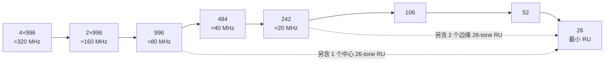

# 第 2 章　OFDM 与 OFDMA：从 numerology 到资源单元 ★

## 学习目标

1. 掌握 802.11 正交频分复用（Orthogonal Frequency Division Multiplexing, OFDM）的参数集（numerology：子载波间隔、符号时长、保护间隔，Guard Interval, GI）及其设计约束。
2. 能手工计算任意带宽下的数据子载波数、导频数与资源单元（Resource Unit, RU）划分。
3. 理解多资源单元（Multi-Resource Unit, MRU）、前导穿刺的频域表示与信令开销。
4. 理解峰均功率比（Peak-to-Average Power Ratio, PAPR）、频谱掩模与误差向量幅度（Error Vector Magnitude, EVM）对系统设计的影响，并掌握子载波（tone）索引生成算法。

---

## 2.1 OFDM 基本原理

### 2.1.1 从频选信道到并行平坦子信道

频率选择性信道下，单载波系统需要复杂的时域均衡。OFDM 的核心思想是：把带宽 $B$ 分成 $N$ 个窄带子载波，每个子载波带宽 $B/N \ll B_c$，从而每个子信道是**平坦衰落**，均衡退化为每子载波一个复数除法。

数学上，发射端做 逆离散傅里叶变换（Inverse Discrete Fourier Transform, IDFT）：

$$
x[n] = \frac{1}{N}\sum_{k=0}^{N-1} X[k] e^{j2\pi kn/N}, \quad n = 0,\dots,N-1
$$

添加长度为 $N_{GI}$ 的循环前缀（Cyclic Prefix, CP）后，若 $N_{GI} \ge L_{ch}$（信道抽头数），则线性卷积变为**循环卷积**，频域有

$$
Y[k] = H[k] X[k] + N[k]
$$

均衡器 $\hat{X}[k] = Y[k]/H[k]$，即**单抽头均衡器**。这是 OFDM 在宽带系统中不可替代的根本原因。

### 2.1.2 802.11 的 numerology

| 参数 | 值 | 说明 |
|---|---|---|
| 快速傅里叶变换（Fast Fourier Transform, FFT）点数（20 MHz） | 64 | 子载波间隔 $\Delta f = 20\text{ MHz}/64 = 312.5$ kHz |
| 子载波间隔（11ax/be 数据） | 78.125 kHz | 20 MHz 对应 256 点 FFT，4× 加密 |
| 有效符号时长 | 3.2 μs | $T_{DFT} = 1/\Delta f = 12.8$ μs（11ac 及以后） |
| 保护间隔（Guard Interval, GI）选项 | 0.8 / 1.6 / 3.2 μs | 对应 $T_{sym} = 13.6 / 14.4 / 16.0$ μs |

**注意历史差异**：11a/g/n 用 64 点 FFT（$\Delta f = 312.5$ kHz，$T_{DFT} = 3.2$ μs）；11ac 引入 256 点（80/160 MHz）；**11ax（Wi-Fi 6）起统一改为 4× 加密的 numerology**：子载波间隔降为 78.125 kHz，$T_{DFT}$ 变为 12.8 μs，GI 相应变为 0.8/1.6/3.2 μs。11be 与 11bn 沿用此 numerology。

**子载波间隔为什么选 78.125 kHz？** 权衡三条：
1. 必须 $\ll B_c$（室内 $B_c \approx 1\sim4$ MHz）→ 远满足；
2. 必须 $\gg$ 多普勒扩展（最大 666 Hz 高铁）→ 满足，抗 ICI；
3. 符号时长 $12.8$ μs 必须 $\gg \tau_{rms}$（最大 150 ns）→ CP 开销合理。

### 2.1.3 CP 开销与效率

$$
\eta_{CP} = \frac{T_{DFT}}{T_{DFT} + T_{GI}}
$$

| GI | $T_{sym}$ (μs) | $\eta_{CP}$ |
|---|---|---|
| 0.8 μs | 13.6 | 94.1% |
| 1.6 μs | 14.4 | 88.9% |
| 3.2 μs | 16.0 | 80.0% |

室外/大空间用 3.2 μs（抗长时延扩展），室内小房间用 0.8 μs 提升效率。

---

## 2.2 各带宽的 tone plan

### 2.2.1 通用结构

一个 $B$ MHz 的信道包含：
- **数据子载波** $N_{sd}$：承载调制符号
- **导频子载波** $N_{sp}$：相位跟踪
- **DC 子载波**：中心，通常置零（避免 DC 泄漏）
- **保护子载波**（左/右边缘）：满足频谱掩模

### 2.2.2 完整对照表（11ax/11be/11bn）

| 带宽 | FFT 点数 | 总子载波 | $N_{sd}$ | $N_{sp}$ | DC+保护 |
|---|---|---|---|---|---|
| 20 MHz | 256 | 256 | 234 | 8 | 14 |
| 40 MHz | 512 | 512 | 468 | 16 | 28 |
| 80 MHz | 1024 | 1024 | 980 | 16 | 28 |
| 160 MHz | 2048 | 2048 | 1960 | 32 | 56 |
| 320 MHz | 4096 | 4096 | 3920 | 64 | 112 |

**记忆规律**：40 MHz 及以上，$N_{sd} \approx \text{带宽(MHz)} \times 12.25$。320 MHz 的 3920 个子载波直接决定了 4096-QAM 下的极限速率（第 4 章）。

### 2.2.3 ASCII 频域示意（80 MHz）

```
|<------------------------ 80 MHz (1024 tones) ------------------------>|
 保护(6)                                                        保护(5)
[//////| 数据区 980 tones + 16 导频均匀分布 | DC | 数据区继续 |\\\\\]
       ↑                                        ↑
   -500 tone index                              0 (DC, 置零)   +500

20 MHz 子块划分（每个 242-tone RU）:
[  RU1   ][  RU2   ][  RU3   ][  RU4   ]
 -500     -248      0         +248      +500
```

---

## 2.3 资源单元 RU

### 2.3.1 RU 类型与层级

| RU | tone 数 | 数据子载波 | 导频 | 20 MHz 内数量 | 带宽近似 |
|---|---|---|---|---|---|
| 26-tone | 26 | 24 | 2 | 9 | 2.03 MHz |
| 52-tone | 52 | 48 | 4 | 4 | 4.06 MHz |
| 106-tone | 106 | 102 | 4 | 2 | 8.28 MHz |
| 242-tone | 242 | 234 | 8 | 1 | 18.9 MHz |
| 484-tone | 484 | 468 | 8 | — | 37.7 MHz |
| 996-tone | 996 | 980 | 16 | — | 77.8 MHz |
| 2×996 | 1992 | 1960 | 32 | — | 155.6 MHz |
| 4×996 | 3984 | 3920 | 64 | — | 311.1 MHz |

**层级结构**：大 RU 由小 RU 嵌套构成（242 = 2×106 + 26 + 保护；996 = 2×484 + 中心 26 等），这种设计使不同大小 RU 可以在同一正交频分多址（Orthogonal Frequency Division Multiple Access, OFDMA）符号中**无冲突共存**。



*图 2-1　RU 的嵌套层级。每一级由两个下一级 RU 加保护子载波（部分层级再加中心 26-tone）构成，因此不同大小的 RU 可在同一 OFDMA 符号内无冲突共存。*

### 2.3.2 RU 分配约束（OFDMA）

11ax/be 的 RU 分配遵循：
- 一个 20 MHz 子块内，只能用**同一"大小层级"**的 RU 组合（如 9×26，或 4×52+26，或 2×106，或 1×242）；
- 不同 20 MHz 子块可以独立选择层级；
- 用户在带宽内的 RU 位置由 信号字段（Signal field, SIG）字段中的 **RU Allocation** 索引指示（8 bit，指向预定义表）。

### 2.3.3 MRU（Multiple RU，11be）

11be 允许**单个用户**分配多个不连续 RU，主要用于穿刺场景：

| MRU 类型 | 组成 | 典型用途 |
|---|---|---|
| 52+26 | 小聚合 | 窄带用户 |
| 106+26 | | |
| 484+242 | 80 MHz 内 20 MHz 被打孔 | 规避窄带干扰 |
| 996+484 | 160 MHz 内 80 MHz 被打孔 | |
| 2×996+484, 3×996, 3×996+484 | 320 MHz | |

**Small MRU**（≤242 tone）限制为 52+26、106+26 两种，用于上行小包；**Large MRU** 用于下行大带宽。

---

## 2.4 前导穿刺（Preamble Puncturing）

### 2.4.1 问题

160/320 MHz 信道中只要有一个 20 MHz 子块被占用（雷达、其他 基本服务集（Basic Service Set, BSS）、非 Wi-Fi 干扰），传统做法是整个信道不可用，只能降到下一个可用带宽。穿刺允许**跳过被打孔的子块**，在剩余子块上传输。

### 2.4.2 信令

- **统一信号字段（Unified Signal, U-SIG）**（11be）：携带带宽、 puncture channel information
- **EHT-SIG**：携带每用户的 RU/MRU 分配

穿刺模式用位图表示：320 MHz 有 16 个 20 MHz 子块，用 16 bit 位图（实际压缩为有限合法模式集）。

### 2.4.3 速率计算示例

80 MHz 中一个 20 MHz 被占用 → 可用 3 个子块 → 可用 MRU = 484+242（即 60 MHz 有效）：

$$
N_{sd}^{MRU} = 468 + 234 = 702
$$

相比完整 80 MHz 的 980，损失 $1 - 702/980 = 28.4\%$；相比降级到 40 MHz（468），**增益 50%**。这就是穿刺的价值。

---

## 2.5 PAPR、频谱掩模与 EVM

### 2.5.1 PAPR

OFDM 信号是 $N$ 个独立子载波的叠加，由中心极限定理近似复高斯，包络瑞利分布。**峰均功率比**

$$
\text{PAPR} = \frac{\max |x[n]|^2}{\mathbb{E}[|x[n]|^2]}
$$

对 $N$ 个子载波，**超过门限 $\gamma_0$ 的概率**：

$$
P(\text{PAPR} > \gamma_0) \approx 1 - (1 - e^{-\gamma_0})^N
$$

**算例 2.1**：$N = 256$，求 PAPR 超过 12 dB（$\gamma_0 = 15.85$）的概率。

$$
P \approx 1 - (1 - e^{-15.85})^{256} \approx 1 - (1 - 1.3\times10^{-7})^{256} \approx 3.3\times10^{-5}
$$

即约每 3 万个符号出现一次。看似很小，但 11ax 每秒约 7.4 万个符号，**每 0.4 秒就出现一次**，因此必须留 **功率回退（backoff）**，典型 6–9 dB。这直接降低了 PA 效率与覆盖范围。

高阶调制（4096-QAM）对 PAPR 更敏感，因为 EVM 要求更严（见 2.5.3）。

### 2.5.2 频谱掩模

802.11 规定了各带宽的发射频谱掩模（spectral mask），典型要求：

| 频偏 | 相对衰减（典型） |
|---|---|
| 距中心 ±(B/2) | 0 dBr（带宽边缘） |
| +11 MHz（20 MHz 信道） | −20 dBr |
| +20 MHz | −28 dBr |
| +30 MHz | −40 dBr |
| +60 MHz | −56 dBr（或绝对 −62 dBm/MHz） |

这决定了**必须保留保护子载波**，否则带外泄露不合规。

### 2.5.3 EVM 要求

误差矢量幅度定义为

$$
\text{EVM}_{\rm RMS} = \sqrt{\frac{1}{N_s}\sum_{n} \frac{|r_n - s_n|^2}{P_0}}
$$

其中 $s_n$ 是理想星座点，$r_n$ 是实测点，$P_0$ 是平均星座功率。

| 调制 | 11be 要求 EVM（dB） |
|---|---|
| BPSK / 四相移键控（Quadrature Phase Shift Keying, QPSK） | −5 |
| 16-QAM | −10 |
| 64-QAM | −16 |
| 256-QAM | −22 |
| 1024-QAM | −28 |
| 4096-QAM | −34 |

**注意**：4096-QAM 要求 −34 dB EVM，即误差幅度仅为信号幅度的 2%。这对 PA 线性度、相位噪声、IQ 失衡提出极高要求，也是 4096-QAM **只在近距离可用**的根本原因（第 4 章）。

---

## 2.6 算法：tone 索引生成与 RU 分配

### 2.6.1 问题建模

给定：带宽 $B$、RU 类型 $T$、RU 在子块内的序号 $i$。
求：该 RU 占用的物理子载波索引集合 $\mathcal{K}$。

关键：逻辑子载波索引 $k \in [-N/2, N/2)$ 需映射为物理 tone 索引，且要跳过 DC 与保护子载波。

### 2.6.2 伪代码 2.1

```python
# 20 MHz 子块内 26-tone RU 的逻辑起始偏移(以 26-tone 为单位)
RU26_OFFSET_20M = [-121, -95, -69, -43, -17, 17, 43, 69, 95]   # 9 个 RU 的中心
RU52_OFFSET_20M = [-107, -53, 53, 107]                          # 4 个
RU106_OFFSET_20M = [-53, 53]                                    # 2 个

def ru_tone_indices(bw_mhz, ru_type, subband_idx, ru_idx):
    """
    输入:
        bw_mhz    : 20/40/80/160/320
        ru_type   : 26/52/106/242/484/996/1992/3984
        subband_idx: 所在 20 MHz 子块编号 (0 开始)
        ru_idx    : RU 在该子块内的序号
    输出:
        data_idx, pilot_idx: 数据/导频子载波的绝对索引(list)
    """
    # 1. 计算子块中心频率的物理偏移
    n_sub = bw_mhz // 20
    # 每子块 242 tones (含 2 保护 + 240 可用), 子块中心间隔 256
    center_step = 256
    sub_center = (subband_idx - (n_sub - 1) / 2.0) * center_step

    # 2. 取对应 RU 类型的偏移表并加上子块中心
    if ru_type == 26:
        offs, n_data, n_pilot = RU26_OFFSET_20M, 24, 2
    elif ru_type == 52:
        offs, n_data, n_pilot = RU52_OFFSET_20M, 48, 4
    elif ru_type == 106:
        offs, n_data, n_pilot = RU106_OFFSET_20M, 102, 4
    else:                                   # 242 及以上: 整子块/整带宽
        offs, n_data, n_pilot = [0], RU_INFO[ru_type]['nd'], RU_INFO[ru_type]['np']
        # 大 RU 跨多个子块, sub_center 取这些子块的中点
    base = int(sub_center + offs[ru_idx])

    # 3. 展开为索引并剔除 DC 与保护子载波
    half = n_data // 2
    lo = base - half
    hi = base + half
    idx = list(range(lo, hi + 1))
    idx = [k for k in idx if k != 0]        # 去 DC
    # 保护子载波检查(带宽边缘 ±(N/2 - guard))
    N = bw_mhz * 64                          # 320MHz -> 4096? 实为 4096 点 FFT
    N = {20:256, 40:512, 80:1024, 160:2048, 320:4096}[bw_mhz]
    idx = [k for k in idx if abs(k) < N // 2 - 5]

    # 4. 导频位置: 在 RU 内按固定规则插入
    pilot_idx = [base + p for p in PILOT_PATTERN[ru_type]]
    data_idx = [k for k in idx if k not in pilot_idx]
    return data_idx, pilot_idx
```

**复杂度**：$O(N_{sd})$，单次数十微秒级，可在每个 OFDMA 符号前在线执行。

### 2.6.3 RU 分配的可行集枚举

**问题**：给定 $U$ 个用户与带宽，枚举所有合法 RU 组合并选最优。

```python
def enumerate_ru_allocations(bw_mhz, n_users):
    """枚举合法的 RU 分配方案(每个 20MHz 子块独立选层级)"""
    patterns_per_20m = {
        '9x26':  [26]*9, '4x52+26': [52]*4 + [26],
        '2x106': [106]*2, '1x242': [242]
    }
    n_sub = bw_mhz // 20
    # 每个子块 4 种选择 -> 4^n_sub 种组合(320MHz: 4^16 ≈ 4.3e9, 需剪枝)
    if n_sub > 4:
        raise ValueError("需改用贪心/DP 剪枝, 见第 9 章")
    results = []
    for combo in product(patterns_per_20m.values(), repeat=n_sub):
        rus = [r for sub in combo for r in sub]
        if len(rus) >= n_users:             # 容量约束
            results.append(rus)
    return results
```

**复杂度**：$4^{n_{sub}}$，320 MHz 时不可枚举，必须改用贪心或动态规划（第 9 章详述）。

---

## 2.7 算例汇总

**算例 2.2（速率上界）**：320 MHz，4096-QAM 5/6，8 空间流，GI = 0.8 μs。求 物理层（Physical Layer, PHY）速率。

$$
R = \frac{N_{sd} \cdot N_{bpscs} \cdot R_c \cdot N_{ss}}{T_{sym}} = \frac{3920 \times 12 \times 5/6 \times 8}{13.6\times10^{-6}}
$$

$$
= \frac{3920 \times 10 \times 8}{13.6\times10^{-6}} = \frac{313600}{13.6\times10^{-6}} = 23.06 \text{ Gbps}
$$

**这就是 Wi-Fi 7 / Wi-Fi 8 标称的 ~23 Gbps 来源**（注意：这是单向单链路的理论峰值；营销中常见的 46 Gbps 是把双向或多链路相加的结果）。

**算例 2.3（OFDMA 效率）**：20 MHz，4 个用户各分 52-tone RU，调制编码方案（Modulation and Coding Scheme, MCS） 9（256-QAM 3/4），GI = 1.6 μs。求聚合速率，并与单用户占满 242-tone 对比。

单用户 52-tone：$N_{sd} = 48$，$N_{bpscs} = 8$，$R_c = 3/4$，$T_{sym} = 14.4$ μs：

$$
R_1 = \frac{48 \times 8 \times 0.75}{14.4\times10^{-6}} = 20 \text{ Mbps}
$$

4 用户聚合 $= 80$ Mbps。

单用户 242-tone（$N_{sd}=234$）：$R = \frac{234 \times 8 \times 0.75}{14.4\mu s} = 97.5$ Mbps。

**对比**：OFDMA 聚合 80 Mbps < 单用户 97.5 Mbps，因为 4×52 = 208 < 234（RU 间的保护子载波开销）。**结论**：OFDMA 的价值不在提高峰值吞吐，而在**降低时延、提高小包并发效率、避免单用户独占**（第 9 章进一步量化）。

**算例 2.4（CP 充分性）**：大空间场馆 $\tau_{rms} = 150$ ns，最大时延扩展通常取 $4\sim5\tau_{rms} = 600\sim750$ ns。GI = 0.8 μs = 800 ns > 750 ns → **勉强够用**；考虑滤波器滚降余量，工程上应选 GI = 1.6 μs。若 GI 不足，残留 ISI + ICI 会使 EVM 恶化，4096-QAM 直接不可用。

---

## 本章小结

| 概念 | 关键结论 |
|---|---|
| numerology | $\Delta f = 78.125$ kHz，$T_{DFT} = 12.8$ μs，GI = 0.8/1.6/3.2 μs |
| 数据子载波 | 20→234，80→980，320→3920 |
| RU | 26/52/106/242/484/996/2×996/4×996，嵌套层级结构 |
| MRU | 单用户多 RU，主要服务穿刺场景 |
| 穿刺 | 80 MHz 打一个孔 → 484+242，比降带宽增益 50% |
| PAPR | $1-(1-e^{-\gamma_0})^N$，需 6–9 dB 回退 |
| EVM | 4096-QAM 要求 −34 dB，是近距离专用调制的根源 |
| 峰值速率 | 320 MHz / 8 SS / MCS13 → 23.06 Gbps |

---

## 习题

**概念题**

1. 为什么 11ax 把子载波间隔从 312.5 kHz 改为 78.125 kHz？给出至少三点理由（提示：从符号时长、CP 开销、OFDMA 粒度、相位噪声角度分析）。
2. RU 为什么要设计成嵌套层级结构？如果任意位置的任意大小 RU 都能分配，会带来什么问题？
3. 4096-QAM 的 EVM 要求（−34 dB）为什么使其几乎只能在近距离使用？中间经过了哪些物理量的传递？

**计算推导题**

4. 证明：对 $N$ 个独立子载波的 OFDM 符号，PAPR 超过 $\gamma_0$ 的概率近似为 $1 - (1-e^{-\gamma_0})^N$。（提示：各采样点包络平方近似独立指数分布）
5. 160 MHz 信道中，第 2、第 5 个 20 MHz 子块被雷达占用。写出可用的 MRU 组合，并计算相比完整 160 MHz 的数据子载波数与速率损失。
6. 20 MHz，GI = 0.8 μs，MCS 11（1024-QAM 5/6）。计算单空间流速率。若改为 GI = 3.2 μs，速率下降多少百分比？
7. 某 80 MHz 系统，3 个用户：A 需 106-tone、B 需 242-tone、C 需 52-tone。验证它们能否在同一 OFDMA 符号中共存（考虑 20 MHz 子块的层级一致性约束），并给出合法分配方案。

**算法设计题**

8. 设计算法：给定带宽 $B$、$U$ 个用户的 $\{\text{MCS}, \text{队列长度}\}$，在**不使用完整枚举**的前提下（$4^{16}$ 不可行）求近似最优 RU 分配。给出伪代码、复杂度与近似比分析思路。
9. 设计穿刺决策算法：接入点（Access Point, AP）周期测量 16 个 20 MHz 子块的干扰功率，决定是否穿刺。需要考虑测量噪声与穿刺带来的信令开销。给出伪代码。

**开放研究题**

10. 如果把子载波间隔提高到 312.5 kHz（4 倍），符号时长降为 3.2 μs，对低时延业务（目标 1 ms 端到端）有什么好处与代价？请从 CP 开销、调度粒度、相位噪声、PAPR 四个维度分析，并判断 Wi-Fi 9 是否应该引入可扩展 numerology。

---

## 答案与解析

**1.** 三点理由：(a) **OFDMA 粒度**：78.125 kHz 使 26-tone RU 仅占 2.03 MHz，可以在 20 MHz 内放 9 个用户；若用 312.5 kHz，同样的 tone 数带宽翻 4 倍，粒度太粗。(b) **CP 开销**：符号时长从 3.2 μs 增至 12.8 μs，相同 GI 绝对值下开销占比降至 1/4（GI 0.8 μs 时开销仅 5.9%，而旧 numerology 的 0.8 μs GI 占 20%）。(c) **抗多径**：12.8 μs 的符号时长相对 $\tau_{rms}$（≤150 ns）更充裕，CP 相对开销更小。代价是**相位噪声敏感度上升**（子载波间隔越小，相位噪声引起的 ICI 越严重），这也限制了高阶调制的使用距离。

**2.** 嵌套层级（242 = 2×106 + 26 + 保护）保证：(a) 不同大小 RU 在同一 OFDMA 符号中**边界对齐、无重叠、无空洞**，接收端可用统一规则解析；(b) 信令压缩——只需 8 bit 指示预定义模式，无需逐用户 bitmap；(c) 调度器只需在**预定义模式集**内搜索，复杂度可控。若允许任意位置任意大小，则：信令开销爆炸（需 3920 bit 位图）、调度问题变成 NP-hard 的二维装箱、接收端需盲检。

**3.** 传递链条：距离 ↑ → 路径损耗 ↑ → 信噪比（Signal-to-Noise Ratio, SNR） ↓；同时 EVM 由多个非理想因素叠加：

$$
\text{EVM}^2 \approx \text{EVM}_{SNR}^2 + \text{EVM}_{PA}^2 + \text{EVM}_{PN}^2 + \text{EVM}_{IQ}^2 + \text{EVM}_{quant}^2
$$

其中 $\text{EVM}_{SNR} \approx 1/\sqrt{\text{SNR}}$（线性值）。4096-QAM 要求总 EVM ≤ −34 dB = 0.02（线性），若 PA 与相位噪声已占 0.015，则留给噪声的只有 $\sqrt{0.02^2 - 0.015^2} = 0.0132$ → SNR ≥ $1/0.0132^2 = 5739$ = **37.6 dB**。加上路径损耗（室内 $n=3$），37.6 dB SNR 通常只在 1–3 米内可达。

**4. 证明**：OFDM 时域样点 $x[n] = \frac{1}{N}\sum_k X_k e^{j2\pi kn/N}$。当 $N$ 较大时由中心极限定理，$x[n]$ 近似零均值复高斯，故 $|x[n]|^2$ 近似**指数分布**，归一化后（$\mathbb{E}|x|^2 = 1$）：

$$
P(|x[n]|^2 \le z) = 1 - e^{-z}
$$

近似认为 $N$ 个样点的包络相互独立（实际因过采样与相关性不严格独立，但近似良好），则

$$
P(\text{PAPR} \le \gamma_0) = P(\forall n: |x[n]|^2 \le \gamma_0) \approx (1 - e^{-\gamma_0})^N
$$

故 $P(\text{PAPR} > \gamma_0) \approx 1 - (1-e^{-\gamma_0})^N$。$\square$

**5.** 160 MHz 有 8 个 20 MHz 子块，占用第 2、5 个（0-indexed 则为 1、4）。剩余子块 0, 2, 3, 5, 6, 7。合法 MRU 必须由**连续可用子块**构成：
- 子块 0：单独 → 242-tone
- 子块 2–3：连续 → 484-tone
- 子块 5–7：连续 → 484 + 242 = 726 tone

可用数据子载波 $N_{sd} \approx 234 + 468 + 468 + 234 = 1404$（按各 MRU 的 $N_{sd}$ 累加：242→234，484→468）。

完整 160 MHz $N_{sd} = 1960$，损失 $1 - 1404/1960 = 28.4\%$。
若不穿刺只能降到 80 MHz（980），则损失 50%。**穿刺增益** $= 1404/980 - 1 = 43\%$。

**6.** MCS 11（11be）：1024-QAM，$N_{bpscs} = 10$，$R_c = 5/6$。20 MHz，$N_{sd} = 234$，$N_{ss} = 1$。

- GI = 0.8 μs：$T_{sym} = 13.6$ μs，$R = \frac{234 \times 10 \times 5/6}{13.6\mu s} = \frac{1950}{13.6\times10^{-6}} = 143.4$ Mbps
- GI = 3.2 μs：$T_{sym} = 16.0$ μs，$R = \frac{1950}{16.0\times10^{-6}} = 121.9$ Mbps

下降 $(143.4-121.9)/143.4 = 15.0\%$。（这正是 $\eta_{CP}$ 之比 $13.6/16.0 = 0.85$ 的体现。）

**7.** 80 MHz 有 4 个 20 MHz 子块，每子块独立选层级。
- 子块 0：`2x106` → 给 A（106-tone）
- 子块 1：`1x242` → 给 B（242-tone）
- 子块 2：`4x52+26` → 给 C（52-tone）
- 子块 3：任意（可给 A 或空闲）

**合法**。关键约束是：**单个用户不能跨子块组合不同层级的 RU**（除非用 MRU 规则）。若要求 A 的 106-tone 必须是 11ax 定义的固定位置（子块内 2 个固定 106-tone RU 之一），则上述分配满足。

**8. 参考方案（贪心 + 层级优先）**

```python
def greedy_ru_alloc(bw_mhz, users, mcs_table):
    """users: [(mcs, queue_bytes)], 返回分配结果"""
    n_sub = bw_mhz // 20
    subs  = [{'pattern': None, 'free': 9*26} for _ in range(n_sub)]  # 以 26-tone 为单位
    alloc = [None] * len(users)
    # 按"每 tone 效率 × 需求"排序: 优先服务效率低、队列长的用户
    order = sorted(range(len(users)),
                   key=lambda u: -users[u][1] / mcs_table[users[u][0]]['rate_per_tone'])
    for u in order:
        need = users[u][1]
        best = None
        for ru_type in [242, 106, 52, 26]:         # 从大到小试
            for s in range(n_sub):
                if fits(subs[s], ru_type):
                    gain = throughput_gain(ru_type, users[u])
                    cost = ru_type                  # 占用的 tone 数
                    if best is None or gain/cost > best[0]:
                        best = (gain/cost, s, ru_type)
        if best: 
            _, s, rt = best
            place(subs[s], rt); alloc[u] = (s, rt)
    return alloc
```

**复杂度**：$O(U \cdot 4 \cdot n_{sub})$，320 MHz 时 $O(64U)$，可在线执行。
**近似比分析思路**：把问题建模为**多选择背包（MCKP）**，贪心按"价值密度"排序对 MCKP 有 $(1-1/e)$ 近似保证（若价值函数可分离且满足次模性）；OFDMA 的吞吐-资源关系因 MCS 离散而**不满足次模性**，故实际近似比需通过仿真对比最优解（小规模用 ILP 求精确解）获得，典型 0.85–0.95。

**9. 参考方案**

```python
def puncturing_decision(interf_pw, sigma_meas, alpha=2.0, T_punct_cost=0.15):
    """interf_pw: 16 个 20MHz 子块的干扰功率(dBm)
       返回 puncture bitmap"""
    bitmap = [0]*16
    # 1. 迟滞: 需要干扰超过门限 + alpha*测量噪声, 避免乒乓
    thr = BASE_THR + alpha * sigma_meas
    for i, p in enumerate(interf_pw):
        if p > thr: bitmap[i] = 1
    # 2. 开销核算: 穿刺会损失该子块容量, 但换来其余子块可用
    n_punct = sum(bitmap)
    gain = (16 - n_punct)/16 * (1 - T_punct_cost)      # 可用比例 × 信令折扣
    fallback_gain = largest_contiguous_free(bitmap)/16  # 降到次大连续带宽
    if gain < fallback_gain:
        return None                                     # 不如降带宽
    return bitmap
```

**要点**：① 必须有迟滞（hysteresis）防乒乓；② 必须比较"穿刺"与"降带宽"两条路；③ 穿刺后 SIG 字段需扩展，开销约 5–15%。

**10. 参考思路**：
- **CP 开销**：符号 3.2 μs，GI 0.4/0.8/1.6 μs，开销占比不变（仍 ~12–33%），无改善。
- **调度粒度**：**显著改善**。一个 OFDMA 符号从 13.6 μs 降到 4 μs，最小调度单元更小，对 1 ms 时延预算中的"等待下一个传输机会"项（典型 0.5–2 ms）改善巨大。
- **相位噪声**：**恶化**。ICI 功率 $\propto (f_c \cdot \sigma_\phi)^2/\Delta f^2$，$\Delta f$ 增大 4 倍 → ICI 降低 12 dB，**实际是有利的**（子载波间隔越大越抗相位噪声）。这是与 1 中方向相反的结论，需要澄清：相位噪声对**小**子载波间隔更敏感。
- **PAPR**：不变（PAPR 由子载波数决定，与间隔无关）。

**综合判断**：扩大子载波间隔对低时延有利、对相位噪声有利，代价是 CP 相对开销不变但绝对值变小（$\tau_{rms}$ 固定下 CP 0.4 μs 仍 > 750 ns，勉强够），以及**与 legacy 不兼容**（这是最大障碍）。Wi-Fi 9 若采用 Greenfield 模式（第 31 章），引入可扩展 numerology 是可行的研究方向。

---

## 延伸阅读

- [IEEE] IEEE 802.11-2024, Clause 17 (OFDM PHY), Clause 27 (High Efficiency, HE PHY), Clause 36 (Extremely High Throughput, EHT PHY)
- [IEEE] IEEE 802.11be SFD, `11-19/1262r17`（RU/MRU 定义）
- [ACM/IEEE] Khorov et al., *A Tutorial on IEEE 802.11ax High Efficiency WLANs*, IEEE COMST, 2019
- [TUT] Wang et al., *Primer on OFDMA in IEEE 802.11ax*, IEEE Comm. Magazine, 2020
