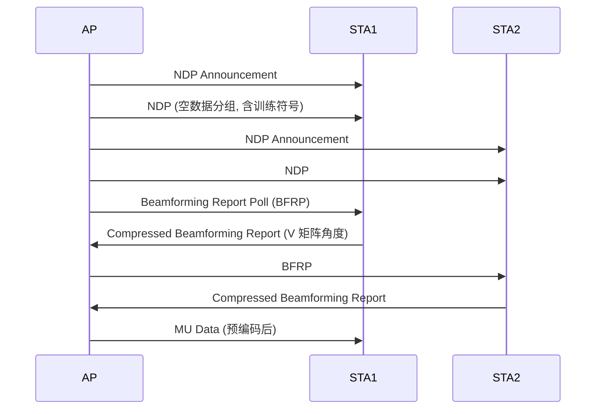

# 第 3 章　MIMO、预编码与波束赋形 ★★

## 学习目标

1. 能从信道矩阵 $\mathbf{H}$ 出发推导 多入多出（Multiple-Input Multiple-Output, MIMO）容量，理解秩、条件数、奇异值分布的物理含义。
2. 掌握 迫零（Zero-Forcing, ZF） / 最小均方误差（Minimum Mean Square Error, MMSE） / 正则化迫零（Regularized Zero-Forcing, RZF）预编码的推导、适用场景与数值稳定性差异。
3. 掌握 多用户 MIMO（Multi-User MIMO, MU-MIMO）的用户选择（SUS）与和速率最大化建模。
4. 理解显式反馈码本、sounding 流程与开销，以及混合波束赋形的基本结构。

---

## 3.1 MIMO 容量

### 3.1.1 系统模型

$$
\mathbf{y} = \mathbf{H}\mathbf{W}\mathbf{s} + \mathbf{n}
$$

- $\mathbf{H} \in \mathbb{C}^{N_{rx}\times N_{tx}}$
- $\mathbf{W} \in \mathbb{C}^{N_{tx}\times N_s}$：预编码矩阵，$N_s$ 为流数
- $\mathbf{s}$：$N_s$ 维符号向量，$\mathbb{E}[\mathbf{s}\mathbf{s}^{\mathsf H}] = \mathbf{I}$
- $\mathbf{n} \sim \mathcal{CN}(0, \sigma_n^2 \mathbf{I})$

功率约束：$\text{tr}(\mathbf{W}\mathbf{W}^{\mathsf H}) \le P$

### 3.1.2 容量推导

对 $\mathbf{H}$ 做 奇异值分解（Singular Value Decomposition, SVD）：$\mathbf{H} = \mathbf{U}\mathbf{\Sigma}\mathbf{V}^{\mathsf H}$，$\mathbf{\Sigma} = \text{diag}(\sigma_1, \dots, \sigma_r, 0,\dots)$，$r = \text{rank}(\mathbf{H})$。

**定理**：最优策略是在 $\mathbf{V}$ 的方向上发送（即 $\mathbf{W} = \mathbf{V}\mathbf{P}^{1/2}$），把 MIMO 信道分解为 $r$ 个并行的 单入单出（Single-Input Single-Output, SISO）子信道，第 $i$ 个子信道增益为 $\sigma_i$。

在接收端左乘 $\mathbf{U}^{\mathsf H}$：

$$
\tilde{\mathbf{y}} = \mathbf{U}^{\mathsf H}\mathbf{y} = \mathbf{\Sigma}\mathbf{P}^{1/2}\mathbf{s} + \tilde{\mathbf{n}}
$$

其中 $\tilde{\mathbf{n}} = \mathbf{U}^{\mathsf H}\mathbf{n}$ 仍为 $\mathcal{CN}(0, \sigma_n^2\mathbf{I})$（酉变换保持高斯性）。

于是第 $i$ 个子信道的 信噪比（Signal-to-Noise Ratio, SNR）为 $\gamma_i = \sigma_i^2 P_i / \sigma_n^2$，总容量

$$
C = \max_{P_i: \sum P_i \le P} \sum_{i=1}^{r} \log_2\left(1 + \frac{\sigma_i^2 P_i}{\sigma_n^2}\right)
$$

### 3.1.3 注水功率分配（推导）

用拉格朗日乘子法：

$$
\mathcal{L} = \sum_i \log_2\left(1 + \frac{\sigma_i^2 P_i}{\sigma_n^2}\right) - \lambda\left(\sum_i P_i - P\right)
$$

对 $P_i$ 求偏导并令为 0：

$$
\frac{1}{\ln 2} \cdot \frac{\sigma_i^2/\sigma_n^2}{1 + \sigma_i^2 P_i/\sigma_n^2} = \lambda
\Rightarrow 1 + \frac{\sigma_i^2 P_i}{\sigma_n^2} = \frac{\sigma_i^2}{\lambda \sigma_n^2 \ln 2}
$$

记 $\mu = \lambda\sigma_n^2\ln 2$，得

$$
\boxed{P_i = \left(\frac{1}{\mu} - \frac{\sigma_n^2}{\sigma_i^2}\right)^+}
$$

这就是**注水（water-filling）**解：$1/\mu$ 是"水位"，$\sigma_n^2/\sigma_i^2$ 是"碗底高度"，弱子信道分配不到功率（$(x)^+ = \max(x, 0)$）。

**算例 3.1**：$2\times2$，$\sigma_1^2 = 4$，$\sigma_2^2 = 1$，$\sigma_n^2 = 1$（线性），总功率 $P = 10$。

设两个子信道都分配功率（先假设），水位 $w = 1/\mu$：

$$
P_1 = w - 1/4, \quad P_2 = w - 1
$$

$$
P_1 + P_2 = 2w - 1.25 = 10 \Rightarrow w = 5.625
$$

$P_1 = 5.375 > 0$，$P_2 = 4.625 > 0$，假设成立。

$$
C = \log_2(1 + 4 \times 5.375) + \log_2(1 + 1\times 4.625) = \log_2(22.5) + \log_2(5.625) = 4.49 + 2.49 = 6.98 \text{ bps/Hz}
$$

对比平均分配（$P_1 = P_2 = 5$）：

$$
C = \log_2(21) + \log_2(6) = 4.39 + 2.58 = 6.97 \text{ bps/Hz}
$$

**结论**：中等 SNR 下注水增益很小（本例 0.01 bps/Hz），因此 Wi-Fi 实际**不做注水功率分配**，只在极端不平衡（一个流接近失效）时通过**流数选择**间接实现。

### 3.1.4 高 SNR 近似

当 $\gamma \to \infty$，功率平均分配：

$$
C \approx \sum_{i=1}^{r} \log_2\left(\frac{\gamma}{N_{tx}}\sigma_i^2\right) = r\log_2\frac{\gamma}{N_{tx}} + \log_2\prod_{i=1}^{r}\sigma_i^2
$$

**关键结论**：容量随 $r$ **线性**增长（复用增益），而非随 SNR 对数增长。这就是"MIMO = 免费容量"的来源，也是 11n/ac/be 一路堆天线的原因。

---

## 3.2 预编码算法

发送端知道 $\mathbf{H}$（CSIT）时，通过预编码消除用户间/流间干扰。

### 3.2.1 ZF（迫零）预编码

**目标**：使等效信道 $\mathbf{H}\mathbf{W}$ 为对角阵（流间完全无干扰）。

对 单用户 MIMO（Single-User MIMO, SU-MIMO），取 $\mathbf{W} = \mathbf{H}^{\mathsf H}(\mathbf{H}\mathbf{H}^{\mathsf H})^{-1}\sqrt{\beta}$（$N_{tx} \ge N_{rx}$ 时用右伪逆形式 $\mathbf{W} = \mathbf{H}^{+}\sqrt{\beta}$）。

对 MU-MIMO（$N_{tx} \ge \sum_u N_{s,u}$）：$\mathbf{W}_{\rm ZF} = \mathbf{H}^{\mathsf H}(\mathbf{H}\mathbf{H}^{\mathsf H})^{-1}\sqrt{\beta}$。

归一化因子（满足功率约束）：

$$
\beta = \frac{P}{\text{tr}\left((\mathbf{H}\mathbf{H}^{\mathsf H})^{-1}\right)}
$$

**问题**：当 $\mathbf{H}$ 接近奇异（条件数大），$(\mathbf{H}\mathbf{H}^{\mathsf H})^{-1}$ 的元素爆炸 → **噪声放大**。因为 ZF 只消除干扰不考虑噪声。

### 3.2.2 MMSE（正则化）预编码（推导）

**优化问题**（最小化均方误差）：

$$
\min_{\mathbf{W}} \ \mathbb{E}\left[\|\mathbf{s} - \mathbf{y}\|^2\right] \quad \text{s.t.} \ \text{tr}(\mathbf{W}\mathbf{W}^{\mathsf H}) \le P
$$

展开（设接收端有标量增益 $g$，先固定 $g=1$）：

$$
\text{MSE} = \mathbb{E}\|\mathbf{s} - (\mathbf{H}\mathbf{W}\mathbf{s} + \mathbf{n})\|^2
= \text{tr}\left[(\mathbf{I} - \mathbf{H}\mathbf{W})(\mathbf{I} - \mathbf{H}\mathbf{W})^{\mathsf H}\right] + \sigma_n^2 N_r
$$

对 $\mathbf{W}$ 求导（利用 $\frac{\partial}{\partial \mathbf{W}^{\mathsf H}}\text{tr}[(\mathbf{I}-\mathbf{H}\mathbf{W})(\mathbf{I}-\mathbf{H}\mathbf{W})^{\mathsf H}] = -\mathbf{H}^{\mathsf H}(\mathbf{I}-\mathbf{H}\mathbf{W})^{\mathsf H}$），令为 0 并加入功率约束的拉格朗日乘子 $\lambda$：

$$
\mathbf{W}_{\rm MMSE} = \mathbf{H}^{\mathsf H}\left(\mathbf{H}\mathbf{H}^{\mathsf H} + \frac{\sigma_n^2 N_s}{P}\mathbf{I}\right)^{-1}\sqrt{\beta}
$$

**与 ZF 的关系**：MMSE = ZF + 正则项 $\alpha\mathbf{I}$，其中 $\alpha = \sigma_n^2 N_s/P = N_s/\gamma$。

- $\gamma \to \infty$（高 SNR）：$\alpha \to 0$，MMSE → ZF
- $\gamma \to 0$（低 SNR）：$\alpha$ 大，MMSE → 匹配滤波（MF，$\mathbf{W} \propto \mathbf{H}^{\mathsf H}$），转为波束赋形/分集模式

**这个统一视角非常重要**：MMSE 预编码在**高 SNR 自动变成空分复用（ZF），低 SNR 自动变成波束赋形（MF）**，无需人工切换模式。

### 3.2.3 伪代码 3.1：MMSE 预编码计算

```python
def mmse_precoder(H, P, sigma2_n, Ns):
    """
    输入: H (Nr x Nt), P 总功率, sigma2_n 噪声功率, Ns 流数
    输出: W (Nt x Ns), 满足 tr(W W^H) = P
    """
    Hh = H.conj().T                                  # Nt x Nr
    alpha = sigma2_n * Ns / P                        # 正则化系数
    A = H @ Hh + alpha * np.eye(H.shape[0])          # Nr x Nr
    W_raw = Hh @ np.linalg.inv(A)                    # Nt x Nr(取前 Ns 列或用户列)
    # 功率归一化
    beta = np.sqrt(P / np.real(np.trace(W_raw @ W_raw.conj().T)))
    W = beta * W_raw
    return W
```

**复杂度**：矩阵求逆 $O(N_r^3)$，典型 $N_r = 2\sim8$，可每帧计算。

**数值稳定性建议**：用 Cholesky 分解求 $\mathbf{A}^{-1}$ 而非 `np.linalg.inv`；条件数 $>\ 10^6$ 时应加对角加载（diagonal loading）。

---

## 3.3 MU-MIMO 与用户选择

### 3.3.1 系统模型

接入点（Access Point, AP）有 $N_{tx}$ 天线，服务 $U$ 个用户，用户 $u$ 有 $N_{r,u}$ 天线、$N_{s,u}$ 流。总流数约束：

$$
\sum_{u} N_{s,u} \le N_{tx}
$$

用户 $u$ 接收：

$$
\mathbf{y}_u = \mathbf{H}_u \mathbf{W}_u \mathbf{s}_u + \sum_{v \neq u} \mathbf{H}_u \mathbf{W}_v \mathbf{s}_v + \mathbf{n}_u
$$

第二项是**用户间干扰**，必须由预编码消除（ZF/MMSE）或抑制。

用户 $u$ 的 信干噪比（Signal-to-Interference-plus-Noise Ratio, SINR）（ZF 预编码下）：

$$
\gamma_u = \frac{|\mathbf{h}_{u,\text{eff}}^{\mathsf H}\mathbf{w}_u|^2 P_u}{\sigma_n^2 + I_{\rm res}}
$$

### 3.3.2 和速率最大化问题

$$
\max_{\mathcal{S}, \{\mathbf{W}_u\}} \sum_{u \in \mathcal{S}} \log_2\det\left(\mathbf{I} + \mathbf{H}_u\mathbf{W}_u\mathbf{W}_u^{\mathsf H}\mathbf{H}_u^{\mathsf H}\mathbf{R}_{u}^{-1}\right)
$$

其中 $\mathbf{R}_u$ 是干扰加噪声协方差。这是一个**组合 + 连续**混合的非凸问题，最优解需要穷举用户子集（$2^{|\mathcal{U}|}$）× 凸优化，NP-hard。工程上用**半正交用户选择（SUS）**。

### 3.3.3 SUS 算法（推导与伪代码）

**核心思想**（Yoo & Goldsmith）：选择**信道方向近似正交**且**范数大**的用户组。

**算法流程**：

```python
def sus_user_selection(H_all, Ntx, Ns_per_user=1, eps=0.3):
    """
    输入: H_all: dict user_id -> H_u (Nr_u x Ntx)
          Ntx: AP 天线数
    输出: 被选中的用户集合 S
    """
    S = []                                   # 已选用户
    H_eff = None                             # 已选用户信道堆叠
    cand = set(H_all.keys())

    # 第 1 个用户: 选信道范数最大的
    u0 = max(cand, key=lambda u: np.linalg.norm(H_all[u], 'fro'))
    S.append(u0); cand.remove(u0)
    H_stack = H_all[u0]                      # (Nr x Ntx)
    # 正交补空间投影矩阵
    Pi = np.eye(Ntx) - np.linalg.pinv(H_stack) @ H_stack

    while len(S) < Ntx // Ns_per_user and cand:
        best, best_metric = None, -1
        for u in cand:
            Hu = H_all[u]
            # 投影到已选用户的正交补
            Hu_perp = Hu @ Pi
            # 度量: 投影后范数(越大越好, 表示与其他用户正交性好)
            m = np.linalg.norm(Hu_perp, 'fro')
            if m > best_metric:
                best_metric, best = m, u
        # 正交性判据: 若投影后范数相对原范数太小, 说明共线, 停止
        if best_metric < eps * np.linalg.norm(H_all[best], 'fro'):
            break
        S.append(best); cand.remove(best)
        H_stack = np.vstack([H_stack, H_all[best]])
        Pi = np.eye(Ntx) - np.linalg.pinv(H_stack) @ H_stack
    return S
```

**复杂度**：外层 $O(N_{tx})$ 轮，内层 $O(|\mathcal{U}|)$ 次投影计算（每次 $O(N_{tx}^2 N_r)$），总 $O(N_{tx}|\mathcal{U}|N_{tx}^2N_r)$。典型 $|\mathcal{U}| = 20$，$N_{tx} = 8$ → 可接受。

**近似比**：SUS 在高 SNR 下可达到穷举最优的 **95% 以上**和速率，且复杂度从指数降为多项式。

### 3.3.4 Sounding 开销分析

**问题**：AP 需知道所有用户的 $\mathbf{H}_u$。

**11ac/ax/be 的显式反馈流程**：



**反馈开销计算**：对每个子载波 $k$，反馈 $\mathbf{V}_k$ 的 Givens 旋转角 $(\phi, \psi)$，每个角度用 $b_{\phi}$ / $b_{\psi}$ bit 量化（典型 7/5 或 9/7 bit）。

总反馈比特数：

$$
N_{bits} = N_{g} \times \left[\binom{N_{tx}}{2}(b_\phi + b_\psi) + N_{tx} b_\phi\right]
$$

其中 $N_g = N_{sd}/N_g^{group}$ 是反馈的**子载波分组数**（$N_g^{group} \in \{4, 16\}$ 为子载波分组因子）。

**算例 3.2**：80 MHz（$N_{sd} = 980$），$N_{tx} = 4$，$N_{rx} = 1$，$N_g^{group} = 4$ → $N_g = 245$。$b_\phi = 7$，$b_\psi = 5$。

$$
N_{bits} = 245 \times \left[\binom{4}{2}(7+5) + 4\times 7\right] = 245 \times [6 \times 12 + 28] = 245 \times 100 = 24500 \text{ bit}
$$

以 调制编码方案（Modulation and Coding Scheme, MCS） 4（约 20 Mbps）反馈，耗时 $24500/20\times10^6 = 1.2$ ms。**4 个用户共 4.8 ms**。

**结论**：sounding 开销随天线数按 $\binom{N_{tx}}{2}$ **平方增长**，随带宽线性增长。这是 11ac 限制在 8 流、且实际 AP 多用 4 天线的原因之一。也解释了为什么 Wi-Fi 8 的 协调波束赋形（Coordinated Beamforming, Co-BF）（第 27 章）要设计**联合探测**以摊薄开销。

---

## 3.4 波束赋形

### 3.4.1 与预编码的关系

- **波束赋形（Beamforming, BF）**：单流，$\mathbf{w} = \mathbf{h}^{\mathsf H}/\|\mathbf{h}\|$，获得 $N_{tx}$ 倍阵列增益（信噪比提升 $10\log_{10}N_{tx}$ dB）
- **预编码**：多流，兼顾复用与干扰消除

实际系统中二者是同一个矩阵运算的不同流数配置。

### 3.4.2 阵列增益

单流匹配滤波 $\mathbf{w} = \mathbf{h}^{\mathsf H}/\|\mathbf{h}\|$：

$$
y = \mathbf{h}\mathbf{w}s + n = \|\mathbf{h}\| s + n
$$

SNR $= \|\mathbf{h}\|^2 P/\sigma_n^2$。若 $\mathbf{h}$ 各元素 i.i.d. 且 $\mathbb{E}|h_i|^2 = 1$，则 $\mathbb{E}\|\mathbf{h}\|^2 = N_{tx}$ → **阵列增益 $10\log_{10}N_{tx}$ dB**。

- 2 天线：+3 dB
- 4 天线：+6 dB
- 8 天线：+9 dB

### 3.4.3 混合波束赋形（11ad/ay，Wi-Fi 9 提案）

60 GHz 以上天线数可达 32–64，但全数字需要等量的 射频（Radio Frequency, RF）链（ADC/DAC），功耗不可接受。**混合架构**：

$$
\mathbf{W} = \mathbf{W}_{RF} \mathbf{W}_{BB}
$$

- $\mathbf{W}_{RF} \in \mathbb{C}^{N_{tx}\times N_{RF}}$：**模拟**波束赋形，用移相器实现，约束 $|[\mathbf{W}_{RF}]_{ij}| = 1$（恒模）
- $\mathbf{W}_{BB} \in \mathbb{C}^{N_{RF}\times N_s}$：**数字**基带预编码
- $N_s \le N_{RF} \ll N_{tx}$

**优化问题**（非凸，因恒模约束）：

$$
\min_{\mathbf{W}_{RF}, \mathbf{W}_{BB}} \|\mathbf{F}_{\rm opt} - \mathbf{W}_{RF}\mathbf{W}_{BB}\|_F^2 \quad \text{s.t.} \ |[\mathbf{W}_{RF}]_{ij}| = 1
$$

其中 $\mathbf{F}_{\rm opt}$ 是全数字最优预编码（SVD 的右奇异向量）。

**常用解法**：正交匹配追踪（OMP）稀疏逼近——把 $\mathbf{F}_{\rm opt}$ 在模拟码本（Discrete Fourier Transform, DFT 码本/波束训练码本）张成的空间上稀疏分解。

**波束训练**（11ad/ay 的 SSW）：分层搜索
1. **Sector Level Sweep（SLS）**：AP 与 站点（Station, STA）依次扫扇区，选最佳扇区对
2. **Beam Refinement Phase（BRP）**：在选定扇区内细化

复杂度从穷举 $N_{tx}\times N_{rx}$ 降到 $O(\log N)$ 层级。

---

## 3.5 算例汇总

**算例 3.3（ZF vs MMSE）**：$2\times2$，$\mathbf{H} = \begin{bmatrix}1 & 0.95 \\ 0.95 & 1\end{bmatrix}$（强相关），$\gamma = 5$ dB（$\gamma_{\rm lin} = 3.16$）。

$\mathbf{H}\mathbf{H}^{\mathsf H} = \begin{bmatrix}1.9025 & 1.9 \\ 1.9 & 1.9025\end{bmatrix}$，特征值 $3.8025,\ 0.0025$，条件数 1521（**极度病态**）。

- **ZF**：$(\mathbf{H}\mathbf{H}^{\mathsf H})^{-1}$ 的特征值 $0.263,\ 400$ → 噪声被放大 400 倍。有效 SNR 在弱方向仅 $3.16/400 = 0.0079$ → 该流速率 $\log_2(1.0079) = 0.011$ bps/Hz，**几乎为零**。
- **MMSE**：$\alpha = 2/3.16 = 0.633$，$\mathbf{A} = \mathbf{H}\mathbf{H}^{\mathsf H} + 0.633\mathbf{I}$，特征值 $4.436,\ 0.636$，条件数 7.0 → 稳定。

**结论**：信道强相关时 ZF 灾难性失效，MMSE 的正则项是**必需的**。这解释了为什么商用 Wi-Fi 芯片都用 MMSE 类预编码。

**算例 3.4（MU-MIMO vs SU-MIMO）**：AP 4 天线，2 个单天线用户，信道方向正交（$\mathbf{h}_1 \perp \mathbf{h}_2$，各 $\|\mathbf{h}\|^2 = 4$），$\gamma = 20$ dB。

- **SU-MIMO**（单用户 4×1，波束赋形）：$C = \log_2(1 + 100 \times 4) = 8.65$ bps/Hz
- **MU-MIMO**（2 用户，ZF，功率平分 $P/2$）：每用户 $\gamma_u = \|\mathbf{h}_u\|^2 (P/2)/\sigma_n^2 = 4 \times 50 = 200$
  $$
  C = 2 \times \log_2(1 + 200) = 2 \times 7.65 = 15.3 \text{ bps/Hz}
  $$

**MU-MIMO 增益 77%**。但若两用户信道共线（完全相关），ZF 无法分离，和速率退化为单用户。**这就是用户选择算法存在的意义**。

---

## 本章小结

| 概念 | 公式/结论 |
|---|---|
| MIMO 容量 | $C = \sum_i \log_2(1 + \gamma\sigma_i^2 P_i/N_{tx})$ |
| 注水 | $P_i = (1/\mu - \sigma_n^2/\sigma_i^2)^+$，中等 SNR 下增益可忽略 |
| 高 SNR 复用增益 | $C \approx r\log_2\gamma$，随秩**线性**增长 |
| MMSE 预编码 | $\mathbf{H}^{\mathsf H}(\mathbf{H}\mathbf{H}^{\mathsf H} + \frac{\sigma_n^2 N_s}{P}\mathbf{I})^{-1}$ |
| ZF vs MMSE | 高 SNR 等价；低 SNR/病态信道时 MMSE 显著优于 ZF |
| SUS 用户选择 | 贪心 + 正交投影，复杂度多项式，达最优 ~95% |
| 信道探测（Channel Sounding, Sounding）开销 | $\propto \binom{N_{tx}}{2} \cdot N_{sd}$，是天线数扩展的主要瓶颈 |
| 阵列增益 | $10\log_{10}N_{tx}$ dB |
| 混合波束赋形 | $\mathbf{W} = \mathbf{W}_{RF}\mathbf{W}_{BB}$，恒模约束下用 OMP 求解 |

---

## 习题

**概念题**

1. 为什么 Wi-Fi 实际系统不使用注水功率分配？请结合算例 3.1 的结果与 MCS 离散化特性回答。
2. MMSE 预编码中的正则项 $\alpha = \sigma_n^2 N_s/P$ 在高/低 SNR 下分别使算法退化为哪种策略？请给出数学说明。
3. 为什么大规模天线（如 32 天线）在 sub-7 GHz Wi-Fi 中未普及？至少给出三个相互独立的原因。

**计算推导题**

4. 推导 MMSE 预编码的闭式解。从 $\min_{\mathbf{W}} \mathbb{E}\|\mathbf{s} - \mathbf{y}\|^2$ 出发，写出完整的矩阵求导过程。
5. $3\times3$ MIMO，$\mathbf{H}\mathbf{H}^{\mathsf H}$ 特征值 $\lambda = \{9, 4, 1\}$，$\sigma_n^2 = 1$，总功率 $P = 12$。
   (a) 求注水功率分配；(b) 求对应容量；(c) 与平均分配对比。
6. 计算 160 MHz、8 天线 AP、单天线用户、$N_g^{group} = 16$、$b_\phi = b_\psi = 7$ 时，单个用户的 beamforming report 比特数。若用 MCS 9（约 65 Mbps）反馈，耗时多少？若同时探测 8 个用户，总开销占多少比例（假设 sounding 周期 20 ms）？
7. 证明：单流匹配滤波波束赋形 $\mathbf{w} = \mathbf{h}^{\mathsf H}/\|\mathbf{h}\|$ 是最优的（在最大化接收 SNR 意义下）。（提示：用 Cauchy-Schwarz 不等式）

**算法设计题**

8. 改进 SUS：原算法只考虑正交性，未考虑用户的**队列长度与 服务质量（Quality of Service, QoS）权重**。设计一个加权的 W-SUS 算法，给出伪代码，并说明如何避免"永远选不到信道差但紧急的用户"。
9. 设计一个**开销感知**的 sounding 调度算法：权衡 sounding 频率（Channel State Information, CSI 新鲜度）与开销。给出建模（用信道时变速度 $f_d$ 刻画 CSI 老化损失）与伪代码。

**开放研究题**

10. Wi-Fi 8 的 Co-BF 要求多个 AP 联合预编码。假设 AP 间通过以太网回传交换 CSI，回传延迟 1 ms、抖动 ±0.2 ms。请分析这对 Co-BF 性能的影响（结合 $T_c$ 分析），并提出两种可能的补偿方案（算法层或协议层）。

---

## 答案与解析

**1.** 三重原因：(a) 算例 3.1 显示中等 SNR 下注水相对平均分配的增益仅 0.01 bps/Hz（0.14%），可忽略；(b) Wi-Fi 的 MCS 是**离散**的，每流独立选 MCS，功率分配的连续优化结果无法直接映射为离散 MCS，增益被量化抹平；(c) 注水需要发送端精确知道各流 SNR 并动态调整功率放大器工作点，实现复杂且带来 误差矢量幅度（Error Vector Magnitude, EVM）恶化。因此 Wi-Fi 采用**等功率 + 逐流 MCS 选择**，把复杂度放在离散域。

**2.** $\mathbf{W}_{\rm MMSE} \propto \mathbf{H}^{\mathsf H}(\mathbf{H}\mathbf{H}^{\mathsf H} + \alpha\mathbf{I})^{-1}$，$\alpha = \sigma_n^2 N_s/P = N_s/\gamma$。

- $\gamma \to \infty$：$\alpha \to 0$，$\mathbf{W} \to \mathbf{H}^{\mathsf H}(\mathbf{H}\mathbf{H}^{\mathsf H})^{-1} = \mathbf{H}^{+}$，即 **ZF**，全力消除流间干扰（此时噪声可忽略）。
- $\gamma \to 0$：$\alpha \to \infty$，$(\mathbf{H}\mathbf{H}^{\mathsf H} + \alpha\mathbf{I})^{-1} \to \frac{1}{\alpha}\mathbf{I}$，$\mathbf{W} \to \frac{1}{\alpha}\mathbf{H}^{\mathsf H}$，即**匹配滤波 / 波束赋形**，全力最大化接收信噪比（此时噪声主导，牺牲复用换取分集）。

**3.** (a) **Sounding 开销平方增长**：反馈比特 $\propto \binom{N_{tx}}{2}$，32 天线时是 8 天线的 16 倍以上，加上带宽线性项，开销不可接受；(b) **终端天线数受限**：MU-MIMO 总流数受限于 $\sum N_{s,u} \le N_{tx}$，但手机只有 1–2 根天线，需要 16–32 个用户同时调度才能用满，而**用户选择复杂度与同步精度**随用户数急剧恶化；(c) **成本与体积**：32 个 RF 链 + 模数转换器（Analog-to-Digital Converter, ADC）的功耗、散热、PCB 面积在消费级 AP 上不可行；(d) **空间相关性**：sub-7 GHz 波长 5–12 cm，32 天线紧凑排布必然强相关，信道秩远小于 32，实际复用增益有限。

**4. 推导**：

目标函数（$g = 1$，接收端无额外增益）：

$$
J(\mathbf{W}) = \mathbb{E}\left[\|\mathbf{s} - \mathbf{y}\|^2\right] = \mathbb{E}\left[\|\mathbf{s} - \mathbf{H}\mathbf{W}\mathbf{s} - \mathbf{n}\|^2\right]
$$

利用 $\mathbb{E}[\mathbf{s}\mathbf{s}^{\mathsf H}] = \mathbf{I}$、$\mathbb{E}[\mathbf{n}\mathbf{n}^{\mathsf H}] = \sigma_n^2\mathbf{I}$、$\mathbb{E}[\mathbf{s}\mathbf{n}^{\mathsf H}] = 0$：

$$
J = \text{tr}\Big(\mathbb{E}[(\mathbf{s} - \mathbf{H}\mathbf{W}\mathbf{s})(\mathbf{s} - \mathbf{H}\mathbf{W}\mathbf{s})^{\mathsf H}]\Big) + N_r\sigma_n^2
$$

$$
= \text{tr}\big((\mathbf{I} - \mathbf{H}\mathbf{W})(\mathbf{I} - \mathbf{H}\mathbf{W})^{\mathsf H}\big) + N_r\sigma_n^2
$$

展开：$= \text{tr}(\mathbf{I}) - \text{tr}(\mathbf{H}\mathbf{W}) - \text{tr}(\mathbf{W}^{\mathsf H}\mathbf{H}^{\mathsf H}) + \text{tr}(\mathbf{H}\mathbf{W}\mathbf{W}^{\mathsf H}\mathbf{H}^{\mathsf H}) + N_r\sigma_n^2$

引入功率约束 $\text{tr}(\mathbf{W}\mathbf{W}^{\mathsf H}) = P$，拉格朗日函数：

$$
\mathcal{L} = J + \lambda\left(\text{tr}(\mathbf{W}\mathbf{W}^{\mathsf H}) - P\right)
$$

对 $\mathbf{W}^{*}$ 求复梯度（用 $\frac{\partial \text{tr}(\mathbf{A}\mathbf{W})}{\partial \mathbf{W}^*} = 0$、$\frac{\partial \text{tr}(\mathbf{W}^{\mathsf H}\mathbf{A})}{\partial \mathbf{W}^*} = \mathbf{A}$、$\frac{\partial\text{tr}(\mathbf{W}\mathbf{W}^{\mathsf H}\mathbf{B})}{\partial \mathbf{W}^*} = \mathbf{B}\mathbf{W}$，其中 $\mathbf{B} = \mathbf{H}^{\mathsf H}\mathbf{H}$）：

$$
\frac{\partial \mathcal{L}}{\partial \mathbf{W}^*} = -\mathbf{H}^{\mathsf H} + \mathbf{H}^{\mathsf H}\mathbf{H}\mathbf{W} + \lambda\mathbf{W} = 0
$$

$$
(\mathbf{H}^{\mathsf H}\mathbf{H} + \lambda\mathbf{I})\mathbf{W} = \mathbf{H}^{\mathsf H} \Rightarrow \mathbf{W} = (\mathbf{H}^{\mathsf H}\mathbf{H} + \lambda\mathbf{I})^{-1}\mathbf{H}^{\mathsf H}
$$

由矩阵求逆引理，等价形式：

$$
\mathbf{W} = \mathbf{H}^{\mathsf H}(\mathbf{H}\mathbf{H}^{\mathsf H} + \lambda\mathbf{I})^{-1}
$$

$\lambda$ 由功率约束确定。取 $\lambda = \sigma_n^2 N_s/P = N_s/\gamma$ 即为标准 MMSE 预编码。$\square$

**5.**
(a) 注水，$w = 1/\mu$：$P_i = w - 1/\lambda_i$，即 $P_1 = w - 1/9$，$P_2 = w - 1/4$，$P_3 = w - 1$。

先假设三个都开：$3w - (0.111 + 0.25 + 1) = 12 \Rightarrow 3w = 13.361 \Rightarrow w = 4.454$

$P_1 = 4.343$，$P_2 = 4.204$，$P_3 = 3.454$，均 > 0，假设成立。

(b) $C = \sum \log_2(1 + \lambda_i P_i) = \log_2(1 + 39.09) + \log_2(1+16.82) + \log_2(1+3.454)$
$= \log_2(40.09) + \log_2(17.82) + \log_2(4.454) = 5.33 + 4.16 + 2.16 = 11.65$ bps/Hz

(c) 平均分配 $P_i = 4$：$C = \log_2(37) + \log_2(17) + \log_2(5) = 5.21 + 4.09 + 2.32 = 11.62$ bps/Hz

增益仅 0.03 bps/Hz（0.26%）。再次验证结论 1。

**6.** 160 MHz：$N_{sd} = 1960$，$N_g^{group} = 16$ → $N_g = 1960/16 = 122.5 \to 123$ 组。

$\binom{8}{2} = 28$ 个 Givens 角对 $(\phi, \psi)$，加 8 个额外 $\phi$（实际 11ac 格式中 $\psi$ 数量为 $\binom{N_{tx}}{2}$，$\phi$ 数量为 $\binom{N_{tx}-1}{1} + \cdots$，标准公式：单用户 $N_{tx}\times N_{rx}$ 时 $\phi$ 个数 $= \binom{N_{tx}}{2}$，$\psi$ 个数 $= \binom{N_{tx}-1}{2} + \cdots$，此处按教材简化式）：

按教材式 $N_{bits} = N_g[\binom{N_{tx}}{2}(b_\phi + b_\psi) + N_{tx}b_\phi]$：

$$
= 123 \times [28 \times 14 + 8 \times 7] = 123 \times [392 + 56] = 123 \times 448 = 55{,}104 \text{ bit}
$$

MCS 9 反馈：$55104/65\times10^6 = 0.85$ ms。

8 个用户：$8 \times 0.85 = 6.8$ ms（还需加 空数据帧（Null Data Packet, NDP） + 波束成形报告轮询（Beamforming Report Poll, BFRP）的前导与帧间隔，实际约 9–11 ms）。

占 20 ms 周期的 **34–55%**。这是**巨大的开销**——说明 8 天线 + 160 MHz + 8 用户 MU-MIMO 在实际中必须降低 sounding 频率或用子载波分组压缩。

**7. 证明**：接收 $y = \mathbf{h}\mathbf{w}s + n$，SNR $= |\mathbf{h}\mathbf{w}|^2 P/(\|\mathbf{w}\|^2\sigma_n^2)$（需对 $\mathbf{w}$ 归一化使 $\|\mathbf{w}\|^2 = 1$，此时 SNR $= |\mathbf{h}\mathbf{w}|^2P/\sigma_n^2$）。

由 Cauchy-Schwarz：$|\mathbf{h}\mathbf{w}| \le \|\mathbf{h}\|\|\mathbf{w}\| = \|\mathbf{h}\|$（当 $\|\mathbf{w}\| = 1$）。

等号成立当且仅当 $\mathbf{w} = c\mathbf{h}^{\mathsf H}$（$c$ 为常数）。取 $c = 1/\|\mathbf{h}\|$ 使 $\|\mathbf{w}\| = 1$，得

$$
\mathbf{w}_{\rm opt} = \frac{\mathbf{h}^{\mathsf H}}{\|\mathbf{h}\|}
$$

最大 SNR $= \|\mathbf{h}\|^2 P/\sigma_n^2$。$\square$

**8. 参考方案（W-SUS）**

```python
def w_sus(H_all, Ntx, weights, queues, eps=0.3, fairness_counter=None):
    """
    weights: dict u -> QoS 权重 w_u
    queues : dict u -> 队列字节数 q_u
    fairness_counter: dict u -> 连续未被选中的次数(用于补偿)
    """
    S, cand = [], set(H_all.keys())
    # 综合优先级: QoS权重 × 队列 × 公平性补偿
    prio = {u: weights[u] * np.log1p(queues[u])
                 * (1 + 0.5 * fairness_counter.get(u, 0)) for u in cand}
    u0 = max(cand, key=lambda u: prio[u] * np.linalg.norm(H_all[u],'fro'))
    S.append(u0); cand.remove(u0)
    Pi = orth_proj(H_all[u0], Ntx)
    while len(S) < Ntx and cand:
        best, best_m = None, -1
        for u in cand:
            m = (np.linalg.norm(H_all[u] @ Pi,'fro')
                 / max(np.linalg.norm(H_all[u],'fro'), 1e-9))   # 归一化正交度
            score = m * prio[u]                                  # 正交度 × 优先级
            if score > best_m: best_m, best = score, u
        # 双重判据: 正交度太低则停(保证 MU 增益), 但优先级极高者强制准入
        orth_ratio = (np.linalg.norm(H_all[best] @ Pi,'fro')
                      / np.linalg.norm(H_all[best],'fro'))
        if orth_ratio < eps and prio[best] < FORCE_THRESHOLD:
            break
        S.append(best); cand.remove(best)
        Pi = orth_proj(np.vstack([H_all[u] for u in S]), Ntx)
    # 更新公平计数
    for u in H_all:
        fairness_counter[u] = 0 if u in S else fairness_counter.get(u,0) + 1
    return S
```

**要点**：① 正交度必须**归一化**（除以信道范数），否则优先级项被信道增益淹没；② 公平性补偿用**乘法**而非加法，避免无限增长；③ 必须保留"正交度过低则停"的硬判据，否则 MU-MIMO 增益消失，不如退化为 SU；④ 评分要点：能否说明"优先级极高的用户应改用 SU-MIMO 单独调度"这一替代路径。

**9. 参考方案**

**建模**：CSI 老化导致的 SINR 损失。设信道按 Jakes 模型时变，相关系数为 $\rho(\tau) = J_0(2\pi f_d \tau)$（$J_0$ 为零阶贝塞尔函数）。用老化 CSI $\hat{\mathbf{H}}$ 做预编码，实际信道 $\mathbf{H}$，则残余干扰功率近似

$$
I_{\rm age} \approx P\,(1 - \rho(\tau)^2)\|\mathbf{H}\|^2
$$

有效 SINR：$\gamma_{\rm eff} = \frac{\rho^2\gamma N_{tx}}{1 + (1-\rho^2)\gamma N_{tx}}$

**优化问题**：最大化 $\frac{\text{有效传输时间}}{\text{周期}} \times \gamma_{\rm eff}$ 的吞吐率：

$$
\max_{T_s} \frac{T_s - T_{oh}}{T_s} \cdot R(\gamma_{\rm eff}(\bar{\tau}))
$$

其中 $T_s$ 为 sounding 周期，$T_{oh}$ 为单次 sounding 开销，平均 CSI 年龄 $\bar\tau \approx T_s/2$。

**伪代码**：

```python
def adaptive_sounding_period(f_d, T_oh, gamma, Ntx):
    best_T, best_rate = None, -1
    for T_s in np.arange(T_oh*2, 200e-3, 1e-3):
        tau_bar = T_s / 2
        rho = scipy.special.j0(2*np.pi*f_d*tau_bar)
        g_eff = (rho**2 * gamma * Ntx) / (1 + (1-rho**2)*gamma*Ntx)
        rate = np.log2(1 + g_eff) * (T_s - T_oh) / T_s
        if rate > best_rate: best_rate, best_T = rate, T_s
    return best_T, best_rate
```

**复杂度**：一维搜索，$O(200)$ 次评估，可离线查表。
**要点**：① 必须同时考虑老化与开销两项，缺一不可；② $f_d$ 需在线估计（可由 CSI 序列的自相关获得）；③ 快变场景应退化为 SU-MIMO 或分集模式。

**10. 参考思路**：

**影响分析**：步行 5 GHz 时 $T_c \approx 17$ ms，1 ms 回传延迟对应相位漂移 $2\pi f_d \tau \approx 2\pi \times 25 \times 0.001 = 0.157$ rad（约 9°），影响较小。但**车载或 AGV 场景**（$f_d = 500$ Hz）：$2\pi\times500\times0.001 = 3.14$ rad（180°），CSI 完全失效，Co-BF 的零陷变为** constructive interference**，性能可能比不协调更差。抖动 ±0.2 ms 进一步使性能不可预测——这正是"确定性"需求（第 31 章）的动机。

**补偿方案**：
- **算法层**：(a) **信道预测**：用 Kalman 滤波或 LSTM 预测 $\tau$ 时刻后的信道，补偿回传延迟（第 33 章 人工智能（Artificial Intelligence, AI）方法的直接应用）；(b) **鲁棒预编码**：不用点估计 CSI，而用 CSI 的**不确定性集合**（椭球模型）做最坏情况优化（worst-case robust beamforming），牺牲峰值换取稳定性。
- **协议层**：(a) **CSI 时间戳 + 有效期**：AP 在交换 CSI 时附带时间戳，接收方若发现超时则放弃本次协调（安全降级）；(b) **降低协调频率但提高协调质量**：只对**慢变信道的用户**（静止终端，如电视、IoT）启用 Co-BF，对移动终端改用 协调 TDMA（Coordinated TDMA, Co-TDMA）（时间分隔，不依赖 CSI 精度）。

**验证建议**：在仿真中把回传延迟建模为随机变量（均值 1 ms，抖动 0.2 ms），对比上述方案在 $f_d \in \{25, 100, 500\}$ Hz 下的和速率与 5% 最差用户速率。

---

## 延伸阅读

- [IEEE] IEEE 802.11-2024, Clause 19.3.12（CSI 反馈）, 11ac/11ax/11be 的 compressed beamforming 格式
- [ACM/IEEE] Yoo & Goldsmith, *On the Optimality of Multiantenna Broadcast Scheduling Using Zero-Forcing Beamforming*, IEEE JSAC, 2006（SUS 原始论文）
- [ACM/IEEE] Spencer, Swindlehurst, Haardt, *Zero-Forcing Methods for Downlink Spatial Multiplexing in Multiuser MIMO Channels*, IEEE TSP, 2004
- [TUT] Heath et al., *An Overview of Signal Processing Techniques for Millimeter Wave MIMO Systems*, IEEE JSTSP, 2016（混合波束赋形）
