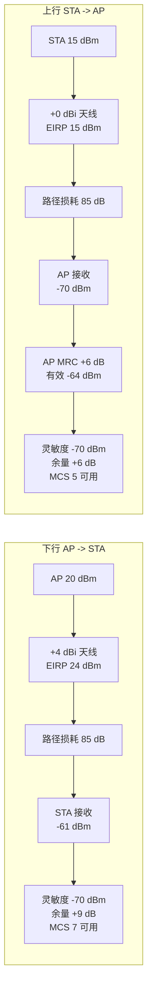

# 第 6 章　链路预算、功率谱密度与上下行不平衡 ★★

## 学习目标

1. 能建立完整的链路预算表，并正确区分"可加"与"不可加"的 dB 项。
2. 理解功率谱密度（Power Spectral Density, PSD）限制的物理含义与法规差异，能计算 PSD 约束下的最大发射功率。
3. 定量刻画上下行不对称（Equivalent Isotropically Radiated Power, EIRP、天线数、噪声系数、PA 线性度四个来源）。
4. 理解为什么这些不对称性直接催生了 Wi-Fi 8 的 DRU 与 极远距离（Extreme Long Range, ELR）。

---

## 6.1 完整链路预算

### 6.1.1 预算表结构

链路预算是把"发射端有多少 dBm"逐步扣减，直到"接收端还剩多少 dBm"，再与灵敏度比较。

$$
P_{rx} = P_{tx} + G_{tx} - L_{path}(d) - L_{other} + G_{rx} - L_{rx\_internal}
$$

| 项 | 符号 | 典型值 | 说明 |
|---|---|---|---|
| 发射功率 | $P_{tx}$ | 15–30 dBm | 受法规限制 |
| 发射天线增益 | $G_{tx}$ | 0–6 dBi | AP 高，终端低 |
| 馈线/连接器损耗 | $L_{cable}$ | 0–2 dB | 终端可忽略 |
| 路径损耗 | $L_{path}(d)$ | 见第 1 章 | 距离 + 频段 + 场景 |
| 穿透损耗 | $L_{pen}$ | 0–30 dB | 墙、人体、家具 |
| 阴影衰落余量 | $M_{shadow}$ | 6–12 dB | 保证 90–95% 覆盖 |
| 接收天线增益 | $G_{rx}$ | 0–6 dBi | |
| 接收机噪声系数 | $NF$ | 4–7 dB | 进入灵敏度公式 |
| 干扰余量 | $M_{int}$ | 0–10 dB | 底噪抬升 |
| 实现损耗 | $\Delta_{impl}$ | 2–4 dB | 信道估计、量化、相位噪声 |

### 6.1.2 灵敏度回顾与"余量"定义

$$
P_{sens} = -174 + 10\log_{10}B + NF + \gamma_{req} + \Delta_{impl}
$$

**链路余量（Link Margin）**：

$$
M_{link} = P_{rx} - P_{sens}
$$

工程要求 $M_{link} \ge 0$ 保证可通；若要保证**移动中的稳定性**，通常要求 $M_{link} \ge 10$ dB（应对人体遮挡、门开关、家具移动）。

### 6.1.3 dB 运算的常见陷阱

**陷阱 1：两个 dBm 不能直接相加。**
两个独立噪声源 $-90$ dBm 与 $-93$ dBm 相加：

$$
P_{tot} = 10\log_{10}\left(10^{-9} + 10^{-9.3}\right) = 10\log_{10}(1.0\times10^{-9} + 5.01\times10^{-10}) = 10\log_{10}(1.501\times10^{-9}) = -88.2 \text{ dBm}
$$

结果比两者都大，但**增量小于 3 dB**。

**陷阱 2：dB 与 dBm 混用。** $P_{rx}(\text{dBm}) = P_{tx}(\text{dBm}) + G(\text{dB}) - L(\text{dB})$，最后一项是无量纲比值，不能用 dBm。

**陷阱 3：带宽加倍的热噪声。** $10\log_{10}(2B) - 10\log_{10}B = 3$ dB。带宽每翻倍，噪声底 +3 dB，**灵敏度恶化 3 dB**（若发射功率不变）。

---

## 6.2 功率谱密度（PSD）限制

### 6.2.1 为什么是 PSD 而不是总功率

监管机构关心的不是"你总共发了多少功率"，而是"你在**每 MHz** 上发了多少"——因为窄带系统（蓝牙、ZigBee、某些雷达）只占据一小段频谱，若 Wi-Fi 在宽带上堆总功率，会对窄带系统造成严重干扰。

**PSD 定义**：

$$
\text{PSD} = \frac{P_{tx}}{B_{occ}} \quad [\text{dBm/MHz}]
$$

### 6.2.2 主要法规（2026 年现状，供研究参考）

| 频段 | 区域 | 类型 | EIRP | PSD |
|---|---|---|---|---|
| 2.4 GHz | 全球 | 通用 | 20–30 dBm | 通常无 PSD 限制（有带外限制） |
| 5 GHz | 全球 | 室内/室外 | 23–30 dBm | 通常 10–17 dBm/MHz |
| 6 GHz | 美国（FCC） | **LPI（Low Power Indoor）** | 30 dBm EIRP（含天线） | **−1 dBm/MHz** |
| 6 GHz | 美国（FCC） | 标准功率（AFC） | 36 dBm EIRP | 23 dBm（总）/ 有 PSD 约束 |
| 6 GHz | 欧盟 | LPI | 23 dBm EIRP | 10 dBm/MHz（200 mW） |
| 6 GHz | 中国 | 室内 | 见工信部最新规定 | 有相应 PSD 要求 |

**关键结论**：在 6 GHz LPI 模式下，**PSD = −1 dBm/MHz 是硬约束**，与带宽无关。

### 6.2.3 PSD 约束下的功率计算

**案例**：6 GHz LPI，PSD 上限 −1 dBm/MHz。

| 带宽 | 最大总功率 | 计算 |
|---|---|---|
| 20 MHz | $-1 + 10\log_{10}20 = 12$ dBm | 16 mW |
| 40 MHz | $-1 + 10\log_{10}40 = 15$ dBm | 32 mW |
| 80 MHz | $-1 + 10\log_{10}80 = 18$ dBm | 63 mW |
| 160 MHz | $-1 + 10\log_{10}160 = 21$ dBm | 126 mW |
| 320 MHz | $-1 + 10\log_{10}320 = 24$ dBm | 251 mW |

**要点**：带宽每翻倍，允许总功率 +3 dB，**但灵敏度也恶化 3 dB**（噪声底 +3 dB）。两者**完全抵消** → **扩带宽不改善覆盖，只改善容量**。这是理解 Wi-Fi 覆盖问题的核心结论。

### 6.2.4 小 RU 的功率困境（DRU 的直接动机）

正交频分多址（Orthogonal Frequency Division Multiple Access, OFDMA）中，若终端只分到 26-tone RU（2.03 MHz）：

$$
P_{max}^{26tone} = -1 + 10\log_{10}(2.03) = -1 + 3.07 = 2.07 \text{ dBm}
$$

而 80 MHz 全带宽可发 18 dBm。**相差 16 dB！**

**后果**：
- 终端在上行用小 RU 时，发射功率被限制在 2 dBm（1.6 mW）
- 而 AP 下行可以用 20 dBm 发同样的数据
- **上下行差距 18 dB**，上行先断

这就是 **DRU（Distributed Resource Unit）** 存在的全部理由——第 24 章将证明，DRU 通过把 26 个 tone 分散到 80 MHz 上，可以让终端在**保持 PSD 合规**的前提下把总功率提到 18 dBm，**获得约 11 dB 增益**。

---

## 6.3 上下行不对称的四个来源

### 6.3.1 来源一：发射功率与 EIRP

| | AP | 手机/终端 |
|---|---|---|
| 功率放大器 | 专用 PA，20–30 dBm | 共享 PA，15–20 dBm（且受 SAR 限制） |
| 天线增益 | 3–6 dBi（多天线阵列） | 0–2 dBi（空间受限） |
| EIRP | 23–36 dBm | 15–21 dBm |
| **差值** | | **8–15 dB** |

### 6.3.2 来源二：天线数与分集

AP 4–8 天线，终端 1–2 天线。上行接收时，AP 可用**最大比合并（Maximal-Ratio Combining, MRC）**获得 $10\log_{10}N_{rx}$ dB 增益（4 天线 +6 dB）；下行接收时终端只有 1–2 天线（0–3 dB）。

**净差 3–6 dB**（有利于上行）。

### 6.3.3 来源三：噪声系数

AP 有更好的 LNA 与滤波，NF 典型 4–5 dB；手机为了省电与多频段共存，NF 典型 6–8 dB。

**净差 2–3 dB**（有利于上行，即 AP 接收更灵敏）。

### 6.3.4 来源四：PA 线性度与 EVM

终端 PA 为省电常工作在接近压缩区，误差矢量幅度（Error Vector Magnitude, EVM）较差（−30 至 −33 dB）；AP PA 余量充足，EVM 可达 −35 至 −38 dB。

**净差 3–6 dB**（下行更优，因为终端发射的 EVM 限制了高阶调制）。

### 6.3.5 综合

$$
\Delta_{UL-DL} = \underbrace{(8\sim15)}_{\text{EIRP}} - \underbrace{(3\sim6)}_{\text{AP MRC}} - \underbrace{(2\sim3)}_{\text{AP NF}} + \underbrace{(3\sim6)}_{\text{终端 EVM}}
$$

$$
\boxed{\Delta_{UL-DL} \approx 6 \sim 16 \text{ dB}}
$$

**典型值 10 dB**。这意味着：**在下行还能用 调制编码方案（Modulation and Coding Scheme, MCS） 9 的距离，上行只能用 MCS 4**。

**实测现象**：用户常报告"下载很快但上传慢"、"视频通话里对方听不清我"。这不是错觉，是物理定律。

### 6.3.6 Mermaid 图：上下行链路预算对比



（注意：上图中 AP 接收用了 MRC 增益，但 站点（Station, STA）的发射 EIRP 仍低 9 dB，最终上行比下行低约 3 个 MCS 档。若再叠加小 RU 的 PSD 限制，差距可达 10 dB 以上。）

---

## 6.4 覆盖半径与"两层覆盖"口径

### 6.4.1 高速覆盖 vs 可用覆盖

传统覆盖规划只用"最高速率能否达到"作为口径，这误导性很强。应区分：

| 口径 | 定义 | 用途 |
|---|---|---|
| **高速覆盖** | MCS ≥ 8 可达的距离 | 宽带业务规划 |
| **可用覆盖** | MCS 0 可达的距离 | IoT、控制类业务的"在线"保证 |
| **可靠覆盖** | 目标 包误码率（Packet Error Rate, PER） ≤ 1% 且余量 ≥ 10 dB | 移动场景 |

**算例 6.1**：AP 20 dBm + 4 dBi，终端 15 dBm + 0 dBi，5 GHz，$n = 3.0$，$L_0 = 46$ dB @1m（5 GHz），$NF_{AP} = 5$ dB，$NF_{STA} = 7$ dB，实现损耗 3 dB，80 MHz。

**下行（MCS 9，$\gamma_{req} = 28$ dB）**：
$P_{sens}^{STA} = -174 + 79 + 7 + 28 + 3 = -57$ dBm
$L_{max} = 20 + 4 + 0 - (-57) = 81$ dB
$81 = 46 + 30\log_{10}d \Rightarrow d = 10^{1.167} = 14.7$ m

**下行（MCS 0，$\gamma_{req} = 3$ dB）**：
$P_{sens}^{STA} = -174 + 79 + 7 + 3 + 3 = -82$ dBm
$L_{max} = 24 + 82 = 106$ dB $\Rightarrow d = 10^{2.0} = 100$ m

**上行（MCS 9，STA 发射 15 dBm + 0 dBi，AP 接收 NF=5，MRC +6 dB 等效）**：
$P_{sens}^{AP} = -174 + 79 + 5 + 28 + 3 = -59$ dBm（已含 MRC 时应在 $P_{rx}$ 侧加 6 dB）
$L_{max} = 15 + 0 + 6 - (-59) = 80$ dB $\Rightarrow d = 10^{1.133} = 13.6$ m

**上行（MCS 0）**：$P_{sens}^{AP} = -174+79+5+3+3 = -84$ dBm
$L_{max} = 15 + 6 + 84 = 105$ dB $\Rightarrow d = 10^{1.967} = 92.6$ m

**汇总**：

| | 高速覆盖 (MCS 9) | 可用覆盖 (MCS 0) |
|---|---|---|
| 下行 | 14.7 m | 100 m |
| 上行 | 13.6 m | 92.6 m |
| 差 | −7% | −7% |

**注意**：此例上/下行差距只有 0.8 dB（因为 AP 的 MRC +6 dB 与 NF −2 dB 几乎抵消了 EIRP 差距）。真正的巨大差距出现在**小 RU + PSD 限制**时——见算例 6.2。

**算例 6.2（PSD 造成的灾难性不对称）**：6 GHz LPI，80 MHz 基本服务集（Basic Service Set, BSS），终端分到 26-tone RU 上行。

- AP 下行：可用 80 MHz，PSD −1 dBm/MHz → 18 dBm，加天线 4 dBi → EIRP 22 dBm
- STA 上行 26-tone：只能发 2.07 dBm，加天线 0 dBi → EIRP 2.07 dBm

**差距 19.9 dB**，相当于 **6.6 个 MCS 档**（每档约 3 dB）。

若下行用 MCS 9（28 dB 门限），上行只能达到 $28 - 19.9 = 8.1$ dB 的有效 信噪比（Signal-to-Noise Ratio, SNR） → **MCS 2**（勉强）。这就是 11ax 上行 OFDMA 在边缘用户处性能崩塌的原因。

**DRU 的解法预告**：把 26 个 tone 分散到 80 MHz → 占用带宽从 2.03 MHz 变为 80 MHz → 允许功率从 2.07 dBm 提升到 18 dBm → **增益 15.9 dB**（实际受实现限制约 11 dB，见第 24 章）。

---

## 6.5 干扰与底噪抬升

### 6.5.1 同频干扰

多个 BSS 同信道时，某接收点的总干扰：

$$
I = \sum_{j} P_{rx,j}
$$

**有效 信干噪比（Signal-to-Interference-plus-Noise Ratio, SINR）**：

$$
\gamma_{eff} = \frac{S}{I + N}
$$

其中 $N = kTB \cdot F$（$F$ 为噪声系数线性值）。

### 6.5.2 底噪抬升（Noise Rise）

定义 $\text{Rise} = \frac{I + N}{N}$。典型网络设计中，允许 Rise ≤ 3 dB（即 $I \le N$）。

**算例 6.3**：80 MHz，$NF = 5$ dB。$N = -174 + 79 + 5 = -90$ dBm。
若允许 Rise = 3 dB，则 $I + N = -87$ dBm → $I = -87.0 - (-90) = ?$ 需功率域计算：

$I + N = 10^{-8.7} = 2.0\times10^{-9}$ mW；$N = 10^{-9} = 1.0\times10^{-9}$ mW
$I = 2.0\times10^{-9} - 1.0\times10^{-9} = 1.0\times10^{-9}$ mW $= -90$ dBm

即 $I = N$ 时 Rise = 3 dB。符合预期。

若有两个等强干扰源各 $-93$ dBm：$I = 2\times10^{-9.3} = 1.0\times10^{-9}$ → Rise = 3 dB。

**设计含义**：同频干扰必须控制在**低于热噪声**的水平，否则容量急剧下降。这就是为什么密集部署要做信道规划（第 22 章）。

### 6.5.3 非 Wi-Fi 干扰

| 干扰源 | 频段 | 特征 |
|---|---|---|
| 蓝牙 | 2.4 GHz | 跳频、短包、占空比低 |
| ZigBee | 2.4 GHz | 低功率、窄带 |
| 微波炉 | 2.4 GHz | 宽带、周期 50%、功率高（可 +20 dBm） |
| 无绳电话 | 2.4/5 GHz | 持续 |
| 雷达 | 5 GHz（Dynamic Frequency Selection, DFS 信道） | 脉冲、必须避让 |
| 5G 邻频 | 3.3–3.6 GHz 等 | 邻频泄露 |

**识别难点**：非 Wi-Fi 干扰在 空闲信道评估（Clear Channel Assessment, CCA）上表现为"能量检测高但前导解码失败"。传统 Wi-Fi 无法区分"能量"来源，只能通过**能量检测统计**与**重传率异常**推断。Wi-Fi 9 的 人工智能（Artificial Intelligence, AI）方案（第 33 章）正是要解决这个问题——用 CSI/IQ 样本分类干扰源类型。

---

## 6.6 算法：链路预算自动化与带宽自适应

### 6.6.1 链路预算计算器

```python
def link_budget(ptx_dbm, gtx_dbi, grx_dbi, f_mhz, bw_mhz, d_m,
                n_exp, L0_db, pen_db, nf_db, impl_db,
                mcs_table, required_margin=10.0):
    """返回: (每 MCS 的余量, 最高可用 MCS, 最大距离)"""
    L_path = L0_db + 10 * n_exp * np.log10(d_m) + pen_db
    Prx = ptx_dbm + gtx_dbi + grx_dbi - L_path
    noise = -174 + 10 * np.log10(bw_mhz * 1e6)
    margins = {}
    for mcs, (_, _, snr_req) in mcs_table.items():
        Psens = noise + nf_db + snr_req + impl_db
        margins[mcs] = Prx - Psens
    feasible = [m for m, mg in margins.items() if mg >= required_margin]
    best_mcs = max(feasible) if feasible else min(mcs_table)
    # 反解最高可用 MCS 的最大距离
    snr_req = mcs_table[best_mcs][2]
    Psens = noise + nf_db + snr_req + impl_db
    Lmax = ptx_dbm + gtx_dbi + grx_dbi - Psens - required_margin
    dmax = 10 ** ((Lmax - L0_db - pen_db) / (10 * n_exp))
    return margins, best_mcs, dmax
```

**复杂度**：$O(M)$，$M = 14$，可实时执行。

### 6.6.2 带宽自适应决策

**问题**：给定距离与干扰，选最优带宽。

**权衡**：
- 带宽 ↑ → 容量 ↑（线性）
- 带宽 ↑ → 噪声底 ↑（3 dB/倍）→ SNR ↓ → MCS ↓
- 带宽 ↑ → 被干扰命中的概率 ↑

**净效应**：

$$
R(B) = B \cdot \log_2\left(1 + \frac{P_{tx}}{kT B \cdot F + I(B)}\right)
$$

对 $B$ 求导（忽略 $I$ 随 $B$ 变化）：

$$
\frac{dR}{dB} \propto \log_2(1+\gamma) - \frac{\gamma}{(1+\gamma)\ln 2}
$$

**结论**：只要 $\log_2(1+\gamma) > \frac{\gamma}{(1+\gamma)\ln 2}$（即 $\gamma$ 足够大），**扩带宽总是有益的**。但 $\gamma$ 小时（边缘用户），扩带宽使 $\gamma$ 进一步下降，收益递减甚至为负。

```python
def bandwidth_adaptation(snr_db_20mhz, interf_per_20mhz, bw_options):
    """snr_db_20mhz: 20MHz 下的 SNR
       interf_per_20mhz: 每 20MHz 子块的干扰功率(dBm)列表"""
    best, best_rate = 20, -1
    for bw in bw_options:
        n_sub = bw // 20
        # 噪声随带宽增加
        snr_bw = snr_db_20mhz - 10*np.log10(bw/20)
        # 干扰: 只累加"被占用"的子块(穿刺可规避)
        I = 10*np.log10(sum(10**(p/10) for p in interf_per_20mhz[:n_sub]))
        sinr = 10*np.log10(10**(snr_bw/10) / (1 + 10**((I - noise_floor(bw))/10)))
        rate = shannon_rate(bw, sinr)
        if rate > best_rate: best_rate, best = rate, bw
    return best, best_rate
```

---

## 本章小结

| 概念 | 结论 |
|---|---|
| 链路余量 | $M_{link} = P_{rx} - P_{sens}$，移动场景要求 ≥ 10 dB |
| PSD 限制 | 6 GHz LPI: −1 dBm/MHz；**与带宽无关** |
| PSD 下的功率 | $P_{max} = \text{PSD}_{lim} + 10\log_{10}B$ |
| 扩带宽的抵消效应 | 功率 +3 dB/倍 vs 噪声 +3 dB/倍 → **覆盖不变，容量增加** |
| 小 RU 困境 | 26-tone 在 LPI 下只能发 2 dBm，比 80 MHz 少 16 dB |
| 上下行不对称 | EIRP 差 8–15 dB，MRC/NF 回收 5–9 dB，净差 **6–16 dB** |
| 非对称的极端情形 | 小 RU + PSD → 上下行差 **~20 dB**，即 6+ 个 MCS 档 |
| 底噪抬升 | Rise ≤ 3 dB 设计要求同频干扰 ≤ 热噪声 |

**承上启下**：本章证明的两个"硬伤"——**小 RU 的 PSD 功率困境**与**上下行 10–20 dB 不对称**——正是 Wi-Fi 8 两大 物理层（Physical Layer, PHY）特性（DRU、ELR）的唯一设计动机。第 24、25 章将给出完整的解决方案与增益推导。

---

## 习题

**概念题**

1. 为什么说"扩带宽不改善覆盖，只改善容量"？请给出完整的 dB 收支证明。
2. 上下行不对称有四个来源，其中哪两个是**有利于上行**的？在实际系统中它们能否完全抵消 EIRP 差距？为什么？
3. PSD 限制为什么用"每 MHz"而不是"总功率"作为约束？这与哪些系统的共存有关？

**计算推导题**

4. 6 GHz LPI（PSD = −1 dBm/MHz）。计算 26-tone（2.03 MHz）、106-tone（8.28 MHz）、242-tone（18.9 MHz）、996-tone（77.8 MHz）RU 下的最大发射功率。若把 26-tone 的 tone 分散到 80 MHz（DRU 思路），功率提升多少 dB？
5. 某链路：AP 20 dBm + 5 dBi，STA 17 dBm + 1 dBi，5 GHz，$n = 3.2$，$L_0 = 46$ dB@1m，穿透损耗 12 dB，$NF_{AP} = 5$ dB，$NF_{STA} = 7$ dB，实现损耗 3 dB，40 MHz。计算距离 25 m 处：
   (a) 下行接收功率与 MCS 8 的余量
   (b) 上行接收功率（含 AP 4 天线 MRC +6 dB）与 MCS 8 的余量
   (c) 上下行可用 MCS 差几档？
6. 证明：对 Shannon 容量 $R(B) = B\log_2(1 + \frac{S}{kTB})$，在固定 $S$ 下 $R(B)$ 是 $B$ 的**单调递增**函数，且 $\lim_{B\to\infty} R(B) = \frac{S}{kT\ln 2}$。这说明什么？
7. 两个等强同频干扰源，各使接收点干扰为 $-95$ dBm。80 MHz，$NF = 6$ dB。计算底噪抬升（dB）与对 MCS 8（需 26 dB SINR）可用距离的影响（假设无干扰时 MCS 8 距离为 20 m，$n = 3$）。

**算法设计题**

8. 设计一个**上下行联合的 MCS 选择算法**：AP 根据上行接收质量推断下行的路径损耗（假设信道互易），再结合已知的 STA 发射能力与 PSD 约束，为上行推荐 RU 大小与 MCS。给出建模与伪代码。
9. 设计一个 **PSD 感知的 OFDMA 调度器**：在分配 RU 时同时考虑 (a) 用户的 PSD 功率上限，(b) 用户到 AP 的路径损耗，(c) 队列需求。目标是最大化上行加权和速率。给出伪代码与复杂度分析。

**开放研究题**

10. 【研究】假设未来监管机构允许 6 GHz 的 PSD 提升到 +5 dBm/MHz（提升 6 dB），这对 Wi-Fi 8 的 DRU 设计动机有何影响？DRU 是否就不需要了？请定量分析（考虑 DRU 除功率增益外的**频域分集**与**抗窄带干扰**收益）。

---

## 答案与解析

**1. 证明**：设带宽从 $B$ 扩到 $2B$。

- 允许发射功率（PSD 受限）：$P_{tx}(2B) = \text{PSD}_{lim} \cdot 2B = 2 P_{tx}(B)$ → **+3 dB**
- 热噪声：$N(2B) = kT \cdot 2B \cdot F = 2N(B)$ → **+3 dB**
- 接收功率：$P_{rx}(2B) = P_{tx}(2B) \cdot G / L_{path}$。路径损耗**与带宽无关**（由距离与频段决定）→ $P_{rx}$ **+3 dB**
- 信噪比：$\gamma(2B) = \frac{2P_{rx}(B)}{2N(B)} = \gamma(B)$ → **不变**
- 灵敏度：$P_{sens}(2B) = kT\cdot 2B \cdot F + \gamma_{req} + \Delta$ → **+3 dB**

链路余量：

$$
M(2B) = P_{rx}(2B) - P_{sens}(2B) = [P_{rx}(B) + 3] - [P_{sens}(B) + 3] = M(B)
$$

**余量不变 → 最大覆盖距离不变。** $\square$

而容量 $R = 2B \log_2(1+\gamma)$ **翻倍**。因此扩带宽纯粹是**容量**手段，不是覆盖手段。

**注意前提**：若发射功率不受 PSD 限制（如 2.4 GHz 只有总功率限制），则扩带宽时 $P_{tx}$ 不变而噪声 +3 dB → **覆盖反而恶化**。这也是算例 4.6 的结论。

**2.** 有利于上行的是：**AP 的多天线 MRC 增益**（$10\log_{10}N_{rx}$，4 天线 +6 dB）与 **AP 更低的噪声系数**（比终端低 2–3 dB）。合计回收 5–9 dB。

**不能完全抵消**，因为：
- EIRP 差距是 8–15 dB（典型 10–12 dB），回收 5–9 dB 后仍差 3–6 dB
- 更重要的是：**PSD 限制下小 RU 的额外 16 dB 损失**（算例 6.2）无法通过 MRC 回收（MRC 改善的是接收灵敏度，不改善发射功率）
- 终端 PA 的 EVM 劣势（3–6 dB）也无法回收

**3.** PSD 用"每 MHz"是因为监管机构要保护**窄带系统**。典型共存对象：
- 6 GHz 的**固定微波链路**（点对点，窄带、高价值）
- 5 GHz 的**气象雷达、军事雷达**（脉冲、特定频点）
- 2.4 GHz 的**蓝牙**（1 MHz 信道）、**ZigBee**（2 MHz 信道）

若只看总功率，一个 Wi-Fi 设备可以在 320 MHz 上发 30 dBm（1 W），虽然总功率合规，但在任一 1 MHz 上只有 $30 - 10\log_{10}320 = 5$ dBm——这看似不高。反之，若设备把 1 W 集中在 20 MHz 上，每 MHz 就是 17 dBm，会严重干扰同频段的窄带系统。因此 **PSD 是保护窄带受害者的必要约束**。

**4.**
| RU | 带宽 | $P_{max} = -1 + 10\log_{10}B$ |
|---|---|---|
| 26-tone | 2.03 MHz | $-1 + 3.07 = 2.07$ dBm |
| 106-tone | 8.28 MHz | $-1 + 9.18 = 8.18$ dBm |
| 242-tone | 18.9 MHz | $-1 + 12.76 = 11.76$ dBm |
| 996-tone | 77.8 MHz | $-1 + 18.91 = 17.91$ dBm |

**26-tone 分散到 80 MHz**：$P_{max} = -1 + 10\log_{10}80 = 18.0$ dBm

**提升 $18.0 - 2.07 = 15.9$ dB**（理论上限；实际约 11 dB，因为 DRU 的 tone 分散不能占满整个带宽，且需保留保护子载波，见第 24 章）。

**5.**
路径损耗（25 m，含穿透）：
$L = 46 + 32\log_{10}(25) + 12 = 46 + 32 \times 1.398 + 12 = 46 + 44.7 + 12 = 102.7$ dB

噪声底（40 MHz）：$-174 + 10\log_{10}(4\times10^7) = -174 + 76 = -98$ dBm

(a) **下行**：$P_{rx}^{STA} = 20 + 5 + 1 - 102.7 = -76.7$ dBm
$P_{sens}^{STA}(\text{MCS 8}) = -98 + 7 + 26 + 3 = -62$ dBm
余量 $= -76.7 - (-62) = -14.7$ dB → **MCS 8 不可用**

试 MCS 4（$\gamma_{req} = 15$ dB）：$P_{sens} = -98 + 7 + 15 + 3 = -73$ dBm，余量 $= -3.7$ dB → 勉强不可靠（需 ≥10 dB）
试 MCS 2（$\gamma_{req} = 9$）：$P_{sens} = -79$ dBm，余量 $= +2.3$ dB → 可用但无移动余量
**下行可用 MCS ≈ 2**

(b) **上行**：$P_{rx}^{AP} = 17 + 1 + 5 - 102.7 + 6(\text{MRC}) = -73.7$ dBm
$P_{sens}^{AP}(\text{MCS 8}) = -98 + 5 + 26 + 3 = -64$ dBm
余量 $= -73.7 + 64 = -9.7$ dB → **不可用**

MCS 2：$P_{sens}^{AP} = -98 + 5 + 9 + 3 = -81$ dBm，余量 $= +7.3$ dB → 可用
**上行可用 MCS ≈ 2**（余量 7.3 dB < 下行 2.3 dB？）

**修正**：等等，上行 $P_{rx}$ 计算应更仔细。MRC 增益应加在接收侧有效 SNR 上，等价于 $P_{rx}$ 增加 6 dB：
$P_{rx}^{AP} = 17 + 1 + 5 - 102.7 = -79.7$ dBm，加 MRC → 有效 $-73.7$ dBm。✓

所以上行有效 $-73.7$ dBm vs 下行 $-76.7$ dBm → **上行比下行好 3 dB**！

这是因为本例中 AP 天线增益（5 dBi）与 MRC（6 dB）与 NF 优势（2 dB）合计 +8 dB，超过了 STA 发射功率劣势（3 dB）。

(c) **上下行 MCS 差**：本例上行**优于**下行 3 dB（1 个 MCS 档）。原因是题目给的 AP 天线增益（5 dBi）与 MRC（6 dB）较强。

**教学要点**：上下行方向**不是绝对的**——取决于具体硬件配置。典型手机（0 dBi、15 dBm、1 天线）+ 典型 AP（3 dBi、20 dBm、4 天线）时，下行优于上行；而本例的高增益 AP 使上行反超。**真正的"必然"不对称来自 PSD 小 RU 场景**（算例 6.2，差 20 dB），那是无解的。

**6. 证明**：

$$
R(B) = B\log_2\left(1 + \frac{S}{kTB}\right) = \frac{B}{\ln 2}\ln\left(1 + \frac{a}{B}\right), \quad a \triangleq \frac{S}{kT}
$$

求导：

$$
\frac{dR}{dB} = \frac{1}{\ln 2}\left[\ln\left(1+\frac{a}{B}\right) + B \cdot \frac{-a/B^2}{1 + a/B}\right] = \frac{1}{\ln 2}\left[\ln\left(1+\frac{a}{B}\right) - \frac{a/B}{1+a/B}\right]
$$

令 $x = a/B > 0$，则

$$
\frac{dR}{dB} = \frac{1}{\ln 2}\left[\ln(1+x) - \frac{x}{1+x}\right]
$$

由 $\ln(1+x) > \frac{x}{1+x}$ 对 $x > 0$ 恒成立（令 $g(x) = \ln(1+x) - \frac{x}{1+x}$，$g(0) = 0$，$g'(x) = \frac{1}{1+x} - \frac{1}{(1+x)^2} = \frac{x}{(1+x)^2} > 0$），故 $\frac{dR}{dB} > 0$，**单调递增**。$\square$

极限（用 $\ln(1+x) \approx x$ 当 $x \to 0$，即 $B \to \infty$）：

$$
\lim_{B\to\infty} R(B) = \lim_{B\to\infty} \frac{B}{\ln 2}\cdot\frac{a}{B} = \frac{a}{\ln 2} = \frac{S}{kT\ln 2}
$$

**物理含义**：**无限带宽的容量存在上界** $\frac{S}{kT\ln 2}$，且这个上界只由**接收信号功率与温度**决定。这就是"宽带极限"——在极低 SNR 下（边缘用户），无论给多少带宽，容量都不超过 $\frac{S}{kT\ln 2}$。

**对 Wi-Fi 的含义**：
- 边缘用户扩带宽收益极小（已在曲线的平坦段）
- 每比特能量趋近 $-1.59$ dB（$kT\ln 2$）是理论下限
- 因此**提高覆盖的正确手段是改善 $S$**（更高 EIRP、更好天线、更低 NF）或**降低 $\gamma_{req}$**（更强编码、ELR），而不是加带宽

**7.**
热噪声（80 MHz，$NF = 6$）：$N = -174 + 79 + 6 = -89$ dBm

两个干扰源各 $-95$ dBm：$I_{tot} = 10\log_{10}(2 \times 10^{-9.5}) = -95 + 3 = -92$ dBm

底噪抬升：$\text{Rise} = 10\log_{10}\left(\frac{N + I}{N}\right) = 10\log_{10}\left(1 + 10^{(-92+89)/10}\right) = 10\log_{10}(1 + 10^{-0.3})$

$10^{-0.3} = 0.501$，$\text{Rise} = 10\log_{10}(1.501) = 1.76$ dB

**对距离的影响**：SINR 门限不变（26 dB），但有效噪声从 $-89$ 升到 $-87.24$ dBm，等效灵敏度恶化 1.76 dB。

距离关系：$L_{max}$ 减少 1.76 dB → $d_{new} = d_{old} \times 10^{-1.76/30} = 20 \times 10^{-0.0587} = 20 \times 0.874 = 17.5$ m

**覆盖缩小 12.5%**。看似不大，但若干扰源增至 4 个（各 $-95$ dBm），$I_{tot} = -89$ dBm，Rise = 3 dB，距离降至 15.9 m（−20%）。**密集部署的同频干扰是覆盖与容量的头号杀手**。

**8. 参考方案**

**建模**：利用**信道互易性**（TDD 系统上下行路径损耗相同）：

$$
L_{path} = P_{tx}^{AP} + G_{AP} - P_{rx}^{AP}(\text{上行测得})
$$

由 STA 上报的能力（最大发射功率 $P_{tx,max}^{STA}$、天线增益、支持的 RU 类型）与已知的 PSD 约束：

$$
P_{tx}^{STA}(RU) = \min\left(P_{tx,max}^{STA},\ \text{PSD}_{lim} + 10\log_{10}B_{RU}\right)
$$

预测上行 SNR：

$$
\gamma_{UL}^{pred} = P_{tx}^{STA}(RU) + G_{STA} - L_{path} + G_{AP} + G_{MRC} - \left(-174 + 10\log_{10}B_{RU} + NF_{AP}\right)
$$

**优化**：选择 $(RU, MCS)$ 使加权速率最大：

$$
\max_{RU, m} w_u \cdot R(RU, m) \cdot \mathbb{1}[\gamma_{UL}^{pred} \ge \gamma_{req}(m) + M_{margin}]
$$

**伪代码**：

```python
def ul_mcs_recommend(ap, sta, path_loss, queue_weight):
    """ap: {'gtx':5, 'nf':5, 'mr':4(天线数), 'psd_lim':-1}
       sta: {'ptx_max':17, 'gtx':1, 'supported_ru':[...]}"""
    noise_per_hz = -174
    best = None
    for ru in sta['supported_ru']:
        B_ru = ru_bandwidth_mhz(ru)                     # 2.03/4.06/...
        # 1. PSD 约束下的可用功率
        p_psd = ap['psd_lim'] + 10*np.log10(B_ru)
        p_tx  = min(sta['ptx_max'], p_psd)
        # 2. 预测的接收 SNR
        noise = noise_per_hz + 10*np.log10(B_ru*1e6) + ap['nf']
        prx   = p_tx + sta['gtx'] - path_loss + ap['gtx']
        snr   = prx - noise + 10*np.log10(ap['mr'])      # MRC 增益
        # 3. 选满足余量的最高 MCS
        for m in sorted(MCS_TABLE, reverse=True):
            if snr >= MCS_TABLE[m]['snr_req'] + MARGIN:
                rate = ru_rate(ru, m)
                score = queue_weight * rate
                if best is None or score > best[0]:
                    best = (score, ru, m)
                break
    return best[1], best[2]
```

**复杂度**：$O(|\mathcal{RU}| \cdot M)$，典型 $8 \times 14 = 112$ 次，忽略不计。
**要点**：① 路径损耗必须由**上行实测**反推（不能只用 接收信号强度指示（Received Signal Strength Indicator, RSSI），因为 STA 发射功率可能变化）；② 必须加**余量**（应对信道时变与模型误差）；③ 若 STA 支持 DRU，应把 DRU 作为额外的"RU 选项"纳入（其 $B_{RU}$ 是分布带宽而非占用带宽，见第 24 章）。

**9. 参考方案**

**建模**：

$$
\max_{\{RU_u, m_u\}} \sum_u w_u R(RU_u, m_u) \quad \text{s.t.} \quad \sum_u B_{RU_u} \le B_{total},\ \text{RU 不重叠}
$$

其中 $R(RU_u, m_u) = \eta \cdot B_{RU_u} \cdot \log_2(1 + \gamma_{UL}(RU_u)) \cdot \mathbb{1}[\gamma_{UL} \ge \gamma_{req}(m_u)]$

**关键非线性**：$P_{tx}(RU)$ 随 $B_{RU}$ 增大而增大（PSD 约束），但 $\gamma$ 中噪声也随 $B_{RU}$ 增大 → **两者抵消**，使得小 RU 的用户 SNR 极低。这是本调度器要解决的核心矛盾。

**伪代码（贪心 + 边际收益）**：

```python
def psd_aware_ofdma_sched(users, ap, bw_total):
    """users: [{'id','path_loss','queue','weight','ptx_max','gtx'}]"""
    alloc = {}
    remaining = set(range(bw_total // 20 * 4))          # 以 52-tone 为单位
    # 按"每单位带宽的边际收益"贪心
    while remaining:
        best = None
        for u in users:
            if u['id'] in alloc: continue
            for ru_size in [26, 52, 106, 242]:          # 试不同 RU
                if not can_place(remaining, ru_size): continue
                m = best_mcs_for(u, ru_size, ap)
                if m is None: continue                  # 该 RU 下 SNR 不足
                gain = u['weight'] * ru_rate(ru_size, m)
                cost = ru_size
                if best is None or gain/cost > best[0]:
                    best = (gain/cost, u, ru_size, m)
        if best is None: break
        _, u, rs, m = best
        place(remaining, rs)
        alloc[u['id']] = (rs, m)
    return alloc
```

**复杂度**：$O(U \cdot 4 \cdot |\text{placement check}|)$，典型 $O(100)$，可每符号执行。
**关键洞察**：`best_mcs_for` 中会体现"小 RU → 功率低 → SNR 低 → MCS 低"的链条。若某用户在 26-tone 下连 MCS 0 都达不到，调度器会**自动给它更大的 RU**（或判定为不可服务）。这就是 PSD 感知的价值——**避免把边缘用户塞进小 RU 导致必然失败**。

**进阶**：若引入 DRU，边缘用户可以用**26-tone DRU 分散到 80 MHz**，既占用少量频谱资源（26 个 tone），又获得 80 MHz 的功率预算——**打破"小 RU 必然低功率"的诅咒**。这正是第 24 章的核心。

**10. 参考思路**：

**定量分析**：设 PSD 从 $-1$ 提升到 $+5$ dBm/MHz（+6 dB）。

- 26-tone RRU 在 20 MHz：$P = 5 + 3.07 = 8.07$ dBm（原 2.07 dBm）
- 26-tone DRU 在 80 MHz：$P = 5 + 19.03 = 24.03$ dBm（原 18.0 dBm）
- **DRU 相对 RRU 的增益仍是 $19.03 - 3.07 = 15.96$ dB**（与之前完全相同！）

**关键洞察**：**DRU 的功率增益来自"分布带宽 / 占用带宽"之比，与 PSD 的绝对值无关**。PSD 提升 6 dB 对 RRU 和 DRU 是**同等**的，DRU 的相对优势不变。

**因此 DRU 仍然需要**，且理由有三：
1. **功率增益不变**（15.9 dB 理论 / ~11 dB 实际）：只要 PSD 约束存在（无论数值多少），小 RU 就吃亏
2. **频域分集**：26 个 tone 分散到 80 MHz，跨越约 60 个相干带宽，衰落独立 → 分集阶数 ~26，深衰落概率从 $10^{-2}$ 降到 $10^{-8}$ 量级
3. **抗窄带干扰**：若 20 MHz 中有 2 MHz 被窄带干扰（蓝牙、ZigBee、微波炉）占用，连续 RU 可能整体受损；分散的 tone 只损失 ~1/40 的子载波，配合编码可完全恢复

**结论**：PSD 提升 6 dB 会让**所有**上行链路受益（包括 RRU），但**不会**消除 DRU 的价值。DRU 的设计动机中，"功率增益"这一项与 PSD 绝对值无关，而"频域分集"与"抗窄带干扰"两项更是完全独立。

**延伸讨论**：若监管完全取消 PSD 限制（只限总功率），则 DRU 的功率增益消失，但频域分集与抗干扰收益仍在——DRU 演变为一种**纯分集技术**，仍有价值但优先级下降。这也说明：**评价一项技术时应分离其多重收益**。

---

## 延伸阅读

- [IEEE] IEEE 802.11-2024, Clause 11（ regulatory requirements）、Annex E（各国频段与功率限制）
- [FCC] FCC 15.407（U-NII 规则）、FCC 报告与命令 20-51（6 GHz 开放）
- [IEEE] IEEE 802.11ax 中关于 uplink PSD 限制的讨论文档（`11-17/xxxx`）
- [ACM/IEEE] Karamyshev et al., *A Tutorial on Wi-Fi 8*, Problems of Information Transmission, 2025（第 4 节链路预算与 DRU 动机）
- [TUT] Liu et al., *Link Budget Analysis for 6 GHz Wi-Fi*, 2021
