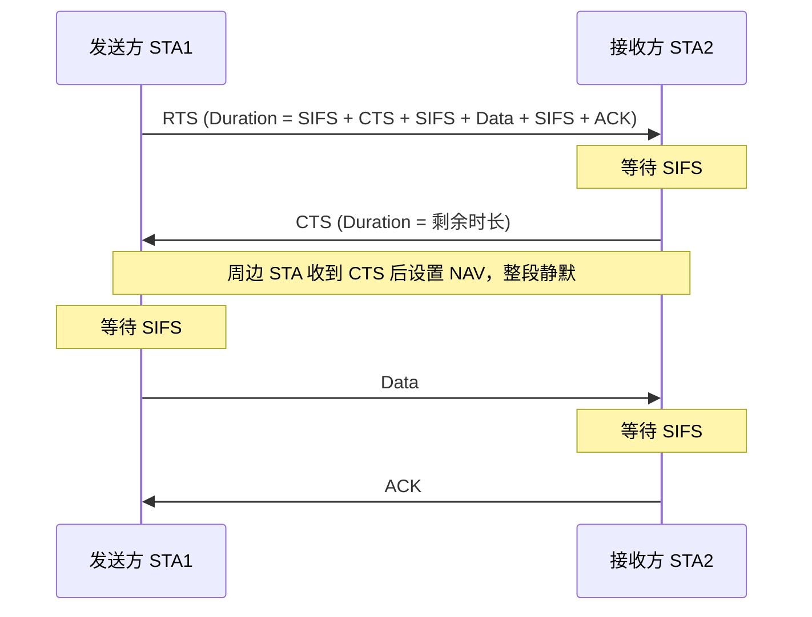
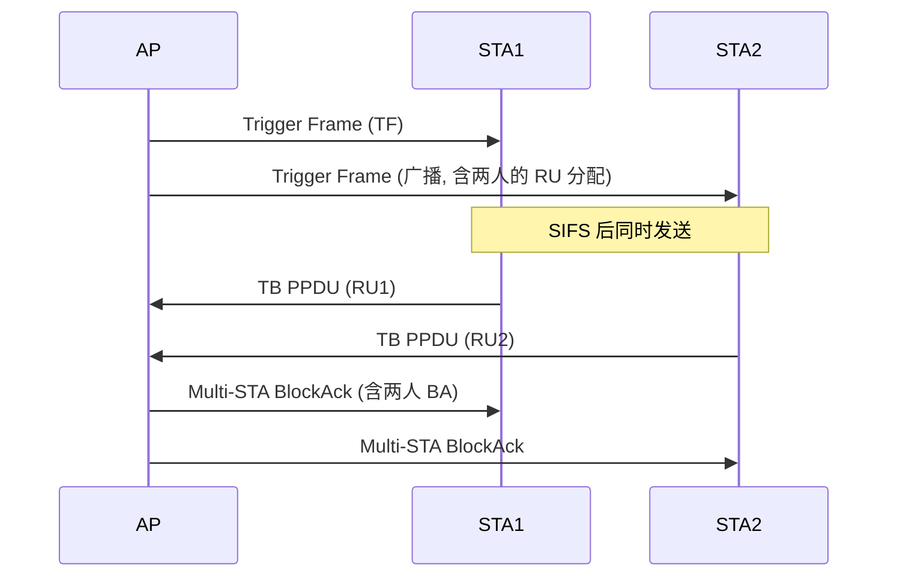
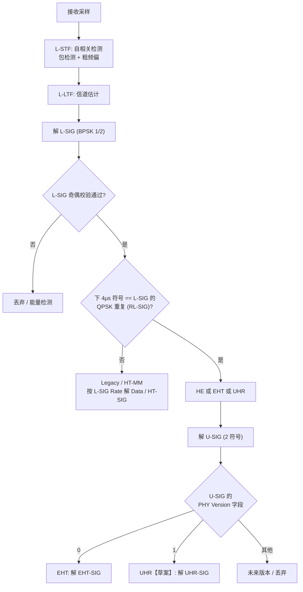

# 第 7 章　帧结构、PPDU 与协议时序 ★

## 学习目标

1. 掌握 MAC（Medium Access Control，媒体接入控制）帧通用格式与各字段的协议语义。
2. 理解 PPDU（PLCP Protocol Data Unit，物理层汇聚协议（Physical Layer Convergence Protocol, PLCP）协议数据单元）从 Legacy（传统）到 高效率（High Efficiency, HE） / EHT / UHR 的演进逻辑：**每一代都要让老设备"能听懂前导"。**
3. 能计算任意帧序列的空口时长，理解 IFS（Interframe Space，帧间间隔）、NAV（Network Allocation Vector，网络分配向量）、时隙（slot）的时序配合。
4. 掌握前导结构的设计约束（自动检测、共存、信令可靠性），并能说清 **PPDU 在空口上到底是怎么"摆"上去的**（本节 7.2.6）。

---

## 7.1 MAC 帧格式

### 7.1.1 通用 MAC 帧


*图 7-1　MAC（Medium Access Control）通用帧格式。图中字段宽度按字节数等比绘制，便于直观比较各字段的相对开销；Frame Body 与 HT Control 为可选字段，因此最小的数据帧仅 24 B，而最"胖"的 WDS + 服务质量（Quality of Service, QoS） + HT Control 帧光头部就达 36 B。*

**Frame Control 字段**（2 字节）：

| 子字段 | bit | 含义 |
|---|---|---|
| Protocol Version | 2 | 恒为 0 |
| Type | 2 | 00 管理 / 01 控制 / 10 数据 / 11 扩展 |
| Subtype | 4 | 如 1000 = Beacon，1011 = 请求发送（Request To Send, RTS） |
| To 分发系统（Distribution System, DS） / From DS | 2 | 决定 4 个地址字段的解释 |
| More Fragments | 1 | |
| Retry | 1 | 重传帧标记 |
| Power Management | 1 | 站点（Station, STA）进入省电态 |
| More Data | 1 | 接入点（Access Point, AP）还有缓存数据 |
| Protected Frame | 1 | 已加密 |
| Order | 1 | 严格排序（HT 后基本不用） |

**Duration/ID 字段**（2 字节）：这是 **NAV（Network Allocation Vector，网络分配向量）** 的载体。

- bit 15 = 0：值为微秒数，其他 STA 据此设置 NAV
- bit 15 = 1，bit 14 = 0：省电轮询（Power Save Poll, PS-Poll）中的 关联标识符（Association Identifier, AID）
- bit 15 = 1，bit 14 = 1：CFP 期间的固定值 32768

**QoS Control 字段**（2 字节，数据帧）：

| 子字段 | bit | 含义 |
|---|---|---|
| 流量标识符（Traffic Identifier, TID） | 4 | 业务标识符 0–15（0–7 为 TC，8–15 为 TS） |
| EOSP | 1 | 非调度自动省电交付（Unscheduled Automatic Power Save Delivery, U-APSD）服务期结束 |
| Ack Policy | 2 | Normal / No Ack / No Explicit Ack / Block Ack |
| MSDU 聚合（Aggregated MSDU, A-MSDU） Present | 1 | |
| 发送机会（Transmission Opportunity, TXOP） Limit / Queue Size | 8 | 取决于发送方 |

### 7.1.2 地址字段解释规则

| To DS | From DS | Addr1 | Addr2 | Addr3 | Addr4 |
|---|---|---|---|---|---|
| 0 | 0 | DA | SA | 基本服务集标识符（BSS Identifier, BSSID） | — |
| 0 | 1 | DA | BSSID | SA | — |
| 1 | 0 | BSSID | SA | DA | — |
| 1 | 1 | RA | TA | DA | SA |

（DA = 目的地址，SA = 源地址，RA = 接收 AP，TA = 发送 STA，WDS 场景）

---

## 7.2 PPDU 演进

### 7.2.1 兼容性设计的核心问题

**问题**：新标准的 PPDU 必须让**老设备**也能解析出"这个帧要占用信道多久"，否则老设备会在新帧传输期间贸然发送 → 碰撞。

**解法**：**所有 PPDU 都以 Legacy 前导开头**，且 Legacy 前导中的 **传统信号字段（Legacy Signal, L-SIG）** 用 BPSK 1/2 调制（最稳健），携带 **Length** 字段，老设备据此设置 NAV。

### 7.2.2 各代 PPDU 结构


*图 7-2　各代 PPDU 的结构对比。橙色的传统前导（Legacy Preamble，含 传统短训练字段（Legacy Short Training Field, L-STF） / 传统长训练字段（Legacy Long Training Field, L-LTF） / L-SIG）在每一代中都原封不动地保留在最前面，这是 Wi-Fi 向后兼容的物理基础；紫色为各代新增的信令与训练字段，蓝色为数据，灰色为 包扩展（Packet Extension, PE）。*每一个新字段的引入都遵循"先做老设备能懂的事，再做新设备的事"的顺序。

### 7.2.3 各前导字段的作用

| 字段 | 时长 | 作用 |
|---|---|---|
| **L-STF**（Legacy Short Training Field，传统短训练字段） | 8 μs | 老设备做包检测、AGC（Automatic Gain Control，自动增益控制）、粗频偏估计 |
| **L-LTF**（Legacy Long Training Field，传统长训练字段） | 8 μs | 老设备做信道估计（用于解 L-SIG） |
| **L-SIG**（Legacy Signal Field，传统信令字段） | 4 μs | **Rate + Length**，老设备据此设 NAV；Rate 恒为 BPSK 1/2（6 Mbps） |
| **重复传统信号字段（Repeated Legacy Signal field, RL-SIG）**（Repeated Legacy Signal Field，重复传统信令字段） | 4 μs | L-SIG 的重复，用于让接收端区分 HE/EHT 与 Legacy |
| **统一信号字段（Unified Signal, U-SIG）**（Universal Signal Field，通用信令字段，11be 引入） | 8 μs (2 符号) | 物理层（Physical Layer, PHY）版本、带宽、基本服务集（Basic Service Set, BSS） Color、TXOP、穿刺（puncture）模式 |
| **EHT-SIG**（Extremely High Throughput Signal Field，极高吞吐信令字段） | 变长 | 用户专属信令：RU（Resource Unit，资源单元）分配、MCS（Modulation and Coding Scheme，调制编码方案）、流数、编码 |
| **xx-STF**（新前导短训练字段） | 4–8 μs | 新 numerology 下的 AGC 与频偏精估计 |
| **xx-LTF**（新前导长训练字段） | 4–8 μs × N | MIMO（Multiple-Input Multiple-Output，多输入多输出）信道估计，N ≥ 空间流数 |
| **PE**（Packet Extension，包扩展） | 0–16 μs | 给接收端留出处理时间 |

> **⚠️ 一个常见误解**：上面这张表容易让人以为"前导就是先在时间轴上排好的一串波形"。**事实恰恰相反**——前导字段（包括 L-STF / L-LTF）的内容是在**频域（子载波上）**定义的，只有经过 逆快速傅里叶变换（Inverse Fast Fourier Transform, IFFT）之后才变成时域波形。这一点在 7.2.6 节专门讲清楚，它是理解 PPDU、峰均功率比（Peak-to-Average Power Ratio, PAPR）、频谱掩模与接收机实现的基础。

### 7.2.4 为什么需要 RL-SIG？

接收端看到 L-SIG 后，如何判断这是 Legacy 帧还是 HE/EHT 帧？

**方法**：读 L-SIG 后的**下一个 4 μs 符号**：
- 若为 **L-SIG 的 四相移键控（Quadrature Phase Shift Keying, QPSK）调制重复**（即 RL-SIG），则是 HE/EHT
- 否则是 Legacy 的 Data 字段（BPSK/QPSK/…按 L-SIG 的 Rate 字段）

因为 Legacy 的 Data 绝不会恰好是 L-SIG 的 QPSK 重复（L-SIG 用 BPSK，重复用 QPSK 旋转 90°），这个判据可靠。

### 7.2.5 U-SIG 的设计意义（11be）

U-SIG 是 **"统一信令"**，设计目标是**向前兼容到未来世代**：11bn（UHR）与 11bq（毫米波）都复用 U-SIG 结构，只是把"PHY Version"字段改成对应值。这样接收端只需解 U-SIG 就能知道后续如何解析。

| U-SIG 字段 | 内容 |
|---|---|
| PHY Version | 0 = EHT, 1 = UHR【草案】, … |
| Bandwidth | 20/40/80/160/320 MHz |
| BSS Color | 6 bit |
| TXOP | 7 bit |
| Puncture Channel Info | 穿刺位图（压缩） |
| Disregard / Validate | 留给未来 |

### 7.2.6 PPDU 在空口上的映射：先频域、后时域 ★★

这是本章最容易被跳过、却最影响后续所有章节（PAPR、频谱掩模、信道估计、感知）的一节。要回答两个问题：**前导是先映射频域还是时域？PPDU 整体又是怎么个次序？**

#### 1. 统一答案：一切都先在频域构造，再经 IFFT 变成时域

PPDU 的生成贯穿三个"世界"，顺序不可颠倒：

| 层次 | 域 | 描述方式 | 典型操作 |
|---|---|---|---|
| ① 逻辑层 | — | 字段序列：L-STF → L-LTF → L-SIG → … → Data | MAC 组帧、加前导 |
| ② 子载波层 | **频域** | 每个 正交频分复用（Orthogonal Frequency Division Multiplexing, OFDM）符号 = $N_{FFT}$ 个子载波上的一组复数取值 | 前导序列取值、正交幅度调制（Quadrature Amplitude Modulation, QAM）映射、导频插入、空间映射 |
| ③ 样点层 | **时域** | 每个符号 = $N_{FFT}$ 个时域样点 + CP | IFFT、加 CP、加窗、数模转换器（Digital-to-Analog Converter, DAC）、上变频 |


*图 7-3　PPDU 发送通路。注意 IFFT 是一道分水岭：它**之前**的所有操作（前导序列、QAM 映射、导频、预编码）都在子载波上完成；它**之后**才有"时域波形"这个概念，CP、PAPR、加窗、频谱掩模、误差矢量幅度（Error Vector Magnitude, EVM）的讨论都在这一侧。*

因此，对"前导是先频域还是时域"的准确回答是：

- **L-STF / L-LTF 的取值是在频域规定的**（规定"第几个子载波上放什么复数"），而不是在时域"画"出一段波形；
- 它们经 IFFT 之后，**在时域表现为具有特定周期性的序列**，接收机正是利用这种周期性做包检测与定时同步；
- L-SIG 与 U-SIG / EHT-SIG 则是"频域上的一串 BPSK / QPSK 星座点"，经 IFFT 后成为普通的 OFDM 符号；
- 数据字段同理：QAM 星座点先落到数据子载波上，再 IFFT。

#### 2. 一个关键对偶关系：频域越稀疏，时域越周期

为什么 L-STF 能被"一眼认出"？因为它人为地把非零值**稀疏地**放在频域，换来时域上的强周期性。这个关系可以严格推导。

设频域序列为 $X[k],\ k=0,\dots,N-1$，时域样点为

$$
x[n]=\frac{1}{\sqrt{N}}\sum_{k=0}^{N-1}X[k]\,e^{j2\pi kn/N},\qquad n=0,\dots,N-1
$$

**命题**：若 $X[k]$ 仅在 $k=mD$（$m\in\mathbb{Z}$）处可能非零，则 $x[n]$ 以 $N/D$ 为周期。

**证明**：把求和范围限制在这些位置，

$$
x[n]=\frac{1}{\sqrt{N}}\sum_{m}X[mD]\,e^{j2\pi mDn/N}
$$

考察 $n\to n+N/D$：

$$
x\!\left[n+\frac{N}{D}\right]=\frac{1}{\sqrt{N}}\sum_{m}X[mD]\,e^{j2\pi mD\left(n+\frac{N}{D}\right)/N}
=\frac{1}{\sqrt{N}}\sum_{m}X[mD]\,e^{j2\pi mDn/N}\underbrace{e^{j2\pi m}}_{=1}=x[n]
$$

证毕。$\blacksquare$

把结论用到 20 MHz（$N=64$）的实际参数上：

| 字段 | 频域非零子载波位置 | 间隔 $D$ | 时域周期 $N/D$ | 时域表现（20 MHz，$T_s=50$ ns） |
|---|---|---|---|---|
| **L-STF** | $\{-24,-20,-16,-12,-8,-4,+4,+8,+12,+16,+20,+24\}$，共 12 个 | 4 | 16 样点 | 0.8 μs 的波形在 8 μs 内**重复 10 次** → 适合包检测与 AGC |
| **L-LTF** | $\pm\{1,\dots,26\}$，共 52 个（跳过直流） | 1 | 64 样点 | 3.2 μs 一个周期，**不重复** → 适合信道估计 |
| **L-SIG / U-SIG / Data** | 同 L-LTF（全占用，除导频与保护） | 1 | 64 样点 | 普通 OFDM 符号，靠星座点携带信息 |

这张表解释了一个常见困惑：**为什么 短训练字段（Short Training Field, STF）是"重复波形"而 长训练字段（Long Training Field, LTF）不是？** 不是设计者随手选的，而是频域稀疏度 $D$ 直接决定的。

#### 3. PPDU 的时频映射全貌


*图 7-4　上半部分为**频域视图**：每个字段对应 1 个或多个 OFDM 符号，符号内容在子载波上定义；注意传统前导只占 20 MHz 内的 52 个子载波，而 EHT/UHR 前导占满整个带宽。中间箭头表示"沿子载波方向做 $N$ 点 IFFT"。下半部分为**时域视图**：PPDU 在空口上就是一串按时序排列的字段；右下角放大了一个 OFDM 符号的内部结构（CP + 有效符号）。*

于是，PPDU 在空口上的完整映射可以概括为三步：

1. **时间方向上**：字段首尾相接。总时长为
$$
T_{PPDU}=T_{L\text{-}PRE}+T_{SIG}+T_{STF}^{new}+N_{LTF}\cdot T_{LTF}+N_{sym}\cdot T_{sym}+T_{PE}
$$
其中 $T_{L\text{-}PRE}=T_{L\text{-}STF}+T_{L\text{-}LTF}=16$ μs（20 MHz 及以上均为此值）。
2. **频率方向上**：同一符号内的所有子载波**同时**发射，因此"频域并行"。
3. **时域冗余**：每个符号前加 CP（Cyclic Prefix，循环前缀）——把有效符号尾部 $\tfrac{1}{4}$（长 保护间隔（Guard Interval, GI）时为 $\tfrac{1}{2}$）复制到前面，使线性卷积近似为循环卷积，从而让单抽头频域均衡成立（推导见第 2 章）。

#### 算例 7.2　验证 L-STF 的时域重复次数

**已知**：20 MHz 信道，$N_{FFT}=64$，采样率 20 MS/s（$T_s=50$ ns）；L-STF 的非零子载波按上表间隔 $D=4$ 放置，字段时长 8 μs。

**求**：L-STF 的时域周期，以及在 8 μs 内的重复次数。

**解**：
（1）由命题，时域周期为 $N_{FFT}/D=64/4=16$ 个样点。
（2）换算成时间：$16\times 50\ \text{ns}=0.8\ \mu s$。
（3）$\boxed{8\ \mu s / 0.8\ \mu s = 10}$ 次重复。

**量纲检查**：周期（μs）与字段时长（μs）相除得无量纲次数，正确；量级上，工程文献普遍描述 L-STF 为"0.8 μs 波形重复 10 次"，与推导一致。

**逆向用途**：接收机利用这 10 次重复做"自相关"就能在极低 信噪比（Signal-to-Noise Ratio, SNR）下检测到帧的开始，并同时估计粗频偏（重复段之间的相位旋转正比于频偏）。这就是 11ax 之前所谓"前导检测"——本质是**频域稀疏性换来时域冗余，时域冗余换来检测鲁棒性**。

#### 算例 7.3　给定 PSDU 长度，反推符号数与 PPDU 总时长

**已知**：EHT（11be）单用户 PPDU，20 MHz，$N_{sd}=234$ 数据子载波；MCS 4（16-QAM，$N_{bpscs}=4$ bit/子载波/流，码率 $R=3/4$），单空间流，低密度奇偶校验码（Low-Density Parity-Check, LDPC）编码；PLCP 服务数据单元（PLCP Service Data Unit, PSDU）（即 MAC 帧）长度 1500 B。前导按标准取值：L-STF 8 μs + L-LTF 8 μs + L-SIG 4 μs + RL-SIG 4 μs + U-SIG 8 μs + EHT-SIG 4 μs + EHT-STF 4 μs + EHT-LTF 4 μs（1 流），符号时长 $T_{sym}=13.6$ μs（GI = 0.8 μs），PE = 0 μs。

**求**：所需 OFDM 数据符号数与 PPDU 总时长。

**解**：
（1）每符号可携带的信息比特：
$$
N_{DBPS}=N_{sd}\cdot N_{bpscs}\cdot R = 234\times 4\times \tfrac{3}{4}=702\ \text{bit}
$$
（2）需要承载的比特（含 MAC 开销 30 B 的头 + 帧校验序列（Frame Check Sequence, FCS） 4 B，以及 LDPC 服务字段与填充的近似 2 B）：
$$
L_{bits}=(1500+30+4+2)\times 8 \approx 12\,288\ \text{bit}
$$
（3）符号数：
$$
N_{sym}=\left\lceil \frac{L_{bits}}{N_{DBPS}}\right\rceil=\left\lceil \frac{12288}{702}\right\rceil=\lceil 17.5\rceil=18
$$
(4) 前导总时长：
$$
T_{PRE}=8+8+4+4+8+4+4+4=44\ \mu s
$$
（5）PPDU 总时长：
$$
\boxed{T_{PPDU}=44 + 18\times 13.6 = 44+244.8 = 288.8\ \mu s}
$$

**量纲检查**：μs 与无量纲符号数相乘得 μs，相加量纲一致；量级上，1500 B 在 MCS 4 下需要约 245 μs 传输、折合约 48 Mbps 的有效载荷速率，与 MCS 4/20 MHz 的理论值（702 bit / 13.6 μs ≈ 51.6 Mbps）相符（差额来自前导与帧头开销），合理。

**结论**：**PPDU 时长 = 固定前导开销 + 符号数 × 符号时长**。前导的 44 μs 是"不可避免的固定税"；当帧很短时，这笔税会显著拉低效率——这正是第 10 章聚合（Aggregated MPDU, A-MPDU）的动机，也是第 12 章"唤醒开销"必须计入的项。

---

## 7.3 帧间间隔（IFS）

### 7.3.1 五种 IFS

| IFS | 定义 | 时长（11a/g/n/ac，OFDM） |
|---|---|---|
| **SIFS** | Short IFS，最高优先级 | 16 μs |
| **PCF 帧间间隔（PCF Inter-Frame Space, PIFS）** | 点协调功能（Point Coordination Function, PCF） IFS | SIFS + 1 slot = 25 μs |
| **DIFS** | 分布式协调功能（Distributed Coordination Function, DCF） IFS | SIFS + 2 slot = 34 μs |
| **仲裁帧间间隔（Arbitration Inter-Frame Space, AIFS）** | Arbitration IFS（EDCA） | SIFS + 仲裁帧间间隔数（AIFS Number, AIFSN） × slot |
| **扩展帧间间隔（Extended Inter-Frame Space, EIFS）** | Extended IFS（收到坏帧后） | SIFS + DIFS + 传输 确认帧（Acknowledgement, ACK）的时间 |

**slot 时间**：2.4 GHz 直接序列扩频（Direct Sequence Spread Spectrum, DSSS） = 20 μs，OFDM = 9 μs。

**设计逻辑**：SIFS 最短，用于**同一帧交换序列内**的响应（ACK、允许发送（Clear To Send, CTS）、BlockAck），保证一旦获得信道就不会被别人抢走。DIFS/AIFS 更长，给竞争留出空间。

### 7.3.2 AIFS 计算

$$
\text{AIFS}[AC] = \text{SIFS} + \text{AIFSN}[AC] \times T_{slot}
$$

| AC | AIFSN | CWmin | CWmax | TXOP Limit |
|---|---|---|---|---|
| VO (Voice) | 2 | 3 | 7 | 2.08 ms |
| VI (Video) | 2 | 7 | 15 | 4.16 ms |
| BE (Best Effort) | 3 | 15 | 1023 | 0（单帧） |
| BK (Background) | 7 | 15 | 1023 | 0 |

（11a/g/n/ac 的 EDCA 参数；11ax 与 11be 的 CWmin 略有调整。）

对应 AIFS：VO = VI = $16 + 2\times9 = 34$ μs，BE = $16 + 27 = 43$ μs，BK = $16 + 63 = 79$ μs。

---

## 7.4 NAV 机制

### 7.4.1 单 NAV

每个 STA 维护一个 NAV 计时器。收到任何帧（无论是否是给自己的），若帧中的 Duration 大于当前 NAV，则更新 NAV。NAV > 0 时认为信道"虚拟忙"，不启动退避。

**问题**：NAV 会导致**暴露终端**——一个 重叠基本服务集（Overlapping BSS, OBSS）的帧也会让本 BSS 的 STA 沉默。

### 7.4.2 双 NAV（11ax）

11ax 引入两个 NAV：
- **Intra-BSS NAV**：由本 BSS（同 BSS Color）的帧设置
- **Basic NAV**：由其他 BSS 或无法识别的帧设置

**规则**：仅当 **Intra-BSS NAV = 0** 时可以发送（Basic NAV 不阻止，配合 OBSS PD 门限决定是否真的发）。这就是**空间复用**的基础（第 11 章）。

### 7.4.3 NAV 重置

11ax 引入 NAV 重置机制：若 STA 判断某个 NAV 是基于"误判的帧"（例如该帧来自 OBSS 且已被判定为可忽略），可以重置 NAV。避免一个错误的长 NAV 长时间阻塞。

---

## 7.5 帧交换序列

### 7.5.1 基本序列


*图 7-5　基本接入（basic access）的帧交换序列。要点有三：(1) 发送方只有在介质空闲**满 DIFS（DCF Interframe Space，DCF 帧间间隔）**之后才开始递减退避计数器；(2) 数据帧与 ACK 之间只隔 **SIFS（Short Interframe Space，短帧间间隔，16 μs）**，SIFS 短于任何其他 STA 的 DIFS/AIFS，因此这段间隙内不会有第三方插入；(3) 数据帧中 Duration 字段的值已经把"SIFS + ACK"的时间预留给接收方，其他 STA 据此设置 NAV，在整段交换结束前不会尝试接入。*

**RTS/CTS（Request To Send / Clear To Send）变体**：在发送数据前先交换 RTS 与 CTS 两个短控制帧，两者的 Duration 字段同样用于设置 NAV。它的价值在于：收到 CTS 的**所有** STA（包括听不到发送方的隐藏节点）都会静默，从而缓解隐藏终端问题（详见第 8 章 8.5 节与图 8-1）。



### 7.5.2 Trigger-based 序列（11ax 上行 OFDMA）



**关键时序要求**：所有 TB PPDU 必须在 **SIFS（16 μs）** 后同时开始，且到达 AP 的时间偏差在 **CP 内**（±0.4 μs 量级）。因此 Trigger Frame 中携带 **AP Tx Power** 与 **Target 接收信号强度指示（Received Signal Strength Indicator, RSSI）** 字段，STA 据此做开环功率控制，使各用户到达功率相近。

### 7.5.3 MU-RTS / CTS（保护机制）

在 OBSS 密集场景，AP 发送 **多用户 RTS（Multi-User Request To Send, MU-RTS）** 触发多个 STA 同时回 CTS，用多个 CTS 的叠加来"宣告"信道占用，防止 OBSS 的隐藏节点干扰后续 MU 传输。

---

## 7.6 空口时长计算

### 7.6.1 PPDU 时长公式

$$
T_{PPDU} = T_{preamble} + T_{sym} \times N_{sym} + T_{PE}
$$

其中数据符号数由以下决定：

$$
N_{sym} = \left\lceil \frac{8 \cdot L_{PSDU} + N_{tail} + N_{pad}}{N_{sd} \cdot N_{bpscs} \cdot R_c \cdot N_{ss}} \right\rceil
$$

- $L_{PSDU}$：PSDU 字节数（MAC 头 + 帧体 + FCS）
- $N_{tail}$：LDPC 时 0，二进制卷积码（Binary Convolutional Coding, BCC）时 6（尾比特）
- $N_{pad}$：使总比特数恰好填满整数个符号的填充

### 7.6.2 伪代码 7.1

```python
def ppdu_duration(psdu_bytes, mcs, nss, bw_mhz, gi_us, preamble_us,
                  pe_us=0.0, coding='LDPC'):
    """返回 PPDU 时长 (μs)"""
    Nsd  = {20:234, 40:468, 80:980, 160:1960, 320:3920}[bw_mhz]
    nbpscs, Rc = MCS_TABLE[mcs]['nbpscs'], MCS_TABLE[mcs]['rate']
    Tsym = 12.8 + gi_us
    # 1. 前导(含 L-STF/L-LTF/L-SIG/RL-SIG/U-SIG/SIG/STF/LTF)
    T_pre = preamble_us
    # 2. 数据符号数
    n_bits = 8 * psdu_bytes
    n_tail = 0 if coding == 'LDPC' else 6
    bits_per_sym = Nsd * nbpscs * Rc * nss
    N_sym = int(np.ceil((n_bits + n_tail) / bits_per_sym))
    # 3. 总时长
    return T_pre + Tsym * N_sym + pe_us
```

### 7.6.3 算例 7.1：完整 A-MPDU 时长

**参数**：80 MHz，MCS 9，2 SS，GI = 0.8 μs，$N_{sd} = 980$，$N_{bpscs} = 8$，$R_c = 5/6$。
A-MPDU 含 32 个 1500 字节 MAC 服务数据单元（MAC Service Data Unit, MSDU）。

**PSDU 长度**：
- 每个 MAC 协议数据单元（MAC Protocol Data Unit, MPDU）：MAC 头 30 字节（QoS 数据帧）+ A-MPDU 分隔符 4 字节（含填充至 4 字节边界）+ MSDU 1500 + FCS 4
  = $30 + 4 + 1500 + 4 = 1538$ 字节
- 32 个：$32 \times 1538 = 49{,}216$ 字节
- 加密（Galois/Counter Mode Protocol, GCMP）增加 8 字节/MPDU 与 8 字节 A-MSDU 保护：$+ 32 \times 16 = 512$ 字节
- MAC 头（A-MPDU 本身）：无额外

PSDU $\approx 49{,}728$ 字节

**符号数**：
每符号比特 $= 980 \times 8 \times (5/6) \times 2 = 13{,}066.7$ bit

$N_{sym} = \lceil (49728 \times 8) / 13066.7 \rceil = \lceil 30.45 \rceil = 31$

**时长**：
- 前导（EHT）：L-STF 8 + L-LTF 8 + L-SIG 4 + RL-SIG 4 + U-SIG 8 + EHT-SIG ~8 + EHT-STF 8 + EHT-LTF $2\times8 = 16$ → **64 μs**
- 数据：$31 \times 13.6 = 421.6$ μs
- PE：8 μs

$T_{PPDU} = 64 + 421.6 + 8 = 493.6$ μs

**完整交换**：
$T_{total} = \text{DIFS}(34) + \text{平均退避}(67.5) + T_{PPDU}(493.6) + \text{SIFS}(16) + T_{BA}(44) + \text{SIFS}(16)$

BlockAck 帧约 32 字节，用 MCS 0（最稳健）在 20 MHz 发送：
$N_{sym} = \lceil 32\times8/(234\times1\times0.5\times1)\rceil = \lceil 256/117\rceil = 3$
$T_{BA} = 32 + 3\times13.6 = 72.8$ μs（含 20 MHz 前导 32 μs）

$T_{total} = 34 + 67.5 + 493.6 + 16 + 72.8 + 16 = 699.9$ μs

**有效吞吐** $= 32 \times 1500 \times 8 / 699.9\mu s = 384000/699.9\times10^{-6} = 548.6$ Mbps

**MAC 效率** $= 548.6 / (2 \times 127.5 \times \ldots)$ —— PHY 速率为 $980\times8\times(5/6)\times2/13.6\mu s = 127.5\times2 = 255$ Mbps？

**修正**：80 MHz 2SS MCS 9 的 PHY 速率 $= \frac{980 \times 8 \times 5/6 \times 2}{13.6\mu s} = \frac{13066.7}{13.6\times10^{-6}} = 960.8$ Mbps。

**MAC 效率 $= 548.6/960.8 = 57.1\%$**。

**效率损失来源分解**：
- 前导 + PE：72 / 699.9 = 10.3%
- 竞争开销（DIFS + 退避）：101.5 / 699.9 = 14.5%
- ACK 与 SIFS：104.8 / 699.9 = 15.0%
- MAC 头与加密开销：$32\times(30+4+4+16)/49728 = 3.5\%$

**优化方向**：增大聚合长度可摊薄固定开销。若 A-MPDU 含 128 个 MSDU：
- PSDU $\approx 199{,}000$ 字节，$N_{sym} = \lceil 199000\times8/13066.7\rceil = 122$
- $T_{PPDU} = 64 + 122\times13.6 + 8 = 1731$ μs
- $T_{total} = 34 + 67.5 + 1731 + 16 + 72.8 + 16 = 1937$ μs
- 吞吐 $= 128\times1500\times8/1937\mu s = 792.5$ Mbps
- **MAC 效率 $= 792.5/960.8 = 82.5\%$**

**结论**：聚合长度从 32 增至 128，效率从 57% 提升到 82.5%。但代价是**时延增加**（单帧占用信道 1.7 ms，其他用户等待）。这是第 10 章聚合长度自适应的核心权衡。

---

## 7.7 时序参数汇总表

| 参数 | 11a/g/n/ac (OFDM) | 11ax/be |
|---|---|---|
| Slot time | 9 μs | 9 μs |
| SIFS | 16 μs | 16 μs |
| DIFS | 34 μs | 34 μs |
| PIFS | 25 μs | 25 μs |
| EIFS | 依赖 ACK 速率 | 同 |
| CWmin (BE) | 15 | 15 |
| OFDM 符号时长 | 3.2 + GI（旧 numerology） | 12.8 + GI |
| 前导长度 | 20–40 μs | 40–80 μs |

---

## 本章小结

| 概念 | 要点 |
|---|---|
| MAC 帧 | Duration/ID 承载 NAV；QoS Control 承载 TID 与 ACK 策略 |
| 兼容设计 | 所有 PPDU 以 L-STF/L-LTF/L-SIG 开头，老设备靠 L-SIG 的 Length 设 NAV |
| RL-SIG | L-SIG 的 QPSK 重复，用于识别 HE/EHT |
| U-SIG | 11be 起的统一信令，向前兼容到 UHR 及以后 |
| IFS | SIFS 16 μs 保证帧交换序列不被打断 |
| 双 NAV | 11ax 区分 intra-BSS 与 basic NAV，实现空间复用 |
| 时长计算 | $T = T_{pre} + N_{sym}T_{sym} + T_{PE}$ |
| MAC 效率 | 32 帧聚合时 57%，128 帧聚合时 82.5% |

---

## 习题

**概念题**

1. 为什么每一代新标准的 PPDU 都必须保留 L-STF/L-LTF/L-SIG？如果某代标准决定"全新设计"（Greenfield），会带来什么后果？（联系第 31 章 Greenfield 模式讨论）
2. RL-SIG 为什么能可靠地用于区分 Legacy 与 HE/EHT？是否存在误判可能？
3. 双 NAV 机制解决了什么问题？它是如何与 BSS Color 配合的？

**计算推导题**

4. 计算 20 MHz、MCS 0、1 SS、GI = 0.8 μs 下发送一个 32 字节 BlockAck 的时长（含前导 32 μs）。若改用 MCS 4，时长变化多少？这说明了 ACK 速率选择的什么权衡？
5. 一个 A-MPDU 含 64 个 1500 字节 MSDU，80 MHz，MCS 11，2 SS，GI = 0.8 μs。计算：(a) PSDU 长度；(b) 符号数；(c) PPDU 时长；(d) 含 DIFS+退避+BA 的完整交换时长；(e) MAC 效率。
6. 推导 EIFS 的计算公式：$T_{EIFS} = T_{SIFS} + T_{DIFS} + T_{ACK}$。为什么收到坏帧后要等待比 DIFS 更长的时间？
7. 证明：在 Trigger-based 上行 正交频分多址（Orthogonal Frequency Division Multiple Access, OFDMA）中，若两个 STA 的信号到达 AP 的时间差超过 CP 长度，会产生什么后果？定量分析（设 CP = 1.6 μs，符号时长 14.4 μs）。

**算法设计题**

8. 设计**聚合长度自适应算法**：目标是在满足业务的 95 分位时延约束 $D$ 的前提下最大化 MAC 效率。给出建模（含重传与竞争）、伪代码与复杂度。
9. 设计一个 **PPDU 格式检测器**：接收端需要在不知道 PHY 版本的情况下，从前 20 μs 的采样中判断这是 Legacy / HT / 甚高吞吐量（Very High Throughput, VHT） / HE / EHT / UHR 帧。给出检测流程（Mermaid 图 + 伪代码）。

**开放研究题**

10. 【研究】11bn 的 UHR-SIG 需要在 U-SIG 之后携带用户专属信令。若未来要支持超过 74 个用户（OFDMA 极限）或更复杂的 分布式 MIMO（Distributed MIMO, D-MIMO）信令，信号字段（Signal field, SIG）字段会成为瓶颈吗？请估算 SIG 开销占比，并提出两种降低信令开销的方案（如分层信令、隐式信令、人工智能（Artificial Intelligence, AI）预测信令）。

---

## 答案与解析

**1.** 保留 Legacy 前导是为了**虚拟载波侦听**：老设备必须能解出"这个帧要占多久"，否则会在新帧传输期间发送，造成碰撞。若 Greenfield（无 Legacy 前导）：
- 老设备做能量检测可能检测不到（或检测到但无法解 Length），会在新帧期间发送 → 碰撞
- **解决方案**：只能在**隔离的频谱/时段/空间**部署 Greenfield（第 31 章）
- 代价：失去向后兼容，生态系统割裂，这是 11n Greenfield 模式失败的原因
- Wi-Fi 9 的 Greenfield 提案必须配套"独立频谱"（如 中频段（Frequency Range 3, FR3）、轻许可频段）或"受管环境"（工厂专用网）

**2.** RL-SIG 是 L-SIG 的 **QPSK 调制重复**（L-SIG 用 BPSK，RL-SIG 把每个符号旋转 90°）。Legacy 帧的 Data 字段按 L-SIG 中的 Rate 字段调制，Rate 字段只有 8 种合法值（6–54 Mbps），对应的调制为 BPSK/QPSK/16-QAM/64-QAM。

**误判可能性**：理论上，若 Legacy Data 的前 4 μs 恰好与"L-SIG 的 QPSK 重复"完全相同，会误判。概率极低（需连续 48 个 bit 匹配，且 L-SIG 的 Length 字段还要通过奇偶校验）。实践中还会检查 **L-SIG 的奇偶校验位**与 **Length 是否为 3 的倍数**（HE/EHT 中 Length 字段被复用为 TXOP 等），多重校验使误判率 $< 10^{-9}$。

**3.** 解决的问题：**暴露终端**。传统单 NAV 下，收到 OBSS 的帧也设置 NAV，导致本 BSS 明明可以并发传输却被阻塞。

**与 BSS Color 配合**：
- 帧的 SIG 字段携带 **BSS Color**（6 bit）
- 接收端解码后比较 Color：若与本 BSS 相同 → 设置 **Intra-BSS NAV**；不同 → 设置 **Basic NAV**
- 信道接入判据：Intra-BSS NAV = 0 且（Basic NAV = 0 或 OBSS 信号强度 < OBSS PD 门限）→ 可发送

这样，OBSS 的远距离弱信号不再阻塞本 BSS，实现空间复用（第 11 章详述）。

**4.**
**MCS 0**：$N_{sd} = 234$，$N_{bpscs} = 1$，$R_c = 1/2$，$N_{ss} = 1$。
每符号比特 $= 234 \times 1 \times 0.5 = 117$ bit
$N_{sym} = \lceil (32\times8 + 0)/117\rceil = \lceil 256/117\rceil = 3$
$T = 32 + 3\times13.6 = 72.8$ μs

**MCS 4**：$N_{bpscs} = 4$，$R_c = 3/4$，每符号 $= 234\times4\times0.75 = 702$ bit
$N_{sym} = \lceil 256/702\rceil = 1$
$T = 32 + 13.6 = 45.6$ μs

**节省 27.2 μs（37%）**。

**权衡**：BlockAck 用高速率可节省空口，但 ACK/BA 是**控制帧，必须极可靠**——若 BA 丢失，整个 A-MPDU 要重传（代价远大于 27 μs）。因此实际系统通常用**中等速率**（MCS 0–4）发送 BA，牺牲 20–30 μs 换取极高的可靠性。这是典型的"控制面优先"设计。

**5.**
(a) 每个 MPDU：$30(\text{头}) + 4(\text{分隔符}) + 1500 + 4(\text{FCS}) + 16(\text{加密}) = 1554$ 字节
64 个：$64 \times 1554 = 99{,}456$ 字节

(b) 80 MHz MCS 11：$N_{sd} = 980$，$N_{bpscs} = 10$，$R_c = 5/6$，$N_{ss} = 2$
每符号 $= 980 \times 10 \times (5/6) \times 2 = 16{,}333$ bit
$N_{sym} = \lceil 99456\times8/16333\rceil = \lceil 48.7\rceil = 49$

(c) $T_{PPDU} = 64(\text{前导}) + 49\times13.6 + 8(\text{PE}) = 64 + 666.4 + 8 = 738.4$ μs

(d) $T_{BA}$：BA 帧约 32 字节 + BA bitmap（64 个 MSDU → 若每 MPDU 一个 BA 位，需 8 字节）≈ 40 字节
用 MCS 0，20 MHz：$N_{sym} = \lceil 320/117\rceil = 3$，$T_{BA} = 32 + 40.8 = 72.8$ μs

$T_{total} = 34(\text{DIFS}) + 67.5(\text{退避}) + 738.4 + 16(\text{SIFS}) + 72.8 + 16 = 944.7$ μs

(e) PHY 速率 $= \frac{980\times10\times(5/6)\times2}{13.6\mu s} = \frac{16333}{13.6\times10^{-6}} = 1.201$ Gbps
有效吞吐 $= 64\times1500\times8/944.7\mu s = 768000/9.447\times10^{-4} = 813$ Mbps
**MAC 效率 $= 813/1201 = 67.7\%$**

**6.** EIFS 用于**收到坏帧（FCS 错误）后**。为什么比 DIFS 长？

**原因**：收到坏帧时，接收端无法确定：
- 这是发给谁的（地址字段可能出错）
- 该帧的 Duration 是多少（不可信）
- 发送端是否期望一个 ACK

若只等 DIFS 就发送，可能与**原发送端等待的 ACK** 碰撞。因此协议规定：等待 EIFS = SIFS + DIFS + ACK 时长，确保"即使对方在等 ACK，这个 ACK 也已经发完了"。

$$
T_{EIFS} = T_{SIFS} + T_{DIFS} + T_{ACK@最低速率}
$$

**数值**：$16 + 34 + 72.8 = 122.8$ μs（若 ACK 用 MCS 0 / 20 MHz）。

**注意**：EIFS 是**保守设计**，会导致一个坏帧使整个 BSS "冻结" 123 μs。11ax 后引入 **EIFS 恢复机制**：若在 EIFS 期间收到一个正确帧，则恢复到 DIFS。

**7. 分析**：

CP 的作用是吸收多径时延扩展与定时偏差。若两个 STA 的信号到达时间差 $\Delta t > T_{CP}$：
- 早到的信号：其 OFDM 符号的 CP 内包含了晚到信号的**前一符号尾部** → **ISI**
- 晚到的信号：其 CP 内没有早到信号的有效部分 → 相对干净，但整体叠加后 快速傅里叶变换（Fast Fourier Transform, FFT）窗口内有两部分不同符号 → **ICI**

**定量**：CP = 1.6 μs，符号 14.4 μs。若 $\Delta t = 2$ μs > 1.6 μs：
- 有效 FFT 窗口内混入 $2 - 1.6 = 0.4$ μs 的"污染"，占符号的 $0.4/12.8 = 3.1\%$
- 对应 信干噪比（Signal-to-Interference-plus-Noise Ratio, SINR）损失约 $10\log_{10}(1/0.031) \approx 15$ dB（若污染功率与信号相当）
- 实际影响取决于两个信号的功率比：若晚到信号弱 10 dB，污染功率降低 10 dB，SINR 损失约 5 dB

**这就是 Trigger Frame 中携带 Target RSSI 的原因**：AP 通过功率控制使各 STA 到达功率相近且定时对齐（STA 根据 TF 中的 AP Tx Power 与自身测量的 RSSI 推算路径损耗，反向调整发射功率与定时提前量）。

**标准要求的同步精度**：±0.4 μs 以内（远小于 CP），由 STA 的定时提前（Timing Advance）实现。

**8. 参考方案**

**建模**：
- 聚合 $n$ 个 MSDU 时：$T_{PPDU}(n) = T_{pre} + \lceil n \cdot L_{mpdu} \cdot 8 / R_{bits/sym}\rceil T_{sym} + T_{PE}$
- 竞争与确认开销固定：$T_{oh} = T_{DIFS} + T_{bo} + T_{SIFS} + T_{BA} + T_{SIFS}$
- 重传：包误码率（Packet Error Rate, PER）为 $p$ 时，期望传输次数 $1/(1-p)$
- 有效吞吐：$\eta(n) = \frac{n \cdot L_{msdu} \cdot 8}{[T_{PPDU}(n) + T_{oh}]/(1-p(n))}$
- 时延：单用户的帧等待时间 $\approx T_{PPDU}(n) + T_{oh}$（若排队在前）→ 95 分位时延约束

**优化问题**：

$$
\max_n \ \eta(n) \quad \text{s.t.} \quad \Pr[T_{wait} \le D] \ge 0.95
$$

**伪代码**：

```python
def ampdu_length_adapt(queue_bytes, mcs, nss, bw, gi, per_est,
                       D_target, n_competing):
    """返回最优聚合帧数"""
    best_n, best_eta = 1, -1
    for n in range(1, MAX_AMPDU+1):
        n_act = min(n, queue_bytes // L_MPDU)
        if n_act == 0: break
        # 1. PPDU 时长
        T_ppdu = ppdu_duration(n_act * L_MPDU, mcs, nss, bw, gi)
        T_oh   = T_DIFS + T_BO + T_SIFS + T_BA + T_SIFS
        # 2. 时延约束: 等待时间 = 本帧 + 其他竞争者的帧
        #    (n_competing 个竞争 STA 轮流发送)
        T_wait = (n_competing + 1) * (T_ppdu + T_oh)
        if T_wait > D_target:               # 违反时延约束
            continue                        # n 继续增大只会更差, 可 break
        # 3. 期望吞吐(含重传)
        eta = (n_act * L_MSDU * 8) * (1 - per_est) / (T_ppdu + T_oh)
        if eta > best_eta: best_eta, best_n = eta, n_act
    return best_n
```

**复杂度**：$O(N_{max})$（$N_{max} \le 256$），可每帧执行。实际实现用二分或增量搜索降到 $O(\log N)$。

**要点**：① 时延约束应包含**竞争者数量**（多用户时大聚合的等待成本放大 $N$ 倍）；② PER 随 $n$ 增大而增大（帧越长，碰撞概率越高），应建模 $p(n) = 1 - (1-p_0)^{n/n_0}$；③ 队列不足时应立即发送（避免等待聚合导致时延）。

**9. 参考方案**

**检测流程**：



**伪代码**：

```python
def detect_ppdu_format(iq_samples, fs):
    """返回 (format, info_dict)"""
    # 1. L-STF: 延迟自相关(重复结构, 周期 0.8μs)
    if not detect_packet(iq_samples, fs):
        return ('IDLE', {})
    # 2. L-LTF: 信道估计 + 精频偏
    H_l = estimate_channel_ltf(iq_samples, fs)
    # 3. 解 L-SIG (BPSK, 1/2 码率)
    lsig_bits = demod_bpsk(extract_lsig(iq_samples, fs), H_l)
    if not check_parity(lsig_bits):
        return ('UNKNOWN_BAD_LSIG', {})
    rate, length = parse_lsig(lsig_bits)
    # 4. RL-SIG 判据
    next_sym = extract_next_symbol(iq_samples, fs)
    if is_qpsk_repeat(next_sym, lsig_sym):
        # 5. U-SIG
        usig = extract_usig(iq_samples, fs)
        ver  = parse_uhr_version(usig)
        if ver == 0:   return ('EHT', parse_eht(usig))
        elif ver == 1: return ('UHR', parse_uhr(usig))
        else:          return ('FUTURE', {'version': ver})
    else:
        # Legacy 或 HT Mixed Mode: 检查下 8μs 是否为 HT-SIG
        if is_ht_sig(next_sym):
            return ('HT_MM', parse_ht(next_sym))
        return ('LEGACY', {'rate': rate, 'length': length})
```

**复杂度**：$O(N_{samp})$，主要是自相关与 FFT，硬件流水线实现。
**要点**：① 检测必须在 **20 μs 内完成**（L-STF+L-LTF+L-SIG+RL-SIG = 24 μs），否则来不及解析后续字段；② 必须用**多重校验**（奇偶 + RL-SIG 相关性 + U-SIG CRC）降低误判；③ 未知版本必须**安全丢弃**（不能猜测），保证协议演进的安全性。

**10. 参考思路**：

**SIG 开销估算**：
- 当前 EHT-SIG：每用户约 **8–10 字节**（RU 分配 8 bit + MCS 4 bit + 空间流数（Number of Spatial Streams, NSS） 3 bit + 编码 1 bit + STA-ID 11 bit + 循环冗余校验（Cyclic Redundancy Check, CRC）…）
- 320 MHz / 74 用户时：SIG 字段约 $74 \times 10 = 740$ 字节
- 在 MCS 0（20 MHz，6 Mbps）下传输：$740 \times 8 / 6\times10^6 = 987$ μs
- 而一个典型数据 PPDU 约 500 μs → **SIG 比数据还长！**

**结论**：**在大规模用户场景下，SIG 是严重瓶颈**。当前标准通过"SIG 用 MCS 0 但只在 20 MHz 重复发送"来折中，开销仍大。

**两种降低信令开销的方案**：

**方案 A：分层/差分信令**
- **第一层（U-SIG）**：只指示"资源分配模板编号"（如 8 bit 索引到预定义的 256 种分配模式）
- **第二层**：只在**模板未覆盖**的情况下携带完整用户信令
- **差分更新**：连续帧间只传"变化的部分"（用户增删、MCS 变化）
- **预期收益**：典型场景（分配模式重复）下 SIG 从 740 字节降到 ~20 字节，**降低 97%**

**方案 B：AI 预测信令 / 隐式信令**
- AP 与 STA 共享一个**调度预测模型**（第 33 章）
- AP 只发送"模型输入"（如队列状态、信道状态的压缩表示）或一个**种子**
- STA 用相同模型**推断**自己的 RU 分配与 MCS
- 若推断不确定（置信度低），STA 回退到显式信令请求
- **预期收益**：稳态下 SIG 降到 ~4 字节（种子 + 校验）；代价是需要模型同步机制与失效回退

**对比与风险**：

| | 分层信令 | AI 预测信令 |
|---|---|---|
| 标准化难度 | 低（模板表是静态约定） | 高（需标准化模型接口） |
| 鲁棒性 | 高（显式回退） | 中（模型漂移风险） |
| 适用场景 | 周期性、可预测的业务 | 高度重复的稳态场景 |
| 互操作性 | 好 | 差（不同厂商模型不同） |

**建议**：Wi-Fi 9 应优先采用**方案 A**（分层/差分信令），把**方案 B** 作为研究议题，待 AIML SC 明确模型接口标准后再考虑。

---

## 延伸阅读

- [IEEE] IEEE 802.11-2024, Clause 9（MAC 帧格式）、Clause 36（EHT PPDU）
- [IEEE] IEEE 802.11bn D2.x【草案】, Clause on UHR PPDU formats
- [ACM/IEEE] Khorov et al., *A Tutorial on IEEE 802.11ax High Efficiency WLANs*, IEEE COMST 2019（第 4 节帧结构）
- [TUT] Gast, *802.11 Wireless Networks: The Definitive Guide*, 2nd ed., O'Reilly
