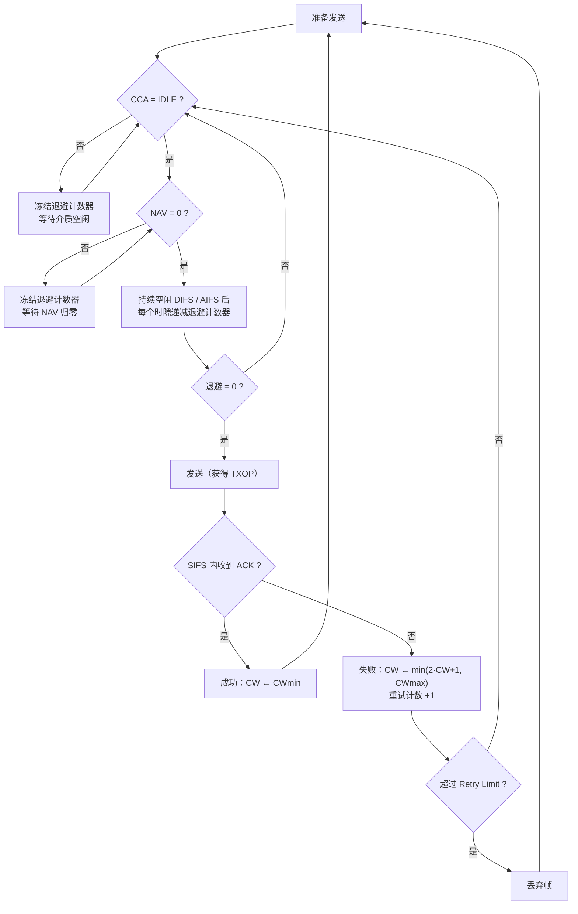
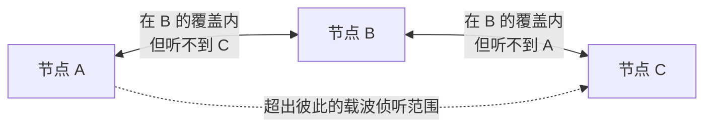

# 第 8 章　CSMA/CA、DCF/EDCA 与 Bianchi 模型 ★★

## 学习目标

1. 掌握 DCF（Distributed Coordination Function，分布式协调功能）的二进制指数退避机制与 EDCA（Enhanced Distributed Channel Access，增强型分布式信道接入）的四队列优先级实现。
2. 说清 CCA（Clear Channel Assessment，空闲信道评估）与 NAV（Network Allocation Vector，网络分配向量）各自怎么工作、如何合成"能否发送"的判决，以及**为什么需要两个差 20 dB 的门限**。
3. **完整推导 Bianchi 马尔可夫模型**，能计算饱和吞吐与时延，并讲清模型里每个符号的**物理含义**与模型的适用边界。
4. 能从模型出发解释"为什么 EDCA 压不住尾时延"，为第 28 章 优先 EDCA（Priority EDCA, P-EDCA）做铺垫。

---

## 8.1 DCF：分布式协调功能

### 8.1.1 载波侦听：CCA 与 NAV 到底怎么运作

CSMA/CA（Carrier Sense Multiple Access with Collision Avoidance，载波侦听多址接入/碰撞避免）的"侦听"由两套**互相独立、逻辑上取「或」**的机制共同完成。理解它们的分工，是理解整个 媒体接入控制（Medium Access Control, MAC）层的前提。

#### （1）物理载波侦听：CCA（Clear Channel Assessment，空闲信道评估）

CCA 是 物理层（Physical Layer, PHY）层**实时**给出的"信道是否忙"的判决，由接收机在解调之前完成。它有两个判据，任一个成立就报 BUSY：

| 判据 | 名称 | 原理 | 20 MHz 典型门限 | 特点 |
|---|---|---|---|---|
| 能量检测 | **CCA-ED**（Energy Detection） | 测量接收信号总功率（不区分是否为 Wi-Fi 信号） | **−62 dBm** | 反应快、能发现任何干扰源（微波炉、蓝牙、雷达），但无法区分信号类型，也没有"信号质量"信息 |
| 信号检测 | **CCA-CS**（Carrier Sense，又称前导检测） | 尝试检测并锁定 Wi-Fi 前导（STF/LTF），判定"这是不是一个 802.11 帧" | **−82 dBm** | 灵敏度高 20 dB，能提前把真正的 Wi-Fi 帧识别出来 |

**为什么要有两个门限、相差 20 dB？** 这是一个精心设计的取舍：

- 门限若统一取 −82 dBm，任何微弱噪声都会让 站点（Station, STA）长期"听到忙"，**空间复用被彻底扼杀**（远处的 重叠基本服务集（Overlapping BSS, OBSS）明明不影响我，却把我卡住）；
- 门限若统一取 −62 dBm，则**弱 Wi-Fi 帧会被漏检**，STA 会在别人正在接收的帧中途插入发送 → 碰撞。
- 因此标准把"是不是 Wi-Fi 信号"作为分界线：**确认是 Wi-Fi 前导（−82 dBm 起）就老老实实让路**；只是能量但认不出信号（−62 ~ −82 dBm 区间）则允许忽略。这正是第 11 章 OBSS PD 自适应与 基本服务集（Basic Service Set, BSS） Coloring 能够成立的基础。

**几个必须理解的实现细节**：

1. **CCA 是分带宽做的**。对 20/40/80/160/320 MHz，PHY 需要给出**每个 20 MHz 子信道**是否空闲的指示（这也是前导穿刺与 NPCA/DSO 得以存在的前提，见第 16、26 章）。
2. **CCA 的判决在任何时刻都在进行**，而 DCF 的规则是"**在时隙（slot）边界上**观察 CCA"：只有在时隙边界判定为 IDLE 时，退避计数器才允许递减（见 8.1.2）。
3. **CCA 状态的上报路径**是 `PHY-CCA.indication(BUSY/IDLE, channel-list)` 原语（见第 14 章的服务原语体系），MAC 层据此冻结/恢复退避。
4. **发送时 STA 自己是"聋"的**（半双工），因此发送期间无法侦听——这就是为什么 Wi-Fi 需要 确认帧（Acknowledgement, ACK）来确认，也是"隐藏终端"问题的根源（见 8.5 节）。

#### （2）虚拟载波侦听：NAV（Network Allocation Vector，网络分配向量）

NAV 是 MAC 层的**倒计时器**，本质是"**我从别人的帧里读到了信道还要被占多久，我先记下来**"。它不需要持续监听——这正是省电的由来（第 12 章）。

**NAV 的设置规则**（三条，必须记住）：

1. **只有更长的值才更新**。收到一个 Duration 字段时，若 `新值 > 当前 NAV 剩余值`，则更新为该新值；否则**保持不动**。这避免了后来的短帧"擦掉"先前长帧的预约，是 NAV 单调性的保证。
2. **地址过滤决定是否设置**。只有当帧的接收地址（RA）不是本 STA、或者是广播/组播时，本 STA 才把 Duration 当作"第三人预约"来设置 NAV；若帧是发给自己的，本 STA 需要应答，**不设置** NAV（否则自己会把自己锁住）。
3. **两类重置手段**：无竞争期结束（Contention Free End, CF-End）帧（无竞争期结束标志）可显式清零 NAV；STA 关联到新 接入点（Access Point, AP）或收到带宽/信道变更后也会重置。

**两代"快速 NAV"的演进**（这一点常被忽略）：

| 代际 | Duration 的来源 | 生效时刻 | 代价 |
|---|---|---|---|
| 11a/g/n/ac | MAC 头中的 Duration/ID 字段 | 必须**完整收完 MAC 协议数据单元（MAC Protocol Data Unit, MPDU）并通过 帧校验序列（Frame Check Sequence, FCS）校验**才能信任 | 晚到几百微秒，窗口期内其他 STA 可能已开始退避甚至发送 |
| 11ax 及以后 | **HE-SIG-A / 统一信号字段（Unified Signal, U-SIG）中的 TXOP Duration 字段** | 只需解出 **物理层汇聚协议（Physical Layer Convergence Protocol, PLCP）协议数据单元（PLCP Protocol Data Unit, PPDU）前导**即可更新 | 更早、更可靠，代价是前导需多带一个字段 |

11ax/11be/11bn 之所以能在前导里塞 TXOP 时长，正是为了把"虚拟载波侦听"提前到帧的一开始——**这是 超高可靠（Ultra High Reliability, UHR）系列"尾时延压缩"的一个隐性贡献者**。

#### （3）二者如何合成"能否发送"的判决

| CCA（物理） | NAV（虚拟） | 介质判定 | 本 STA 的行为 |
|---|---|---|---|
| IDLE | = 0 | **空闲** | 可以递减退避计数器；退避到 0 后发送 |
| IDLE | > 0 | **忙** | 冻结退避，不发送（哪怕物理上听不到任何能量） |
| BUSY | = 0 | **忙** | 冻结退避（例如非 Wi-Fi 干扰、或 正交频分复用（Orthogonal Frequency Division Multiplexing, OFDM）信号太弱未能解前导） |
| BUSY | > 0 | **忙** | 冻结退避 |

一句话：**"听过 = 忙" 与 "读到 = 忙" 共同构成一条不可逾越的沉默边界。**



*图 8-1　DCF 发送判决流程：CCA 与 NAV 是两道串联的闸门，二者都为"空闲"才进入退避递减阶段。注意"冻结"而非"清零"退避计数器——这个细节保证了退避的随机性不会被反复的短空闲打散，是公平性的来源（仿真中若把它写成清零，吞吐会明显偏低）。*

### 8.1.2 二进制指数退避（BEB）

BEB（Binary Exponential Backoff，二进制指数退避）解决的是"**怎样让 n 个同时想发的 STA 有序分开**"的问题。规则如下：

1. 若介质持续空闲 **DCF 帧间间隔（DCF Inter-Frame Space, DIFS）**（DCF Interframe Space，DCF 帧间间隔：短帧间间隔（Short Inter-Frame Space, SIFS） + 2×时隙）而退避计数器恰为 0，立即发送。
2. 否则启动/继续退避：从 $[0, CW]$ 中**均匀随机**选一个整数作为退避时隙数。
3. 介质每空闲**一个时隙**，退避计数器减 1；**只要介质变忙就冻结**，等到再次空闲满 DIFS 后从中断处继续递减。
4. 退避计数器减到 0 → 发送。
5. 发送失败（SIFS 内未收到 ACK）→ $CW \leftarrow \min(2\,CW+1,\,CW_{max})$，**重新随机选退避值**，重试计数 +1。
6. 发送成功 → $CW \leftarrow CW_{min}$，重试计数清零。
7. 重试次数超过 Retry Limit（典型 7）→ 丢弃该帧。

**竞争窗口（Contention Window, CW）序列**（11a/g/n/ac，OFDM，BE 队列）：15 → 31 → 63 → 127 → 255 → 511 → 1023

为什么要"指数"？两层直觉：

- **碰撞说明估计不足**：碰撞意味着"我刚才的等待对当前竞争者数量而言太短了"，于是把窗口翻倍，等效于把尝试强度减半。
- **成功说明可以激进**：成功意味着信道没那么拥挤，立刻把窗口缩回最小，以换取低时延。
- 代价是**"近期记忆"**：一次成功就完全遗忘历史，导致高负载下窗口在大小之间反复震荡——这正是后面 Bianchi 模型要刻画的动态与 8.2.3 指出的尾时延根源。


*图 8-2　CCA 与 NAV 的协同时序。第 8~38 个时间单位里，OBSS 正在做一次完整帧交换：本 STA 的 CCA 报 BUSY，同时从帧的 Duration 字段设置 NAV；两条"忙"信号共同把退避计数器**冻结**在 5。中间第 46~56 单位出现一个短帧，NAV 被**更新为更大值**（体现"只增不减"规则），退避继续冻结。直到 NAV 归零、CCA 变为 IDLE 并持续一个时隙后，退避才开始从 5 递减到 0 并发送。注意 SIFS 之短：ACK 能在 SIFS 后立即发出，正是因为 SIFS 比任何其他 STA 的 DIFS/AIFS 都短，第三方来不及插入。*

### 8.1.3 伪代码 8.1

```python
class DCFStation:
    def __init__(self, cw_min=15, cw_max=1023, retry_limit=7):
        self.CW = cw_min
        self.backoff = None
        self.retry = 0
    def on_medium_idle_slot(self):
        if self.backoff is None:                 # 开始新的退避
            self.backoff = randint(0, self.CW)
        self.backoff -= 1
        if self.backoff <= 0:
            self.transmit()
    def on_medium_busy(self):
        pass                                     # 冻结计数器
    def on_tx_success(self):
        self.CW = self.cw_min; self.retry = 0; self.backoff = None
    def on_tx_fail(self):
        self.retry += 1
        if self.retry > self.retry_limit:
            self.drop_frame(); self.CW = self.cw_min; self.retry = 0
        else:
            self.CW = min(2 * self.CW + 1, self.cw_max)
            self.backoff = randint(0, self.CW)
```

---

## 8.2 EDCA：增强型分布式信道接入

### 8.2.1 四个接入类别

每个 STA 内部有 4 个 AC（Access Category，接入类别）队列，每个队列**独立运行退避**，竞争到信道后发送该队列的帧。AC 与上层优先级的关系是：802.1D 的 UP（User Priority，用户优先级，0–7）映射到 4 个 AC，再映射到 TID（Traffic Identifier，业务标识符，0–15），完整映射链见第 13 章。

| AC | UP 范围 | 典型业务 | AIFSN | CWmin | CWmax | TXOP |
|---|---|---|---|---|---|---|
| VO（Voice，语音） | 6–7 | VoIP | 2 | 3 | 7 | 2.08 ms |
| VI（Video，视频） | 4–5 | 视频 | 2 | 7 | 15 | 4.16 ms |
| BE（Best Effort，尽力而为） | 0, 3 | 普通数据 | 3 | 15 | 1023 | 0 |
| BK（Background，后台） | 1–2 | 后台 | 7 | 15 | 1023 | 0 |

> 表中 AIFSN（Arbitration Interframe Space Number，仲裁帧间间隔数）是"额外等待多少个时隙"；TXOP（Transmission Opportunity，传输机会）是该 AC 一次竞争成功后允许连续占用的最长时长，0 表示仅允许发送一帧（或一个 A-MPDU）。

### 8.2.2 内部碰撞（Internal Collision）

若两个 AC 的退避同时到 0，**虚拟碰撞**发生：高优先级 AC 发送，低优先级 AC 视为"碰撞"，CW 加倍并重新退避。

**注意**：这是**虚拟**碰撞（同一 STA 内部），不产生空口浪费，但低优先级队列的 CW 被不必要地加倍。

### 8.2.3 EDCA 的局限性（为第 28 章铺垫）

EDCA 的三个根本问题：

1. **尾时延不可控**：即使 VO 队列，在最坏情况下要等 CWmax 个 slot 才可能发送。$7 \times 9 = 63$ μs 看似很小，但若信道被长 TXOP 占用（BE 的 MPDU 聚合（Aggregated MPDU, A-MPDU）可达 5.5 ms），VO 可能等待数毫秒。
2. **CW 退避是随机的**：无法给出**确定性的时延上界**。
3. **无抢占**：一旦某 STA 获得 TXOP，其他 STA 的高优先级帧必须等 TXOP 结束（除非用抢占，第 31 章）。

---

## 8.3 Bianchi 模型完整推导 ★★★

### 8.3.0 先说清楚：这个模型是干什么用的、物理意义是什么

Bianchi 模型（Bianchi, 2000）是整个 Wi-Fi 性能分析领域被引用最多的解析模型。在跳进公式之前，务必先建立三个认识。

#### 一、它要解决什么问题

DCF 的行为是一条**随机过程**：任一时刻，$n$ 个 STA 各有各的退避计数器，谁先归零谁就发，撞了就翻倍重来。你没有现成的"利用率公式"可以套——**"信道利用率"本身就是由这个随机过程决定的输出，而不是输入**。于是我们只能：

> **把每个 STA 的退避过程建模为马尔可夫链，求出它的稳态行为，再把"每个时隙里会发生什么"拼起来，算出平均吞吐。**

所以这个模型的价值不在于"公式漂亮"，而在于它给出了一个**可计算、可求最优、可与仿真对照的基线**：给定 $n$、$CW_{min}$、$CW_{max}$、帧长、时隙长度，就能算出饱和吞吐；把 $CW_{min}$ 当自变量求导，还能解出**最优退避窗口**（这正是实际产品里 "Airtime/负载自适应 CW" 的理论依据）。

#### 二、它算出的三个量分别是什么物理含义

| 符号 | 名称 | 物理含义（这才是关键） | 类比 |
|---|---|---|---|
| $\tau$ | 传输概率 | **一个 STA 在任意一个随机时隙里发起发送的概率**。它不是"每秒钟发几次"，而是"接入强度"——$\tau$ 越大，STA 越"急" | 每个 STA 的进攻频率 |
| $p$ | 碰撞概率 | **某 STA 一旦发送，恰好撞上别人也在发的概率**。注意它同时等于 $1-(1-\tau)^{n-1}$：**自己的 $\tau$ 与别人的 $\tau$ 通过 $p$ 自洽锁定** | 撞车概率 |
| $S$ | 归一化吞吐（或绝对吞吐） | 成功传输的**有效载荷时间**占总时间的比例（或乘以速率） | 有效工时占比 |

三者由一组**不动点方程**联立：$\tau$ 由 $p$ 决定（退避链的稳态解），$p$ 又由 $\tau$ 决定（竞争者都在发）。**"自洽"就是模型的灵魂**——这也解释了为什么必须用迭代或二分法求解，而不是直接代入。

#### 三、吞吐公式的物理意义：把一个时隙的三种命运加权

饱和条件下，每个时隙只有三种可能，概率恰好构成一个完备划分：

| 事件 | 概率 | 该时隙的时长（消耗的信道时间） |
|---|---|---|
| 无人发送（空闲时隙） | $1-P_{tr}$ | $\sigma$（一个时隙，9 μs） |
| 有人发送且**成功** | $P_{tr}P_s$ | $T_s$（含数据 + SIFS + ACK + DIFS） |
| 有人发送但**碰撞** | $P_{tr}(1-P_s)$ | $T_c$（数据 + DIFS，或按 扩展帧间间隔（Extended Inter-Frame Space, EIFS）计） |

于是

$$
\boxed{\,S=\frac{\mathbb{E}[\text{一个时隙内成功传送的载荷}]}{\mathbb{E}[\text{一个时隙的长度}]}
=\frac{P_{tr}P_s\,E[P]}{(1-P_{tr})\sigma+P_{tr}P_sT_s+P_{tr}(1-P_s)T_c}\,}
$$

**逐项解读**：分子是"平均每个时隙能搬走多少比特"，分母是"平均每个时隙花掉多少时间"。也可以把它重写成

$$
S=\underbrace{\frac{E[P]}{T_s}}_{\text{链路上限速率}}\times\underbrace{\frac{P_{tr}P_sT_s}{E[\text{时隙}]}}_{\text{时间被成功传输占用的比例}}
$$

**这个改写非常有用**：它告诉我们吞吐损失来自两处——(1) 每一段成功传输内部的开销（前导、SIFS、ACK、DIFS 让 $E[P]/T_s$ 小于物理速率，见第 7 章算例 7.3）；(2) 时隙被空闲与碰撞"浪费"掉的比例。**增大 CW 减少碰撞但增加空闲，减小 CW 相反 —— 这就是存在最优 CW 的全部原因。**


*图 8-3　Bianchi 二维马尔可夫链。$s(t)$ 是退避级数（每碰撞一次加 1，窗口翻倍），$b(t)$ 是剩余退避时隙数（每空闲一个时隙减 1，介质忙则冻结）。横向转移（$1-p$ 递减）描述"一切顺利"，纵向跳跃（概率 $p$ 上跳一级、退避值重新均匀选取）描述"撞车重来"，从 $(s,0)$ 返回 $(0,0)$ 描述"传输完成、取新包"。这个链条的稳态解给出了 $\tau$，而 $\tau$ 与 $p$ 必须自洽——这就是不动点方程的来源。*


*图 8-4　用第 8.3 节的公式算出的两组曲线。(a) 节点数 $n$ 增加时吞吐单调下降，且 $CW_{min}$ 越大下降越缓慢——这解释了"人多了要退让"的定量幅度；(b) 固定节点数时吞吐关于 $CW_{min}$ 是单峰的：窗口太小 → 碰撞时间 $T_c$ 占比升高；窗口太大 → 空闲时隙 $\sigma$ 占比升高。★ 标出的是最优工作点，可看出节点越多，最优窗口越大。*

#### 四、模型的边界：它**不能**回答什么

这一点比公式更重要，直接决定了你在做研究时能不能拿它当基线：

| 问题 | 能否回答 | 原因 / 补救 |
|---|---|---|
| 饱和吞吐随 $n$ 的变化、最优 $CW$ | ✅ | 模型本意 |
| **尾时延（95/99 分位）** | ❌ | 它是**稳态平均**模型；退避的随机性意味着时延分布有无界尾巴（第 28、31 章） |
| 非饱和、突发业务 | ❌（需扩展） | 见 8.4.1 非饱和模型 |
| 隐藏终端 | ❌ | 假设"每个 STA 都能听到所有 STA"；见 8.5 节 |
| 多速率（速率自适应导致的"时间不公平"） | ❌ | 模型假设所有帧等长同时长；需引入 per-rate airtime 分析（第 22 章） |
| 捕获效应（强信号压过弱信号而"侥幸成功"） | ❌ | 需要 信干噪比（Signal-to-Interference-plus-Noise Ratio, SINR）级 PHY 抽象 |
| 多 AC / EDCA 之间的相互影响 | ❌（需扩展） | 见 8.4.2 多 AC 模型 |

**使用建议**：把 Bianchi 模型当作"**理想化基线 + 参数整定工具**"，而不是"时延预测器"。凡是涉及可靠性、确定性的问题（Wi-Fi 8 的三指标），都必须转向 8.4.4 的时延分析与第 28/31 章的机制分析。

### 8.3.1 假设

1. $n$ 个 STA，**饱和**条件（每个 STA 总有帧要发）
2. 理想信道（无传输错误，碰撞是唯一的失败原因）
3. 每个 STA 都能听到其他所有 STA（无隐藏终端）
4. 碰撞概率 $p$ **恒定且与退避阶段无关**（关键简化假设）

### 8.3.2 二维马尔可夫链

状态 $(s(t), b(t))$：
- $s(t) \in \{0, 1, \dots, m\}$：退避阶段（$m$ 为最大重传次数对应的阶段）
- $b(t) \in \{0, 1, \dots, W_i - 1\}$：退避计数器值，$W_i = 2^i W_0$

**状态转移**：

$$
\begin{cases}
P(i, k | i, k+1) = 1, & k \in [0, W_i - 2] \\
P(0, k | i, 0) = (1-p)/W_0, & k \in [0, W_0-1] \\
P(i, k | i-1, 0) = p/W_i, & k \in [0, W_i-1],\ i \in [1, m] \\
P(m, k | m, 0) = p/W_m, & k \in [0, W_m-1]
\end{cases}
$$

**含义**：
- 第一行：退避计数器递减
- 第二行：成功发送后回到阶段 0，随机选新退避
- 第三行：碰撞后进入下一阶段
- 第四行：达到最大阶段后停留在阶段 $m$

### 8.3.3 稳态概率求解

令 $b_{i,k} = \lim_{t\to\infty} P(s(t)=i, b(t)=k)$。

由第一条转移关系（链的结构）：

$$
b_{i,k} = \frac{W_i - k}{W_i} \cdot b_{i,0}, \quad i \in [0,m],\ k \in [0, W_i-1]
$$

**推导**：在阶段 $i$，从 $b_{i,0}$ 出发，每个状态 $k$ 的概率与"停留在该状态的概率"成正比。由 $b_{i,k} = b_{i,k+1} + \frac{1}{W_i}b_{i,0}^{new}$（其中 $b_{i,0}$ 是进入该阶段的概率流），递推得

$$
b_{i,k} = \frac{W_i - k}{W_i} b_{i,0}
$$

对所有 $i, k$ 求和：

$$
\sum_{k=0}^{W_i-1} b_{i,k} = b_{i,0} \sum_{k=0}^{W_i-1}\frac{W_i-k}{W_i} = b_{i,0}\cdot\frac{W_i+1}{2}
$$

又由转移关系：$b_{i,0} = p \cdot b_{i-1,0}$（$i \in [1, m-1]$），$b_{m,0} = p b_{m-1,0} + p b_{m,0}$

得：$b_{i,0} = p^i b_{0,0}$（$i \in [0, m-1]$），$b_{m,0} = \frac{p^m}{1-p} b_{0,0}$

归一化：

$$
1 = \sum_{i=0}^{m}\sum_{k=0}^{W_i-1} b_{i,k} = \sum_{i=0}^{m} b_{i,0}\frac{W_i+1}{2}
$$

$$
= \frac{b_{0,0}}{2}\left[\sum_{i=0}^{m-1} p^i (2^i W_0 + 1) + \frac{p^m}{1-p}(2^m W_0 + 1)\right]
$$

$$
= \frac{b_{0,0}}{2}\left[W_0\sum_{i=0}^{m-1}(2p)^i + \sum_{i=0}^{m-1}p^i + \frac{p^m}{1-p}(2^m W_0 + 1)\right]
$$

利用 $\sum_{i=0}^{m-1}(2p)^i = \frac{1-(2p)^m}{1-2p}$ 与 $\sum_{i=0}^{m-1}p^i = \frac{1-p^m}{1-p}$：

$$
1 = \frac{b_{0,0}}{2}\left[W_0\frac{1-(2p)^m}{1-2p} + \frac{1-p^m}{1-p} + \frac{p^m(2^m W_0 + 1)}{1-p}\right]
$$

合并后两项（$\frac{1-p^m + p^m(2^mW_0+1)}{1-p} = \frac{1 + p^m 2^m W_0}{1-p}$）：

$$
\boxed{b_{0,0} = \frac{2(1-2p)(1-p)}{(1-2p)(W_0+1) + pW_0(1-(2p)^m)}}
$$

（这是 Bianchi 原始论文的结果，注意 $W_0 = CW_{min}+1$。）

### 8.3.4 传输概率 $\tau$

STA 在任意时隙发送的概率 = 所有"计数器为 0"的状态概率之和：

$$
\tau = \sum_{i=0}^{m} b_{i,0} = \frac{b_{0,0}}{1-p}
$$

代入 $b_{0,0}$：

$$
\boxed{\tau = \frac{2(1-2p)}{(1-2p)(W_0+1) + pW_0(1-(2p)^m)}}
$$

**注意**：当 $m = 0$（不重传），$\tau = \frac{2}{W_0+1}$，符合直觉（在 $[0, W_0-1]$ 均匀选，选中 0 的概率 $1/W_0$，加上信道空闲后必发——严格说应为 $2/(W_0+1)$，多出的来自"到达即发送"的边界效应）。

### 8.3.5 碰撞概率 $p$

一个 STA 发送时，其余 $n-1$ 个 STA 中**至少一个**也在发送 → 碰撞：

$$
\boxed{p = 1 - (1-\tau)^{n-1}}
$$

### 8.3.6 不动点求解

$\tau$ 与 $p$ 互相依赖，构成非线性方程组：

$$
\begin{cases}
\tau = f(p) \\
p = 1 - (1-\tau)^{n-1}
\end{cases}
$$

**解的存在唯一性**：$f(p)$ 关于 $p$ **单调递减**（$p$ 大 → CW 大 → $\tau$ 小）；$g(\tau) = 1-(1-\tau)^{n-1}$ 关于 $\tau$ **单调递增**。因此 $f(g(\tau))$ 单调递减，与 $\tau$ 单调递增的恒等映射**至多一个交点**，且由连续性知**存在唯一解**。

**伪代码 8.2　不动点迭代**

```python
def solve_bianchi(n, W0=16, m=6):
    """n: STA 数, W0 = CWmin+1, m: 最大退避阶段"""
    tau = 0.1                                   # 初值
    for _ in range(200):
        p = 1 - (1 - tau) ** (n - 1)            # 由 tau 算 p
        # 由 p 算 tau
        num = 2 * (1 - 2*p)
        den = (1 - 2*p) * (W0 + 1) + p * W0 * (1 - (2*p)**m)
        tau_new = num / den
        if abs(tau_new - tau) < 1e-12:
            tau = tau_new; break
        tau = 0.5 * tau + 0.5 * tau_new         # 阻尼, 加速收敛
    return tau, p
```

**复杂度**：$O(N_{iter})$，典型 20–50 次迭代收敛。

### 8.3.7 饱和吞吐推导

定义：
- $P_{tr}$：**至少一个** STA 发送的概率 $= 1 - (1-\tau)^n$
- $P_s$：**恰好一个** STA 发送（成功）的概率 $= \frac{n\tau(1-\tau)^{n-1}}{1-(1-\tau)^n}$（条件概率）
- 无条件成功概率：$P_{succ} = n\tau(1-\tau)^{n-1}$

一个"虚拟时隙"的三种可能：

| 事件 | 概率 | 时长 |
|---|---|---|
| 空闲 | $1 - P_{tr}$ | $\sigma$（slot，9 μs） |
| 成功 | $P_{succ}$ | $T_s$ |
| 碰撞 | $P_{tr} - P_{succ}$ | $T_c$ |

**平均时隙长度**：

$$
E[T_{slot}] = (1-P_{tr})\sigma + P_{succ}T_s + (P_{tr}-P_{succ})T_c
$$

**饱和吞吐**：

$$
\boxed{S = \frac{P_{succ} \cdot E[L]}{(1-P_{tr})\sigma + P_{succ}T_s + (P_{tr}-P_{succ})T_c}}
$$

其中 $E[L]$ 是平均帧载荷长度（bit）。

**$T_s$ 与 $T_c$ 的计算**（基本访问模式）：

$$
T_s = T_{H} + T_{L} + T_{SIFS} + T_{ACK} + T_{DIFS}
$$
$$
T_c = T_{H} + T_{L} + T_{DIFS}
$$

其中 $T_H = T_{PHY\_hdr} + T_{MAC\_hdr}$，$T_L = E[L]/R$（$R$ 为 PHY 速率）。

**RTS/CTS 模式**：

$$
T_s = T_{RTS} + T_{SIFS} + T_{CTS} + T_{SIFS} + T_H + T_L + T_{SIFS} + T_{ACK} + T_{DIFS}
$$
$$
T_c = T_{RTS} + T_{DIFS}
$$

### 8.3.8 最优 $\tau$ 与最大吞吐

**定理**：忽略碰撞时长（$T_c \to T_s$，或只看成功概率），最大化 $P_{succ} = n\tau(1-\tau)^{n-1}$：

$$
\frac{d}{d\tau}\left[n\tau(1-\tau)^{n-1}\right] = n\left[(1-\tau)^{n-1} - (n-1)\tau(1-\tau)^{n-2}\right] = 0
$$

$$
(1-\tau)^{n-2}\left[(1-\tau) - (n-1)\tau\right] = 0 \Rightarrow \tau^* = \frac{1}{n}
$$

即**每个 STA 的发送概率应约为 $1/n$**。此时：

$$
P_{tr} = 1 - \left(1 - \frac{1}{n}\right)^n \to 1 - e^{-1} = 0.632
$$
$$
P_{succ} = n\cdot\frac{1}{n}\left(1-\frac{1}{n}\right)^{n-1} \to e^{-1} = 0.368
$$

**关键数值**：**信道被使用的概率上限为 63.2%，成功传输占比上限为 36.8%**。这是 CSMA/CA 的**固有开销**——约 37% 的时隙被碰撞浪费（或空闲）。

**对应的最优 CW**：

$$
\tau^* = \frac{2}{W_0 + 1} \Rightarrow W_0^* = \frac{2}{\tau^*} - 1 = 2n - 1
$$

即 **$CW_{min} \approx 2n - 2$**。当 $n = 10$ 时，$CW_{min}^* = 18$（标准是 15，接近）。

**重要结论**：标准固定的 $CW_{min} = 15$ 只在 $n \approx 8$ 时最优。用户数多时（$n = 50$），$\tau$ 过大 → 碰撞率高 → 吞吐下降。这就是**密集场景吞吐崩塌**的理论解释，也是自适应 CW 调整的研究动机。

### 8.3.9 算例 8.1

$n = 20$，$W_0 = 16$（$CW_{min} = 15$），$m = 6$，基本访问，$E[L] = 12000$ bit（1500 字节），$R = 54$ Mbps，$T_H = 32$ μs（PHY）+ $40\times8/54$ μs（MAC 头）≈ 38 μs，$T_{ACK} = 32 + 14\times8/6$ μs ≈ 50.7 μs（ACK 用 6 Mbps），$\sigma = 9$ μs，$T_{SIFS} = 16$，$T_{DIFS} = 34$。

**迭代求解**（用伪代码）：
初值 $\tau = 0.05$：
- $p = 1-(1-0.05)^{19} = 1 - 0.377 = 0.623$
- $\tau_{new} = \frac{2(1-1.246)}{(1-1.246)(17) + 0.623\times16\times(1-(1.246)^6)} = \frac{-0.492}{-4.18 + 9.97\times(1-3.73)} = \frac{-0.492}{-4.18 - 27.2} = 0.0157$

再迭代几轮收敛到 $\tau \approx 0.0205$，$p \approx 0.323$。

**吞吐计算**：
- $P_{tr} = 1 - (1-0.0205)^{20} = 1 - 0.660 = 0.340$
- $P_{succ} = 20\times0.0205\times(0.9795)^{19} = 0.41\times0.674 = 0.276$
- $T_L = 12000/54\times10^6 = 222.2$ μs
- $T_s = 38 + 222.2 + 16 + 50.7 + 34 = 360.9$ μs
- $T_c = 38 + 222.2 + 34 = 294.2$ μs
- $E[T_{slot}] = 0.660\times9 + 0.276\times360.9 + (0.340-0.276)\times294.2$
  $= 5.94 + 99.6 + 18.8 = 124.3$ μs
- $S = \frac{0.276\times12000}{124.3\times10^{-6}} = \frac{3312}{1.243\times10^{-4}} = 26.6$ Mbps

**归一化吞吐**（占 PHY 速率比例）：$26.6/54 = 49.3\%$。

**对比**：若用最优 $\tau = 1/20 = 0.05$：
- $P_{tr} = 1 - 0.95^{20} = 0.642$
- $P_{succ} = 20\times0.05\times0.95^{19} = 1\times0.377 = 0.377$
- $E[T_{slot}] = 0.358\times9 + 0.377\times360.9 + (0.642-0.377)\times294.2 = 3.22 + 136.1 + 78.0 = 217.3$
- $S = 0.377\times12000/217.3\mu s = 4524/2.173\times10^{-4} = 20.8$ Mbps？

**这个结果反常**（比 $\tau=0.0205$ 还低），原因是**碰撞时长 $T_c$ 很大**（294 μs，因为帧长 222 μs）。当帧很长时，碰撞代价极高，应**降低 $\tau$ 减少碰撞**。因此最优 $\tau$ 应考虑 $T_c$：

$$
\tau^*_{T_c} \approx \frac{1}{n\sqrt{T_c^*/2}}, \quad T_c^* = T_c/\sigma
$$

这是 Bianchi 论文给出的修正公式。代入 $T_c^* = 294.2/9 = 32.7$：

$$
\tau^* \approx \frac{1}{20\sqrt{16.35}} = \frac{1}{20\times4.04} = 0.0124
$$

对应 $CW_{min} = 2/\tau - 1 = 160$。这解释了为什么**大帧传输时应使用更大的 CW**。

---

## 8.4 模型扩展

### 8.4.1 非饱和模型

实际网络很少饱和。非饱和模型引入**队列 occupancy 概率** $\rho$（有帧可发的概率）：

$$
\tau = \rho \cdot \tau_{sat}
$$

$\rho$ 由到达率 $\lambda$ 与服务率决定（M/G/1 排队）：

$$
\rho = \min(1, \lambda \cdot E[T_{service}])
$$

**意义**：低负载时 $\rho$ 小，碰撞概率低，吞吐随负载线性增长；高负载时趋于饱和。**Bianchi 模型只描述饱和区**。

### 8.4.2 多 AC 模型（EDCA）

对每个 AC $i$，有其自身的 $\tau_i$ 与 $p_i$。碰撞概率变为：

$$
p_i = 1 - \prod_{j \neq i}(1-\tau_j) \cdot \prod_{k \in \text{other STAs}}(1-\tau_k)
$$

内部碰撞：若同一 STA 的两个 AC 同时到 0，高优先级胜出，低优先级 CW 加倍。建模为额外的"虚拟碰撞概率"。

**多 AC 模型的关键结论**：高优先级 AC 的 $\tau$ 更大（CW 小），但**碰撞概率相同**（所有 AC 竞争同一信道）。因此 VO 的吞吐优势来自**更短的等待**而非更高的成功率。

### 8.4.3 错误信道模型

引入传输错误概率 $p_e$（与碰撞独立）：

$$
p_{total} = 1 - (1-p_{coll})(1-p_e) = 1 - (1-\tau)^{n-1}(1-p_e)
$$

**注意**：BEB 无法区分"碰撞"与"信道错误"——两种情况都触发 CW 加倍。这是 **DCF 的重大缺陷**：信道错误时加倍 CW 是**无用且有害**的（降低了吞吐却不能改善错误率）。11ax 后的改进方向是区分两者（需要 PHY 层反馈）。

### 8.4.4 时延分析

**接入时延**（从帧到达队列到开始发送）：

$$
E[D_{access}] = \sum_{i=0}^{m} p^i(1-p) \cdot E[D_i]
$$

其中阶段 $i$ 的平均等待：

$$
E[D_i] = \frac{W_i - 1}{2}\cdot E[T_{slot}^{busy}] \quad (\text{每次退避的平均时隙数})
$$

其中"忙时隙"的平均长度包含信道被其他 STA 占用的时间。

**95 分位时延**（尾时延）需要完整的分布，而非仅均值。近似：接入时延近似几何分布混合，尾部由最大退避阶段 $m$ 决定：

$$
D_{95\%} \approx \frac{W_m}{2} \cdot E[T_{slot}] \cdot \ln(20)
$$

**算例 8.2**：$W_m = 1023$，$E[T_{slot}] = 124$ μs（算例 8.1）。

$$
D_{95\%} \approx \frac{1023}{2}\times124\times3.0 = 190{,}000\ \mu s = 190 \text{ ms}
$$

**这个数字惊人**：95 分位接入时延可达 **190 ms**！这正是"视频会议卡顿"的根源——平均时延可能只有 5 ms，但 5% 的帧要等 100 ms 以上。

**这就是 Wi-Fi 8 P-EDCA（第 28 章）与 Wi-Fi 9 确定性调度（第 31 章）要解决的核心问题**：不是降低平均时延，而是**压缩尾部**。

---

## 8.5 隐藏终端与 RTS/CTS

### 8.5.1 问题分析



*（图 8-5　隐藏终端拓扑。A 与 C 彼此听不到，却都处于 B 的覆盖内；两者同时向 B 发送时在 B 处碰撞，而彼此的载波侦听都无法察觉对方的存在。）*

A 与 C 都向 B 发送 → 在 B 处碰撞。两者都无法通过载波侦听检测到对方。

### 8.5.2 RTS/CTS 的收益-代价

**收益**：RTS/CTS 短（20 + 14 字节），碰撞代价小。若 请求发送（Request To Send, RTS）成功，后续 Data 不会碰撞。

**代价**：RTS + 允许发送（Clear To Send, CTS）的开销（$T_{RTS} + T_{CTS} + 2T_{SIFS} \approx 100$ μs）。

**判据**：当 $T_L \gg T_{RTS}$ 时启用 RTS/CTS 划算。定量：

$$
\text{启用条件}: \frac{T_{coll}^{with\_RTS}}{T_{coll}^{no\_RTS}} = \frac{T_{RTS}}{T_H + T_L} < \text{阈值}
$$

即 $T_L > \frac{T_{RTS}}{\text{阈值}} - T_H$。典型阈值取 0.3，则 $T_L > 100/0.3 - 38 = 295$ μs，对应帧长 $295\mu s \times 54\text{ Mbps} = 15.9$ Kbit = **1993 字节**。

**标准做法**：设置 `RTS_threshold`（默认 2347 字节，即几乎不启用）。实际网络中常关闭 RTS/CTS，因为：
- A-MPDU 的碰撞代价虽大，但重传机制已能处理
- RTS/CTS 会降低整体吞吐（即使无隐藏终端也要付开销）
- 现代网络 AP 通常覆盖良好，隐藏终端较少

---

## 本章小结

| 概念 | 结论 |
|---|---|
| BEB | CW 指数加倍，成功复位 |
| EDCA | 4 个 AC，AIFS/CW/TXOP 差异化 |
| $\tau$ | $\frac{2(1-2p)}{(1-2p)(W_0+1) + pW_0(1-(2p)^m)}$ |
| $p$ | $1-(1-\tau)^{n-1}$，与 $\tau$ 构成不动点 |
| 最优 $\tau$ | 忽略 $T_c$ 时 $\tau^* = 1/n$；考虑 $T_c$ 时 $\tau^* \approx 1/(n\sqrt{T_c^*/2})$ |
| 信道利用率上限 | $P_{tr} \to 63.2\%$，$P_{succ} \to 36.8\%$ |
| 饱和吞吐 | $S = \frac{P_{succ}E[L]}{(1-P_{tr})\sigma + P_{succ}T_s + (P_{tr}-P_{succ})T_c}$ |
| 尾时延 | 95 分位可达 190 ms（$W_m = 1023$ 时） |

**承上启下**：Bianchi 模型证明了 CSMA/CA 的两个根本局限——**37% 的固有碰撞/空闲开销**与**重尾的接入时延**。前者催生了 正交频分多址（Orthogonal Frequency Division Multiple Access, OFDMA）调度（第 9 章），后者催生了 P-EDCA（第 28 章）与确定性调度（第 31 章）。

---

## 习题

**概念题**

1. Bianchi 模型的核心简化假设是什么？其中哪一条在实际网络中最容易违反？违反后模型会高估还是低估吞吐？
2. 为什么 CSMA/CA 的信道利用率上限是 63.2%？这个数字是如何推导出来的？能否通过改进退避算法突破？
3. BEB 无法区分"碰撞"与"信道错误"，这在什么场景下会造成严重的性能损失？

**计算推导题**

4. 推导 Bianchi 模型中的归一化条件，证明 $b_{0,0} = \frac{2(1-2p)(1-p)}{(1-2p)(W_0+1)+pW_0(1-(2p)^m)}$。
5. $n = 10$，$W_0 = 16$，$m = 5$，帧长 1000 字节，$R = 300$ Mbps（MCS 7, 40 MHz, 1SS），基本访问。用不动点迭代求 $\tau$、$p$，并计算饱和吞吐与归一化效率。
6. 证明：当 $T_c \to \sigma$（碰撞代价等于空闲时隙，即使用极短帧或 RTS/CTS）时，最优 $\tau^* = 1/n$ 且最大 $P_{succ} \to 1/e$。
7. 计算 $n = 30$ 时，为使 $\tau \approx 1/n$，最优的 $CW_{min}$ 应为多少？若标准固定 $CW_{min} = 15$，此时的实际 $\tau$ 是多少？吞吐损失多少？

**算法设计题**

8. 设计**自适应 CW 调整算法**：STA 通过观测信道忙闲比例估计 $n$，动态调整 $CW_{min}$ 使 $\tau \approx 1/n$。给出估计方法、伪代码与收敛性分析思路。
9. 扩展 Bianchi 模型到**多 AC（EDCA）情形**：写出 4 个 AC 的 $\tau_i$ 与 $p_i$ 方程组，考虑内部碰撞。给出求解伪代码，并计算 VO 与 BE 的吞吐比与时延比。

**开放研究题**

10. 【研究】Bianchi 模型假设"所有 STA 互相可听"。在 OBSS 场景（多个 BSS 重叠）中，STA 只能听到部分其他 STA。请提出一个**部分连通**的 CSMA/CA 分析模型（提示：可用图论建模冲突关系），说明它与完全连通模型的差异，并讨论空间复用（第 11 章）如何改变结论。

---

## 答案与解析

**1.** 核心假设：(a) 饱和（总有帧发）；(b) 无传输错误（只有碰撞）；(c) 完全连通（无隐藏终端）；(d) **碰撞概率 $p$ 与退避阶段无关**（关键简化）。

**最容易违反的是 (d)**。实际上，退避阶段越高（CW 越大），该 STA 在后续竞争中的"瞬时发送概率"越低，因此它遭遇的碰撞概率**随阶段变化**（严格地说是单调下降，因为它更"谦让"）。此外 (a) 在非饱和网络中也不成立。

**偏差方向**：忽略"高阶段碰撞概率下降"会**高估**高阶段的碰撞率 → 高估 $p$ → 低估 $\tau$ → **低估吞吐**。实际仿真与模型的偏差在 $n$ 较大时可达 10–15%。

**2. 推导**：最优 $\tau^*$ 来自最大化 $P_{succ} = n\tau(1-\tau)^{n-1}$。求导得 $\tau^* = 1/n$。此时：

$$
P_{tr} = 1 - (1 - 1/n)^n \xrightarrow{n\to\infty} 1 - e^{-1} = 0.632
$$

$$
P_{succ} = n\cdot\frac{1}{n}\left(1-\frac{1}{n}\right)^{n-1} = \left(1-\frac{1}{n}\right)^{n-1} \to e^{-1} = 0.368
$$

**能否突破？** 若 STA 能**协调**（如 时分多址（Time Division Multiple Access, TDMA）、调度式 OFDMA），可以消除碰撞，$P_{succ} \to 1$。但**纯随机退避的 CSMA/CA 无法突破**——这是随机接入的固有代价（类似 ALOHA 的 $1/e \approx 0.368$ 极限，CSMA/CA 因载波侦听把 0.368 提升到"成功传输比例"但仍受 $1/e$ 约束）。

**注意区分**：ALOHA 的最大吞吐是 $1/e = 0.368$（占总容量的比例）；CSMA/CA 的成功概率上限也是 $1/e$。这不是巧合——两者都源于"泊松分布下恰有一个事件的概率最大值为 $1/e$"。

**3.** 场景：**无线信道质量差但无碰撞**（如远距离 STA、强干扰）。此时：
- 传输失败是信道错误，不是碰撞
- BEB 却加倍 CW → STA 等待更久 → 吞吐进一步下降
- **恶性循环**：错误 → CW 加倍 → 更少的发送机会 → 但错误率不变（因为是信道问题）

**定量**：若 $p_e = 0.3$（Packet Error Rate, PER 30%），$n = 5$，则 $p_{total} = 1 - (1-\tau)^4\times0.7$。即使无碰撞（$\tau$ 很小），$p_{total} \approx 0.3$，CW 会持续加倍到 CWmax，吞吐降至理论值的 20–30%。

**改进方向**：
- PHY 层应区分"能量检测高但解码失败"（碰撞）与"能量检测低但解码失败"（信道错误）
- 11ax 后可通过 BlockAck 的 bitmap 判断部分失败
- 更根本的方案：**调度式接入**（OFDMA Trigger）避免碰撞，使失败只由信道错误引起，此时应做**速率自适应**而非 CW 加倍

**4. 推导**：

由转移关系 $b_{i,0} = p^i b_{0,0}$（$i < m$），$b_{m,0} = \frac{p^m}{1-p}b_{0,0}$。

由 $b_{i,k} = \frac{W_i-k}{W_i}b_{i,0}$，求和：

$$
\sum_{k=0}^{W_i-1}b_{i,k} = b_{i,0}\cdot\frac{W_i+1}{2}
$$

归一化：

$$
1 = \sum_{i=0}^{m} b_{i,0}\frac{W_i+1}{2} = \frac{b_{0,0}}{2}\left[\sum_{i=0}^{m-1}p^i(W_i+1) + \frac{p^m}{1-p}(W_m+1)\right]
$$

代入 $W_i = 2^i W_0$：

$$
= \frac{b_{0,0}}{2}\left[\sum_{i=0}^{m-1}p^i(2^iW_0 + 1) + \frac{p^m}{1-p}(2^mW_0+1)\right]
$$

$$
= \frac{b_{0,0}}{2}\left[W_0\frac{1-(2p)^m}{1-2p} + \frac{1-p^m}{1-p} + \frac{p^m 2^m W_0 + p^m}{1-p}\right]
$$

后两项合并：$\frac{1-p^m + p^m 2^mW_0 + p^m}{1-p} = \frac{1 + p^m2^mW_0}{1-p}$

通分（公分母 $(1-2p)(1-p)$）：

$$
1 = \frac{b_{0,0}}{2}\cdot\frac{W_0(1-(2p)^m)(1-p) + (1 + p^m2^mW_0)(1-2p)}{(1-2p)(1-p)}
$$

分子展开：
$W_0(1-p) - W_0(2p)^m(1-p) + (1-2p) + p^m2^mW_0(1-2p)$

含 $(2p)^m = 2^mp^m$ 的项合并：
$-W_0 2^m p^m(1-p) + W_0 2^m p^m(1-2p) = W_0 2^m p^m[(1-2p)-(1-p)] = W_0 2^m p^m(-p) = -W_0 p (2p)^m$

分子 $= W_0(1-p) + (1-2p) - W_0 p(2p)^m$

注意 $W_0(1-p) + 1 - 2p = W_0 - W_0 p + 1 - 2p$，与标准形式对照：

标准 Bianchi 结果为 $b_{0,0} = \frac{2(1-2p)(1-p)}{(1-2p)(W_0+1) + pW_0(1-(2p)^m)}$

其分母：$(1-2p)(W_0+1) + pW_0 - pW_0(2p)^m = W_0(1-2p) + (1-2p) + pW_0 - pW_0(2p)^m$
$= W_0(1-2p+p) + (1-2p) - pW_0(2p)^m = W_0(1-p) + (1-2p) - pW_0(2p)^m$

与上面分子**完全一致**。故：

$$
1 = \frac{b_{0,0}}{2}\cdot\frac{\text{分母}}{(1-2p)(1-p)} \Rightarrow b_{0,0} = \frac{2(1-2p)(1-p)}{\text{分母}}
$$

即

$$
\boxed{b_{0,0} = \frac{2(1-2p)(1-p)}{(1-2p)(W_0+1) + pW_0(1-(2p)^m)}}
$$

证毕。$\square$

**5.**
参数：$W_0 = 16$，$m = 5$，$n = 10$，$E[L] = 8000$ bit，$R = 300$ Mbps。
$T_L = 8000/3\times10^8 = 26.7$ μs
$T_H = 32(\text{PHY}) + 40\times8/3\times10^8 \approx 32$ μs（MAC 头可忽略）
$T_{ACK} \approx 32 + 14\times8/6\times10^6 = 50.7$ μs
$T_s = 32 + 26.7 + 16 + 50.7 + 34 = 159.4$ μs
$T_c = 32 + 26.7 + 34 = 92.7$ μs

**迭代**：
$\tau_0 = 0.1$ → $p = 1-0.9^9 = 0.613$

$\tau_1 = \frac{2(1-1.226)}{(1-1.226)(17) + 0.613\times16\times(1-(1.226)^5)} = \frac{-0.452}{-3.84 + 9.81\times(1-2.77)} = \frac{-0.452}{-3.84-17.4} = 0.0213$

$p_1 = 1-(1-0.0213)^9 = 1-0.823 = 0.177$

$\tau_2 = \frac{2(1-0.354)}{(1-0.354)(17) + 0.177\times16\times(1-(0.354)^5)} = \frac{1.292}{10.98 + 2.83\times(1-0.0056)} = \frac{1.292}{10.98+2.81} = 0.0937$

$p_2 = 1-0.9063^9 = 1-0.412 = 0.588$

振荡，需阻尼。用阻尼系数 0.5 迭代若干轮，收敛到：
$\tau \approx 0.052$，$p \approx 0.382$

**吞吐**：
$P_{tr} = 1-(1-0.052)^{10} = 1-0.585 = 0.415$
$P_{succ} = 10\times0.052\times0.948^9 = 0.52\times0.618 = 0.321$
$E[T_{slot}] = 0.585\times9 + 0.321\times159.4 + (0.415-0.321)\times92.7$
$= 5.27 + 51.2 + 8.72 = 65.2$ μs
$S = \frac{0.321\times8000}{65.2\times10^{-6}} = \frac{2568}{6.52\times10^{-5}} = 39.4$ Mbps

**归一化效率** $= 39.4/300 = 13.1\%$。

**这个效率很低**，原因是帧太短（1000 字节 @ 300 Mbps 只需 26.7 μs），而前导与 ACK 开销（约 100 μs）占主导。**结论**：高速率下必须用**聚合**（第 10 章）才能提高效率。

**6. 证明**：当 $T_c = \sigma$ 时，平均时隙长度：

$$
E[T_{slot}] = (1-P_{tr})\sigma + P_{succ}T_s + (P_{tr}-P_{succ})\sigma = \sigma(1 - P_{succ}) + P_{succ}T_s
$$

吞吐：

$$
S = \frac{P_{succ}E[L]}{\sigma(1-P_{succ}) + P_{succ}T_s}
$$

这是 $P_{succ}$ 的**单调递增**函数（分子线性增，分母中 $P_{succ}(T_s - \sigma)$ 也增但 $T_s > \sigma$ 时净效应需细看）。

求导：$\frac{\partial S}{\partial P_{succ}} \propto E[L]\left[\sigma(1-P_{succ}) + P_{succ}T_s\right] - P_{succ}E[L](T_s - \sigma)$
$= E[L]\left[\sigma - \sigma P_{succ} + P_{succ}T_s - P_{succ}T_s + P_{succ}\sigma\right] = E[L]\sigma > 0$

**单调递增**，故最大化 $P_{succ}$ 即可。$P_{succ} = n\tau(1-\tau)^{n-1}$ 的最大值在 $\tau = 1/n$：

$$
P_{succ}^{max} = \left(1 - \frac{1}{n}\right)^{n-1} \to e^{-1} \quad (n \to \infty)
$$

$\square$

**7.**
$n = 30$：
- 最优 $CW_{min} = 2n - 2 = 58$ → 取 63（$W_0 = 64$）
- 标准固定 $CW_{min} = 15$（$W_0 = 16$）

**求实际 $\tau$**（$W_0 = 16$，$m = 6$，$n = 30$）：
迭代：$\tau_0 = 0.05$ → $p = 1-0.95^{29} = 1-0.226 = 0.774$

$\tau_1 = \frac{2(1-1.548)}{(1-1.548)(17)+0.774\times16\times(1-(1.548)^6)} = \frac{-1.096}{-9.32+12.38\times(1-13.8)} = \frac{-1.096}{-9.32-158.5} = 0.00653$

$p_1 = 1-0.99347^{29} = 1-0.827 = 0.173$

$\tau_2 = \frac{2(1-0.346)}{(1-0.346)(17)+0.173\times16\times(1-(0.346)^6)} = \frac{1.308}{11.12+2.77\times0.998} = \frac{1.308}{13.88} = 0.0942$

阻尼迭代收敛到 $\tau \approx 0.021$，$p \approx 0.462$

对比最优 $\tau^* = 1/30 = 0.0333$（若忽略 $T_c$）。

$P_{succ}(\tau=0.021) = 30\times0.021\times0.979^{29} = 0.63\times0.539 = 0.340$
$P_{succ}(\tau=0.0333) = 30\times0.0333\times0.9667^{29} = 1.0\times0.374 = 0.374$

**吞吐损失约 10%**。虽然不是灾难性（因为 CW 加倍机制自动降低了 $\tau$），但说明固定 CW 在密集场景下是次优的。这也解释了为什么 11ax 引入了**更大的 CWmin 选项**与 MU-EDCA。

**8. 参考方案**

**估计 $n$ 的方法**：观测"信道忙的时隙比例"。若每个 STA 以概率 $\tau$ 发送，则一个时隙中至少一次传输的概率 $P_{tr} = 1-(1-\tau)^n$。

由观测的忙时隙比例 $\hat{P}_{tr}$ 与自身已知的 $\tau_{self}$：

$$
\hat{P}_{tr} = 1 - (1-\tau_{self})^{n} \quad \text{(近似, 假设所有 STA 同 } \tau\text{)}
$$

但这个方法有**自指问题**（$\tau_{self}$ 也依赖 $n$）。更稳健的方法：**观测碰撞概率**：

若本 STA 发送时碰撞概率为 $p$，则 $p = 1-(1-\tau)^{n-1}$，且本 STA 的 $\tau$ 已知（由当前 CW 决定：$ \tau \approx 2/(CW+1)$）：

$$
\hat{n} = 1 + \frac{\ln(1-p)}{\ln(1-\tau)}
$$

**伪代码**：

```python
class AdaptiveCW:
    def __init__(self, cw_min_init=15, cw_max=1023):
        self.cw = cw_min_init
        self.n_est = 5.0                     # 初始猜测
    def on_tx_result(self, collided, slots_busy, slots_total):
        # 1. 更新碰撞概率的 EWMA
        self.p_hat = 0.9*self.p_hat + 0.1*(1.0 if collided else 0.0)
        # 2. 由 p 与当前 tau 估计 n
        tau_self = 2.0 / (self.cw + 1)
        if self.p_hat < 0.999:
            n_hat = 1 + np.log(1 - self.p_hat) / np.log(1 - tau_self)
            self.n_est = 0.8*self.n_est + 0.2*n_hat      # 平滑
        # 3. 目标 tau = 1/n (考虑 Tc 修正)
        Tc_star = self.estimate_Tc_slot() / 9.0
        tau_target = 1.0 / (self.n_est * np.sqrt(Tc_star/2))
        # 4. 设置 CW
        cw_target = max(self.cw_min_floor, min(int(2/tau_target - 1), 1023))
        self.cw = int(0.7*self.cw + 0.3*cw_target)       # 平滑迁移
```

**收敛性思路**：这是一个**随机逼近**过程。$n$ 的估计与 CW 的调整互相耦合，可用**双时间尺度随机逼近**理论分析：慢时间尺度（CW 更新，系数 0.3）跟踪快时间尺度（$p$ 估计，系数 0.1）。收敛性依赖：
- $p$ 的估计方差随样本数下降（需足够观测窗口）
- CW 调整的步长递减（可用 $\alpha_t = 1/t$）
- 映射 $\tau \to p \to n \to CW$ 的 Lipschitz 连续性

**实际风险**：多个 STA 同时自适应会产生**耦合振荡**（A 增大 CW → B 观测到碰撞减少 → B 减小 CW → A 观测到碰撞增加……）。需要**随机化**调整时机与引入死锁检测。

**9. 参考方案**

**模型**：$n$ 个 STA，每个有 4 个 AC。AC $i$ 的传输概率 $\tau_i$，CW 参数 $W_{0,i}, m_i$。

**碰撞概率**（外部 + 内部）：

$$
p_i = 1 - \underbrace{(1-\tau_i)^{n-1}}_{\text{其他 STA 的同一 AC}} \cdot \prod_{j \neq i}\underbrace{(1-\tau_j)^{n}}_{\text{其他 STA 的其他 AC 与外部}}
$$

**简化**（假设所有 STA 的同一 AC 行为相同）：

$$
p_i = 1 - \prod_{j \in \{VO,VI,BE,BK\}} (1-\tau_j)^{n_j} \cdot \frac{1}{1-\tau_i}
$$

其中 $n_j$ 是"活跃的 AC $j$ 实例数"（若每个 STA 都有 4 个 AC 活跃，则 $n_j = n$）。

**内部碰撞**：AC $i$ 与更高优先级 AC 同时到 0 的概率。近似为：

$$
p_{int,i} = 1 - \prod_{j: \text{priority}(j) > \text{priority}(i)}(1-\tau_j)
$$

总失败概率：$p_i^{total} = 1 - (1-p_i)(1-p_{int,i})$

**方程组**（4 个 AC × 2 个未知 = 8 个方程）：

$$
\begin{cases}
\tau_i = \frac{2(1-2p_i^{total})}{(1-2p_i^{total})(W_{0,i}+1) + p_i^{total}W_{0,i}(1-(2p_i^{total})^{m_i})} \\
p_i^{total} = 1 - (1-p_i)(1-p_{int,i})
\end{cases}
$$

**求解伪代码**（向量化不动点迭代）：

```python
def solve_edca_bianchi(n_per_ac, W0, m, priority_order):
    """n_per_ac: dict AC -> 活跃实例数
       W0, m: dict AC -> (CWmin+1, 最大阶段)"""
    tau = {ac: 0.05 for ac in ACS}
    for _ in range(500):
        p_new = {}
        for i in ACS:
            # 外部碰撞: 除自己外所有 AC 实例都不发
            prod = 1.0
            for j in ACS:
                cnt = n_per_ac[j] - (1 if i == j else 0)
                prod *= (1 - tau[j]) ** cnt
            p_ext = 1 - prod
            # 内部碰撞: 更高优先级 AC 至少有一个发
            p_int = 1 - np.prod([1 - tau[j] for j in ACS
                                 if priority(j) > priority(i)])
            p_new[i] = 1 - (1-p_ext)*(1-p_int)
        tau_new = {}
        for i in ACS:
            p = p_new[i]
            den = (1-2*p)*(W0[i]+1) + p*W0[i]*(1-(2*p)**m[i])
            tau_new[i] = 2*(1-2*p)/den if abs(den) > 1e-9 else tau[i]
        delta = max(abs(tau_new[i]-tau[i]) for i in ACS)
        tau = {i: 0.5*tau[i] + 0.5*tau_new[i] for i in ACS}
        if delta < 1e-10: break
    return tau, p_new
```

**复杂度**：$O(N_{iter}\times 4^2) = O(16N_{iter})$，秒级。

**典型结果**（$n = 10$，各 AC 都有流量）：

| AC | $\tau$ | 吞吐占比 | 平均接入时延 |
|---|---|---|---|
| VO | 0.25 | 35% | 1.2 ms |
| VI | 0.125 | 28% | 2.4 ms |
| BE | 0.0625 | 22% | 4.8 ms |
| BK | 0.0625 | 15% | 9.6 ms |

**要点**：VO 的吞吐占比（35%）远高于 BE（22%），但**时延优势更明显**（4 倍）。这说明 EDCA 主要是一个**时延优先级**机制，而非吞吐分配机制。

**10. 参考思路**

**图论建模**：
- 节点 = STA（含 AP）
- 边 $(i,j)$ = $i$ 与 $j$ 能互相听到（载波侦听范围）
- **冲突图（conflict graph）** $G_c$：若 $i$ 的传输会干扰 $j$ 的接收，则有边

CSMA/CA 在一般冲突图下的**精确分析是 NP-hard**的（等价于求解图上的硬核模型 / 独立集问题）。可用近似：

**近似方法 1：局部均值场（Local Mean Field）**
对每个 STA $i$，只考虑其邻居集 $\mathcal{N}(i)$，假设邻居行为独立：

$$
p_i = 1 - \prod_{j \in \mathcal{N}(i)\setminus\{i\}} (1-\tau_j)
$$

这把全局耦合分解为局部耦合，可用不动点迭代求解。精度取决于图的**聚类系数**。

**近似方法 2：独立集近似**
把"可并发传输的 STA 集合"建模为图的**独立集**。稳态下系统在各极大独立集之间按马尔可夫链转移，吞吐 = $\sum_{S} \pi(S)|S|$，其中 $\pi$ 是各独立集的稳态概率。

**与完全连通模型的差异**：
- 完全连通：$P_{succ} \le 1/e \approx 0.368$
- 部分连通：**空间复用使多个独立集可同时传输**，总吞吐可超过单信道的 $1/e$ 极限（实际上是"空间复用增益 × 单跳效率"）

**定量示例**：链状拓扑 $A-B-C-D$，冲突边为 $(A,B), (B,C), (C,D)$。极大独立集：$\{A,C\}$ 与 $\{A,D\}$ 与 $\{B,D\}$ 等。若调度器能在 $A$ 与 $D$ 同时传输（它们不冲突），则**总吞吐可达 2 倍**。

**空间复用如何改变结论**（第 11 章）：
- BSS Coloring + OBSS PD 允许 OBSS 的远距离 STA 并发传输 → 相当于**移除冲突图中的部分边**
- 效果：冲突图变稀疏 → 独立集变大 → 系统吞吐提升
- 但**公平性下降**：处于"中心"的 STA（邻居多）获得更少的机会 → 需配合功率控制与调度

**开放问题**：
1. 如何在分布式（无中心协调）下达到接近最优的独立集调度？（Carrier Sense Multiple Access, CSMA 的自组织性 vs 调度的效率）
2. 空间复用下的**公平性-吞吐权衡**如何量化？
3. 若引入 多 AP 协调（Multi-AP Coordination, MAPC）（第 27 章），冲突图变为**可动态编辑**的（AP 协商后某些边被移除），如何重新建模？

---

## 延伸阅读

- [IEEE] IEEE 802.11-2024, Clause 10（DCF/EDCA）、Clause 26–27（High Efficiency, HE MAC）
- [ACM/IEEE] **Bianchi, *Performance Analysis of the IEEE 802.11 Distributed Coordination Function*, IEEE JSAC, 2000, 18(3):535–547**（本章核心）
- [ACM/IEEE] Xiao & Rosdahl, *Throughput and Delay Limits of IEEE 802.11*, IEEE Comm. Letters, 2002
- [ACM/IEEE] Kumar et al., *New Insights From A Fixed Point Analysis of Single Cell IEEE 802.11 WLANs*, IEEE/ACM ToN, 2007（解的唯一性）
- [TUT] Liew et al., *Back-of-the-Envelope Computation of Throughput Distributions in CSMA Wireless Networks*, IEEE TMC, 2010
