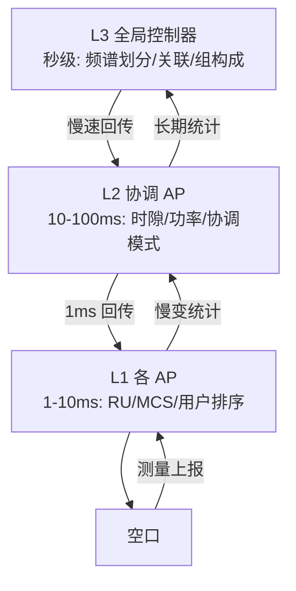

# 第 9 章　OFDMA 触发接入与上行调度 ★★

## 学习目标

1. 掌握触发帧（Trigger Frame, TF）的结构与上行正交频分多址（Orthogonal Frequency Division Multiple Access, OFDMA）的完整时序要求。
2. 能把资源单元（Resource Unit, RU）分配建模为优化问题，并实现贪心、比例公平、时延感知三类调度器。
3. 理解多用户多入多出（Multi-User Multiple-Input Multiple-Output, MU-MIMO）与 OFDMA 的联合调度问题及其实用启发式。
4. 理解缓冲状态报告（Buffer Status Report, BSR）量化误差对调度的影响。

---

## 9.1 上行 OFDMA 的协议机制

### 9.1.1 为什么需要"触发"

11ax 之前，上行传输是**竞争式**的（增强分布式信道接入，Enhanced Distributed Channel Access，EDCA）。OFDMA 要求多用户**同时**发送且时间对齐，这无法通过分布式竞争实现——必须由接入点（Access Point, AP）显式**调度**。

**Trigger Frame（TF，触发帧）** 承担三重角色：
1. **资源分配**：指定每个 站点（Station, STA）的 RU、调制编码方案（Modulation and Coding Scheme, MCS）、流数、目标 接收信号强度指示（Received Signal Strength Indicator, RSSI）
2. **同步**：提供统一的时序基准（Short Inter-Frame Space, SIFS 后同时发送）
3. **功率控制**：提供 AP Tx Power，STA 据此推算路径损耗并做开环功控

### 9.1.2 Trigger Frame 结构


*图 9-1　触发帧（Trigger Frame, TF）的字节布局（按字节宽度成比例绘制）。前 16 B 即标准 媒体接入控制（Medium Access Control, MAC）头，其后是 Common Info（≥8 B）与逐用户的 User Info List，末尾 4 B 为 帧校验序列（Frame Check Sequence, FCS）。*

**Common Info 字段**（关键部分）：

| 字段 | bit | 含义 |
|---|---|---|
| Trigger Type | 4 | 0=Basic, 1=Beamforming Report Poll, 2=MU-BAR, 3=多用户 RTS（Multi-User Request To Send, MU-RTS）, 4=BSRP, 5=BQRP, 6=空数据帧（Null Data Packet, NDP） Feedback Report Poll |
| UL Length | 12 | 指示 TB 物理层汇聚协议（Physical Layer Convergence Protocol, PLCP）协议数据单元（PLCP Protocol Data Unit, PPDU）的 传统信号字段（Legacy Signal, L-SIG） Length |
| More TF | 1 | 后续还有 TF |
| CS Required | 1 | 是否要求载波侦听 |
| UL BW | 2 | 上行带宽 |
| 保护间隔（Guard Interval, GI） And HE 长训练字段（HE Long Training Field, HE-LTF） Type | 2 | |
| AP Tx Power | 6 | 用于开环功控 |

**User Info 字段**：

| 字段 | bit | 含义 |
|---|---|---|
| AID12 | 12 | 关联 ID（0 = 随机接入 RU） |
| RU Allocation | 8 | RU 位置与大小索引 |
| UL 前向纠错（Forward Error Correction, FEC） Coding Type | 1 | 二进制卷积码（Binary Convolutional Coding, BCC） / 低密度奇偶校验码（Low-Density Parity-Check, LDPC） |
| UL MCS | 4 | |
| UL DCM | 1 | 双载波调制 |
| SS Allocation / RA | 6 | 空间流或随机接入 |
| UL Target RSSI | 7 | 期望到达功率 |
| Trigger Dependent | 变长 | |

### 9.1.3 时序要求


*图 9-2　OFDMA 上行触发接入的时序。AP 发 TF 后经一个 SIFS，被调度的各 STA 在各自 RU 上**同时开始、同时结束**（长度由 TF 的 UL Length 字段统一指定），再经一个 SIFS 由 AP 以 Multi-STA BlockAck 统一确认。*

**关键约束**：
1. **同时开始**：所有 TB PPDU 在 TF 结束后 SIFS 开始
2. **同时结束**：各 STA 的 PPDU 长度必须对齐（通过填充实现），否则短的用户结束后其 RU 空闲，长用户仍在发（浪费）
3. **定时对齐**：到达 AP 的时间差 < 循环前缀（Cyclic Prefix, CP）（±0.4 μs）
4. **功率对齐**：目标 RSSI 差异 < 3 dB（避免强弱信号互相压制）

### 9.1.4 开环功率控制（推导）

STA 测量 TF 的接收功率 $P_{rx}^{TF}$（dBm），TF 中携带 AP 的发射功率 $P_{tx}^{AP}$（dBm）与天线增益，则路径损耗：

$$
L_{path} = P_{tx}^{AP} + G_{AP} - P_{rx}^{TF} + G_{STA}
$$

STA 需发送的功率（使到达 AP 的功率为 Target RSSI）：

$$
P_{tx}^{STA} = \text{TargetRSSI} + L_{path} - G_{STA} - G_{AP}
$$

代入：

$$
\boxed{P_{tx}^{STA} = \text{TargetRSSI} + P_{tx}^{AP} - P_{rx}^{TF}}
$$

（增益项抵消，前提是上下行路径损耗对称——TDD 系统的互易性。）

**算例 9.1**：AP 发射 20 dBm，STA 测得 TF 的 RSSI = −65 dBm，AP 指定 Target RSSI = −70 dBm。

$$
P_{tx}^{STA} = -70 + 20 - (-65) = 15 \text{ dBm}
$$

**验证**：路径损耗 $= 20 - (-65) = 85$ dB。STA 发 15 dBm，到达 AP $= 15 - 85 = -70$ dBm ✓

**功率谱密度（Power Spectral Density, PSD）约束检查**：若该 STA 分到 26-tone RU（2.03 MHz），6 GHz LPI 限制 PSD −1 dBm/MHz → 最大 2.07 dBm。**15 dBm 严重超标**！

**处理**：STA 必须把功率降到 2.07 dBm，实际到达 AP 的功率为 $-70 - (15-2.07) = -82.9$ dBm，比目标低 12.9 dB → **MCS 必须大幅降档**。

**这正是 分布式资源单元（Distributed Resource Unit, DRU）（第 24 章）要解决的问题。**

---

## 9.2 RU 分配问题建模

### 9.2.1 系统模型

- $B$：可用带宽，$N_{RU}$：可分配的 RU 数
- $\mathcal{U}$：待调度用户集，$|\mathcal{U}| = U$
- 用户 $u$ 的参数：队列长度 $Q_u$、MCS $m_u$（由 SNR 决定）、时延预算 $D_u$、权重 $w_u$
- RU $r$ 的参数：大小 $S_r$（tone 数）

分配给用户 $u$ 的 RU 集合 $\mathcal{R}_u$，其速率：

$$
R_u = \sum_{r \in \mathcal{R}_u} \frac{S_r^{data} \cdot N_{bpscs}(m_u) \cdot R_c(m_u) \cdot N_{ss}(u)}{T_{sym}}
$$

**约束**：
1. **不重叠**：$\mathcal{R}_u \cap \mathcal{R}_v = \emptyset$
2. **层级一致**：同一 20 MHz 子块内只能用同一层级的 RU 组合
3. **RU 数上限**：单次 OFDMA 最多 74 个用户（11ax 的 AID12 限制与 信号字段（Signal field, SIG）开销）

### 9.2.2 三种目标函数

**(a) 吞吐最大化（Max-Sum）**：

$$
\max \sum_u w_u R_u
$$

问题：会导致**饿死**——信道差的用户永远分不到资源。

**(b) 比例公平（Proportional Fair, PF）**：

$$
\max \sum_u w_u \log(\bar{R}_u + R_u^{(t)})
$$

或经典的 PF 调度：每轮选择

$$
u^* = \arg\max_u \frac{R_u^{(t)}}{\bar{R}_u}
$$

其中 $\bar{R}_u$ 是该用户的历史平均速率（EWMA 更新）。

**(c) 时延感知（Earliest Deadline First, EDF / Deadline-Aware）**：

$$
\min \sum_u w_u \cdot \max(0, D_u^{remain} - T_{tx}(u))
$$

或优先服务**剩余时延最小**的用户（EDF，Earliest Deadline First）。

### 9.2.3 复杂度分析

**定理**：RU 分配问题是 **NP-hard** 的。

**证明思路**：把"单个 20 MHz 子块的 RU 分配"归约到**背包问题**：
- 子块有 9 个 26-tone 位置，可组合为 $\{9\times26, 4\times52+26, 2\times106, 242\}$
- 每个用户有"所需 RU 大小"与"价值"
- 选择哪些用户填入哪些位置 → **二维装箱 / 多选择背包**，NP-hard

由于枚举不可行（320 MHz 有 $4^{16} \approx 4.3\times10^9$ 种模式），实际系统使用**启发式**。

---

## 9.3 三类调度算法

### 9.3.1 贪心调度（Max-Rate）

**策略**：按"每 tone 的速率"降序分配 RU。

```python
def greedy_max_rate(users, ru_pool, T_sym):
    """users: [{'id','mcs','queue','nss','weight'}]
       ru_pool: 可用的 RU 列表 (按层级预分组)"""
    alloc = {}
    # 按"每 tone 效率"排序
    order = sorted(users, key=lambda u: -u['weight'] * rate_per_tone(u))
    for u in order:
        need = u['queue']
        # 选能装下需求的最小 RU (减少浪费)
        for ru in sorted(ru_pool, key=lambda r: r.size):
            if ru.available and ru.data_tones * bits_per_tone(u) >= need:
                alloc[u['id']] = ru
                ru.available = False
                break
        else:
            # 无单个 RU 满足, 取最大的可用 RU
            biggest = max([r for r in ru_pool if r.available],
                          key=lambda r: r.size, default=None)
            if biggest: alloc[u['id']] = biggest; biggest.available = False
    return alloc
```

**复杂度**：$O(U\log U + U\cdot|\mathcal{RU}|)$，典型 $O(20\times8) = 160$。

**问题**：信道好的用户（高 MCS）总是优先 → **严重不公平**。边缘用户（MCS 0）可能永远得不到资源。

### 9.3.2 比例公平调度（PF）

**核心**：用历史平均速率归一化当前速率，使"长期机会均等"。

$$
\text{metric}_u = \frac{R_u^{(t)}}{\bar{R}_u}, \quad \bar{R}_u \leftarrow (1-\alpha)\bar{R}_u + \alpha R_u^{(t)}
$$

**伪代码 9.1**

```python
class ProportionalFairScheduler:
    def __init__(self, users, alpha=0.1):
        self.R_avg = {u['id']: 1.0 for u in users}      # 避免除零
        self.alpha = alpha
    def schedule(self, users, ru_pool, T_sym):
        alloc = {}
        available = set(ru_pool)
        while available:
            # 1. 计算每个用户在"最优可用 RU"下的 PF 指标
            best_u, best_ru, best_metric = None, None, -1
            for u in users:
                if u['id'] in alloc or u['queue'] <= 0: continue
                for ru in available:
                    R = rate(ru, u)                      # 该 RU 下该用户的速率
                    metric = R / self.R_avg[u['id']]
                    if metric > best_metric:
                        best_metric, best_u, best_ru = metric, u, ru
            if best_u is None: break
            # 2. 分配
            alloc[best_u['id']] = best_ru
            available.discard(best_ru)
            # 3. 检查是否满足需求(可分配多个 RU / MRU)
            if rate(best_ru, best_u) * T_sym < best_u['queue'] * 8:
                continue                                 # 继续为该用户分配
            # 4. 更新历史平均
            self.R_avg[best_u['id']] = ((1-self.alpha)*self.R_avg[best_u['id']]
                                        + self.alpha * rate(best_ru, best_u))
        return alloc
```

**复杂度**：$O(|\mathcal{RU}| \cdot U \cdot |\mathcal{RU}|) = O(U|\mathcal{RU}|^2)$，典型 $20\times64 = 1280$，可接受。

**PF 的性质**（证明要点）：
PF 等价于最大化 $\sum_u \log \bar{R}_u$（**对数效用最大化**），因此是**比例公平**的：任何改变分配使某用户速率提升 $x\%$ 的方案，必然使其他用户的速率下降总和 $> x\%$。

**证明**（简略）：考虑在时刻 $t$ 的分配，PF 选择最大化 $\sum_u \frac{R_u^{(t)}}{\bar{R}_u}$ 的分配（梯度上升方向）。这正是对数效用 $\sum\log\bar{R}_u$ 关于 $R_u$ 的梯度：

$$
\frac{\partial}{\partial R_u}\sum_v \log \bar{R}_v = \frac{1}{\bar{R}_u}
$$

因此 PF 是**梯度调度**，收敛到对数效用的最大值。

### 9.3.3 时延感知调度（EDF + 权重）

**建模**（第 13 章详述排队与时延）：

对每个用户维护：
- $D_u$：时延预算（如 扩展现实（Extended Reality, XR） 20 ms）
- $W_u^{(t)}$：队首帧的已等待时间
- $T_{tx}(u)$：预计传输时间

**剩余裕度**：

$$
\text{slack}_u = D_u - W_u^{(t)} - T_{tx}(u)
$$

**调度优先级**：
- $\text{slack}_u < 0$：**已违约**，尽力而为（可能丢弃）
- $\text{slack}_u$ 小 → 高优先级（EDF）

**伪代码 9.2**

```python
def deadline_aware_sched(users, ru_pool, T_sym, now):
    alloc = {}
    # 1. 计算每个用户的紧急度
    for u in users:
        W = now - u['head_arrival']
        T_tx = transmission_time(u)                  # 用当前 MCS 估算
        u['slack'] = u['deadline'] - W - T_tx
        u['urgency'] = 1.0 / max(u['slack'], 0.1)    # slack 越小越紧急
    # 2. 按 urgency × 队列长度 排序
    order = sorted(users, key=lambda u: -(u['urgency'] * u['queue']))
    available = set(ru_pool)
    for u in order:
        if u['queue'] <= 0 or not available: continue
        # 选能满足该用户时延的最小 RU(节省资源给他人)
        feasible = [r for r in available
                    if tx_time(r, u) <= u['deadline'] - (now - u['head_arrival'])]
        if feasible:
            ru = min(feasible, key=lambda r: r.size)
        else:
            ru = max(available, key=lambda r: r.size)    # 最快发出去
        alloc[u['id']] = ru
        available.discard(ru)
    return alloc
```

**复杂度**：$O(U\log U + U|\mathcal{RU}|)$。

---

## 9.4 MU-MIMO 与 OFDMA 联合调度

### 9.4.1 问题结构

两个正交的资源维度：
- **频域**（OFDMA）：RU 划分
- **空域**（MU-MIMO）：同 RU 内多用户空间复用

**联合优化**：

$$
\max_{\mathcal{S}, \{\mathcal{R}_u\}} \sum_{u} R_u(\mathcal{R}_u, \text{MU 组})
$$

**约束**：
- 同一 MU 组的用户共享同一 RU（或同一组 RU）
- 组内总流数 $\le N_{tx}$
- 组内用户信道应近似正交（SUS，第 3 章）

### 9.4.2 实用启发式：两阶段法

**阶段 1（频域分组）**：按用户的**信道正交性**与**RU 需求**分组
**阶段 2（空域配对）**：每组内用 SUS 选可复用用户

```python
def joint_ofdma_mumimo_sched(users, ru_pool, H_all, Ntx):
    """H_all: dict user_id -> 信道矩阵"""
    alloc = {}                                    # ru -> [user_ids]
    # 阶段 1: 按 SNR 与队列排序, 分配 RU
    order = sorted(users, key=lambda u: -(u['queue'] * u['snr']))
    for u in order:
        ru = pick_ru_for(u, ru_pool)
        alloc.setdefault(ru, []).append(u['id'])
    # 阶段 2: 每个 RU 内做 SUS 用户选择
    for ru, uid_list in alloc.items():
        if len(uid_list) > 1:
            H_sub = {uid: H_all[uid] for uid in uid_list}
            selected = sus_user_selection(H_sub, Ntx)
            alloc[ru] = selected
            # 未被选中的用户放回待调度队列(下一次 OFDMA 机会)
            for uid in uid_list:
                if uid not in selected: requeue(uid)
    return alloc
```

**复杂度**：阶段 1 $O(U|\mathcal{RU}|)$，阶段 2 每 RU 一次 SUS $O(N_{tx}^2 U_{ru})$，总 $O(U|\mathcal{RU}| + |\mathcal{RU}|N_{tx}^2U_{ru})$。

### 9.4.3 OFDMA vs MU-MIMO 的选择判据

| 场景 | 优选 | 原因 |
|---|---|---|
| 小包、用户多 | OFDMA | 用户数不受天线数限制 |
| 大包、用户少、信道正交 | MU-MIMO | 全带宽复用，频谱效率更高 |
| 用户信道相关性强 | OFDMA | MU-MIMO 无法分离 |
| CSIT 不准确（快变） | OFDMA | MU-MIMO 的零陷失效 |
| 用户数 > 天线数 | 混合 | 部分 RU 内做 MU-MIMO |

**定量判据**：比较两种方案的和速率

$$
R_{OFDMA} = \sum_u \frac{B}{U} \log_2(1 + \gamma_u)
$$
$$
R_{MU} = \sum_{u \in \mathcal{S}} B\log_2(1 + \gamma_u^{MU}), \quad \gamma_u^{MU} \approx \frac{\gamma_u}{|\mathcal{S}|} \cdot \frac{\|\mathbf{h}_u^{\perp}\|^2}{\|\mathbf{h}_u\|^2}
$$

其中 $\mathbf{h}_u^{\perp}$ 是 $\mathbf{h}_u$ 在已选用户信道正交补上的投影。若正交性好，$\|\mathbf{h}_u^{\perp}\|^2 \approx \|\mathbf{h}_u\|^2$，$R_{MU} \approx U \cdot B\log_2(1+\gamma/U)$，远大于 $R_{OFDMA}$。若正交性差，投影近零，$R_{MU}$ 崩溃。

---

## 9.5 BSR 与量化误差

### 9.5.1 BSR 机制

STA 通过 **BSRP（Buffer Status Report Poll）** 触发上报队列状态，或在 TB PPDU 中捎带 BSR。

**BSR 格式**（11ax）：
- **ACI Bitmap**：哪个 AC 有数据
- **Queue Size**：8 bit，分两种粒度
  - **Scaling factor 0**（16 字节单位）：0–4080 字节
  - **Scaling factor 1**（256 字节单位）：0–65280 字节

### 9.5.2 量化误差分析

8 bit 队列长度，最大 65280 字节。若实际队列 100 KB（Aggregated MPDU, A-MPDU 聚合上限常见值），**无法表示**——STA 只能上报 255（满格）。

**影响**：
- AP 不知道实际队列长度 → 可能分配过小的 RU（用户要多次往返）或过大（浪费）
- **吞吐损失**：实测可达 5–15%

**改进方向**：
- 11be 引入更精细的 BSR 与**多次轮询**
- 研究方案：用**队列增长速率**而非绝对值（AP 侧预测）
- Wi-Fi 9 的 人工智能（Artificial Intelligence, AI）方案（第 33 章）：用历史流量模式预测队列

---

## 9.6 算例

**算例 9.2（三种调度器对比）**：
40 MHz（468 数据子载波），4 个用户：

| 用户 | MCS | 队列 (KB) | 历史平均速率 (Mbps) | SNR (dB) |
|---|---|---|---|---|
| A | 9 | 20 | 40 | 30 |
| B | 7 | 15 | 30 | 24 |
| C | 4 | 10 | 20 | 17 |
| D | 2 | 5 | 5 | 12 |

40 MHz 各 RU 的数据 tone：26-tone(24), 52-tone(48), 106-tone(102), 242-tone(234)。

每 tone 每符号比特（$N_{bpscs} \times R_c$）：
- MCS 9: $8 \times 5/6 = 6.67$
- MCS 7: $6 \times 5/6 = 5.0$
- MCS 4: $4 \times 3/4 = 3.0$
- MCS 2: $2 \times 3/4 = 1.5$

**贪心（Max-Rate）**：按每 tone 效率排序 A > B > C > D。
- A 需 20 KB = 163,840 bit。106-tone（102 tone）：$102 \times 6.67 = 680$ bit/符号 → 需 241 符号 = 3.28 ms
- 但 40 MHz 只有 2 个 106-tone RU。给 A 一个，给 B 一个。
- C、D 分 52-tone 与 26-tone。

结果：A、B 获得大 RU，C、D 获得小 RU → **C、D 长期饥饿**。

**PF**：第一轮指标 $R/\bar{R}$：
- A: $R_{106}(A)/\bar{R}_A$，B: $R_{106}(B)/\bar{R}_B$，...

设 $T_{sym} = 14.4$ μs：
- $R_{106}(A) = 680/14.4\mu s = 47.2$ Mbps，指标 $47.2/40 = 1.18$
- $R_{106}(B) = 102\times5.0/14.4\mu s = 35.4$ Mbps，指标 $35.4/30 = 1.18$
- $R_{52}(C) = 48\times3.0/14.4 = 10$ Mbps，指标 $10/20 = 0.5$
- $R_{26}(D) = 24\times1.5/14.4 = 2.5$ Mbps，指标 $2.5/5 = 0.5$

第一轮 A 与 B 指标相同 → 任选。选 A 后，第二轮 B 的指标不变（1.18）但 A 的 $\bar{R}$ 上升 → 指标下降 → B 获选。**长期看 C、D 也会轮到**（因为它们的 $\bar{R}$ 持续下降，指标上升）。

**PF 的长期公平性**：最终各用户的**时间/资源占比**趋于相等（而非速率相等——信道好的用户速率仍高，但获得的资源份额相当）。

**EDF**：若 D 是 XR 业务（预算 20 ms，已等 12 ms），C 是普通数据：
- $slack_D = 20 - 12 - T_{tx}(D)$。若给 D 52-tone：$T_{tx} = 8192\times8/(48\times1.5/14.4\mu s) = 65536/5\times10^6 = 13.1$ ms → $slack = -5.1$ ms（违约！）
- 给 D 106-tone：$T_{tx} = 65536/(102\times1.5/14.4\mu s) = 65536/10.6\times10^6 = 6.2$ ms → $slack = 1.8$ ms ✓

EDF 会给 D 分配 106-tone，牺牲 A、B 的资源。**这是时延与吞吐的权衡**。

---

## 本章小结

| 概念 | 结论 |
|---|---|
| Trigger Frame | 承担资源分配 + 同步 + 功控三重角色 |
| 开环功控 | $P_{tx}^{STA} = \text{TargetRSSI} + P_{tx}^{AP} - P_{rx}^{TF}$ |
| PSD 冲突 | 小 RU 下功控目标常无法满足 → 上行崩塌 |
| RU 分配复杂度 | NP-hard（多选择背包） |
| 贪心 | 吞吐高但不公平 |
| PF | 最大化 $\sum\log\bar{R}_u$，长期资源份额均等 |
| EDF | 按时延裕度排序，牺牲吞吐换时延 |
| 联合调度 | 两阶段：先频域分组，再空域 SUS |
| BSR 量化 | 8 bit，最大 65 KB，大队列无法精确上报 |

---

## 习题

**概念题**

1. 为什么 OFDMA 上行必须由 AP 触发，而不能像下行那样由 STA 竞争？给出至少三个技术原因。
2. 比例公平调度为什么能兼顾"吞吐"与"公平"？它的"公平"是哪种意义上的公平？（速率相等？还是资源份额相等？）
3. 在 PSD 受限场景（6 GHz LPI），开环功控的目标 RSSI 经常无法达到。这会导致什么连锁后果？

**计算推导题**

4. 证明 PF 调度等价于最大化对数效用 $\sum_u \log\bar{R}_u$。（提示：从梯度调度角度证明）
5. 40 MHz，用户 A（MCS 9，队列 30 KB）、B（MCS 5，队列 8 KB）。可用 RU：2×106-tone、4×52-tone、1×26-tone。分别用贪心与 PF 分配（设 $\bar{R}_A = 35$ Mbps，$\bar{R}_B = 12$ Mbps），给出分配结果与各自理由。
6. 推导开环功控公式，并分析：若上下行路径损耗**不对称**（如 STA 的接收 LNA 与发射 PA 经过不同滤波器），公式会引入多大误差？如何校准？
7. 证明 RU 分配的 NP-hard 性：把"在单个 20 MHz 子块内为 $U$ 个用户分配 RU 使加权吞吐最大"归约到 0-1 背包问题。

**算法设计题**

8. 设计一个**考虑 PSD 约束的 RU 分配算法**：在分配时同时考虑用户的 PSD 功率上限、路径损耗与队列需求。目标是避免把边缘用户分配到"必然失败"的小 RU。给出伪代码与复杂度。
9. 设计一个**跨 OFDMA 符号的时序对齐算法**：不同用户的 PPDU 长度不同，需通过填充对齐。目标是在"填充浪费"与"RU 空闲浪费"之间权衡，并允许部分用户提前结束（需考虑前导开销）。给出建模与伪代码。

**开放研究题**

10. 【研究】在 Wi-Fi 8 的 多 AP 协调（Multi-AP Coordination, MAPC）（第 27 章）场景下，多个 AP 协调分配 RU。若协调需要通过以太网回传（延迟 1 ms），哪些调度决策可以"离线预计算"（不依赖实时 CSI），哪些必须"在线计算"？请提出一个分层调度架构，并分析其对时延与吞吐的影响。

---

## 答案与解析

**1.** 三个技术原因：
(a) **时间同步**：OFDMA 要求多用户的 TB PPDU 在同一个 SIFS 后开始，且到达 AP 的时间差在 CP 内（±0.4 μs）。分布式竞争无法保证这种微秒级对齐。
(b) **资源不重叠**：多个 STA 必须占用**互不重叠**的 RU。若由 STA 自选，会冲突（且 STA 无法知道别人选了什么）。
(c) **功率控制**：多用户信号到达 AP 的功率需相近（差 < 3 dB），否则弱信号被强信号压制（近远效应）。这需要 AP 统一指定 Target RSSI 并让 STA 做开环功控，分布式无法实现。
(d) 补充：**帧长对齐**——多用户的 PPDU 需同时结束，需 AP 统一指定长度并让短的用户填充。

**2.** PF 的公平是**资源份额（或时间份额）公平**，不是速率相等。

**证明要点**：PF 最大化 $\sum_u \log \bar{R}_u$。对数函数的**凹性**使得：给速率低的用户增加资源带来的效用增益，大于从速率高的用户拿走等量资源的效用损失。均衡时：

$$
\frac{\partial}{\partial R_u}\log\bar{R}_u = \frac{1}{\bar{R}_u} = \text{const} \Rightarrow \bar{R}_u \text{ 不一定相等}
$$

实际上，若所有用户信道相同，均衡时 $\bar{R}_u$ 相等（速率公平）；若信道不同，信道好的用户 $\bar{R}_u$ 更高，但**获得的资源份额（RU 数 × 时长）**趋于相等。

**这就是 PF 的精髓**：
- 相对于 Max-Sum（纯吞吐）：牺牲约 10–20% 吞吐，换取边缘用户不被饿死
- 相对于 Round-Robin（纯公平）：利用信道差异（多用户分集），吞吐显著提升

**3. 连锁后果**：
(a) **到达功率不足**：STA 无法达到 Target RSSI，实际到达功率低 10–15 dB
(b) **MCS 降档**：AP 侧预测的 SNR 与实际不符 → 解不出 → 重传
(c) **重传与浪费**：该用户的 TB PPDU 失败，整个 RU 的时隙浪费
(d) **调度器误判**：AP 归因于"信道差"，进一步降低该用户的 MCS 与 RU 大小 → **恶性循环**
(e) **上行吞吐崩塌**：实测 6 GHz 边缘用户的上行吞吐可降至下行的 1/5

**这正是 Wi-Fi 8 DRU 的核心动机**（第 24 章）：DRU 让小 RU 也能用满带宽的功率预算，从根本上消除 (a)。

**4. 证明**：

设系统运行在时间平均速率 $\bar{R}_u$。效用函数 $U(\bar{\mathbf{R}}) = \sum_u \log \bar{R}_u$。

在时刻 $t$，若分配给用户 $u$ 速率 $R_u^{(t)}$，则 $\bar{R}_u$ 的变化（用 EWMA $\bar{R}_u \leftarrow (1-\alpha)\bar{R}_u + \alpha R_u^{(t)}$）：

$$
\Delta \bar{R}_u = \alpha(R_u^{(t)} - \bar{R}_u)
$$

效用的一阶变化：

$$
\Delta U = \sum_u \frac{\partial U}{\partial \bar{R}_u}\Delta\bar{R}_u = \sum_u \frac{1}{\bar{R}_u}\cdot\alpha(R_u^{(t)} - \bar{R}_u)
$$

$$
= \alpha\sum_u\left(\frac{R_u^{(t)}}{\bar{R}_u} - 1\right) = \alpha\sum_u\frac{R_u^{(t)}}{\bar{R}_u} - \alpha|\mathcal{U}|
$$

要最大化 $\Delta U$，等价于最大化 $\sum_u \frac{R_u^{(t)}}{\bar{R}_u}$。

而在每个时刻，$R_u^{(t)}$ 取决于资源分配决策。**贪心地**每轮选择使 $\sum_u R_u^{(t)}/\bar{R}_u$ 最大的分配，就是**沿效用梯度的投影梯度上升**。由凹函数的投影梯度上升收敛性（$\alpha$ 递减时），PF 收敛到 $\max\sum_u\log\bar{R}_u$。$\square$

**5.**
40 MHz RU 池：2×106（102 tone）、4×52（48 tone）、1×26（24 tone）。

用户速率（每符号）：
- A (MCS 9): $N_{bpscs}\times R_c = 6.67$ bit/tone
  - 106-tone: $102\times6.67 = 680$ bit/符号 → $680/14.4\mu s = 47.2$ Mbps
  - 52-tone: $48\times6.67 = 320$ bit → 22.2 Mbps
- B (MCS 5): $6\times2/3 = 4.0$ bit/tone
  - 106-tone: $102\times4.0 = 408$ bit → 28.3 Mbps
  - 52-tone: $48\times4.0 = 192$ bit → 13.3 Mbps

**贪心（Max-Rate）**：A 的效率（6.67）高于 B（4.0），且 A 队列 30 KB 需要大 RU。
- A 得 106-tone ×1：$T = 30\times1024\times8/47.2\text{Mbps} = 245760/4.72\times10^7 = 5.2$ ms。太长，需要更多 RU → 再给 A 一个 106-tone（并行）→ 2.6 ms
- B 得 52-tone ×4 = 192 tone：$T = 8192\times8/(192\times4/14.4\mu s) = 65536/53.3\times10^6 = 1.23$ ms

结果：A 得 2×106，B 得 4×52（并行）。总时长 $\max(2.6, 1.23) = 2.6$ ms。

**PF**：
- A 指标（106-tone）：$47.2/35 = 1.35$
- B 指标（106-tone）：$28.3/12 = 2.36$

**B 的指标更高** → PF 优先给 B 分配 106-tone！

- B 得 106-tone：$T = 8192\times8/28.3\text{Mbps} = 65536/2.83\times10^7 = 2.32$ ms
- A 得另一个 106-tone + 52-tone ×4（Multi-RU, MRU）：$(102 + 192)\times6.67 = 1961$ bit/符号 → $1961/14.4\mu s = 136.2$ Mbps
  $T = 245760/1.362\times10^8 = 1.80$ ms

总时长 $\max(2.32, 1.80) = 2.32$ ms。

**对比**：
- 贪心：2.6 ms，A 独占大资源，B 用小资源
- PF：2.32 ms（**更快**），B 获得大 RU（因为其历史平均低）

**关键洞察**：PF 在本例中**同时改善了吞吐与公平**——因为 B 用大 RU 的效率增益（从 13.3 到 28.3 Mbps，翻倍）超过了 A 的损失。这说明**贪心的"效率优先"在多用户场景下并非吞吐最优**（忽略了"并行传输"的互补性）。

**6. 推导与误差分析**：

**推导**：
- STA 测得 TF 的接收功率 $P_{rx}^{TF}$
- TF 中携带 $P_{tx}^{AP}$
- 下行路径损耗：$L_{DL} = P_{tx}^{AP} + G_{tx}^{AP} + G_{rx}^{STA} - P_{rx}^{TF}$
- 上行（假设 $L_{UL} = L_{DL}$）：$P_{rx}^{AP} = P_{tx}^{STA} + G_{tx}^{STA} + G_{rx}^{AP} - L_{UL}$
- 令 $P_{rx}^{AP} = \text{TargetRSSI}$：

$$
P_{tx}^{STA} = \text{TargetRSSI} - G_{tx}^{STA} - G_{rx}^{AP} + L_{DL}
$$
$$
= \text{TargetRSSI} - G_{tx}^{STA} - G_{rx}^{AP} + P_{tx}^{AP} + G_{tx}^{AP} + G_{rx}^{STA} - P_{rx}^{TF}
$$

若 STA 收发共用天线（$G_{tx}^{STA} = G_{rx}^{STA}$）且 AP 收发共用（$G_{tx}^{AP} = G_{rx}^{AP}$），增益项抵消：

$$
\boxed{P_{tx}^{STA} = \text{TargetRSSI} + P_{tx}^{AP} - P_{rx}^{TF}}
$$

**不对称误差**：若 STA 的接收链路（LNA 前）与发射链路（PA 后）经过**不同的滤波器/开关**，其等效增益不同：$G_{tx}^{STA} \neq G_{rx}^{STA}$，差 $\Delta G_{STA}$；同理 AP 侧 $\Delta G_{AP}$。

总误差：$P_{tx}^{STA}$ 的误差 $= \Delta G_{STA} + \Delta G_{AP}$，典型 ±1–3 dB。

**校准方法**：
(a) **出厂校准**：在生产测试中测量收发链路增益差，写入校准表
(b) **闭环校正**：AP 测量实际到达功率与 Target RSSI 的差，通过 TF 中的字段反馈给 STA（11ax 未定义，可厂商私有）
(c) **鲁棒设计**：功控误差 3 dB 对应 MCS 降 1 档即可吸收，无需极高精度

**7. 归约证明**：

**0-1 背包问题**：给定 $n$ 个物品，重量 $w_i$、价值 $v_i$，背包容量 $C$，求价值和最大的子集。已知 NP-hard。

**构造 RU 分配实例**：
- 一个 20 MHz 子块，有 9 个 26-tone RU 位置（总容量 $= 9\times26 = 234$ tone，等价于"背包容量 $C = 9$"）
- 构造 $n$ 个用户，用户 $i$ 的需求为 $w_i$ 个 26-tone RU（$w_i \in \{1,2,4,9\}$，对应 26/52/106/242-tone RU）
- 用户 $i$ 的"价值"（吞吐贡献）为 $v_i$
- 选择哪些用户分配 RU 使总价值最大 → **等价于 0-1 背包**

由于层级约束（同一子块内只能用同一层级的组合），实际约束更强，但**至少**与背包一样难（背包的解空间是 RU 分配解空间的子集——可构造 only 26-tone 的实例）。

因此 RU 分配问题 **NP-hard**。$\square$

**推论**：不存在多项式时间精确算法（除非 P = NP），实用系统必须用启发式（贪心、PF、EDF）或小规模精确求解（ILP + 分支定界，仅适用于 $|\mathcal{RU}| \le 8$）。

**8. 参考方案**

```python
def psd_aware_ru_alloc(users, ru_pool, ap, psd_lim, T_sym):
    """users: [{'id','path_loss','queue','mcs_max','weight','ptx_max'}]"""
    alloc = {}
    available = sorted(ru_pool, key=lambda r: -r.size)
    # 1. 对每个用户, 计算各 RU 下的"可达速率"(考虑 PSD)
    feasibility = {}
    for u in users:
        for ru in ru_pool:
            B_ru = ru.bandwidth_mhz
            p_psd = psd_lim + 10*np.log10(B_ru)          # PSD 允许的功率
            p_tx  = min(u['ptx_max'], p_psd)
            prx   = p_tx + u['g_sta'] - u['path_loss'] + ap['g_ap']
            snr   = prx - (-174 + 10*np.log10(B_ru*1e6) + ap['nf'])
            # 该 RU 下能达到的最高 MCS
            m = max_mcs_below(snr, MCS_TABLE)
            feasibility[(u['id'], ru.id)] = (m, snr)
    # 2. 贪心: 优先"边缘用户 + 大 RU"(避免小 RU 饿死)
    #    指标 = 权重 × 速率 × (1 + 边缘惩罚)
    scored = []
    for u in users:
        for ru in available:
            m, snr = feasibility[(u['id'], ru.id)]
            if m is None: continue                        # 该 RU 下不可达
            rate = ru_rate(ru, m)
            # 边缘惩罚: 若用户 SNR 低, 给大 RU 的优先级加成
            edge_bonus = 1.0 + max(0, (20 - snr)) / 20.0
            scored.append((u['weight'] * rate * edge_bonus, u, ru, m))
    scored.sort(reverse=True, key=lambda x: x[0])
    # 3. 逐个分配(保证不重叠)
    for _, u, ru, m in scored:
        if u['id'] in alloc or not ru.available: continue
        alloc[u['id']] = (ru, m)
        ru.available = False
    return alloc
```

**复杂度**：$O(U|\mathcal{RU}| \log(U|\mathcal{RU}|))$（排序主导），典型 $20\times8 = 160$ 项，可忽略。

**要点**：① 关键创新是 `feasibility` 预计算——**先判断该 RU 下用户是否可达**（SNR 是否 ≥ MCS 0 门限），不可达的 (用户, RU) 对**根本不进入候选**；② `edge_bonus` 使边缘用户优先获得大 RU，避免"小 RU → 功率低 → 不可达"的死循环；③ 若所有 RU 都不可达某用户，应**标记该用户为"需 DRU/ELR"**，触发第 24/25 章的机制。

**9. 参考方案**

**建模**：
- 用户 $u$ 需要传输 $L_u$ bit，分配到 RU 大小为 $S_u$（tone），MCS $m_u$
- 传输符号数 $N_u = \lceil L_u / (S_u \cdot b(m_u))\rceil$，其中 $b(m_u) = N_{bpscs}R_c$
- OFDMA 符号总长由 $\max_u N_u$ 决定（填充对齐）
- **浪费** $= \sum_u (N_{max} - N_u) \cdot S_u$（填充的 tone·符号）

**权衡**：
- 若让所有用户同时结束：浪费填充，但 RU 利用率 100%（时间维度）
- 若允许部分用户提前结束：其 RU 在剩余时间**空闲**（因为下一个 OFDMA 符号要重新同步）→ 除非在剩余时间安排**第二个用户**（但需额外的 Trigger + 前导）

**优化问题**：

$$
\min_{S_u, m_u} \underbrace{\sum_u (N_{max} - N_u)S_u}_{\text{填充浪费}} + \underbrace{\lambda \cdot T_{total}}_{\text{时延惩罚}}
$$

**伪代码**：

```python
def align_ofdma_lengths(users, ru_pool, T_sym, allow_early_end=False):
    # 1. 初始分配
    alloc = greedy_alloc(users, ru_pool)
    # 2. 计算各用户符号数
    N = {uid: ceil(L[uid] / (alloc[uid].data_tones * b(mcs[uid])))
         for uid in alloc}
    N_max = max(N.values())
    # 3. 方案 A: 全部填充对齐到 N_max
    waste_fill = sum((N_max - N[uid]) * alloc[uid].data_tones for uid in alloc)
    T_A = N_max * T_sym
    # 4. 方案 B: 允许提前结束, 缩短的符号数 = 提前结束用户的剩余RU浪费
    waste_idle = sum((N_max - N[uid]) * alloc[uid].data_tones for uid in alloc)  # 相同!
    T_B = N_max * T_sym                                  # 总时长相同
    # 5. 方案 C: 重新分配 —— 给符号数少的用户更小的 RU, 减少浪费
    best = (waste_fill, alloc.copy())
    for uid in sorted(N, key=lambda u: -N[u]):
        # 尝试减小该用户的 RU, 看是否能降低总浪费
        for ru_smaller in [r for r in ru_pool if r.size < alloc[uid].size]:
            N_new = ceil(L[uid] / (ru_smaller.data_tones * b(mcs[uid])))
            if N_new > N_max: continue                    # 不能超过 N_max
            new_waste = (waste_fill
                         - (N_max - N[uid]) * alloc[uid].data_tones
                         + (N_max - N_new) * ru_smaller.data_tones
                         - (alloc[uid].data_tones - ru_smaller.data_tones) * N_max * 0)
            # 注意: 释放的 tone 可给其他人 -> 需重算
            if new_waste < best[0]:
                best = (new_waste, {**alloc, uid: ru_smaller})
                break
    return best[1], T_A
```

**复杂度**：$O(U|\mathcal{RU}|)$。
**要点**：① 填充浪费与空闲浪费在"总时长"上等价，真正的优化空间在于**重新分配 RU 大小**使各用户的符号数接近；② 释放出的 tone 可以分配给其他用户（需迭代）；③ 若允许"多轮 OFDMA"（第二个 Trigger），可为短用户安排第二轮，但需额外前导开销（~50 μs），只有剩余时间 > 100 μs 时才划算。

**10. 参考方案**：

**分层调度架构**：

| 层 | 决策内容 | 时间尺度 | 是否依赖实时 信道状态信息（Channel State Information, CSI） | 可否离线 |
|---|---|---|---|---|
| **L3 全局层**（协调器/云） | AP 间的频谱划分（哪个 AP 用哪个子带）、协调组构成 | 秒–分钟 | 否（用统计信息） | ✅ 可离线 |
| **L2 协调层**（协调 AP） | 协调 TDMA（Coordinated TDMA, Co-TDMA）的时隙划分、协调空间复用（Coordinated Spatial Reuse, Co-SR）的功率上限、协调波束赋形（Coordinated Beamforming, Co-BF）的协调组 | 10–100 ms | 部分（用慢变 CSI：路径损耗、信道方向） | ⚠️ 半在线 |
| **L1 执行层**（各 AP） | 本 基本服务集（Basic Service Set, BSS）内的 RU 分配、MCS 选择、用户排序 | 1–10 ms | 是（快变 CSI） | ❌ 必须在线 |

**关键洞察**：CSI 可分解为**慢变分量**（大尺度路径损耗、信道 subspace/主特征方向）与**快变分量**（小尺度衰落的瞬时系数、相位）。

- **慢变分量**（$T_c$ 数秒）：可通过 1 ms 回传延迟交换，**不会过期**
- **快变分量**（$T_c$ 数毫秒）：1 ms 回传延迟**完全过期**

因此：

**可离线/半在线的决策**：
- 频谱划分（基于干扰图与负载统计）
- 用户到 AP 的**关联**（基于长期信号质量）
- Co-BF 的**协调组构成**（基于信道 subspace 的正交性，慢变）
- Co-TDMA 的**时隙比例**（基于长期业务需求）

**必须在线的决策**：
- 瞬时 MCS 选择（依赖快变 CSI）
- 精确的零陷方向（依赖瞬时 CSI 的相位）
- 单个 OFDMA 符号内的 RU 分配（依赖队列瞬时状态）

**架构设计**：



**对时延与吞吐的影响**：
- **吞吐**：全局层优化带来 20–40% 增益（避免 AP 间干扰、负载均衡），协调层带来 15–30%（Co-SR/Co-BF），执行层是基础
- **时延**：分层架构引入**决策延迟**（L3 秒级、L2 十毫秒级）。对**确定性业务**（第 31 章）而言，L3 的慢速决策必须在业务建立时**预配置**（类似 时间敏感网络（Time-Sensitive Networking, TSN）的流预留），不能在运行中改变
- **风险**：层间**时间尺度失配**——若 L2 的决策基于过期的 L3 配置，可能产生冲突。需设计**版本号 + 有效期**机制

**开放问题**：
1. 如何保证跨层的**一致性**（L1 的即时决策不违反 L2 的协调约束）？
2. 若回传中断，L1 应如何**安全降级**（退化为独立 BSS 的 EDCA）？
3. 全局优化的目标函数如何在**多厂商**环境下达成共识（各厂商的效用函数不同）？

---

## 延伸阅读

- [IEEE] IEEE 802.11-2024, Clause 9.3.1.22（Trigger Frame 格式）、Clause 26.5（High Efficiency, HE UL OFDMA）
- [IEEE] IEEE 802.11ax SFD：`11-15/0132r0`（OFDMA 与 Trigger 机制）
- [ACM/IEEE] Khorov et al., *A Tutorial on IEEE 802.11ax High Efficiency WLANs*, IEEE COMST 2019（第 6 节调度）
- [ACM/IEEE] **Tse & Viswanath, *Fundamentals of Wireless Communication*, Cambridge, 2005**（第 6 章多用户分集与 PF 调度）
- [ACM/IEEE] Bellalta & Khorov, *IEEE 802.11ax: High Efficiency WLANs*, IEEE Wireless Comm., 2019
