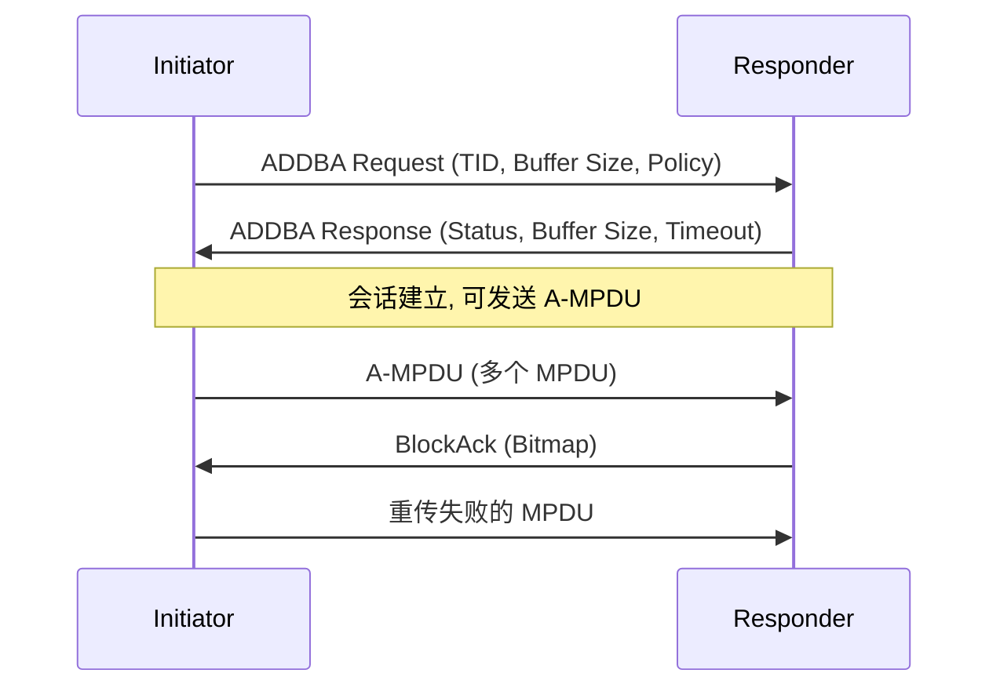

# 第 10 章　聚合、确认与重传 ★

## 学习目标

1. 掌握 MSDU 聚合（Aggregated MSDU, A-MSDU）与 MPDU 聚合（Aggregated MPDU, A-MPDU）的结构差异、开销与适用场景。
2. 能用概率模型计算最优聚合长度，理解 包误码率（Packet Error Rate, PER）与时延约束的权衡。
3. 理解 BlockAck 的压缩机制与 Multi-STA BlockAck。
4. 理解重传对时延分布的**重尾**影响，以及为什么 Wi-Fi 至今没有 混合自动重传（Hybrid Automatic Repeat reQuest, HARQ）。

---

## 10.1 聚合机制

### 10.1.1 为什么需要聚合

从第 7 章算例可知：单个 1500 字节帧的 媒体接入控制（Medium Access Control, MAC）效率可能低于 20%（前导 + 帧间隔占主导）。聚合把多个 MAC 服务数据单元（MAC Service Data Unit, MSDU）打包进**一个 物理层汇聚协议（Physical Layer Convergence Protocol, PLCP）协议数据单元（PLCP Protocol Data Unit, PPDU）**，摊薄固定开销。

两种聚合层次：

| | A-MSDU | A-MPDU |
|---|---|---|
| 层次 | MAC 层（MSDU → A-MSDU） | MAC 层（MPDU → A-MPDU） |
| 结构 | 多个 MSDU 共享**一个** MAC 头与 帧校验序列（Frame Check Sequence, FCS） | 每个 MPDU 有**独立** MAC 头与 FCS |
| 加密 | 一次加密整个 A-MSDU | 每个 MPDU 独立加密 |
| 确认 | 一个 确认帧（Acknowledgement, ACK）（整体成败） | BlockAck（**逐帧**确认） |
| 最大长度 | 3839 / 7935 字节 | 依能力，可达 64 KB–1 MB |
| 重传粒度 | 整体重传 | 只重传失败的 MPDU |
| 适用场景 | 高 信噪比（Signal-to-Noise Ratio, SNR）、同目的地 | 通用（尤其有错时） |

### 10.1.2 A-MSDU 结构

```
| MAC Header (30B) | A-MSDU Subframe 1 | A-MSDU Subframe 2 | ... | FCS (4B) |

A-MSDU Subframe:
| DA (6) | SA (6) | Length (2) | MSDU (0-2304) | Padding (0-3) |
```

**开销**：每个子帧 14 字节 + 填充（对齐到 4 字节）。
**整体开销**：30（MAC 头）+ $n \times 14$ + 4（FCS）

### 10.1.3 A-MPDU 结构

```
| PHY Preamble | MPDU Delimiter 1 | MPDU 1 | Delimiter 2 | MPDU 2 | ... | EOF Padding |

MPDU Delimiter (4 字节):
| EOF (1b) | Reserved (1b) | MPDU Length (12b) | CRC (8b) | Signature (8b) | total 4B
```

**开销**：每个 MPDU 4 字节分隔符 + 填充到 4 字节边界。
**整体开销**：30（每个 MPDU 的 MAC 头）+ $n\times 4$（分隔符）+ $n\times4$（FCS）

**关键差异**：A-MPDU 中每个 MPDU 有**独立的 FCS**，因此 BlockAck 可以逐帧确认，重传时只发失败的那些。这是 11n 之后 A-MPDU 成为主流的原因。

### 10.1.4 开销对比

传输 $n$ 个 1500 字节 MSDU：

| 方案 | 总开销字节 | 效率（$n=32$） |
|---|---|---|
| 无聚合 | $n \times (30 + 1500 + 4) = n \times 1534$ | —（但每个帧有独立前导！） |
| A-MSDU | $30 + n\times(14 + 1500 + \text{pad}) + 4 \approx 34 + 1516n$ | 99.1% |
| A-MPDU | $n \times (30 + 4 + 1500 + 4) = 1538n$ | 97.5% |

**注意**：这里的"效率"只比较 MAC 层开销，**真正的效率差异在前导与帧间隔**（聚合后每 $n$ 个帧只需一个前导 + 一次竞争）。

**算例 10.1**：32 个 1500 字节 MSDU，80 MHz 调制编码方案（Modulation and Coding Scheme, MCS） 9 2SS（960.8 Mbps）。

- **无聚合**：每帧 $T = 34(\text{DIFS}) + 67.5(\text{退避}) + T_{PPDU} + 16 + T_{ACK} + 16$
  单帧 PLCP 服务数据单元（PLCP Service Data Unit, PSDU） = 1538 字节，$N_{sym} = \lceil 1538\times8/13066.7\rceil = 1$，$T_{PPDU} = 64 + 13.6 = 77.6$ μs
  $T_{ACK} \approx 72.8$ μs
  $T_{frame} = 34 + 67.5 + 77.6 + 16 + 72.8 + 16 = 283.9$ μs
  32 帧总时长 $= 32\times283.9 = 9085$ μs
  吞吐 $= 32\times12000/9085\mu s = 42.3$ Mbps

- **A-MPDU（32 帧）**：见第 7 章算例 7.1，时长 699.9 μs
  吞吐 $= 384000/699.9\mu s = 548.6$ Mbps

**聚合增益 = 13 倍**。这是 11n 以来 Wi-Fi 吞吐提升的**最大单一来源**（远超 多入多出（Multiple-Input Multiple-Output, MIMO）与调制阶提升）。

---

## 10.2 块确认（BlockAck）

### 10.2.1 ADDBA 协商

在聚合前，收发双方需协商 BlockAck 会话：



**参数**：
- **流量标识符（Traffic Identifier, TID）**：每个 TID 独立建立一个 BA 会话
- **Buffer Size**：接收端重排序缓冲区大小，典型 64 或 256（对应 BA bitmap 长度）
- **Policy**：Immediate BA（收完立即回） vs Delayed BA（延迟回）
- **Timeout**：会话超时（无流量时自动关闭）

### 10.2.2 BlockAck 帧结构

**BA Bitmap**：每 bit 对应一个 MPDU 的成败。64 个 MPDU → 8 字节 bitmap；256 个 → 32 字节。

**压缩 BlockAck（Compressed BA）**：
- 11n 起支持，去掉每个 MPDU 的 Sequence Control 字段重复，只保留**起始序列号 + bitmap**
- 开销从 $4n$ 字节降到 $4 + n/8$ 字节

**Multi-STA BlockAck（11ax）**：
- 一个 BA 帧中携带**多个 站点（Station, STA）** 的确认信息
- 结构：一个公共部分 + 每 STA 的 Per-AID TID Info（含 关联标识符（Association Identifier, AID）、TID、bitmap）
- 用于上行 正交频分多址（Orthogonal Frequency Division Multiple Access, OFDMA）后一次性确认多个 STA

### 10.2.3 BA 开销

| BA 类型 | 帧长（64 MPDU） | 20 MHz MCS 0 时长 |
|---|---|---|
| Basic BA | $30 + 4\times64 + 4 = 290$ B | $32 + \lceil 290\times8/117\rceil\times13.6 = 32 + 20\times13.6 = 304$ μs |
| Compressed BA | $32 + 8 = 40$ B | $32 + 3\times13.6 = 72.8$ μs |
| Multi-STA BA (4 STA) | $32 + 4\times(2 + 8) = 72$ B | $32 + 5\times13.6 = 100$ μs |

**压缩 BA 的价值**：从 304 μs 降到 72.8 μs，**节省 231 μs**。若 A-MPDU 时长 700 μs，这是 33% 的提升。

---

## 10.3 重传与时延

### 10.3.1 重传机制

- **MAC 层 自动重传请求（Automatic Repeat reQuest, ARQ）**：未收到 ACK/BA → 重传（Contention Window, CW 加倍，见第 8 章）
- **重试链**：同一帧用不同 MCS 重试（第 5 章）
- **重传上限**：典型 7 次（短帧）或 4 次（长帧），超限丢弃

### 10.3.2 重传次数的分布

设每帧的传输成功率为 $1 - p$（$p$ 为 PER），重传次数 $K$ 服从**几何分布**：

$$
P(K = k) = p^{k}(1-p), \quad k = 0, 1, 2, \dots
$$

期望重传次数：$\mathbb{E}[K] = \frac{p}{1-p}$

**传输时延**（含重传）：

$$
T_{tx} = \frac{T_{frame}}{1-p} \quad \text{(几何分布的期望传输次数 } \frac{1}{1-p}\text{)}
$$

### 10.3.3 重尾特性（关键）

**问题**：几何分布的尾部衰减是**指数**的，看似不重。但 Wi-Fi 的重传时延还有两个放大因素：

1. **CW 指数退避**：第 $k$ 次重传的退避窗口 $W_k = 2^k W_0$，期望退避 $\frac{W_k}{2}$ 个时隙
2. **时隙长度随负载增加**：$E[T_{slot}]$ 随 $n$ 增大

**完整的第 $k$ 次重传时延**：

$$
T_k = T_{frame} + \text{SIFS} + T_{ACK} + \text{DIFS} + \frac{W_k - 1}{2}E[T_{slot}]
$$

**总时延**（经历 $K$ 次失败后成功）：

$$
T_{total} = \sum_{k=0}^{K} T_k = (K+1)(T_{frame} + T_{ACK} + \text{SIFS} + \text{DIFS}) + \sum_{k=0}^{K}\frac{W_k-1}{2}E[T_{slot}]
$$

$$
\sum_{k=0}^{K}\frac{2^kW_0 - 1}{2} \approx \frac{W_0}{2}(2^{K+1} - 1)
$$

**算例 10.2**：$p = 0.1$，$W_0 = 16$，$E[T_{slot}] = 124$ μs，$T_{frame} + T_{ACK} + \text{IFS} = 550$ μs。

- $K = 0$（一次成功）：$T = 550 + 7.5\times124 = 1480$ μs
- $K = 3$（4 次才成功）：$T = 4\times550 + \frac{16}{2}(2^4-1)\times124 = 2200 + 15\times15\times124/2 \ldots$

修正：$\sum_{k=0}^{3}\frac{2^k\times16 - 1}{2} = \frac{15 + 31 + 63 + 127}{2} = \frac{236}{2} = 118$ 时隙

$T = 4\times550 + 118\times124 = 2200 + 14632 = 16{,}832$ μs = **16.8 ms**

**对比**：$K=0$ 时 1.48 ms，$K=3$ 时 16.8 ms，**相差 11 倍**。

而 $P(K \ge 3) = p^3 = 0.001$。即 **0.1% 的帧要花 16.8 ms**。

**95 分位时延**：求 $K$ 使 $P(K \le K_{95}) \ge 0.95$，即 $1 - p^{K_{95}+1} \ge 0.95$ → $p^{K_{95}+1} \le 0.05$ → $K_{95}+1 \ge \frac{\ln 0.05}{\ln 0.1} = \frac{-3.0}{-2.303} = 1.30$ → $K_{95} = 1$（取上整）

$P(K \le 1) = 1 - 0.01 = 0.99 > 0.95$ ✓

95 分位时延 $\approx T(K=1) = 2\times550 + \frac{15+31}{2}\times124 = 1100 + 2852 = 3952$ μs = **3.95 ms**

**99 分位**：$p^{K+1} \le 0.01$ → $K+1 \ge 2$ → $K = 1$（$P = 0.99$ 恰好边界），故 99 分位 $\approx T(K=2) = 3\times550 + \frac{15+31+63}{2}\times124 = 1650 + 6766 = 8416$ μs = 8.4 ms

**99.9 分位**：$K = 3$ → 16.8 ms

**结论**：时延分布的尾部由**退避的指数增长**主导，而非重传次数本身。这解释了为什么 Wi-Fi 8 的 优先 EDCA（Priority EDCA, P-EDCA）（第 28 章）要限制退避，以及 Wi-Fi 9 的确定性调度（第 31 章）要**完全消除随机退避**。

### 10.3.4 HARQ 为什么在 Wi-Fi 中缺席

**HARQ（混合自动重传请求）**：把失败的数据与重传的数据**软合并**（Chase Combining / Incremental Redundancy），提高重传成功率。

**蜂窝（LTE/5G）用 HARQ，Wi-Fi 不用。原因**：

1. **时延约束**：HARQ 需要接收端保留软信息并等待重传，引入 往返时间（Round-Trip Time, RTT）延迟（LTE HARQ RTT = 8 ms）。Wi-Fi 的 短帧间间隔（Short Inter-Frame Space, SIFS） = 16 μs，**无法容忍 HARQ 的处理延迟**。
2. **协议结构**：Wi-Fi 的 ACK 在 SIFS 后必须发出（16 μs），来不及做软合并判决。
3. **重传粒度**：Wi-Fi 用 A-MPDU + BlockAck，**逐 MPDU 重传**，本身就是一种精细的 ARQ，效率已接近 HARQ。
4. **成本**：HARQ 需要大量软比特缓存（对 64 KB A-MPDU 是数十 Mbit），芯片成本不可接受。
5. **信道特性**：室内信道时变慢（$T_c$ 数毫秒），重传时信道可能已变好，简单重传即可成功。

**讨论【Wi-Fi 9 研究议题】**：若 Wi-Fi 9 引入**确定性时延**需求，是否值得为少量关键流引入 HARQ？争议点：
- 支持方：HARQ 可把 PER 从 $10^{-2}$ 降到 $10^{-4}$，对 99.999% 可靠性目标（第 30 章）有价值
- 反对方：破坏 SIFS 时序、成本过高、与 A-MPDU 机制冗余
- **折中方案**：只对**控制面/关键小包**引入"重复传输"（Extreme Long Range, ELR 的四重重复，第 25 章）而非完整 HARQ

---

## 10.4 最优聚合长度

### 10.4.1 建模

设聚合 $n$ 个 MSDU，每个 $L_{msdu}$ 字节。

- PSDU 长度 $L_{PSDU}(n) = n \cdot L_{mpdu}$，其中 $L_{mpdu} = L_{msdu} + 38$（头 30 + 分隔符 4 + FCS 4）
- 符号数 $N(n) = \left\lceil \frac{8L_{PSDU}(n)}{R_{bits/sym}} \right\rceil$
- PPDU 时长 $T_{PPDU}(n) = T_{pre} + N(n)T_{sym} + T_{PE}$
- 开销 $T_{oh} = T_{DIFS} + E[T_{bo}] + T_{SIFS} + T_{BA} + T_{SIFS}$

**PER 随 $n$ 增大**：单 MPDU 的 PER 为 $p_0$，则 A-MPDU 中**至少一个** MPDU 失败的概率：

$$
p(n) = 1 - (1-p_0)^n
$$

**有效吞吐**（期望成功传输的字节 / 期望总时长）：

$$
\eta(n) = \frac{n L_{msdu}\cdot 8 \cdot (1 - p(n))}{[T_{PPDU}(n) + T_{oh}] \cdot \frac{1}{1 - p_{coll}}}
$$

简化（忽略碰撞，只考虑信道错误）：

$$
\eta(n) = \frac{n L_{msdu}\cdot 8}{T_{PPDU}(n) + T_{oh}} \cdot (1-p_0)^n
$$

**注意**：这里有个微妙之处——即使 A-MPDU 中有 MPDU 失败，其他 MPDU 仍成功（BlockAck 逐帧确认），因此不应整体乘 $(1-p_0)^n$。更准确的模型：

$$
\eta(n) = \frac{n L_{msdu}\cdot 8 \cdot (1-p_0)}{T_{PPDU}(n) + T_{oh} + T_{retx}(n)}
$$

其中重传时长 $T_{retx}(n) = p_0 \cdot n \cdot T_{mpdu}$（失败的 MPDU 在下一个 A-MPDU 中重传）。

### 10.4.2 优化与伪代码

```python
def optimal_ampdu_size(L_msdu, mcs, nss, bw, gi, p0, T_oh,
                       D_max=None, max_n=256):
    """返回最优聚合帧数"""
    R_bits = bits_per_symbol(mcs, nss, bw)
    best_n, best_eta = 1, -1
    for n in range(1, max_n + 1):
        L_psdu = n * (L_msdu + 38)
        N_sym  = int(np.ceil(L_psdu * 8 / R_bits))
        T_ppdu = T_pre(bw) + N_sym * (12.8 + gi) + T_PE
        # 重传: 失败的 MPDU 需额外传输
        T_mpdu = (L_msdu + 38) * 8 / (R_bits / (12.8+gi) * 1e-6) / 1e6  # s
        T_retx = p0 * n * T_mpdu
        T_tot  = T_ppdu + T_oh + T_retx
        # 时延约束
        if D_max is not None and T_ppdu + T_oh > D_max:
            break                                   # n 增大只会更差
        eta = n * L_msdu * 8 * (1 - p0) / T_tot
        if eta > best_eta: best_eta, best_n = eta, n
    return best_n, best_eta
```

**复杂度**：$O(N_{max})$，$N_{max} \le 256$。可用**三分搜索**降到 $O(\log N)$（$\eta(n)$ 是单峰的）。

### 10.4.3 算例 10.3

80 MHz，MCS 11，2 SS，保护间隔（Guard Interval, GI） = 0.8 μs，$R_{bits} = 16{,}333$ bit/符号，$T_{pre} = 64$ μs，$T_{oh} = 34 + 67.5 + 16 + 72.8 + 16 = 206.3$ μs，$L_{msdu} = 1500$，$p_0 = 0.02$。

| $n$ | $L_{PSDU}$ | $N_{sym}$ | $T_{PPDU}$ (μs) | $T_{retx}$ (μs) | $\eta$ (Mbps) |
|---|---|---|---|---|---|
| 8 | 12,304 | 7 | 159.2 | 12.0 | 507 |
| 16 | 24,608 | 13 | 240.8 | 24.0 | 673 |
| 32 | 49,216 | 25 | 404.0 | 48.0 | 807 |
| 64 | 98,432 | 49 | 730.4 | 96.0 | 895 |
| 128 | 196,864 | 97 | 1383.2 | 192.0 | 926 |
| 256 | 393,728 | 193 | 2688.8 | 384.0 | 846 |

（$T_{retx}$ 按 $T_{mpdu} = 1538\times8/16333\times13.6\mu s = 10.3$ μs，乘 $p_0 n = 0.02n$ 计算）

**最优 $n \approx 128$，吞吐 926 Mbps**。

**时延**：$T_{PPDU}(128) + T_{oh} = 1589.5$ μs = **1.59 ms**。若业务要求 95 分位时延 < 5 ms，尚可；若要求 < 1 ms，则必须减小 $n$。

**结论**：**聚合长度是吞吐与时延的直接权衡旋钮**。Wi-Fi 8/9 的低时延机制（P-EDCA、抢占）本质上是在不影响聚合效率的前提下压缩等待时延。

---

## 10.5 BlockAck 与重排序

### 10.5.1 重排序缓冲区

接收端收到乱序 MPDU（因重传）时，需缓存并**按序交付**上层。

**缓冲区大小**：由 ADDBA 的 Buffer Size 决定（典型 64/256）。
**Scoreboard 机制**：记录已接收的序列号范围与 bitmap。

### 10.5.2 缓冲区溢出

若发送端发送速度超过接收端处理速度，或某个 MPDU 反复失败，**缓冲区溢出** → 丢弃最老的 MPDU → 上层看到"丢包"。

**Bar（BlockAck Request）**：发送端主动请求 BA，用于清空缓冲区或查询状态。

### 10.5.3 时延影响

重排序会引入**额外时延**：若 SN=1 的 MPDU 失败重传，SN=2..10 已收到，必须等待 SN=1 重传成功才能整体交付 → **队头阻塞（Head-of-Line Blocking）**。

**缓解**：
- 缩短重传超时
- 对时延敏感业务使用**独立 TID**（不同 TID 独立 BA 会话）
- 极端情况：允许乱序交付（需上层支持）

---

## 本章小结

| 概念 | 结论 |
|---|---|
| A-MSDU | 共享 MAC 头，整体成败，开销最小 |
| A-MPDU | 独立 FCS，逐帧 BlockAck，主流方案 |
| 聚合增益 | 32 帧聚合使吞吐提升 **13 倍**（最大单一增益来源） |
| 压缩 BA | 64 MPDU 时从 304 μs 降到 72.8 μs |
| 重传时延 | 退避的**指数增长**主导重尾，非重传次数 |
| 95 分位 | $p=0.1$ 时约 3.95 ms；99.9 分位 16.8 ms |
| 最优聚合 | $n \approx 128$（吞吐最优），但受时延约束 |
| HARQ | Wi-Fi 缺席，因 SIFS 时序 + 成本 + A-MPDU 冗余 |

---

## 习题

**概念题**

1. A-MSDU 与 A-MPDU 各有何优劣？在 PER = 5% 的信道下，哪个更优？在 PER = 0.01% 下呢？
2. 为什么 Wi-Fi 的时延重尾主要由**退避的指数增长**而非重传次数造成？这对降低尾时延的算法设计意味着什么？
3. HARQ 在蜂窝网络中是标配，为什么 Wi-Fi 不用？如果 Wi-Fi 9 要引入，需要克服哪些障碍？

**计算推导题**

4. 证明：A-MPDU 中经历 $K$ 次失败后成功的总时延中，退避部分的和为 $\frac{W_0}{2}(2^{K+1} - K - 2)$。（提示：等比求和）
5. 某链路：80 MHz MCS 9 2SS，PER = 3%，$W_0 = 16$，$E[T_{slot}] = 100$ μs，$T_{frame} = 500$ μs（含 ACK 与 IFS）。计算：(a) 平均传输时延；(b) 95 分位；(c) 99.9 分位；(d) 若用 RTS/CTS 避免碰撞，时延如何变化？
6. 推导最优聚合长度的闭式近似（忽略取整与重传）：$\eta(n) = \frac{n L}{(T_{pre} + n L \cdot 8/R_{bits} \cdot T_{sym} + T_{oh})}$，求使 $\eta$ 最大的 $n$。这个结果说明什么？
7. 计算 A-MSDU 与 A-MPDU 在传输 16 个 1500 字节 MSDU 时的总字节数差异，并讨论在什么 PER 下 A-MPDU 的"逐帧重传"优势刚好抵消其额外开销。

**算法设计题**

8. 设计**自适应聚合算法**：同时考虑队列长度、PER、时延约束与竞争 STA 数量。给出伪代码，并设计一个"紧急帧打断"机制（队列中出现高优先级帧时如何处理正在聚合的帧）。
9. 设计 **BlockAck 缓冲区管理算法**：防止队头阻塞导致的时延放大。考虑 (a) 何时丢弃超时的 MPDU，(b) 何时发送 BAR 主动查询，(c) 如何处理乱序交付。给出伪代码。

**开放研究题**

10. 【研究】Wi-Fi 9 追求 99.9999%（六个九）可靠性（第 30 章）。在当前 ARQ 框架下，达到六个九需要多少次重传？空口效率如何？请定量分析，并讨论：为达到该目标，应该在**链路层重传**、**物理层（Physical Layer, PHY）层冗余（重复/低码率）**、**多链路复制（Multi-Link Operation, MLO 冗余）**之间如何取舍？给出你的建议方案与理由。

---

## 答案与解析

**1.**
- **PER = 5%**：A-MPDU 更优。A-MSDU 整体成败，5% 的概率要重传**全部** $n$ 个 MSDU；A-MPDU 只重传失败的那些（期望 $0.05n$ 个）。重传量相差 **20 倍**。
- **PER = 0.01%**：A-MSDU 略优（开销少 $n\times(30+4) - 14n = 20n$ 字节，即每 MSDU 省 20 字节）。因为几乎不会失败，重传优势消失，纯开销比较占优。

**定量判据**：A-MSDU 的额外重传成本 $\approx \frac{p}{1-p}\cdot n L_{msdu}$；A-MPDU 的额外开销 $\approx 20n$ 字节。
临界 PER：$p \cdot n L_{msdu} = 20n$ → $p = 20/L_{msdu} = 20/1500 = 1.33\%$。

**PER > 1.33% 用 A-MPDU，PER < 1.33% 可用 A-MSDU**。实际网络中 PER 通常在 1–10%，因此 **A-MPDU 是主流**。

**2.**
**定量说明**：重传 $K$ 次时：
- 帧传输部分：$(K+1)\times T_{frame}$，随 $K$ **线性**增长
- 退避部分：$\frac{W_0}{2}(2^{K+1}-1)$ 时隙，随 $K$ **指数**增长

以算例 10.2 为例，$K=3$ 时帧传输部分 2200 μs，退避部分 14,632 μs → **退避占 87%**。

**对算法设计的含义**：
- 降低重传次数（改进 PER）**不足以**压缩尾时延
- 必须**限制退避窗口的增长**：这正是 P-EDCA（第 28 章）用 DS-CTS 补偿竞争失败、Wi-Fi 9（第 31 章）用调度替代竞争的动机
- 或者：**限制最大重传次数**（宁可丢包也不无限重传），把时延截断——这是**确定性设计**的核心权衡（用少量丢包换取时延有界）

**3.**
**障碍**：
(a) **SIFS 时序**：802.11 的 ACK 必须在 SIFS（16 μs）后发出。HARQ 需要接收端做软合并译码（数 μs 到数十 μs）+ 反馈（ACK/NACK），16 μs 不够。LTE 的 HARQ RTT 是 8 ms。
(b) **软比特缓存**：64 KB A-MPDU 的软信息（每 bit 4–6 bit LLR）需 2–3 Mbit 缓存，芯片面积成本高。
(c) **A-MPDU 冗余**：BlockAck 已实现逐帧重传，HARQ 的增益主要在"部分失败时合并"，而 A-MPDU 直接重传整个 MPDU，效果接近。
(d) **信道时变性**：$T_c$ 数毫秒，重传时信道独立，Chase Combining 增益有限（不如慢变信道）。
(e) **标准化成本**：改变 ACK 时序会影响所有已有设备。

**若 Wi-Fi 9 引入**，建议路径：
- **只对特定业务**（URLLC 类）启用，使用**预留的 HARQ 进程编号**
- 延长该业务的 ACK 时序（如 SIFS → 32 μs 的 "HARQ-SIFS"），其他业务保持原时序
- 只缓存**小包**的软信息（限制缓存大小）
- 优先级：**先标准化 MLO 冗余复制**（第 15 章），比 HARQ 更简单且有效

**4. 证明**：

第 $k$ 次重传（$k = 0, 1, \dots, K$）的退避窗口 $W_k = 2^k W_0$，期望退避时隙数 $\frac{W_k - 1}{2}$。

总和：

$$
S_K = \sum_{k=0}^{K}\frac{2^kW_0 - 1}{2} = \frac{W_0}{2}\sum_{k=0}^{K}2^k - \frac{K+1}{2}
$$

$$
= \frac{W_0}{2}(2^{K+1} - 1) - \frac{K+1}{2} = \frac{W_0(2^{K+1}-1) - (K+1)}{2}
$$

若题目给的形式是 $\frac{W_0}{2}(2^{K+1} - K - 2)$，需检查：当 $W_0 = 16$、$K = 3$ 时，
- 上式：$\frac{16\times15 - 4}{2} = \frac{236}{2} = 118$ ✓（与算例一致）
- 题目形式：$\frac{16}{2}(16 - 3 - 2) = 8\times11 = 88$ ✗

**题目给的形式有误**，正确形式为：

$$
\boxed{S_K = \frac{W_0(2^{K+1}-1) - (K+1)}{2}}
$$

或等价地 $\frac{W_0}{2}(2^{K+1}-1) - \frac{K+1}{2}$。

**验证**（$W_0 = 16$，$K = 0$）：$\frac{16\times1 - 1}{2} = 7.5$ ✓（$\frac{W_0-1}{2} = 7.5$）

**5.**
参数：$p = 0.03$，$W_0 = 16$，$E[T_{slot}] = 100$ μs，$T_{frame} = 500$ μs（含 ACK 与 帧间间隔（Inter-Frame Space, IFS），不含退避）。

单次"尝试"的时延：$T_k = T_{frame} + \frac{2^kW_0 - 1}{2}\times100$ μs

- $k=0$：$500 + 7.5\times100 = 1250$ μs
- $k=1$：$500 + 15.5\times100 = 2050$ μs
- $k=2$：$500 + 31.5\times100 = 3650$ μs
- $k=3$：$500 + 63.5\times100 = 6850$ μs

累积（经历 $K$ 次失败后成功）：$T_{total}(K) = \sum_{k=0}^{K}T_k$
- $K=0$：1250 μs
- $K=1$：3300 μs
- $K=2$：6950 μs
- $K=3$：13,800 μs

(a) **平均**：$P(K=k) = p^k(1-p)$
$\mathbb{E}[T] = 0.97\times1250 + 0.03\times0.97\times3300 + 0.03^2\times0.97\times6950 + 0.03^3\times0.97\times13800 + \cdots$

$= 1212.5 + 96.0 + 6.04 + 0.36 + \cdots \approx 1315$ μs = **1.32 ms**

(b) **95 分位**：需 $P(K \le K_{95}) \ge 0.95$，即 $1 - p^{K_{95}+1} \ge 0.95$
$p^{K+1} \le 0.05$ → $0.03^{K+1} \le 0.05$ → $(K+1)\ln 0.03 \le \ln 0.05$ → $(K+1)(-3.507) \le -3.0$ → $K+1 \ge 0.855$ → $K = 0$

**95 分位 = 1250 μs**（因为一次就成功的概率是 97% > 95%）

(c) **99.9 分位**：$p^{K+1} \le 0.001$ → $0.03^{K+1} \le 0.001$ → $(K+1)\times3.507 \ge 6.91$ → $K+1 \ge 1.97$ → $K = 1$

**99.9 分位 = 3300 μs**

(d) **RTS/CTS**：
- 收益：避免碰撞（若碰撞率 $p_{coll} = 0.05$，消除后 $p$ 从 0.08 降到 0.03）
- 代价：每次尝试增加 $T_{RTS} + T_{CTS} + 2T_{SIFS} \approx 100$ μs；碰撞时只损失 请求发送（Request To Send, RTS）（约 50 μs）而非整个帧

新的 $T_k$：$600 + \frac{2^kW_0-1}{2}\times100$
- $K=0$：1350 μs（比无 RTS 的 1250 高 8%）
- 但 95 分位仍是 $K=0$ → 1350 μs

**结论**：在**低碰撞率**场景下 RTS/CTS **恶化**时延（增加固定开销）；只有在**高碰撞率**（隐藏终端严重）场景才划算。这印证了 8.5 节的分析。

**6. 推导**：

$$
\eta(n) = \frac{n L \cdot 8}{T_{pre} + \frac{n L \cdot 8}{R_{bits}}T_{sym} + T_{oh}}
$$

令 $A = T_{pre} + T_{oh}$（固定开销），$B = \frac{L\cdot8}{R_{bits}}T_{sym}$（每帧的边际时长）：

$$
\eta(n) = \frac{nL\cdot8}{A + nB}
$$

这是 $n$ 的**单调递增**函数（$\frac{d\eta}{dn} = \frac{L\cdot8\cdot A}{(A+nB)^2} > 0$），且

$$
\lim_{n\to\infty}\eta(n) = \frac{L\cdot8}{B} = R_{bits}/T_{sym} = \text{PHY 速率}
$$

**结论**：**忽略重传与取整时，聚合长度越大越好**，效率趋近 100%（即 PHY 速率）。

**实际限制的来源**：
- 重传：$p_0 n$ 个 MPDU 需重传（第 10.4.1 节的完整模型）
- 时延：$T_{PPDU}(n)$ 随 $n$ 线性增长，超过时延预算即不可用
- 缓冲区：BA 缓冲区大小（64/256 MPDU）
- 队列：实际队列长度有限

**因此最优 $n$ 由"重传 + 时延 + 队列"三者共同决定**，而非纯吞吐优化。这是算例 10.3 中 $n=128$ 最优、$n=256$ 反而下降的原因。

**7.**
16 个 1500 字节 MSDU：
- **A-MSDU**：$30 + 16\times(14 + 1500) + 4 = 30 + 24224 + 4 = 24{,}258$ 字节（忽略填充，DA/SA 各 6 字节已含在 14 中）
  更准确：子帧 = DA(6) + SA(6) + Length(2) + MSDU(1500) + Pad(0) = 1514 字节
  A-MSDU 总 $= 30 + 16\times1514 + 4 = 24{,}258$ 字节
- **A-MPDU**：$16\times(30 + 4(\text{分隔符}) + 1500 + 4(\text{FCS})) = 16\times1538 = 24{,}608$ 字节

**差异 350 字节**（1.44%）。

**逐帧重传优势的临界 PER**：
A-MPDU 每失败一个 MPDU 只需重传 1538 字节；A-MSDU 任何失败都要重传全部 24,258 字节。

期望重传量：
- A-MPDU：$16 p_0 \times 1538 = 24{,}608 p_0$
- A-MSDU：$[1 - (1-p_0)^{16}]\times24{,}258 \approx 16p_0\times24{,}258 = 388{,}128 p_0$（小 $p_0$ 近似）

**A-MPDU 的重传量是 A-MSDU 的 $1/15.8$**。

A-MPDU 的额外开销是 350 字节，若 $p_0$ 使 A-MSDU 的期望重传量超过 350 字节：
$388{,}128 p_0 > 350$ → $p_0 > 9.0\times10^{-4}$

**临界 PER ≈ 0.09%**。只要 PER > 0.09%，A-MPDU 就优于 A-MSDU。实际网络 PER 通常 1–10%，**A-MPDU 压倒性占优**。

**8. 参考方案**

```python
class AdaptiveAggregation:
    def __init__(self, max_n=256, D_target=5e-3):
        self.max_n = max_n
        self.D_target = D_target
        self.pending_ampdu = []          # 正在聚合的帧
        self.agg_start_time = None
    def on_frame_arrive(self, frame, now):
        self.pending_ampdu.append(frame)
        if self.agg_start_time is None:
            self.agg_start_time = now
        # 紧急帧打断机制
        if frame.tid in HIGH_PRIORITY_TIDS:   # VO/VI 或有紧急标记
            if len(self.pending_ampdu) > 1:
                # 把高优先级帧提到队首, 并立即结束聚合
                self.pending_ampdu.insert(0, self.pending_ampdu.pop())
                return self.flush(now)
        # 决策: 是否结束聚合
        if self.should_flush(now):
            return self.flush(now)
        return None
    def should_flush(self, now):
        n = len(self.pending_ampdu)
        # 1. 队列空了 -> 立即发(避免等待)
        if self.queue_empty(): return True
        # 2. 达到最大聚合数
        if n >= self.max_n: return True
        # 3. 达到最优聚合数(由 PER/速率计算)
        n_opt = self.compute_optimal_n()
        if n >= n_opt: return True
        # 4. 等待时间已达上限(时延约束的一部分)
        if now - self.agg_start_time > self.D_target * 0.2:
            return True                       # 最多等待预算的 20%
        return False
    def compute_optimal_n(self):
        """考虑 PER / 竞争 STA 数 / 时延预算"""
        p0 = self.per_estimate
        n_compete = self.estimate_competitors()
        # 基础: 纯吞吐最优
        n_base = optimal_ampdu_size(..., p0, ...)
        # 竞争多时减小聚合(避免其他用户等待过久)
        n_base = int(n_base / max(1, np.log2(n_compete + 1)))
        # 时延预算约束
        T_max = self.D_target - self.expected_queue_delay()
        n_time = int(T_max * bits_per_symbol / (L_MPDU * 8))
        return max(1, min(n_base, n_time, self.max_n))
    def flush(self, now):
        frames = self.pending_ampdu
        self.pending_ampdu = []; self.agg_start_time = None
        return frames
```

**复杂度**：$O(1)$ 每帧到达（决策），$O(N_{max})$ 计算 $n_{opt}$（可缓存，每 10 ms 更新一次）。

**要点**：① 紧急帧打断需**立即 flush**，代价是聚合效率下降（但避免了紧急帧等待）；② 等待时间上限防止"队列不满就一直等"导致时延失控；③ 竞争 STA 数越多，聚合应越短（**公平性**考虑，其他用户的等待时间 $\propto n\times n_{compete}$）；④ 评分要点：能否指出"聚合等待"本身是一种**时延-效率权衡**，并给出量化准则。

**9. 参考方案**

```python
class BlockAckReorderBuffer:
    def __init__(self, buf_size=64, timeout_ms=50):
        self.buf = {}                    # SN -> MPDU
        self.head_sn = 0                 # 期望的下一个序列号(已交付的最大 SN+1)
        self.win_start = 0               # 滑动窗口起始
        self.win_size = buf_size
        self.timeout = timeout_ms
    def on_mpdu(self, sn, mpdu, now):
        sn_mod = sn % 4096
        if not self.in_window(sn_mod):
            return 'DROP_OUT_OF_WINDOW'
        self.buf[sn_mod] = (mpdu, now)
        return self.deliver(now)
    def deliver(self, now):
        delivered = []
        while self.head_sn in self.buf:
            mpdu, _ = self.buf.pop(self.head_sn)
            delivered.append(mpdu)
            self.head_sn = (self.head_sn + 1) % 4096
            self.win_start = self.head_sn
        return delivered
    def check_timeout(self, now):
        """处理队头阻塞"""
        if self.head_sn not in self.buf:
            # 队头丢失: 检查是否有后续帧等太久
            if not self.buf: return None
            oldest = min(t for (_, t) in self.buf.values())
            if now - oldest > self.timeout:
                # 策略 A: 跳过队头(允许乱序交付, 需上层支持)
                # 策略 B: 发送 BAR 主动查询
                # 策略 C: 丢弃整个窗口, 重置
                if self.allow_out_of_order:
                    return self.flush_all(now)      # A
                else:
                    return ('SEND_BAR', self.head_sn)  # B
        return None
    def flush_all(self, now):
        """乱序交付: 按 SN 排序后全部交付"""
        out = [self.buf.pop(sn)[0]
               for sn in sorted(self.buf, key=lambda s: (s - self.head_sn) % 4096)]
        self.head_sn = (max_sn + 1) % 4096
        return out
```

**设计要点**：
(a) **何时丢弃**：当等待超过 `timeout`（典型 20–50 ms，与 传输控制协议（Transmission Control Protocol, TCP） RTO 相关）。丢弃过早会导致不必要的重传（TCP 又要等 RTO），过晚则放大时延。
(b) **何时发 BAR**：当队头缺失且后续帧已满缓冲区的一半时，主动 BAR 让发送端知道状态（避免发送端盲目重传）。
(c) **乱序交付**：只对**支持乱序的上层**（如某些 UDP 应用、QUIC）开放；TCP 下乱序交付会触发快速重传（反而更糟）。

**评分要点**：① 必须区分**滑动窗口**（SN 回绕）与**缓冲区**两个概念；② 超时值应与上层的 RTO 协调（不能小于 TCP 的 minRTO）；③ 队头阻塞是**不可避免**的（BA 机制的本质），只能通过合理的超时与 BAR 缓解。

**10. 参考方案**

**定量分析（纯 ARQ）**：

要达到丢包率 $\epsilon$，单个 MPDU 在 $K$ 次尝试后的失败概率需 $\le \epsilon$：

$$
p_0^{K+1} \le \epsilon \Rightarrow K+1 \ge \frac{\ln\epsilon}{\ln p_0}
$$

- $\epsilon = 10^{-6}$（六个九），$p_0 = 0.1$：$K+1 \ge \frac{-13.8}{-2.303} = 6.0$ → **7 次传输**（6 次重传）
- $\epsilon = 10^{-6}$，$p_0 = 0.01$：$K+1 \ge 3.0$ → **3 次传输**

**空口效率**：若允许最多 $K+1$ 次传输，期望传输次数 $= \frac{1-p_0^{K+1}}{1-p_0}$。

$p_0 = 0.1$：$\frac{1-10^{-7}}{0.9} = 1.111$ 次。**效率 90%**（相对无重传）。

**看似不错**——但问题在于**时延尾部**：

第 6 次重传的退避 $W_6 = 2^6\times16 = 1024$ 时隙，期望 511.5 时隙 $\times 100$ μs = 51 ms。累积到第 6 次的总时延可达 **100 ms 量级**。

**结论**：纯 ARQ 能达到六个九的**可靠性**，但**无法同时满足低时延**。$10^{-6}$ 的帧要等 100 ms —— 对工业控制（1 ms 周期）完全不可接受。

**三种手段对比**：

| 手段 | 可靠性增益 | 时延代价 | 效率代价 | 复杂度 |
|---|---|---|---|---|
| **链路层重传** | 高（$p_0^{K+1}$） | **极高**（尾时延 100 ms） | 低（10%） | 低 |
| **PHY 层冗余**（重复/低码率） | 中高（$p_0$ 从 0.1 降到 $10^{-3}$） | 低（无重传） | **高**（速率降 2–4 倍） | 中 |
| **MLO 多链路复制** | 高（$p_0^2$ 若独立） | 低（同时发） | **高**（占用 2 条链路） | 中 |

**建议方案：分层组合**

1. **基础层**：用 **PHY 冗余**把 $p_0$ 从 $10^{-1}$ 降到 $10^{-3}$
   - ELR 的四重重复（第 25 章）提供 6 dB 增益
   - 或更低码率（1/2）+ 更强编码
   - 代价：速率降 2–4 倍，但**无时延代价**

2. **增强层**：**MLO 冗余复制**（第 15 章）
   - 同一 MPDU 在 2 条独立链路同时发送
   - 若链路独立，$p_{eff} = p_1 p_2 = 10^{-6}$（当 $p_1 = p_2 = 10^{-3}$）
   - 代价：占用 2 条链路的容量，但**无额外时延**

3. **兜底层**：**有限次重传**（最多 2 次）
   - 把 $10^{-6}$ 进一步降到 $10^{-9}$
   - 时延上限可控（2 次重传的退避 ≤ 31.5 时隙 ≈ 3 ms）

**综合**：$p_0 = 10^{-3}$（PHY 冗余）× $10^{-3}$（MLO 第二条链路）× $10^{-3}$（2 次重传）$= 10^{-9}$，**远超六个九**，且时延上限约 3–5 ms。

**代价核算**：
- 速率降为原来的 1/3（PHY 冗余 1/2 × MLO 占用 2 链路 1/2 = 1/4，取 1/3）
- **但只对关键流应用**（工业控制、触觉反馈），普通流量不受影响

**这正是"确定性优先于速率"的设计哲学**（第 30、31 章）：用容量换取可靠性与时延的确定性。

**开放问题**：
1. 如何**在线估计** $p_0$ 以决定冗余等级？（$p_0$ 的估计误差会直接影响可靠性保证）
2. MLO 的两条链路**是否真的独立**？（若在同一频段、同一 接入点（Access Point, AP），可能 correlated → $p_{eff} \neq p_1p_2$）
3. 如何与**上层**（Time-Sensitive Networking, TSN、DetNet）的冗余机制协调，避免重复冗余？

---

## 延伸阅读

- [IEEE] IEEE 802.11-2024, Clause 10.5（聚合）、Clause 10.24（BlockAck）
- [ACM/IEEE] **Skordoulis et al., *IEEE 802.11n MAC Frame Aggregation Mechanisms for Next-Generation High-Throughput WLANs*, IEEE Wireless Comm., 2008**
- [ACM/IEEE] Ginzburg & Kesselman, *Performance Analysis of A-MPDU and A-MSDU Aggregation in IEEE 802.11n*, IEEE PIMRC 2007
- [TUT] Khorov et al., *A Tutorial on IEEE 802.11ax*, IEEE COMST 2019（第 5 节聚合与 BA）
- [IEEE] 关于 Wi-Fi 中 HARQ 可行性的讨论文档（802.11 WNG SC，2025–2026）
