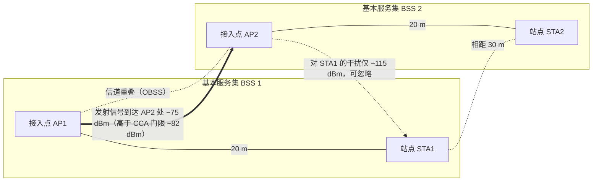
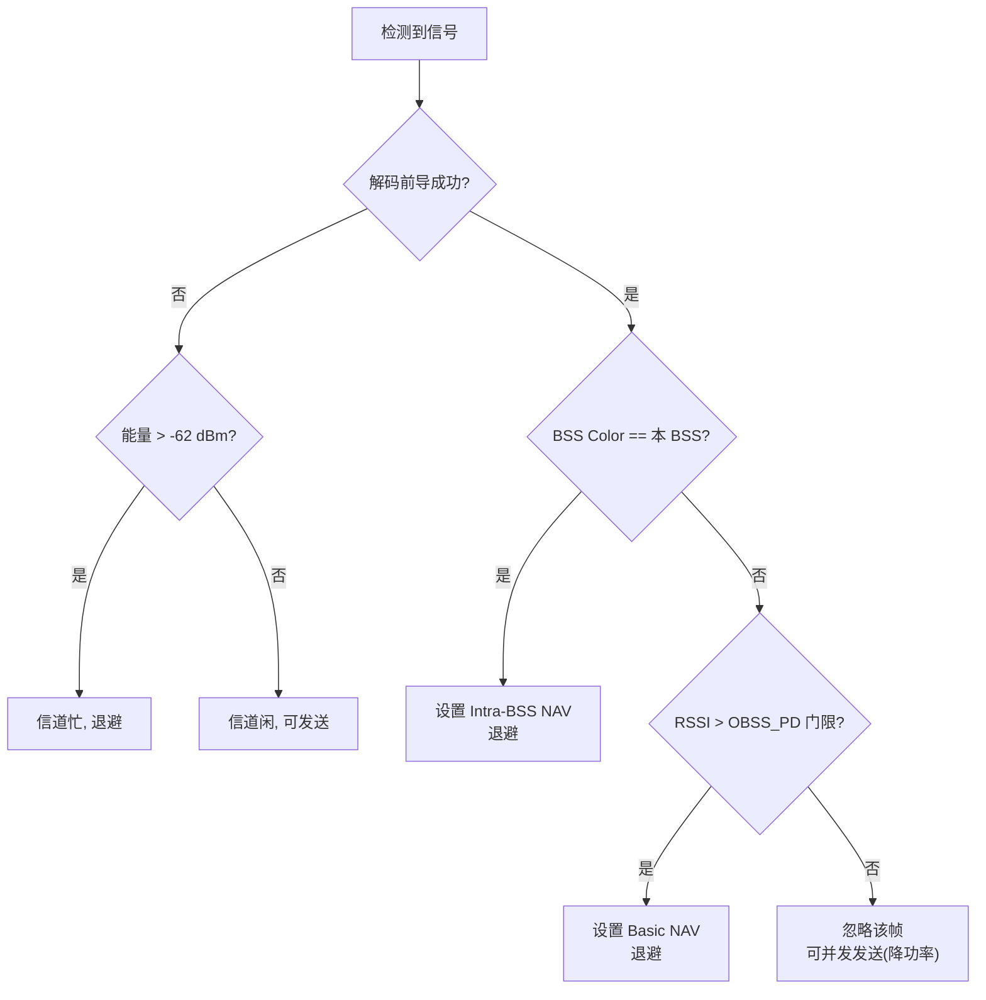
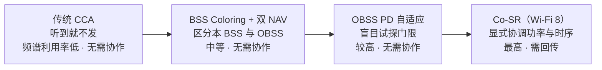
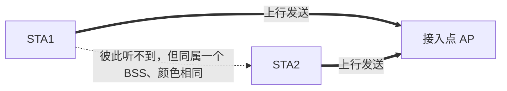

# 第 11 章　空间复用与干扰管理 ★★

## 学习目标

1. 掌握 基本服务集（Basic Service Set, BSS） Coloring、双 网络分配矢量（Network Allocation Vector, NAV）、OBSS PD 的 SR（Spatial Reuse）框架。
2. 能推导 OBSS PD 门限自适应的最优值并分析其利弊。
3. 理解 SRP 与基于功率控制的并发传输判据。
4. 能识别非 Wi-Fi 干扰并理解其对 SR 机制的挑战。
5. 理解从单点 SR 到 Wi-Fi 8 Co-SR 的演进逻辑（第 27 章铺垫）。

---

## 11.1 问题背景：OBSS 干扰

### 11.1.1 密集部署的困境

在公寓楼、写字楼、场馆中，多个 BSS 在同一信道上工作，互为 **OBSS（Overlapping BSS）**。

**传统 载波侦听多址/冲突避免（Carrier Sense Multiple Access with Collision Avoidance, CSMA/CA）的处理**：任何检测到的能量超过 空闲信道评估（Clear Channel Assessment, CCA）门限 → 信道忙 → 退避。这导致**极大的频谱浪费**——一个 OBSS 的远距离弱信号也能阻塞本 BSS。

**暴露终端问题的量化**：



*图 11-1　暴露终端场景。AP1 的发送虽被 AP2 听到（触发保守退避），但对 STA1 的干扰可忽略；传统 CCA 的"听到即退避"在此白白浪费了并发机会。*

若 AP1 向 STA1 发送，AP2 听到 AP1 的信号为 $-75$ dBm（超过 CCA 门限 $-82$ dBm）→ AP2 退避。但 AP2 向 STA2 发送时，对 STA1 的干扰仅 $-75 - 40(\text{STA1 到 AP2 的路径损耗}) = -115$ dBm，完全可忽略。**AP2 本可同时传输**。

### 11.1.2 空间复用的基本思想

**判据**：不是"能否听到"，而是"我发送是否会让对方的接收失败"。

**数学形式**：设 AP2 考虑向 STA2 发送，需保证对 AP1→STA1 的接收不造成有害干扰：

$$
\frac{S_{1}}{I_{2\to1} + N} \ge \gamma_{req}
$$

其中 $S_1$ 是 STA1 收到的有用信号功率，$I_{2\to1}$ 是 AP2 对 STA1 的干扰功率。

**关键洞察**：这个判据涉及**四个**节点（发送方、接收方、干扰源、受害接收方），而 CCA 只涉及**两个**（发送方、干扰源）。这是空间复用需要额外信令的根本原因。

---

## 11.2 11ax 的 SR 框架

### 11.2.1 BSS Coloring

**机制**：每个 BSS 分配一个 **6 bit 颜色**（0–63），携带在 HE/EHT 物理层汇聚协议（Physical Layer Convergence Protocol, PLCP）协议数据单元（PLCP Protocol Data Unit, PPDU）的 信号字段（Signal field, SIG）字段中。

**用途**：接收端解码前导后，立即判断该帧是**本 BSS** 还是 **OBSS**：
- 同色 → intra-BSS 帧
- 异色 → OBSS 帧

**颜色分配**：接入点（Access Point, AP）在 Beacon 中宣告本 BSS 的 Color。冲突时（两个相邻 BSS 同色）可触发颜色更换。

**冲突概率**（生日悖论）：$N$ 个相邻 BSS 随机选 64 色，至少一对冲突的概率：

$$
P_{coll} = 1 - \prod_{i=0}^{N-1}\left(1 - \frac{i}{64}\right)
$$

**算例 11.1**：$N = 10$ 个相邻 BSS。

$P_{coll} = 1 - \frac{64\times63\times\cdots\times55}{64^{10}}$

用近似 $P_{coll} \approx 1 - e^{-N(N-1)/(2\times64)} = 1 - e^{-45/128} = 1 - e^{-0.352} = 29.6\%$

**结论**：10 个邻居时有 **30% 概率**发生颜色冲突。因此必须配合**冲突检测与更换机制**。

### 11.2.2 双 NAV

回顾第 7 章：
- **Intra-BSS NAV**：同色帧设置
- **Basic NAV**：异色帧或无法识别的帧设置

**信道接入判据**：
- Intra-BSS NAV = 0 → 可发送（Basic NAV 不阻塞）
- 若 Basic NAV > 0，配合 OBSS PD 门限决定是否真的发送

### 11.2.3 OBSS PD（Packet Detect）门限

**机制**：对 OBSS 帧使用**更高的**检测门限（即更不敏感）。

| 检测类型 | 门限 | 说明 |
|---|---|---|
| 前导检测（intra-BSS） | −82 dBm | 标准 CCA |
| 能量检测 | −62 dBm | 非 Wi-Fi 信号 |
| **OBSS PD** | **−82 ~ −62 dBm（可调）** | 高于此门限的 OBSS 帧才认为信道忙 |

**效果**：若 OBSS 信号强度 < OBSS PD 门限，本 BSS 可以**忽略它并同时发送**（并降低自身功率）。

### 11.2.4 SR 操作流程图



---

## 11.3 OBSS PD 门限自适应

### 11.3.1 问题建模

**变量**：OBSS PD 门限 $\theta$（dBm）。

**权衡**：
- $\theta$ 越低（越敏感）→ 更多并发被禁止 → **干扰少但频谱利用率低**
- $\theta$ 越高（越不敏感）→ 更多并发 → **频谱利用率高但干扰大**

**目标**：最大化**网络总吞吐**（所有 BSS 之和）：

$$
\max_{\theta} \sum_{b \in \text{BSS}} R_b(\theta)
$$

### 11.3.2 推导：单对 BSS 的最优门限

考虑两个 BSS（BSS1 与 BSS2），对应的链路为 $(A_1, S_1)$ 与 $(A_2, S_2)$。

若两者并发：
- BSS1 的 信干噪比（Signal-to-Interference-plus-Noise Ratio, SINR）：$\gamma_1 = \frac{P_1 g_{11}}{P_2 g_{21} + N}$
- BSS2 的 SINR：$\gamma_2 = \frac{P_2 g_{22}}{P_1 g_{12} + N}$

其中 $g_{ij}$ 是发送方 $i$ 到接收方 $j$ 的信道增益（含路径损耗）。

**并发的总速率**：

$$
R_{both} = B\log_2(1+\gamma_1) + B\log_2(1+\gamma_2)
$$

**独占的总速率**（时分）：

$$
R_{TDMA} = \frac{1}{2}B\log_2(1 + \gamma_1^{no\_int}) + \frac{1}{2}B\log_2(1+\gamma_2^{no\_int})
$$

其中 $\gamma_i^{no\_int} = P_i g_{ii}/N$。

**并发优于时分的判据**：$R_{both} > R_{TDMA}$。

**简化分析**（对称情形 $P_1 = P_2 = P$，$g_{11} = g_{22} = g_d$，$g_{12} = g_{21} = g_i$）：

令 $\alpha = g_i/g_d$（干扰耦合系数，典型 0.001–0.1），$\gamma_0 = Pg_d/N$。

并发：$R_{both} = 2B\log_2\left(1 + \frac{\gamma_0}{1 + \alpha\gamma_0}\right)$
时分：$R_{TDMA} = B\log_2(1+\gamma_0)$

判据：

$$
2\log_2\left(1 + \frac{\gamma_0}{1+\alpha\gamma_0}\right) > \log_2(1+\gamma_0)
$$

**算例 11.2**：$\gamma_0 = 20$ dB（100），$\alpha = 0.01$。

- 并发：$\frac{100}{1+1} = 50$，$2\log_2(51) = 2\times5.67 = 11.35$ bps/Hz
- 时分：$\log_2(101) = 6.66$ bps/Hz

**并发增益 70%**。

**临界 $\alpha$**：令 $2\log_2(1 + \frac{\gamma_0}{1+\alpha\gamma_0}) = \log_2(1+\gamma_0)$

$$
\left(1 + \frac{\gamma_0}{1+\alpha\gamma_0}\right)^2 = 1 + \gamma_0
$$

$$
1 + \frac{\gamma_0}{1+\alpha\gamma_0} = \sqrt{101} = 10.05
$$

$$
\frac{\gamma_0}{1+\alpha\gamma_0} = 9.05 \Rightarrow 100 = 9.05(1 + 100\alpha) \Rightarrow 100\alpha = 10.05 \Rightarrow \alpha_{crit} = 0.1005
$$

**结论**：当干扰耦合 $\alpha < 0.1$（即干扰比有用信号弱 10 dB 以上）时，**并发优于时分**。

**转化为 PD 门限**：AP2 听到 AP1 的信号功率 $P_1 g_{12} = \alpha P g_d$。若要求 $\alpha < \alpha_{crit}$：

$$
P_{rx}^{OBSS} < \alpha_{crit} \times P \times g_d
$$

设 $P = 20$ dBm，BSS 内的路径损耗 $1/g_d = 70$ dB（即 $g_d = -70$ dB），则 $P g_d = -50$ dBm（这是 STA1 收到的有用信号）。

$$
P_{rx}^{OBSS} < 0.1 \times (-50\text{ dBm}) \Rightarrow \text{dB 域}: -50 - 10 = -60 \text{ dBm}
$$

**最优 OBSS PD 门限 ≈ −60 dBm**（本例）。这与标准中"OBSS PD 可调范围 −82 至 −62 dBm"的上限接近，说明**标准默认值偏保守**。

### 11.3.3 自适应算法

**问题**：$\alpha$ 与网络拓扑未知，需在线学习。

**实用算法**（11ax 标准给出的参考算法）：AP 周期性测量：
- 本 BSS 的**平均 接收信号强度指示（Received Signal Strength Indicator, RSSI）**（$RSSI_{intra}$）
- OBSS 帧的**平均 RSSI**（$RSSI_{OBSS}$）
- 本 BSS 的**吞吐**与 **PER**

根据吞吐变化调整 $\theta$：升 $\theta$ → 若吞吐升则继续升，否则回落（**爬山法**）。

```python
class OBSS_PD_Adapter:
    def __init__(self, pd_min=-82, pd_max=-62, step=1.0):
        self.pd = pd_min
        self.step = step
        self.tp_history = []
        self.direction = +1                    # 上次调整方向
    def update(self, throughput, per, window=10):
        self.tp_history.append(throughput)
        if len(self.tp_history) < window: return self.pd
        # 1. 比较本窗口与上窗口的平均吞吐
        cur = np.mean(self.tp_history[-window:])
        prev = np.mean(self.tp_history[-2*window:-window]) \
               if len(self.tp_history) >= 2*window else None
        if prev is None: return self.pd
        # 2. 爬山: 吞吐提升则继续同方向, 否则反向
        if cur > prev * 1.02:                  # 2% 阈值防抖
            new_pd = self.pd + self.direction * self.step
        else:
            self.direction *= -1
            new_pd = self.pd + self.direction * self.step
        # 3. 限幅
        self.pd = np.clip(new_pd, self.pd_min, self.pd_max)
        # 4. PER 保护: PER 过高时强制回落
        if per > PER_THRESHOLD:
            self.pd = max(self.pd_min, self.pd - 2*self.step)
        return self.pd
```

**复杂度**：$O(1)$ 每窗口。

**算法问题**：
- **局部最优**：爬山法可能陷入局部最优
- **振荡**：多个 AP 同时调整会互相影响（A 升门限 → B 受干扰 → B 降门限 → A 受益 → A 继续升……）
- **慢收敛**：窗口 10 × 100 ms = 1 秒，密集场景拓扑变化快

**改进方向**：Wi-Fi 8 的 Co-SR（第 27 章）通过**AP 间显式协调**代替这种"盲目试探"。

---

## 11.4 SRP 与功率控制

### 11.4.1 SRP（Spatial Reuse Parameter）

11ax 定义了 **SRP-based SR**：发送端在 Trigger Frame 或某些帧中携带 **SRP 字段**，指示"我能容忍的干扰水平"。

**机制**：
- AP 在 TF 中宣告：本 BSS 的传输将在 $T$ 时间内进行，且**可容忍的最大干扰**为 $I_{tol}$
- 邻居 BSS 的 AP/STA 收到后，计算自己发送对**受害接收方**的干扰
- 若干扰 < $I_{tol}$，则可以并发（并限制自己的功率）

### 11.4.2 功率控制的判据推导

设 BSS2 的 AP（$A_2$）想并发发送，需保证对 BSS1 的接收方（$S_1$）的干扰不超过 $I_{tol}$：

$$
P_2 \cdot g_{2\to S_1} \le I_{tol}
$$

$A_2$ 如何知道 $g_{2\to S_1}$？两种途径：
1. **测量**：$A_2$ 测量来自 $S_1$ 的信号（互易性），但 $S_1$ 可能不发送
2. **信令**：$A_1$ 在帧中宣告 $S_1$ 的位置/信号强度，$A_2$ 估算

**实用近似**：用 $A_2$ 测得的来自 $A_1$ 的 RSSI 作为代理（假设 $S_1$ 与 $A_1$ 距离不远）：

$$
P_2 \le I_{tol} - (RSSI_{A_1\to A_2} - P_1) \cdot \beta
$$

其中 $\beta$ 是修正因子（补偿 $A_1$ 到 $S_1$ 的额外路径损耗）。

### 11.4.3 并发传输的完整判据（四节点）

标准 SR 的严格判据需要四个量：

| 量 | 获取方式 |
|---|---|
| $P_1$（对方发送功率） | 帧中携带的 Tx Power 字段 |
| $RSSI_{A_1 \to A_2}$ | 直接测量 |
| $I_{tol}$（受害方容忍度） | SRP 字段 |
| $g_{2\to S_1}$ | 估计（最难） |

**这是 SR 难以完美工作的根本原因**：第四项只能估计，误差导致 SR 要么过于保守（浪费频谱），要么过于激进（造成干扰）。

---

## 11.5 非 Wi-Fi 干扰

### 11.5.1 干扰源分类

| 类型 | 频段 | 时域特征 | 频域特征 |
|---|---|---|---|
| 蓝牙 | 2.4 GHz | 跳频、短包（<1 ms） | 1 MHz 窄带 |
| ZigBee | 2.4 GHz | 低占空比 | 2 MHz |
| 微波炉 | 2.4 GHz | 周期 8–20 ms（50% 占空比） | 宽带（~20 MHz） |
| 无绳电话 | 2.4/5 GHz | 持续 | 窄带 |
| 雷达 | 5 GHz 动态频率选择（Dynamic Frequency Selection, DFS） | 脉冲（μs 级） | 窄带，功率高 |
| 5G NR-U | 5/6 GHz | 类 Wi-Fi 的 先听后说（Listen Before Talk, LBT） | 宽带 |

### 11.5.2 识别难点

传统 Wi-Fi 只能看到：
- **CCA 能量高但前导解码失败** → 可能是非 Wi-Fi 干扰，也可能是远距离 Wi-Fi 或碰撞
- **重传率异常升高** → 可能是干扰，也可能是信道质量差

**无法区分**是核心困难。

### 11.5.3 现有（弱）方法

1. **能量检测统计**：统计一段时间内的能量分布，周期性的（微波炉）可识别
2. **信道切换**：DFS 信道检测到雷达必须切换（法规强制）
3. **CCA 门限提升**：整体降低灵敏度（会恶化正常通信）

### 11.5.4 Wi-Fi 9 的 AI 方案（预告，第 33 章）

**思路**：用 **IQ 样本或 信道状态信息（Channel State Information, CSI）** 训练分类器，识别干扰类型：

| 特征 | 可用于识别 |
|---|---|
| 时域占空比与周期 | 微波炉、雷达 |
| 频谱形状 | 蓝牙（窄带跳频）、ZigBee |
| 调制特征 | 5G NR-U（OFDM，可解调） |
| CSI 的时间相关性 | 持续干扰 vs 瞬态 |

**标准化争议**（第 33 章详述）：干扰分类是**纯厂商实现**（不需要标准化）还是**需要标准化接口**（统一的数据采集格式）？

---

## 11.6 从 SR 到 Co-SR

### 11.6.1 SR 的三个根本局限

1. **信息不完整**：四节点判据中，最关键的一项（对受害方的干扰）只能估计
2. **分布式试探**：各 AP 独立调整，产生振荡与次优
3. **无时序协调**：即使允许并发，也无法协调"何时并发"（各自竞争）

### 11.6.2 Co-SR 如何解决【Wi-Fi 8，第 27 章】

| SR 的问题 | Co-SR 的解法 |
|---|---|
| 干扰信息靠估计 | AP 间**显式交换** CSI 与功率意图 |
| 分布式试探振荡 | **协调 AP 统一分配**功率与时序 |
| 无时序协调 | **协调 TDMA（Coordinated TDMA, Co-TDMA）** 划分时隙，或 Co-SR 指定并发时隙 |

**代价**：需要 AP 间的**回传连接**与**协调协议**。这限制了 Co-SR 只能在"同厂商/同管理域"的 AP 间部署。

### 11.6.3 演进阶梯



*图 11-4　空间复用能力的演进阶梯：从"听到就不发"逐步走向"显式协调功率/时序"，频谱利用率递增，但协作前提（回传与协调协议）也随之出现。*

---

## 本章小结

| 概念 | 结论 |
|---|---|
| BSS Coloring | 6 bit，10 个邻居时冲突概率 30% |
| 双 NAV | Intra-BSS NAV 阻塞，Basic NAV 不阻塞 |
| OBSS PD | −82 ~ −62 dBm 可调，越高越激进 |
| 并发判据 | 干扰耦合 $\alpha < 0.1$ 时并发优于时分 |
| 最优门限 | 由 $\alpha_{crit}$ 与路径损耗决定，典型 −60 dBm |
| SRP | 宣告容忍干扰，但第四项（对受害方干扰）仍靠估计 |
| 非 Wi-Fi 干扰 | 无法可靠识别，是 人工智能（Artificial Intelligence, AI）方案的切入点 |
| Co-SR | 用显式协调替代分布式试探（Wi-Fi 8） |

---

## 习题

**概念题**

1. 为什么空间复用需要"四节点"信息而传统 CCA 只需要"两节点"？这给协议设计带来什么困难？
2. OBSS PD 门限调高（更激进）一定能提高网络总吞吐吗？在什么情况下会适得其反？
3. BSS Color 只有 6 bit，在密集部署中冲突概率高。为什么标准不增加 bit 数？有什么替代方案？

**计算推导题**

4. 推导：在对称两 BSS 场景下，并发优于时分的临界干扰耦合系数 $\alpha_{crit}$ 的一般表达式（用 $\gamma_0$ 表示）。并分析 $\gamma_0 \to \infty$ 与 $\gamma_0 \to 0$ 两种极限。
5. 某场景：AP1 与 AP2 相距 25 m，各自的 站点（Station, STA）距离 10 m。路径损耗 $L(d) = 40 + 30\log_{10}d$（5 GHz）。AP 发射 20 dBm。计算干扰耦合系数 $\alpha$，判断并发是否优于时分（$\gamma_0$ 取 20 dB）。
6. 20 个相邻 BSS，用 64 色。计算颜色冲突概率。若改为 12 bit（4096 色），冲突概率是多少？这是否值得占用额外的 SIG 开销？
7. 证明：BSS Coloring 无法解决"隐藏节点"问题（即两个互相听不到的 STA 同时向同一 AP 发送）。说明为什么 SR 框架对此无能为力，以及可能的解决方案。

**算法设计题**

8. 设计**多 AP 协同的 OBSS PD 调整算法**（Co-SR 的简化版）：AP 间通过回传交换"我观测到的干扰水平"，联合决定各自的 PD 门限。给出建模（如用博弈论或分布式优化）与伪代码。
9. 设计**非 Wi-Fi 干扰识别算法**：基于能量采样的时间序列，区分微波炉、蓝牙、持续窄带干扰三类。给出特征提取方法、分类器设计与伪代码。

**开放研究题**

10. 【研究】11ax 的 SR 机制在实际部署中采用率很低（多数设备默认关闭或保守配置）。请分析原因（从标准设计、芯片实现、运维责任三个角度），并提出改进建议。进一步讨论：Wi-Fi 8 的 Co-SR 能否避免同样的命运？

---

## 答案与解析

**1.**
**四节点 vs 两节点**：
- **传统 CCA**：判断"我发送时，是否有人在**我这里**发送"→ 只需知道干扰源到**我**的信道（2 个节点：干扰源 + 我）
- **空间复用**：判断"我发送时，是否会破坏**对方的接收**"→ 需知道我到**对方接收方**的信道（4 个节点：我 + 我的接收方 + 对方发送方 + 对方接收方）

**困难**：
- 第四项（我到对方接收方的信道）**无法直接测量**（我听不到对方的接收方，或对方的接收方不发送）
- 需要用"我到对方发送方的信道"作代理，引入误差
- 需要额外的**信令**（SRP 字段）传递容忍度，增加开销
- 多个 OBSS 时问题变为 N 体问题，复杂度爆炸

**2.** **不一定**。适得其反的情况：
(a) **干扰耦合强**（$\alpha > \alpha_{crit}$）：并发的速率损失超过并发的数量增益
(b) **非对称场景**：一个 BSS 大幅受益，另一个严重受损 → **总吞吐可能上升但公平性崩溃**（某 BSS 饿死）
(c) **非 Wi-Fi 干扰**：OBSS PD 只对 Wi-Fi 帧有效；若干扰来自微波炉，提高门限只会让 Wi-Fi 在干扰中硬发 → PER 飙升
(d) **动态场景**：门限调整滞后于拓扑变化

**定量**：算例 11.2 中 $\alpha_{crit} = 0.1$。若 $\alpha = 0.5$（AP 相距很近）：
并发：$2\log_2(1 + 100/(1+50)) = 2\log_2(2.96) = 2\times1.57 = 3.13$
时分：$\log_2(101) = 6.66$
**并发损失 53%**。

**3.** **为什么不增加 bit**：
(a) **SIG 字段开销**：每增加 1 bit，每个 PPDU 的前导增加 1 bit（虽然小，但 11ax 的 SIG 字段已经是稀缺资源）
(b) **收益递减**：从 64 色到 4096 色，冲突概率从 30% 降到 0.2%（20 个邻居时），但**颜色冲突的后果并不严重**——只是退化为传统 CCA 行为（保守），不会造成错误
(c) **根本问题不是精度**：即使无冲突，SR 的第四节点问题仍存在

**替代方案**：
- **动态颜色更换**：检测到冲突时更换（标准已支持）
- **用 基本服务集标识符（BSS Identifier, BSSID）哈希代替 Color**：接收端可从地址字段判断，无需额外 Color 字段（但需解更多字节，延迟高）
- **协调式颜色分配**：Wi-Fi 8 的 多 AP 协调（Multi-AP Coordination, MAPC）可以在 AP 间协调颜色（第 27 章）

**4. 推导**：

对称场景，判据 $R_{both} = R_{TDMA}$：

$$
2\log_2\left(1 + \frac{\gamma_0}{1+\alpha\gamma_0}\right) = \log_2(1+\gamma_0)
$$

$$
\left(1 + \frac{\gamma_0}{1+\alpha\gamma_0}\right)^2 = 1 + \gamma_0
$$

$$
1 + \frac{\gamma_0}{1+\alpha\gamma_0} = \sqrt{1+\gamma_0}
$$

$$
\frac{\gamma_0}{1+\alpha\gamma_0} = \sqrt{1+\gamma_0} - 1
$$

$$
\gamma_0 = (\sqrt{1+\gamma_0}-1)(1 + \alpha\gamma_0)
$$

$$
\alpha\gamma_0(\sqrt{1+\gamma_0}-1) = \gamma_0 - \sqrt{1+\gamma_0} + 1
$$

$$
\boxed{\alpha_{crit} = \frac{\gamma_0 - \sqrt{1+\gamma_0} + 1}{\gamma_0(\sqrt{1+\gamma_0}-1)}}
$$

**验证**（$\gamma_0 = 100$）：$\alpha_{crit} = \frac{100 - 10.05 + 1}{100\times9.05} = \frac{90.95}{905} = 0.1005$ ✓

**极限分析**：
- $\gamma_0 \to \infty$：$\sqrt{1+\gamma_0} \approx \sqrt{\gamma_0}$，分子 $\approx \gamma_0$，分母 $\approx \gamma_0^{1.5}$ → $\alpha_{crit} \approx \gamma_0^{-0.5} \to 0$
  **含义**：高 信噪比（Signal-to-Noise Ratio, SNR）下，对干扰耦合的要求**更严格**（因为干扰相对更致命，时分的高 SNR 优势太明显）
- $\gamma_0 \to 0$：用泰勒展开 $\sqrt{1+\gamma_0} \approx 1 + \gamma_0/2 - \gamma_0^2/8$
  分子 $\approx \gamma_0 - \gamma_0/2 = \gamma_0/2$，分母 $\approx \gamma_0 \times \gamma_0/2 = \gamma_0^2/2$ → $\alpha_{crit} \approx 1/\gamma_0 \to \infty$
  **含义**：低 SNR 下（噪声主导），干扰相对不重要，**几乎总能并发**

**有趣的结论**：**低 SNR 场景更适合空间复用**（因为干扰相对噪声不显著），而高 SNR 场景反而应该时分（避免干扰破坏高质量链路）。这与直觉相反，值得注意。

**5.**
路径损耗：$L(d) = 40 + 30\log_{10}d$

- AP1 → STA1（10 m）：$L = 40 + 30 = 70$ dB → $g_{11} = -70$ dB
- AP2 → STA2（10 m）：$L = 70$ dB → $g_{22} = -70$ dB
- AP2 → STA1（AP2 到 AP1 25 m，AP1 到 STA1 10 m）：距离约 $25 + 10 = 35$ m（保守）或按实际几何
  $L = 40 + 30\log_{10}35 = 40 + 46.4 = 86.4$ dB → $g_{21} = -86.4$ dB
- AP1 → STA2：同 $-86.4$ dB

干扰耦合系数（线性比）：

$$
\alpha = \frac{g_{21}}{g_{11}} = 10^{(-86.4 + 70)/10} = 10^{-1.64} = 0.0229
$$

$\gamma_0 = P \cdot g_{11}/N$。设 $P = 20$ dBm，$N = -95$ dBm（20 MHz，$NF=6$：$-174+73+6 = -95$）
$\gamma_0 = 20 - 70 - (-95) = 45$ dB $= 31{,}623$

$\alpha_{crit}(\gamma_0 = 31623)$：$\sqrt{1+\gamma_0} = 177.8$
$\alpha_{crit} = \frac{31623 - 177.8 + 1}{31623\times176.8} = \frac{31446}{5.591\times10^6} = 5.62\times10^{-3}$

**$\alpha = 0.0229 > \alpha_{crit} = 0.0056$** → **并发劣于时分！**

**验证**：
并发：$\gamma = \frac{31623}{1 + 0.0229\times31623} = \frac{31623}{725} = 43.6$
$R_{both} = 2\log_2(44.6) = 2\times5.48 = 10.96$ bps/Hz
时分：$R_{TDMA} = \log_2(31624) = 14.95$ bps/Hz

**时分优 36%**。

**原因分析**：本例 $\gamma_0 = 45$ dB 很高（近距 10 m + 20 dBm），根据习题 4 的结论，高 SNR 下 $\alpha_{crit}$ 很小，对干扰要求严格。**这与"近距离用户应该独占"的直觉一致**。

**6. 计算**：

**64 色，20 个 BSS**：
$P_{coll} = 1 - \prod_{i=0}^{19}(1 - i/64)$

用近似 $P_{coll} \approx 1 - e^{-N(N-1)/(2M)} = 1 - e^{-190/128} = 1 - e^{-1.484} = 1 - 0.2267 = 77.3\%$

**4096 色（12 bit）**：
$P_{coll} \approx 1 - e^{-190/8192} = 1 - e^{-0.0232} = 2.29\%$

**是否值得？**
- 收益：冲突概率 77% → 2.3%
- 代价：SIG 字段增加 6 bit。在 20 MHz 调制编码方案（Modulation and Coding Scheme, MCS） 0 下，6 bit 约 $6/(234\times1\times0.5)\times13.6\mu s = 0.70$ μs

**判断**：0.7 μs 的前导开销换取冲突概率大幅下降，**看起来值得**。但需考虑：
- 前导开销对**短帧**（如 确认帧（Acknowledgement, ACK）、BA）影响更大（占比高）
- 颜色冲突的**后果轻微**（退化为保守 CCA，不致命）
- 可用**动态更换**替代（冲突后再换，成本更低）

**结论**：增加到 12 bit 收益有限，不如保留 6 bit + 强化动态更换机制。这也说明**协议设计中的 bit 是稀缺资源**，需权衡。

**7. 证明与分析**：

**隐藏节点场景**：



BSS Coloring 的作用：让 STA 区分本 BSS 与 OBSS 的帧。但 STA1 与 STA2 **同属一个 BSS**（同色）！

因此：
- STA1 收到 STA2 的帧（若听得到）→ 同色 → 设置 Intra-BSS NAV → 退避 ✓
- 但 STA1 **听不到** STA2 → 无 NAV → 同时发送 → 在 AP 处碰撞 ✗

**BSS Coloring 无法解决**：因为它只区分"本 BSS / OBSS"，不解决"本 BSS 内部的隐藏节点"。

**SR 框架也不行**：SR 的目的是"允许 OBSS 并发"，而隐藏节点问题恰恰是"本 BSS 内部不应并发"——方向相反。

**解决方案**：
1. **RTS/CTS**（8.5 节）：AP 回 允许发送（Clear To Send, CTS）让所有 STA 听到（但 CTS 也可能被隐藏）
2. **MU-RTS/CTS**（11ax）：AP 发送 多用户 RTS（Multi-User Request To Send, MU-RTS），多个 STA 同时回 CTS，覆盖更广
3. **调度式接入**（Orthogonal Frequency Division Multiple Access, OFDMA Trigger）：AP 完全控制，STA 只在被触发时发送 → **根本解决**
4. **功率控制**：提高 STA 发射功率使互相可听（有副作用）

**结论**：**隐藏节点是分布式接入的固有问题，只有转向调度式接入（第 9、31 章）才能根本解决**。这也是 Wi-Fi 9 确定性调度的一个论据。

**8. 参考方案（博弈论建模）**

**建模**：$N$ 个 AP，AP $i$ 选择 PD 门限 $\theta_i$。其效用（吞吐）$U_i(\theta_i, \theta_{-i})$ 依赖自身与他人的门限。

这是一个**非合作博弈**。纳什均衡：$\theta_i^*$ 使得任何单方面偏离都不会提升 $U_i$。

**问题**：纳什均衡通常**不是社会最优**（帕累托无效）。需要**协调机制**。

**协调方案（分布式优化）**：
把问题建模为**网络效用最大化**（NUM）：

$$
\max_{\{\theta_i\}} \sum_i U_i(\theta_i, \theta_{-i}) \quad \text{s.t.} \quad \theta_{min} \le \theta_i \le \theta_{max}
$$

用**分布式梯度上升**求解：每个 AP 交换"我对你的边际影响"信息，独立更新。

**简化方案（实用）**：AP 间交换**观测到的干扰矩阵**，用**集中式**求解（若有一个协调者）：

```python
def coordinated_pd_adapt(aps, interference_matrix, throughput_model):
    """aps: [{'id', 'pd', 'tx_power', 'load'}]
       interference_matrix[i][j]: AP i 对 AP j 的干扰耦合 (线性)"""
    # 1. 构建优化问题: 最大化总加权吞吐
    def objective(theta_vec):
        total = 0.0
        for i, ap in enumerate(aps):
            # 该 AP 的 SINR 受其他 AP 并发的影响
            # 是否并发取决于 |theta_i - RSSI_ij| 的关系, 用 sigmoid 软化
            interference = 0.0
            for j, ap_j in enumerate(aps):
                if i == j: continue
                rssi_ij = rssi_between(i, j)
                # 并发概率: theta_i 越高, 越可能与 j 并发(承受其干扰)
                p_concurrent = sigmoid((theta_vec[i] - rssi_ij) / 3.0)
                interference += p_concurrent * ap_j['tx_power'] * \
                                interference_matrix[j][i]
            sinr = ap['tx_power'] * interference_matrix[i][i] / (interference + NOISE)
            total += ap['load'] * np.log2(1 + sinr)
        return total
    # 2. 用坐标下降求解(每个 AP 轮流更新自己的 theta)
    theta = np.array([ap['pd'] for ap in aps])
    for iteration in range(MAX_ITER):
        for i in range(len(aps)):
            # 固定其他 AP 的 theta, 一维搜索 theta_i
            best_theta, best_val = theta[i], objective(theta)
            for cand in np.arange(PD_MIN, PD_MAX, 1.0):
                theta[i] = cand
                val = objective(theta)
                if val > best_val: best_val, best_theta = val, cand
            theta[i] = best_theta
    return theta
```

**复杂度**：$O(N_{iter}\times N\times N_{cand})$，典型 $10\times10\times21 = 2100$ 次评估。
**部署**：需一个协调者（如 WLC 无线控制器）收集干扰矩阵并下发门限。

**要点**：① 必须**软化**并发判据（用 sigmoid 而非硬阈值），否则目标函数不连续、无法用梯度法；② 干扰矩阵可通过周期性测量获得（慢变）；③ 公平性：目标函数中用 $\log$ 或对低吞吐 AP 加权，避免某些 AP 饿死。

**9. 参考方案**

**特征提取**（基于 RSSI/能量采样的时间序列，采样率 1 kHz）：

| 特征 | 微波炉 | 蓝牙 | 持续窄带 |
|---|---|---|---|
| 占空比 | 40–60% | <5% | ~100% |
| 周期性 | 强（8–20 ms 周期） | 无 | 无 |
| 突发时长 | 8–10 ms | 0.1–1 ms | 持续 |
| 频谱宽度 | 宽带 | 1 MHz 跳频 | 窄带固定 |
| 峰值功率 | 高（−40 dBm） | 低（−70 dBm） | 中 |

**分类器设计**：决策树或简单的规则引擎（因为特征区分度极高，无需复杂模型）。

**伪代码**：

```python
def classify_interference(energy_samples, fs=1000.0, window_s=2.0):
    """energy_samples: 能量采样序列 (dBm), 采样率 fs"""
    n = int(window_s * fs)
    x = np.array(energy_samples[-n:])
    # 1. 阈值化: 判断"忙/闲"
    busy = x > ENERGY_THRESHOLD                     # -62 dBm
    duty = busy.mean()
    # 2. 突发长度统计
    #    找出连续的忙段
    runs = []
    cur = 0
    for b in busy:
        if b: cur += 1
        elif cur > 0: runs.append(cur); cur = 0
    if cur > 0: runs.append(cur)
    runs_ms = [r / fs * 1000 for r in runs] if runs else [0]
    # 3. 周期性检测 (自相关)
    if duty > 0.05:
        ac = autocorr(busy.astype(float))
        # 在 8-20 ms 范围内找峰值
        peak_lag = find_peak_in_range(ac, int(0.008*fs), int(0.020*fs))
        periodicity = ac[peak_lag] if peak_lag else 0.0
    else:
        periodicity = 0.0
    # 4. 分类决策
    if duty > 0.3 and 0.3 < duty < 0.7 and periodicity > 0.4 \
       and np.median(runs_ms) > 5:
        return 'MICROWAVE'
    elif duty < 0.15 and np.median(runs_ms) < 2:
        return 'BLUETOOTH'
    elif duty > 0.8 and np.std(x[busy]) < 3:        # 持续且平稳
        return 'CONTINUOUS_NARROWBAND'
    elif duty > 0.5:
        return 'UNKNOWN_BUSY'
    else:
        return 'NONE'
```

**复杂度**：$O(n\log n)$（自相关用 FFT），$n = 2000$，可在 MCU 上每 2 秒执行一次。

**评估要点**：
- 微波炉识别准确率应 > 90%（特征极明显）
- 蓝牙与 ZigBee 难区分（都短包低占空比）——需频谱信息
- 多个干扰源共存时，上述规则失效 → 需 ICA 或深度学习

**后续动作**：
- 微波炉：切换到 5 GHz（微波炉不干扰）
- 蓝牙：启用 AFH 协调（若设备支持）或降低 2.4 GHz 优先级
- 持续窄带：信道切换或穿刺（第 16 章）

**10. 参考思路**

**采用率低的原因分析**：

**标准设计层面**：
- **第四节点问题**：SR 的核心判据（对受害方的干扰）无法准确获取 → 效果不确定
- **参数复杂**：OBSS PD 门限、SRP、双 NAV 的组合行为难以预测
- **自适应算法未标准化**：标准只定义了机制，未规定如何调整 PD 门限 → 各厂商实现不同，互操作差
- **收益不确定**：仿真显示 SR 增益 20–60%，但**实测常在 ±10% 波动**（取决于拓扑）

**芯片实现层面**：
- 前导解码需要**更快地**完成（要在 短帧间间隔（Short Inter-Frame Space, SIFS）内判断 Color）→ 硬件成本
- 双 NAV 需要额外的状态机
- 早期芯片的实现有 bug（错误地忽略 intra-BSS 帧导致丢包）

**运维责任层面**（最关键）：
- **风险不对称**：开启 SR 若导致某区域性能下降，运维被追责；不开启则"稳定但慢"无人抱怨
- **缺乏可视化工具**：运维无法看到"SR 带来了多少增益"
- **默认配置保守**：厂商为避免投诉，默认关闭或设为最保守值

**改进建议**：
1. **标准化自适应算法**：像 Minstrel 成为事实标准一样，标准化一个"参考 SR 参数调整算法"
2. **可观测性**：在 AP 的管理接口暴露 SR 相关的计数器（并发次数、干扰导致的 PER 增量）
3. **安全模式**：提供"SR 监控模式"（只统计不实际改变行为），让运维先评估再开启
4. **分级开启**：先在低风险区域（如室外、空旷）开启，积累经验

**Co-SR 能否避免同样命运？**

**有利因素**：
- Co-SR 的收益**更可预测**（显式协调而非盲目试探）
- 同厂商 AP 间协调，互操作问题小
- 企业网络有 WLC（无线控制器），天然具备协调基础设施

**不利因素**：
- **部署门槛高**：需所有 AP 同厂商 + 回传连接 + 统一管理域 → 排除了家庭与小型办公
- **协调开销**：AP 间需交换 CSI，可能抵消部分收益
- **同样的运维保守性**：若 Co-SR 出问题，责任归谁？

**判断**：Co-SR 在**企业市场**会成功（有 WLC 与专业运维），在**消费市场**会像 SR 一样被保守配置。这提示 Wi-Fi 9 应设计**渐进式协调**（从无协调 → 松散协调 → 紧密协调），允许按部署环境选择。

---

## 延伸阅读

- [IEEE] IEEE 802.11-2024, Clause 26.12（Spatial Reuse in HE）、Clause 26.12.4（OBSS PD）
- [IEEE] IEEE 802.11ax SFD 关于 SR 的讨论（`11-15/0132r0`、`11-16/xxxx`）
- [ACM/IEEE] **Wilhelmi et al., *Spatial Reuse in IEEE 802.11ax WLANs*, IEEE Comm. Magazine, 2020**
- [ACM/IEEE] Khorov et al., *A Tutorial on IEEE 802.11ax*, IEEE COMST 2019（第 7 节 SR）
- [IEEE] IEEE 802.11bn【草案】, Multi-AP Coordination 相关章节（Co-SR）
