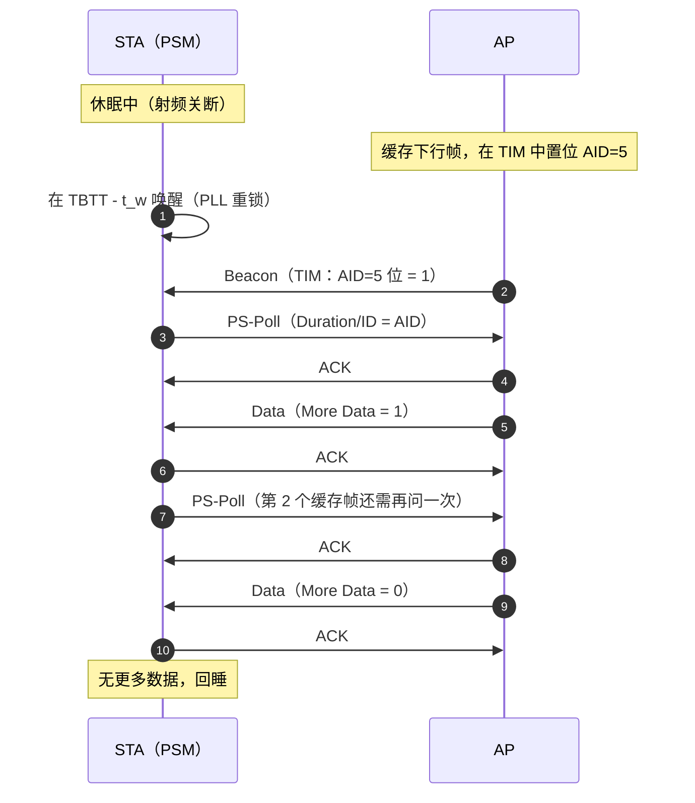
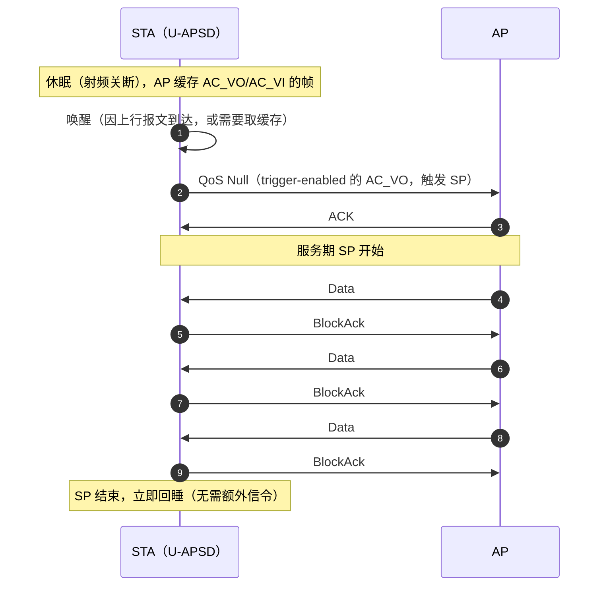
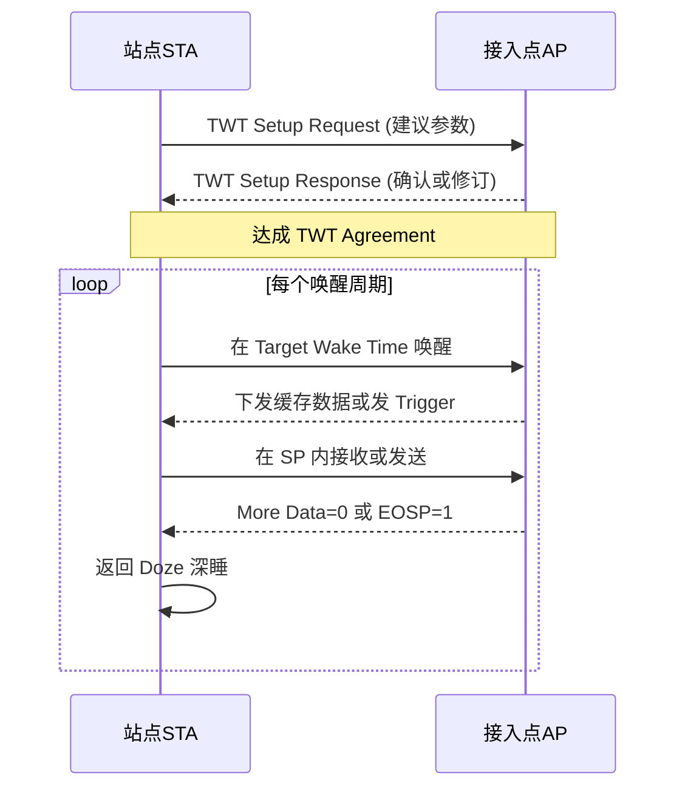
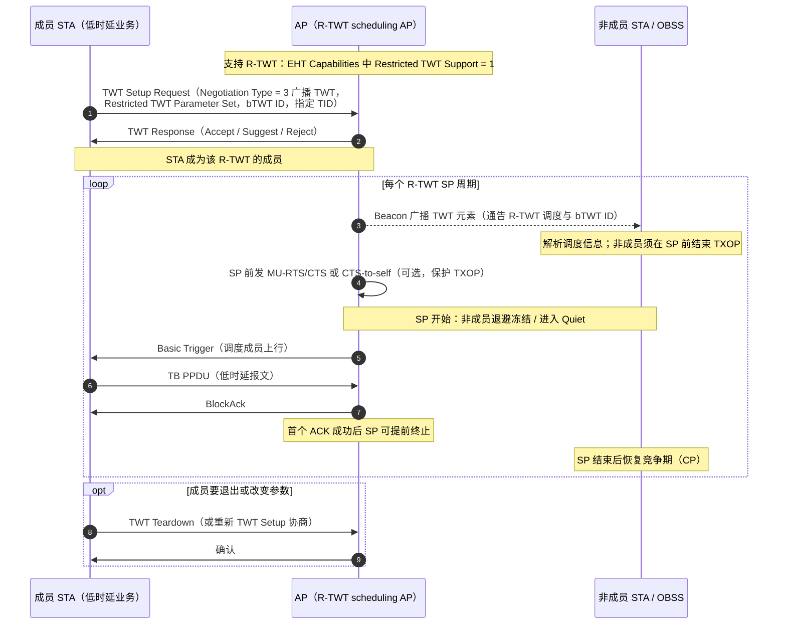
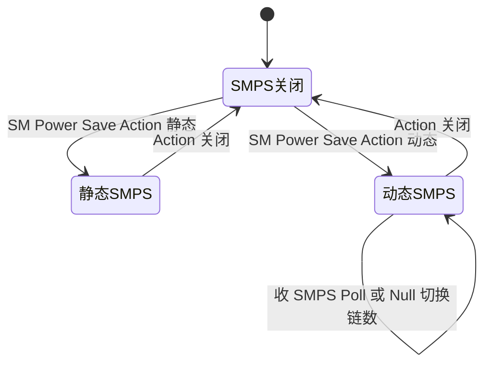

# 第 12 章　功耗管理与省电机制 ★

## 学习目标

1. 能建立 STA 射频链路的分模块功耗模型，并量化"空闲侦听接近接收功耗"这一反直觉结论。
2. 能推导 AID → TIM 位图的 partial virtual bitmap 映射（block offset / bit offset 计算），并给出算例。
3. 能写出 TWT 协商流程与关键 IE 字段，完成 Wake Interval / Wake Duration 的时间单位换算与占空比计算。
4. 能把省电机制建模为调度问题：推导"休眠盈亏平衡"封闭解，并设计"自适应 TWT 唤醒窗口调度"算法，最终绘制能耗—时延帕累托前沿。

---

## 12.1 功耗构成与建模基础

### 12.1.1 完整信号处理通路：从天线到 MAC，每一级在做什么、耗多少电

要理解省电机制为什么这样设计，必须先看清**一个比特在收发链路上要走多少级、每一级为什么必须耗电**。


*图 12-1　上两行分别给出接收（RX）与发送（TX）的完整信号处理通路，每个模块下方标注典型功耗（示意值，20 MHz 单空间流）；左下为四档工作状态功耗对比，右下为接收链路内部分解。注意两点：(1) **模拟域（RF/AFE）与数字域（基带 DSP）的分界在 ADC/DAC**，它决定了"哪些级可以用时钟门控省电、哪些级必须常开"；(2) **PA 是发射侧绝对主导项**，而接收侧则是**数字基带与 模数转换器（Analog-to-Digital Converter, ADC）主导**——这个差别直接决定了 RX 省电只能靠"少听"，TX 省电只能靠"少发/降功率"。*

下表逐级给出**作用、基本原理与功耗**（数值为典型 11ax 1×1、20 MHz 单链路芯片的示意值，不同工艺差异可达数倍）：

| # | 模块 | 作用 | 基本原理 | 典型功耗 |
|---|---|---|---|---|
| 1 | 天线 + 收发开关（T/R Switch） | 收发切换、把天线接到 PA 或 LNA | 半双工器件：发送时接收支路必须断开，否则大功率会烧毁 LNA | < 1 mW |
| 2 | 带通滤波器（BPF） | 抑制带外干扰与镜像频率 | 声表面波/LC 滤波，插损直接恶化噪声系数 $NF$ | 0（无源，仅插损 1–3 dB） |
| 3 | **LNA**（Low Noise Amplifier，低噪声放大器） | RX 第一级放大 | 用最小噪声系数放大微弱信号；其 $NF$ 几乎决定整机灵敏度（Friis 公式：后级噪声被前级增益压制） | 3–10 mW |
| 4 | 正交混频器（I/Q Mixer） | 把 射频（Radio Frequency, RF）搬到基带，同时保留 I/Q 两路 | 与本地振荡相乘：$r(t)\cos(2\pi f_c t)$ 得到基带 + 二倍频，后者被滤除 | 5–15 mW |
| 5 | **PLL/VCO**（Phase-Locked Loop / Voltage-Controlled Oscillator，锁相环/压控振荡器） | 产生本振载波 | 用参考晶振锁定 VCO，使本振频率/相位稳定；**锁定需要时间**（典型 0.5–2 ms） | 15–30 mW（常为 RX 侧第二大项） |
| 6 | LPF + VGA（Low-Pass Filter / Variable Gain Amplifier） | 抗混叠滤波、动态范围适配 | 增益自动调整（Automatic Gain Control, AGC），使信号恰好落在 ADC 的满量程附近 | 10–20 mW |
| 7 | **ADC**（Analog-to-Digital Converter，模数转换器） | 模拟 → 数字 | 采样 + 量化；**功耗近似正比于采样率与量化位数**，故带宽翻倍 ADC 功耗显著上升 | 10–30 mW |
| 8 | 数字前端（DDC/抽取、数字滤波） | 数字下变频、降采样、去直流 | 用数字混频与多速率滤波替代部分模拟处理，避免模拟器件漂移 | 10–20 mW |
| 9 | 同步（Short Training Field, STF 检测 / AGC 收敛 / 载波频偏（Carrier Frequency Offset, CFO）估计） | 找出帧起点、校正频偏 | 自相关检测 传统短训练字段（Legacy Short Training Field, L-STF）的周期性（第 7 章 7.2.6 节已证明 STF 时域有 10 次重复） | 8–15 mW |
| 10 | 去 循环前缀（Cyclic Prefix, CP） + **快速傅里叶变换（Fast Fourier Transform, FFT）**（Fast Fourier Transform，快速傅里叶变换） | 时域 → 频域 | 利用 正交频分复用（Orthogonal Frequency Division Multiplexing, OFDM）的循环前缀把线性卷积转为循环卷积，再用 $N\log N$ 的 FFT 完成多载波分离 | 8–12 mW |
| 11 | 信道估计与均衡 | 估计 $H[k]$ 并单抽头均衡 | 用 传统长训练字段（Legacy Long Training Field, L-LTF） / xx-LTF 估计频域响应，$\hat X[k]=Y[k]/\hat H[k]$（见第 3 章） | 5–10 mW |
| 12 | 解调（LLR 计算） | 星座点 → 软信息 | 计算每比特的对数似然比 $L(b)=\ln\frac{P(b{=}0|y)}{P(b{=}1|y)}$，交给译码器 | 5–8 mW |
| 13 | 解交织 + **低密度奇偶校验码（Low-Density Parity-Check, LDPC）译码**（Low-Density Parity-Check） | 纠错 | 置信传播迭代；**迭代次数是可控的能耗旋钮**（早停可省 30–60% 译码功耗） | 15–60 mW（随迭代次数） |
| 14 | 解扰 / 去聚合 / 递交 媒体接入控制（Medium Access Control, MAC） | 还原 MAC 服务数据单元（MAC Service Data Unit, MSDU） | 去扰、MAC 协议数据单元（MAC Protocol Data Unit, MPDU）聚合（Aggregated MPDU, A-MPDU）解聚合、地址与 帧校验序列（Frame Check Sequence, FCS）校验 | 5–10 mW |
| 15 | **PA**（Power Amplifier，功率放大器） | TX 末级放大到发射功率 | 工作在非线性区换取效率，典型效率仅 10–30%：**输出 100 mW 时自身要消耗 300–1000 mW，其余全部变成热** | 200–800 mW（TX 时） |
| 16 | 数模转换器（Digital-to-Analog Converter, DAC） + LPF + 正交上变频 | 数字 → 模拟 → RF | 与 RX 对称；DAC 采样率同样随带宽上升 | 30–50 mW |

> **表 12-1　信号处理通路逐级功耗（示意值）。** 整机四档汇总：**TX（20 dBm 输出）300–1000 mW ／ RX 60–120 mW ／ Idle 50–90 mW ／ Deep Sleep < 0.1 mW**。
> dBm 换算：$P_{\rm dBm}=10\log_{10}(P_{\rm mW})$。RX 90 mW ⇒ $19.5$ dBm；深睡 0.05 mW ⇒ $-13$ dBm；TX 500 mW ⇒ $27.0$ dBm。注意 dBm 是功率量，**两档"相加"必须先转回 mW 线性域**。

**从这张表能读出三条对省电设计至关重要的结论**：

1. **"听"的代价几乎等于"收"**。RX 与 Idle 都要求 LNA、混频器、PLL、ADC、数字前端全部加电——因为要判断"信道是否忙"就必须能解出前导（第 8 章的 CCA-CS）。两者之差仅在于是否继续做信道估计与译码，而那部分功耗占比很小（见 12.1.3 的量化）。
2. **"唤醒"的代价主要是时间，而不是能量**。唤醒过程要重新锁定 PLL（0.5–2 ms）、AGC 收敛、定时同步功能（Timing Synchronization Function, TSF）重新同步；这段时间射频全开，因此**唤醒次数比唤醒时长更值得优化**——这是 TWT 优于 PSM（PSM 每个 Beacon 都要醒一次）的根本原因。
3. **省电旋钮分四层**，互不替代：
   - **协议层**：减少唤醒次数与侦听时长（PSM / U-APSD / TWT，本章主体）；
   - **天线层**：少开接收链（SMPS/DPS，12.6 节）；
   - **算法层**：降低译码迭代次数、降采样、简化信道估计（早停、自适应精度）；
   - **电路层**：时钟门控、动态电压频率调节（DVFS）、深睡时停 DCXO。

### 12.1.2 四档功耗模型

定义 STA 的四种工作状态（state）及对应功率。注意"哪些模块加电"这一列——它才是四档功耗差异的物理原因：

| 状态 | 符号 | 典型功率 | 加电的模块 | 能做什么 / 不能做什么 |
|---|---|---|---|---|
| 发射 | $P_{\rm tx}$ | 300–1000 mW | PA+LNA+Mixer+PLL+ADC/DAC+BB 全开 | 能发；**自己是聋的**（半双工），期间收不到任何帧 |
| 接收 | $P_{\rm rx}$ | 60–120 mW | LNA+Mixer+PLL+ADC+BB 全开（含解调译码） | 能收全帧、能解 MAC 头 |
| 空闲侦听 | $P_{\rm idle}$ | 50–90 mW | LNA+Mixer+PLL+ADC+BB 全开（**只做 空闲信道评估（Clear Channel Assessment, CCA）与前导检测**） | 只知道"信道忙不忙"；不译码、不接收数据 |
| 深睡 | $P_{\rm sleep}$ | < 0.1 mW | 仅定时器/寄存器保持（DCXO 可停） | 什么也收不到；只能被本地定时器唤醒 |

功耗的时间平均由这四档的**占空比**决定。令 $\alpha_{\rm tx},\alpha_{\rm rx},\alpha_{\rm idle},\alpha_{\rm sleep}$ 为各态时间占比（$\sum\alpha=1$），则平均功率

$$
\bar P = \alpha_{\rm tx}P_{\rm tx}+\alpha_{\rm rx}P_{\rm rx}+\alpha_{\rm idle}P_{\rm idle}+\alpha_{\rm sleep}P_{\rm sleep}.
$$

对多数电池供电的 无线局域网（Wireless LAN, WLAN）设备，**$\alpha_{\rm idle}$ 远大于其余三项**（等待网络、无业务时仍须保持侦听），因此减少 $\alpha_{\rm idle}$（让其转为 $\alpha_{\rm sleep}$）是省电的第一杠杆——这正是本章所有机制的出发点。

### 12.1.3 "空闲侦听最贵"的量化

**反直觉结论**：空闲侦听（Idle listening）的功耗与接收（RX）几乎相等，远高于深睡。原因在于：要检测前导（preamble）以判断是否信道忙或本 STA 被呼叫，LNA、混频器、PLL、ADC 与基带时钟**必须全部加电**——即"为了听，必须先全开"。唯一省掉的是解调出 MAC 帧负载后的后续处理，但这部分占比很小。

量化对比（取表 12-1 中值）：

| 状态 | 功率 (mW) | 相对 RX 比值 | dBm |
|---|---|---|---|
| RX | 90 | 1.00 | 19.5 |
| Idle | 75 | **0.83** | 18.8 |
| TX（20 dBm） | 500 | 5.6 | 27.0 |
| Sleep | 0.05 | 5.6×10⁻⁴ | −13.0 |

**关键判读**：
- $P_{\rm idle}/P_{\rm rx}\approx 0.83$，即"空听"耗费了接收态 83% 的能量，却**没有接收任何有用比特**。
- $P_{\rm idle}/P_{\rm sleep}\approx 1500$，休眠相比空闲省下约三个数量级。
- TX 虽单值最高，但 TX 发生在有数据要发的短暂瞬间，而 Idle 是"长时间、高频次"的背景消耗。对一个每天仅上传几次传感数据的 IoT 设备，**总能耗中 Idle 占比可达 70% 以上**，TX 反而可忽略。

> 这一结论推翻了"发射最耗电"的直觉，也解释了为什么 Wi-Fi 的省电机制（PSM→U-APSD→TWT）的核心思想都是**压缩空闲侦听时间**，而非压缩发射时间。

---

## 12.2 传统 PSM（Power Save Mode）

传统省电模式（Power Save Mode, PSM，11 legacy）让 STA 在无数据时在 Beacon 指示的窗口外进入休眠，由 AP 缓存单播帧并在 Beacon 中通过 TIM 通知。

### 12.2.1 TIM / DTIM 工作机制与时序

AP 在每个 Beacon 中携带 **TIM（Traffic Indication Map，流量指示图）**，用位图通告"哪些关联 ID（Association ID, AID）有缓存单播帧"。STA 在每次 Beacon 来临前短暂唤醒读取 TIM；若自己的 AID 位为 1，则保持清醒并取数据，否则立即回睡。

**DTIM（Delivery Traffic Indication Message，投递流量指示消息）** 是每隔 `DTIM Period` 个 Beacon 出现一次的"特殊 Beacon"（体现为 TIM 中的 DTIM Count/Period 字段），其后 AP 立即下发缓存的**组播/广播帧**——组播无法点对点缓存，必须在"所有 STA 都确定醒着"的时刻统一发送。


*图 12-2　传统 PSM 时序。横轴为时间（Beacon 周期 100 ms，DTIM 周期 = 3 个 Beacon）。四行自上而下分别是：AP 的 Beacon/DTIM 发送时刻、TIM 位图（16 bit 示意，红色格子代表本 STA 的 AID=5 有缓存帧）、AP 缓存的待取下行帧、STA 的射频状态。关键观察：**STA 的唤醒窗口极窄**（只够读 TIM），因此平均功耗由"唤醒次数 × 唤醒时长"的占空比决定，而不是由峰值功耗决定。*

#### PSM 完整交互步骤（逐条对应图 12-2）

设 STA 采用 PSM，且已在关联请求中把 Power Management 位置 1。

1. **关联/重关联时**：STA 在 Association Request 中声明 PS 支持；AP 分配 AID，并在响应中告知 DTIM Period（也可由 Beacon 获取）。
2. **进入休眠**：STA 发送一个 Power Management = 1 的帧（或 服务质量（Quality of Service, QoS） Null）后，关闭射频，进入 Sleep。此后 AP 开始为它缓存下行单播帧。
3. **等待 TBTT**：STA 用本地 TSF 计时器推算下一个 Target Beacon Transmission Time（TBTT，目标信标发送时刻），提前 $t_w$（唤醒转换时间）唤醒——这段提前量必须覆盖 PLL 重锁 + AGC 收敛 + 同步。
4. **读取 TIM**：收到 Beacon 后解析 TIM 元素。若本 STA 的 AID 位为 **0** → 立即回睡（这是最常见、最省电的分支）；若为 **1** → 保持清醒。
5. **取数据（PS-Poll 方式）**：STA 向 AP 发 **PS-Poll** 帧（Duration/ID 字段携带 AID），AP 用 确认帧（Acknowledgement, ACK）确认并在 短帧间间隔（Short Inter-Frame Space, SIFS）后回一个缓存帧；若还有更多缓存帧，帧头 **More Data 位 = 1**，STA 需要**再发一次 PS-Poll**（见下图）。收完所有帧后 STA 回睡。
6. **DTIM 的特殊处理**：当 TIM 指示本次为 DTIM 时，STA 必须**保持清醒直到组播/广播帧全部收完**（AP 用 More Data 或组播帧序列结束来指示），此后才允许回睡。这是 PSM 下组播业务时延较大的原因。
7. **主动发送（可选）**：STA 可在任何时刻唤醒并用正常 DCF/EDCA 竞争发送上行帧（"PS 不影响发"），发完后可再次回睡。



*图 12-3　PS-Poll 取数流程：**每取一个缓存帧都需要一次"PS-Poll + ACK + Data + ACK"的完整往返**，这是 PSM 在多帧突发场景下的核心缺陷，也是 U-APSD 的直接动机（见 12.3 节与图 12-4）。*

**唤醒时序约束**：STA 必须在 TBTT 前完成"唤醒 + PLL 重锁 + 同步"全过程，即要求唤醒时间 $t_w$（典型 1–3 ms）**远小于 Beacon 间隔**，否则连读 TIM 都来不及。这解释了两件事：(1) Beacon 间隔不能无限压缩；(2) **PSM 的时延下限由 Beacon 周期决定**（最坏情况要等一个 Beacon 周期才发现自己有数据，100 ms 量级），因此 PSM 只适合低速率、容忍高时延的 IoT 业务。

### 12.2.2 AID → TIM 位图映射（partial virtual bitmap 推导）

AID 取值范围 1–2007。若每次 Beacon 都发 2008 bit 位图，开销不可接受。因此标准采用 **partial virtual bitmap（部分虚拟位图）**：只发送"有缓存 AID 所处区间"的若干字节，配合 `Bitmap Control` 中的偏移量还原绝对位置。

**符号与结构**：
- 位图按 8 个 AID 为一字节（block/octet）组织。AID 所在的字节索引 $b=\lfloor{\rm AID}/8\rfloor$，字节内位 $r={\rm AID}\bmod 8$。
- `Bitmap Control`（1 字节）：bit 0 = AID 0（组播/广播）指示位；bit 1–7 = **N1（block offset，起始字节偏移）**，单位为"字节"。
- `Partial Virtual Bitmap`：从字节 N1 到 N2 的连续 $({\rm N2-N1+1})$ 字节。

**发送端构造算法**（block offset / bit offset 计算）：

```
输入: bufferedAIDs = 有缓存单播帧的 AID 集合; mcastBuffered (DTIM时组播缓存?)
1. A = bufferedAIDs ∪ {0 if mcastBuffered else ∅}      // 含AID 0
2. if A == ∅: 返回空位图 (length=0), BitmapControl.bit0=0
3. N1 = floor(min(A)/8)                                // 起始块偏移
4. N2 = floor(max(A)/8)                                // 终止块偏移
5. bitmap = zeros(N2-N1+1 字节)
6. for aid in A:
7.     byteIdx = floor(aid/8) - N1                      // 块内相对偏移
8.     bitIdx  = aid mod 8                             // 位偏移
9.     bitmap[byteIdx] |= (1 << bitIdx)
10. BitmapControl = (mcastFlag<<0) | (N1<<1)           // N1 占高7位
11. 返回 BitmapControl, bitmap
```

**接收端解码算法**（判断自己 AID 是否被指示）：

```
输入: BitmapControl, partialBitmap, myAID
1. N1 = BitmapControl >> 1
2. byteIdx = floor(myAID/8) - N1
3. if byteIdx < 0 or byteIdx >= len(partialBitmap): return 0   // 不在区间内
4. bitIdx = myAID mod 8
5. return (partialBitmap[byteIdx] >> bitIdx) & 1
```

**算例 12.1**：TIM 位图映射。

> **已知**：某 DTIM Beacon 中，缓存单播帧的 AID 集合为 $\{100,105,110\}$，且本次无组播缓存（$mcastFlag=0$）。
> **求**：N1、N2、partial bitmap 字节内容，并验证解码 AID=105 得到 1。
> **解**：
> - $\min=100\Rightarrow {\rm N1}=\lfloor100/8\rfloor=12$；$\max=110\Rightarrow {\rm N2}=\lfloor110/8\rfloor=13$。
> - 部分位图长度 $={\rm N2-N1+1}=2$ 字节（Byte0 对应绝对字节 12，Byte1 对应绝对字节 13）。
> - AID 100：$\text{byteIdx}=12-12=0$，$\text{bit}=100\bmod 8=4$ ⇒ Byte0 置位 $(1\ll4)=0{\rm x}10$。
> - AID 105：$\text{byteIdx}=13-12=1$，$\text{bit}=105\bmod 8=1$ ⇒ Byte1 置 $(1\ll1)=0{\rm x}02$。
> - AID 110：$\text{byteIdx}=13-12=1$，$\text{bit}=110\bmod 8=6$ ⇒ Byte1 置 $(1\ll6)=0{\rm x}40$。
> - 故 Byte0 = `0x10`，Byte1 = `0x02|0x40 = 0x42`。
> - 解码 AID 105：N1=12，$\text{byteIdx}=13-12=1$，$\text{bit}=1$，$(0{\rm x}42\gg1)\&1=(0{\rm x}21)\&1=1$ ✓。
> **结论**：仅用 2 字节 + 1 字节控制域即指示了 3 个分散在 AID 100–110 的 STA，相比全量 2008 bit 压缩比约 1/100。量纲无关（纯索引运算），但偏移 N1 单位为"字节（8 个 AID）"，避免把 N1 误当成 AID 序号。

### 12.2.3 PS-Poll 取数流程

读 TIM 发现本 AID 位为 1 后，STA 发送 **PS-Poll（Power Save Poll）** 帧（携带本 AID），AP 回应**一个**缓存单播帧。STA 持续保持清醒，直到收到的帧 `More Data` 子字段为 0，才返回休眠。

**特点与代价**：PS-Poll 是"一问一答、一次取一帧"——每取一帧都需一次 PS-Poll 竞争接入（含退避，见第 8 章），**轮询开销随缓存帧数线性增长**，在突发（burst）流量下效率低下。这正是 U-APSD 要解决的问题。

### 12.2.4 DTIM 与组播/广播缓存

组播/广播帧无法按 AID 单独缓存与轮询。AP 将其缓存在 DTIM Beacon 之前，**仅在 DTIM Beacon 之后**统一下发，确保所有处于 PSM 的 STA 此刻都已唤醒。因此：
- 组播敏感业务（如音视频组播）的实际可达周期 = `DTIM Period × Beacon Interval`。
- 缩短 DTIM Period 可降低组播时延，但增加所有 STA 的唤醒频率（能耗↑），构成第一组"时延—能耗"权衡。

---

## 12.3 U-APSD（11e / WMM Power Save）

**U-APSD（Unscheduled Automatic Power Save Delivery，非调度自动省电投递，11e）** 在 PSM 之上引入**业务期（Service Period, SP）** 概念：STA 用一个 **QoS Null 帧**触发 AP，AP 在一个 SP 内连续下发该 AC（Access Category，接入类别）及可投递 AC 的缓存帧，直到 `More Data = 0` 或 QoS 控制字段的 **EOSP（End Of Service Period，服务期结束）** 位置 1。


*图 12-4　同样取回 4 个缓存帧的两种做法。(a) PS-Poll 模式：每一帧都要走一次"PS-Poll → ACK → Data → ACK"，且每次 PS-Poll 都要重新竞争、重新唤醒；(b) U-APSD 模式：一个触发帧（QoS Null）开启服务期 SP，AP 在这一个 SP 内连续下发多个帧（用 More Data=1 标示"还有"），最后一帧 More Data=0 结束 SP，STA 立即回睡。两者的差别不在于单帧的传输时间，而在于**唤醒与竞争次数从 $n$ 次降到 1 次**。*

#### U-APSD 完整交互步骤

1. **前置协商**：STA 在关联请求或 (Re)Association 中通过 QoS Capability / Wi-Fi 多媒体（Wi-Fi Multimedia, WMM）元素声明哪些 AC 是 **trigger-enabled**（可由本 STA 的 QoS Null 触发 SP）与哪些是 **delivery-enabled**（其缓存帧可在 SP 内被投递）。这一步决定了 SP 的语义：**触发哪个 AC，就能收哪些 AC 的帧**。
2. **进入休眠**：STA 发送一个 Power Management = 1 的帧后进入 Sleep；AP 为它缓存各 AC 的帧。
3. **触发 SP**：STA 有业务（上行要发）或需要取回缓存时，唤醒并发送一个 **QoS Null 帧**——该帧本身不携带数据，只用于"敲 AP 的门"。**注意：这个触发不依赖 Beacon 时刻**，这是 "Unscheduled（非调度）" 的字面含义，也是 U-APSD 相对 PSM 的时延优势来源。
4. **SP 内连续投递**：AP 收到 QoS Null 后开启 SP，按优先级连续发送缓存帧；每帧的 QoS Control 中 More Data 位指示"后面还有"。
5. **结束 SP**：AP 在最后一帧把 **EOSP = 1**（或 More Data = 0），STA 收到后即可回睡，无需额外信令。
6. **上行与下行可交织**：STA 在 SP 内也可以发送上行帧（利用 SP 内已被 AP 分配的机会），AP 用 ACK/BlockAck 回应。
7. **对 PS-Poll 的兼容**：SP 内的帧同样通过 BlockAck 聚合确认（第 10 章），因此一个 SP 实际能取回的帧数远超"一帧"——这正是它与 PS-Poll 的本质区别。



*图 12-5　U-APSD 的服务期交互。与图 12-3 的 PS-Poll 对比可见：**一次触发换一整个 SP**，且 SP 内可用 A-MPDU + BlockAck 批量搬运，唤醒与竞争开销从 $O(n)$ 降到 $O(1)$。*

### 12.3.1 触发/投递 AC 与 SP 机制

- **trigger-enabled AC**：该 AC 的 QoS Null 可触发 SP（如 VoIP 的 AC_VO）。
- **delivery-enabled AC**：该 AC 的缓存帧可在任意 SP 内被投递（即使未被该 AC 触发）。
- SP 内 AP 可连续发送多帧（聚合/块确认，见第 10 章），结束时置 EOSP=1。

### 12.3.2 相对 PS-Poll 的优势（排队论视角）

PS-Poll 相当于**每帧一次轮询**的 $M/D/1$ 型"单服务"系统：每取一帧需一次独立接入，轮询开销 $c$ 与帧数 $n$ 成正比，总接入开销 $\approx n\cdot c$。U-APSD 的 SP 是**批服务（batch service）**：一次触发换取一个 SP 内连续服务，开销近似为常数 $c$（与 $n$ 无关）。

设每帧平均服务时间 $s$，触发/轮询竞争开销 $c$（含退避均值，典型数 ms），突发到达 $n$ 帧：

$$
T_{\rm poll}(n)\approx n(c+s),\qquad T_{\rm UAPSD}(n)\approx c + n\,s.
$$

两者差 $\Delta T=(n-1)c$ 随 $n$ 线性增长。**排队论含义**：突发越长的业务（大 $n$），U-APSD 相对 PS-Poll 的时延与能耗优势越显著；而孤立单帧（$n=1$）二者等价。这解释了 U-APSD 在 VoIP/视频等突发实时业务中的主导地位。

---

## 12.4 TWT（11ax）【已发布】

**TWT（Target Wake Time，11ax）** 让 STA 与 AP 协商"在哪些绝对 TSF 时刻唤醒、唤醒多久"，把省电从"依附 Beacon"升级为"独立调度"，可把空闲侦听压到极低占空比，同时降低网络竞争。

### 12.4.1 个体 TWT 与广播 TWT 协商流程

- **个体 TWT（Individual TWT）**：STA（Applicant）与 AP（Responder）通过 TWT Setup Request/Response 单播协商，可建最多 8 条协议（3-bit Flow ID 区分）。
- **广播 TWT（Broadcast TWT）**：AP 在 Beacon/Action 帧中宣告共享时间表，多个 STA 按 TWT ID 订阅，同一 SP 内同时唤醒（适合工厂传感等同步场景）。
- **Implicit（隐式）**：STA 自行按"上一次 SP 起点 + Wake Interval"推算后续 SP，无需每轮信令；**Explicit（显式）**：AP 在每个 SP 前发 空数据帧（Null Data Packet, NDP） Paging 帧显式宣告。

*图 12-6　个体 TWT（Target Wake Time，目标唤醒时间）协商与周期运行时序。协商阶段确定参数，运行阶段 STA 自行按"上次 SP 起点 + Wake Interval"推算唤醒时刻，无需每轮信令。*



### 12.4.2 TWT IE 关键字段表

TWT Element（Element ID 216）的核心字段如下（依据 IEEE 802.11-2020 条款 9.4.2.200）。

| 字段 | 长度 | 含义 / 关键比特 |
|---|---|---|
| Request Type | 2 字节 | bit0 TWT Request；bit1–3 Setup Command；bit4 Trigger；bit5 Implicit；bit6 Flow Type（Announced/Unannounced）；bit7–10 Flow ID；bit11–15 TWT Wake Interval **Exponent**（5 bit） |
| Target Wake Time | 8 字节 | 首个 SP 的绝对 TSF 时间（单位 μs，64 bit） |
| TWT Wake Interval Mantissa | 2 字节 | 唤醒间隔尾数（16 bit，最大 65535） |
| TWT Wake Interval Exponent | 见 Request Type | 唤醒间隔指数（5 bit，最大 31） |
| Nominal Minimum TWT Wake Duration | 1 字节 | SP 最小清醒时长，单位 256 μs（Wake Duration Unit=0）或 1024 μs（=1，即 1 TU） |
| TWT Group Assignment | 9 字节 | 仅广播 TWT：组 ID 与成员参数 |

**时间单位换算推导**：

唤醒间隔（Wake Interval）由尾数—指数浮点编码给出：

$$
T_{\rm inv} = M \times 2^{E}\ \ (\mu{\rm s}),
$$

其中 $M$ 为 Mantissa（16 bit），$E$ 为 Exponent（5 bit）。该编码支持从微秒级到"数年级"的间隔（最大 $65535\times 2^{31}\,\mu{\rm s}\approx 4.5$ 年）。

SP 最小清醒时长：

$$
T_{\rm wd} = D_{\rm field}\times U_{\rm unit},\qquad U_{\rm unit}\in\{256\,\mu{\rm s},\ 1024\,\mu{\rm s}\}.
$$

**wake TBTT（SP 起点序列）**：Implicit 模式下第 $k$ 个 SP 起点为

$$
{\rm SP}_k = {\rm TWT}_0 + k\cdot T_{\rm inv},\qquad k=0,1,2,\dots
$$

（单位均为 μs，直接相加，量纲一致）。

**算例 12.2**：TWT 时间单位换算。

> **已知**：$M=5000,\ E=10$，$D_{\rm field}=5$，Wake Duration Unit=0（256 μs）。
> **求**：唤醒间隔 $T_{\rm inv}$、最小 SP 时长 $T_{\rm wd}$，并换算为 ms/s。
> **解**：
> - $T_{\rm inv}=5000\times 2^{10}=5000\times1024=5\,120\,000\ \mu{\rm s}=5120\ {\rm ms}=5.12\ {\rm s}$。
> - $T_{\rm wd}=5\times256=1280\ \mu{\rm s}=1.28\ {\rm ms}$。
> **量纲检查**：$M$（无量纲）$\times 2^{E}$（无量纲）得 μs，再 $\div1000$ 得 ms、$\div10^6$ 得 s，正确；256 μs × 整数 = μs，正确。该量级合理（传感器每约 5 s 醒 1.28 ms，占空比极低）。

### 12.4.3 SP 时长与占空比算例

**算例 12.3**：给定 Applicant/Responder 协商参数，算 SP 与占空比。

> **已知**：协商 ${\rm TWT}_0=200\,000\,000\ \mu{\rm s}$（TSF），$T_{\rm inv}=5.12\ {\rm s}$（即 5 120 000 μs），$T_{\rm wd}=1.28\ {\rm ms}$。采用 Implicit、Non-trigger。
> **求**：第 $k=1,2$ 个 SP 起点（wake TBTT）；占空比 $\rho$；若开启 early termination（无数据则提前结束），实际 SP 可短至多少。
> **解**：
> - ${\rm SP}_1=200\,000\,000+5\,120\,000=205\,120\,000\ \mu{\rm s}$；${\rm SP}_2=210\,240\,000\ \mu{\rm s}$。
> - 名义占空比（按最小 SP 算）：$\rho = T_{\rm wd}/T_{\rm inv}=1.28\ {\rm ms}/5120\ {\rm ms}=2.5\times10^{-4}=0.025\%$。
> - early termination 下，若 AP 在 SP 起点即表明"无缓存数据"，STA 可在收到第一个帧（或 Beacon 指示）后立即回睡，实际 SP 可短至一次 SIFS + 帧交换（约数十 μs），此时占空比进一步下降一个数量级。
> **量纲检查**：$T_{\rm wd}$（ms）与 $T_{\rm inv}$（ms）同单位相除得无量纲占比，正确；wake TBTT 全为 μs 相加，正确。结论：TWT 把 Idle 占比从"接近 100%"压到 0.025%，是超低占空比省电的核心手段。

---

## 12.5 R-TWT（11be）【草案】

**R-TWT（Restricted TWT，11be）** 是广播 TWT 的受限变体，用于在密集场景为成员 STA 提供**受保护的低时延窗口**。


*图 12-7　R-TWT（Restricted TWT，受限 TWT）的时序。自上而下五行分别是：非成员 STA 的普通业务、成员 STA 的低时延业务、AP（R-TWT 调度者）、退避过程、信道保护状态。三个关键动作：(1) **SP 开始前，非成员必须结束自己已获得的 发送机会（Transmission Opportunity, TXOP）**，不得跨越 SP 边界；(2) **SP 内非成员的退避过程被冻结**，成员则静默等待 AP 的 Basic Trigger（Bluetooth, BT）来调度上行；(3) **SP 可在首个成功 ACK 后提前终止**，把剩余时间还给竞争期（CP），从而不过度牺牲背景业务吞吐。*

#### 12.5.1 成员约束、保护与"致歉"的正确说法（术语澄清）

**（1）成员资格与身份。** R-TWT 是**广播 TWT（Broadcast TWT）的受限变体**：在 TWT 元素的 Request Type 字段中，当 **Broadcast TWT Recommendation 子字段取值为 4** 时，表示该广播 TWT 即为 R-TWT。支持该特性的 极高吞吐量（Extremely High Throughput, EHT） AP 称为 **R-TWT scheduling AP**，成员 STA 称为 **R-TWT scheduled STA**，双方在 EHT Capabilities 元素的 **Restricted TWT Support 子字段**置 1 表示支持。

**（2）SP 内谁可以传。** 在 R-TWT SP 内，只有该 R-TWT 的**成员**被允许（或被优先允许）与 AP 交换帧；非成员须让路。若 SP 配置为 **trigger-enabled**，则由 AP 在每个 SP 内至少发送一个 **Basic Trigger** 帧来显式调度成员上行——这同时避免了成员之间的内部竞争（第 8 章 8.2.2 的内部碰撞问题）。

**（3）三类"清空信道"的手段**（对应图 12-7 的保护行）：

| 手段 | 作用范围 | 机制 |
|---|---|---|
| **SP 边界约束** | 本 基本服务集（Basic Service Set, BSS）内支持 R-TWT 的 STA | 必须在 SP 开始前**结束当前 TXOP**；缓冲的非实时帧延后到 SP 结束再发 |
| **静默（Quiet）** | 本 BSS 内所有 STA | AP 在 Beacon 中广播 **Quiet element**，通告 SP 内的静默间隔，STA 据此进入 quiet mode，不做任何发送 |
| **网络分配矢量（Network Allocation Vector, NAV）保护 TXOP** | 含 重叠基本服务集（Overlapping BSS, OBSS） | AP 在 SP 前用 **MU-RTS/CTS、自发 CTS（CTS to Self, CTS-to-self）** 等预留一段保护 TXOP，把 OBSS 也挡在门外（与第 11 章 OBSS PD、第 28 章低时延工具箱协同） |

**（4）关于"致歉（apology）机制"——一个需要澄清的术语。** 不少中文二手资料把 R-TWT 中"AP 临时让出/解除某次 SP 保护"的做法称为 **apology（致歉）机制**。需要明确的是：**IEEE 802.11be 正文并未定义名为 apology 的帧或机制**。它的语义在标准中由以下四组已定义机制分别承担，做研究时应当使用标准术语：

| 二手中文资料的说法 | 标准中的对应机制 | 触发方向 | 效果 |
|---|---|---|---|
| "成员为紧急业务申请让出 SP" | STA 退出/暂停参与 R-TWT 调度：**TWT Teardown**（MLME-TWTTEARDOWN 原语）或重新协商 TWT Setup | STA → AP | 结束该 STA 的成员资格，此后它按普通 STA 参与竞争 |
| "AP 临时解除保护" | AP 更新 **广播 TWT 元素**中的调度参数（含 Broadcast TWT Persistence）、或不再发送保证 SP 的调度 | AP → 全体 STA | 该 SP 退化为普通竞争期；STA 按下一次 Beacon 中的新参数运行 |
| "AP 在 SP 内宣布暂停" | **Quiet element** 通告静默间隔 | AP → 全体 STA | 全体静默，SP 内无可传输者 |
| "成员道歉表示本次不参与" | 成员在 SP 内不发送（静默），AP 的 SP 可**提前终止** | STA 侧隐式 | 剩余 SP 归还竞争期，不浪费空口 |

> **写论文时的建议**：若你的工作确实要引入"AP 因资源不足而无法兑现 R-TWT 保护"的机制，请把它作为**你的新机制**提出并显式说明与标准机制的差异（例如"我们扩展 Quiet element 的语义，允许 AP 按 STA 粒度声明 SP 不可用"），**不要**沿用 "apology" 这个名字暗示它是标准已有特性。

#### 12.5.2 R-TWT 完整消息流程



*图 12-8　R-TWT 的完整消息流程。注意三条时间线的配合：协商（一次性）、通告（每个 Beacon）、执行（每个 SP）。这也是"确定性"与"统计性优先"的分界——R-TWT 给出的是**有边界的 SP**，而 增强型分布式信道接入（Enhanced Distributed Channel Access, EDCA）只能给出概率上的优先。*

### 12.5.3 演进指向

R-TWT 仍是单 AP 内的广播调度。Wi-Fi 8（802.11bn【草案】）将其升级为 **Co-RTWT（Coordinated R-TWT）**——在多 AP 间协调 R-TWT SP，使相邻 BSS 的成员窗口错开或联合保护，进一步提升密集部署下的确定性与能效。详见第 27 章。

---

## 12.6 SMPS / DPS / MLPM

### 12.6.1 静态与动态空间复用省电（SMPS）

**SMPS（Spatial Multiplexing Power Save，11n）** 让 STA 在不需要多流时关闭多余接收链（RF chain），只保留单链。两种模式：
- **Static SMPS**：协商后固定单链，AP 若要发多流须先发 **SMPS Poll / Null 帧** 唤醒额外链。
- **Dynamic SMPS**：可动态在单链/多链间切换，AP 通过帧头的 SMPS 控制位指示下一帧的链数。

*图 12-9　SMPS（Spatial Multiplexing Power Save，空间复用省电）的状态迁移。*



> DPS（Dynamic Power Save，11n/11ac）与此互补：在 SMPS 基础上，STA 可对"暂时无业务"的接收链做更细粒度的时钟门控/下电，由 More Data 与帧调度触发。两者共同把"多天线带来的额外链耗"在空闲时压到最低。

### 12.6.2 Awaken Window

部分省电调度（如 WMM-PS 的约定、TWT 协商的弹性窗口）引入 **awaken window（清醒窗口）**：STA 在约定窗口内必须保持可接收，窗口外可自由回睡。它是对"绝对 SP 时刻"的容错——补偿唤醒时钟漂移与调度抖动，避免 STA 因早到/迟到而漏收。

### 12.6.3 MLPM 跨链路 TIM 指示压缩（简述）

**MLPM（Multi-Link Power Management，11be MLO）** 面对一个 MLD（Multi-Link Device）拥有多条链路的问题：若每条链路各发一份 TIM，开销随链路数倍增。其思路是**跨链路压缩**：AP 用单个 MLD 级 AID 指示，并以"Per-STA Profile + Link Bitmap"告知"哪些链路上有缓存"，STA 只需在一跳内得知全部链路的待取状态，再按需唤醒对应链路。由于 多链路操作（Multi-Link Operation, MLO）架构、TID-to-link 映射与跨链路调度在第 15 章专门展开，此处仅点出其"指示压缩"思想——本质是用一个高层指示替代 N 个低层 TIM，复用第 12.2.2 的位图压缩逻辑。

---

## 12.7 算法一：唤醒盈亏平衡模型（六段式）

> **本节先回答两个"元问题"：这个算法到底干什么用？"六段式"又是什么？** 弄不清这两点，下面的推导就只是公式体操。

**（一）这个算法要干什么用**

**一句话**：它回答"**这一觉到底该不该睡**"——给出一张**判决公式**，让 STA 在每次收完数据、面对一段无业务窗口时，能在 1 次除法的代价内决定"进深睡"还是"继续空闲侦听"。

**为什么需要它**：省电的本质是一场赌博。睡觉当然省电，但醒来要付**固定成本**——晶振/PLL 重新锁定、AGC 重新收敛、重同步、重新侦听信道（详见图 12-1 与 12.1.1 的通路分解）。若只睡很短一段时间，省下来的那点电还不够唤醒花掉的多，**结果反而是净亏损**。12.1.3 已经量化过"空闲侦听最贵"，于是"睡多久才回本"就成了一个必须给出**封闭形式答案**的判决问题。本模型给出的答案就是临界时长 $T_{\rm be}$（break-even time，盈亏平衡时长）：

$$
T\ge T_{\rm be}=\frac{1000\,E_w}{P_i-P_s}\quad\Longrightarrow\quad \text{睡；否则保持空闲侦听。}
$$

**它在全章的定位**：这是本章最底层的**决策原语**。12.8 的自适应 TWT 调度、12.9 的帕累托取点都要复用它——TWT 每个周期的"要不要按这个 $T_{\rm int}$ 醒"，其内核正是同一个盈亏平衡判断的多周期版本：把 $T$ 换成 $T_{\rm int}$、把 $E_w$ 换成"每周期唤醒能耗"即可。因此理解本节 = 拿到后面所有省电调度的钥匙。

**直觉类比**（帮助建立物理感）：

| 生活场景 | 模型中的对应量 |
|---|---|
| 关灯能省电 | 功率差 $P_i-P_s$ |
| 重新开灯的代价（灯管启动、眼睛重新适应） | 唤醒固定能耗 $E_w$ |
| 离开多久才值得关灯 | 盈亏平衡时长 $T_{\rm be}$ |
| 客人随时可能回来，不能黑太久 | 时延预算 $D_{\max}$ |

**（二）什么是"六段式"**

"**六段式**"**不是本算法的专有名词**，而是**全书所有核心技术点统一采用的写作模板**（见 `.workbuddy/写作规范.md` 第 4 节）——本章 12.7、12.8 两个"算法一/算法二"以及后续各章同名的算法块，都严格按同一顺序的六段展开。之所以固定成六段，是因为它恰好构成"**从物理问题走到可落地工程判据**"的完整链条，缺任何一段，读者都会在其中某一环断链：

| 段 | 这一段回答什么 | 缺了会怎样 |
|---|---|---|
| **1 问题建模** | 到底在决策什么？涉及哪些量？ | 符号无定义，读者不知道在看什么 |
| **2 目标函数与约束** | 想最大化/最小化什么？边界在哪？ | 变成"为推导而推导"，不知目的 |
| **3 完整推导** | 结论从哪来？用了什么定理/近似？ | 结论不可信、不可复现 |
| **4 伪代码** | 工程上怎么落地？ | 停留在纸面，无法实现 |
| **5 复杂度分析** | 能不能塞进固件、毫秒级跑完？ | 不知道是否满足实时性 |
| **6 数值算例** | 数值到底多大？量级合理吗？ | 不知参数取值，无法验收 |

> 阅读建议：若只想抓工程结论，跳读**第 3 段（框内公式）**与**第 6 段（算例）**即可；若要做研究复现，六段需连读。下面正式进入六段。

### 1. 问题建模

STA 在一次收发结束后，面临一段预计长度为 $T$ 的"无数据"窗口（到下一个预期分组到达）。决策：进入深睡，还是保持空闲侦听？

| 符号 | 含义 | 单位 |
|---|---|---|
| $P_i$ | 空闲侦听功率 | mW |
| $P_s$ | 深睡功率 | mW |
| $E_w$ | 单次唤醒固定能耗（PLL 重锁+重同步净额外能耗） | mJ |
| $t_w$ | 唤醒转换时间 | ms |
| $T$ | 可用休眠时长 | ms |
| $D_{\max}$ | 业务允许的最大额外时延 | ms |

假设：分组到达可预期（或历史均值）使 $T$ 可估；唤醒后重同步成本以固定能耗 $E_w$ 计（已含 $t_w$ 期间超出空闲基线的净能耗）。

### 2. 目标函数与约束

令休眠相对"一直空闲"的净能耗收益为 $\Delta E$，目标是 $\Delta E\ge 0$，且休眠引入的额外时延不超预算：

$$
\max\ \Delta E = \frac{(P_i-P_s)T}{1000} - E_w,\qquad
\text{s.t.}\quad T\le D_{\max},\ T\ge 0.
$$

### 3. 完整推导

休眠 $T$ 期间节省的空闲能耗（mW·ms ⇒ 转 mJ 需 ÷1000）：

$$
\Delta E_{\rm save} = \frac{(P_i-P_s)T}{1000}\ \ ({\rm mJ}).
$$

唤醒付出的净额外能耗为 $E_w$（mJ）。净收益：

$$
\Delta E = \frac{(P_i-P_s)T}{1000} - E_w.
$$

令 $\Delta E\ge 0$ 得休眠划算的**临界休眠时长**：

$$
\frac{(P_i-P_s)T}{1000}\ge E_w
\ \Longrightarrow\
T \ge \frac{1000\,E_w}{P_i-P_s}\equiv T_{\rm be}.
$$

**量纲检查**：左 $({\rm mW})({\rm ms})={\rm \mu J}$，÷1000 ⇒ mJ；右 $1000({\rm mJ\to\mu J})\times E_w({\rm mJ})={\rm \mu J}$，再隐含 ÷1000 已并入左式——等式两边均为 mJ 量级，一致。叠加时延约束，休眠划算的充要条件为：

$$
\boxed{T_{\rm be}=\frac{1000\,E_w}{P_i-P_s},\qquad \text{休眠划算}\iff T\ge T_{\rm be}\ \text{且}\ T\le D_{\max}.}
$$

**结论的图形化**：图 12-5(a) 把净收益 $\Delta E(T)$ 画成三条直线，斜率即 $P_i-P_s$（本例 59.9 mW），截距即 $-E_w$；直线与零轴的交点就是各自的 $T_{\rm be}$——可以看到 $E_w$ 越大（唤醒越贵），交点越靠右，"值得睡"的门槛越高。图 12-5(b) 把两个决策量 $T$ 与 $E_w$ 直接张成一张**判决相图**：边界曲线下方（绿色）为 SLEEP 区，上方（红色）为 IDLE 区，右侧灰带是超时延预算的禁区。任何一次判决都只是在这张图上"查坐标"。


*图 12-5　唤醒盈亏平衡模型。(a) 净收益线性增长，临界点 $T_{\rm be}=1000E_w/(P_i-P_s)$；(b) 判决相图，边界把 $(T,E_w)$ 平面切成"休眠划算"与"回调空闲"两区。参数：$P_i=60$ mW，$P_s=0.1$ mW，$D_{\max}=100$ ms。*

**三点物理解读**（这是本节最该记住的部分）：

1. **$T_{\rm be}$ 与 $E_w$ 成正比、与 $P_i-P_s$ 成反比**——唤醒越贵或"空闲与深睡的功率差"越小，越难睡回本。这直接解释了为什么轻载设备（$P_i-P_s$ 小）反而不值得频繁进出深睡，而低占空比的传感节点（$T$ 很长）几乎总是应该睡。
2. **判决是"长窗口"友好的**：收益正比于 $T$，成本是固定的 $E_w$。因此**把零散的小窗口合并成一个长窗口**（这正是 TWT/R-TWT 做的事）比"每次小睡一下"更划算——这就是 12.8 算法二存在的理由。
3. **两个约束必须同时成立**：只满足 $T\ge T_{\rm be}$（省电）但违反 $T\le D_{\max}$（时延）时，正确动作是**缩短睡眠、提前唤醒**，而不是硬睡——此时应由 12.8 在 $T_{\rm int}^\star$ 处取折中。

### 4. 伪代码

```text
 1  function ShouldSleep(P_i, P_s, E_w, T, D_max):
 2      // 计算盈亏平衡临界时长 (ms)
 3      T_be = 1000 * E_w / (P_i - P_s)        // 量纲: mJ→μJ / (mW) = μJ/mW = ms
 4      // 决策: 休眠必须既"省能量"又"不超时延"
 5      if T >= T_be and T <= D_max:
 6          return SLEEP                       // 休眠划算
 7      else:
 8          return IDLE                         // 否则保持空闲侦听
 9      // 复杂度: 仅常数运算, O(1)
```

### 5. 复杂度分析

时间与空间复杂度均为 $O(1)$：仅一次除法与两次比较。该判决可在 STA 固件中每帧结束后即时执行，无状态累积。

### 6. 数值算例

**算例 12.4**：盈亏平衡。

> **已知**：$P_i=60$ mW，$P_s=0.1$ mW，$E_w=0.5$ mJ，$t_w=2$ ms（仅用于唤醒延迟背景）；预计空闲 $T=50$ ms，$D_{\max}=100$ ms。
> **解**：
> - $T_{\rm be}=1000\times0.5/(60-0.1)=500/59.9=8.35$ ms。
> - 判据：$T=50\ge 8.35$ 且 $50\le 100$ ⇒ **休眠划算**。
> - 净节省：$\Delta E=(60-0.1)\times50/1000-0.5=2.995-0.5=2.495$ mJ。
> - 反例若 $T=5$ ms：$5<8.35$ ⇒ 不应休眠（唤醒能耗都赚不回）。
> **量纲检查**：$(P_i-P_s)T=$ mW·ms = μJ，÷1000 = mJ，与 $E_w$（mJ）相减，单位一致。量级 2.5 mJ 合理（单次唤醒省毫焦级，对应电池 μAh 量级）。

---

## 12.8 算法二：自适应 TWT 唤醒窗口调度（六段式）

### 1. 问题建模

在 TWT 框架下，STA 每个周期唤醒一次，AP 在 SP 内下发（或 STA 在 SP 内上报）缓存数据。目标是**在满足时延百分位约束下最小化平均能耗**，即自适应选择唤醒周期 $T_{\rm int}$ 与 SP 长度 $d_k$。

| 符号 | 含义 | 单位 |
|---|---|---|
| $\lambda$ | 分组到达率（EWMA 估计 $\hat\lambda_k$） | pkt/s |
| $s$ | 每分组平均服务时间 | ms |
| $D_{\max}$ | 99 分位时延上界 | ms |
| $P_a$ | SP 内清醒功率（RX+基带） | mW |
| $P_s$ | 深睡功率 | mW |
| $E_w$ | 每次唤醒固定能耗 | mJ |
| $T_{\rm int}$ | 唤醒周期（决策） | ms |
| $d_k$ | 第 $k$ 个 SP 实际长度 | ms |
| $d_{\min}$ | SP 最小长度 | ms |
| $N_{99}$ | 99 分位积压包数（设计参数） | pkt |

模型：到达为泊松过程；SP 采用"门控（gated）"服务——SP 起点清点积压并连续服务至清空（或达弹性上限）。SP 之间 STA 深睡。

### 2. 目标函数与约束

平均功率（能量/周期 ÷ 周期长度）：

$$
\bar P = \frac{P_a\,\mathbb E[d] + P_s\,(T_{\rm int}-\mathbb E[d]) + E_w}{T_{\rm int}},
$$

其中 $\mathbb E[d]=d_{\min}+\hat\lambda_k T_{\rm int} s$（最小窗 + 预期积压服务量）。约束：

$$
W_{99}\le D_{\max},\qquad W_{99}\approx T_{\rm int}+d_{\max},\ d_{\max}=d_{\min}+sN_{99}.
$$

即取最大可行周期 $T_{\rm int}=D_{\max}-d_{\max}$ 以最小化 $\bar P$。

### 3. 完整推导

代入 $\mathbb E[d]$ 到 $\bar P$ 分子：

$$
\begin{aligned}
{\rm Num}
&= P_a(d_{\min}+\hat\lambda T_{\rm int}s)
   +P_s(T_{\rm int}-d_{\min}-\hat\lambda T_{\rm int}s)+E_w\\
&= T_{\rm int}\big[P_s+(P_a-P_s)\hat\lambda s\big]
   + d_{\min}(P_a-P_s)+E_w.
\end{aligned}
$$

两边 ÷$T_{\rm int}$：

$$
\bar P = P_s + (P_a-P_s)\hat\lambda s
       + \frac{d_{\min}(P_a-P_s)+E_w}{T_{\rm int}}.
$$

第一项 $P_s$ 为深睡基；第二项 $(P_a-P_s)\hat\lambda s$ 为"清醒服务导致的额外平均功耗"（与到达率、单包服务占比成正比）；第三项随 $T_{\rm int}$ **单调递减**——周期越长，每次唤醒的固定能耗被摊得越薄。因此最优周期取约束上界：

$$
\boxed{T_{\rm int}^* = D_{\max}-(d_{\min}+sN_{99}),\qquad
\bar P^* = P_s+(P_a-P_s)\hat\lambda s+\frac{d_{\min}(P_a-P_s)+E_w}{T_{\rm int}^*}.}
$$

**违约率检查**：$W>D_{\max}$ 当且仅当 SP 起点积压 $N_{\rm b}>N_{99}$；而 $N_{\rm b}\sim{\rm Poisson}(\hat\lambda T_{\rm int})$，故选 $N_{99}$ 使 ${\rm P}(N_{\rm b}>N_{99})<1\%$（泊松右尾）。

### 4. 伪代码

```text
 1  function AdaptTWT(λ_hat, s, D_max, d_min, P_a, P_s, E_w):
 2      // 1. 选 N_99 使泊松(λ_hat*T_int)尾部<1%; 先以 T_int≈D_max 初估
 3      T_int_guess = D_max - d_min
 4      N_99 = PoissonTailThreshold(λ_hat*T_int_guess, 0.01)   // 满足 P(>N_99)<1%
 5      // 2. 最优周期 (ms)
 6      T_int = D_max - (d_min + s*N_99)                       // 取最大可行周期
 7      // 3. 本周期 SP 长度: 最小窗 + 预测积压服务量
 8      N_pred = λ_hat * T_int                                 // 预期到达数
 9      d_k = d_min + N_pred * s                               // gated 服务所需
10      // 4. 在线更新到达率 (EWMA), 用于下一周期
11      λ_hat = (1-α)*λ_hat + α*observed_arrivals / T_int      // α∈(0,1)
12      // 5. 违约率自检
13      viol = 1 - CDF_Poisson(N_99, λ_hat*T_int)
14      if viol > 0.01:  N_99 += 1; goto 6                      // 收紧, O(1)迭代
15      return T_int, d_k, λ_hat
16      // 复杂度: 每周期 O(1); PoissonTailThreshold 为查表/近似 O(1)
```

### 5. 复杂度分析

每周期计算量 $O(1)$（几次乘加 + 一次泊松尾近似/查表）。状态量仅为 $\hat\lambda$（标量）与 $N_{99}$（小整数），空间 $O(1)$。适合在资源受限 STA 上以 Beacon/SP 为节拍周期运行。

### 6. 数值算例

**算例 12.5**：自适应 TWT 调度。

> **已知**：$\hat\lambda=1$ pkt/s，$s=1$ ms，$D_{\max}=100$ ms，$d_{\min}=2$ ms，$P_a=80$ mW，$P_s=0.1$ mW，$E_w=0.5$ mJ。
> **解**：
> - 初估 $T_{\rm int}\approx 100-2=98$ ms，$\lambda T_{\rm int}=0.098$，取 $N_{99}=5$（泊松(0.098) 尾部 P(>5)≈0）。
> - $T_{\rm int}^*=100-(2+1\times5)=93$ ms。
> - $\mathbb E[d]=2+1\times0.093\times1=2.093$ ms。
> - $\bar P^* = 0.1 + 79.9\times1\times0.001 + (2\times79.9+0.5)/93$
>   $=0.1+0.0799 + 160.3/93 = 0.1799+1.724 = 1.904$ mW。
> - 违约率：$N_{\rm b}\sim{\rm Poisson}(1\times93{\rm ms}=0.093)$，P(>5)≈$e^{-0.093}0.093^6/720\approx 10^{-9}$ ≪ 1%，满足。
> **量纲检查**：$\hat\lambda s$ 为 $(1/{\rm s})({\rm ms})={\rm ms/s}=10^{-3}$ 无量纲，故 $(P_a-P_s)\hat\lambda s$ 单位 mW ✓；方括号项 $d_{\min}(P_a-P_s)$=ms·mW=μJ，加 $E_w$(mJ=1000μJ) 得 μJ，÷$T_{\rm int}$(ms) ⇒ μJ/ms = mW ✓。对比常开空闲 60 mW，TWT 调度降至 1.9 mW，**省电约 97%**，且 99 分位时延 ≤100 ms。

---

## 12.9 能耗—时延帕累托前沿

把三种机制放到同一组参数（示意值：单链路 IoT，RX 90 mW / Idle 60 mW / Sleep 0.05 mW，Beacon 100 ms，TWT 间隔 5.12 s）下比较：

| 机制 | 平均功率 (mW) | 最坏/典型时延 | 关键说明 |
|---|---|---|---|
| 常开空闲（基准） | 60 | ~5 ms | 无任何省电 |
| R-TWT【草案】 | 15 | ~20 ms | 受保护 SP，成员低时延 |
| PSM（传统） | 30 | ~100 ms | 受 Beacon/DTIM 周期约束 |
| TWT（11ax） | 1.9–5 | ~5120 ms | 超低占空比，时延高 |

**帕累托前沿示意**（纵轴功耗↓好，横轴时延↓好；前沿朝"左下"为优）：


*图 12-6　能耗—时延帕累托前沿（坐标为示意值，双对数轴）。橙色虚线为前沿：位于其左下方向的点（如 PSM）被前沿点**支配**——存在另一点在能耗与时延上同时不差且至少一维更优。*

图 12-6 中注意 **PSM 在本参数化下被 R-TWT 支配**（能耗与时延均更差），其存在价值主要是 legacy 兼容与极简实现；研究者在前沿上的取点原则：

1. **时延敏感型**（如工业控制、VoIP）：取 R-TWT 段，用"受保护窗口"换低时延，牺牲部分能耗。
2. **时延容忍型**（如环境传感、抄表）：取 TWT 段，把周期拉到 $D_{\max}$ 附近（算法二结论），逼近能耗下限。
3. **中间/混合业务**：在 R-TWT 与 TWT 间用多 TWT 协议（最多 8 条，第 12.4.1）分层——时延敏感流走短周期 R-TWT，背景流走长周期 TWT。
4. **前沿外点（如 PSM）** 一般不应作为新设计目标，除非受限于不支持 11ax/11be 的硬件。

> 该前沿的精确形状依赖流量模型与唤醒能耗 $E_w$；当 $E_w$ 较大时，过短周期会使 TWT 段上抬（唤醒固定成本摊不薄），此时算法二给出的 $T_{\rm int}^*$ 正是沿前沿取点的最优解。省电与时延的总体权衡在第 28 章（低时延工具箱）进一步收紧。

---

## 本章小结

| 概念 | 关键结论 |
|---|---|
| 功耗四档 | TX≫RX≈Idle≫Sleep；Idle≈0.83·RX，**空闲侦听最贵** |
| PSM/TIM | partial virtual bitmap：N1=⌊minAID/8⌋，按字节偏移压缩 |
| PS-Poll | 一帧一询，突发下开销线性增长 |
| U-APSD | 以 SP 批服务替代逐帧轮询，突发越长优势越大 |
| TWT 编码 | $T_{\rm inv}=M\cdot2^E$ μs；$T_{\rm wd}=D_{\rm field}\times256/1024$ μs |
| R-TWT【草案】 | 受限成员 + SP 保护 TXOP；所谓"apology"非标准术语，对应 TWT Teardown / Quiet element / 重协商（见 12.5.1）；Co-RTWT 见第 27 章 |
| SMPS/MLPM | 关多余接收链；MLO 跨链路 TIM 压缩（详第 15 章） |
| 盈亏平衡 | $T_{\rm be}=1000E_w/(P_i-P_s)$，休眠需 $T\ge T_{\rm be}$ 且 $\le D_{\max}$ |
| 自适应 TWT | $T_{\rm int}^*=D_{\max}-(d_{\min}+sN_{99})$，周期越长能耗越低 |
| 帕累托 | PSM 被 R-TWT 支配；时延敏感取 R-TWT，容忍取 TWT |

---

## 习题

**概念题**

1. 为什么说"空闲侦听比发射更消耗总能量"？从射频链路必须保持加电的模块角度解释。
2. partial virtual bitmap 中 N1 是"字节偏移"而非"AID 序号"，若把 N1 误当成 AID 序号会导致什么解码错误？
3. U-APSD 的 Service Period 相比 PS-Poll，为什么在突发流量下能同时降低时延与能耗？

**计算与推导题**

4. 给定 $P_i=70$ mW、$P_s=0.05$ mW、$E_w=0.8$ mJ、$D_{\max}=150$ ms。计算盈亏平衡 $T_{\rm be}$；若预计空闲 $T=20$ ms，STA 应休眠还是空闲？净能耗差多少？
5. TWT 参数：$M=8192,\ E=8$，$D_{\rm field}=3$（256 μs 单位）。求 $T_{\rm inv}$（换算为 s）与 $T_{\rm wd}$（ms），并算占空比（若 $T_{\rm inv}$ 即周期）。
6. 用 AID 集合 $\{8, 9, 70, 2000\}$ 构造 partial virtual bitmap，给出 N1、N2、各字节内容与 Bitmap Control（无组播），并验证 AID=2000 的解码。
7. 推导自适应 TWT 中 $\bar P$ 对 $T_{\rm int}$ 单调递减（已知 $\mathbb E[d]=d_{\min}+\hat\lambda T_{\rm int}s$ 且 $d_{\min},s,\hat\lambda$ 与 $T_{\rm int}$ 无关），并说明为何 $E_w$ 较大时应避免过短周期。

**算法设计题**

8. 设计一个"多档休眠"决策算法：除深睡外增加"浅睡（保留 PLL，功耗 $P_{\rm light}$，唤醒能耗 $E_{w2}<E_w$、时间 $t_{w2}<t_w$）"一档。给出建模、目标与伪代码，并讨论何时选浅睡而非深睡。
9. 设 R-TWT 的 SP 需跨多个成员错峰（避免成员内冲突）。设计一种"成员 SP 偏移分配"算法，使总保护开销最小，给出伪代码与复杂度，并指出其与第 9 章 正交频分多址（Orthogonal Frequency Division Multiple Access, OFDMA）调度的类比。

**开放研究题**

10. 【研究】TWT 在真实 IoT 部署中常因"应用层超时（TCP/TLS 保活、云服务器心跳）"被迫频繁唤醒，使理论占空比失真。请提出一种"跨层协调"方案，使应用层心跳与 TWT SP 对齐，并给出可量化的节能与保活成功率指标。

---

## 参考答案与解析

**1.** 发射仅发生在"有数据要发"的瞬时，占空比极低；而空闲侦听是"无数据时长时间等待网络呼叫"的背景态，占空比接近 100%。更关键的是：为检测前导，LNA、混频器、PLL、ADC、基带时钟**必须全开**，使 Idle 功耗达 RX 的 83%。因此总时间积分上，Idle 贡献的能量远大于偶发的 TX——"最贵的不是发射动作，而是为了不漏接而一直听"。

**2.** N1 是部分位图的**起始字节索引**（每字节覆盖 8 个 AID），解码时需用 `byteIdx = ⌊AID/8⌋ − N1`。若把 N1 当 AID 序号，则 `⌊AID/8⌋ − N1` 会被错误放大 8 倍，使 byteIdx 越界或指向错误字节，最终把"别人的 AID 位"误判为自己的 TIM 指示（误唤醒）或漏判（漏收数据）。

**3.** PS-Poll 每帧独立竞争接入，开销 $n(c+s)$；U-APSD 一次触发换一个 SP 连续服务，开销 $c+ns$，差 $(n-1)c$ 随帧数线性增长（排队论批服务）。突发越长，$n$ 越大，省下的竞争退避（第 8 章）与帧交换头开销越多，故时延与能耗同降。

**4.** $T_{\rm be}=1000\times0.8/(70-0.05)=800/69.95=11.44$ ms。$T=20\ge 11.44$ 且 $\le150$ ⇒ **休眠划算**。净节省 $=(70-0.05)\times20/1000-0.8=1.399-0.8=0.599$ mJ。量纲 mW·ms=μJ→÷1000=mJ，与 $E_w$ 一致。

**5.** $T_{\rm inv}=8192\times2^8=8192\times256=2\,097\,152\ \mu{\rm s}=2.097\ {\rm s}$。$T_{\rm wd}=3\times256=768\ \mu{\rm s}=0.768\ {\rm ms}$。占空比 $=0.768/2097.152=3.66\times10^{-4}=0.037\%$。量纲：尾数指数无量纲得 μs；256 μs×整数=μs；相除得无量纲，正确。

**6.** AID 集合 $\{8,9,70,2000\}$。$\min=8\Rightarrow {\rm N1}=\lfloor8/8\rfloor=1$；$\max=2000\Rightarrow {\rm N2}=\lfloor2000/8\rfloor=250$。长度 $=250-1+1=250$ 字节。
- AID 8：byteIdx=1−1=0，bit=0 ⇒ Byte0 位0=0x01。
- AID 9：byteIdx=1−1=0，bit=1 ⇒ Byte0 位1=0x02 ⇒ Byte0=0x03。
- AID 70：byteIdx=⌊70/8⌋−1=8−1=7，bit=70 mod 8=6 ⇒ Byte7 位6=0x40。
- AID 2000：byteIdx=⌊2000/8⌋−1=250−1=249，bit=2000 mod 8=0 ⇒ Byte249 位0=0x01。
Bitmap Control = N1<<1 = 1<<1 = 0x02（bit0=0 无组播）。解码 AID 2000：N1=1，byteIdx=249，bit=0，读 Byte249 位0=1 ✓。

**7.** 由 $\bar P=P_s+(P_a-P_s)\hat\lambda s+(d_{\min}(P_a-P_s)+E_w)/T_{\rm int}$，前两项与 $T_{\rm int}$ 无关，第三项正比 $1/T_{\rm int}$ ⇒ 对 $T_{\rm int}$ 单调递减。故在时延约束内取最大 $T_{\rm int}$ 即最小 $\bar P$。若 $E_w$ 大，则 $E_w/T_{\rm int}$ 项在短周期时占比剧增（如 $E_w=2$ mJ、周期 100 ms ⇒ 20 mW），反而抵消深睡收益——所以过短周期不经济，应让周期足够长以摊薄固定唤醒成本。

**8. 参考方案**
- 建模：三档功率 $P_s<P_{\rm light}<P_i$，对应唤醒能耗 $E_w>E_{w2}>0$、唤醒时间 $t_w>t_{w2}>0$。对预计空闲 $T$，分别算净收益：
  $\Delta E_{\rm deep}=(P_i-P_s)T/1000-E_w$，$\Delta E_{\rm light}=(P_i-P_{\rm light})T/1000-E_{w2}$。
- 目标：选使 $\Delta E$ 最大且 $\le D_{\max}$ 的档。
- 伪代码：
```
 1  function PickState(P_i,P_s,P_light,E_w,E_w2,T,D_max):
 2      T_be_deep = 1000*E_w/(P_i-P_s)
 3      T_be_light= 1000*E_w2/(P_i-P_light)
 4      best, val = IDLE, 0
 5      if T>=T_be_deep and T<=D_max and (P_i-P_s)*T/1000-E_w>val:
 6          best, val = SLEEP, (P_i-P_s)*T/1000-E_w
 7      if T>=T_be_light and T<=D_max and (P_i-P_light)*T/1000-E_w2>val:
 8          best, val = LIGHT, (P_i-P_light)*T/1000-E_w2
 9      return best
10  // 复杂度 O(1)
```
- 选浅睡的时机：当 $T$ 介于两临界之间（$T_{\rm be\_light}\le T<T_{\rm be\_deep}$）——深睡不划算（唤醒太贵）但浅睡仍划算（PLL 已保留，唤醒近乎免费）。浅睡适合"短间隙 + 需快速恢复同步"场景（如两次关联帧之间）。

**9. 参考方案**
- 思路：把每个成员的 SP 起点按"成员 ID 哈希 + 小偏移"错峰，使同一 R-TWT 组内成员 SP 不重叠但紧凑排列，总保护 TXOP 长度 = 最大偏移 + 单 SP。类比第 9 章 OFDMA 资源单元（Resource Unit, RU）分配：成员如 RU，错峰如频域正交，目标都是"在受限资源（时间/频率）内无冲突地排布多个用户"。
- 伪代码：
```
 1  function ScheduleRTWT(members, sp_len, guard):
 2      members.sort(by hash(ID))            // 稳定错峰, O(n log n)
 3      t = 0
 4      for m in members:
 5          m.sp_start = t
 6          t = t + sp_len + guard           // 串行排布, 避免成员内冲突
 7      total_protect = t                    // AP 保护 TXOP 总长
 8      return schedule                      // 复杂度 O(n log n)
```
- 复杂度：排序 $O(n\log n)$，排布 $O(n)$。若成员数大，可改"轮转槽位" $O(n)$。评分要点：① 必须避免成员 SP 重叠；② 总保护开销应最小（紧凑排列）；③ 与 OBSS/其他组的协调可复用第 27 章 Co-RTWT 框架。

**10. 研究路径建议**
- 根因：应用层心跳周期（如 15–60 s 的 传输控制协议（Transmission Control Protocol, TCP） keepalive、云 MQTT ping）与 TWT SP（可能数分钟）不同步，迫使 STA 为保活提前/额外唤醒，破坏占空比。
- 方案：**跨层 TWT-Align**：AP 或本地代理缓存应用层心跳，在 STA 的 TWT SP 内代为收发/应答；或 STA 与服务器协商把心跳周期"吸附"到最近的 TWT SP 倍数（jitter 容忍内）。需在"保活成功率/连接保持"与"省电"间量化权衡。
- 关键指标：① 实际占空比 vs 理论占空比（对齐后提升倍数）；② 保活成功率（连接不因超时被服务端断）；③ 额外唤醒次数/小时；④ 端到端心跳时延分布。
- 方向延伸：与第 33 章 人工智能（Artificial Intelligence, AI）驱动 MAC 结合，用预测式心跳调度进一步减少唤醒。

---

## 延伸阅读

- [IEEE] IEEE 802.11-2020, Clause 9.4.2.200（TWT Element）、Clause 11.2（Power Management）、Clause 26（High Efficiency, HE TWT）、Clause 35（EHT R-TWT）.
- [IEEE] IEEE 802.11bn【草案】, Coordinated R-TWT (Co-RTWT) 相关章节（多 AP 协调，第 27 章）.
- [ACM/IEEE] **M. S. Afaqui et al., *IEEE 802.11ax: High-Efficiency WLANs*, IEEE Wireless Comm., 2019**（第 4 节 TWT）.
- [ACM/IEEE] **A. Garcia-Saavedra et al., *Adaptive TWT Scheduling for Wi-Fi 6*, IEEE INFOCOM, 2020**（自适应 TWT 调度，对应本章 12.8 算法）.
- [ACM/IEEE] **R. Karmakar et al., *Survey on Power Saving in IEEE 802.11 WLANs*, IEEE COMST, 2021**（PSM/U-APSD/TWT 综述）.
- [IEEE] IEEE 802.11be 提案 `11-21/xxxx`（Restricted TWT 讨论【草案】；注：标准正文无名为 "apology" 的机制，见 12.5.1 术语澄清）.
