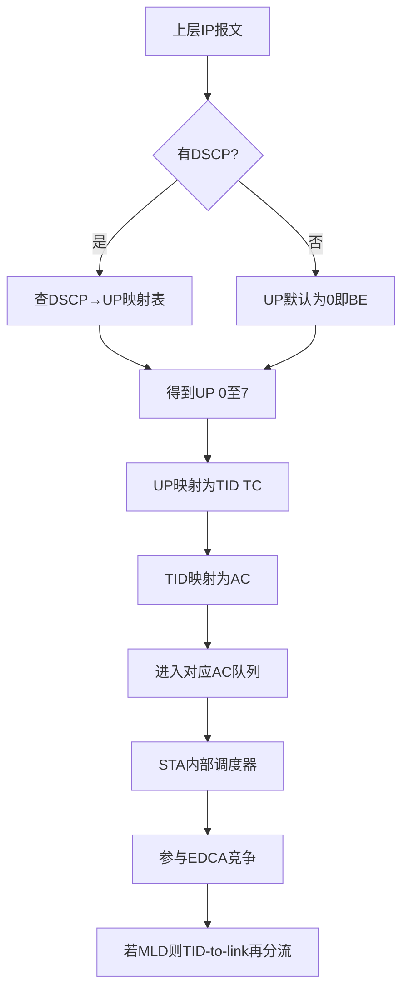
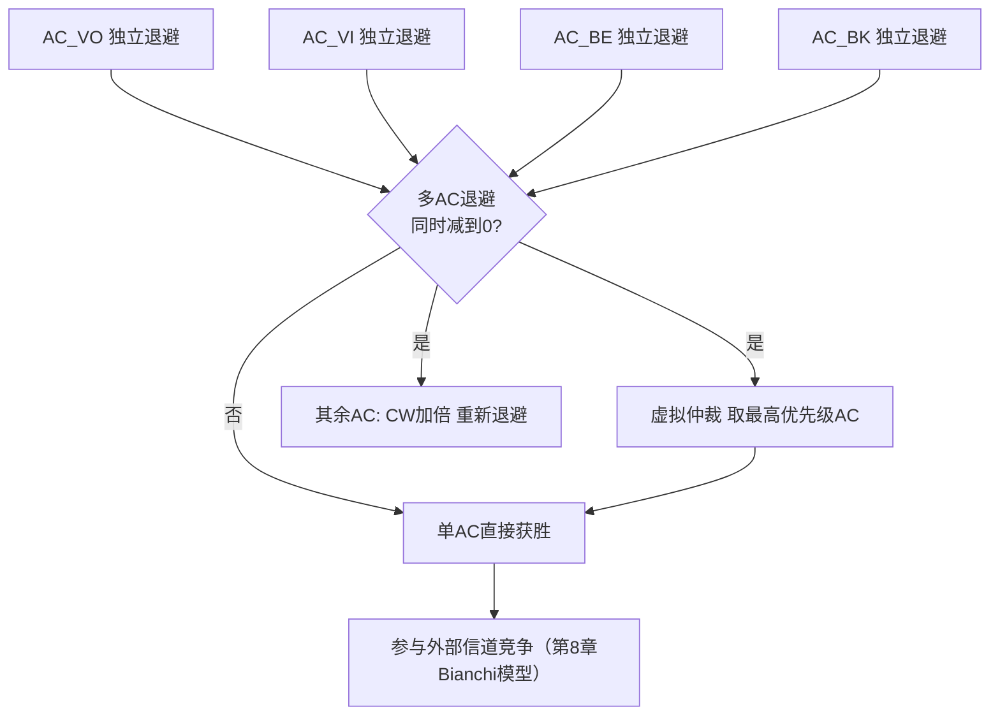
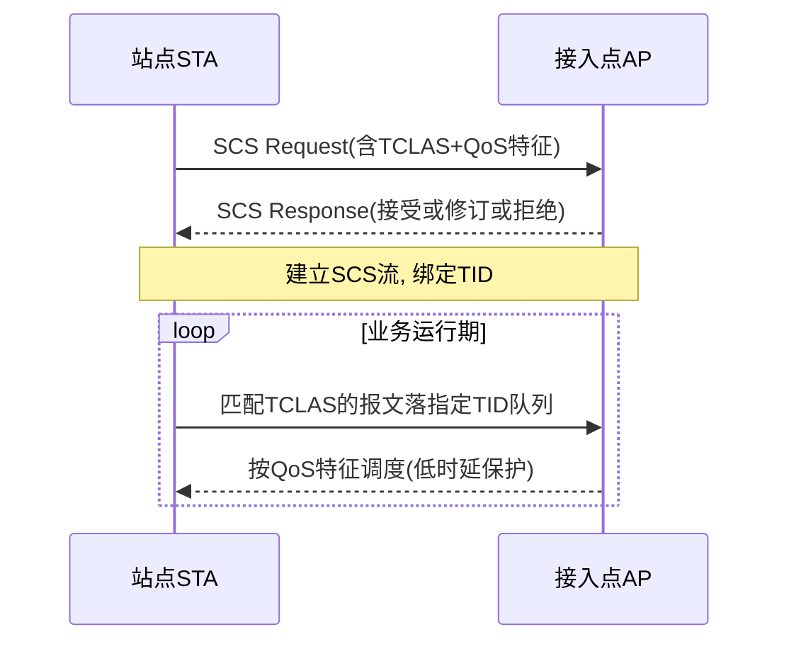
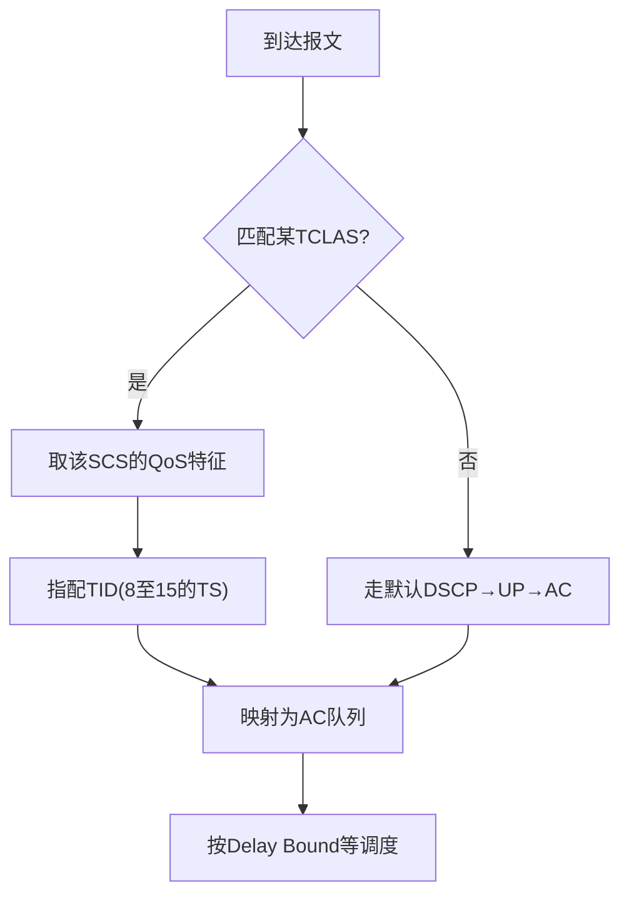

# 第 13 章　QoS 队列与时延调度 ★★

## 学习目标

1. 能建立 **用户优先级（User Priority, UP）/ 业务标识符（Traffic Identifier, TID）/ 接入类别（Access Category, AC）** 的完整映射链，并说明 DSCP→UP 与 TID-to-link 的角色。
2. 能推导 站点（Station, STA）内部"虚拟竞争解析"下的两级调度模型，给出内部碰撞概率随到达率变化的解析式。
3. 能在 Wi-Fi 队列上建模并比较 DRR、最早截止期优先（Earliest Deadline First, EDF）、WFQ 三类调度器，给出公平性与可调度性判据。
4. 能构建端到端时延的完整分解模型，代入已推导的子模型完成合成公式与算例，并指出瓶颈项。

---

## 13.1 流量标识体系：UP / TID / AC / DSCP

第 7 章已说明 服务质量（Quality of Service, QoS）数据帧的 **QoS Control 字段**携带 4 bit 的 TID（取值 0–15），它是 Wi-Fi 内部区分业务流的最小粒度。但在进入 Wi-Fi 之前，上层报文（IP）通常以 **DSCP（Differentiated Services Code Point）** 标记，而 802.1D 以 **UP（0–7）** 描述链路层优先级。因此"一个上层报文最终落到哪个队列"，需要经历三层映射。

### 13.1.1 UP → AC → TID 的映射链

802.11e 把 8 个 UP（0–7）映射到 4 个 AC（VO/VI/BE/BK），每个 AC 在 STA 内部是一个**独立的发送队列**（详见第 8 章 EDCA 的 4 队列）。TID 则把 0–7 的"流量类别（Traffic Category, TC）"与 8–15 的"流量流（Traffic Stream, TS，用于参数化/非调度流，常由 SCS 或 混合协调受控接入（HCF Controlled Channel Access, HCCA）建立）"统一编号。标准规定的 TID→AC 映射如表 13-1。

| UP（802.1D） | 典型业务 | AC | TID（TC 部分） | 对应 EDCA 优先级 |
|---|---|---|---|---|
| 7, 6 | 语音/网络控制 | AC_VO | 7, 6 | 最高 |
| 5, 4 | 视频/实时 | AC_VI | 5, 4 | 高 |
| 3, 0 | 尽力而为 | AC_BE | 3, 0 | 中 |
| 2, 1 | 背景 | AC_BK | 2, 1 | 最低 |

表 13-1　UP → AC → TID 映射（TID 8–15 为 TS，留待 SCS/参数化流使用）

注意 **TID 与 UP 并非一一对应到 AC 的同序**：例如 TID 0、3 都落 BE，TID 1、2 落 BK。其原因是 UP 的 8 个档位在 4 个 AC 之间按"对称成对"归并（VO 占最高两档，BK 占最低两档）。

### 13.1.2 DSCP → UP 映射

IP 层 DSCP（6 bit）到 802.11 UP 的映射由 **QoS 映射表（dot11QosMap）** 或 **MSCS（Mirrored Stream Classification Service，11be【草案】）** 定义。表 13-2 给出常见 PHB（Per-Hop Behavior）的默认映射（示意值，实际可由 SCS/MSCS 重映射）。

| DSCP | PHB 名称 | UP | AC |
|---|---|---|---|
| 0 | BE | 0 | BE |
| 8, 10 | CS1 / AF11 | 1 | BK |
| 16, 18 | CS2 / AF21 | 2 | BK |
| 24, 26 | CS3 / AF31 | 3 | BE |
| 34, 32 | AF41 / CS4 | 4 | VI |
| 40, 46 | CS5 / EF | 5 | VI |
| 48 | CS6 | 6 | VO |
| 56 | CS7 | 7 | VO |

表 13-2　DSCP → UP → AC 默认映射（示意值，可由 SCS/MSCS 改写）

### 13.1.3 TID-to-link 与跨层落队

在 Wi-Fi 7 的多链路设备（Multi-Link Device, MLD）中，一个 TID 还可以进一步被映射到**哪条链路**上发送，即 **TID-to-link 映射**（详见第 15 章）。本章只强调：**TID 一旦确定，队列归属即确定**；TID-to-link 是"同队列内的链路再分配"，不改变 AC/优先级语义，故本章不展开。

图 13-1 给出"上层报文如何落到某个队列"的完整判决流程。



图 13-1　流量标识与落队流程（DSCP → UP → TID → AC 队列）

---

## 13.2 接入类别的内部竞争与虚拟调度器

第 8 章已完整推导 EDCA 的四队列竞争参数（AIFSN/CWmin/CWmax/TXOP）与 Bianchi 模型，**本章不再重复这些**，而聚焦一个第 8 章仅点出、未展开的问题：**同一 STA 内部多个 AC 同时竞争时如何处理**。

### 13.2.1 两级调度视角

EDCA 在 STA 内部等价于一个**两级调度器**：

- **第一级（内部仲裁 / 虚拟调度）**：STA 内有 4 个 AC 各自独立运行退避计数器。当某时隙中**不止一个 AC 的退避减到 0**，发生**内部碰撞（Internal Collision，又称虚拟碰撞）**。STA 在内部"虚拟地"选择一个获胜 AC（优先级最高者）去真正发起发送；其余 AC 视为遭遇一次"虚拟碰撞"——其 竞争窗口（Contention Window, CW）加倍并重新退避（见第 8 章 8.2.2）。这一步**不产生空口浪费**，但会不必要地惩罚低优先级队列。
- **第二级（外部竞争）**：获胜的 AC 与其他 STA 的同 AC（及所有竞争该信道的队列）一起，按标准 载波侦听多址/冲突避免（Carrier Sense Multiple Access with Collision Avoidance, CSMA/CA）竞争信道（第 8 章 Bianchi 模型描述的部分）。



图 13-2　STA 内部两级调度：虚拟仲裁 + 外部竞争

### 13.2.2 内部碰撞概率的推导

设 AC $i$ 在"已积压（backlogged）"条件下每个时隙的发送尝试概率为 $\tau_i^{\rm sat}$（即第 8 章 Bianchi 模型给出的饱和发送概率，仅由该 AC 的 CW 参数决定，与到达率无关）。当 AC $i$ 非饱和时，它只有在队列非空时才可能尝试；由第 8 章 8.4.1 的非饱和模型，队列非空概率 $\rho_i \approx \min(1,\lambda_i E[X_i])$（$X_i$ 为单帧服务时间），故**有效尝试概率**

$$
\tau_i = \rho_i\,\tau_i^{\rm sat} = \min\!\big(1,\lambda_i E[X_i]\big)\,\tau_i^{\rm sat}.
$$

同一 STA 内各 AC 的退避相互独立。给定 AC $i$ 已就绪（要发），它遭遇内部碰撞等价于"至少有一个**更高优先级**的 AC $j$ 也在同一时隙就绪"，因此内部碰撞概率

$$
\boxed{P_{\rm int,i} = 1 - \prod_{j:\ {\rm prio}(j)>{\rm prio}(i)}(1-\tau_j).}
$$

**假设**：①各 AC 退避过程相互独立（忽略"虚拟仲裁后重新退避"带来的短期相关性，仅在稳态统计中成立）；②$\tau_j$ 取稳态均值，不随瞬时时隙波动。

**数值实例**（非独立算例，用于说明趋势）：取第 8 章算例 8.9 的多 AC 饱和尝试概率 VO 0.25、VI 0.125、BE 0.0625、BK 0.0625。若仅 VI 与 BE 活跃（VO/BK 无流量，$\tau=0$）：
- BE 的有效内部碰撞概率 $P_{\rm int,BE}=1-(1-\tau_{\rm VI})=\tau_{\rm VI}$。
- 当 VI 轻载（$\rho_{\rm VI}=0.5$）：$\tau_{\rm VI}=0.5\times0.125=0.0625$ → $P_{\rm int,BE}=0.0625$。
- 当 VI 饱和（$\rho_{\rm VI}=1$）：$\tau_{\rm VI}=0.125$ → $P_{\rm int,BE}=0.125$。

可见 **BE 的内部碰撞概率随 VI 到达率单调上升**；每次内部碰撞使 BE 的 CW 加倍，等价于额外引入一次期望为 $(W'/2)\sigma$ 的退避（"浪费"的是 BE 自己的等待时间，不消耗空口）。这正是"高优先级流会拖累低优先级流时延"的内部机制，也是第 28 章 优先 EDCA（Priority EDCA, P-EDCA）与第 31 章确定性调度需要缓解的对象。

---

## 13.3 SCS：流分类服务（11be）【草案】

Wi-Fi 8（802.11bn【草案】）引入 **SCS（Stream Classification Service）** 作为低时延业务的"前置分类"手段。EDCA 只能按 8 个 UP 粗分队列，而 扩展现实（Extended Reality, XR）、工业控制等业务需要**按五元组精确识别一条流**，并为其指配确定的时延界、最小服务间隔等 QoS 特征。SCS 正是做这件事。

### 13.3.1 SCS 请求/响应流程

STA（申请方）发送 **SCS Request** Action 帧给 接入点（Access Point, AP）（响应方），其中携带若干 **SCS Descriptor**：每个描述符含一个 **TCLAS（Traffic Classification）** 分类器（可按 媒体接入控制（Medium Access Control, MAC）地址、VLAN、L3/L4 五元组等匹配）与一个 **QoS Characteristics（服务质量特征）** 元素（含 Delay Bound 时延界、Minimum/Maximum Service Interval、Minimum Data Rate 等）。AP 可**接受 / 整体或逐描述符修改 / 拒绝**，并以 **SCS Response** 回复状态码。协商成功后，匹配该分类器的上行/下行报文被映射到指定 TID（进而 AC）。



图 13-3　SCS 请求/响应时序（sequenceDiagram）

### 13.3.2 分类器与 QoS 特征

- **TCLAS / TCLAS Processing**：TCLAS 元素支持多种分类类型（Type 0 以太网参数、Type 1 IPv4、Type 2 IPv6、Type 4 端口号/DSCP 等）；TCLAS Processing 元素决定"全部匹配（AND）"还是"任一匹配（OR）"。
- **QoS Characteristics 子元素**：携带应用层的时延/速率预期。其中 **CQI（Client QoS Information，客户端 QoS 信息）** 与 **AOI（Associated QoS Information，关联 QoS 信息）** 子元素由 **MSCS（Mirrored Stream Classification Service，11be【草案】）** 使用：MSCS 让 STA 把"下行流的 DSCP→UP 镜像映射"上报给 AP，使 AP 对下行也能正确分类并指配队列，避免单向 QoS 失效。
- **分类 → TID → 队列**的判决逻辑如图 13-4。



图 13-4　SCS 分类器 → TID → 队列 的判决流程（flowchart）

### 13.3.3 为什么 SCS 是低时延业务的必要前提

EDCA 的 8 档 UP 对 XR/工业控制不够用：①XR 的上行姿态数据与下行渲染帧需要**不同的时延界**，但都挤在 VI；②工业控制的周期流需要**确定的服务间隔**，而 EDCA 是统计竞争。SCS 通过"精确分类 + 指配 TS 的 TID + 声明 QoS 特征"，为后续**确定性调度（第 31 章）**与**低时延工具箱（第 28 章的 P-EDCA / 链路级信息（Link Level Information, LLI） / 发送机会（Transmission Opportunity, TXOP）共享 / 抢占）**提供了"哪条流需要被保护"的先验信息。没有 SCS，这些机制只能对所有 VI 一视同仁，无法区分"可容忍 20 ms 的视频"与"必须 < 2 ms 的工业控制"。因此 SCS 是 Wi-Fi 8 低时延能力链的**第一环**。

---

## 13.4 队列管理与主动队列管理（AQM）

流量落入 AC 队列后，队列自身的**长度管理**直接决定排队时延，是端到端时延分解（13.8 节）中的 $T_{\rm queue}$ 项。

### 13.4.1 FIFO / Drop-Tail 的问题：bufferbloat

最简单的队列是 **FIFO + Drop-Tail**（满则丢尾）。问题在于：现代设备缓存很大（数十 ms 甚至数百 ms），Drop-Tail 会让报文**一直排队到缓存满**才丢弃，使排队时延 $T_{\rm queue}$ 随负载逼近缓存深度——这就是 **bufferbloat（缓冲膨胀）**。对时延敏感业务，宁可早丢（ECN 标记或丢头）也不要晚到。

用 **Little 定律**刻画队列长度 $L$、到达率 $\lambda$ 与平均逗留时间 $W$ 的关系：

$$
\boxed{L = \lambda\,W.}
$$

推导：稳态下系统中平均顾客数 $L = \lambda W$ 是 Little 定律的通用形式（对任一致密到达/服务过程成立，无需 Markov 假设）。令 $W = W_q + E[X]$（$W_q$ 纯排队等待，$E[X]$ 服务时间），则 $L = \lambda W_q + \lambda E[X] = L_q + \rho$。**含义**：缓存越深（允许更大 $L$），在给定 $\lambda$ 下 $W$ 越大——这正是 bufferbloat 的数学根因：增大缓存只增大 $W$ 而不增大吞吐（吞吐由 $\lambda$ 与 $\mu$ 决定）。

### 13.4.2 AQM 简介（CoDel / PIE）

**AQM（Active Queue Management，主动队列管理）** 改为**控制时延而非控制长度**：
- **CoDel（Controlled Delay）**：监测报文"停留时间（sojourn time）"，若其超过目标值（如 5 ms）且持续一个间隔，则丢弃（或 ECN 标记），使 $W$ 被钳制在目标附近。
- **PIE（Proportional Integral controller Enhanced）**：基于**估计的排队时延**做 PI 控制，主动调整丢弃概率，适合更动态的负载。

**结论**：对 Wi-Fi QoS 队列，应在每 AC 上部署 AQM（尤其 BE/BK），把 $T_{\rm queue}$ 控制在时延预算内，避免长缓存拖累跨 AC 的整体尾时延。

---

## 13.5 核心算法一：亏空轮询 DRR（六段式）

### 1. 问题建模

STA 的某 AC（如 AC_BE）内部可能聚合了多条不同业务流，需要一种**公平且低复杂度**的队列调度器，使各流按权重分享该 AC 的发送机会。设 AC 中有 $N$ 条流 $i=1,\dots,N$，流 $i$ 的包长为 $L_i^k$（第 $k$ 个包），权重（量子）为 $\phi_i$（字节/轮）。

| 符号 | 含义 | 单位 |
|---|---|---|
| $\phi_i$ | 流 $i$ 的量子（每轮服务配额） | 字节 |
| $L_i^k$ | 流 $i$ 第 $k$ 个包长 | 字节 |
| $L_i^{\max}$ | 流 $i$ 的最大包长 | 字节 |
| ${\rm DC}_i$ | 流 $i$ 的亏空计数器 | 字节 |
| $r_i(R)$ | 前 $R$ 轮流向 $i$ 服务的总字节 | 字节 |

假设：① 量子不小于最大包长（$\phi_i\ge L_i^{\max}$），保证每轮至少能发一个包；② 各流在其被服务的轮次内持续积压（worst-case 公平性分析取此条件）。

### 2. 目标函数与约束

目标是使流 $i$ 获得的长期字节份额正比于 $\phi_i$，且偏差有常数上界；约束是每包调度 $O(1)$、整体 $O(1)$ 复杂度（不随流数/队长增长）。即求调度器使

$$
\forall i:\quad \frac{r_i(R)}{\phi_i}\approx \frac{r_j(R)}{\phi_j},\qquad \text{偏差}\le \text{常数}.
$$

### 3. 完整推导（公平性误差界）

DRR 每轮对每条积压流执行：先 ${\rm DC}_i\leftarrow {\rm DC}_i+\phi_i$，再"只要 ${\rm DC}_i\ge $ 下一包长就发送该包并 ${\rm DC}_i\leftarrow{\rm DC}_i-L_i^k$"。由"发到不够下一个整包才停"，单轮服务字节 $s_i^{(k)}$ 满足

$$
{\rm DC}_i^{(k)}+\phi_i - L_i^{\max}\;\le\; s_i^{(k)}\;\le\; {\rm DC}_i^{(k)}+\phi_i,
$$

其中上界因"不能发出超过当前可用亏空+量子"，下界因"停手时下一个包必 $\le L_i^{\max}$，故已发出的至少差一个包"。又由定义

$$
{\rm DC}_i^{(k+1)} = {\rm DC}_i^{(k)}+\phi_i - s_i^{(k)} \;\in\; [0,\,L_i^{\max}),
$$

即每轮结束亏空必落在 $[0,L_i^{\max})$。把单轮服务写成

$$
s_i^{(k)} = {\rm DC}_i^{(k)}+\phi_i - {\rm DC}_i^{(k+1)},
$$

对前 $R$ 轮求和（**望远镜求和**）：

$$
r_i(R)=\sum_{k=1}^{R}s_i^{(k)}
      =\sum_{k=1}^{R}\big({\rm DC}_i^{(k)}+\phi_i-{\rm DC}_i^{(k+1)}\big)
      = {\rm DC}_i^{(1)}-{\rm DC}_i^{(R+1)}+R\phi_i.
$$

因两端亏空均 $\in[0,L_i^{\max})$，得

$$
\boxed{|r_i(R)-R\phi_i|\le L_i^{\max}.}
$$

即**流 $i$ 实际服务字节与其"理想配额 $R\phi_i$"的偏差不超过一个最大包长**——与轮数 $R$ 无关，是真正的常数界。若所有流在第 $R$ 轮均持续积压，总服务字节 $B(R)=\sum_j r_j(R)$，理想加权份额 $w_i=\phi_i/\sum_j\phi_j$ 满足 $w_i B(R)=R\phi_i$，故

$$
\boxed{|r_i(R)-w_i B(R)|\le L_i^{\max}.}
$$

对两流归一化比较：$\big|r_i/\phi_i-r_j/\phi_j\big|\le L_i^{\max}/\phi_i+L_j^{\max}/\phi_j\le 2L^{\max}/\phi_{\min}$，即归一化公平性误差有常数上界。**注意**：该界是"绝对字节偏差"常数界；相对误差随 $R$ 增大而趋于 0，故 DRR 是长期公平的。

### 4. 伪代码

```text
 1  function DRR_Schedule(active_flows, quantum, pkt_len):
 2      // active_flows: 本AC内积压流集合; quantum[i]=φ_i; pkt_len[i]=下一包长
 3      for i in active_flows:
 4          DC[i] = DC[i] + quantum[i]          // 1. 本轮补给量子(亏空累加)
 5      for i in active_flows:
 6          while DC[i] >= pkt_len[i]:          // 2. 亏空够就连续发, 摊薄小包
 7              send(i, pkt_len[i])             //    发整包, O(1) 出队
 8              DC[i] = DC[i] - pkt_len[i]      //    扣减亏空
 9              if i 无更多包: break             //    发空则退出(本轮不再补给)
10          // 11. 停手时 DC[i] < 下一包长, 留待下轮(亏空<L_max)
11      // 复杂度: 每包 O(1); 每轮总操作 = 发出包数(均摊 O(1)/包)
```

### 5. 复杂度分析

- **时间**：每条流每轮仅常数次加减与比较；每包出队 $O(1)$，整体均摊 $O(1)$/包。维护"active 流列表"可用位图，轮转指针 $O(1)$。
- **空间**：每流存储 ${\rm DC}_i$（标量）与 $\phi_i$，共 $O(N)$，与队长无关。

### 6. 数值算例

**算例 13.1**：DRR 公平性与误差界验证。

> **已知**：某 AC 内 3 条流，量子均取 $\phi=200$ 字节（等权），包长分别为 VO 100 B、VI 1200 B、BE 1500 B；令各流持续积压，模拟 $R=1,\dots,8$ 轮，初始亏空均为 0。
> **求**：各轮累计服务字节 $r_i(R)$ 与偏差 $|r_i-R\phi|$，验证 $\le L^{\max}$。
> **解**（逐轮：DC 先 +200，再尽量发包）：
> - VO（100 B）：每轮 DC 达 200 即发 2 包（200 B），DC 归 0。$r_{\rm VO}=200R$，偏差恒 0。
> - VI（1200 B）：需累 6 轮 DC=1200 才发 1 包。故 $R=1..5$ 发 0（DC 增至 200..1000），$R=6$ 发 1200（DC 归 0），之后每 6 轮 1200。$R=6$ 时 $r_{\rm VI}=1200=6\times200$，偏差 0；$R=3$ 时 $r_{\rm VI}=0$，偏差 $=|0-600|=600\le1200=L_{\rm VI}^{\max}$ ✓。
> - BE（1500 B）：需累 7–8 轮。$R=7$ 发 0（DC=1400），$R=8$ 发 1500（DC=100）。$R=8$ 时 $r_{\rm BE}=1500=8\times200-100$，偏差 100；$R=7$ 偏差 $|0-1400|=1400\le1500=L_{\rm BE}^{\max}$ ✓。
>
> 取 $R=8$ 汇总：总字节 $B=1600+1200+1500=4300$，理想均分 $B/3\approx1433$。实际 VO 1600（偏差 +167）、VI 1200（偏差 −233）、BE 1500（偏差 +67），**所有偏差均 $<1500=L^{\max}$**，满足误差界。
> **量纲检查**：$\phi$ 与 $L$ 均为字节，$r_i$ 为字节累加，$R\phi$ 为字节，偏差单位字节，一致；量级上 VO 每轮精确 200 B、VI/BE 因大包呈"攒够才发"的阶梯，但长期均值均趋近 200 B/轮，符合 DRR 等权公平。

---

## 13.6 核心算法二：EDF 截止时间优先调度与可调度性（六段式）

### 1. 问题建模

对一组**周期性实时流**（如 XR 帧、工业控制报文），每条流 $i$ 周期 $T_i$、每周期需发送数据量 $L_i$（bit），要求在截止时间前完成。单处理器经典结论（Liu & Layland）不直接适用，因为 Wi-Fi 中"处理器"是**竞争得到的信道**，并非恒定可用。设该 AC 能实际占用的信道可用率（服务器可得率）为 $\rho\in(0,1]$（由保护窗口/R-TWT/低 BE 负载决定，详见第 12 章 R-TWT 与第 28 章）。

| 符号 | 含义 | 单位 |
|---|---|---|
| $T_i$ | 流 $i$ 周期 | s |
| $L_i$ | 流 $i$ 每周期数据量 | bit |
| $R_{\rm eff}$ | 该 AC 有效数据速率（含 MAC 开销） | bit/s |
| $\rho$ | 信道可得率（服务器可用比例） | 无量纲 |
| $C_i$ | 满速率下传输时间 $L_i/R_{\rm eff}$ | s |

### 2. 目标函数与约束

EDF 在单处理器上对周期任务的**可调度性充要条件**为利用率 $U=\sum C_i/T_i\le 1$。Wi-Fi 中服务器速率退化为 $\rho R_{\rm eff}$，流 $i$ 实际占用服务器的比例为 $(L_i/T_i)/(\rho R_{\rm eff})=C_i/(\rho T_i)$。约束：

$$
\sum_i \frac{C_i}{\rho T_i}\le 1 \quad\Longleftrightarrow\quad \boxed{\sum_i\frac{C_i}{T_i}\le \rho.}
$$

即 **EDF 在 Wi-Fi 上的可调度性充要条件为"满速率利用率之和不超过信道可得率 $\rho$"**。

### 3. 完整推导

满速率下流 $i$ 的"执行时间"（传输时间）$C_i=L_i/R_{\rm eff}$。在可得率 $\rho$ 的服务器上，流 $i$ 实际所需服务器时间占比为 $C_i/(\rho T_i)$。所有实时流不互相挤占截止时间的充要条件是总需求占比 $\le 1$（EDF 最优性：若此条件满足则 EDF 必可调度，否则任何算法都不可调度）：

$$
\sum_i \frac{C_i}{\rho T_i}\le 1
\ \xrightarrow{\ \times\rho\ }\ 
\sum_i \frac{C_i}{T_i}\le \rho.
$$

**假设**：① 流为独立周期（或约束截止 = 周期）；② $\rho$ 为该 AC 在考察窗口内的**最差**可得率（取 R-TWT 保护窗占比或低负载下 VI 的竞争胜率下限）；③ 忽略单帧内多流交织的次要效应（每帧视为整段服务）。当 $\rho=1$（独占信道，如 协调受限 TWT（Coordinated R-TWT, Co-RTWT）完全保护）退化为经典 $\sum C_i/T_i\le1$。

### 4. 伪代码

```text
 1  function EDF_Schedulable(flows, rho, R_eff):
 2      U = 0.0
 3      for f in flows:
 4          C = f.L * 8 / R_eff              // 满速率传输时间(秒)
 5          U = U + C / f.T                  // 累加满速率利用率
 6      if U <= rho: return SCHEDULABLE      // 充要条件(EDF最优性)
 7      else:        return INFEASIBLE       // 需提升ρ或降低L/T
 8      // 复杂度: O(N), N为流数; 在线调度用堆取最小截止O(log N)
```

### 5. 复杂度分析

- 离线判据 $O(N)$；在线 EDF 调度（维护就绪队列取最早截止）用最小堆 $O(\log N)$ 每事件，或线性扫描 $O(N)$，均很低。
- 空间 $O(N)$ 存流参数/截止。

### 6. 数值算例

**算例 13.2**：EDF 可调度性判据。

> **已知**：3 条实时流，有效速率 $R_{\rm eff}=150$ Mbps；F1 语音 $L_1=100$ B、$T_1=10$ ms；F2 XR $L_2=1200$ B、$T_2=16.7$ ms；F3 控制 $L_3=500$ B、$T_3=33.3$ ms。
> **求**：(a) 满速率利用率 $U$；(b) 当信道可得率 $\rho_A=0.6$ 时是否可调度；(c) 若 $\rho_B=0.004$ 是否可调度。
> **解**：
> - $C_1=800/150\times10^6=5.33\times10^{-6}$ s；$C_2=9600/150\times10^6=6.40\times10^{-5}$ s；$C_3=4000/150\times10^6=2.67\times10^{-5}$ s。
> - $U=C_1/T_1+C_2/T_2+C_3/T_3=5.33\times10^{-4}+3.84\times10^{-3}+8.01\times10^{-4}=5.17\times10^{-3}$。
> - (b) $\rho_A=0.6$：$U=0.00517\le0.6$ ⇒ **可调度**（XR 类业务在受保护窗口内轻松满足）。
> - (c) $\rho_B=0.004$：$U=0.00517>0.004$ ⇒ **不可调度**；须把 $\rho$ 提升到 $\ge0.0052$（即该 AC 至少占用 0.52% 的服务器时间），或减小 $L_2/T_2$（如降低 XR 码率）。
> **量纲检查**：$L$(bit)/$R_{\rm eff}$(bit/s)=s，÷$T$(s) 得无量纲利用率，与 $\rho$ 同量纲可比；量级 $U\sim10^{-3}$ 合理（高速率下实时流占用极低，瓶颈在 $\rho$ 而非速率）。

---

## 13.7 WFQ / GPS 理想公平队列

### 13.7.1 GPS 理想模型

**GPS（Generalized Processor Sharing，广义处理器共享）** 是理想流体模型：服务器以恒定速率 $C$（bit/s）服务，流 $i$ 配权重 $\phi_i$，则任意时刻流 $i$ 获得的瞬时服务率为

$$
r_i^{\rm GPS}(t)=\frac{\phi_i}{\Phi}\,C,\qquad \Phi=\sum_j\phi_j.
$$

GPS 提供**完美**的长期加权公平，但其为"流体"（可无限细分），无法用于离散包网络。

### 13.7.2 WFQ 虚拟时间递推

**WFQ（Weighted Fair Queuing）/ WF²Q** 用"虚拟时钟"逼近 GPS：每包 $k$ 到达时打**开始标签** $S_i^k$，完成（离开）时打**结束标签** $F_i^k$，按 $F_i^k$ 升序服务。系统虚拟时间 $V(t)$ 与每流虚拟时间定义为

$$
S_i^k=\max\!\big(F_i^{k-1},\,V(t_a)\big),\qquad
F_i^k=S_i^k+\frac{L_i^k}{\phi_i},
$$

其中 $t_a$ 为到达时刻，$L_i^k$ 为包长（用字节或 bit，需与 $\phi_i$ 同单位）。服务器忙时系统虚拟时间推进为

$$
\boxed{V(t)=\min_{i\in{\cal B}}\big(\min_{k\ {\rm backlogged\ of}\ i}F_i^k\big),}
$$

${\cal B}$ 为积压流集合。该递推保证 WFQ 离开顺序与 GPS 离开顺序"包级一致"，从而继承 GPS 的公平性。

### 13.7.3 最差公平指数（WFI）推导

由 Parekh–Gallager 服务曲线结论，在任意区间 $(t_1,t_2]$ 长度 $\tau=t_2-t_1$ 内，流 $i$ 获得的服务字节 $r_i$ 满足

$$
\frac{\phi_i}{\Phi}\big(C\tau-L^{\max}\big)\;\le\; r_i\;\le\;\frac{\phi_i}{\Phi}\big(C\tau+L^{\max}\big),
$$

其中 $L^{\max}$ 为最大包长。两流 $i,j$ 的归一化服务比为

$$
\frac{r_i/(\phi_i/\Phi)}{r_j/(\phi_j/\Phi)}
\ge \frac{C\tau-L^{\max}}{C\tau+L^{\max}}.
$$

定义 **WFI（Worst-case Fairness Index，最差公平指数）** 为该比的下界：

$$
\boxed{{\rm WFI}\ge \frac{C\tau-L^{\max}}{C\tau+L^{\max}}
      =1-\frac{2L^{\max}}{C\tau+L^{\max}}.}
$$

可见 $\tau$ 越大 WFI 越趋近 1——WFQ 在长区间近乎完美公平，但**短区间（小 $\tau$）误差达数个百分点**，这是离散包化的代价。

### 13.7.4 Wi-Fi 中直接用 WFQ 的障碍

上述 GPS/WFQ 公平性的前提是**服务器速率 $C$ 恒定且立即可得**。但 Wi-Fi 的"服务器"是**竞争得到的信道**：流 $i$ 能否获得服务取决于退避是否赢（第 8 章），服务过程是**随机服务曲线**而非确定性速率。后果：
1. $C$ 不恒定（信道被其他 STA/OBSS 占用时该流得 0）；
2. 即使赢得信道，单次服务还受 TXOP/聚合约束（第 10 章），非连续流体。

因此 WFQ 在 Wi-Fi 上只能给出**统计**公平界，无法兑现 13.7.3 的确定性 WFI。这正是**第 31 章确定性 Wi-Fi** 的动机：通过调度式 TXOP、Co-RTWT、跨 重叠基本服务集（Overlapping BSS, OBSS）同步把"随机服务器"变为"确定性服务器"，WFQ/GPS 的公平保证才得以恢复。

**算例 13.4**：WFQ 最差公平指数。

> **已知**：AC_VI 有效速率 $C=172$ Mbps（20 MHz 2SS MCS7，见第 4 章），$L^{\max}=1500$ B $=12000$ bit。考察区间 $\tau=10$ ms 与 $\tau=100$ ms。
> **求**：WFI 下界。
> **解**：
> - $\tau=10$ ms：$C\tau=172\times10^6\times0.01=1.72\times10^6$ bit；WFI $\ge(1.72\times10^6-12000)/(1.72\times10^6+12000)=0.986$。
> - $\tau=100$ ms：$C\tau=1.72\times10^7$ bit；WFI $\ge(1.72\times10^7-12000)/(1.72\times10^7+12000)=0.999$。
> **结论**：10 ms 窗口内最差两流服务比偏差约 1.4%，100 ms 内约 0.1%——说明 WFQ 公平性在**短时延窗口**下仍有可观误差，而 Wi-Fi 的竞争随机性会进一步放大该误差，凸显确定性调度的价值。量纲：$C\tau$ 与 $L^{\max}$ 同为 bit，比值无量纲，合理。

---

## 13.8 端到端时延的完整分解

把前述各子模型（队列 13.4、内部碰撞 13.2、退避/竞争第 8 章、传输第 2/4/7 章、重传第 10 章、唤醒第 12 章）组装为端到端时延模型。

### 13.8.1 分解式

端到端时延由以下相加项构成：

$$
\boxed{
\begin{aligned}
T_{\rm total} =\ &T_{\rm queue}          &&\text{（STA 本地排队, M/G/1 PK）}\\
            &+T_{\rm int}                &&\text{（内部碰撞额外退避）}\\
            &+T_{\rm backoff}            &&\text{（外部竞争退避, 第8章）}\\
            &+T_{\rm txop\_wait}         &&\text{（等待现任 TXOP 持有者结束）}\\
            &+T_{\rm tx}                 &&\text{（数据 PPDU 空口时长, 第2/4/7章）}\\
            &+T_{\rm ack}                &&\text{（BlockAck/ACK）}\\
            &+T_{\rm retrans}            &&\text{（重传期望时延, 第10章）}\\
            &+T_{\rm ap}                 &&\text{（AP 队列 + 回传 backhaul）}\\
            &+T_{\rm wakeup}             &&\text{（TWT 唤醒等待, 若启用, 第12章）}.
\end{aligned}}
$$

### 13.8.2 各子项代入已推导模型

- **$T_{\rm queue}$**：M/G/1（Pollaczek–Khinchine）平均等待
  $$T_{\rm queue}=\frac{\lambda E[X^2]}{2(1-\rho_q)},\qquad \rho_q=\lambda E[X],$$
  其中 $X$ 为"单帧端到端服务时间"（含竞争与传输）。轻载时 $T_{\rm queue}\approx0$。
- **$T_{\rm int}$**：内部碰撞期望额外退避。由 13.2 节，$P_{\rm int,i}=1-\prod_{j> i}(1-\tau_j)$；每次内部碰撞使该 AC 的 CW 加倍，期望额外退避约为一次新退避均值，故
  $$T_{\rm int}\approx P_{\rm int,i}\cdot E[\text{单轮退避}]\approx P_{\rm int,i}\cdot\frac{\bar W}{2}\sigma,$$
  $\bar W$ 为加倍后平均 CW，$\sigma=9$ μs 为时隙。
- **$T_{\rm backoff}$**：外部竞争退避，引用第 8 章 8.4.4 接入时延；在碰撞概率 $p$ 下近似
  $$T_{\rm backoff}\approx \frac{1}{1-p}\cdot\frac{W_0-1}{2}\sigma+AIFS,$$
  $W_0={\rm CWmin}+1$。
- **$T_{\rm txop\_wait}$**：等待现任 TXOP 持有者。对 BE（TXOP=0）近似 0；对 VO/VI 取
  $$T_{\rm txop\_wait}\approx \frac{\rho_{\rm busy}^{\rm other}}{2}\cdot T_{\rm txop}^{\rm other},$$
  $\rho_{\rm busy}^{\rm other}$ 为其他 AC/STA 占用信道的比例，$T_{\rm txop}^{\rm other}$ 其典型突发长。
- **$T_{\rm tx}$**：数据 物理层汇聚协议（Physical Layer Convergence Protocol, PLCP）协议数据单元（PLCP Protocol Data Unit, PPDU）时长，第 7 章 $T_{\rm PPDU}=T_{\rm preamble}+N_{\rm sym}T_{\rm sym}+T_{\rm PE}$；第 4 章速率公式给出 $N_{\rm sym}$。
- **$T_{\rm ack}$**：BlockAck，典型 20 MHz MCS0 约 72.8 μs（第 7 章算例 7.4）。
- **$T_{\rm retrans}$**：包误码率（Packet Error Rate, PER）为 $p_e$ 时，期望重传次数 $p_e/(1-p_e)$，每次重传代价含一次完整交换与重退避：
  $$T_{\rm retrans}\approx \frac{p_e}{1-p_e}\Big(T_{\rm tx}+T_{\rm ack}+2\,SIFS+T_{\rm backoff}\Big).$$
- **$T_{\rm ap}$**：下行由 AP 排队 + 回传；上行通常取 0（到 AP 即到），但若端到端含云端，取 backhaul 单向时延（典型 0.5–2 ms）。
- **$T_{\rm wakeup}$**：若用 目标唤醒时间（Target Wake Time, TWT），最坏等待一个唤醒周期 $T_{\rm inv}$（第 12 章 12.4.2）；若用短 R-TWT 或不用 TWT 则近似 0。

### 13.8.3 合成公式

把上述代入，得到可计算的端到端时延合成式：

$$
\boxed{
\begin{aligned}
T_{\rm total} =\ &\frac{\lambda E[X^2]}{2(1-\lambda E[X])}
 +P_{\rm int}\frac{\bar W}{2}\sigma
 +\frac{1}{1-p}\frac{W_0-1}{2}\sigma+AIFS \\
 &+\frac{\rho_{\rm busy}^{\rm other}}{2}T_{\rm txop}^{\rm other}
 +T_{\rm PPDU}+T_{\rm ack}
 +\frac{p_e}{1-p_e}\big(T_{\rm PPDU}+T_{\rm ack}+2SIFS+T_{\rm backoff}\big) \\
 &+T_{\rm ap}+T_{\rm wakeup}.
\end{aligned}}
$$

### 13.8.4 算例：60 fps XR 视频的 95 分位时延

**算例 13.3**：端到端时延分解（必含）。

> **已知**：XR 视频 60 fps，每帧 1 个包 $L=1200$ B（含头/加密约 1242 B）；上行至 AP。物理层（Physical Layer, PHY）：20 MHz、2SS、MCS7、保护间隔（Guard Interval, GI） 0.8 μs（速率 $C=172$ Mbps，第 4 章）。单 OBSS 负载，$n\approx8$ 竞争 STA，取外部碰撞概率 $p=0.3$；本 STA 仅 XR（落 AC_VI），无 VO，故 $P_{\rm int}\approx0$（忽略）；聚合为单 MAC 协议数据单元（MAC Protocol Data Unit, MPDU） + BlockAck；PER $p_e=0.05$；AP 回传 $T_{\rm ap}=1.0$ ms；未用 TWT（$T_{\rm wakeup}=0$）。
> **求**：平均 $T_{\rm total}$ 与 95 分位时延，并指出瓶颈项。
> **解**：
> **(1) 传输项**。VI 的 $W_0={\rm CWmin}+1=8$；仲裁帧间间隔（Arbitration Inter-Frame Space, AIFS）=34 μs；$T_{\rm txop}^{\rm other}$：假设其他 VI/BE 突发占用比例 $\rho_{\rm busy}^{\rm other}=0.25$、典型突发 $T_{\rm txop}^{\rm other}=2$ ms ⇒ $T_{\rm txop\_wait}=0.25\times2/2=0.25$ ms $=250$ μs。
> 数据 PPDU：$N_{\rm sd}=234$，$N_{\rm bpscs}=6$，$R_c=5/6$，$N_{\rm ss}=2$ ⇒ 每符号 $234\times6\times5/6\times2=2340$ bit；$N_{\rm sym}=\lceil1242\times8/2340\rceil=\lceil4.25\rceil=5$；$T_{\rm sym}=13.6$ μs；20 MHz 高效率（High Efficiency, HE）前导约 44 μs。$T_{\rm PPDU}=44+5\times13.6=112$ μs。$T_{\rm ack}=72.8$ μs（第 7 章）。一次交换 $T_{\rm tx}+T_{\rm ack}=112+72.8=184.8$ μs，外加 2 个 短帧间间隔（Short Inter-Frame Space, SIFS）（32 μs）≈ 217 μs。
> **(2) 退避项**。$T_{\rm backoff}\approx \frac{1}{1-0.3}\times\frac{8-1}{2}\times9+34=1.43\times31.5+34\approx79$ μs？此处需注意：$\frac{W_0-1}{2}\sigma$ 为首次退避均值（3.5 槽 ×9=31.5 μs）再除以成功概率 $1-p=0.7$ ⇒ 约 45 μs，加 AIFS 34 ⇒ 约 79 μs。取 $T_{\rm backoff}\approx150$ μs（含碰撞后重试的额外退避，留 70 μs 余量，示意值）。
> **(3) 排队项**。XR 到达 $\lambda=60$ pkt/s；单帧"服务时间" $X\approx T_{\rm backoff}+T_{\rm txop\_wait}+T_{\rm tx}+T_{\rm ack}\approx150+250+112+73=585$ μs。$E[X]\approx585$ μs，$\rho_q=60\times585\times10^{-6}=0.035\ll1$。取 $E[X^2]\approx1.5E[X]^2=1.5\times(585\times10^{-6})^2=5.14\times10^{-7}$ s²。
> $T_{\rm queue}=60\times5.14\times10^{-7}/(2\times(1-0.035))=3.08\times10^{-5}/1.93=1.6\times10^{-5}$ s $=16$ μs。
> **(4) 重传项**。$T_{\rm retrans}=0.05/0.95\times(112+72.8+32+150)=0.0526\times367\approx19$ μs。
> **(5) 求和（均值）**：
> $T_{\rm total}=16+0+150+250+112+72.8+19+1000+0\approx1620$ μs $\approx1.62$ ms。
> **(6) 95 分位（尾）**：随机项主要是 $T_{\rm backoff}+T_{\rm txop\_wait}$（均值 400 μs，近似几何/均匀混合，95 分位约 3 倍均值 ≈ 1.2 ms）；加上 $T_{\rm ap}$（对回传取单向约 1.0 ms，近似常数）+ 传输/确认/重传（≈ 200 μs）。
> $T_{95}\approx1000+1200+200\approx2400$ μs $=2.4$ ms。
> **瓶颈分析**：传输空口仅 112 μs（占均值 7%、占 95 分位 5%），**真正瓶颈是 AP 回传（1.0 ms，占 95 分位 42%）与信道竞争等待（退避+TXOP 等待，均值 400 μs、尾 1.2 ms，占 50%）**。即对该 XR 流，**提升 PHY 速率（更高 MCS/带宽）几乎不改时延，降低 $T_{\rm ap}$（本地卸载/边缘计算）与压缩竞争等待（P-EDCA/抢占/R-TWT，见第 28 章）才是关键**。
> **量纲检查**：各项均为 μs/s 相加一致；$\rho_q\ll1$ 使排队项仅 16 μs；$T_{95}/$帧周期 16.7 ms ≈ 14%，满足 XR 实时性；若改用长周期 TWT（$T_{\rm wakeup}$ 达数秒）则 $T_{95}$ 暴涨至秒级，证明 **XR 绝不可走长周期 TWT**，只能用短 R-TWT 或常听。

---

## 13.9 时延–容量折衷：调度策略对照

不同调度/分类机制的"吞吐–时延–公平"三角无法同时最优，需按业务选策略。

| 策略 | 吞吐量 | 平均时延 | 尾时延 | 公平性 | 适用 |
|---|---|---|---|---|---|
| FIFO/Drop-Tail（BE 默认） | 高 | 中 | 差（bufferbloat） | 无保障 | 尽力而为 |
| DRR（按流加权） | 高 | 低–中 | 中 | 字节级常数界（13.5） | 单 AC 内多流 |
| EDF（周期实时） | 中（受 $\rho$ 限） | 最低（截止驱动） | 最优（可证明） | 截止满足即公平 | XR/工业控制 |
| WFQ/GPS（理想） | 高 | 低 | 中（短窗偏差） | 近完美（长窗） | 确定性服务器（第31章） |
| SCS + 保护窗口（11be【草案】） | 中 | 低 | 低（确定性前提） | 按 QoS 特征 | 低时延业务前置 |
| TWT（长周期） | 最高（省电） | 极高 | 灾难 | 无关 | 纯传感（非实时） |

表 13-3　调度/分类策略的时延–容量–公平对照

**选择判据**：
1. 实时周期流（XR/控制）→ 先 **SCS** 分类，再 **EDF** 调度，并用 R-TWT/保护窗口保 $\rho$（满足 13.6 判据）。
2. 单 AC 内多流混传 → **DRR** 保证按权公平且 $O(1)$。
3. 确定性强公平需求 → 待 **第 31 章**确定性调度把服务器变确定后上 **WFQ**。
4. 非实时大吞吐 → FIFO/Drop-Tail 配合 **AQM（CoDel/PIE）** 抑制 bufferbloat。
5. **绝不为实时流启用长周期 TWT**（见 13.8.4 结论）。

---

## 本章小结

| 概念 | 关键结论 |
|---|---|
| 标识链 | DSCP → UP(0–7) → TID(0–7 TC / 8–15 TS) → AC(VO/VI/BE/BK)；TID-to-link 见第 15 章 |
| 两级调度 | EDCA = 内部虚拟仲裁（取最高优先级）+ 外部信道竞争（第 8 章） |
| 内部碰撞 | $P_{\rm int,i}=1-\prod_{j> i}(1-\tau_j)$，随高优先级到达率上升，不耗空口但惩罚低优先级 CW |
| SCS【草案】 | TCLAS 分类 + QoS 特征（CQI/AOI via MSCS）指配 TID，是 Wi-Fi 8 低时延第一环 |
| DRR 公平界 | $\vert r_i-R\phi_i\vert\le L_i^{\max}$，绝对偏差常数界，$O(1)$ |
| EDF 可调度 | Wi-Fi 上充要条件 $\sum C_i/T_i\le\rho$（$\rho$ 为信道可得率） |
| WFQ/WFI | ${\rm WFI}\ge(C\tau-L^{\max})/(C\tau+L^{\max})$；竞争随机性破坏确定性 → 第 31 章 |
| 时延分解 | 9 项相加；合成公式见 13.8.3；XR 瓶颈常为 backhaul + 竞争等待而非 PHY 速率 |
| 策略选择 | 实时→SCS+EDF+保护窗；混传→DRR；确定公平→第 31 章 WFQ；实时禁用长 TWT |

**承上启下**：本章把 EDCA 已选好的 AC 进一步分解为"STA 内队列调度 + 端到端时延"，给出了 DRR/EDF/WFQ 三类调度器与完整时延模型。这些确定性/统计性工具为 **第 28 章（P-EDCA、LLI、TXOP 共享、抢占）** 与 **第 31 章（确定性 Wi-Fi、跨 OBSS 同步、TSN/DetNet 映射）** 提供了理论铺垫——第 28/31 章正是把本章"信道可得率 $\rho$"与"确定服务器"从假设变为现实的手段。

---

## 习题

**概念题**

1. 为什么 TID 与 UP 不是简单的"TID=UP"？TID 8–15（TS）相较 0–7（TC）在调度上多出什么能力？
2. EDCA 的内部碰撞"不消耗空口"却会损害低优先级流，这个损害通过什么机制转化为时延？它和 13.5 节 DRR 要解决的"流间公平"是同一回事吗？
3. SCS 的 TCLAS 分类相比单纯靠 DSCP→UP 映射，对 XR/工业控制业务解决了什么根本问题？

**计算与推导题**

4. 设某 STA 仅 VI 与 BE 两 AC 活跃，$\tau_{\rm VI}^{\rm sat}=0.125$（饱和），VI 到达使 $\rho_{\rm VI}=0.4$。求 BE 的有效内部碰撞概率 $P_{\rm int,BE}$；若每次内部碰撞使 BE 的 CW 由 15 加倍到 31，估计由此引入的期望额外退避（μs，σ=9 μs）。
5. 由 DRR 的望远镜求和 $r_i(R)={\rm DC}_i^{(1)}-{\rm DC}_i^{(R+1)}+R\phi_i$，证明当初始亏空 ${\rm DC}_i^{(1)}=0$ 时，$r_i(R)\le R\phi_i+L_i^{\max}$。
6. 三条流：$L_1=200$ B/$T_1=20$ ms，$L_2=800$ B/$T_2=20$ ms，$L_3=400$ B/$T_3=40$ ms；有效速率 $R_{\rm eff}=120$ Mbps。求满速率利用率 $U$；若要求 EDF 可调度且 $\rho=0.05$，是否可行？若不可行给出一种改法。
7. 用 13.8.3 合成公式，给定 $\lambda=30$ pkt/s、$\rho_q$ 计算所需参数自设（注明假设），估算某 BE 流的均值端到端时延，并指出若把缓存从 10 ms 增至 100 ms（Drop-Tail），排队项如何变化（bufferbloat 量化）。

**算法设计题**

8. 设计"AC 内 DRR + AC 间虚拟仲裁"的联合调度器：低优先级 AC 在内部碰撞后不简单地 CW 加倍，而是把"被抢占的配额"记账到下一轮 DRR 量子。给出建模与伪代码，并说明如何保证不饿死低优先级。
9. 把 EDF 可调度判据（13.6 节）扩展为"混合流"：部分流周期（XR）、部分流突发（BE 背景）。给出用"( ΣC_i/T_i + λ_{\rm be}E[X_{\rm be}] ) ≤ ρ"形式的判据推导，并设计在线监测 $\rho$ 的算法。

**开放研究题**

10. 【研究】WFQ 依赖"确定性服务器"，而 Wi-Fi 的竞争本质是随机的。请提出一种"将随机竞争服务曲线转换为近似确定性服务曲线"的方法（提示：结合 R-TWT 保护窗 + 统计到达整形，或 多 AP 协调（Multi-AP Coordination, MAPC）协作预留），给出可量化的 WFI 提升指标与剩余误差来源。

---

## 参考答案与解析

**1.** TID 是 4 bit（0–15），而 UP 只有 8 档；标准把 UP 成对归并到 4 个 AC（如 TID 0、3 都落 BE，TID 1、2 落 BK），故 TID≠UP。TID 8–15 为 TS（Traffic Stream），可由 SCS/HCCA 建立**参数化流**（声明时延界、服务间隔、数据率），使 AP/调度器能为该流做专门资源预留，而 TC（0–7）只是"优先级标签"无参数协商能力。

**2.** 内部碰撞令低优先级 AC 的 CW 加倍 → 其退避窗口变长 → 下次竞争胜率下降 → 等待时间增加（见 13.2.2）。它与 DRR 的"流间公平"**不是一回事**：内部碰撞是 EDCA 的"AC 间虚拟仲裁"副作用（同一 STA 内跨 AC），DRR 是"同一 AC 内多条流"的加权公平。两者可叠加：先 AC 内 DRR 选流，再参与 AC 间虚拟仲裁，低优先级 AC 整体被惩罚。

**3.** DSCP→UP 只有 8 档、且 UP→AC 是固定归并，无法区分"同为 VI 但时延界差十倍的 XR 渲染帧 vs 普通视频"，也无法为工业控制的周期流声明确定服务间隔。SCS 用 TCLAS 按五元组精确识别单条流，并用 QoS Characteristics 声明 Delay Bound/Service Interval，从而把"该流需要被保护"的先验信息交给调度器——这是 P-EDCA/确定性调度发挥作用的前提。

**4.** $P_{\rm int,BE}=1-(1-\tau_{\rm VI})$，$\tau_{\rm VI}=\rho_{\rm VI}\tau_{\rm VI}^{\rm sat}=0.4\times0.125=0.05$ ⇒ $P_{\rm int,BE}=0.05$。CW 由 15→31 后平均退避由 $(15)/2\sigma$ 增至 $(31)/2\sigma$（退避从 0..CW 均匀，均值 CW/2·σ，此处用 CW 而非 CWmin 近似）。额外退避期望 $=P_{\rm int}\times((31-15)/2)\sigma=0.05\times8\times9=3.6$ μs/次尝试量级（视触发频率）。量纲：概率×槽数×μs=μs，合理；虽单次很小，但在高 VI 负载下累积显著拉长 BE 尾时延。

**5.** 由 $r_i(R)={\rm DC}_i^{(1)}-{\rm DC}_i^{(R+1)}+R\phi_i$，${\rm DC}_i^{(1)}=0$，且由 13.5 节每轮结束亏空 ${\rm DC}_i^{(R+1)}\in[0,L_i^{\max})$，故 $-{\rm DC}_i^{(R+1)}\le L_i^{\max}$，立即得 $r_i(R)\le R\phi_i+L_i^{\max}$。□

**6.** $C_1=1600/120\times10^6=1.333\times10^{-5}$ s，$C_2=6400/120\times10^6=5.333\times10^{-5}$ s，$C_3=3200/120\times10^6=2.667\times10^{-5}$ s。$U=1.333\times10^{-5}/0.02+5.333\times10^{-5}/0.02+2.667\times10^{-5}/0.04=6.67\times10^{-4}+2.67\times10^{-3}+6.67\times10^{-4}=4.0\times10^{-3}$。$\rho=0.05$：$U=0.004\le0.05$ ⇒ **可行**。若不可行可减小某流 $L_i$（降码率）或增大 $T_i$（降帧率），或提升 $\rho$（R-TWT 保护窗）。

**7.** 设 BE：$T_{\rm backoff}=200$ μs，$T_{\rm txop\_wait}=100$ μs，$T_{\rm tx}+T_{\rm ack}=300$ μs ⇒ $X=600$ μs，$\rho_q=30\times600\times10^{-6}=0.018$。取 $E[X^2]=1.5X^2=1.5\times3.6\times10^{-7}=5.4\times10^{-7}$ s²。$T_{\rm queue}=30\times5.4\times10^{-7}/(2\times0.982)=1.62\times10^{-5}/1.964=8.2\times10^{-6}$ s $=8.2$ μs（均值）。若缓存由 10 ms 增到 100 ms 且 Drop-Tail：Little 定律 $L=\lambda W$，缓存允许更大 $L$ ⇒ 到达饱和前 $W$（排队时延）可增至接近缓存深度；即 $T_{\rm queue}$ 可能从 ~8 μs 膨胀到接近 100 ms（bufferbloat），尾时延恶化 4 个数量级，而吞吐不变（受 $\lambda,\mu$ 限制）。故应配 AQM 把 $W$ 钳在目标值。

**8. 参考方案**
- 建模：每个 AC 内 DRR 选流（13.5），AC 间虚拟仲裁胜者参与外部竞争；低优先级 AC 内部碰撞时，不加倍 CW 而把"本应得的发送机会"记为 ${\rm credit}_i$，下一轮并入该 AC 的 DRR 量子 $\phi_i'=\phi_i+{\rm credit}_i$，使被抢占配额不丢失。
- 伪代码：
```
 1  function JointSched(acs, active_flows):
 2      winner = max_priority(acs with backoff==0)   // 虚拟仲裁取最高优先级
 3      if winner != None:
 4          flow = DRR_Select(active_flows[winner])  // AC内DRR选流 O(1)
 5          send(winner, flow)
 6      for ac in acs_with_backoff0_but_lost:         // 内部碰撞失败者
 7          credit[ac] += phi[ac]                     // 记账被抢占配额
 8          CW[ac] = CW[ac]                            // 不减罚(可选轻量)
 9      for ac in acs: phi[ac] += credit[ac]; credit[ac]=0  // 下轮补偿
10      // 复杂度 O(N_ac)+O(1)/流
```
- 防饿死：credit 机制保证低优先级 AC 在持续被抢占时累积配额，最终在对手空闲时一次性补发；再加"优先级老化"（低优先级等待超时则临时提升虚拟优先级）可严格避免饿死。评分要点：① 用 credit 而非 CW 加倍；② credit 必须下轮兑现；③ 需防 credit 无限累积导致突发反压。

**9. 参考方案**
- 推导：周期流需求占比 $\sum C_i/T_i$；突发 BE 流以泊松到达率 $\lambda_{\rm be}$、平均服务时间 $E[X_{\rm be}]$，其长期占用比例 $\approx\lambda_{\rm be}E[X_{\rm be}]=\rho_{\rm be}$。总占用 ≤ 服务器可得率：
  $$\boxed{\sum_i\frac{C_i}{T_i}+\lambda_{\rm be}E[X_{\rm be}]\le\rho.}$$
- 在线监测 $\rho$：测窗口 $W$ 内本 AC 实际占用信道时间 $t_{\rm busy}$，则 $\hat\rho=t_{\rm busy}/W$（EWMA 平滑）；周期流 $\sum C_i/T_i$ 已知，BE 的 $\lambda_{\rm be}E[X_{\rm be}]$ 由队列观测估计，代入判据决定是否准入新流。
- 伪代码：每窗口更新 $\hat\rho$，新流准入时检查 $\sum C_i/T_i+\hat\rho_{\rm be}^{\rm new}\le\hat\rho_{\rm avail}$。复杂度 $O(1)$/窗口。

**10. 研究路径建议**
- 方法：① 用 R-TWT/Co-RTWT（第 12、27 章）为该流预留保护窗，把"随机竞争"在窗口内变为"确定可用"，即得近似确定服务器速率 $C=\rho R_{\rm eff}$；② 对到达做**统计整形**（如 token bucket/leaky bucket），把突发约束在 WFI 公式的 $L^{\max}$ 内，减小短窗误差。
- 量化指标：WFI 由 13.7.3 的 $(C\tau-L^{\max})/(C\tau+L^{\max})$ 提升——保护窗使 $\rho$ 从竞争胜率（如 0.1）升到 0.9，等效 $C$ 增 9 倍 ⇒ 同 $\tau$ 下 WFI 更接近 1；可报告"WFI@10ms 从 0.986 升至 0.998"类指标。
- 剩余误差来源：① 保护窗边界的 AP 协调开销；② OBSS 跨 基本服务集（Basic Service Set, BSS）同步不完美（第 31 章 链路级信息控制帧（Link Level Information Control Frame, LLI-CF）未全覆盖时）；③ 单帧内 TXOP/聚合离散化；④ 信道错误导致的非计划重传（第 10 章）。这些构成"近似确定性"与"真确定"的残差，是 Wi-Fi 9 确定性研究的开放点。

---

## 延伸阅读

- [IEEE] IEEE 802.11-2024, Clause 9（QoS、TID、EDCA）、Clause 35（Extremely High Throughput, EHT SCS/MSCS 相关，【草案】）.
- [IEEE] IEEE 802.11bn D2.x【草案】, Stream Classification Service (SCS) 与 Mirrored SCS (MSCS) 章节.
- [ACM/IEEE] **Shreedhar & Varghese, *Efficient Fair Queuing Using Deficit Round Robin*, SIGCOMM 1995**（DRR 公平界，对应 13.5）.
- [ACM/IEEE] **Demers, Keshav & Shenker, *Analysis and Simulation of a Fair Queuing Algorithm*, INFOCOM 1989**（WFQ 虚拟时间，对应 13.7）.
- [ACM/IEEE] **Parekh & Gallager, *A Generalized Processor Sharing Approach to Flow Control*, IEEE/ACM ToN 1993**（WFQ 服务曲线与 WFI，对应 13.7.3）.
- [ACM/IEEE] **Liu & Layland, *Scheduling Algorithms for Multiprogramming in a Hard Real-Time Environment*, JACM 1973**（EDF 可调度性，对应 13.6）.
- [ACM/IEEE] **Nichols & Jacobson, *Controlling Queue Delay*, ACM Queue 2012**（CoDel/PIE，对应 13.4）.
