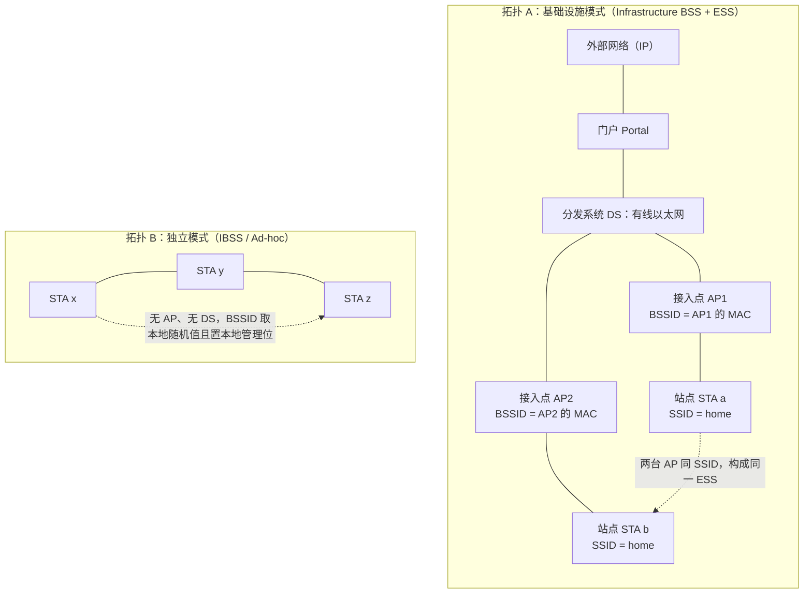
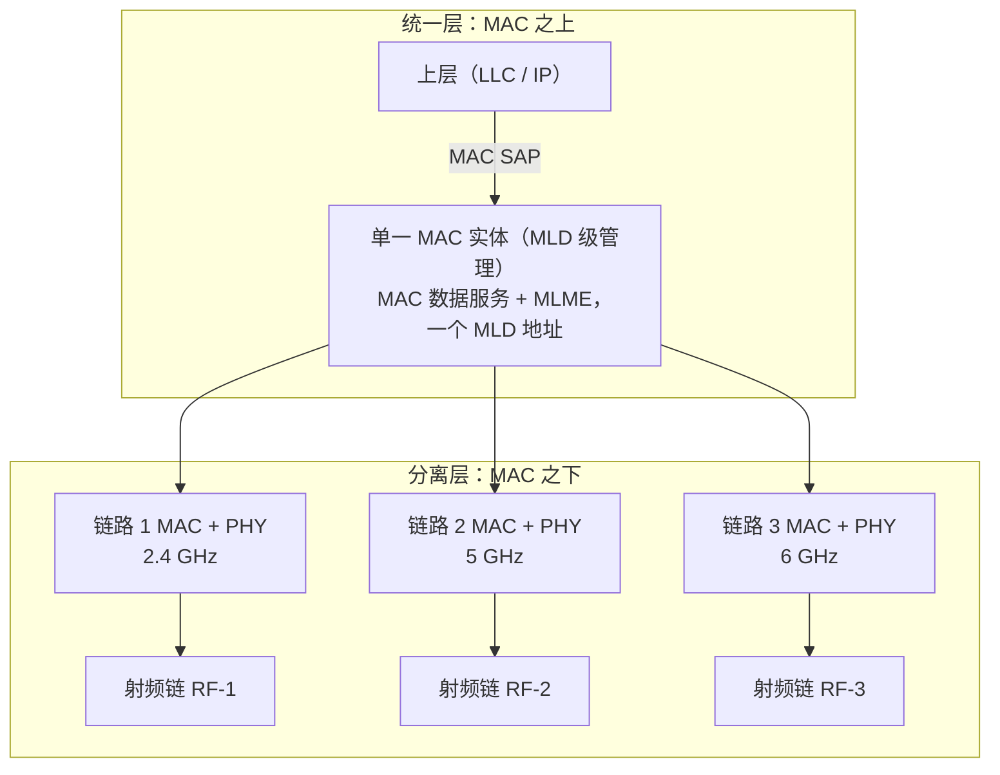
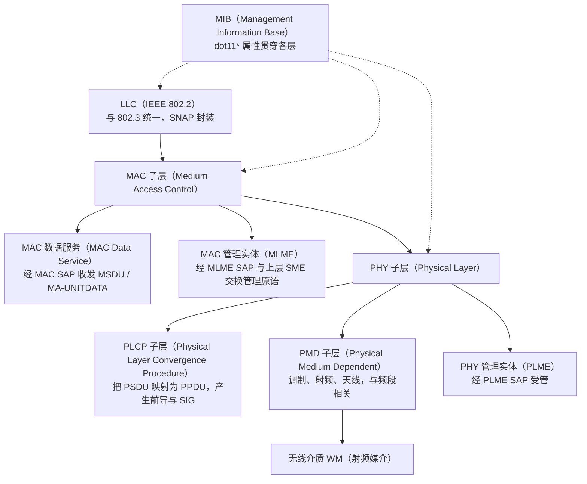
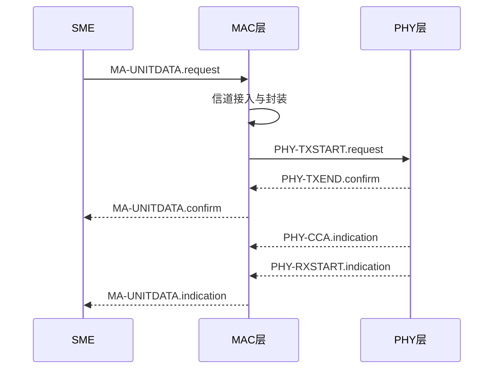
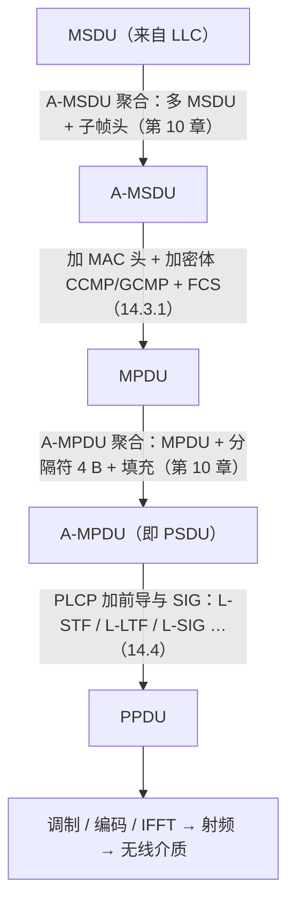
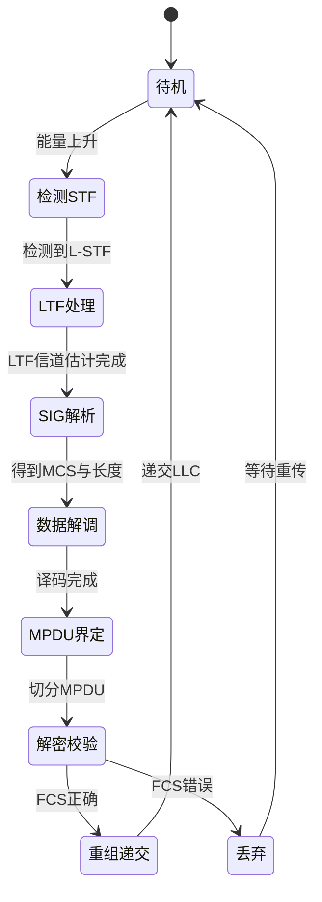
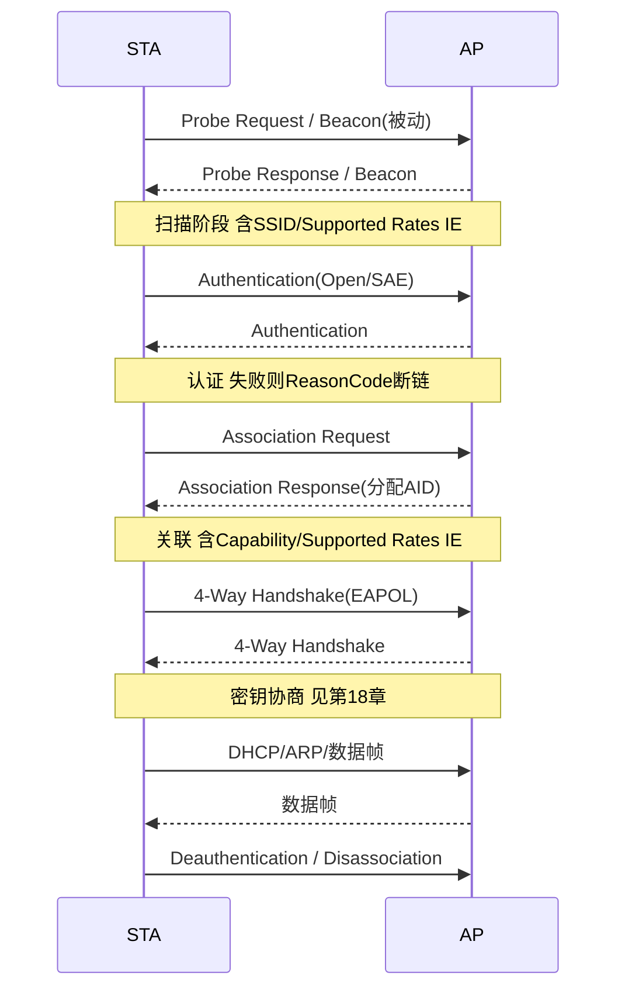
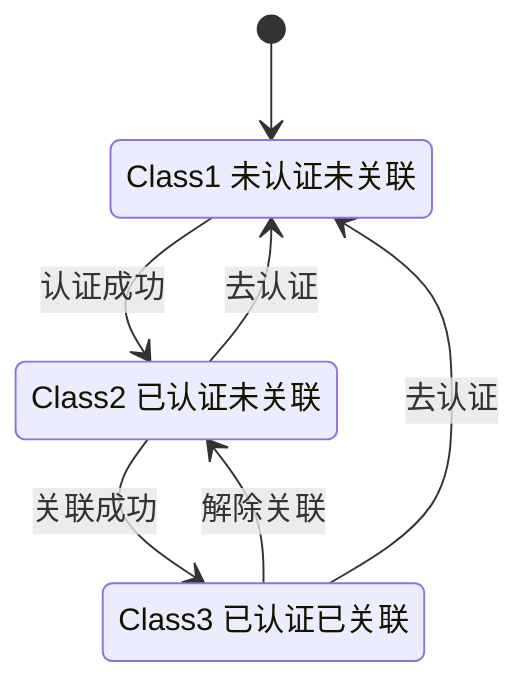

# 第 14 章　Wi-Fi 系统总体架构与协议流程 ★

## 学习目标

1. 能画出从 LLC 到 PHY 的完整协议栈分层图，并逐一定位 媒体接入控制（Medium Access Control, MAC） SAP、PHY SAP、MAC 层管理实体（MAC Layer Management Entity, MLME） SAP、物理层管理实体（Physical Layer Management Entity, PLME） SAP 的位置、原语类型与参数方向。
2. 能复述从 MAC 服务数据单元（MAC Service Data Unit, MSDU）经分片/聚合、加密、前导、编码、空间映射到 PLCP 协议数据单元（PLCP Protocol Data Unit, PPDU）的发送流水线，以及逆向的接收流水线，并对各阶段开销做数量级归因。
3. 能走通扫描→同步→认证→关联→密钥协商→数据传输→漫游的管理面全流程状态机，并解释 Class 1/2/3 帧权限迁移的协议安全含义。
4. 能依据本章给出的 关键性能指标（Key Performance Indicator, KPI）定义与跨层映射总表，将本书第 1–36 章任一关键技术定位到（PHY/MAC/管理面）×（吞吐/时延/覆盖/功耗/可靠/安全）矩阵中的具体坐标。

---

## 14.1 体系结构与拓扑

### 14.1.1 基本组成实体定义

IEEE 802.11 体系由一组明确定义的实体与介质构成。这些定义是后续一切流程讨论的词汇表，须严格区分"设备"与"网络范围"。

- **站（Station, STA）**：任何含 MAC 与 PHY 且接入无线介质（Wireless Medium, WM）的单一地址实体，拥有唯一的 MAC 地址。STA 既指终端也指接入点（AP 本身也是 STA）。
- **基本服务集（Basic Service Set, BSS）**：由一组通过 WM 互通的 STA 构成的逻辑集合，由 基本服务集标识符（BSS Identifier, BSSID）（通常为 AP 的 MAC 地址）标识。
- **独立基本服务集（Independent BSS, IBSS）**：无中心 AP 的对等 BSS，即 Ad-hoc 模式，BSSID 由随机值生成且本地管理位置 1。
- **接入点（Access Point, AP）**：在基础设施（Infrastructure）BSS 中，向关联 STA 提供对分发系统（Distribution System, DS）访问的 STA。
- **分发系统（Distribution System, DS）**：连接多个 BSS 的骨干网络（通常为有线以太网），负责跨 BSS 的 MSDU 转发。
- **扩展服务集（Extended Service Set, ESS）**：由一个或多个通过同一 DS 互连的 BSS 组成，对外呈现同一 服务集标识符（Service Set Identifier, SSID），是用户感知的"一个网络"。
- **无线介质（Wireless Medium, WM）**：STA 之间交换 MAC 帧的射频媒介。
- **门户（Portal）**：ESS 与校外（非 802.11）网络之间的逻辑桥接点，实现 802.11 与 802.3/IP 的互操作。

上述关系的核心在于：**WM 连接 BSS 内 STA；DS 连接 BSS 之间；Portal 连接 ESS 与外部网络**。AP 同时处于 WM 与 DS 两侧，是二者的边界实体。

图 14-1 用两张拓扑框图对照基础设施 ESS 与 IBSS 两种基本组网形态。



**图 14-1 说明**：基础设施模式下 AP 充当用户 STA 与 DS 的桥；IBSS 模式下无中心、无 DS，所有 STA 对等。

### 14.1.2 拓扑类型对照表

除基础两类外，标准还定义了若干扩展拓扑。表 14-1 给出拓扑类型、中心实体、典型应用场景与是否含 DS 的对照，供后续各章引用。

| 拓扑类型 | 英文/缩写 | 中心实体 | 是否含 DS | 典型场景 | 主要标准章节 |
|---|---|---|---|---|---|
| 基础设施 BSS | Infrastructure BSS | AP | 是（连 ESS） | 家庭/企业 Wi-Fi | 第 7、8 章 |
| 独立 BSS | IBSS | 无 | 否 | 应急自组网络 | 802.11 原版 |
| 扩展服务集 | ESS | 多 AP + DS | 是 | 漫游网络 | 第 19 章 |
| 网状 BSS | MBSS | Mesh Point | 是（Mesh 骨干） | 回传/野外 | 第 20 章 |
| 无线分布式系统 | WDS | 无线桥 | 是 | AP 间无线回传 | 第 20 章 |
| 多链路 BSS | MLD BSS | AP MLD | 是 | 多频聚合 | 第 15 章 |

**表 14-1 说明**：拓扑类型决定 DS 的存在形式与中心实体，进而决定帧转发路径与地址字段取值（详见第 7 章"四地址帧"）。

### 14.1.3 多链路设备架构【草案】

802.11be（Wi-Fi 7，【已发布】）引入多链路操作（Multi-Link Operation, MLO），由多链路设备（Multi-Link Device, MLD）承载。11bn（Wi-Fi 8 / 超高可靠（Ultra High Reliability, UHR），【草案】）沿用并扩展该架构。其分层原则严格为：

> **"MAC 层之上统一、MAC/PHY 之下分离"**——一个 MLD 对应一个 MAC 数据服务/MLME 实体与单一网络标识（MAC Address + MLD-level 管理），但在其下挂接多套相互独立的 MAC 子层与 PHY 子层（每套对应一个频段/链路，如 2.4/5/6 GHz）。

图 14-2 给出 AP MLD 的"一个 MAC 实体 + 多套 MAC/PHY 下层"架构。本章只定位 MLD 在架构中的位置，具体链路建立、STR/MLMR、链路重映射等机制详见第 15 章。



**图 14-2 说明**：MLD 在 MAC 之上收敛为单一管理实体，之下按链路分裂为多套独立 MAC/PHY，这正是"统一/分离"原则的图示。

### 14.1.4 其他拓扑：MBSS 与 WDS

- **网状 BSS（Mesh BSS, MBSS）**：由 Mesh Point（Mesh Point, MP）或 Mesh AP（MAP）构成，使用 Hybrid Wireless Mesh Protocol（HWMP）在 WM 上自组织转发，DS 功能由 Mesh 骨干承担，不依赖有线回传。
- **无线分布式系统（Wireless Distribution System, WDS）**：用无线链路替代 AP 间的有线 DS，实现 AP 无线回传。WDS 帧采用四地址格式（RA/TA/DA/SA），其中 RA/TA 为 WDS 跳间地址，DA/SA 为端到端地址。

这两类拓扑的转发路径比 ESS 更复杂，但其 MAC/PHY 接口仍服从本章 14.2 的 SAP 模型，只是 DS 子层的路由逻辑不同。

---

## 14.2 协议栈与服务访问点（SAP）

### 14.2.1 分层模型

802.11 协议栈自顶向下分为三层：逻辑链路控制（Logical Link Control, LLC，即 802.2）、MAC 子层、PHY 子层。其中 MAC 与 PHY 各自又含"功能子层 + 管理实体"。图 14-3 给出完整分层树。



**图 14-3 说明**：每一层含"数据面子层 + 管理实体（ME）"，管理实体通过对应 SAP 向站管理实体（SME）暴露配置与状态原语。

### 14.2.2 MAC SAP 与 PHY SAP/PLCP 原语

**服务访问点（Service Access Point, SAP）** 是相邻层之间交换服务原语的抽象接口。原语分四类：

- `request`：上层 → 本层，请求启动某服务；
- `confirm`：本层 → 上层，报告 `request` 的执行结果；
- `indication`：本层 → 上层，通知本层内部发生的事件（如收到帧）；
- `response`：上层 → 本层，对 `indication` 的应答。

**MAC SAP** 传递 MSDU：`MA-UNITDATA.request(源地址,目的地址,路由信息,MSDU,优先级,…)` 与 `MA-UNITDATA.indication(...)`。

**PHY SAP（Physical Layer Convergence Protocol, PLCP 服务）** 是 MAC 与 PLCP 之间的接口，控制 PPDU 收发与信道状态。表 14-2 列出核心原语。

| 原语 | 方向 | 关键参数 | 含义 |
|---|---|---|---|
| `PHY-TXSTART.request` | MAC→PHY | `TXVECTOR`(MCS,长度,带宽,…) | 启动一次 PPDU 发送 |
| `PHY-TXEND.confirm` | PHY→MAC | `status` | 发送完成确认 |
| `PHY-RXSTART.indication` | PHY→MAC | `RXVECTOR`(速率,长度,…) | 检测到 PPDU 起始 |
| `PHY-RXEND.indication` | PHY→MAC | `status`(CRC/格式错误) | 接收结束 |
| `PHY-CCA.indication` | PHY→MAC | `state`(IDLE/BUSY) | 信道忙闲指示（CS 物理载波侦听） |
| `PHY-CCARESET.request` | MAC→PHY | — | 复位 空闲信道评估（Clear Channel Assessment, CCA）状态机 |
| `PHY-RESET.request` | MAC→PHY | `resetType` | 复位 PHY |

**表 14-2 说明**：`PHY-CCA.indication` 是 MAC 信道接入中物理载波侦听（CS）的来源，与第 8 章的 网络分配矢量（Network Allocation Vector, NAV）（虚拟载波侦听）共同构成 CCA 判决。

### 14.2.3 MLME SAP 与 PLME SAP 管理原语

管理面原语由 MLME / PLME 向上层 SME 暴露，承载扫描、认证、关联、密钥等控制流程。表 14-3 列出管理原语。

| 原语 | 方向 | 关键参数 | 关联章节 |
|---|---|---|---|
| `MLME-SCAN.request/.confirm` | SME↔MLME | `BSSType`,`SSID`,`ChannelList` | 14.6 |
| `MLME-AUTHENTICATE.request/.confirm` | SME↔MLME | `BSSID`,`AuthType`(OPEN/SAE) | 14.6/18 |
| `MLME-ASSOCIATE.request/.confirm` | SME↔MLME | `Capability`,`ListenInterval` | 14.6 |
| `MLME-REASSOCIATE.request` | SME→MLME | `CurrentAP` | 19 |
| `MLME-START.request` | SME→MLME | `SSID`,`BeaconInterval` | AP 侧 |
| `MLME-SETKEYS.request` | SME→MLME | `Key`,`KeyID`,`Cipher` | 18 |
| `MLME-DEAUTHENTICATE.request` | SME↔MLME | `ReasonCode` | 14.6 |
| `PLME-RESET.request` | MLME→PLME | `dot11PHYType` | — |
| `PLME-CHARACTERISTICS` | PLME→MLME | `MIB` 属性 | — |

**表 14-3 说明**：每个 `request` 必有配对的 `confirm`；涉及对端交互的（认证/关联）由 `indication`/`response` 承载（见 14.6 流程图）。

**MIB（Management Information Base）** 以 `dot11` 前缀的属性承载可配置/可读状态，如 `dot11EDCATable`（Enhanced Distributed Channel Access, EDCA 参数，见第 13 章）、`dot11RTSThreshold`、`dot11BeaconPeriod`，由 SME 经 MLME/PLME 读写。

### 14.2.4 原语四类交互示例

图 14-4 用 Mermaid 展示一次 `MA-UNITDATA`/`PHY-TX` 的 request–confirm 与 `PHY-CCA`/`PHY-RX` 的 indication 交互，体现四类原语的时序。



**图 14-4 说明**：控制类（request/confirm）与事件类（indication）原语在发送与接收两条链路上并发生成，构成 SAP 交互骨架。

---

## 14.3 MAC 层内部功能分解与 MPDU 变换流水线

### 14.3.1 功能模块分解

MAC 子层（数据面）可分解为以下相互协作的模块，其输出在 14.4 发送流水线中按序串联：

1. **信道接入**：EDCA（第 8 章）/ 上行触发调度（第 9 章）决定何时获得 发送机会（Transmission Opportunity, TXOP）与竞争窗口。
2. **帧校验生成**：发送端计算 帧校验序列（Frame Check Sequence, FCS）（32-bit 循环冗余校验（Cyclic Redundancy Check, CRC），生成多项式见下）；接收端校验。
3. **分片与重组**：当 MSDU 超过 `dot11FragmentationThreshold` 时分片，接收端重组。
4. **加密封装**：在 MAC 协议数据单元（MAC Protocol Data Unit, MPDU）头与会话数据之间插入加密体（IV/PN + 密文 + MIC），支持 CCMP（AES-128）与 GCMP（AES-128/256，11ad/11be）。封装位置严格在 MAC 头之后、FCS 之前。
5. **聚合**：将多个 MSDU 聚为 MSDU 聚合（Aggregated MSDU, A-MSDU）、多个 MPDU 聚为 A-MPDU（第 10 章）。
6. **省电管理**：TIM/PS-Poll/TWT（第 12 章）决定 STA 收发时机。
7. **服务质量（Quality of Service, QoS）区分**：UP（User Priority）→ AC（Access Category）映射与 EDCA 参数（第 13 章）。

FCS 采用 CRC-32（生成多项式 $G(x)=x^{32}+x^{26}+x^{23}+x^{22}+x^{16}+x^{12}+x^{11}+x^{10}+x^8+x^7+x^5+x^4+x^2+x+1$），对 MPDU 头与会话数据（加密前明文）计算，置于帧尾。其推导为线性反馈移位寄存器（LFSR）逐位处理，本教材不展开电路级，仅给出判定式：接收端校验余式为 0 则接受，否则丢弃（不回复 ACK）。

### 14.3.2 MPDU 变换流水线

图 14-5 给出 MSDU 在 MAC/PHY 边界上的逐次变换，这是理解 14.4 发送流水线的前置图。



**图 14-5 说明**：A-MSDU 由 MAC 高层聚合、A-MPDU 由 MAC 低层聚合；加密发生在单 MPDU 层面；PSDU 即 A-MPDU，PPDU 即加完前导的空中帧。

---

## 14.4 端到端发送流水线

### 14.4.1 逐阶段处理与开销

发送侧从队列取到 MSDU 开始，到 PPDU 离开 PA 为止，依次经过表 14-4 所列阶段。每一阶段给出典型时延量级（示意值，单流 80 MHz 场景）。注意区分两类耗时：**处理耗时**（数字电路/基带，ns–μs 级）与**传输耗时**（符号在 WM 上的空中时间，μs–ms 级）。

| 阶段 | 操作 | 时延量级（示意） | 类型 |
|---|---|---|---|
| 1 队列与调度 | EDCA 退避/触发授权，获 TXOP | $10\,\mu\text{s}$–$10\,\text{ms}$（竞争相关，变） | 处理+等待 |
| 2 分片/聚合 | A-MSDU/A-MPDU 组装 | $<1\,\mu\text{s}$ | 处理 |
| 3 MPDU 头与加密 | 填 MAC 头、CCMP/GCMP 加密封装 | $0.1$–$1\,\mu\text{s}$/MPDU | 处理 |
| 4 加入 PHY 前导 | L-STF/L-LTF/L-SIG(+RL-SIG/HE-SIG) | 固定 $20$–$44\,\mu\text{s}$ | 传输(前导) |
| 5 编码 | LDPC/BCC 编码 + 速率匹配 | $<1\,\mu\text{s}$ | 处理 |
| 6 交织与星座映射 | 比特交织 + 正交幅度调制（Quadrature Amplitude Modulation, QAM）映射 | $<1\,\mu\text{s}$ | 处理 |
| 7 空间映射 | 预编码矩阵 $\mathbf{Q}$（波束赋形，第 6 章） | $<1\,\mu\text{s}$ | 处理 |
| 8 逆快速傅里叶变换（Inverse Fast Fourier Transform, IFFT） + 加 循环前缀（Cyclic Prefix, CP） | 正交频分复用（Orthogonal Frequency Division Multiplexing, OFDM）调制，符号 $T_{\text{sym}}$+CP | $T_{\text{sym}}\approx 4$–$16\,\mu\text{s}$ | 传输(数据) |
| 9 加窗与上变频 | 加窗、升频至载频、数模转换器（Digital-to-Analog Converter, DAC） | $<1\,\mu\text{s}$ | 处理 |
| 10 DAC/PA | 数模转换、功率放大 | $<1\,\mu\text{s}$ | 处理 |

**表 14-4 说明**：数字处理（5–9）合计通常 $<5\,\mu\text{s}$，远小于数据符号的空中时间；但前导（阶段 4）是固定且不可压缩的开销，短帧场景下占比显著（算例 14.1）。

空间映射步骤 7 中，已编码比特流经预编码矩阵 $\mathbf{Q}$ 分配到 $N_{\text{TX}}$ 根天线：$\mathbf{x}=\mathbf{Q}\,\mathbf{s}$，其中 $\mathbf{s}$ 为空间流、$\mathbf{x}$ 为发射天线信号；单流/无 beamforming 时 $\mathbf{Q}$ 退化为单位映射，耗时更低。

### 14.4.2 算例：发送流水线时延归因

**算例 14.1**：发送流水线各分量耗时占比。

- **已知**：MCS 11（High Efficiency, HE，1024-QAM 5/6，单流 80 MHz），聚合 64 个 MPDU，每 MSDU 长度 1500 B；HE SU PPDU 前导总时长 $T_{\text{pre}}=44\,\mu\text{s}$；数字处理（阶段 5–9）合计 $T_{\text{proc}}=4\,\mu\text{s}$；忽略竞争退避（取最理想 TXOP）。
- **求**：数据字段空中时间 $T_{\text{data}}$、总 PPDU 时间 $T_{\text{ppdu}}$、前导占比与各分量占比。
- **解**：
  - 净载荷比特数 $N_b=64\times 1500\times 8=768\,000\,\text{bit}$。
  - HE 单流 80 MHz MCS11 物理速率 $R=1201.5\,\text{Mbps}$（标准表值）。
  - $T_{\text{data}}=N_b/R=768\,000/1.2015\times10^9=6.39\times10^{-4}\,\text{s}=639\,\mu\text{s}$。
  - 取符号/CP 等已含于速率定义内，则 $T_{\text{ppdu}}=T_{\text{pre}}+T_{\text{data}}+T_{\text{proc}}=44+639+4=687\,\mu\text{s}$。
  - 前导占比 $=44/687=6.4\%$；数字处理占比 $=4/687=0.58\%$；数据空中时间占比 $=639/687=93.0\%$。
- **结论**：PHY 处理耗时（4 μs）远小于数据空中时间（639 μs），印证"处理非瓶颈"；但前导 44 μs 不可忽略（6.4%）。若改为短帧（如每 MSDU 100 B、聚合 8 个），数据时间降至约 $8\times100\times8/1.2015\text{e}9=5.3\,\mu\text{s}$，前导占比飙升至 $44/(44+5.3)=89\%$，说明短包场景前导开销主导效率——这是 11be/11bn 引入多资源单元与更紧凑前导的动因之一。

---

## 14.5 端到端接收流水线

### 14.5.1 逐阶段处理

接收侧与发送侧镜像，但含估计与判决环节：

1. **AGC/同步**：检测 传统短训练字段（Legacy Short Training Field, L-STF）完成自动增益控制与粗定时同步。
2. **CFO/相位估计**：利用 传统长训练字段（Legacy Long Training Field, L-LTF）做信道估计与频偏（Carrier Frequency Offset, CFO）校正（指向第 3 章 长训练字段（Long Training Field, LTF）信道估计）。
3. **信号字段（Signal field, SIG）解析**：解析 L-SIG/HE-SIG-A 得到 MCS、长度、带宽，决定后续 PPDU 格式与解调参数。
4. **解调/解交织/译码**：QAM 解映射、解交织、LDPC/BCC 译码。
5. **解扰**：去除加扰序列。
6. **MPDU 边界界定**：解析 A-MPDU 中每个 MPDU 的 4 字节 delimiter（含长度与 CRC）以切分 MPDU。
7. **解密与 FCS 校验**：CCMP/GCMP 解密，校验 32-bit FCS。
8. **去重**：依据重放计数器（PN）丢弃重放帧（安全，详见第 18 章）。
9. **重组**：A-MSDU/A-MPDU 解聚合、分片重组。
10. **递交 LLC**：通过 `MA-UNITDATA.indication` 上交。

### 14.5.2 接收机状态机

接收机在 PPDU 处理过程中经历明确状态迁移，图 14-6 用 Mermaid 状态图表示。



**图 14-6 说明**：接收机以 短训练字段（Short Training Field, STF）检测为入口，SIG 解析触发格式分支；FCS 错误直接丢弃并等待重传（触发第 11 章块确认/重传）。

---

## 14.6 管理面全流程

管理面将 STA 从"未连"带入"可传数据"状态，是 14.7 状态机的具体执行。图 14-7 用 Mermaid 时序图给出完整流程，每个交互标注关键 IE（信息元素）与失败分支。



**图 14-7 说明**：流程严格遵循"扫描→认证→关联→密钥→数据→拆除"。任一步 AP 返回失败状态均带 `ReasonCode`（如 0x01  unspecified、0x04 断开、0x0F 4-way 超时）。

各步关键说明：
- **扫描与同步**：被动扫描收 Beacon，主动扫描发 Probe Request/Response。Beacon 携带 TSF、目标信标发送时刻（Target Beacon Transmission Time, TBTT）、流量指示图（Traffic Indication Map, TIM）（指示省电 STA 是否有缓冲，第 12 章）、Supported Rates/Spatial Streams 等 IE。
- **认证**：Open System 为两步空认证；SAE（WPA3，第 18 章）为抗离线字典的三步交换（Commit/Commit、Confirm/Confirm）。
- **关联/重关联**：Association Request 携带 Capability（如短前导、DSSS-OFDM）、Listen Interval；Response 分配关联标识符（Association ID, AID，范围 1–2007），用于 TIM 位图寻址与 Block Ack 会话。
- **4 次握手**：基于 802.1X/EAP 或 相移键控（Phase Shift Keying, PSK）派生 PTK/GTK，详见第 18 章；完成后受控端口（controlled port）打开。
- **地址学习**：STA 通过 ARP/DHCP 与 省电轮询（Power Save Poll, PS-Poll）完成 IP 获取与缓冲领取。
- **拆除**：Deauthentication（回到 Class 1）或 Disassociation（回到 Class 2），清 AID 与密钥。

---

## 14.7 状态机全景：Class 1/2/3 帧权限

802.11 按 STA 与 AP 的关系定义了三类帧传输权限状态，状态迁移由认证/关联结果驱动，图 14-8 给出全景。



**图 14-8 说明**：Class 1 仅可发管理帧（Beacon/Probe/Auth）；Class 2 增加认证帧；Class 3 才允许数据帧与控制帧（RTS/CTS/ACK/BlockAck）。

三种状态的帧权限严格性体现**协议安全含义**：在认证完成前禁止数据帧，是为了防止未授权 STA 占用空口资源与获取网络访问——攻击者必须先后通过认证（证明身份）与关联（获得 AID 与 QoS 参数）才进入 Class 3。且 802.1X 受控端口在 4-Way Handshake 完成前处于"未授权"状态，即便已关联（Class 3）数据也被MAC层/上层丢弃，形成双保险（受控端口三态：未授权/授权/强制授权，详见第 18 章）。

---

## 14.8 TSF 与时间同步

### 14.8.1 TSF 模型与溢出

定时同步功能（Timing Synchronization Function, TSF）维护一个 **64 位、1 μs 分辨率**的计数器 `dot11TSFTimer`。所有 BSS 内 STA 通过该定时器对齐 Beacon 发送时刻（TBTT）与省电时序。

溢出周期推导：
$$T_{\text{overflow}}=2^{64}\,\mu\text{s}=2^{64}\times10^{-6}\,\text{s}\approx 1.8447\times10^{13}\,\text{s}$$
换成年：
$$T_{\text{overflow}}=\frac{1.8447\times10^{13}}{365.25\times24\times3600}\approx 5.849\times10^{5}\,\text{年}$$
$$\boxed{T_{\text{overflow}}\approx 5.85\times10^{5}\,\text{年}\ (\text{约 }58.5\text{ 万年})}$$

即 TSF 在实际系统生命周期内不会回绕，同步算法无需处理 64 位溢出。

### 14.8.2 算法块（a）：TSF 同步与 Beacon 时序计算

**1. 问题建模**
- 符号：$T_{\text{BI}}$ 为 Beacon 间隔（TU，$1\,\text{TU}=1024\,\mu\text{s}$）；$t_{\text{TSF}}^{\text{AP}}$、$t_{\text{TSF}}^{\text{STA}}$ 为 AP 与 STA 的 TSF 值；$\Delta_{\text{clock}}$ 为两时钟晶振漂移差；$\tau$ 为传播时延（室内 $\approx0$）；$t_{\text{rx}}$ 为 STA 收到 Beacon 的本地时刻。
- 假设：Beacon 间隔为 $N_{\text{BI}}$ 个 TU；AP 严格在 TBTT 发 Beacon；晶振标称频率误差 $\pm e_{\text{ppm}}$（ppm = $10^{-6}$）。

**2. 目标函数与约束**
目标：STA 估计 AP 的 TSF 偏移并校正本地计时，使下一 TBTT 预测误差 $<\delta$（典型 $\delta<1\,\mu\text{s}$）。
约束：仅能通过观察 Beacon 中的 TSF 字段估计；观测间隔受 Beacon 周期限制。

**3. 完整推导**
AP 第 $k$ 个 TBTT 的真实时刻（AP TSF）为：
$$t_k^{\text{AP}}=t_0^{\text{AP}}+k\cdot T_{\text{BI}}$$
STA 在本地时刻 $t_{\text{rx},k}$ 收到该 Beacon，其中携带 AP 的 TSF 值 $t_k^{\text{AP}}$。理想无漂移时：
$$\hat t_0^{\text{STA}}=t_{\text{rx},k}-k\cdot T_{\text{BI}}- \tau$$
偏移估计 $\hat\theta=t_{\text{rx},k}-t_k^{\text{AP}}-\tau$。连续两次观测 $k,k+1$ 得漂移率：
$$\rho=\frac{(t_{\text{rx},k+1}-t_{\text{rx},k})-(t_{k+1}^{\text{AP}}-t_k^{\text{AP}})}{t_{k+1}^{\text{AP}}-t_k^{\text{AP}}}$$
下一 TBTT 预测：
$$\hat t_{k+1}^{\text{TBTT}}=t_{\text{rx},k}+T_{\text{BI}}-\hat\theta_{\text{corr}}$$
其中 $\hat\theta_{\text{corr}}$ 由 $\rho$ 外推补偿：
$$\hat\theta_{\text{corr}}=\hat\theta+\rho\cdot(t_{\text{now}}-t_{\text{rx},k})$$
$$\boxed{\hat t_{k+1}^{\text{TBTT}}=t_{\text{rx},k}+T_{\text{BI}}-\hat\theta-\rho\cdot(t_{\text{now}}-t_{\text{rx},k})}$$

**4. 伪代码**

```text
 1: function TSF_SYNC(BeaconSeq):              // 输入Beacon流
 2:   for each Beacon k do                     // 逐个观测
 3:     t_rx = local_clock()                   // 本地收包时刻
 4:     t_ap = Beacon.TSF                      // AP携带的TSF
 5:     theta_hat = t_rx - t_ap                // 估计偏移(含传播)
 6:     if k>=1 then
 7:       rho = ((t_rx - t_rx_prev) - (t_ap - t_ap_prev)) / (t_ap - t_ap_prev)  // 漂移率
 8:     else rho = 0
 9:     t_rx_prev, t_ap_prev = t_rx, t_ap      // 保留上一观测
10:     now = local_clock()
11:     tbtt_next = t_rx + T_BI - theta_hat - rho*(now - t_rx)  // 预测下一TBTT
12:     schedule_wake(tbtt_next)               // 省电:定时唤醒收Beacon
13:   end for
14: end function                              // 复杂度 O(1) 每Beacon
```

**5. 复杂度分析**：时间复杂度 $O(1)$/Beacon（仅常数个寄存器），空间 $O(1)$。随观测数线性累积但无额外开销，适合嵌入式 STA 持续运行。

**6. 数值算例**：取 $T_{\text{BI}}=100\,\text{ms}$，晶振 $\pm20\,\text{ppm}$。
- 单次 Beacon 间隔内最大漂移 $=T_{\text{BI}}\times e_{\text{ppm}}=0.1\,\text{s}\times20\times10^{-6}=2.0\,\mu\text{s}$。
- 若连续 10 个 Beacon 未同步（扫描/休眠），累积漂移可达 $10\times2=20\,\mu\text{s}$，仍 $<1$ 个符号时间，但若到 $N_{\text{BI}}=100$（约 10 s）则 $200\,\mu\text{s}$，可能误判 TBTT 窗口——故省电 STA 须按 传送流量指示消息（Delivery TIM, DTIM）周期回归同步。量级合理，因为 ppm 级误差在百毫秒尺度仅产生微秒级偏移。

### 14.8.3 算例：TSF 同步误差

**算例 14.2**：基于 14.8.2 推导，给定 Beacon 间隔 100 ms、晶振 ±20 ppm，求单间隔漂移与 1 s 内最坏累积漂移。
- **已知**：$T_{\text{BI}}=0.1\,\text{s}$，$e_{\text{ppm}}=20\times10^{-6}$。
- **求**：单 Beacon 漂移 $\Delta_1$ 与 1 s（10 个 Beacon）最坏漂移 $\Delta_{10}$。
- **解**：$\Delta_1=0.1\times20\times10^{-6}=2.0\,\mu\text{s}$；$\Delta_{10}=10\times2.0=20\,\mu\text{s}$。
- **结论**：最坏 20 μs，远小于符号时间（4–16 μs 量级但含 CP 通常 >20 μs 容限），普通数据通信无需每帧同步；但 DTIM 寻址与 TBTT 对齐需周期校正。

---

## 14.9 跨层耦合与性能归因总表

本节作为全书索引工具，将第 1–36 章关键技术映射到"层次 × 影响指标"矩阵。坐标定义：行=层次（PHY / MAC / 管理面）；列=指标（吞吐/时延/覆盖/功耗/可靠/安全）。表 14-5 中"●"表示强影响、"○"弱影响。

| 章 | 技术 | 层次 | 吞吐 | 时延 | 覆盖 | 功耗 | 可靠 | 安全 | 备注 |
|---|---|---|---|---|---|---|---|---|---|
| 3 | 信道估计/LTF | PHY | ○ | ○ | ● | | ● | | 指向 14.5 |
| 4 | BCC/LDPC 编码 | PHY | ● | ○ | ○ | | ● | | |
| 5 | OFDM/OFDMA | PHY | ● | ○ | ● | | ○ | | |
| 6 | MIMO/波束赋形(Q) | PHY | ● | | ● | ○ | ● | | 14.4 空间映射 |
| 7 | MAC 帧/IFS/NAV | MAC | ○ | ● | | ○ | ● | ○ | 已详述 |
| 8 | EDCA 信道接入 | MAC | ● | ● | | ○ | ○ | | |
| 9 | 上行触发调度 | MAC | ● | ● | | ○ | ○ | | |
| 10 | A-MSDU/A-MPDU | MAC | ● | ○ | | ○ | ○ | | 14.3 流水线 |
| 11 | 块确认/重传 | MAC | ○ | ○ | | ○ | ● | | |
| 12 | PSM/TWT 省电 | MAC | ○ | ○ | | ● | ○ | | |
| 13 | QoS/UP-AC | MAC | ○ | ● | | ○ | ○ | | |
| 15 | MLO 多链路 | MAC+PHY | ● | ● | ● | ○ | ● | | 14.1.3 架构 |
| 16 | 160/320 MHz 带宽 | PHY | ● | ○ | ○ | ○ | ○ | | |
| 17 | MU-MIMO/OFDMA 复用 | PHY/MAC | ● | ● | ○ | ○ | ○ | | |
| 18 | 802.1X/4-Way/SAE | 管理面 | | | | | | ● | 14.6/14.7 |
| 19 | 快速漫游/FT | 管理面 | ○ | ● | ○ | ○ | ○ | ● | |
| 20 | Mesh/WDS | 管理面 | ○ | ○ | ● | ○ | ○ | ○ | 14.1.4 |
| 21 | 定位 | MAC/PHY | | ○ | ● | | | | |
| 22 | 共存/DFS | MAC/PHY | ○ | ○ | ● | ○ | ○ | | |
| 23 | Wi-Fi 8 UHR 三指标 | 全层 | ● | ● | | | ● | | 14.10 预告 |
| 24–36 | 前沿(AI/感知/节能) | 全层 | ● | ● | ● | ● | ● | ○ | 未定案较多 |

**表 14-5 说明**：研究者可将任一新技术先在此表定位坐标，例如"引入 人工智能（Artificial Intelligence, AI）调度"应落在 MAC×时延/吞吐，与第 8、9 章耦合。

---

## 14.10 系统级 KPI 定义

为避免后续仿真口径不一致，给出严格定义与测量口径。

1. **吞吐量（Throughput）**：
   - MAC 层聚合吞吐 $S_{\text{MAC}}=\frac{\sum \text{成功交付 MSDU 字节}\times8}{T_{\text{meas}}}$（含 MAC 开销，不含前导 Phys 层开销统计口径可选）。
   - IP 层吞吐 $S_{\text{IP}}=\frac{\sum \text{IP 净荷字节}\times8}{T_{\text{meas}}}$（不含 MAC/IP 头）。
   - 口径差异：A-MPDU 聚合提升 $S_{\text{MAC}}$ 更接近物理速率，但 $S_{\text{IP}}$ 受 MAC 头(28–36 B/MPDU)、加密体(8–16 B)与 确认帧（Acknowledgement, ACK）占用空口拖累。

2. **时延（Latency）**：端到端分组时延 $D=D_{\text{queue}}+D_{\text{chan}}+D_{\text{tx}}+D_{\text{prop}}+D_{\text{rx}}+D_{\text{proc}}$。
   - 统计口径：均值 $\bar D$、95 分位 $D_{0.95}$、99.9 分位 $D_{0.999}$。仿真须同时报告三者，因为 EDCA 竞争尾延迟显著。

3. **丢包率（Packet Loss Rate）**：$P_{\text{loss}}=N_{\text{lost}}/N_{\text{sent}}$，含 FCS 错误丢弃、重传耗尽（RetryLimit 达限）、缓冲溢出三类，须分项统计。

4. **空口占用率（Airtime）**：某业务/STA 占用的 WM 时间占比 $A_i=T_i^{\text{on-air}}/T_{\text{meas}}$。总 airtime 接近 100% 即饱和，是拥塞首要指标。

5. **能效（Energy Efficiency）**：$\eta_E=\frac{\text{成功交付比特数}}{E_{\text{total}}}$（bit/J）。$E_{\text{total}}$ 含发射 PA、基带、唤醒监听，省电机制（第 12 章）直接提升 $\eta_E$。

6. **覆盖概率（Coverage Probability）**：$P_{\text{cov}}=\mathbb{P}(\text{SINR}>\gamma_{\text{th}})$，给定 信干噪比（Signal-to-Interference-plus-Noise Ratio, SINR）门限 $\gamma_{\text{th}}$（由目标 MCS 的 信噪比（Signal-to-Noise Ratio, SNR）需求决定）。

7. **切换中断时间（Handoff Interruption Time）**：从旧 AP 最后一个数据帧到新 AP 第一个数据帧的时间间隔 $T_{\text{ho}}=t_{\text{first,new}}-t_{\text{last,old}}$，含扫描+认证+重关联+重握手（见第 19 章）。

**Wi-Fi 8（802.11bn，【草案】）三指标预告**：相对 11ax 基线，目标为 **IP 吞吐 +25%**、**95 分位时延 −25%**、**丢包率 −25%**。三项为 UHR 核心承诺，机制（如多 AP 协调、更低开销前导、增强重传）详见第 23 章。

### 14.10.1 算法块（b）：端到端时延归因算法

**1. 问题建模**
- 变量：$D$ 为实测/仿真端到端时延样本集；各分量 $D_{\text{queue}}$（排队+退避）、$D_{\text{chan}}$（信道接入额外等待）、$D_{\text{tx}}$（发送空中时间）、$D_{\text{rx}}$（接收+ACK）、$D_{\text{proc}}$（基带处理）、$D_{\text{roam}}$（若有切换）。
- 假设：可从日志/仿真打点分别取得各分量；无切换时 $D_{\text{roam}}=0$。

**2. 目标函数与约束**
目标：将 $\bar D$ 与 $D_{0.95}$ 分解为各分量占比，定位瓶颈。
约束：分解须满足 $\sum D_i=D$（闭合），否则说明埋点缺失。

**3. 完整推导**
均值分解：$\bar D=\sum_i \bar D_i$。分位不可简单相加，须对样本逐条求 $D_j=\sum_i D_{i,j}$ 后再取分位。占比：
$$p_i=\frac{\bar D_i}{\bar D},\qquad \sum_i p_i=1$$
$$\boxed{p_i=\frac{\bar D_i}{\sum_k \bar D_k}}$$
尾延迟归因：若 $D_{0.95}$ 中 $p_{\text{queue}}>0.6$，瓶颈在接入（第 8 章 EDCA/退避）；若 $p_{\text{tx}}$ 主导则为大包/低 MCS（PHY）。

**4. 伪代码**

```text
 1: function LATENCY_ATTRIB(Logs):            // Logs: 每条含各分量
 2:   N = length(Logs)
 3:   sum = zeros(6)                          // 6个分量累加器
 4:   D_total = []
 5:   for j = 1 to N do
 6:     d = [Logs[j].queue, Logs[j].chan, Logs[j].tx,
 7:          Logs[j].rx, Logs[j].proc, Logs[j].roam]
 8:     sum = sum + d                         // 分量求和
 9:     D_total[j] = sum(d)                   // 总时延样本
10:   end for
11:   mean_comp = sum / N                     // 各分量均值
12:   D_bar = mean(D_total)
13:   p = mean_comp / D_bar                   // 占比向量, sum(p)=1
14:   D95 = percentile(D_total, 95)           // 95分位
15:   D999 = percentile(D_total, 99.9)
16:   bottleneck = argmax(p)                  // 定位主导分量
17:   return p, D_bar, D95, D999, bottleneck
18: end function                             // 时间O(N) 空间O(1)
```

**5. 复杂度分析**：时空均为 $O(N)$（单遍扫描），空间仅常数个累加器，适合在线归因。

**6. 数值算例**：取 1000 条样本均值（μs）：排队 1200、信道 300、发送 639、接收+ACK 700、处理 4、切换 0。
- $\bar D=1200+300+639+700+4=2843\,\mu\text{s}$。
- 占比：$p_{\text{queue}}=1200/2843=42.2\%$，$p_{\text{chan}}=10.6\%$，$p_{\text{tx}}=22.5\%$，$p_{\text{rx}}=24.6\%$，$p_{\text{proc}}=0.14\%$。
- 瓶颈=排队（42.2%），指向 EDCA 竞争/退避（第 8 章）；处理仅 0.14%，印证 14.4 结论。量级合理：$\bar D\approx2.8\,\text{ms}$ 符合 11ax 单流重负载典型均值。

**算例 14.3**：沿用上例，若通过第 9 章上行触发调度消除竞争退避，使 $D_{\text{queue}}$ 由 1200 μs 降至 200 μs，重算 $\bar D$ 与 $p_{\text{queue}}$。
- **已知**：其余分量不变。
- **解**：$\bar D'=200+300+639+700+4=1843\,\mu\text{s}$；$p'_{\text{queue}}=200/1843=10.9\%$。
- **结论**：均值由 2.84 ms 降至 1.84 ms（降 35%），排队占比由 42% 降至 11%，证实调度类机制对均值时延影响最大，与 14.9 矩阵中"上行调度→时延●"一致。

---

## 本章小结

1. **拓扑词汇**：WM 连 BSS 内、DS 连 BSS 间、Portal 连外部网络；IBSS 无中心，ESS 多 AP 同 SSID，MLD/MBSS/WDS 为扩展形态。
2. **SAP 骨架**：LLC→MAC(数据+MLME)→PHY(PLCP+PMD，含 PLME)，四类原语 request/confirm/indication/response 驱动所有层间交互。
3. **MAC 变换流水线**：MSDU→A-MSDU→MPDU(加密)→A-MPDU(PSDU)→PPDU，加密严格位于 MAC 头之后、FCS 之前。
4. **发送流水线瓶颈**：数字处理（编码/映射/IFFT）合计 $<5\,\mu\text{s}$，远小于数据空中时间；前导为固定不可压缩开销，短包场景占比可达 89%。
5. **接收状态机**：以 STF 检测为入口、SIG 解析分支、FCS 错误即丢弃触发重传。
6. **管理全流程**：扫描→认证→关联(AID)→4-Way→数据→拆除，每步带 IE 与 ReasonCode 失败分支。
7. **Class 1/2/3 权限**：未认证禁数据帧，叠加 802.1X 受控端口双保险，构成接入安全基线（第 18 章展开）。
8. **TSF**：64 位 1 μs 定时器，溢出约 58.5 万年；晶振 ±20 ppm 在 100 ms Beacon 间隔产生 2 μs 漂移，需周期校正。

**关键结论/参数速查表**

| 项 | 值/公式 | 位置 |
|---|---|---|
| TSF 分辨率 | 64 bit, 1 μs | 14.8 |
| TSF 溢出 | $2^{64}\,\mu\text{s}\approx5.85\times10^5$ 年 | 14.8.1 |
| 20 ppm @100ms 漂移 | $2\,\mu\text{s}$ | 14.8.3 |
| HE SU 前导 | $\approx44\,\mu\text{s}$ | 14.4.2 |
| 数字处理合计 | $<5\,\mu\text{s}$ | 14.4.1 |
| AID 范围 | 1–2007 | 14.6 |
| 四类原语 | req/conf/ind/resp | 14.2.2 |
| Wi-Fi 8 三指标 | +25%吞吐 / −25%时延 / −25%丢包 | 14.10 |

---

## 习题

### A. 概念题（3 题）

1. 为什么说"在未完成认证前禁止发送数据帧"是协议安全设计而非单纯流程约定？它与 802.1X 受控端口如何形成双保险？
2. 对比 IBSS 与 ESS 在数据帧转发路径上的差异，并说明为何 WDS 帧需要使用四地址格式。
3. 图 14-5 中加密封装位于 MAC 头之后、FCS 之前。若将其错误地放在 FCS 之后会产生什么后果？

### B. 计算与推导题（4 题）

4. 推导 TSF 64 位 1 μs 计数器的溢出周期（以年为单位），并与常见协议（如 32 位毫秒计数器约 49.7 天）比较说明其工程意义。
5. 晶振误差 ±25 ppm，Beacon 间隔 102.4 ms（100 TU）。求单 Beacon 间隔最坏漂移，并判断连续 50 个 Beacon 未同步时是否会超过一个 HE 符号时间（取 16 μs 容限）。
6. 某 PPDU：MCS 9（HE 单流 80 MHz，速率 600.4 Mbps），聚合 32 个 MPDU，每 MSDU 1200 B，前导 44 μs，数字处理 4 μs。求数据空中时间、总 PPDU 时间、前导占比。
7. 沿用题 6，若改用 MCS 11（1201.5 Mbps）且聚合 64 个 1500 B MSDU，比较两者 IP 层吞吐（假设 MAC 头 36 B/MPDU、加密体 16 B/MPDU、ACK 占用 40 μs 空口且每 PPDU 一次）。

### C. 算法设计题（2 题）

8. 设计"基于 TSF 漂移预测的省电唤醒调度"伪代码：STA 休眠时本地时钟漂移，需在 DTIM 前校正以避免错过 Beacon。要求输入 Beacon 观测序列，输出下次唤醒时刻。
9. 设计"跨层时延归因"的在线滑动窗口版本：内存受限，仅保留最近 W 条样本，实时输出各分量占比与瓶颈。给出伪代码与复杂度。

### D. 开放研究题（1 题）

10. Wi-Fi 8 承诺 95 分位时延 −25%，但 EDCA 尾延迟本质是竞争随机性。请探讨：在多 AP 协调（Coordinated Spatial Reuse / Multi-AP）架构下，哪些机制可系统性压低尾延迟？给出可量化验证的指标与仿真设计思路。

---

## 参考答案与解析

### A. 概念题

1. **根因**：数据帧承载用户净荷与网络访问能力，若未认证即可发送，未授权 STA 能占用空口、探测内网甚至发起资源耗尽攻击。认证（身份）、关联（AID/参数）是两层准入 gate；而 802.1X 受控端口在 4-Way 完成前保持"未授权"，即便 STA 已进入 Class 3（已关联）其数据仍被丢弃——这是 MAC 权限（Class 3）之上再加的逻辑端口门禁，二者独立故为双保险。
2. **差异**：IBSS 中源 STA 直接经 WM 发给目的 STA，无中间转发；ESS 中 STA 先发往 AP，再由 DS 路由至目的 BSS/外部网络，涉及三地址/四地址帧。WDS 用无线链路替代有线 DS，AP 间需表达"这一跳的收发射频"与"端到端源目的"，故需 RA/TA（跳间）+ DA/SA（端到端）四地址。
3. **后果**：FCS 是对"MAC 头+明文会话数据"计算的校验。加密体在 FCS 之前才能被接收端先校验完整性再解密；若置于 FCS 之后，接收端无法在解密前验证完整性，且加密改变了帧尾结构使 FCS 位置错乱，导致所有帧 FCS 校验失败被丢弃，通信完全中断。

### B. 计算与推导题

4. **解**：$T=2^{64}\,\mu\text{s}=2^{64}\times10^{-6}\,\text{s}=1.8447\times10^{13}\,\text{s}$；年化 $/ (365.25\times24\times3600)=5.849\times10^5$ 年。32 位 ms 计数器溢出 $=2^{32}\,\text{ms}\approx49.7$ 天。工程意义：TSF 在设备生命周期（甚至数千年）内绝不回绕，同步算法无需处理 64 位 wraparound，简化实现；而 ms 计数器需频繁处理回绕，易出 bug。
5. **解**：单间隔漂移 $=0.1024\,\text{s}\times25\times10^{-6}=2.56\,\mu\text{s}$。50 个 Beacon 累积 $=50\times2.56=128\,\mu\text{s}>16\,\mu\text{s}$ 容限。结论：会超过一个符号容限，故省电 STA 不能 50 个 Beacon 不校正，须按 DTIM 周期回归同步（呼应 14.8.2 算例）。
6. **解**：$N_b=32\times1200\times8=307\,200\,\text{bit}$；$T_{\text{data}}=307200/6.004\times10^8=5.115\times10^{-4}\,\text{s}=511.5\,\mu\text{s}$；$T_{\text{ppdu}}=44+511.5+4=559.5\,\mu\text{s}$；前导占比 $=44/559.5=7.86\%$。
7. **解**：方案 A（题6）：每 PPDU 净 IP $=32\times1200=38400\,\text{B}$，总帧时间含 ACK：$T_A=559.5+40=599.5\,\mu\text{s}$，但需注意聚合节省 ACK；IP 吞吐 $=38400\times8/599.5\mu\text{s}=512.1\,\text{Mbps}$。方案 B：$N_b=64\times1500\times8=768000\,\text{bit}$，$T_{\text{data}}=768000/1.2015\text{e}9=639\,\mu\text{s}$，$T_{\text{ppdu}}=44+639+4=687\,\mu\text{s}$，加 ACK $=727\,\mu\text{s}$；IP 净荷 $=64\times1500=96000\,\text{B}$；吞吐 $=96000\times8/727\mu\text{s}=1.057\,\text{Gbps}$。比较：B 比 A 高约 2.06 倍，主因更高 MCS 与更大聚合降低前导/ACK 摊销。

### C. 算法设计题

8. **参考方案**：复用 14.8.2 算法，休眠期间以本地时钟估算漂移率 $\rho$（由历史 Beacon 对拟合），唤醒时刻 $t_{\text{wake}}=t_{\text{last\_beacon}}+k\cdot T_{\text{BI}}-\hat\theta-\rho\cdot(t_{\text{now}}-t_{\text{last\_beacon}})-\Delta_{\text{margin}}$（留 $\Delta_{\text{margin}}$ 余量避免错过）。**评分要点**：必须补偿漂移率而非仅用固定偏移；须留唤醒余量。**常见错误**：忽略休眠期本地时钟也在漂，直接用上次偏移导致逐渐错过 Beacon。
9. **参考方案**：维护长度 W 的环形缓冲，每来一条样本更新分量滑动和与总滑动和，输出 $p_i=\text{sum}_i/W_{\text{eff}}\bar D_{\text{win}}$ 瓶颈 argmax。**复杂度**：时间 $O(1)$/样本（环形覆盖写），空间 $O(W\cdot6)$。**评分要点**：窗口更新不重算全量；处理窗口未满时的归一化。

### D. 开放研究题

10. **研究路径建议**：尾延迟主要来自 (a) 退避随机性、(b) 隐藏节点冲突重传、(c) 多用户竞争。多 AP 协调可：用 Coordinated 正交频分多址（Orthogonal Frequency Division Multiple Access, OFDMA）预约时频资源消除竞争（降 (a)(c)）；用 Coordinated Spatial Reuse 在受限 TXOP 内并行传输（降 airtime）；用 AP 触发的确定性上行（第 9 章机制扩展）替代随机接入。可量化指标：仿真测 $D_{0.95}/D_{0.999}$ 与 $P_{\text{loss}}$，对比 11ax 基线验证 −25% 目标；关键挑战是协调信令开销与时钟对齐精度（回到 14.8 TSF）。非唯一答案，鼓励提出新协调原语。
