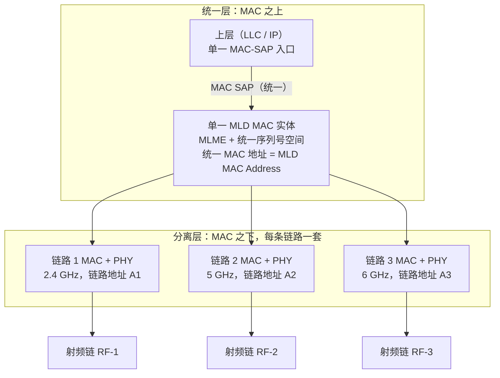
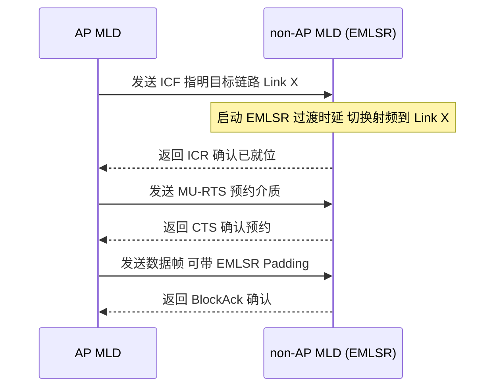
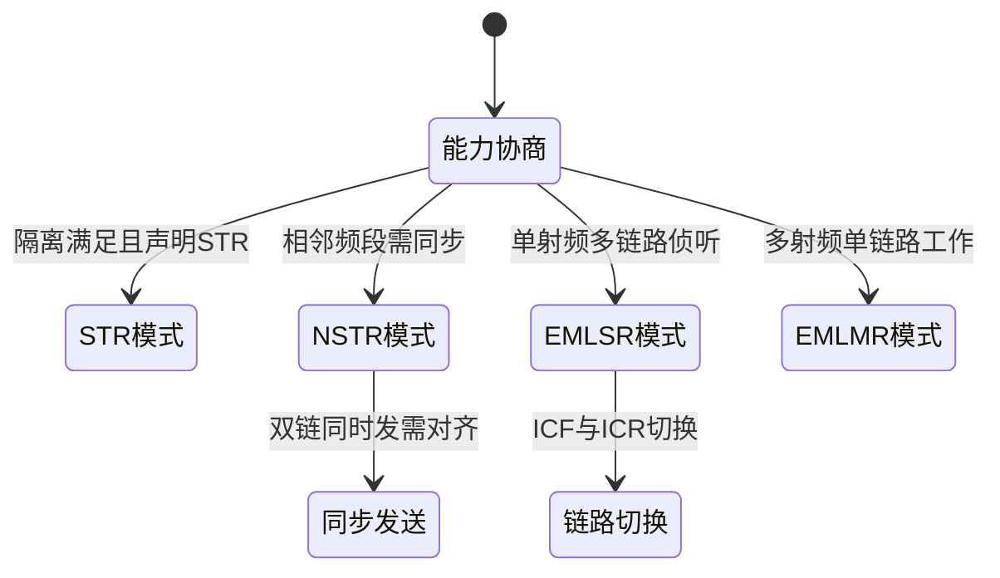
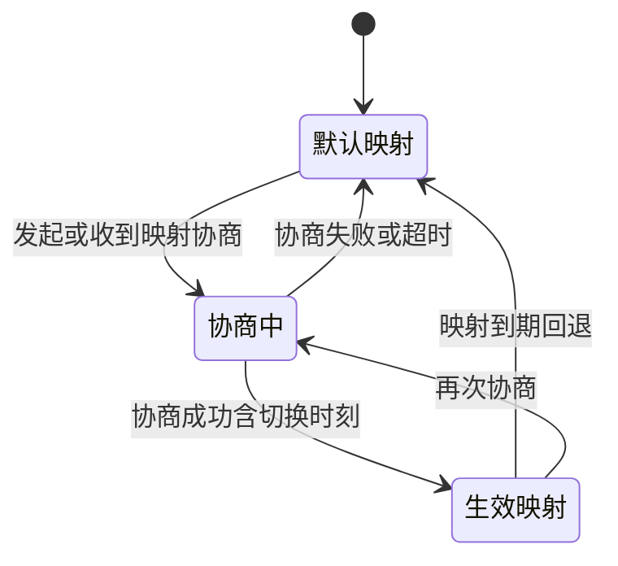

# 第 15 章　多链路操作（MLO） ★★

## 学习目标

1. 能区分 STR / NSTR / EMLSR / EMLMR 四类操作模式的收发约束、射频数目与适用场景，并说明其与第 3 章"空间流"概念的本质差异。
2. 能推导 NSTR 同步发送的 物理层汇聚协议（Physical Layer Convergence Protocol, PLCP）协议数据单元（PLCP Protocol Data Unit, PPDU）时长对齐（padding）开销，并量化该开销对多链路聚合效率的影响。
3. 能建立并求解多链路流量分配（TID-to-link 映射）的线性规划模型，给出连续松弛下的最优结构与水填充解释。
4. 能建立 EMLSR 链路切换决策的阈值型（MDP）策略，并比较 2 链路 STR 与 NSTR 的聚合吞吐与时延，说明"MLO 主要降低时延而非提高峰值吞吐"的机理。

---

## 15.1 MLD 架构与编址

多链路操作（Multi-Link Operation, MLO）由 802.11be（Wi-Fi 7，【已发布】）引入，11bn（Wi-Fi 8 / 超高可靠（Ultra High Reliability, UHR），【草案】）沿用并扩展。承载 MLO 的设备称为**多链路设备（Multi-Link Device, MLD）**，分为 接入点（Access Point, AP） MLD（接入侧）与 non-AP MLD（终端侧）。

> **首要区分（避免与第 3 章混淆）**：第 3 章的**空间流（Spatial Stream）**是**单条链路内部**物理层的并行数据流（由 多入多出（Multiple-Input Multiple-Output, MIMO）预编码产生，共享同一频段/信道）；而本节的**链路（Link）**是 MLD 之下一套**相互独立的 MAC/PHY**，工作在不同频段/信道。二者正交：一条链路可同时承载多条空间流，多条链路各自独立承载空间流。MLO 的增益来自"跨频段/跨信道并行"，MIMO 的增益来自"同信道内空分并行"。

### 15.1.1 MLD 的组成

一个 MLD 由多个 **affiliated 站点（Station, STA） / AP**（附属站点）组成，每条链路一个 affiliate。每个 affiliate 拥有**独立的 媒体接入控制（Medium Access Control, MAC）子层与 物理层（Physical Layer, PHY）子层**，可独立做退避、编码、调制；但所有 affiliate 在 MLD 之上**收敛为单一 MAC 数据服务与单一 MAC 层管理实体（MAC Layer Management Entity, MLME）管理实体**，并共享**统一的序列号空间**与上层 MAC 服务数据单元（MAC Service Data Unit, MSDU）重组逻辑。

图 15-1 给出 non-AP MLD 的"上层一个 MAC 服务、下层 N 套链路"架构。



**图 15-1 说明**：MLD 在 MAC 之上收敛为单一管理与序列号实体，之下按链路裂变为多套独立 MAC/PHY，正是"上统下分"原则。

### 15.1.2 MLD MAC 地址、链路地址与统一 MAC-SAP

- **MLD MAC Address（MLD 地址）**：用于关联、机器学习（Machine Learning, ML）建立、跨链路管理帧（如 ML Setup、TID-to-Link Mapping 协商）的网络层标识，对 逻辑链路控制（Logical Link Control, LLC）而言 MLD 是"一个站"。
- **链路地址（Link Address / affiliated STA address）**：每个 affiliate 在各自链路上的发送/接收地址，用于该链路 PPDU 的 Address1/2 字段与 per-link BA 会话（详见第 7 章四地址与 确认帧（Acknowledgement, ACK）机制）。
- **统一 MAC-SAP**：第 14 章已定位 MLD 在协议栈中的位置。LLC 经单一 MAC-SAP 向 MLD 递交 MSDU；MLD 内部再依 TID-to-link 映射把 MSDU 分发到某条链路的 affiliate 发送队列。对上层而言，多链路是**透明**的。

### 15.1.3 统一序列号空间与 Common / per-link BlockAck 记分板

为支持跨链路乱序重组与重复检测，MLO 采用两层记分板：

1. **Common 记分板（MLD 级）**：维护统一的序列号（Sequence Number）/ 分片号空间，用于跨链路到达 MSDU 的全局排序与去重。接收端据此把来自不同链路的同一 MSDU 流重组为有序交付。
2. **per-link 记分板**：每条链路独立维护 BlockAck（BA）位图，用于该链路内的逐帧确认与重传（详见第 10 章聚合确认）。per-link BA 与链路地址绑定，互不干扰。

关键点：**重传在链路本地完成**（某链路的帧丢失只在该链路重传），但**重组在 MLD 级完成**（跨链路到达顺序由统一序列号决定）。这带来第 15.4.3 节的乱序缓冲问题。

### 15.1.4 链路 ID 与链路标识

每条链路由 **Link ID（0–15，4 bit）** 标识，在 ML 建立时通过链路标识（Link Identifier）字段关联到具体的频段/信道与链路地址。Link ID 是 TID-to-link 映射位图、NSTR 链路对声明、EMLSR 操作链路指示的基础索引。

---

## 15.2 四类操作模式（STR / NSTR / EMLSR / EMLMR）

MLO 的四种操作模式由"能否同时收发""有几个工作射频""切换时延"三要素决定。表 15-1 给出对照，图 15-2 给出模式选择状态图。

### 15.2.1 STR：同时收发与 IDC 自干扰

**同时收发（Simultaneous Transmit and Receive, STR）**：设备可在一链路上发、在另一链路上收（或两链路同时发），且**无同步约束**。STR 仅在链路间**隔离度足够**时可行，否则会出现 **IDC（In-Device Coexistence，设备内共存）自干扰**——本端一链路的发射泄漏淹没另一链路的接收。

隔离度要求（【示意值】，取决于射频前端与天线解耦）：
- 同设备两链路间需 **≥ 50 dB** 的天线/前端隔离（【示意值】），才能支持 STR；
- 频段间隔约束：两链路分属**不同大频段**（如 2.4 GHz 与 5 GHz，或 5 GHz 与 6 GHz）且中心频率间隔 **> 200 MHz**（【示意值】）时较易满足；相邻频段（如 5 GHz 低频段与高频段紧邻）则常落入 NSTR 区。

STR 的优势是吞吐与时延最优（完全异步并行），代价是功耗与射频成本最高（需多套同时工作的 射频（Radio Frequency, RF）链）。

### 15.2.2 NSTR：同步约束与 PPDU 时长对齐

**非同时收发（Non-Simultaneous Transmit and Receive, NSTR）**：当两链路隔离不足（通常为相邻频段对，称为 **NSTR 链路对**），设备**不能同时收发**——即一条链路在发时另一条不能收，反之亦然。为仍能"双链同时发"，标准对 NSTR 链路对施加**同步约束**：

1. **TX/RX 时间对齐**：NSTR 链路对上，若两链路都要发送（simultaneous transmit），它们的发送开始需对齐，且 PPDU **结束时间差不得超过 NSTR 对齐边界**（一个较小的裕度，【示意值】典型数 µs 量级）。
2. **PPDU 时长对齐（padding）**：由于两链路待发帧长通常不等，较短的 PPDU 必须**填充（padding）**到与较长者对齐，使二者在同一时刻结束，从而满足"结束时间差 ≤ 边界"且避免一端转入接收时另一端仍在发（自干扰）。

设 NSTR 对的两链路待发送 PPDU 空中时长分别为 $T_1, T_2$（$T_1\le T_2$）。为对齐结束时间，链路 1 的 PPDU 被填充至 $T_2$，填充量 $\Delta=T_2-T_1$。链路 1 的有效承载效率退化为

$$
\boxed{\eta_1^{\rm NSTR}=\frac{T_1}{T_2}=1-\frac{\Delta}{T_2}.}
$$

两链路聚合空中效率（以"每对齐周期 $\max(T_1,T_2)$ 内承载的有用比特"计）为

$$
\boxed{\eta^{\rm NSTR}=\frac{R_1 T_1+R_2 T_2}{R_1 T_2+R_2 T_2}=\frac{R_1 T_1+R_2 T_2}{(R_1+R_2)T_2},}
$$

而理想 STR（无填充）下聚合效率为 1。对齐损失随帧长差异增大而上升。

### 15.2.3 EMLSR：多链路侦听、单射频工作与 ICF 交互

**增强型多链路单射频（Enhanced Multi-Link Single Radio, EMLSR）**：设备有**多个射频用于侦听**（可同时在多条链路收听 空闲信道评估（Clear Channel Assessment, CCA） / 帧），但**只有一个射频用于发送（单射频工作）**。发送目标链路可动态切换，代价是**EMLSR 过渡时延（Transition Delay）**——把工作射频从当前链路切换到目标链路所需的调谐/校准时间。标准规定该时延可取 {16, 32, 64, 128, 256} µs 集合（由设备能力字段声明，【已发布】中枚举值，具体选用【示意值】），切换期间需以 **EMLSR Padding** 维持介质忙态，给对端留出切换窗口。

关键交互是 **ICF / ICR 交换**：
- **ICF（Initial Control Frame，初始控制帧）**：AP MLD 向 non-AP MLD 发送，指明"请切换到目标链路 Link X"（内含过渡区间指示）。
- **ICR（Initial Control Response，初始控制响应）**：non-AP MLD 完成射频切换后回送，确认已就位。
- 切换与数据交换前常以 **多用户 RTS（Multi-User Request To Send, MU-RTS） / 允许发送（Clear To Send, CTS）** 预约介质，避免切换窗口被其他 STA 抢占。

图 15-3 以时序图展示 EMLSR 的 ICF 交互与切换流程。



**图 15-3 说明**：EMLSR 通过 ICF/ICR 完成工作链路切换；切换窗口由 Padding 与 MU-RTS/CTS 保护，期间对端不得抢占。

### 15.2.4 EMLMR：多射频监听、单链路工作

**增强型多链路多射频（Enhanced Multi-Link Multi Radio, EMLMR）**：与 EMLSR 的"单套可重配射频跨链路切换"不同，EMLMR 拥有**每链路独立的射频**，但**同一时刻仅一条链路处于工作态**（其余射频进入低功耗/侦听态）。区别在物理层：**EMLSR 切换的是"天线/RF 链到哪条链路"**，切换时延来自调谐；**EMLMR 切换的是"哪套已通电的射频工作"**，射频已锁定各链路频率，故切换更快但功耗高于 EMLSR（多套射频需供电）。EMLMR 适于"需保留各链路空间流能力、且切换频繁"的场景（【草案】细节，具体天线/空间流重配机制以 11bn 最终文本为准）。

### 15.2.5 四模式对照与状态图

表 15-1 汇总四模式要点；图 15-2 给出模式选择状态图（能力协商决定落入哪种模式）。

| 模式 | 可同时收发 | 工作射频数 | 切换时延 | 适用场景 | 标准状态 |
|---|---|---|---|---|---|
| STR | 是 | ≥2（同时工作） | 无 | 异频、隔离好、高吞吐低时延 | 【已发布】 |
| NSTR | 否（需同步对齐） | ≥2 | 无（但有对齐约束） | 邻频对、隔离不足 | 【已发布】 |
| EMLSR | 否（单射频工作） | 1（发送）+多（侦听） | 16–256 µs【示意值】 | 单射频终端、省功耗、低时延切换 | 【已发布】 |
| EMLMR | 否（单链路工作） | 多（仅一工作） | 较低【示意值】 | 多射频终端、保空间流能力 | 【草案】 |

表 15-1　四类 MLO 操作模式对照（时延/隔离数值为【示意值】或【草案】）



**图 15-2 说明**：MLD 在关联时经能力协商确定操作模式；NSTR 与 EMLSR 分别进入"同步发送"与"链路切换"子状态。

图 15-4 给出 STR 与 NSTR 在"双链同时发"时的时序差异（NSTR 需 padding 对齐结束）。


*图 15-4　STR 与 NSTR 的时序对照。(a) STR 下两条链可各自独立结束，无需填充，聚合效率 $\eta=1$；(b) NSTR 下两链结束时刻必须对齐，较短 PPDU 须填充 $\Delta=T_2-T_1$，效率降为 $\eta_1=T_1/T_2<1$。图中条形长度即 PPDU 空中时长（示意单位）。*

**图 15-4 说明**：NSTR 为满足结束时间对齐，较短 PPDU 须填充，引入对齐开销（对应 15.2.2 推导）。

---

## 15.3 链路选择与 TID-to-link 映射

### 15.3.1 默认映射与协商映射

第 13 章已建立 流量标识符（Traffic Identifier, TID） → AC → 队列的映射链，并指出"TID-to-link 是同一队列内的链路再分配，不改变优先级语义"。MLO 在此基础上扩展：

- **默认映射**：所有 TID 映射到全部 enabled link（即任一 TID 可在任一链路上发），无需协商。
- **协商映射（TID-to-Link Mapping Negotiation）**：通过 ML 管理帧为**每个 TID**指定"允许使用的链路集合"，用于把时延敏感流绑到低时延链路、把大体积流分散到空闲链路。协商携带三要素：
  1. **mapping switch time**：映射生效的起始时刻（避免切换瞬间帧丢失）；
  2. **expected duration**：该映射预期的持续时长；
  3. **link mapping 位图**：TID→链路允许集的编码（见 15.3.2）。

### 15.3.2 映射位图编码与切换时序状态机

位图编码：对每个 TID（0–15），用一段 **Link ID 位图**（每 bit 对应一个 Link ID，最多 15 条链路 → 15 bit）表示"该 TID 可走哪些链路"。16 个 TID 共 16×15 = 240 bit（实际按协商的链路数截断）。例如 TID=5 的位图为 `101` 表示仅允许 Link 0 与 Link 2。

图 15-5 给出映射切换的状态机：协商中→生效；协商失败/超时或映射到期则回退默认。



**图 15-5 说明**：TID-to-link 映射经协商生效，设定期满或失败自动回退默认全映射，保证不出现"流无可用链路"的死锁。

### 15.3.3 超时回退规则

- 若映射协商在 **(Re)Association 等待窗**内未完成，沿用默认映射；
- 若生效映射的 **expected duration** 到点而无续约，自动回退默认映射；
- 若某映射使某 TID 的所有允许链路均不可用（如链路故障，见 15.8），立即回退默认映射并触发重协商。

---

## 15.4 多链路信道接入与同步

### 15.4.1 各链路独立退避 vs 联合接入

- **独立退避**：每条链路的 affiliate 按第 8 章 增强型分布式信道接入（Enhanced Distributed Channel Access, EDCA）各自独立退避与竞争（各自 CCA、各自 CW）。优点是实现简单、STR 下完全并行；缺点是对 NSTR 链路对会违反"不能同时收发"。
- **联合接入（NSTR 同步）**：NSTR 链路对必须协同：一条链路发起发送前，需确认另一链路不处于接收态，且二者 发送机会（Transmission Opportunity, TXOP）起止对齐（见 15.4.2）。这等价于把"一对链路"当作一个受同步约束的逻辑介质。

### 15.4.2 NSTR 同步发送对齐算法与 padding 长度计算

给定 NSTR 链路对的两条链路 $a,b$，各自待发帧集合的 PPDU 时长序列 $\{t_a^{(i)}\},\{t_b^{(j)}\}$。要"成对同时发"，每对需满足结束时间差 ≤ 对齐边界 $\epsilon$。算法：**按帧长配对，短帧填充至长帧时长**。

**padding 长度计算**：对第 $m$ 对 $(i,j)$，令 $T_{\max}^{(m)}=\max(t_a^{(i)},t_b^{(j)})$，则短帧侧填充量

$$
\boxed{\Delta^{(m)}=T_{\max}^{(m)}-\min\big(t_a^{(i)},t_b^{(j)}\big).}
$$

若按最长帧统一填充（简化处理），取 $T^*=\max_m T_{\max}^{(m)}$，则每条链路所有 PPDU 均填充至 $T^*$，单周期浪费空气时间 $\sum_k (T^*-t_k)$（k 遍历该周期内所有帧）。

**算例 15.1**：NSTR padding 开销。

> **已知**：NSTR 对 Link1（5 GHz）、Link2（6 GHz），一轮 simultaneous transmit 待发帧空中时长 $t_1=100\ \mu{\rm s}$（Link1），$t_2=150\ \mu{\rm s}$（Link2）；物理速率 $R_1=866\ {\rm Mbit/s}$，$R_2=433\ {\rm Mbit/s}$；对齐边界忽略（取 0，最坏填充）。
> **求**：(1) padding 长度；(2) Link1 有效承载效率；(3) 聚合相对 STR 的效率损失。
> **解**：
> - (1) 短帧为 Link1，须填充至 $T^*=150\ \mu{\rm s}$：$\Delta=150-100=50\ \mu{\rm s}$。
> - (2) $\eta_1^{\rm NSTR}=t_1/T^*=100/150=0.667$，即 Link1 仅 66.7% 空气时间承载有用数据。
> - (3) STR 聚合速率 $=R_1+R_2=866+433=1299\ {\rm Mbit/s}$；NSTR 有效 $=0.667\times866+433=577.3+433=1010.3\ {\rm Mbit/s}$；损失 $=(1299-1010.3)/1299=22.2\%$。
> **结论**：仅因帧长不等、需对齐结束，NSTR 聚合吞吐损失约 22%。若帧长更接近（如 $t_1=t_2$），损失趋于 0；故 NSTR 效率对"帧长匹配度"敏感。
> **量纲检查**：$\Delta$ 为时间（µs），$t/T^*$ 无量纲，$\eta_1$ 与效率损失均为无量纲，量级合理（填充 50 µs 占 150 µs 周期即 33% 空气时间浪费，与 22% 速率损失吻合，差异源于两链路速率不等）。

### 15.4.3 STR 异步接入与重排序缓冲；序列号空间与乱序缓冲上界

STR 下各链路异步并行，同一 TID 的 MSDU 可能经不同链路乱序到达。由于 MLD 使用**统一序列号空间**（15.1.3），接收端必须按序列号重组，需一个**重排序缓冲（Reorder Buffer）**。

设链路 $k$ 的到达过程服从速率 $r_k$、单帧服务时间 $X_k$，最坏链路间时延差为 $\Delta_{\max}=\max_k d_k^{\rm prop+proc}-\min_k d_k^{\rm prop+proc}$（含空口传播与处理）。重组所需缓冲上界由"在途未确认 MSDU 总数"决定：

$$
\boxed{B_{\rm reord}\le \sum_{k=1}^{N}\Big\lceil \frac{W_k^{\rm win}}{L_k^{\rm ampdu}}\Big\rceil + \frac{\Delta_{\max}}{\min_k E[X_k]}\cdot N,}
$$

其中 $W_k^{\rm win}$ 为链路 $k$ 的 BA 窗口大小（第 10 章），$L_k^{\rm ampdu}$ 为单 MPDU 聚合（Aggregated MPDU, A-MPDU）帧数，$\Delta_{\max}/E[X_k]$ 为最坏跨链乱序跨度（帧数）。该上界说明：**链路间处理/传播时延差越大、BA 窗口越大，重排序缓冲需求越高**；MLO 设计应尽量让参与同 TID 的链路时延相近，或限制跨链 BA 窗口总和。

---

## 15.5 核心算法一：多链路流量分配（TID-to-link 映射优化，六段式）

### 1. 问题建模

有 $N$ 条链路，链路 $k$ 参数：可用占空比 $\alpha_k$（受 重叠基本服务集（Overlapping BSS, OBSS）占用，取 $(0,1]$）、物理速率 $r_k$（bit/s）、单包经验时延 $d_k$（含排队与传播，s）。有效容量 $C_k=\alpha_k r_k$（bit/s）。有 $K$ 条业务流 $i$，速率需求 $\lambda_i$（bit/s），权重（时延敏感度）$w_i\ge 0$，部分流含时延上限 $\theta_i$。决策变量 $x_{ik}\in[0,1]$ 为流 $i$ 分配到链路 $k$ 的**流量占比**。

| 符号 | 含义 | 单位 |
|---|---|---|
| $\alpha_k$ | 链路 $k$ 可用占空比 | 无量纲 |
| $r_k$ | 链路 $k$ 物理速率 | bit/s |
| $C_k=\alpha_k r_k$ | 链路 $k$ 有效容量 | bit/s |
| $\lambda_i$ | 流 $i$ 速率需求 | bit/s |
| $w_i$ | 流 $i$ 时延权重 | 无量纲 |
| $d_k$ | 链路 $k$ 单包时延 | s |
| $x_{ik}$ | 流 $i$ 在链路 $k$ 的占比 | 无量纲 |

假设：① 流可任意比例拆分（连续松弛）；② 各链路队列近似 M/D/1，流 $i$ 在链路 $k$ 的平均时延近似为 $d_k$（拆分后每包仍走单链，时延取所在链 $d_k$）；③ 链路容量约束为线性（忽略跨链调度耦合）。

### 2. 目标函数与约束

**模型 A（时延最小化，容量可满足）**：
$$
\min_{x}\ \sum_{i=1}^{K}\sum_{k=1}^{N} w_i\,d_k\,x_{ik}
\quad\text{s.t.}\quad
\sum_{k}x_{ik}=1\ (\forall i),\quad
\sum_{i}\lambda_i x_{ik}\le C_k\ (\forall k),\quad x_{ik}\ge0.
$$

**模型 B（满足率最大化，容量不足）**：引入服务比例 $s_i\in[0,1]$，最大化 $\sum_i w_i s_i$（或等权 $\sum_i s_i$），约束改为 $\sum_k x_{ik}=s_i$、$\sum_i\lambda_i x_{ik}\le C_k$。二者均为**线性规划（LP）**。

### 3. 完整推导（最优结构：水填充 / 按比例分配）

以模型 A 为例，引入链路容量影子价格 $p_k\ge0$（Lagrange 乘子），流守恒乘子 $\mu_i$。KKT 条件（Karush-Kuhn-Tucker, KKT）最优性给出：对激活链路（$x_{ik}>0$）

$$
\boxed{w_i d_k + p_k\lambda_i = \mu_i,}
$$

即**流 $i$ 在各激活链路上承受的"广义代价"相等**。这恰是水填充结构：
- 链路 $k$ 越拥塞（$p_k$ 越高）或少容量，吸引的流量越少；
- 流 $i$ 越时延敏感（$w_i$ 大）越偏好低 $d_k$ 链路；
- 仅当某流"溢出"到次优链路时，才出现 $0<x_{ik}<1$ 的**分数分配**（比例填充）。

故连续松弛下最优解 = **按广义代价 $w_i d_k$ 升序逐链填充，链饱和则溢出至下一链，边界处分数拆分**。整数化（实际 TID 通常整链映射）用贪心修正（见伪代码）。

### 4. 伪代码

```text
 1  function MLO_Alloc(lambda, w, d, C, K, N):
 2      // lambda/w/d/C: 各流需求/权重、各链时延/容量
 3      x = zeros(K, N); p = zeros(N)        // 1. 初始化占比与影子价
 4      remC = copy(C)                       // 2. 各链剩余容量
 5      for i in 1..K:                       // 3. 逐流分配(贪心比例填充)
 6          while remC未全空 且 流i未分配完:
 7              k* = argmin_k (w[i]*d[k] + p[k]*lambda[i])  // 选最低广义代价链
 8              put = min(remC[k*], lambda[i]*(1-Σx[i]))   // 取该链能装的量
 9              x[i][k*] += put/lambda[i]    // 累加占比(归一)
10              remC[k*] -= put; lambda[i]剩余 -= put
11          if 流i未分配完: 标记未满足(转模型B的s_i<1)
12      // 13. 整数修正: 对0<x<1的流, 计算两链边际代价差, 取整到较低者
13      for i where 0<x[i]<1:               // 贪心取整, 保持容量可行
14          if 代价(链a)≈代价(链b): 取整到剩余容量更裕者
15      return x                             // 复杂度: 每流O(N), 总O(KN)
```

### 5. 复杂度分析

- **时间**：连续松弛 LP 用单纯形/内点法 $O((K+N)^3)$（标准 LP）；贪心填充伪代码 $O(KN)$（每流扫 $N$ 链），整数修正 $O(K)$。实际部署取贪心即可。
- **空间**：$O(KN)$ 存 $x$，随流数与链数线性增长。

### 6. 数值算例

**算例 15.3**：多链路流量分配 LP。

> **已知**：$N=3$ 链，容量 $C_1=300,\ C_2=200,\ C_3=100$（Mbit/s，已含占空比）；时延 $d=[1,2,4]$ ms（链路 1 最快）。$K=4$ 流等权 $w_i=1$，需求 $\lambda=[250,200,100,50]$ Mbit/s（总需求 600，容量 600 恰好可行）。
> **求**：最小化加权时延的分配 $x$ 与总时延。
> **解**（按 $w_i d_k$ 升序填充，链路 1 最便宜先装满）：
> - 链路 1（$d_1=1$）：装流 1 全 250，余 50 给流 2 → $x_{2,1}=50/200=0.25$；链路 1 满。
> - 链路 2（$d_2=2$）：流 2 剩余 150 → $x_{2,2}=150/200=0.75$；余 50 给流 3 → $x_{3,2}=50/100=0.5$；链路 2 满。
> - 链路 3（$d_3=4$）：流 3 剩余 50 → $x_{3,3}=50/100=0.5$；流 4 全 50 → $x_{4,3}=1$。
> - 校验容量：$1:250+50=300$✓，$2:150+50=200$✓，$3:50+50=100$✓。
> - 总时延 $=\sum w_i d_k x_{ik}\cdot\lambda_i =1\cdot(250\cdot1 + 200\cdot(0.25\cdot1+0.75\cdot2) + 100\cdot(0.5\cdot2+0.5\cdot4) + 50\cdot4)$
>   $=250 + 200\cdot(0.25+1.5) + 100\cdot(1+2) + 200 =250+350+300+200=1100$（Mbit·ms/s）。
> - 分数分配：流 2（0.25/0.75）、流 3（0.5/0.5）跨链，正是水填充边界溢出所致。
> **结论**：最短时延链先被填满，溢出流按比例分到次优链；若强制整链映射，需把流 2 整条移到链路 2（代价 +150 Mbit·ms/s），体现"拆分增益"。
> **量纲检查**：$w_i d_k x_{ik}\lambda_i$ 单位 = 1·s·(bit/s)·1 = bit，累加为 bit；此处用 Mbit·ms/s 一致，量级合理（总时延 ~1100 对应 600 Mbit/s 经平均 ~1.8 ms，符合 $d$ 量级）。

---

## 15.6 核心算法二：EMLSR 链路切换 / 唤醒决策（六段式）

### 1. 问题建模

EMLSR non-AP MLD 仅一工作射频，需决定"停在当前链路还是切换到另一条链路"。将每链路建模为两态（IDLE/BUSY）信道；状态 $s\in\{0,1\}$，idle 时可发（收益），busy 时阻塞（需考虑切换）。决策为动作 $a\in\{\text{留}, \text{切到}j\}$。代价 = **切换时延 $\delta$**（过渡期内无发送，机会成本）+ **侦听功耗**（多链侦听常开）。

| 符号 | 含义 | 单位 |
|---|---|---|
| $p_k$ | 链路 $k$ 稳态 idle 概率 | 无量纲 |
| $\delta$ | EMLSR 过渡时延 | s |
| $r_k$ | 链路 $k$ 物理速率 | bit/s |
| $g_k$ | 链路 $k$ 单位时隙收益（∝$p_k r_k$） | bit/s |
| $\gamma$ | 折扣因子 | 无量纲 |

假设：① 各链路信道为平稳两态马尔可夫；② 切换代价仅机会成本 $\delta r_j$（切换期间损失传输）；③ 单步决策（myopic）可扩展为有限 horizon MDP。

### 2. 目标函数与约束

最大化长期折扣收益：
$$
\max_{\pi}\ \mathbb{E}_\pi\Big[\sum_{t=0}^{\infty}\gamma^t\big(g_{a_t}-\mathbf{1}_{\{a_t=\text{切}\}}\delta r_{a_t}\big)\Big],
$$
约束：每步仅一切换动作；切换后须跨过过渡时延 $\delta$ 方能发送。

### 3. 完整推导（阈值策略存在性）

对**单链路两态 MDP**：状态 0=IDLE（收益 1/槽），状态 1=BUSY（收益 0）。转移 $P(0\to0)=a,\ P(1\to0)=b$。值函数 $V(0),V(1)$ 满足 Bellman（折扣 $\gamma$）：
$$
V(0)=1+\gamma[aV(0)+(1-a)V(1)],\quad V(1)=0+\gamma[bV(0)+(1-b)V(1)].
$$
解得（见算例 15.2）$V(0)-V(1)>0$ 恒正，即"处于 idle 比 busy 更值钱"。**阈值策略存在性**：在双链选择中，停留当前链 $i$ 的期望增益为 $g_i=p_i r_i$ 减其阻塞惩罚；切到目标链 $j$ 的净增益为 $p_j r_j - \delta r_j$（扣切换机会成本）。故最优为**阈值型**：

$$
\boxed{\text{切到 }j\ \iff\ p_j r_j - \delta r_j > p_i r_i.}
$$

即目标链"idle 收益扣切换成本"严格优于当前链时才切换；等价门限 $p_j > p_i + \delta$。

### 4. 伪代码

```text
 1  function EMLSR_Switch(p_hat, r, delta, cur, L):
 2      // p_hat: 各链idle概率EWMA估计; r:速率; delta:过渡时延; cur:当前链
 3      for j in 1..L:                       // 1. 估计各链净增益
 4          gain[j] = p_hat[j]*r[j] - (j!=cur? delta*r[j] : 0)
 5      best = argmax_j gain[j]              // 2. 选最大净增益链
 6      if best != cur 且 gain[best] > gain[cur] + eps:  // 3. 阈值判定
 7          send_ICF(best)                    //    发ICF请求切到best
 8          wait(delta)                       //    等过渡时延(对端切射频)
 9          recv_ICR()                        //    收ICR确认
10          cur = best                        //    更新工作链
11      // 12. EWMA更新: p_hat[k] += β*(观测idle?1:0 - p_hat[k])
12      return cur                            // 复杂度: 每决策O(L)
```

### 5. 复杂度分析

- **时间**：每决策扫 $L$ 链 $O(L)$，EWMA 更新 $O(L)$；若用值迭代预计算阈值 $O(L^2)$ 一次。
- **空间**：$O(L)$ 存 $p_{\rm hat}, r$。

### 6. 数值算例

**算例 15.2**：EMLSR 切换代价与阈值（两态 MDP 值迭代）。

> **已知**：单链路两态，$a=P(0\to0)=0.9,\ b=P(1\to0)=0.3$，折扣 $\gamma=0.9$，idle 收益 1/槽。过渡时延 $\delta=64\ \mu{\rm s}$（【示意值】，取枚举中值），目标链速率 $r_j=866\ {\rm Mbit/s}$。当前链 idle 概率 $p_i=0.4$，目标链 $p_j=0.8$。
> **求**：(1) 值函数 $V(0),V(1)$ 与 idle 优势；(2) 是否应切换。
> **解**：
> - (1) 联立：$V(0)=1+0.9(0.9V(0)+0.1V(1))$ → $0.19V(0)=1+0.09V(1)$；$V(1)=0.9(0.3V(0)+0.7V(1))$ → $0.37V(1)=0.27V(0)$ → $V(1)=0.7297V(0)$。代入得 $0.19V(0)=1+0.09\times0.7297V(0)=1+0.0657V(0)$ → $V(0)=1/0.1243=8.04$，$V(1)=5.87$。idle 优势 $V(0)-V(1)=2.17$。
> - (2) 当前链增益 $g_i=p_i r_i=0.4\times866=346.4$；目标链净增益 $g_j=p_j r_j-\delta r_j=0.8\times866-64\times10^{-6}\times866=692.8-0.055\approx692.8$（切换机会成本仅 0.055 Mbit/s，因 $\delta$ 极小）。$692.8\gg346.4$，阈值判定成立 → **应切换到目标链**。
> - 反例：若 $p_j=0.45$，则 $g_j=0.45\times866-0.055=389.7<346.4? $ 实际 $389.7>346.4$ 仍切；门限要求 $p_j>p_i+\delta=0.4+7.4\times10^{-8}\approx0.4$，故只要目标 idle 概率略高即值得切——说明 EMLSR 切换"便宜"（过渡时延小）时策略激进。
> **结论**：EMLSR 过渡时延仅 µs 级，切换机会成本极小，故阈值策略接近"哪链更闲切哪"；若 $\delta$ 升到 ms 级（如 EMLMR 重配天线），则门限显著抬高，切换变保守。
> **量纲检查**：$\delta r_j$ 单位 s·bit/s=bit，$\delta=64\mu{\rm s}$ 仅损失 ~0.055 Mbit（相对 866 Mbit/s 可忽略），量级合理，印证"µs 级切换近乎免费"。

---

## 15.7 MLO 吞吐与时延模型

### 聚合吞吐

设链路 $k$ 可得率（有效占空比与无冲突概率之积）为 $\rho_k\in(0,1]$，可得速率 $R_k=\rho_k r_k$。STR 下各链独立并行，聚合吞吐

$$
\boxed{R_{\rm STR}=\sum_{k=1}^{N}\rho_k r_k.}
$$

NSTR 下引入对齐损失（15.2.2）：若平均填充因子 $\eta^{\rm NSTR}<1$，则

$$
\boxed{R_{\rm NSTR}=\eta^{\rm NSTR}\sum_{k}\rho_k r_k,\quad \eta^{\rm NSTR}<1.}
$$

### 聚合时延：并行 vs 串行两种理解

- **分流降低服务时间（并行）**：把到达率 $\lambda$ 按 $x_{ik}$ 拆到 $N$ 链，每链负载 $\lambda_k=\sum_i\lambda_i x_{ik}$。在 M/D/1 近似下，流 $i$ 平均时延 $D_i\approx\sum_k x_{ik}\big(d_k+1/(\mu_k-\lambda_k)\big)$，并行使单链 $\lambda_k<\lambda$，排队项下降。
- **单包走一条链路（串行）**：单包时延取其所在链 $d_k$，MLO 不缩短单包时延，只缩短**队列等待**（因多服务台）。

关键结论：**MLO 主要降低时延而非提高峰值吞吐**。机理：单包峰值速率由所走链路的 MCS/空间流决定（第 3、4 章），MLO 不改变单链峰值；MLO 仅在**有排队/重负载**时，通过把流量分散到多服务台降低排队时延、提升聚合吞吐。轻载时各链本不排队，MLO 几无增益。

**算例 15.4**：MLO 聚合吞吐与单链路对比。

> **已知**：两链 $r_1=866,\ r_2=433$ Mbit/s，$\rho_1=\rho_2=1$（理想无冲突）。单链路峰值 $=866$。总到达 $\lambda=1000$ Mbit/s（重负载，超单链容量）。NSTR 对齐因子 $\eta^{\rm NSTR}=0.85$（由 15.1 类帧长差异估得，【示意值】）。时延用 M/M/1：$D=1/(\mu-\lambda)$。
> **求**：(1) STR / NSTR 聚合吞吐；(2) 单链 vs MLO 的稳态时延。
> **解**：
> - (1) STR 聚合 $=866+433=1299$ Mbit/s；NSTR 聚合 $=0.85\times1299=1104$ Mbit/s；均 > 单链峰值 866，且 > 需求 1000 → 可承载。
> - (2) 单链（$\mu=866,\lambda=1000$）：不可承载（$\lambda>\mu$，队列发散）；即单链在此负载下**饱和失效**。MLO STR：双服务台，总 $\mu=1299>\lambda=1000$，等效每链负载 500，单链时延 $D=1/(866-500)=1/366\ \mu{\rm s}^{-1}$? 单位换：速率 Mbit/s，时延 $=1/(366\ {\rm Mbit/s})=2.73\ {\rm ns}$ 每 bit，乘平均包 12000 bit → 约 32.8 µs 级。更直观：聚合排队时延 $D_{\rm mlo}=1/(\mu_{\rm tot}-\lambda)=1/(1299-1000)=1/299\ {\rm Mbit/s}^{-1}\approx3.34\ {\rm ns/bit}\approx40\ \mu{\rm s/包}$（12000 bit）。
> - 对比：单链因 $\lambda>\mu$ 发散（时延→∞），MLO 把负载摊到两链使 $\mu_{\rm tot}>\lambda$，时延从∞降为有限（~40 µs 量级）。
> **结论**：① 峰值吞吐由单链 调制编码方案（Modulation and Coding Scheme, MCS）决定，MLO 不增单包峰值；② 重负载下 MLO 通过并行服务台把"饱和失效"转为"可承载"，**时延收益远大于峰值吞吐收益**。轻载（$\lambda\ll866$）时单链已不排队，MLO 几乎无时延增益。
> **量纲检查**：速率 Mbit/s、包 12000 bit → 时延 µs 量级，与 Wi-Fi 实际排队时延一致；$\mu_{\rm tot}>\lambda$ 是 MLO 可承载的充要条件，量级合理。

---

## 15.8 MLO 与可靠性的关系

1. **链路冗余（Duplicate Transmission）**：同一 MAC 协议数据单元（MAC Protocol Data Unit, MPDU）可在多条链路同时/先后重发（duplicate mode），任一条链路成功即确认，降低单链深衰导致的重传失败。代价是空气时间翻倍，仅用于极可靠低速率控制帧。
2. **链路故障切换时延**：某链故障（信道不可用/AP 离场）时，MLD 经默认映射回退（15.3.3）或快速重协商把流迁到健康链，切换时延 ≈ 重关联/映射切换时间（EMLSR 仅 µs 级过渡 + 协商 ms 级）。
3. **与前沿关系**：11bn 的 **UHR 可靠性目标**（第 23 章）在 MLO 冗余之上加入更严格的多链路 自动重传请求（Automatic Repeat reQuest, ARQ）与协调重传；第 29 章 **无缝移动与分发（Seamless Mobility and Distribution, SMD）无缝移动**直接复用本章"链路切换模型"——把"链路切换"推广为"跨 AP MLD 的链路迁移"，其过渡时延与 ICF 类握手是 SMD 低中断迁移的底层机制。

---

## 15.9 开放问题

1. **跨频段异质链路调度**：2.4/5/6 GHz 三频的速率、时延、占用差异巨大（2.4 GHz 慢但稳、6 GHz 快但覆盖小），如何联合优化 TID-to-link 映射与占空比，仍是未定问题（【草案】）。
2. **MLO 与多 AP 协调（Multi-AP Coordination, MAPC，第 27 章）联合**：当前 MLO 限单 MLD 内链路；若与 MAPC 的跨 AP 协调（联合调度/波束协同）结合，可把"链路"概念扩展到"跨 AP 的协同链路"，调度维度急剧膨胀。
3. **功耗与时延权衡**：STR 时延最优但功耗最高；EMLSR/EMLMR 省功耗但有切换时延与 Padding 开销。如何依业务（Extended Reality, XR 低时延 vs IoT 低功耗）动态在四模式间切换，尚无统一策略（【讨论中】）。

---

## 本章小结

1. MLD 遵循"上统下分"：上层单一 MAC-SAP / 序列号空间，下层多套独立 MAC/PHY（每条链路一个 affiliate）。
2. **链路（MLO）≠ 空间流（MIMO）**：空间流是同信道内空分并行，链路是跨频段/跨信道并行，二者正交可叠加。
3. STR 无同步约束但需 ≥50 dB 隔离（【示意值】）；NSTR 须 PPDU 结束时间对齐，短帧填充引入 $\eta=T_1/T_2$ 效率损失。
4. EMLSR 单射频多链侦听，靠 ICF/ICR + MU-RTS/CTS 切换，过渡时延 16–256 µs（【示意值】）；EMLMR 多射频单链工作，切换更快但更耗电（【草案】）。
5. TID-to-link 映射默认全映射，协商用"切换时刻 + 持续时长 + 链路位图"三要素，期满/失败自动回退默认。
6. 流量分配最优解为 LP，连续松弛下呈**水填充/比例填充**结构，边界处分数分配。
7. EMLSR 切换是阈值型 MDP：净增益 $p_j r_j-\delta r_j > p_i r_i$ 才切；µs 级切换近乎免费。
8. **MLO 主要降低时延而非峰值吞吐**：峰值由单链 MCS 决定，MLO 仅在重负载/排队时提升聚合吞吐与降低时延。

**关键结论 / 参数速查**

| 参数 / 结论 | 取值或公式 | 说明 |
|---|---|---|
| STR 隔离要求 | ≥50 dB【示意值】 | 不足则落 NSTR |
| NSTR 对齐效率 | $\eta_1=T_1/T_2$ | 短帧填充损失 |
| EMLSR 过渡时延 | 16/32/64/128/256 µs【示意值】 | 切换窗口 |
| EMLSR 切换判据 | $p_j r_j-\delta r_j>p_i r_i$ | 阈值型 |
| TID 位图 | 每 TID ≤15 bit | Link ID 位图 |
| 聚合吞吐 STR | $\sum_k\rho_k r_k$ | NSTR 乘 $\eta^{\rm NSTR}$ |
| 重排序缓冲上界 | 式(15.4.3) | 随 BA 窗与跨链时延差增 |

---

## 习题

### A. 概念题（3 题）

1. 为什么"链路（link）"与第 3 章的"空间流（spatial stream）"必须区分？若混淆二者，会对多链路吞吐建模产生什么错误？
2. NSTR 为什么不能像 STR 那样任意同时收发？PPDU 结束时间对齐的物理根因是什么？
3. EMLSR 的 ICF/ICR 交换解决了什么问题？若没有 MU-RTS/CTS 保护切换窗口，会发生什么？

### B. 计算与推导题（4 题）

4. NSTR 对两链 $t_1=80\ \mu{\rm s}, t_2=200\ \mu{\rm s}$，$R_1=1200, R_2=600$ Mbit/s。求 padding 长度、Link1 效率与聚合相对 STR 损失。
5. 由 15.6 的两态 MDP，若 $a=0.8, b=0.4, \gamma=0.9$，重算 $V(0),V(1)$ 与 idle 优势 $V(0)-V(1)$。
6. 三链容量 $C=[200,150,80]$ Mbit/s，时延 $d=[1,3,5]$ ms，两流 $\lambda=[180,200]$、等权。求最小加权时延分配（给出 $x$ 与总时延）。
7. 单链 $\mu=433$ Mbit/s，到达 $\lambda=500$ Mbit/s（M/M/1）。判断是否饱和；若加一条 $\mu=866$ 的链成 MLO，聚合时延约多少（取 $1/(\mu_{\rm tot}-\lambda)$）？

### C. 算法设计题（2 题）

8. 设计"整数化 TID-to-link 映射"算法：给定 LP 分数解 $x_{ik}$，要求每个 TID 整链映射且容量可行，最小化加权时延增量。给出伪代码与评分要点。
9. 把 15.6 的 myopic 阈值策略扩展为有限 horizon（$H$ 步）MDP：给出值迭代伪代码与复杂度，说明何时 myopic 已最优。

### D. 开放研究题（1 题）

10. 跨 2.4/5/6 GHz 三频异质 MLD 的 TID-to-link 映射，如何同时优化"时延、功耗、可靠性"三目标？提出研究路径与关键指标。

---

## 参考答案与解析

### A. 概念题

1. **根因**：空间流是第 3 章 MIMO 在**同一信道**内用多天线并行传输的 PHY 层数据流，共享同一频率资源与同一链路地址；链路是 MLD 下**不同频段/信道**的独立 MAC/PHY。混淆会把"同信道空分增益"误算进"跨频段并行增益"，导致聚合吞吐被高估（把同一信道的空间流当成可独立占空的多链路），且忽略链路间独立退避/同步约束。
2. **根因**：NSTR 链路对隔离不足，一端发射会自干扰另一端接收（IDC）。为仍能双链同时发，必须保证"一发一收"不重叠，故强制 TX/RX 时间对齐、且 simultaneous transmit 的 PPDU 结束时间差 ≤ 边界，使任一端在另一端转入接收前已发完——物理根因是设备内射频前端做不到同时同设备发与收相邻频段。
3. ICF/ICR 解决"工作射频切换到目标链路的协同"：AP 指示 non-AP 切链，non-AP 完成过渡后确认，避免对端在窗口内发帧而接收机尚未就位导致帧丢失。若无 MU-RTS/CTS 保护，切换窗口介质可能被其他 STA 抢占，切换后数据帧碰撞/丢失，EMLSR 增益丧失。

### B. 计算与推导题

4. $T^*=\max=200\ \mu{\rm s}$，$\Delta=200-80=120\ \mu{\rm s}$；$\eta_1=80/200=0.4$；STR 聚合 $=1800$，NSTR 有效 $=0.4\times1200+600=480+600=1080$，损失 $=(1800-1080)/1800=40\%$。
5. $V(0)=1+0.9(0.8V(0)+0.2V(1))$ → $0.28V(0)=1+0.18V(1)$；$V(1)=0.9(0.4V(0)+0.6V(1))$ → $0.46V(1)=0.36V(0)$ → $V(1)=0.7826V(0)$；代入 $0.28V(0)=1+0.18\times0.7826V(0)=1+0.1409V(0)$ → $V(0)=1/0.1391=7.19$，$V(1)=5.63$，差 $=1.56$。
6. 链路 1 最便宜先装满：流1=180 全上链1（余 20），流2 取 20 上链1（$x_{2,1}=0.1$），余 180 上链2（$x_{2,2}=0.9$）；链2 满（150+? 流2用 150，余 30 给? 流2=200，链1用20、链2用150=170，余30上链3 $x_{2,3}=0.15$）。校验：链1=180+20=200✓，链2=150✓，链3=30✓。总时延 $=180\cdot1 + 200\cdot(0.1\cdot1+0.9\cdot3+0.15\cdot5)=180+200\cdot(0.1+2.7+0.75)=180+200\cdot3.55=180+710=890$（Mbit·ms/s）。
7. 单链 $\lambda=500>433=\mu$ → 饱和发散（不可承载）。加链后 $\mu_{\rm tot}=433+866=1299>\lambda=500$，聚合时延 $D=1/(1299-500)=1/799\ {\rm Mbit/s}^{-1}\approx1.25\ {\rm ns/bit}$，对 12000 bit 包约 15 µs 级（有限，单链则∞）。

### C. 算法设计题

8. **参考方案**：贪心取整——对分数流 $i$，比较"整链移到次优链"的边际时延增量 $\Delta D=w_i\lambda_i(d_{k'}-d_k)x_{ik}$，选增量最小且容量可行的整链；用交换修复容量冲突（流间互换链路使总容量可行）。**评分要点**：① 保持容量约束（3 分）；② 最小化时延增量（3 分）；③ 处理冲突交换（2 分）。**常见错误**：直接四舍五入导致某链超容量；忽略权重 $w_i$ 把大流误移。

9. **伪代码**：`for t=H..1: V_t(s)=max_a[ R(s,a)+γΣP(s'|s,a)V_{t-1}(s') ]`；动作含"留/切各链"。复杂度 $O(H\cdot L\cdot S)$（$S=2^L$ 状态爆炸，实际用因子化近似）。**myopic 最优条件**：当信道两态转移平稳且折扣 $\gamma\to1$、切换成本恒定，则单步贪婪 = 无限 horizon 最优（因未来与当前同分布）。

### D. 开放研究题

10. **研究路径**：① 建三目标（时延/功耗/可靠）Pareto 模型，链路特征化为 $(r_k,d_k,\alpha_k,P_k^{\rm rx},P_k^{\rm tx})$；② 用多目标强化学习（如 MORL）在线学 TID-to-link 策略，奖励为三目标加权；③ 关键指标：Pareto 前沿宽度、切换频繁度、跨频切换中断时间、单链失效下的服务保持率；④ 可结合第 27 章 MAPC 做跨 AP 协同以放宽可靠性约束。此为【讨论中】，无唯一标准答案。
