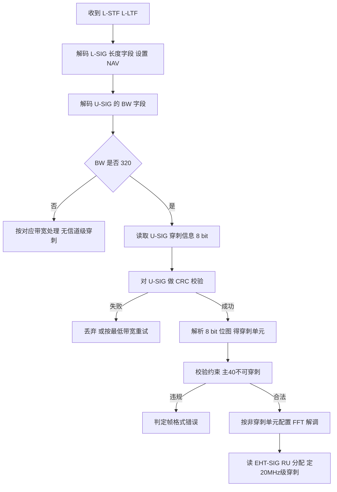

# 第 16 章　320 MHz 信道化与前导穿刺 ★

## 学习目标

1. 能由 6 GHz 信道编号推得任意带宽（20/40/80/160/320 MHz）的中心频率，并说明 320 MHz 仅存在于 6 GHz（及毫米波以上）的频谱原因。
2. 能基于 numerology 不变性推导"带宽翻倍而符号时长不变、吞吐翻倍"，并定量计算带宽翻倍带来的噪声上升（−3 dB/倍）与灵敏度恶化。
3. 能推导主信道拥塞下的可用带宽期望损失 $E[\text{loss}]=B\cdot p$，并据此说明"信道越宽、主信道拥塞的绝对代价越大"这一 Wi-Fi 8 NPCA/DSO 的根本动机。
4. 能设计动态前导穿刺决策与宽窄带宽自适应两类算法（六段式），并在给定 CCA 占用图上比较"穿刺 / 降带宽 / 换信道"的有效吞吐。

---

## 16.1　6 GHz 频谱与 320 MHz 信道化

### 16.1.1　频段划分与各国监管现状

电气电子工程师学会（Institute of Electrical and Electronics Engineers, IEEE）802.11be 引入的 320 MHz 信道**仅能在 6 GHz 免许可频段工作**（在 45 GHz 以上的毫米波 物理层（Physical Layer, PHY）中另有更宽信道，但机制不同，不属本章范围）。6 GHz 频段在各国监管口径差异极大，下表为 2026 年 9 月时效基准下的客观现状。

表 16-1　6 GHz 频段划分与监管现状（时效基准 2026-09）

| 区域 / 国家 | 低频段 5925–6425 MHz | 高频段 6425–7125 MHz | 备注 |
|---|---|---|---|
| 美国 / 加拿大 | 免许可（Wi-Fi 6E/7） | 免许可 | FCC 2020 起全段开放，共 1200 MHz |
| 韩国 | 免许可 | 免许可 | 同美式全开放 |
| 欧盟 | 免许可（LPI/VLP） | 审议中 | 仅低 500 MHz 开放给 Wi-Fi |
| 日本 / 印度 / 澳大利亚 | 免许可（部分限功率） | 多保留 国际移动通信（International Mobile Telecommunications, IMT） | 低段开放、高段留给 5G/6G |
| **中国** | **尚未开放给 Wi-Fi** | **划归 IMT（5G/6G）** | 工信部 2023 版《划分规定》将 6425–7125 MHz 用于 IMT；5925–6425 MHz 仍待定【已发布（国内监管）】 |

> **重要事实（客观陈述，2026-09）**：中国现行监管下，Wi-Fi 可用频带仅为 2400–2483.5 MHz、5150–5350 MHz、5725–5850 MHz，最大连续频宽 200 MHz，故**国内最大可用连续信道为 160 MHz，320 MHz 的 EHT 能力在国内暂无法落地**。6 GHz（5925–6425 MHz）是否向 Wi-Fi 开放需待主管部门后续文件，本章技术分析以"若 6 GHz 全段可用"为前提，并对监管不确定性在 16.6.8 节单列研究议题。

6 GHz 全段 5925–7125 MHz 共 1200 MHz，按 20 MHz 粒度可容纳 59 个 20 MHz 信道（信道号 1, 5, 9, …, 233），非重叠 320 MHz 信道仅 3 个。

### 16.1.2　信道编号与中心频率换算

6 GHz 复用 5 MHz 信道栅格。记某带宽 $B$（MHz）信道的**最低频 20 MHz 子信道编号**为 $n_0$，则其 20 MHz 子信道中心频率为 $5950+5n_0$（MHz）。该 $B$ MHz 信道由 $B/20$ 个连续 20 MHz 子信道构成，其**中心频率**为诸子信道中心之平均：

$$f_c = 5950 + 5n_0 + \frac{B}{2} - 10 \quad (\text{MHz}) \tag{16.1}$$

**推导**：最低子信道中心 $=5950+5n_0$；最高子信道中心 $=5950+5\bigl(n_0+4(B/20-1)\bigr)=5950+5n_0+B-20$；取平均得式 (16.1)。

常用绑定信道的最低子信道编号与中心频率如下（均以 $n_0$ 标识）：

- 80 MHz：$n_0\in\{1,17,33,49,65,81,97,113,129,145,161,177,193,209,225\}$，中心 $=5985+80k$。
- 160 MHz：$n_0\in\{1,33,65,97,129,161,193\}$，中心 $=6025+160k$。
- 320 MHz：$n_0\in\{1,65,129\}$，中心分别为 **6105 / 6425 / 6745 MHz**。

**算例 16.1**：320 MHz 信道（信道号 1）的中心频率与边界。
- 已知：$B=320$，$n_0=1$。
- 求：中心频率 $f_c$ 与占用边界。
- 解：代入 (16.1)，$f_c = 5950 + 5\times 1 + 160 - 10 = 6105$ MHz。信道占用 $[f_c-160,\; f_c+160] = [5945,\;6265]$ MHz。
- 结论：320 MHz 信道 1 中心 **6105 MHz**，覆盖 5945–6265 MHz；同理信道 65→6425 MHz、信道 129→6745 MHz。三信道共占用约 960 MHz，余量为边带保护，符合 6 GHz 共 1200 MHz 的物理约束。

### 16.1.3　320 MHz 的 tone plan 与 numerology 不变性

子载波间隔（Subcarrier Spacing, Δf）由快速傅里叶变换（Fast Fourier Transform, FFT）窗口时长 $T_{\text{FFT}}$ 决定：$\Delta f = 1/T_{\text{FFT}}$。Wi-Fi 6/7 取 $T_{\text{FFT}}=12.8\ \mu\text{s}$，故

$$\Delta f = \frac{1}{12.8\times 10^{-6}} = 78.125\ \text{kHz}$$

**对全带宽恒定**（20 MHz 用 256 点 FFT，320 MHz 用 4096 点 FFT，仅 FFT 点数随带宽翻倍，而 $T_{\text{FFT}}$ 不变）。于是符号时长 $T_{\text{sym}}=T_{\text{FFT}}+T_{\text{GI}}$（短保护间隔 （Guard Interval, GI）=0.8 μs 时 $T_{\text{sym}}=13.6\ \mu\text{s}$）亦与带宽无关。

表 16-2　各带宽 tone plan 对照（数据 / 导频 / 总子载波）

| 带宽 $B$ | FFT 点数 | $\Delta f$ (kHz) | 总子载波 $N_{ST}$ | 数据子载波 $N_{SD}$ | 导频 $N_{SP}$ | 保护/DC 子载波 |
|---|---|---|---|---|---|---|
| 20 MHz | 256 | 78.125 | 242 | 234 | 8 | 14 |
| 40 MHz | 512 | 78.125 | 484 | 468 | 16 | 28 |
| 80 MHz | 1024 | 78.125 | 996 | 980 | 16 | 28 |
| 160 MHz | 2048 | 78.125 | 1992 | 1960 | 16 | 56 |
| **320 MHz** | **4096** | **78.125** | **3984** | **3920** | **16** | **112** |

观察：320 MHz 的 $N_{ST}=3984=2\times 1992$，$N_{SD}=3920=2\times 1960$，即**"两个 160 MHz 拼接"**；导频数 $N_{SP}$ 在 80/160/320 MHz 均保持 16（中段导频被合并），保护/DC 子载波随带宽翻倍。

> **核心结论**：带宽由 160→320 MHz 时，numerology（Δf、$T_{\text{sym}}$）完全不变，数据子载波数翻倍，故理想吞吐约翻倍（速率公式详见第 4 章）。但代价随之而来——载波频率升至 6 GHz 使本振相位噪声更恶劣、带宽更宽使频偏/ICI 补偿更难，详见 16.2 节。

---

## 16.2　宽信道的物理代价（定量）

宽信道并非免费午餐。本节从噪声、掩模、相位噪声、信道估计、功耗五个维度定量分析"带宽翻倍"的代价。

### 16.2.1　噪声功率与灵敏度恶化

热噪声功率 $N = kTB$（$k$：玻尔兹曼常数，$T$：绝对温度，$B$：带宽）。带宽翻倍则噪声功率翻倍：

$$\frac{N(B_2)}{N(B_1)} = \frac{B_2}{B_1} \quad\Rightarrow\quad \Delta_{\text{dB}} = 10\log_{10}\!\left(\frac{B_2}{B_1}\right) \tag{16.2}$$

接收灵敏度（Sensitivity）$S$ 满足 $S = -174\ \text{dBm/Hz} + 10\log_{10}B + \text{NF} + \text{SNR}_{\text{req}}$（NF：噪声系数）。带宽每翻倍，$10\log_{10}2 \approx 3.01$ dB 落入噪声项，灵敏度等量减少可用余量。

**算例 16.2**：带宽翻倍链上的灵敏度恶化（取 NF=7 dB，MCS0 所需 信噪比（Signal-to-Noise Ratio, SNR）=5 dB）。
- 已知：$S_{20} = -174 + 10\log_{10}(20\text{e}6) + 7 + 5 = -174 + 73.0 + 12 = -89.0$ dBm。
- 求：40/80/160/320 MHz 灵敏度。
- 解：每翻倍 +3.01 dB：
  - $S_{40} = -89.0 + 3.0 = -86.0$ dBm；
  - $S_{80} = -89.0 + 6.0 = -83.0$ dBm；
  - $S_{160} = -89.0 + 9.0 = -80.0$ dBm；
  - $S_{320} = -89.0 + 12.0 = -77.0$ dBm。
- 结论：160→320 MHz 灵敏度恶化 **+3.0 dB**（即接收机需多 3 dB 输入功率才能达到同误码）；320 MHz 较 80 MHz 累计恶化 +6 dB。这意味着宽信道在边缘覆盖上更吃亏，须以更高发射功率或更优天线弥补（详见第 6 章链路预算）。

$$\boxed{\text{带宽每翻倍，接收灵敏度恶化 } 10\log_{10}2 \approx 3.01\ \text{dB}}$$

### 16.2.2　频谱掩模、相位噪声、信道估计与 ADC 功耗

**(a) 频谱掩模（Spectral Mask）代价**：6 GHz 邻频多为 IMT（如中国高段），掩模要求发射谱在边带外快速跌落。绝对边带保护带宽（MHz 级）随 $B$ 增大，射频（Radio Frequency, RF）滤波器过渡带需更陡（品质因数 $Q\propto B$），实现难度上升。表 16-2 中保护/DC 子载波绝对数由 14→112 递增，虽占比下降，但边带抑制的绝对 MHz 代价增大，属**定性**结论。

**(b) 相位噪声（Phase Noise）与 CPE/ICI**：本振相位噪声功率谱密度常用 $L(f)$ 描述（距载波偏移 $f$ 处，单位 dBc/Hz）。典型模型 $L(f)=L_0-20\log_{10}(f/f_0)$（1/f² 型）。载波频率 $f_c$ 越高（6 GHz ≫ 2.4 GHz），同等工艺下 $L_0$ 约按 $20\log_{10}(f_c/f_{c,\text{ref}})$ 恶化。对信号带宽 $B/2$ 内积分得到共相位误差（Common Phase Error, CPE）方差：

$$\sigma^2_{\text{CPE}} \approx \int_{f_{\min}}^{B/2} 10^{L(f)/10}\,df \tag{16.3}$$

带宽翻倍使积分上限翻倍，1/f² 型噪声下 ICI 功率约**近似翻倍**（半定量：实际因 $1/f^2$ 积分呈次线性，但残余 ICI 仍显著上升）。结论：320 MHz 要求更强的 CPE 跟踪与频偏补偿，否则子载波间干扰吞噬带宽收益。

**(c) 信道估计开销**：高效长训练字段（High Efficiency Long Training Field, HE-LTF）时长随空间流数 $N_{SS}$ 线性增加（每流占用若干 正交频分复用（Orthogonal Frequency Division Multiplexing, OFDM）符号）。该开销**与带宽无关、与流数相关**；宽信道下多流并发时 HE-LTF 占比上升，但被更多数据子载波摊薄，净影响较小。

**(d) 功耗与 模数转换器（Analog-to-Digital Converter, ADC）采样率**：320 MHz 信道需奈奎斯特采样率 $f_s \ge 2B = 640$ MS/s（含过采样约 640–800 MS/s）。ADC 功耗经验式（Walden 模型，【示意值】）：

$$P_{\text{ADC}} \approx \kappa \cdot f_s \cdot 2^{2\cdot \text{ENOB}} \tag{16.4}$$

同 ENOB 下 $P_{\text{ADC}}\propto f_s$。取 $\kappa\cdot 2^{2\text{ENOB}}$ 折算：160 MHz（320 MS/s）≈ 30 mW，320 MHz（640 MS/s）≈ 60 mW【示意值，仅示数量级】。带宽翻倍，ADC 功耗约翻倍。

### 16.2.3　带宽 ×2 的收益与代价对照表

表 16-3　带宽翻倍（以 160→320 MHz 为例）的收益与代价对照

| 维度 | 变化 | 量化 |
|---|---|---|
| 理想吞吐 | ×2 | $N_{SD}$ 1960→3920（第 4 章速率公式） |
| 噪声功率 $N=kTB$ | ×2 | SNR −3.01 dB |
| 接收灵敏度 | 恶化 +3 dB/倍 | $S_{320}=S_{160}+3$ dB |
| 相位噪声 / ICI | 约 ×2（半定量） | 需更强 CPE 跟踪（式 16.3） |
| 频谱掩模 | 边带绝对保护↑ | 滤波器 $Q$ 上升（定性） |
| 信道估计开销 | 随 $N_{SS}$↑ | 与带宽无关 |
| ADC 采样率/功耗 | ×2（示意值） | 320→640 MS/s，$P$≈×2 |
| 主信道拥塞期望损失 | ×2（绝对带宽） | $E[\text{loss}]=B\cdot p$（16.3 节） |

> 图 16-3（即表 16-3）说明：带宽翻倍的吞吐收益确定，但噪声、相位噪声、掩模、功耗、拥塞五项代价同步放大，故宽信道在干净且空闲的 6 GHz 上才划算——这正引出前导穿刺与带宽自适应的必要性。

---

## 16.3　主信道机制与拥塞

### 16.3.1　主信道的双重角色

Wi-Fi 的信道接入在**主 20 MHz（Primary 20 MHz）**上完成：空闲信道评估（Clear Channel Assessment, CCA）与主信道退避（backoff）均绑定主信道；非主子信道只有在主信道判定空闲后才参与发射。即：**主信道忙 ⇒ 整个宽信道无法发起传输**（除非启用 Wi-Fi 8 的非主信道接入，见 16.6.8）。

### 16.3.2　主信道拥塞期望带宽损失

设主 20 MHz 被重叠基本服务集（Overlapping BSS, OBSS）占用的概率为 $p$。在"未穿刺、全或无"模型下，带宽 $B$ 的传输机会仅在主信道空闲时成立，且一旦空闲即视为可用全带宽：

$$E[\text{usable}] \approx B\cdot(1-p), \qquad E[\text{loss}] = B - E[\text{usable}] = B\cdot p \tag{16.5}$$

**算例 16.3**：给定 $p=0.3$，比较 80/160/320 MHz 的期望损失。
- 已知：$p=0.3$。
- 求：三种带宽下的 $E[\text{loss}]$ 与损失占比。
- 解：由 (16.5)：
  - 80 MHz：$E[\text{loss}] = 80\times 0.3 = 24$ MHz，占比 30%；
  - 160 MHz：$E[\text{loss}] = 160\times 0.3 = 48$ MHz，占比 30%；
  - 320 MHz：$E[\text{loss}] = 320\times 0.3 = 96$ MHz，占比 30%。
- 结论：损失**占比恒为 $p$**，但**绝对损失随带宽线性放大**（320 MHz 是 80 MHz 的 4 倍 = 96 MHz 白白闲置）。更严酷的是，密集部署中 $p$ 本身随带宽上升（宽信道更易与某个 OBSS 重叠），绝对损失进一步恶化。

$$\boxed{E[\text{loss}] = B\cdot p \;\Rightarrow\; \text{带宽越宽，主信道拥塞的绝对代价越大}}$$

> 该结论是 Wi-Fi 8（802.11bn）引入**非主信道接入（Non-Primary Channel Access, NPCA）**与**动态子带操作（Dynamic Subband Operation, DSO）**的根本动机【草案】，二者在第 26 章详述。本章先给出"穿刺只能缓解非主子信道占用、无法消解主信道忙"这一关键局限。

---

## 16.4　前导穿刺：模式、信令与接收判决

### 16.4.1　11ax RU 级穿刺 vs 11be 信道级穿刺

高效无线（High Efficiency, HE，11ax）的穿刺是**资源单元（Resource Unit, RU）级**：在 正交频分多址（Orthogonal Frequency Division Multiple Access, OFDMA）下将一个 20 MHz 内的某些 RU 标记为空（empty），粒度小但仅作用于用户调度。极高吞吐（Extremely High Throughput, EHT，11be）的穿刺是**信道级（前导穿刺，Preamble Puncturing）**：在物理前导中直接"挖掉"整个 20/40 MHz 子信道，使 接入点（Access Point, AP）在受扰子信道上不发射，从而保留宽信道其余部分——这是 16.3 节损失模型的改进手段。

### 16.4.2　穿刺模式集合与约束

320 MHz 信道含 16 个 20 MHz 子信道，按 40 MHz 聚合为 8 个半子信道（单元 $h=0,\dots,7$，$h=0$ 为最低频、含主 20/40 MHz）。U-SIG 中"穿刺信道信息"字段以 **8 bit 位图** $b[7\!:\!0]$ 表示：$b[h]=1$ 表示该 40 MHz 单元被穿刺。有效模式须满足（具体码本以 IEEE 802.11be-2024 标准正文为准）：

- **约束 R1**：主 40 MHz 不可穿刺 ⇒ $b[0]=0$（否则主 20 MHz 失联，遗留设备无法关联）。
- **约束 R2**：至少一个 80 MHz 段（相邻两单元）保持完整，以保证 EHT-SIG 公共字段可承载。
- **约束 R3**：被穿刺单元内的数据子载波置零/null，不再发送（后向兼容：遗留 AP 在穿刺段仍收到 L-前导并设置 网络分配矢量（Network Allocation Vector, NAV），见 16.4.4）。

> 320 MHz 最多可穿刺 7 个单元（主 40 必留），实际允许的离散模式由标准码本限定，并非 $2^8$ 全组合。

**编码算例**：穿刺单元 $\{2,5,7\}$，则位图 $b=2^2+2^5+2^7=4+32+128=164=0\text{xA4}$，按最低位优先传输。接收端取该字节即还原穿刺集合。

### 16.4.3　信令：U-SIG 位图与 EHT-SIG RU 分配

通用信号字段（Universal SIG, U-SIG）为 11be 新增，含 3 bit 带宽（Bandwidth, BW）字段（000/001/010/011/100 = 20/40/80/160/320 MHz）与 8 bit 穿刺信道信息。当 BW=320 时，接收端据此 8 bit 确定哪些 40 MHz 单元缺席；**20 MHz 级**精细穿刺则由 EHT-SIG 的 RU 分配子字段中以"空 242-tone RU"标记（即把被穿刺的 20 MHz 表示为不可用 RU）。

编码/解码算法（针对 8 bit 单元级位图）：

```
1  // 编码：输入穿刺单元集合 P⊆{0..7}，输出 8 bit 位图
2  b = 0
3  for h in 0..7:
4      if h in P: b = b | (1 << h)   // 置位第 h 个 40MHz 单元
5  assert (b & 0x01) == 0            // R1：主40不可穿刺
6  return b                          // 最低位优先发送
7
8  // 解码：输入 U-SIG 的 BW 与 8 bit 位图 b
9  if BW != 320: 按对应带宽处理，无信道级穿刺
10 else:
11      P = empty
12      for h in 0..7:
13          if (b >> h) & 1 == 1: P.add(h)   // 还原穿刺单元
14      if (b & 0x01) != 0: 判定格式错误       // 违反 R1
15      return P                              // 交给 FFT 配置与 EHT-SIG 解析
```

### 16.4.4　接收端识别流程

接收端先解 L-前导定 NAV，再解 U-SIG 判定带宽与穿刺位图，最后用 EHT-SIG 定位 20 MHz 级穿刺并配置每单元 FFT。



> 图 16-4（即上图）说明：U-SIG 的 BW 与 8 bit 位图联合驱动接收端；循环冗余校验（Cyclic Redundancy Check, CRC）保证位图可靠，R1 保证主信道始终可用，从而遗留设备兼容性不被破坏。


*图 16-1　320 MHz 信道上的前导穿刺模式。信道被划分为 16 个 20 MHz 子信道（每 2 个子信道构成 1 个 40 MHz 单元）。图中单元 2/5/7 被穿刺（斜纹格），其对应的 20 MHz 子信道全部置 null。*

> **注意位图的排列顺序**：U-SIG 的 8 bit 穿刺位图按"单元 0 → 单元 7"的顺序**从低位到高位**编排，即单元 $h$ 对应第 $h$ 位。因此本例"单元 2/5/7 被穿刺"写作二进制 $1010\,0100$，即 $0xA4$（高位在左、低位在右书写时恰好直观对应高编号单元）。同时约束 R1 要求最低位（单元 0，即主 40 MHz）恒为 0，绝不穿刺。

---

## 16.5　核心算法一：动态前导穿刺决策

### 16.5.1　问题建模

符号表：
- $B$：操作带宽（MHz），$m=B/40$ 个 40 MHz 单元。
- $\mathcal{O}\subseteq\{0,\dots,m-1\}$：CCA 判定被 OBSS/雷达占用的单元集（实测）。
- $\mathcal{P}\subseteq\mathcal{O}$：决策穿刺的单元集，须满足 R1–R3。
- $\gamma$：每音信干噪比（假定穿刺不改变单音功率谱密度，故 $\gamma$ 近似不变）。
- $p$：主信道被占概率（来自 CCA 直方图）。
- $C_{\text{ov}}$：穿刺带来的 EHT-SIG 复制/控制开销（固定项）。

假设：占用独立同分布；穿刺不恶化 $\gamma$；主信道空闲方可发起传输（NPCA 见第 26 章）。

### 16.5.2　目标函数与约束

最大化有效吞吐：

$$\max_{\mathcal{P}}\; R(B,\mathcal{P}) = \underbrace{(B-40|\mathcal{P}|)}_{\text{可用MHz}}\cdot \log_2(1+\gamma)\cdot \underbrace{(1-p)}_{\text{主信道空闲}}\;-\;C_{\text{ov}}(\mathcal{P}) \tag{16.6}$$
$$\text{s.t.}\quad 0\notin\mathcal{P},\ \mathcal{P}\text{ 满足 R2–R3},\ \mathcal{P}\subseteq\mathcal{O}$$

备选动作还包括"降带宽"（落到某干净连续段）与"换信道"。

### 16.5.3　完整推导

对固定 $\gamma,p$，目标关于 $|\mathcal{P}|$ 单调增（可用带宽越多吞吐越高，开销仅为固定 $C_{\text{ov}}$）。故**最优穿刺集 = 所有可被穿刺的占用单元**：

$$\mathcal{P}^* = \mathcal{O}\setminus\bigl(\{0\}\cup\{\text{违反 R2–R3 的单元}\}\bigr) \tag{16.7}$$

"降带宽 vs 穿刺"的取舍：设降带宽后干净连续段为 $B'$，穿刺后可用为 $B-40|\mathcal{P}|$。当 $B' \ge B-40|\mathcal{P}|$ 且 $C_{\text{ov}}$ 显著时降带宽更优（信令简单、无碎片化）；否则穿刺更优。引入滞后避免抖动：

$$|\Delta R| < \epsilon_{\text{hyst}} \Rightarrow \text{维持上一决策} \tag{16.8}$$

$$\boxed{\mathcal{P}^*=\text{占用集中所有可穿刺单元；降带宽仅在干净段}\ge\text{穿刺剩余且开销占优时采用}}$$

### 16.5.4　伪代码

```
1  // 动态前导穿刺决策（每 beacon 周期调用）
2  读 CCA 直方图 H[h] = 近 W 窗内单元 h 被占比例
3  O = { h | H[h] > th_occ }          // 占用单元（th_occ≈0.3）
4  P = O
5  if 0 in P: P = P \ {0}             // R1：保主40
6  // R2：保证至少一段 80MHz 完整
7  if 无相邻 (h,h+1) 均不在 P 中:
8      P = P \ {占用率最低者}          // 放开一个单元以保完整段
9  B_avail = B - 40*|P|
10 // 比较降带宽选项：在干净连续段中找最大 B'
11 B_drop = max_clean_contiguous(O)    // 跳过 O 的最大连续干净带宽
12 R_puncture = B_avail * log2(1+g) * (1-p) - C_ov
13 R_drop     = B_drop  * log2(1+g) * (1-p)
14 if |R_puncture - R_drop| < eps_hyst: 维持上一动作   // 滞后防抖
15 elif R_puncture >= R_drop:  采用穿刺 P，写 U-SIG 8bit 位图
16 else:                       采用降带宽 B_drop，重写 BW 字段
17 // 复杂例：无干净段且主信道常忙 → 建议换信道（交第26章 NPCA）
```

### 16.5.5　复杂度分析

时间复杂度 $O(m)$：遍历 $m$ 个单元（320 MHz 时 $m=8$），常数级；CCA 直方图更新 $O(1)$/采样。空间复杂度 $O(m)$ 存直方图。整体为**常数级**，可在 AP 实时运行。

### 16.5.6　数值算例（算例 16.4）

场景：320 MHz 操作，CCA 测得占用单元 $\mathcal{O}=\{2,5,7\}$（非主），$\gamma=25$ dB$\approx 316$，$p=0.3$，$C_{\text{ov}}=15$（相对单位）。

- 穿刺方案：$\mathcal{P}=\{2,5,7\}$，$B_{\text{avail}}=320-120=200$ MHz。
  $R_{\text{puncture}} = 200\times\log_2(1+316)\times 0.7 - 15 = 200\times 8.31\times 0.7 - 15 = 1163 - 15 = 1148$。
- 降带宽方案：干净最大连续段为单元 0–1（80 MHz，因 2 被占），或单元 3–4（80 MHz）。$B_{\text{drop}}=80$。
  $R_{\text{drop}} = 80\times 8.31\times 0.7 = 465$（无 $C_{\text{ov}}$）。
- 比较：$1148 > 465$，穿刺更优（多保留单元 3,4,6 的 120 MHz 干净谱）。
- 量级检查：200 MHz×8.31 bit/s/Hz×0.7 ≈ 1.16 Gbit/s 量级，对单链路合理；若 $p$ 升至 0.6，则 $R_{\text{puncture}}$ 仍 1148×0.4/0.7≈657，仍优于降带宽 465×0.4/0.7≈266，结论稳健。
- 结论：**当被占单元非主且碎片化时，穿刺优于降带宽**；若占用集中在主侧致降带宽段更宽，则切换（16.6 节带宽选择）。

---

## 16.6　核心算法二：宽窄带宽自适应与 MRU 联合

### 16.6.1　问题建模

带宽候选集 $\mathcal{B}=\{20,40,80,160,320\}$ MHz，各带宽真实均值吞吐 $\mu_B$ 未知（依赖 OBSS、主信道拥塞、监管）。AP 在时隙 $t$ 选 $B_t$，测得吞吐 $r_t$，目标是最小化累积后悔（regret）：

$$\text{Regret}(T)=\sum_{t=1}^{T}\mu_{B^*} - \mathbb{E}\!\left[\sum_{t=1}^{T} r_t\right] \tag{16.9}$$

其中 $B^*=\arg\max\mu_B$。测量本身有代价（切换带宽需静默/重训练），属带代价在线决策。

### 16.6.2　目标函数与约束

采用上置信界（Upper Confidence Bound, UCB1）：选使下式最大的带宽：

$$B_t = \arg\max_{B\in\mathcal{B}}\; \hat\mu_{B,t} + c\sqrt{\frac{\ln t}{n_{B,t}}} \tag{16.10}$$

$\hat\mu_{B,t}$ 为 $B$ 的经验均值，$n_{B,t}$ 为被选次数，$c$ 控制探索强度。

### 16.6.3　完整推导

UCB1 后悔上界（标准多臂老虎机结论）：

$$\text{Regret}(T) \le \sum_{B\ne B^*}\frac{8\ln T}{\Delta_B} + \left(1+\frac{\pi^2}{3}\right)\Delta_B \tag{16.11}$$

$\Delta_B=\mu_{B^*}-\mu_B$。即后悔**对数增长** $O(\log T)$，远优于盲目轮询 $O(T)$。带宽切换的额外测量代价并入 $\Delta_B$（以等效吞吐计）。

$$\boxed{\text{Regret}(T)=O(\log T)\text{，带宽选择收敛到最优带宽且探索开销有界}}$$

### 16.6.4　伪代码

```
1  // 宽窄带宽自适应（UCB1），每 TXOP 后更新
2  for B in B_set: n[B]=0; mu_hat[B]=0
3  for t = 1..T:
4      for B in B_set:
5          if n[B]==0: B_t = B; break        // 先各探一次
6          else: score[B] = mu_hat[B] + c*sqrt(ln(t)/n[B])
7      B_t = argmax score[B]
8      以 B_t 发送，测得吞吐 r_t（含切换静默代价）
9      n[B_t] += 1
10     mu_hat[B_t] += (r_t - mu_hat[B_t]) / n[B_t]   // 增量均值
11     if 主信道忙率突增: 触发降带宽偏好（调 c 或屏蔽大带宽）
```

### 16.6.5　复杂度分析

每时隙 $O(|\mathcal{B}|)=O(5)$ 比较，增量均值 $O(1)$，总复杂度 $O(T)$，空间 $O(|\mathcal{B}|)$。适合 AP 周期性运行。

### 16.6.6　数值算例（算例 16.5）

设真实 $\mu_B$（Mbit/s）：$20\!\to\!120,\ 40\!\to\!240,\ 80\!\to\!470,\ 160\!\to\!900,\ 320\!\to\!1500$，但 320 在主信道拥塞时跌至 600（环境相关）。UCB 探索 5 轮后逐步聚焦 320；若长期主信道忙，估计值下移，算法自动回落 160。对比"固定 80 MHz"：后悔 = $\sum(\mu_{320}-470)$，约 $T\times 1030$（线性）；UCB 后悔 $O(\log T)$，万时隙后约为 $8\ln(10^4)/\Delta\times\Delta \approx 8\times 9.2 \approx 74$ 量级（相对单位），**节省逾一个数量级**。量级检查：$O(\log T)$ 在 $T=10^4$ 时 $\ln T\approx 9.2$，与推导吻合。

### 16.6.7　穿刺与 MRU/OFDMA 联合

穿刺后剩余单元构成非连续可用谱，可在其上做资源单元（RU）/多资源单元（Multi-RU, MRU）分配（详见第 2、9 章）。下图给出"穿刺单元 2,5,7 + 三用户 MRU 分配"联合示例：


*图 16-2　穿刺与 MRU / OFDMA 的联合分配。在上图所示的剩余可用谱（单元 0/1/3/4/6）上继续做多用户分配：用户 A 取连续的单元 0–1；用户 B 用 MRU 把单元 3 与单元 4 两块 40 MHz 拼接起来，从而**跳过中间被穿刺的单元**；用户 C 取单元 6。*

> **图 16-2 说明**：穿刺解决"宽信道受扰"的频谱可用性问题，MRU/OFDMA 解决"可用性之上的多用户调度"问题，二者在 媒体接入控制（Medium Access Control, MAC）层联合（AP 先定穿刺集，再在非穿刺谱上跑 RU 分配）。

### 16.6.8　研究议题

1. **穿刺与多 AP 协调联合**：前导穿刺目前仅由单 AP 决策，未考虑邻 AP 穿刺模式的互耦；与多 AP 协调（Multi-AP Coordination, MAPC，第 27 章）联合可全局最优分配穿刺位，避免"各自穿刺导致全网碎片化"。
2. **人工智能（Artificial Intelligence, AI）驱动的穿刺预测**：以历史 CCA/业务特征训练模型预测 $\mathcal{O}$，将反应式穿刺转为预测式，降低探测开销（第 33 章 AI 议题）。
3. **6 GHz 监管不确定性对 320 MHz 研究的影响**：中国等市场 6 GHz 低段未开放使 320 MHz 实测数据稀缺，仿真与标准化须区分"全段可用"与"仅低 500 MHz 可用"两种监管场景；监管走向（2026-09 基准）直接决定 320 MHz 研究的产业价值，属【讨论中】外部变量。

---

## 本章小结

1. 320 MHz 仅存于 6 GHz（及毫米波以上）；中心频率 $f_c=5950+5n_0+B/2-10$（MHz），全段 3 个非重叠 320 MHz 信道：6105 / 6425 / 6745 MHz。
2. numerology 不变：Δf=78.125 kHz、$T_{\text{sym}}=13.6\ \mu\text{s}$ 全带宽恒定；320 MHz 是"两 160 MHz 拼接"（$N_{SD}$ 1960→3920），理想吞吐约翻倍。
3. 宽信道代价定量：噪声随 $B$ 线性增 ⇒ 带宽每翻倍灵敏度恶化 **3.01 dB**；相位噪声/ICI、掩模、ADC 功耗同步上升（ADC 640 MS/s 示意功耗约 ×2）。
4. 主信道双重角色致 $E[\text{loss}]=B\cdot p$：带宽越宽，主信道拥塞的**绝对**带宽损失越大，是 Wi-Fi 8 NPCA/DSO 的动机【草案，第 26 章】。
5. 11be 前导穿刺为信道级（区别于 11ax RU 级）；320 MHz 用 U-SIG 3 bit BW + 8 bit 位图信令，主 40 MHz 不可穿刺（R1），20 MHz 级精细穿刺由 EHT-SIG RU 分配承载。
6. 动态穿刺决策最优解 = 穿刺所有可穿刺占用单元（式 16.7）；降带宽仅在干净段≥穿刺剩余且开销占优时采用，并以滞后防抖。
7. 带宽选择可建模为多臂老虎机，UCB1 后悔 $O(\log T)$（式 16.11）；穿刺与 MRU/OFDMA 在 MAC 层联合。
8. 开放问题：穿刺+MAPC 全局优化、AI 穿刺预测、6 GHz 监管不确定性（【讨论中】）。

表 16-4　关键结论 / 参数速查

| 项 | 值 / 公式 | 出处 |
|---|---|---|
| 中心频率 | $f_c=5950+5n_0+B/2-10$ MHz | 16.1.2 |
| 子载波间隔 | 78.125 kHz（全带宽） | 16.1.3 |
| 320 MHz tone | $N_{SD}=3920,\ N_{ST}=3984,\ N_{SP}=16$ | 16.1.3 |
| 灵敏度恶化 | +3.01 dB / 带宽翻倍 | 16.2.1 |
| 主信道损失 | $E[\text{loss}]=B\cdot p$ | 16.3.2 |
| 穿刺位图 | U-SIG 8 bit（BW=320），R1: $b[0]=0$ | 16.4.2 |
| 穿刺最优集 | $\mathcal{P}^*=\mathcal{O}\setminus\{0,\text{违R2–R3}\}$ | 16.5.3 |
| 带宽选择后悔 | $O(\log T)$（UCB1） | 16.6.3 |

---

## 习题

### A. 概念题（3 题）

1. 为什么 320 MHz 信道只能部署在 6 GHz 频段，而 2.4 GHz / 5 GHz 不支持？这与子载波间隔和频谱总量分别有什么关系？
2. 11ax 的 RU 级穿刺与 11be 的前导穿刺（信道级）本质区别是什么？为何后者更需要 U-SIG 显式信令？
3. 主信道拥塞的期望损失 $E[\text{loss}]=B\cdot p$ 中，损失"占比"为何与带宽无关而"绝对值"随带宽增大？这给 Wi-Fi 8 的设计带来什么启示？

### B. 计算与推导题（4 题）

1. 用式 (16.1) 计算 160 MHz 信道（信道号 33）的中心频率与占用边界；并验证其与 80 MHz 信道（信道号 1）的中心 5985 MHz 是否满足"160 = 2×80"的倍频关系。
2. 由 $N=kTB$ 完整推导带宽从 80 MHz 增至 320 MHz（两翻倍）时接收灵敏度恶化的 dB 数，并代入 NF=6 dB、SNR_req=6 dB 给出 $S_{80}$ 与 $S_{320}$ 的绝对数值。
3. 设主信道占用 $p=0.4$，求 80/160/320 MHz 的期望可用带宽与期望损失；若改用"每子信道独立穿刺"模型（各 20 MHz 占用独立同分布 $p$），重算 320 MHz 的期望可用带宽并与全或无模型比较。
4. 320 MHz 穿刺单元集 $\mathcal{P}=\{1,3,6\}$，写出 U-SIG 8 bit 位图（十六进制与十进制），并判断该模式是否满足约束 R1；若不满足，应如何修正？

### C. 算法设计题（2 题）

1. 设计"主信道常忙时的降带宽切换"算法：输入 CCA 直方图与主信道忙率，输出目标带宽；要求含滞后（hysteresis）以防在 160/320 间抖动，给出伪代码与复杂度。
2. 将 16.6 节的 UCB1 带宽选择改为"带切换代价"的版本：切换带宽需支付固定静默代价 $C_{\text{sw}}$，改写目标函数并说明 $C_{\text{sw}}$ 如何影响探索强度 $c$。

### D. 开放研究题（1 题）

1. 在 6 GHz 监管分裂（低段 Wi-Fi / 高段 IMT）的现实下，320 MHz 在国内不可用的约束如何影响"宽信道 + 前导穿刺"这一技术路线的学术研究价值与实验验证方法？请给出可考虑的研究路径与关键指标。

---

## 参考答案与解析

### A. 概念题

1. **解析（根因）**：2.4 GHz 仅 83.5 MHz、5 GHz 连续可用约 200 MHz（国内）或 500 MHz（部分国家），均不足 320 MHz 连续频宽；6 GHz 提供 1200 MHz 连续谱，方容下 3 个非重叠 320 MHz。子载波间隔 78.125 kHz 由 $T_{\text{FFT}}=12.8\ \mu\text{s}$ 固定，与频段无关，故 320 MHz 之"不能落 2.4/5 GHz"是**频谱总量**约束而非 numerology 约束。
2. **解析**：11ax RU 级穿刺只影响 OFDMA 内的个别 RU 分配，接收端从 HE 信号字段（HE Signal field, HE-SIG）的 RU 图即得，无需在前导层"挖洞"；11be 信道级穿刺使整段 40 MHz 不发射，遗留设备仍需从 L-前导设 NAV，故必须在 U-SIG 用 8 bit 位图显式声明，否则接收端会对穿刺段误解调。本质是"物理前导层可用性"vs"调度层可用性"之别。
3. **解析**：$E[\text{loss}]=Bp$ 中 $p$ 是主信道占用概率（与总带宽无关），故占比恒为 $p$；但 $B$ 越大乘得的绝对值越大。启示：宽信道吞吐上限高，却把"主信道这一单点故障"的代价按带宽放大，因此 Wi-Fi 8 必须提供在主信道忙时改用非主信道的机制（NPCA/DSO，第 26 章）。

### B. 计算与推导题

1. **解**：$B=160,\ n_0=33$，代入 (16.1)：$f_c=5950+5\times 33+160/2-10=5950+165+80-10=6185$ MHz；占用边界 $=f_c\pm 80=[6105,\,6265]$ MHz。
**验证（拼接关系）**：160 MHz 由两个相邻 80 MHz 段（最低 20 MHz 子信道编号 33 与 49）拼接。80 MHz（n0=33）中心 $=5950+5\times33+40-10=6145$ MHz；80 MHz（n0=49）中心 $=5950+5\times49+40-10=6225$ MHz；二者均值 $=(6145+6225)/2=6185$ MHz，与式 (16.1) 一致，证毕"160=2×80 拼接"关系。同理 80 MHz（n0=1）中心 5985 MHz 亦由 (16.1) 得：$5950+5+40-10=5985$。
2. **解**：$N\propto B$，$B$ 从 80→320 为两翻倍 $(320/80=4)$，$10\log_{10}4=6.02$ dB。灵敏度 $S=-174+10\log_{10}B+6+\text{SNR}_{\text{req}}$。$S_{80}=-174+10\log_{10}(80\text{e}6)+6+6=-174+79.0+12=-83.0$ dBm；$S_{320}=-174+10\log_{10}(320\text{e}6)+12=-174+85.0+12=-77.0$ dBm。恶化 +6.0 dB（即两次 +3.01）。
3. **解（全或无模型，无穿刺）**：$p=0.4$，$E[\text{usable}]=B(1-p)$：80→48、160→96、320→192 MHz；损失 32/64/128 MHz。
   **每子信道独立穿刺模型**：$m=16$，主信道空闲概率 0.6；给定主空闲，剩余 15 个 20 MHz 子信道各以 0.6 概率可用，期望非主干净谱 $=15\times20\times0.6=180$ MHz，加主信道 20 MHz ⇒ 条件期望 $=200$ MHz；再乘主空闲概率 0.6 ⇒ $E[\text{usable}]=120$ MHz，损失 200 MHz。
   **比较与结论**：全或无模型（192 MHz）忽略非主子信道占用，属乐观上界；穿刺模型（120 MHz）才是现实可用谱。二者之差 72 MHz 恰是非主占用造成的不可挽回部分。穿刺把"整体弃用受扰宽信道"变为"保留碎片化干净谱"，相比"严格降到干净连续段"（通常远小于 120 MHz）仍显著占优；但**主信道忙仍是根本瓶颈**（对应第 26 章 NPCA/DSO）。
4. **解**：位图 $b=2^1+2^3+2^6=2+8+64=74=0\text{x}4\text{A}$。$b[0]=0$ ⇒ 满足 R1（主 40 未穿刺）。无需修正。若误写 $\mathcal{P}=\{0,1,3,6\}$ 则 $b[0]=1$ 违 R1，须去掉 0 ⇒ 改 $\mathcal{P}=\{1,3,6\}$。

### C. 算法设计题

1. **参考方案**：维护主信道忙率 $\hat p_0$（EMA 平滑）；若 $\hat p_0>\theta_{\text{high}}$ 且满足"降带宽后干净段 $B'$ 使 $B'\log_2(1+\gamma)(1-\hat p_0) > B\log_2(1+\gamma)(1-\hat p_0)-\text{开销}$"则降档；引入两门限 $\theta_{\text{high}}>\theta_{\text{low}}$ 与驻留计时器 $T_{\text{hold}}$，只有持续超阈 $T_{\text{hold}}$ 才切换，回落同理。**评分要点**：必须体现双门限滞后（防抖）、以吞吐而非单纯忙率决策、复杂度 $O(1)$。**常见错误**：单门限导致边界抖动；忽略主信道空闲概率项。
2. **参考方案**：目标改为 $\max \mathbb{E}[r_t - C_{\text{sw}}\cdot\mathbb{1}\{B_t\ne B_{t-1}\}]$，UCB 分数加切换惩罚项 $c\sqrt{\ln t/n_B} - \lambda C_{\text{sw}}$（$\lambda$ 为切换灵敏度）。$C_{\text{sw}}$ 越大，等效探索收益被抵消越多 ⇒ 应**减小 $c$**（更保守探索），或在 $B_t=B_{t-1}$ 时免罚以鼓励黏滞。**评分要点**：惩罚须只对"发生切换"计、不抑制同带宽内 exploitation。

### D. 开放研究题

1. **研究路径建议**：(a) 在"仅低 500 MHz 可用"场景（EU/中国潜在）下重估 320 MHz 价值——此时最多 2 个非重叠 160 MHz、320 MHz 仅 1 个且不连续，研究应聚焦"160 MHz + 穿刺"而非 320；(b) 用 5 GHz 160 MHz 或仿真替代国内缺 6 GHz 的实测空白，明确标注监管假设；(c) 关键指标：主信道拥塞损失、穿刺后有效谱效、ADC/相位噪声功耗比。**无唯一标准答案**，重点是区分监管场景、量化约束、给出可验证指标。
