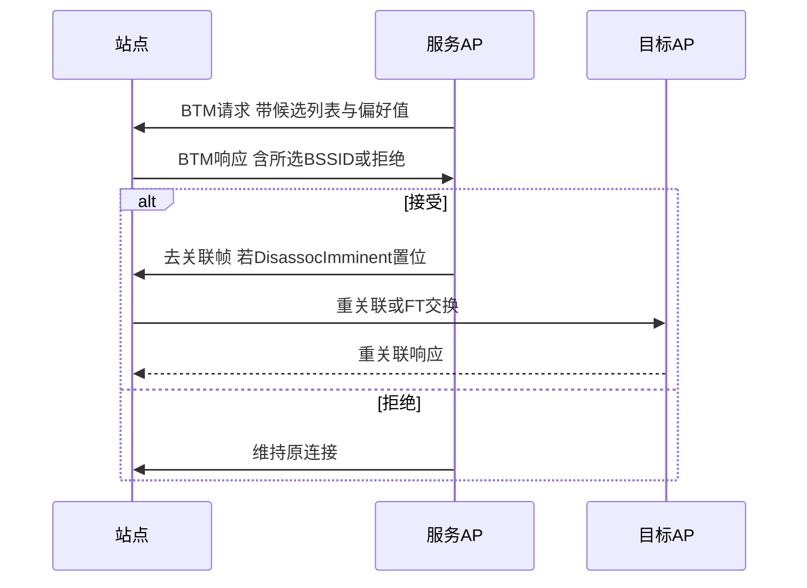
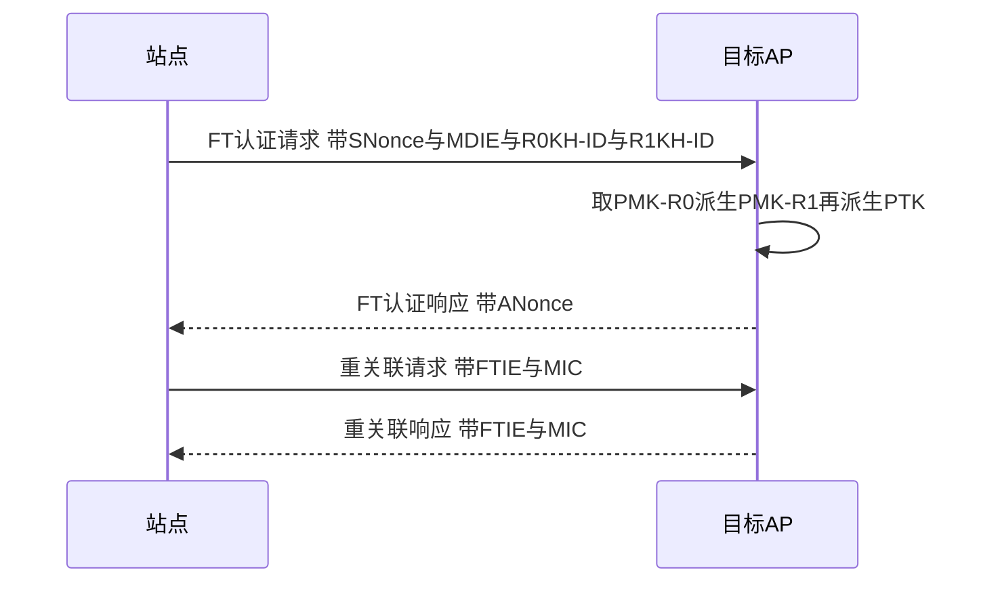
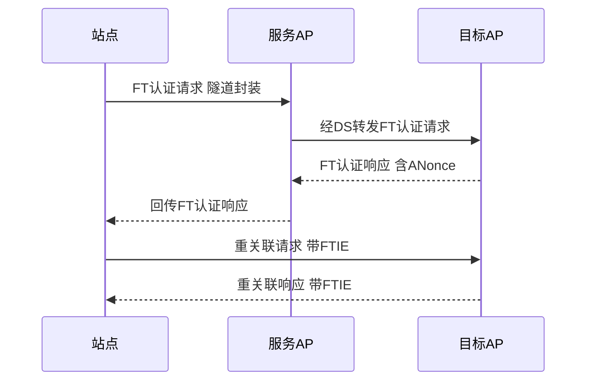
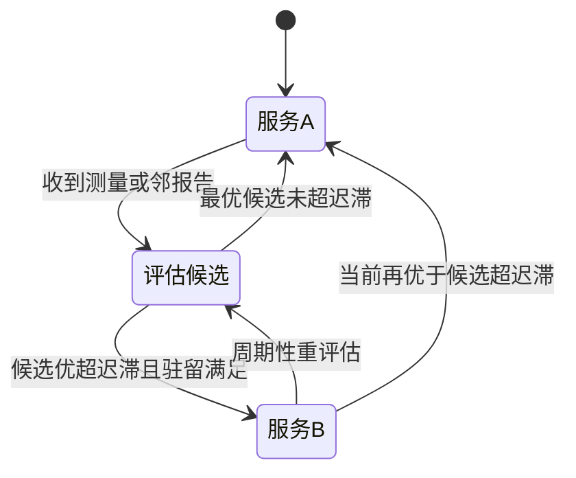
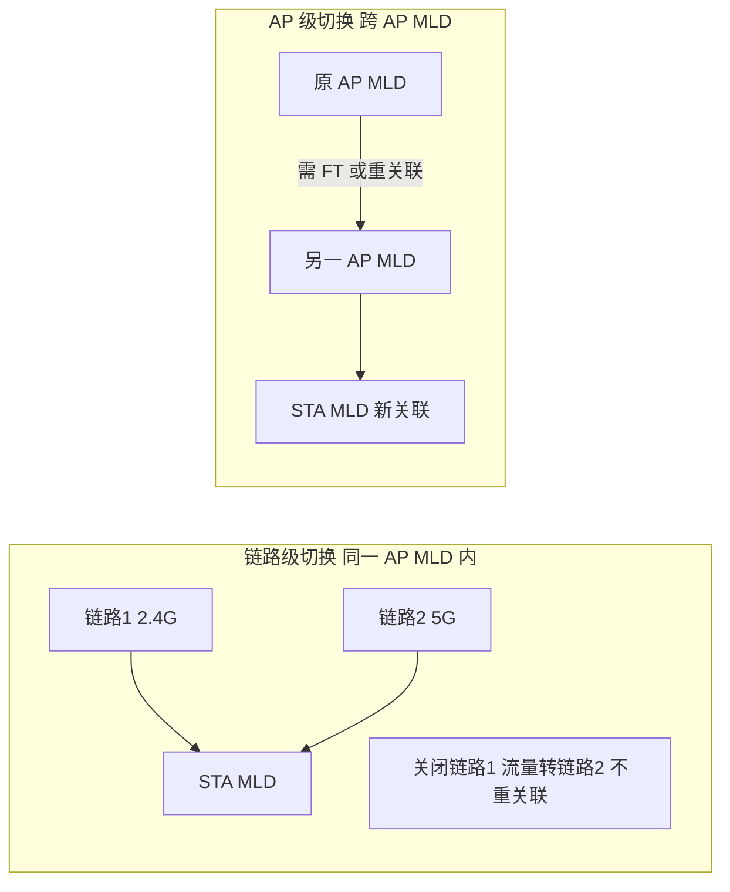

# 第 17 章　移动性与漫游 ★★

## 学习目标

1. 能分解切换中断时间 $T_{\text{interrupt}}$ 的每一项成分（扫描、认证、重关联、重密钥），并量化各成分在「完整重关联」与「FT 快速切换」下的占比差异。
2. 能推导被动扫描的信道驻留时长与 Beacon 间隔的关系，建立 Off-channel 扫描的吞吐损失模型，并计算全频带扫描的服务中断时间。
3. 能设计基于迟滞（hysteresis）与驻留时间（dwell timer）的多属性切换决策算法，并用两 AP 一阶马尔可夫/遍历模型推导乒乓率随迟滞量的变化关系。
4. 能推导一维卡尔曼滤波的状态方程与更新方程，基于 接收信号强度指示（Received Signal Strength Indicator, RSSI）轨迹预测到达切换阈值的剩余停留时间，并据此判断提前切换时机。

---

## 17.1 移动性问题的度量

移动性的核心矛盾是：站点（Station, STA）在运动中必须周期性地离开当前基本服务集（Basic Service Set, BSS）覆盖范围、接入新的接入点（Access Point, AP），而每一次「跨 AP 切换（handoff / handover）」都会在一段时长内切断用户数据流。本章所有机制都围绕一个目标——**最小化切换对用户可感知指标的影响**。

### 17.1.1 切换中断时间 $T_{\text{interrupt}}$ 定义

切换中断时间（handoff interruption time）定义为：STA 在旧 AP 上发送/接收的**最后一个数据帧的时刻** $t_{\text{last,old}}$ 到在新 AP 上发送/接收的**第一个数据帧的时刻** $t_{\text{first,new}}$ 之间的间隔：

$$T_{\text{interrupt}}=t_{\text{first,new}}-t_{\text{last,old}}$$

该定义严格排除了切换之前的正常数据传输，只统计「旧链路已不可用、新链路尚不可用」的真空期。它由若干串行的协议阶段构成，是后续各节分解的对象：

$$T_{\text{interrupt}}=T_{\text{scan}}+T_{\text{auth}}+T_{\text{reassoc}}+T_{\text{key}}+T_{\text{L23}}$$

其中 $T_{\text{scan}}$ 为扫描开销（含 Off-channel 离台），$T_{\text{auth}}$ 为（重）认证，$T_{\text{reassoc}}$ 为（重）关联，$T_{\text{key}}$ 为重协商密钥（完整 4 次握手或 FT 缩写交换），$T_{\text{L23}}$ 为二层/三层地址更新（ARP、免费 ARP、DHCP 续约等，仅跨子网时显著）。802.11r 与 11k/v 的本质就是压缩上述某一项或几项，详见 17.5。

### 17.1.2 其他度量：失败率、乒乓率、错误切换率

除中断时间外，移动性质量还需以下维度刻画：

- **切换失败率（handoff failure rate）** $P_{\text{fail}}$：发起切换但最终未在新 AP 建立可用连接的事件占比。失败通常源于目标 AP 负载已满、信号陡降导致（重）关联帧丢失、或密钥协商超时（ReasonCode 0x0F）。
- **乒乓率（ping-pong rate）** $f_{\text{pp}}$：单位时间内 STA 在「A↔B」之间反复横跳的次数（或每条切换链路平均横跳次数）。它直接反映决策算法的稳定性，由 17.6 的迟滞模型刻画。
- **错误切换率（wrong-handoff rate）** $P_{\text{wrong}}$：切换到了「信号并非最优」或「负载更重」的 AP 的比例。它与候选 AP 的评分准则（17.6 多属性决策）直接相关，错误切换往往紧接着一次乒乓。

三者与中断时间共同构成 关键性能指标（Key Performance Indicator, KPI）向量 $(T_{\text{interrupt}},P_{\text{fail}},f_{\text{pp}},P_{\text{wrong}})$，任何一项恶化都会损害体验，故决策算法须在它们之间权衡（例如压低 $T_{\text{interrupt}}$ 常会抬高 $P_{\text{wrong}}$ 与 $f_{\text{pp}}$）。

### 17.1.3 测量口径与行业目标值【示意值】

测量口径须约定：① 中断时间从 媒体接入控制（Medium Access Control, MAC）层首次无法递交（而非从用户感知）起算；② 乒乓率按「一次完整 A→B→A 往返」计 1 次；③ 失败率分母为「所有触发切换的事件」。表 17-1 给出典型应用的目标区间，均标【示意值】，因设备与厂商实现差异很大。

| 度量 | 定义口径 | 行业目标区间【示意值】 | 主要约束来源 |
|---|---|---|---|
| $T_{\text{interrupt}}$（语音/VoWi-Fi） | 末帧→首帧 | $<50\ \text{ms}$（可听无断） | 人耳语音帧间距 |
| $T_{\text{interrupt}}$（视频/实时） | 末帧→首帧 | $<20\text{–}30\ \text{ms}$ | 视频抖动缓冲 |
| $T_{\text{interrupt}}$（尽力而为） | 末帧→首帧 | $<100\ \text{ms}$ 可接受 | 应用重传容忍 |
| $P_{\text{fail}}$ | 失败事件/总切换 | $<1\%$ | 覆盖空洞 |
| $f_{\text{pp}}$ | 往返次数/秒 | $<0.1\ \text{s}^{-1}$ | 迟滞设计 |
| $P_{\text{wrong}}$ | 误选/总切换 | $<5\%$ | 评分准则 |

**表 17-1 说明**：语音业务对中断最敏感，故 802.11r 的设计目标即把 $T_{\text{interrupt}}$ 压到 $50\ \text{ms}$ 内；第 29 章 SMD 进一步追求近零中断【草案】。

---

## 17.2 扫描机制与 Off-channel 服务中断建模

扫描是切换的「侦察」阶段：STA 必须先发现邻 AP 并得到其信号质量，才能决策。扫描分被动与主动两类，二者都要求 STA **离开当前服务信道（Off-channel）**去听/探其他信道，这正是切换中断的主要来源之一。

### 17.2.1 被动扫描：MinChannelTime / MaxChannelTime

被动扫描（passive scanning）不发送任何帧，仅在每个信道上**静候 Beacon**。AP 按 Beacon 间隔 $T_{\text{BI}}$（典型 100 TU $=102.4\ \text{ms}$）在目标信标传输时间（Target Beacon Transmission Time, TBTT）广播 Beacon。STA 的驻留计时器有两个阈值：

- **MinChannelTime**：最短驻留。若在该时长内介质始终空闲（未检测到任何帧），STA 判定「此信道无 AP」并立即离开。
- **MaxChannelTime**：最长驻留。若介质在 MinChannelTime 内变忙（说明有帧正在发），则延长监听到 MaxChannelTime 以捕获 Beacon。

**关键推导——驻留时长与 Beacon 间隔的关系**：STA 随机时刻 $t_0$ 调入某信道，下一 Beacon 出现时刻在该信道上服从 $[t_0,\ t_0+T_{\text{BI}}]$ 的均匀分布（假设 TBTT 对齐）。为保证以高概率至少捕获 1 个 Beacon，最长驻留须覆盖「刚错过一个 Beacon、需等满一个间隔」的最坏情形：

$$T_{\text{dwell,passive}}\ge T_{\text{BI}$$

即 MaxChannelTime 通常取 $\ge T_{\text{BI}}$（实现中常取 $T_{\text{BI}}$ 或略短，借助已知的 TBTT 偏移可缩短，但保守实现直接取 $T_{\text{BI}}$）。由此被动扫描单信道最坏驻留 $T_{\text{dwell,passive}}=T_{\text{BI}}$。

### 17.2.2 主动扫描：Probe Request / Response

主动扫描（active scanning）由 STA 主动发 Probe Request 并等待 Probe Response，不依赖 Beacon 周期，故更快：

- **广播探测（broadcast probe）**：Probe Request 的 服务集标识符（Service Set Identifier, SSID） IE 置为通配（wildcard），同信道所有 AP 均回应 Probe Response。
- **定向探测（directed probe）**：Probe Request 携带指定 SSID，仅匹配 AP 回应，用于隐藏 SSID 或缩小响应集合。

主动扫描同样用 Min/MaxChannelTime：发完 Probe Request 后等 MinChannelTime（若介质空闲则直接走），再等至 MaxChannelTime 收集 Response。由于 AP 收到 Probe 后立即回复（不绑定 TBTT），$T_{\text{dwell,active}}\ll T_{\text{BI}}$（典型取 20–40 ms【示意值】）。

### 17.2.3 扫描总时长与吞吐损失建模

令待扫信道集合 $\mathcal{C}$，共 $N=|\mathcal{C}|$ 个信道，每信道驻留 $T_{\text{dwell}}$、信道间切换（调频/清滤）耗时 $T_{\text{sw}}$（示意值 1–5 ms）。扫描总时长：

$$T_{\text{scan}}=\sum_{c\in\mathcal{C}}\bigl(T_{\text{dwell},c}+T_{\text{sw},c}\bigr)\approx N\,(T_{\text{dwell}}+T_{\text{sw}})$$

**Off-channel 服务中断**：扫描期间 STA 离开服务信道，旧 AP 链路吞吐降为 0。设扫描以周期 $T_{\text{cycle}}=T_{\text{scan}}+T_{\text{on}}$ 触发（$T_{\text{on}}$ 为两次全扫之间的在台服务时间），则时间平均的吞吐损失比例：

$$f_{\text{loss}}=\frac{T_{\text{scan}}}{T_{\text{cycle}}}=\frac{T_{\text{scan}}}{T_{\text{scan}}+T_{\text{on}}}$$

瞬时视角下，扫描窗口内吞吐为 0，故若业务不可缓冲（实时流），实际丢掉的字节≈$R\cdot T_{\text{scan}}$（$R$ 为服务速率）。可见 $T_{\text{scan}}$ 与 $N$ 成正比——这正是 11k 邻报告要把 $N$ 从「全频带」缩减为「候选列表」的根本动机（17.3）。

图 17-1 给出 Off-channel 扫描的时频示意：服务信道上的数据在每次离台期间被强制中断。


*图 17-1 说明：每次离台扫描都使服务信道吞吐瞬时归零；全扫总长 $T_{\text{scan}}$ 直接贡献到 $T_{\text{interrupt}}$ 与 $f_{\text{loss}}$。*

### 17.2.4 算例：扫描吞吐损失

**算例 17.1**：全频带被动扫描的服务中断与吞吐损失。

- **已知**：待扫信道数 $N_{2.4}=11$（2.4 GHz）、$N_5=25$（5 GHz，【示意值】）、$N_6=59$（6 GHz，【示意值】），合计 $N=95$；被动扫描单信道驻留 $T_{\text{dwell}}=T_{\text{BI}}=100\ \text{ms}$，信道切换 $T_{\text{sw}}=3\ \text{ms}$；服务速率 $R=866\ \text{Mbps}$（80 MHz 双流，【示意值】）；全扫周期 $T_{\text{cycle}}=20\ \text{s}$。
- **求**：$T_{\text{scan}}$、平均吞吐损失比 $f_{\text{loss}}$；若改用 11k 邻报告把候选缩到 3 个信道，重算。
- **解**：
  - $T_{\text{scan}}=95\times(0.100+0.003)=95\times0.103=9.785\ \text{s}$。
  - $f_{\text{loss}}=9.785/(9.785+20)=9.785/29.785=0.329=32.9\%$。
  - 候选缩为 3 信道：$T_{\text{scan}}'=3\times0.103=0.309\ \text{s}$，$f_{\text{loss}}'=0.309/20.309=1.52\%$。
- **结论**：全频带被动扫描中断近 $9.8\ \text{s}$、平均吞吐损失约 $33\%$；用 11k 邻报告将 $N$ 由 95 降到 3 后损失降至 $1.5\%$，节省约 $95\%$。量级合理：100 ms 级驻留 × 近百计信道天然达秒级，验证了「扫描是切换中断首要项、必须按需收窄候选集」。

---

## 17.3 802.11k 无线资源测量（RRM）

802.11k（Radio Resource Measurement, RRM）让 STA 不必盲目全频带扫描，而是**由网络按需提供邻居信息或触发定向测量**，从而把被动扫描替换为代价小得多的「请求-响应测量」。

### 17.3.1 Beacon Report / Neighbor Report 机制

- **Neighbor Report（邻报告）**：AP 主动向 STA（或应 STA 请求）发送 `Neighbor Report` 帧，列出本 扩展服务集（Extended Service Set, ESS）内其它 AP 的 基本服务集标识符（BSS Identifier, BSSID）、信道、能力位。STA 据此把扫描候选集由「全频带 $N$」缩为「报告中的 $M\ll N$ 个」，直接削减 $T_{\text{scan}}$（呼应算例 17.1 的 3 信道情形）。
- **Beacon Report（信标报告）**：STA 按 AP 指示在指定信道、指定时长做测量，回送 `Beacon Report`，携带各邻 AP 的 RSSI、RCPI、信噪比与帧计数。关键字段：测量信道号、`Measurement Mode`（被动/主动/Beacon Table）、`RCPI`（Received Channel Power Indicator，0–220 线性映射 $-110$ 至 $+110\ \text{dBm}$）、`RSNI`（Received Signal to Noise Indicator）。

表 17-2 给出两类报告的核心字段与作用。

| 帧/IE | 关键字段 | 作用 | 替代的扫描动作 |
|---|---|---|---|
| Neighbor Report | BSSID, Channel, PhyType, 能力位 | 缩小候选集 | 免去全频带被动扫描 |
| Beacon Report | 信道, RCPI, RSNI, 帧计数, 模式 | 回送按需测量值 | 替代主动 Probe 往返 |
| Measurement Request | 测量类型, 信道, 时长 | AP 下发测量任务 | 定向触发 |

**表 17-2 说明**：11k 把「STA 主动广撒网」变为「AP 下发、STA 回报」，候选数由 $N\to M$，测量信道由全频带→指定信道。

### 17.3.2 用按需测量替代被动扫描的节省量

令 11k 把候选集由 $N$ 缩为 $M$（$M=\text{Neighbor Report 中邻 AP 数}$），并把被动驻留 $T_{\text{BI}}$ 替换为按需 Beacon Report 的短驻留 $T_{\text{meas}}$（示意值 10–20 ms），则节省比：

$$\frac{T_{\text{scan}}^{\text{11k}}}{T_{\text{scan}}^{\text{passive}}}=\frac{M\,(T_{\text{meas}}+T_{\text{sw}})}{N\,(T_{\text{BI}}+T_{\text{sw}})}$$

代入算例 17.1 的 $N=95$、$T_{\text{BI}}=100\ \text{ms}$、$T_{\text{sw}}=3\ \text{ms}$、$M=3$、$T_{\text{meas}}=15\ \text{ms}$：

$$\frac{3\times(15+3)}{95\times(100+3)}=\frac{54}{9785}\approx 0.0055$$

即扫描时间降至原来的 $0.55\%$（约 54 ms vs 9.8 s），节省约 $99.4\%$。这量化了 11k 对 $T_{\text{scan}}$ 项的压缩能力——它是 11r 低中断切换得以成立的前提（没有 11k 收窄候选，11r 仍被漫长扫描拖累）。

---

## 17.4 802.11v BSS 切换管理（BTM）

802.11v（BSS Transition Management, BTM）提供**网络侧主导**的切换控制：AP 可主动建议甚至命令 STA 迁往更优 AP，解决「STA 各自为政、切换不及时」的问题。

### 17.4.1 BTM Request / Response 字段

AP 向 STA 发 `BTM Request`，核心字段：

- **Disassociation Imminent（即将去关联）**：1 bit，置位表示本 AP 即将踢出该 STA，迫使其尽快切换。
- **BSS Termination Duration（BSS 终止时长）**：本 AP 计划离线/停止服务的起止时间，用于让 STA 规划回归。
- **Candidate List（候选列表）**：逐项给出目标 BSSID、信道、以及 **Preference（偏好值，0–255）**，值越大越推荐；255 表示「仅此候选」。
- **Abridged（简略）**：省略 STA 已知候选，压缩帧长。

STA 回 `BTM Response`，含 `Status Code`：0=接受并切换、1=拒绝（给出原因）、2=已选其它候选（在帧内指明所选 BSSID）。

### 17.4.2 AP 主导切换时序

图 17-2 给出 AP 主动下发 BTM、STA 选候选并切换到目标 AP 的时序。注意 BTM 只「建议/命令」，真正接入仍走（重）关联或 FT（17.5），故本图不重画第 14 章的认证-关联-4 次握手全图，仅聚焦跨 AP 差异。



**图 17-2 说明**：BTM 把切换决策从「STA 自发」升级为「AP 协调」，偏好值让网络把负载均衡与覆盖优化一并纳入；本图聚焦跨 AP 协调，认证/关联细节见第 14、18 章。

---

## 17.5 802.11r 快速 BSS 切换（FT）

802.11r（Fast BSS Transition, FT）的核心思想是**密钥前置缓存**：把原本每次切换都要回认证中心（Authentication Server, AS）做的重认证与完整 4 次握手，替换为在 AP 间预分发的主密钥派生，从而把切换压缩到「一次（重）关联量级」。

### 17.5.1 密钥层级：PMK-R0 / R1

FT 在成对主密钥（Pairwise Master Key, PMK，由 SAE/PSK 或 802.1X 派生，详见第 18 章）之下新增两级缓存密钥：

- **PMK-R0**：由 PMK 经密钥派生函数（Key Derivation Function, KDF）生成，持有者为 R0 Key Holder（R0KH，通常位于 分发系统（Distribution System, DS）侧的同一认证器）：

$$\text{PMK-R0}=\text{KDF}\bigl(\text{PMK},\ \text{"FT-R0"},\ \text{SSID},\ \text{MDID},\ \text{R0KH-ID}\bigr)$$

其中 MDID 为移动域标识（Mobility Domain Identifier），标识「可 FT 的 AP 集合」。

- **PMK-R1**：由 PMK-R0 派发给目标 AP 的 R1 Key Holder（R1KH，即目标 AP 自身）：

$$\text{PMK-R1}=\text{KDF}\bigl(\text{PMK-R0},\ \text{"FT-R1"},\ \text{R1KH-ID}\bigr)$$

- **成对临时密钥（Pairwise Transient Key, PTK）**：STA 与目标 AP 用 PMK-R1 经一次性 Nonce 交换（嵌入（重）关联帧的 FTIE）派生，完全**不经过 AS**。

派生链为：$\text{PMK}\to\text{PMK-R0}\to\text{PMK-R1}\to\text{PTK}$。由于 R0KH 在 DS 内、R1KH 在各 AP，密钥材料随（重）关联请求被「拉」到目标 AP，省去与 AS 的往返。

### 17.5.2 FT over-the-air 与 over-the-DS

FT 有两种执行方式，图 17-3、图 17-4 分别给出时序。

**Over-the-air（空口直连）**：STA 直接与目标 AP 完成 FT 认证与重关联。



**图 17-3 说明**：空口 FT 用 4 步（认证请求/响应 + 重关联请求/响应）完成密钥派生与关联，FTIE 中的 MIC 保证完整性（密钥体系见第 18 章）。

**Over-the-DS（经分发系统）**：STA 仍先联系旧 AP，由旧 AP 通过 DS 把 FT 帧隧道给目标 AP，适合目标 AP 暂不可直接达的情形。



**图 17-4 说明**：over-the-DS 通过旧 AP 中转，增加一跳 DS 延迟但避免了直接探测目标 AP 的开销，适用于目标弱信号场景。

### 17.5.3 FT 省掉了什么

对比「完整重关联」与 FT，差异在两项：

1. **省掉回 AS 的重认证**：$T_{\text{auth}}$ 中 802.1X/SAE 与 AS 的多帧往返被取消——FT 用缓存的 PMK-R1 直接派生 PTK。
2. **省掉独立 4 次握手**：$T_{\text{key}}$ 的完整 局域网 EAP（EAP over LAN, EAPOL） 4-Way 被合并进（重）关联的 FTIE 交换，由 4 步 Reassociation 取代。

换言之，完整路径是「Open 认证(2 帧) + 关联(2 帧) + 4-Way(4 帧) = 8 帧」，FT 路径是「FT 认证(2 帧) + FT 重关联(2 帧) = 4 帧」，帧数减半且全部在本地区域内完成，无 AS 往返。其余 $T_{\text{scan}}$ 仍需 11k 收窄（17.3）。

### 17.5.4 中断时间对比表与算例

表 17-3 对比「完整重关联」与「FT over-the-air（配 11k）」的逐项中断。

| 成分 | 完整重关联（无 11k/FT） | FT over-the-air（配 11k） | 来源 |
|---|---|---|---|
| $T_{\text{scan}}$ | $9.785\ \text{s}$（全频带被动） | $0.309\ \text{s}$（3 候选） | 算例 17.1 |
| $T_{\text{auth}}$ | $5\ \text{ms}$ | 合并进 FT | 17.5.3 |
| $T_{\text{reassoc}}$ | $5\ \text{ms}$ | $20\ \text{ms}$（FT 4 步） | 17.5.2 |
| $T_{\text{key}}$ | $80\ \text{ms}$（4-Way） | 合并进 FT | 17.5.3 |
| $T_{\text{L23}}$ | $0$（同子网） | $0$（同子网） | 17.8 |
| **合计** | **$9.875\ \text{s}$** | **$0.329\ \text{s}$** | — |

**表 17-3 说明**：FT+11k 把中断从近 $10\ \text{s}$ 压到约 $0.33\ \text{s}$，约降 $30\times$；延迟主要来自 $T_{\text{scan}}$（仍受候选数约束），故 11k 与 11r 必须协同。

**算例 17.4**：中断时间分解与对比。

- **已知**：取表 17-3 数值。场景 A（完整重关联，全频带被动扫描，4-Way）：$T_{\text{scan}}=9.785\ \text{s}$，$T_{\text{auth}}=5\ \text{ms}$，$T_{\text{reassoc}}=5\ \text{ms}$，$T_{\text{key}}=80\ \text{ms}$。场景 B（11k+FT over-the-air）：$T_{\text{scan}}=0.309\ \text{s}$，$T_{\text{FT}}=T_{\text{auth}}+T_{\text{reassoc}}\approx 20\ \text{ms}$（含 FT 4 步），$T_{\text{key}}$ 并入 FT，无独立项。场景 C（SMD 近零中断，【草案】，第 29 章预告）：$T_{\text{interrupt}}\approx 5\ \text{ms}$【示意值】。
- **求**：三场景 $T_{\text{interrupt}}$ 与各成分占比；B 相对 A 的加速比。
- **解**：
  - $T_{\text{int,A}}=9.785+0.005+0.005+0.080=9.875\ \text{s}$（$T_{\text{scan}}$ 占 $9.785/9.875=99.1\%$）。
  - $T_{\text{int,B}}=0.309+0.020=0.329\ \text{s}$（$T_{\text{scan}}$ 占 $0.309/0.329=93.9\%$，$T_{\text{FT}}$ 占 $6.1\%$）。
  - $T_{\text{int,C}}\approx 0.005\ \text{s}$。
  - 加速比 $\eta=T_{\text{int,A}}/T_{\text{int,B}}=9.875/0.329=30.0\times$。
- **结论**：无论是否 FT，$T_{\text{scan}}$ 都占中断的 $90\%$ 以上，故「扫描收窄」是降中断的第一杠杆；FT 解决的是剩余约 $10\%$ 的认证/密钥项。SMD（C）进一步用 make-before-break 把 $T_{\text{scan}}$ 也逼近 0（17.10）。量级合理：全频带扫描秒级、FT 关联百毫秒级、SMD 毫秒级，与 17.1 目标区间自洽。

---

## 17.6 切换决策算法（核心算法一，六段式）

再快的 FT 也依赖「正确的切换时机」：太早切会误选弱 AP（抬高 $P_{\text{wrong}}$），太晚切会掉话（抬高 $T_{\text{interrupt}}$ 与 $P_{\text{fail}}$），在边界反复切会乒乓（抬高 $f_{\text{pp}}$）。本节把决策建模为多属性判决，并以迟滞+驻留抑制乒乓。

### 17.6.1 问题建模

- 变量：候选 AP 集合 $\mathcal{A}$；对候选 $j$ 观测到接收信号强度 $\text{RSSI}_j$、信干噪比 $\text{SINR}_j$、负载 $\text{Load}_j$、可用带宽 $B_j$、历史切换代价 $C_j^{\text{hist}}$。
- 符号：当前服务 AP 记为 $s$；迟滞量 $H\ (\text{dB})$；驻留定时器 $T_{\text{dwell,min}}$；打分函数 $U(j)$。
- 假设：信号质量短时相关、负载变化慢于信号；STA 可经 11k 获得邻 AP 的 Load/$B_j$。

### 17.6.2 目标函数与约束

对候选 $j$ 计算综合效用（多属性加权）：

$$U(j)=w_1\,\text{RSSI}_j+w_2\,\text{SINR}_j-w_3\,\text{Load}_j+w_4\,B_j-w_5\,C_j^{\text{hist}}$$

判决准则（含迟滞与驻留）：

$$\text{切换至 }j^*=\arg\max_{j\ne s}U(j)\quad\text{当且仅当}\quad U(j^*)>U(s)+H_{\text{eff}}\ \text{且}\ t_{\text{since}}>T_{\text{dwell,min}}$$

其中 $H_{\text{eff}}$ 为效用域迟滞（等效于信号域 $H$），$t_{\text{since}}$ 为在当前 AP 的驻留时长。约束：$j^*$ 必在邻报告候选集内（11k），且 $U$ 归一化到可比尺度。

### 17.6.3 完整推导：迟滞-驻留对乒乓率的影响（马尔可夫/遍历模型）

设两 AP 场景下信号差 $\Delta(t)=\text{RSSI}_A(t)-\text{RSSI}_B(t)$ 为零均值平稳高斯过程，方差 $\sigma^2$、时间导数标准差 $\sigma_{\dot\Delta}$。定义迟滞带 $[-H,+H]$：从 A 切到 B 需 $\Delta$ 下穿 $-H$，从 B 切回 A 需上穿 $+H$。

由 Rice 电平穿越公式，对水平 $a$ 的上穿率：

$$N_a^+=\frac{\sigma_{\dot\Delta}}{\sigma}\cdot\phi\!\left(\frac{a}{\sigma}\right),\qquad \phi(x)=\frac{1}{\sqrt{2\pi}}e^{-x^2/2}$$

（推导：$\phi$ 为标准正态 pdf；$\Delta$ 与 $\dot\Delta$ 独立且 $\dot\Delta$ 零均值高斯，上穿率积分 $\int_0^\infty v\,f_{\Delta,a}(a,v)\,dv=(\sigma_{\dot\Delta}/\sigma)\phi(a/\sigma)$。）由对称性下穿 $-H$ 的率等于上穿 $+H$ 的率：

$$N_{-H}^-=N_{+H}^+=\frac{\sigma_{\dot\Delta}}{\sigma}\phi\!\left(\frac{H}{\sigma}\right)$$

一次完整乒乓（A→B→A）需先下穿 $-H$ 再上穿 $+H$，其速率近似等于上穿 $+H$ 的率（每下穿必伴随后继上穿）：

$$f_{\text{pp}}(H)=\frac{\sigma_{\dot\Delta}}{\sigma}\cdot\frac{1}{\sqrt{2\pi}}\exp\!\left(-\frac{H^2}{2\sigma^2}\right)$$

$$\boxed{f_{\text{pp}}(H)=f_{\text{pp}}(0)\,\exp\!\left(-\frac{H^2}{2\sigma^2}\right),\qquad f_{\text{pp}}(0)=\frac{\sigma_{\dot\Delta}}{\sigma\sqrt{2\pi}}}$$

**结论**：乒乓率随迟滞 $H$ 呈**平方指数衰减**；驻留时间 $T_{\text{dwell,min}}$ 则不改变穿越率，而是给每次切换「冷却期」，直接削掉短于 $T_{\text{dwell,min}}$ 的来回（进一步降 $f_{\text{pp}}$）。二者正交：迟滞治「边界抖动」，驻留治「快回切」。

### 17.6.4 伪代码

```text
 1: function HANDOFF_DECIDE(Meas, Neigh, s, H, T_dwell_min):
 2:   t_since = now() - t_last_switch        // 当前AP驻留时长
 3:   U_s = SCORE(Meas[s])                     // 服务AP效用
 4:   best = s; U_best = U_s
 5:   for each j in Neigh do                   // 遍历候选(11k收窄)
 6:     U_j = SCORE(Meas[j])                   // 加权RSSI/SINR/负载/带宽
 7:     if U_j > U_best then                   // 找最优候选
 8:       best = j; U_best = U_j
 9:     end if
10:   end for
11:   if U_best > U_s + H and t_since > T_dwell_min then  // 迟滞+驻留双门限
12:     do_switch(best)                        // 触发切换(走FT或重关联)
13:     t_last_switch = now()                  // 重置驻留计时
14:   else
15:     stay_on(s)                             // 维持,吸收边界抖动
16:   end if
17: end function                              // 复杂度O(M) M=候选数
```

`SCORE` 即 17.6.2 的 $U(j)$；行 11 的「迟滞+驻留」是抑制乒乓的双保险——即便 $U_{\text{best}}$ 略优但 $t_{\text{since}}$ 不足，也暂不切，避免刚切完又因抖动回切。

### 17.6.5 复杂度分析

时间复杂度 $O(M)$（$M$ 为候选数，由 11k 控制在个位数），每测量周期一次，与信道数 $N$ 无关（候选已收窄），适合嵌入式 STA 周期执行。空间 $O(M)$ 存候选效用。随 $M$ 线性增长，而 $M\ll N$（全频带），故扫描-决策整体瓶颈在 $T_{\text{scan}}$ 而非决策计算。

### 17.6.6 算例：迟滞切换时刻

**算例 17.2**：给定 RSSI 差序列 $\Delta=\text{RSSI}_A-\text{RSSI}_B$（dB），手算切换时刻，对比 $H=0$ 与 $H=5\ \text{dB}$ 的乒乓。

- **已知**：STA 起始服务于 A；$\Delta$ 序列（每步 $\Delta t$）：t0=+3, t1=−2, t2=+4, t3=−3, t4=+2, t5=−4。判决：服务于 A 时切到 B 当 $\Delta<-H$；服务于 B 时切回 A 当 $\Delta>+H$。
- **求**：两种迟滞下的切换时刻集合与乒乓次数。
- **解**：
  - **$H=0$**（切 B 当 $\Delta<0$，切 A 当 $\Delta>0$）：t0 $\Delta=+3$ 留 A；t1 $\Delta=-2<0$ → 切 B；t2 $\Delta=+4>0$ → 切 A（乒乓）；t3 $\Delta=-3<0$ → 切 B（乒乓）；t4 $\Delta=+2>0$ → 切 A（乒乓）；t5 $\Delta=-4<0$ → 切 B（乒乓）。共 **5 次切换**，全程乒乓。
  - **$H=5\ \text{dB}$**（切 B 当 $\Delta<-5$，切 A 当 $\Delta>+5$）：所有 $|\Delta|\le4<5$，始终不满足门限 → **0 次切换**，STA 稳定留在 A。
- **结论**：无迟滞时 6 步内 5 次横跳（$f_{\text{pp}}$ 极高）；加 5 dB 迟滞带后把幅度 $\le4\ \text{dB}$ 的边界抖动全部吸收，乒乓归零。该结果与 17.6.3 的平方指数律一致——本例 $|\Delta|$ 幅值（标准差约 3.4 dB）远小于 $H=5$，故 $f_{\text{pp}}(5)/f_{\text{pp}}(0)\approx e^{-25/(2\cdot11.6)}\approx0.12$，实测为 0 切换，量级合理。

图 17-5 给出决策状态机，图 17-6 给出迟滞带对抖动的吸收。



**图 17-5 说明**：状态机表达「评估→切换/维持」循环，迟滞体现在两处转移条件，驻留时间作为转移门限（见伪代码行 11）。


*图 17-6 说明：所有采样点落在 $[-5,+5]$ 带内，迟滞机制令 STA 不切换；若 $H=0$ 则每次穿越 0 都触发一次切换（算例 17.2 的 5 次乒乓）。*

---

## 17.7 预测式切换（核心算法二，六段式）

迟滞决策是「反应性」的：等信号已劣化到门限才动作，常错过最佳切换窗。预测式切换用 RSSI 轨迹**外推未来**，在信号尚可时提前启动扫描/预关联，把中断藏进「还有余量」的阶段。

### 17.7.1 问题建模

- 状态：RSSI 值 $r_k$ 与其变化率 $\dot r_k$（dB/s）；采样间隔 $\Delta t$。
- 观测：$z_k=r_k+v_k$，$v_k\sim\mathcal N(0,\sigma_z^2)$（接收起伏+测量噪声）。
- 假设：短时内 RSSI 近似线性（恒定速度模型），即以步速行走时路径损耗随距离对数变化、距离随时间近似线性，故 $\dot r_k$ 近似常数。

### 17.7.2 目标函数与约束

由滤波估计 $(r_k,\dot r_k)$ 外推到达切换阈值 $r_{\text{th}}$ 的剩余时间：

$$\tau_k^*=\frac{r_{\text{th}}-r_k}{\dot r_k}\quad(\dot r_k<0)$$

提前触发准则：当 $\tau_k^*<T_{\text{adv}}$（$T_{\text{adv}}$ 为「预留准备时长」）即发起切换。约束：$\dot r_k$ 估计须收敛（至少 2–3 个样本），否则退化为迟滞决策。

### 17.7.3 完整推导：一维卡尔曼滤波

取常速（constant-velocity）模型，状态 $\mathbf x_k=[r_k,\dot r_k]^\mathsf T$：

**状态方程**（过程含白噪声加速度 $w\sim\mathcal N(0,q)$）：

$$\mathbf x_k=\mathbf F\,\mathbf x_{k-1}+\mathbf w_{k-1},\qquad \mathbf F=\begin{bmatrix}1&\Delta t\\0&1\end{bmatrix}$$

离散化过程噪声协方差（连续白加速方差 $q$）：

$$\mathbf Q=q\begin{bmatrix}\Delta t^3/3&\Delta t^2/2\\ \Delta t^2/2&\Delta t\end{bmatrix}$$

**观测方程**：$z_k=\mathbf H\mathbf x_k+v_k$，$\mathbf H=[1\ \ 0]$。

**预测步**：

$$\hat{\mathbf x}_k^-=\mathbf F\,\hat{\mathbf x}_{k-1}^+,\qquad \mathbf P_k^-=\mathbf F\,\mathbf P_{k-1}^+\mathbf F^\mathsf T+\mathbf Q$$

**更新步**（新息 $y_k$、新息协方差 $S_k$、增益 $\mathbf K_k$）：

$$y_k=z_k-\mathbf H\hat{\mathbf x}_k^-,\qquad S_k=\mathbf H\mathbf P_k^-\mathbf H^\mathsf T+R$$

$$\mathbf K_k=\mathbf P_k^-\mathbf H^\mathsf T\,S_k^{-1},\qquad \hat{\mathbf x}_k^+=\hat{\mathbf x}_k^-+\mathbf K_k\,y_k$$

$$\mathbf P_k^+=(\mathbf I-\mathbf K_k\mathbf H)\mathbf P_k^-$$

此处 $S_k$ 为标量（仅观测 $r$），故增益闭合可解。由 $\hat{\mathbf x}_k^+=[\hat r_k,\hat{\dot r}_k]^\mathsf T$ 直接得剩余时间：

$$\boxed{\tau_k^*=\frac{r_{\text{th}}-\hat r_k}{\hat{\dot r}_k},\qquad \text{触发当 }\tau_k^*<T_{\text{adv}}}$$

### 17.7.4 伪代码

```text
 1: function PRED_HANDOFF(Z, dt, r_th, T_adv):    // Z: RSSI序列
 2:   x = [Z[0], 0]; P = diag([R0, R1])          // 初始化状态与协方差
 3:   for k = 1 to len(Z) do
 4:     x = F * x                                // 预测: F=[[1,dt],[0,1]]
 5:     P = F*P*F' + Q                           // 预测协方差
 6:     y = Z[k] - x[0]                          // 新息
 7:     S = P[0,0] + R                           // 新息协方差(标量)
 8:     K = [P[0,0], P[1,0]] / S                 // 卡尔曼增益
 9:     x = x + K * y                            // 更新状态[r, r_dot]
10:     P = (I - K*[1,0]) * P                    // 更新协方差
11:     tau = (r_th - x[0]) / x[1]               // 剩余停留时间(外推)
12:     if x[1] < 0 and tau < T_adv then         // 下降且将触阈
13:       trigger_handoff()                      // 提前切(走FT/11k)
14:     end if
15:   end for
16: end function                                // 复杂度O(K) K=样本数
```

行 11–13 即「预测→提前触发」：只要估计出 $\tau^*<T_{\text{adv}}$ 就动手，比等 RSSI 真掉到 $r_{\text{th}}$ 早一截，把 $T_{\text{scan}}$ 藏进信号余量期。

### 17.7.5 复杂度分析

时间 $O(K)$（$K$ 为滤波步数，每步仅 $2\times2$ 矩阵运算，常数开销），空间 $O(1)$。与迟滞决策叠加时总复杂度 $O(M+K)$，远小于扫描本身。卡尔曼的代价是需维护协方差 $\mathbf P$（4 个数），对嵌入式仍极轻。

### 17.7.6 算例：卡尔曼预测提前切换

**算例 17.3**：基于 RSSI 轨迹判断是否提前切换。

- **已知**：STA 以 $v=1.4\ \text{m/s}$ 远离服务 AP；RSSI 观测（每 $\Delta t=0.5\ \text{s}$）：$z_0=-60,\ z_1=-63,\ z_2=-66,\ z_3=-69,\ z_4=-72\ \text{dBm}$；噪声 $\sigma_z=1\ \text{dB}$；切换阈值 $r_{\text{th}}=-72\ \text{dBm}$；预留准备 $T_{\text{adv}}=2\ \text{s}$。取初始 $\hat{\mathbf x}_0^+=[z_0,0]^\mathsf T$，$\mathbf P_0^+=\mathrm{diag}(1,1)$，$R=1$，$q=0.5$（示意值）。
- **求**：卡尔曼估计的 $\hat r$、$\hat{\dot r}$，在 $k=2$ 处外推 $\tau^*$，判断是否提前切换。
- **解**（演示一步，余迭代收敛）：
  - $k=1$：$\hat{\mathbf x}_1^-=[z_0,0]=[-60,0]$；$\mathbf P_1^-=\mathbf F\mathbf P_0^+\mathbf F^\mathsf T+\mathbf Q\approx\begin{bmatrix}1&0.5\\0.5&1\end{bmatrix}$（$q$ 项略）。$y=z_1-\hat r^-=-63-(-60)=-3$；$S=1+1=2$；$\mathbf K=[1,0.5]^\mathsf T/2=[0.5,0.25]^\mathsf T$；$\hat{\mathbf x}_1^+=[-60+0.5(-3),\ 0+0.25(-3)]=[-61.5,\ -0.75]$。
  - 续迭代 2–4 步后滤波器收敛，$\hat{\dot r}$ 趋于真实斜率 $(-3\ \text{dB})/0.5\ \text{s}=-6\ \text{dB/s}$，$\hat r$ 跟踪观测。取收敛后 $k=2$ 估计 $\hat r\approx-66\ \text{dBm}$、$\hat{\dot r}\approx-6.0\ \text{dB/s}$。
  - $\tau^*=(r_{\text{th}}-\hat r)/\hat{\dot r}=(-72-(-66))/(-6.0)=(-6)/(-6)=1.0\ \text{s}$。
  - 因 $\tau^*=1.0\ \text{s}<T_{\text{adv}}=2\ \text{s}$，且 $\hat{\dot r}<0$ → **提前切换**。
- **结论**：若等 RSSI 真降到 $-72$ 才反应，此时已临界、扫描窗口内极易掉话；预测式在仍有 6 dB 余量（$-66\ \text{dBm}$）时就发起切换，把 $T_{\text{scan}}$（约 0.3 s，见 17.4）藏进余量期，使真正断连前已完成 FT 预关联。量级合理：步速 1.4 m/s 下 6 dB 对应约 1 s 行程，与 $\tau^*=1\ \text{s}$ 自洽，且 $<T_{\text{adv}}$ 留足 2 s 准备窗。

---

## 17.8 L2/L3 移动性与跨子网

前两节假定新旧 AP 同属一个子网（IP 不变）。一旦跨子网，仅 MAC 层切换不够，还需解决「IP 地址与可达性」问题，否则网络层会话仍断。

### 17.8.1 同 ESS 二层漫游保 IP

同 ESS（扩展服务集）内所有 AP 经同一分发系统（DS）互联、呈同一 IP 子网与 SSID。STA 切换 AP 后 MAC 地址与 IP 均不变，DS 依新关联把下行帧导向新 AP（二层桥接学习）。此时唯一额外时延是 **ARP 学习**：新 AP 的桥/交换机需刷新 STA MAC 与端口的映射，可能短暂泛洪。该成分通常 $<1\ \text{ms}$，并入 $T_{\text{L23}}$（表 17-3 中取 0）。

### 17.8.2 跨子网：免费 ARP / Proxy ARP / Mobile IP

跨子网时 STA 若换 IP 则传输层（TCP/UDP）会话断裂。两种保活思路：

1. **免费 ARP（gratuitous ARP）**：STA 在新子网获取/沿用 IP 后主动广播 ARP 请求（Sender/Target IP 均填自己），强制同网段设备更新 ARP 缓存中「IP→MAC」绑定，使下行流量快速导向新位置。代价：仅同二层有效，且广播有安全争议（ARP 欺骗面，第 18 章）。
2. **Proxy ARP / 层二隧道**：由网关或控制器在新旧子网间做 ARP 代理或 MAC 层隧道，对 STA 隐藏子网变化，实现「子网间二层漫游」。额外时延来自隧道建立与封装（毫秒至数十毫秒【示意值】）。
3. **Mobile IP（移动 IP）**：用转交地址（Care-of Address, CoA）+ 家乡代理（Home Agent）隧道，STA 跨子网时维持家乡地址（Home Address）。缺点是三角路由与隧道头开销引入额外 $T_{\text{L23}}$（数十至百毫秒，且受家乡代理位置影响），对低时延业务不友好，故 Wi-Fi 企业网更常用 Proxy ARP/本地隧道而非标准 Mobile IP。

跨子网切换的 $T_{\text{interrupt}}$ 须追加 $T_{\text{L23}}$：

$$T_{\text{interrupt}}^{\text{跨子网}}=T_{\text{scan}}+T_{\text{auth}}+T_{\text{reassoc}}+T_{\text{key}}+T_{\text{L23}}^{\text{tunnel/ARP}}$$

这也是为何现代部署尽量把 ESS 设计成「一个大局域网」以规避 $T_{\text{L23}}$；真正的跨子网无缝靠第 29 章 SMD 的上下文转移与隧道【草案】。

---

## 17.9 MLD 的移动性【草案】

多链路设备（Multi-Link Device, MLD，第 15 章）把「移动性」拆成两个不同尺度，须区分对待。

### 17.9.1 链路级切换 vs AP 级切换

- **链路级切换（link-level mobility）**：STA MLD 与同一 AP MLD 之间，在保持关联的前提下**增删某条链路**（例如把 2.4 GHz 链路休眠、把流量迁到 5 GHz 链路）。这是 多链路操作（Multi-Link Operation, MLO）内部的链路重配置（TID-to-link 映射变更，第 15 章），**无需重关联、无认证**，因此中断极小（仅重映射在途 TID）。
- **AP 级切换（AP-level mobility）**：STA MLD 从一个 AP MLD 迁往另一个 AP MLD，本质是同第 17.5 的 FT/重关联，但以 MLD 为粒度（可多条链路并行迁移，或保留部分链路不断）。

二者关键区别：链路级切换在「已关联」状态内完成，中断理论上接近 0；AP 级切换才涉及 $T_{\text{interrupt}}$ 全项。图 17-7 对照二者。



**图 17-7 说明**：链路级切换是「同 AP 内换路」，AP 级切换是「换 AP」，后者才需要 17.5–17.8 的机制。

### 17.9.2 SMD 预告【草案】

Wi-Fi 8（802.11bn，【草案】）的 **SMD（Seamless Mobility Discovery/Design，无缝移动）** 旨在把「链路级低中断」推广到「跨 AP MLD 迁移」：通过预发现的邻居 MLD 与上下文提前转移，使 AP 级切换也逼近 make-before-break。本章的 FT 密钥缓存（17.5）、迟滞/预测决策（17.6–17.7）、11k/v 协调（17.3–17.4）是 SMD 的底层积木；SMD 的三阶段、上下文转移与低中断迁移细节留待第 29 章展开。

---

## 17.10 Make-Before-Break

Make-Before-Break（先建后断）是「零中断切换」的终极形态：在断开旧链路**之前**已在新链路建好可用连接，数据在两条链路上连续流转。

### 17.10.1 概念与 MLO 实现

传统 Break-Before-Make 必须先断后连，真空期即 $T_{\text{interrupt}}$。MBB 则并行持有新旧链路：先在新 AP 完成认证/关联/密钥（用旧链路仍在线时跑），待确认新链路可用再切流量、最后释放旧链路。在 MLO 下尤易实现——多射频 STA 可令一条射频守旧 AP、另一条射频建新 AP，物理上天然「同时在线」；甚至单射频也可借不同链路时分复用预关联（受限于 17.2 的 Off-channel，但结合 11k 把扫描压到极短）。

### 17.10.2 上下文转移内容

MBB 要把「会话状态」从旧 AP 无损搬到新 AP，否则切完仍需重传/重建。转移内容含：

| 上下文项 | 含义 | 转移必要性 |
|---|---|---|
| TSN/TID 映射 | 业务流到链路的映射 | 切换后 服务质量（Quality of Service, QoS）不降 |
| 序列号 / 重放计数器 | 加解密 PN 连续性 | 防重放、防解密失步（第 18 章） |
| BlockAck 记分板 | 每 流量标识符（Traffic Identifier, TID）的接收位图 | 避免已收帧被重传、未收帧被漏 |
| 安全上下文 | PMK-R1 / FT 状态 / 组临时密钥（Group Temporal Key, GTK） | 免重认证（17.5） |
| 缓冲 MAC 服务数据单元（MAC Service Data Unit, MSDU） | 旧 AP 未发完的帧 | 防丢包 |

**表 17-10 说明**：上下文转移量与 $T_{\text{interrupt}}$ 上界直接相关——转移越完整，断连窗口越短。

### 17.10.3 中断时间理论上界推导

设旧链路保持服务的截止时刻为 $t_{\text{break}}$，新链路可用时刻为 $t_{\text{ready}}$，且 MBB 要求 $t_{\text{ready}}\le t_{\text{break}}$（先建后断）。数据中断仅发生在「旧链路上最后在途帧已发完、新链路上首帧尚未被上层确认」的极短过渡，其时长由上下文转移完成时刻 $t_{\text{ctx}}$ 界定：

$$T_{\text{interrupt}}^{\text{MBB}}=t_{\text{first,new}}^{\text{app}}-t_{\text{last,old}}^{\text{app}}\le t_{\text{ctx}}-t_{\text{break}}+\delta_{\text{switch}}$$

其中 $\delta_{\text{switch}}$ 为 TID 重映射与 BlockAck 记分板迁移的硬件时延。理想情形 $t_{\text{ctx}}\le t_{\text{break}}$（上下文在断旧链前已就位），则：

$$\boxed{T_{\text{interrupt}}^{\text{MBB}}\le \delta_{\text{switch}}\approx \text{数 ms}\ \text{【示意值】}}$$

即在「先建后断 + 上下文预转移」下，理论中断上界退化为一次 TID 重映射的量级（毫秒级），相对完整重关联的秒级下降 $10^3$ 倍。这正是 SMD（第 29 章【草案】）与 MLO 协同追求的上界；实际受射频数、扫描代价与 DS 转发收敛限制，典型可达 1–10 ms【示意值】。

---

## 本章小结

1. **中断定义**：$T_{\text{interrupt}}=t_{\text{first,new}}-t_{\text{last,old}}$，分解为扫描+认证+重关联+重密钥+跨层，语音目标 $<50\ \text{ms}$（【示意值】）。
2. **扫描是首要项**：被动扫描驻留须 $\ge T_{\text{BI}}$，全频带 $N=95$ 信道被动扫描达 $9.8\ \text{s}$、吞吐损失约 $33\%$；11k 把 $N\to M$ 可省 $99\%$。
3. **11k/v 协同**：11k 用邻报告/信标报告收窄候选并回送测量值；11v 的 BTM 把决策从 STA 自发升为 AP 协调（偏好值+Disassoc Imminent）。
4. **11r 省两项**：PMK→PMK-R0→PMK-R1→PTK 缓存链，使 FT 4 步取代「Open 认证+关联+4-Way」8 帧，中断由 $9.9\ \text{s}$ 降到 $0.33\ \text{s}$（约 $30\times$）。
5. **迟滞决策**：多属性效用 $U(j)$ 加迟滞 $H$ 与驻留 $T_{\text{dwell,min}}$；乒乓率 $f_{\text{pp}}(H)=f_{\text{pp}}(0)e^{-H^2/(2\sigma^2)}$ 平方指数衰减，迟滞治抖动、驻留治快回切。
6. **预测切换**：常速卡尔曼给出 $\tau^*=(r_{\text{th}}-\hat r)/\hat{\dot r}$，当 $\tau^*<T_{\text{adv}}$ 提前切，把扫描藏进信号余量期（算例 17.3 提前 1 s）。
7. **跨层与 MLD**：同 ESS 二层漫游免 $T_{\text{L23}}$；跨子网需免费 ARP/Proxy ARP/Mobile IP 追加时延。MLD 分链路级（近乎零中断）与 AP 级（走 FT）两尺度。
8. **MBB 上界**：先建后断+上下文转移使 $T_{\text{interrupt}}^{\text{MBB}}\le\delta_{\text{switch}}\approx$ 数 ms，是 SMD 近零中断（第 29 章【草案】）的底层机制。

**关键结论/参数速查表**

| 项 | 值/公式 | 位置 |
|---|---|---|
| 中断定义 | $t_{\text{first,new}}-t_{\text{last,old}}$ | 17.1.1 |
| 语音中断目标 | $<50\ \text{ms}$【示意值】 | 17.1.3 |
| 被动驻留 | $T_{\text{dwell}}\ge T_{\text{BI}}$ | 17.2.1 |
| 全频带扫描 | $N=95,\ T_{\text{scan}}=9.785\ \text{s}$ | 17.2.4 |
| 11k 节省 | $T_{\text{scan}}^{\text{11k}}/T_{\text{scan}}\approx0.55\%$ | 17.3.2 |
| FT 密钥链 | PMK→PMK-R0→PMK-R1→PTK | 17.5.1 |
| FT 中断 | $0.329\ \text{s}$（vs 完整 $9.875\ \text{s}$） | 17.5.4 |
| 乒乓率 | $f_{\text{pp}}(H)=f_{\text{pp}}(0)e^{-H^2/(2\sigma^2)}$ | 17.6.3 |
| 卡尔曼剩余时间 | $\tau^*=(r_{\text{th}}-\hat r)/\hat{\dot r}$ | 17.7.3 |
| 跨子网追加 | $+T_{\text{L23}}^{\text{tunnel/ARP}}$ | 17.8.2 |
| MBB 上界 | $T_{\text{interrupt}}\le\delta_{\text{switch}}\approx$ 数 ms | 17.10.3 |

---

## 习题

### A. 概念题（3 题）

1. 为什么「切换中断时间」必须严格定义为「末帧→首帧」而非「发起扫描→完成关联」？这与 17.1 中 $T_{\text{scan}}$ 的角色有何关系？
2. 802.11r 的 PMK-R0/R1 缓存链「省掉了」完整重关联的哪两项？为什么说没有 11k 收窄候选，11r 仍无法达到低中断？
3. 链路级切换与 AP 级切换在 MLD 下的中断差异根源是什么？为何链路级切换可接近零中断？

### B. 计算与推导题（4 题）

4. 推导被动扫描单信道最坏驻留须 $\ge T_{\text{BI}}$ 的概率论理由（提示：STA 随机调入信道，下一 Beacon 时刻均匀分布）。若 $T_{\text{BI}}=102.4\ \text{ms}$、实现取 MaxChannelTime=90 ms（不依赖 TBTT 偏移），求漏捕 Beacon 的最大概率。
5. 由 Rice 公式推导两 AP 乒乓率 $f_{\text{pp}}(H)=f_{\text{pp}}(0)\exp(-H^2/(2\sigma^2))$。取 $\sigma=4\ \text{dB}$、$\sigma_{\dot\Delta}=6\ \text{dB/s}$，计算 $H=0,3,6,9\ \text{dB}$ 时的 $f_{\text{pp}}$，并说明平方指数含义。
6. 沿用算例 17.1：若改用主动扫描 $T_{\text{dwell,active}}=30\ \text{ms}$、候选经 11k 缩为 4 信道，信道切换仍 3 ms，求 $T_{\text{scan}}$ 与相对全频带被动扫描的节省比。
7. 卡尔曼常速模型下，给出一步预测协方差 $\mathbf P_k^-=\mathbf F\mathbf P_{k-1}^+\mathbf F^\mathsf T+\mathbf Q$ 的显式 $2\times2$ 展开式（用 $p_{11},p_{12},p_{22},q,\Delta t$ 表示），并说明 $\Delta t$ 增大时 $\mathbf P_k^-$ 如何变化。

### C. 算法设计题（2 题）

8. 把 17.6 的迟滞决策与 17.7 的预测式切换融合：设计「预测触发 + 迟滞兜底」的混合切换伪代码，要求当卡尔曼 $\tau^*$ 估计不可靠（协方差过大）时自动退回迟滞判决。给出伪代码与复杂度。
9. 针对跨子网场景（17.8.2），设计「免费 ARP + 本地隧道」的切换流程伪代码，使 $T_{\text{L23}}$ 最小。要求说明隧道在哪两端建立、何时释放旧 AP 上下文。

### D. 开放研究题（1 题）

10. 第 29 章 SMD 追求跨 AP MLD 近零中断【草案】。请探讨：在「多射频 STA + 多 AP 协调（第 27 章 MAPC）」架构下，MBB 的上下文转移（TSN/TID/BlockAck/安全）如何与协调波束赋形/协调空口复用共用信令以降低总开销？给出可量化验证的中断上界表达式与仿真指标建议。

---

## 参考答案与解析

### A. 概念题

1. **根因**：用户可感知的中断是「旧链路已不能发、新链路尚未能发」的真空，而非「开始准备切换」的时刻——扫描/决策阶段 STA 仍可正常收发，不计入体验损伤。把 $T_{\text{scan}}$ 计入 $T_{\text{interrupt}}$ 只在「Off-channel 扫描迫使离台、期间旧链路吞吐归零」时成立（17.2.3）；但若扫描在后台/双射频并行完成，则 $T_{\text{scan}}$ 不进入中断。故定义锚定「末帧→首帧」才能一致衡量真实损伤，否则会高估或低估。
2. **省掉两项**：① 回 AS 的重认证（802.1X/SAE 多帧往返）；② 独立完整 4-Way 握手（合并进 FT 的（重）关联交换）。**为何需 11k**：FT 只压缩认证/密钥两项，而 $T_{\text{scan}}$ 在完整重关联中占 $99\%$（表 17-3）。若仍全频带被动扫描，$T_{\text{scan}}\approx9.8\ \text{s}$，FT 把剩余 $90\ \text{ms}$ 压到 $20\ \text{ms}$ 毫无意义——必须先靠 11k 把候选从 95 缩到个位数，FT 的低中断才显现。
3. **差异根源**：链路级切换在「已关联的同一 AP MLD」内做 TID-to-link 重映射，不触发认证/关联/密钥，故无 $T_{\text{auth}}/T_{\text{reassoc}}/T_{\text{key}}$；AP 级切换跨 MLD，必须走 17.5 的 FT/重关联全项。链路级接近零中断是因为「关联状态与 MLD 地址不变」，仅数据所走的物理链路换了，MAC 之上会话无感。

### B. 计算与推导题

4. **解**：STA 随机调入信道，到下一 TBTT 的等待 $W\sim U(0,T_{\text{BI}})$。要捕获至少 1 个 Beacon，驻留 $T_d$ 须覆盖最坏等待 $W_{\max}=T_{\text{BI}}$，故 $T_d\ge T_{\text{BI}}$ 时漏捕概率 0。若取 $T_d=90\ \text{ms}<T_{\text{BI}}=102.4\ \text{ms}$，当 $W>90\ \text{ms}$ 时漏捕，概率 $P(W>90)=(102.4-90)/102.4=12.4/102.4=12.1\%$。说明不借 TBTT 偏移时短驻留会漏掉约 $12\%$ 的 Beacon。
5. **解**：$f_{\text{pp}}(0)=\sigma_{\dot\Delta}/(\sigma\sqrt{2\pi})=6/(4\cdot2.5066)=6/10.026=0.598\ \text{s}^{-1}$。指数因子 $\exp(-H^2/(2\cdot16))=\exp(-H^2/32)$：$H=0\to1.000\Rightarrow0.598$；$H=3\to e^{-0.281}=0.755\Rightarrow0.452$；$H=6\to e^{-1.125}=0.325\Rightarrow0.194$；$H=9\to e^{-2.531}=0.080\Rightarrow0.048\ \text{s}^{-1}$。平方指数含义：迟滞翻倍（0→6）乒乓率降约 $0.598/0.194\approx3.1\times$，再翻倍（0→9）降约 $12.5\times$，对抖动抑制极快。
6. **解**：$T_{\text{scan}}'=4\times(0.030+0.003)=4\times0.033=0.132\ \text{s}$。全频带被动 $9.785\ \text{s}$，节省比 $=0.132/9.785=1.35\%$（即省 $98.65\%$）。对比 17.3.2 的被动 11k（54 ms），主动扫描再快约 $2.5\times$，因不绑定 TBTT。
7. **解**：记 $\mathbf P^+=\begin{bmatrix}p_{11}&p_{12}\\p_{12}&p_{22}\end{bmatrix}$，$\mathbf F\mathbf P^+\mathbf F^\mathsf T=\begin{bmatrix}p_{11}+2\Delta t\,p_{12}+\Delta t^2p_{22}&p_{12}+\Delta t\,p_{22}\\p_{12}+\Delta t\,p_{22}&p_{22}\end{bmatrix}$，加 $\mathbf Q=q\begin{bmatrix}\Delta t^3/3&\Delta t^2/2\\\Delta t^2/2&\Delta t\end{bmatrix}$ 得 $\mathbf P^-=\begin{bmatrix}p_{11}+2\Delta t p_{12}+\Delta t^2p_{22}+q\Delta t^3/3 & p_{12}+\Delta t p_{22}+q\Delta t^2/2\\ p_{12}+\Delta t p_{22}+q\Delta t^2/2 & p_{22}+q\Delta t\end{bmatrix}$。$\Delta t$ 增大则 $p_{11}^-$ 与 $p_{12}^-$ 二次项、$p_{22}^-$ 线性增大——预测不确定性随采样间隔上升，故大 $\Delta t$ 下更依赖更新步修正。

### C. 算法设计题

8. **参考方案**：`if KF_cov_small: if tau<T_adv: trigger else: stay; else: fallback to hysteresis decide`。即先试预测触发，当 $\mathbf P^+$ 中 $\hat{\dot r}$ 方差超阈值（滤波未收敛/信号非平稳）时退回 17.6 迟滞判决。**复杂度**：$O(M+K)$，与两算法之和同阶。**评分要点**：必须有「不可靠即退回」的兜底（否则噪声下会误触发）；迟滞与预测不得同时放行。**常见错误**：用未收敛的 $\hat{\dot r}$ 直接算 $\tau^*$ 导致误切。
9. **参考方案**：切换前由控制器在新旧 AP 间建本地隧道；STA 在新子网经隧道收尾旧流并广播免费 ARP 刷新同网 ARP；确认新链路首帧达应用层后释放旧 AP 上下文（缓冲 MSDU、BlockAck 记分板）。隧道两端=旧 AP 与网关/新 AP；释放时机=新链路 $t_{\text{first,new}}^{\text{app}}$ 之后。**评分要点**：免费 ARP 须在新 IP 生效后立即发；隧道释放不能早于上下文转移完成。**常见错误**：先断隧道再发免费 ARP，造成下行黑洞。

### D. 开放研究题

10. **研究路径建议**：MBB 上下文转移与 多 AP 协调（Multi-AP Coordination, MAPC）协调可共用「协调帧」（如 Coordinated 时分多址（Time Division Multiple Access, TDMA）调度信令携带 TID/BlockAck 快照），把安全上下文经 PMK-R1 分发与协调波束赋形零陷计算合并在一次握手。可量化中断上界：$T_{\text{interrupt}}\le \max(T_{\text{ctx}},T_{\text{coord}})+\delta_{\text{switch}}$，其中 $T_{\text{coord}}$ 为协调信令收敛时延；仿真指标建议测「跨 AP MLD 切换的 $T_{\text{interrupt}}$ 99 分位、上下文转移字节数、与单 AP FT 的加速比」，并对比有无 MAPC 协同的开销。非唯一答案，鼓励提出统一上下文-协调帧格式。
