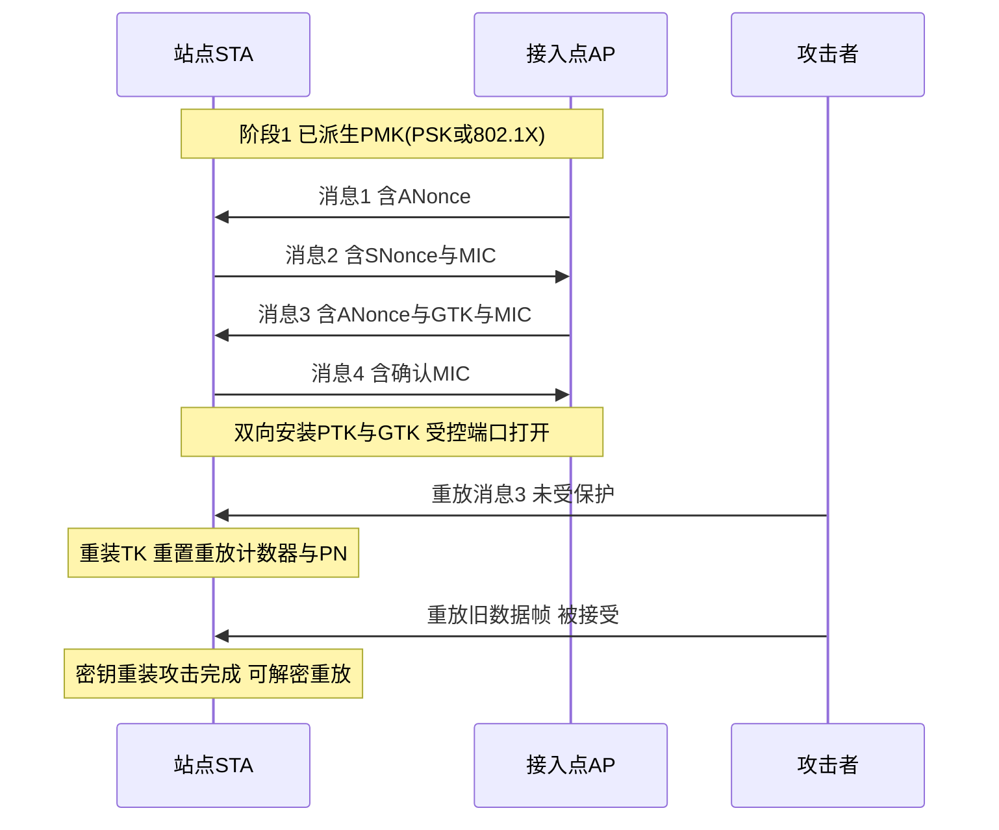
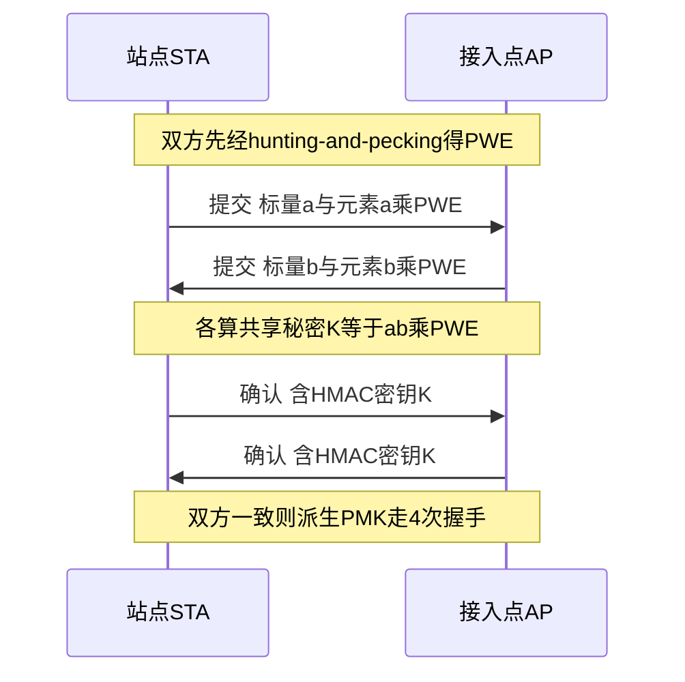
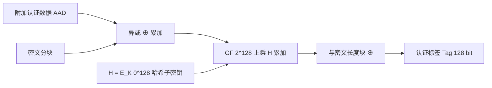
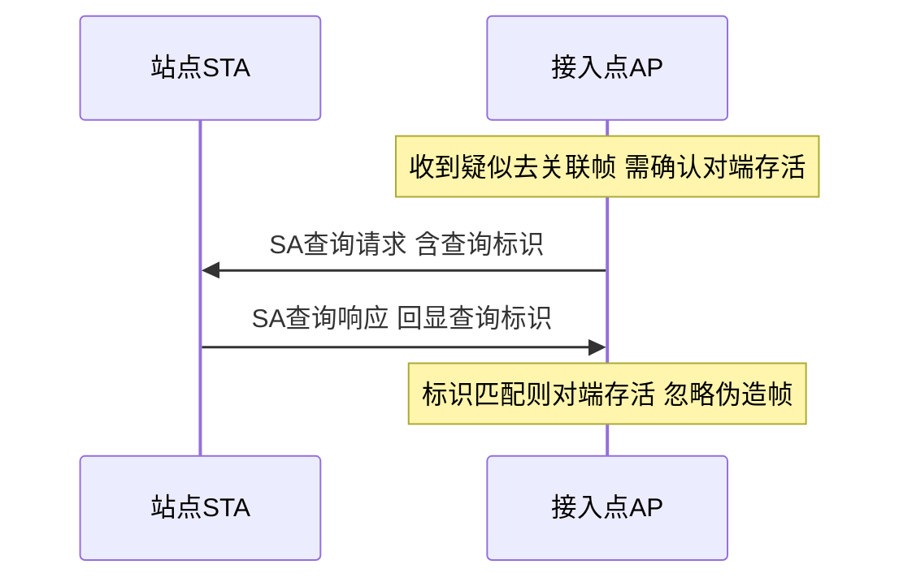
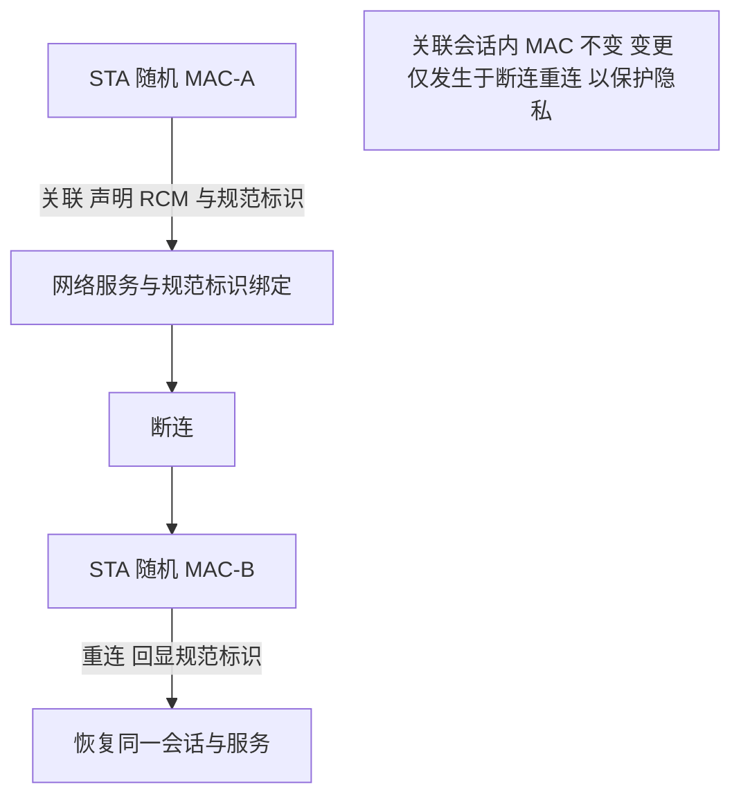

# 第 18 章　安全、密钥体系与隐私 ★

> 本章承接第 14 章的「管理面全流程」：扫描→认证→关联→**4 次握手（EAP over LAN, EAPOL）**→数据→拆除，其中 4 次握手在 14.6/14.7 的位置被标出但细节未展开；本章补全其密码学。第 17 章已给出 802.11r 的密钥层级 `PMK→PMK-R0→PMK-R1→PTK`（17.5.1），本章引用而不重推。侧信道（CSI 指纹）指向第 35 章。

## 学习目标

1. 能推导 4 次握手（4-Way Handshake）与 SAE（Simultaneous Authentication of Equals, 同步对等认证）的密码学过程，包括 PRF-384、PTK 切分与 MIC 计算。
2. 能分析被动窃听、重放、KRACK、离线字典、降级等七类攻击所利用的机制与对应防护，并用「攻击—机制—防护」对照表归纳。
3. 能定量评估密钥协商（SAE 的 hunting-and-pecking、PBKDF2）、数据加密（GHASH）与安全关联时延的开销（算例 18.1–18.4）。
4. 能比较 WEP/WPA2/WPA3/OWE/后量子各方案，并针对 MAC 随机化被破坏的网络功能设计 802.11bh/11bi 级缓解。

## 18.0 先建立一个直观图景

本章公式密集，但背后的东西其实很像**「进一栋需要门禁的大楼」**。动手算之前，先把这个图景记住，后面卡住时可以回来查位置：

| 生活里的角色 | 对应的技术对象 | 一句话说明 |
|---|---|---|
| 办卡时出示的身份证件 | 口令（家用）或身份证书（企业） | 只用来**一次性确立**长期凭证，本身不直接开锁 |
| 档案柜里的母钥匙 | 成对主密钥 | 长期不变、**从不出门**，只用于派生 |
| 每次进楼现场算出的通行证 | 成对临时密钥 | 双方各自算出同一串数，**每次都不一样**，用完即弃 |
| 通行证上开数据门的那一截 | 数据密钥 | 真正加密用户数据的钥匙 |
| 大楼广播系统的钥匙 | 组密钥 | 所有人都能用它听广播，由物业统一发放 |
| 进门时的四句对话 | 4 次握手 | 互报随机数、验签、发广播钥匙、回执确认 |
| 走廊里的广播通知 | 管理帧 | 保护管理帧 = 给通知也盖章，否则谁都能拿喇叭喊「快跑」 |

本章每一节都在细化上面某一件东西：它怎么产生、怎么被攻击、标准怎么补上漏洞。看公式卡住时，先回到这张表里找它扮演的角色。

## 18.1 威胁模型与攻击分类

Wi-Fi 的攻击面横跨物理层、MAC 与密钥管理。按「攻击者能力」可归为被动与主动两类；按「利用的机制」可映射到底层密码学缺陷或协议状态机缺陷。

> **通俗理解**：下面这七类攻击，对应七种很日常的偷鸡摸狗手法——**被动窃听**是趴在墙根偷听；**主动伪造**是冒充前台喊话；**重放**是把你的语音录下来再放一遍；**中间人**是把两人之间的电话线接到自己话机上转接；**离线字典**是把门锁买回家慢慢试钥匙（上一代家用标准的主要弱点）；**降级**是哄骗双方「咱们还是用最老的那把挂锁吧」；**密钥重装**则是趁你换锁的间隙重放换锁指令，让你把锁换回旧状态（详见 18.4.3）。
>
> 这一节不需要记公式，只要抓住一条主线：**机密性靠「别人猜不出」，完整性靠「别人改不了」，可用性靠「别人关不掉」，隐私靠「别人对不上号」**。后面每一节的防护手段都能归到这四类里。

### 18.1.1 七类威胁

1. **被动窃听（Passive Eavesdropping）**：仅监听空口，企图恢复明文或 PMK。防护靠强加密（CCMP/GCMP）与密钥不泄露。
2. **主动伪造（Forgery）**：伪造管理帧（去认证/去关联）或数据帧。防护靠 PMF（18.8）与数据 MIC。
3. **重放（Replay）**：重发截获的合法帧。防护靠 48 bit 包序号（Packet Number, PN）单调窗口（18.3.5）。
4. **中间人（Man-in-the-Middle, MitM）**：在开放/无认证链路插入，典型于无认证的 OWE 之外场景与假冒 AP。防护靠 802.1X 证书链（18.9）与 SAE 双向证明。
5. **离线字典攻击（Off-line Dictionary）**：截获握手后离线穷举口令。WPA2-PSK 因 相移键控（Phase Shift Keying, PSK）由弱口令经 PBKDF2 派生而脆弱；WPA3-SAE 将口令嵌入群元素使离线测试不可行（18.5.3）。
6. **降级攻击（Downgrade）**：诱导双方使用弱 AKM/密码套件（如 WEP）。防护靠 RSNE 中的 MFPR 必选 PMF 与 AKM 协商完整性（18.8.3）。
7. **KRACK（Key Reinstallation Attack, 密钥重装攻击）**：重放 4 次握手第 3 步使 站点（Station, STA）重装 TK 并重置重放计数器/PN，造成 nonce 复用。机理见 18.4.3。

此外还有**侧信道**：即便密文完好，物理层信道状态信息（Channel State Information, CSI）的反馈/探测可泄露设备指纹（详见第 35 章），属「加密之上的可追踪性」问题，本章 18.10 从 MAC 层讨论同类可追踪性。

### 18.1.2 攻击—机制—防护对照表

| 攻击 | 利用的机制 | 防护机制 | 所在节 |
|---|---|---|---|
| 被动窃听 | 明文或弱流密码（WEP/RC4） | CCMP/GCMP（AES） | 18.7 |
| 离线字典 | PSK=PBKDF2(口令)，可截获握手离线穷举 | SAE（口令→群元素，离线不可测） | 18.5 |
| 重放 | 缺重放窗口或窗口被重置 | 48 bit PN 单调窗口 | 18.3.5 |
| KRACK | 第 3 步未受 nonce 保护被重放→TK 重装 | 仅在确认后安装 TK | 18.4.3 |
| 伪造去认证 | 组管理帧无 MIC | PMF/IGTK/MMIE + SA Query | 18.8 |
| 降级 | RSNE 协商可被篡改 | MFPR/必选 PMF + AKM 绑定 | 18.8.3 |
| MitM 假冒 AP | 无服务端认证 | 802.1X/EAP-TLS 证书链 | 18.9 |
| 可追踪性 | 固定 MAC/SSID 列表/时序指纹 | 802.11bh RCM / 11bi 隐私增强 | 18.10 |

**表 18-1 说明**：攻击按「破坏机密性/完整性/可用性/可追踪性」四类归并；其中 KRACK 与降级属协议状态机缺陷，其余多为密钥或算法缺陷。

## 18.2 WEP 的失败：短 IV 与流密码复用

> **通俗理解**：这一节的失败可以用「**一次性密码本**」来讲清楚。流密码给每一帧生成一段与明文等长、只有收发双方知道的「乱码纸」，明文与它逐位异或就得到密文。关键前提是——**每张乱码纸只能用一次**：如果两张纸完全相同，把两段密文一异或，乱码互相抵消，剩下的就是两段明文的异或，凭语言统计就能还原出内容。
>
> 这套方案用 24 bit 的初始化向量来保证「每次的纸不一样」，可 24 bit 只有约 1677 万种取值。按生日悖论（一个班里 23 个人，就有五成概率有人同生日），**发到大约 4813 帧就有五成概率出现重复**——在繁忙网络里这不过是几十秒的流量。所以它的致命伤不是「钥匙太短」，而是「**同一张乱码纸被反复使用**」。
>
> 下面 18.2.2 算的正是「要发多少帧才会撞车」，18.2.3 说明为什么撞车就等于泄密。

### 18.2.1 RC4 + 24 bit IV 的结构

WEP（Wired Equivalent Privacy, 有线等效加密）用 RC4 流密码：密钥流 $z_i=\text{RC4}(\text{IV}\Vert K)$，密文 $c_i=p_i\oplus z_i$。IV（Initialization Vector, 初始化向量）仅 **24 bit**，明文 $p_i$、密钥 $K$（40 或 104 bit）固定时，一旦 IV 重复则密钥流 $z_i$ 复用，两帧异或即两明文异或：

$$\boxed{p_i\oplus p_j = c_i\oplus c_j\quad(\text{当 IV}_i=\text{IV}_j)}$$

### 18.2.2 IV 碰撞概率推导（生日界）

设密钥流段长度为 1 帧，发送 $n$ 帧，IV 取值空间 $N=2^{24}$。把每个 IV 视为从 $N$ 个值中独立抽样，碰撞即至少两个帧复用同一 IV。由生日问题：

$$P_{\text{coll}}(n)=1-\prod_{k=1}^{n-1}\left(1-\frac{k}{N}\right)\approx 1-e^{-n(n-1)/(2N)}$$

令 $P_{\text{coll}}\approx 0.5$，解 $n^2/(2N)\approx \ln 2$：

$$n\approx\sqrt{2N\ln 2}=\sqrt{2\cdot 2^{24}\cdot 0.693}\approx\sqrt{2.32\times10^{7}}\approx 4.8\times10^{3}$$

**算例 18.1**：IV 碰撞概率算例。已知 $N=2^{24}=16\,777\,216$，求 $n=5000$ 帧时的碰撞概率与「半碰撞帧数」。

- 解：直接代入近似式
  $$P_{\text{coll}}(5000)\approx 1-e^{-5000\times 4999/(2\times 16\,777\,216)}=1-e^{-0.7447}=1-0.4751=0.5249$$
  另用精确上界 $n^2/(2N)=25\times10^6/33.55\times10^6=0.745$，与近似一致。令 $P=0.5$ 反解 $n=\sqrt{-2N\ln(1-0.5)}=\sqrt{2N\ln 2}\approx 4813$ 帧。
- 结论：约 **4813 帧**（千量级，按 11 Mbps 约数十秒流量）即以 50% 概率出现 IV 碰撞，足以触发密钥流复用。量级合理：24 bit IV 空间仅千万级，远高于「短寿命流」所需，故 WEP 在 busy 网络中几分钟即暴露。

### 18.2.3 FMS/KoreK 攻击与结论

- **FMS 攻击**（Fluhrer–Mantin–Shamir）：利用 RC4 密钥调度（Key Schedule, KSA）对「弱 IV（Weak IV）」的偏置——部分 IV 使首字节密钥流与某密钥字节强相关，收集数千弱 IV 可逐字节恢复 $K$。
- **KoreK 攻击**：扩展弱 IV 集合并改进恢复效率，将所需 IV 数降至数十万级。
- **结论**：致命根因是「**短 IV + 流密码密钥流复用**」：IV 空间不足使碰撞必然发生（算例 18.1），而流密码一旦复用即完全泄露明文异或；RC4 的 KSA 偏置又使密钥可被主动诱导恢复。两者叠加，WEP 在理论（生日界）与实现（弱 IV）双重崩塌，故 802.11i 以 CCMP 取代之。

## 18.3 RSN 密钥层级（WPA/WPA2）

RSN（Robust Security Network, 健壮安全网络）以 PMK（Pairwise Master Key, 成对主密钥）为根，经 PRF 派生 PTK（Pairwise Transient Key, 成对临时密钥）与 GTK（Group Temporal Key, 组临时密钥）。

> **通俗理解**：密钥体系为什么要**分层**？因为「长期秘密」绝不能直接拿去开门——它一旦在空口被录下来就永久失效，而你不可能每天改口令。分层的目的是让长期秘密**只用于派生、从不直接暴露**：
>
> - **主密钥（PMK）**：档案柜里的母钥匙，长期不变、从不出门。它由你的口令（家用）或身份证书（企业）确立。
> - **临时密钥（PTK）**：每次进楼时现场算出的通行证，**用完即弃**。它由「母钥匙 + 这次见面的两个随机数 + 双方地址」共同派生，所以每次都不一样；即使别人录下这次的通行证，下次也不管用。
> - **数据密钥**：通行证上真正用来开数据门的那一截（下一小节会看到通行证被切成三截，各司其职）。
>
> 一句话：**口令负责证明「你是谁」，派生出来的临时钥匙负责「这次通信」，两者永不混用。**

### 18.3.1 PMK 的两种来源

$$\text{PMK}=
\begin{cases}
\text{PBKDF2-HMAC-SHA1}(\text{passphrase},\ \text{SSID},\ 4096,\ 256\text{ bit}) & \text{PSK 模式}\\[4pt]
\text{MSK}[0:256] & \text{802.1X/EAP 模式}
\end{cases}$$

- **PSK 模式**：口令经 PBKDF2（Password-Based Key Derivation Function, 基于口令的密钥派生函数）以 服务集标识符（Service Set Identifier, SSID）为盐、迭代 4096 次、HMAC-SHA1 为 PRF，输出 256 bit。
- **802.1X 模式**：EAP-TLS 等派生 MSK（Master Session Key, 主会话密钥），取前 256 bit 为 PMK（详见 18.9）。

### 18.3.2 PTK = PRF-384 派生与切分

$$\text{PTK}=\text{PRF-384}\bigl(\text{PMK},\ \text{``Pairwise key expansion''},\ B\bigr)$$

其中排序数据 $B$ 为：

$$B=\min(\text{AA},\text{SPA})\Vert\max(\text{AA},\text{SPA})\Vert\min(\text{ANonce},\text{SNonce})\Vert\max(\text{ANonce},\text{SNonce})$$

AA=AP MAC，SPA=STA MAC，ANonce/SNonce 为双方 256-bit 随机数。$\min/\max$ 排序保证双方得到相同串（去歧义）。PTK 长度 384 bit，切分为：

$$\boxed{\text{PTK}=\text{KCK}(128)\Vert\text{KEK}(128)\Vert\text{TK}(128)}$$

- **KCK**（Key Confirmation Key, 密钥确认密钥）：计算 EAPOL-Key MIC。
- **KEK**（Key Encryption Key, 密钥加密密钥）：加密下发的 GTK（AES Key Wrap）。
- **TK**（Temporal Key, 临时密钥）：数据帧加解密（CCMP/GCMP 用 128 bit）。

### 18.3.3 PRF 伪代码与复杂度

PRF 以 HMAC-SHA1（输出 160 bit）为基元，按长度拼块：

```text
# PRF-L(K, 标签, 数据) → L bit，用于派生 PTK(L=384)
# 输入: K=PMK(256b), 标签="Pairwise key expansion", 数据=B(排序后)
# 输出: PTK(384 bit)
1:  L = 384; BLK = 160                       # HMAC-SHA1 每块 160 bit
2:  n = ceil(L / BLK) = 3                    # 需 3 块
3:  B = min(AA,SPA)‖max(AA,SPA)              # 排序 MAC 去歧义
4:  B = B ‖ min(ANonce,SNonce)‖max(ANonce,SNonce)
5:  for i = 0 to n-1:                        # 常数 3 次迭代
6:      T[i] = HMAC-SHA1(K, 标签 ‖ 0x00 ‖ B ‖ i)   # O(1)/块
7:  PTK = T[0]‖T[1]‖T[2] 取前 384 bit
8:  KCK = PTK[0:128]; KEK = PTK[128:256]; TK = PTK[256:384]
```

- **时间复杂度**：$O(n)=O(1)$（固定 3 次 HMAC-SHA1）。
- **空间复杂度**：$O(L)=O(384\,\text{bit})$，与 PMK 无关，故不随口令强度增长。

### 18.3.4 GTK 组密钥分发

GTK 由 AP 生成（256 bit），在 4 次握手第 3 步以 **KEK（AES Key Wrap）加密**承载于 EAPOL-Key 的 Key Data 字段，仅 AP→STA 单向分发（组播/广播用同一 GTK）。组密钥更新走独立的「组密钥握手（Group Key Handshake）」2 步，避免单播密钥更新时打断组播。

### 18.3.5 Nonce 空间与重放窗口

- **ANonce/SNonce**：256 bit，空间 $2^{256}$，碰撞概率可忽略（远小于 $2^{-32}$ 安全界）。
- **PN（Packet Number, 包序号）**：48 bit，数据帧发送计数器。最大帧数 $2^{48}\approx 2.8\times10^{14}$。以 1 Gbps、1500 B/帧计，速率 $\approx 8.3\times10^4$ 帧/秒，耗尽需
  $$T_{\text{life}}=2^{48}/(8.3\times10^4)\approx 3.4\times10^9\ \text{s}\approx 108\ \text{年}$$
  故 48 bit PN 在设备生命周期内不会回绕（wrap-around）。
- **重放窗口**：接收端维护「最近已接受的最大 PN」，仅接受 $\text{PN}>\text{PN}_{\max}$ 的帧（严格单调）。为容忍聚合/A-MPDU 乱序，窗口宽 $W$ 小（典型 $W=0$ 严格递增，或少数几帧）。窗口越大越抗乱序但越易被重放缓冲，故取极小常数。KRACK 的本质即把 $\text{PN}_{\max}$ 强制回退（18.4.3）。

## 18.4 4 次握手逐步推导

4 次握手在 PTK 派生后、数据前完成，目标：① 双方互证持有 PMK；② 协商 Nonce；③ 安全下发 GTK；④ 双向确认后安装 TK。

> **通俗理解**：把 4 次握手想成**隔着门交接钥匙**——双方都要确认「对面真是本人」，都要拿到新钥匙，还不能被旁人听去。
>
> | 消息 | 生活场景 | 技术动作 |
> |---|---|---|
> | 消息 1（物业→你） | 物业先报一个随机数 | 下发 ANonce，谁也无法预知你要回什么 |
> | 消息 2（你→物业） | 你回自己的随机数并签字 | 回 SNonce + MIC，物业验签后确认你确实持有主密钥 |
> | 消息 3（物业→你） | 把广播钥匙装信封寄给你 | GTK 用 KEK 加密下发，你验签后安装密钥 |
> | 消息 4（你→物业） | 你回一句「收到了」 | 回 MIC，物业确认后才打开数据闸门 |
>
> **为什么不能两步搞定？** 因为要同时满足三件事：双方互证身份、把广播钥匙安全送达、并确认对方真的收到了。少任何一步都会留下漏洞——18.4.2 逐条说明这件事，18.4.3 说明「少一步确认」曾经真的被攻击者利用。

### 18.4.1 四步报文、字段与 MIC

设 AP 先持 ANonce，STA 先持 SNonce。MIC 用 KCK 计算：$\text{MIC}=\text{HMAC-SHA1-128}(\text{KCK},\ \text{frame-body}_{\text{MIC 置零}})$。

- **消息 1（AP→STA）**：EAPOL-Key 含 ANonce、Replay Counter=1、Key Data 空。STA 收后集齐双 Nonce，计算 $\text{PTK}=\text{PRF-384}(\dots)$。
- **消息 2（STA→AP）**：含 SNonce 与 $\text{MIC}_2$。AP 收后计算 PTK，并用 KCK 验 $\text{MIC}_2$ 确认 STA 持有 PMK。
- **消息 3（AP→STA）**：含 ANonce（重发以确认）、$\text{GTK}_{\text{KEK加密}}$、$\text{MIC}_3$。STA 验 $\text{MIC}_3$ 后**安装 PTK（TK）与 GTK**。
- **消息 4（STA→AP）**：仅含 $\text{MIC}_4$。AP 验后**安装 PTK（TK）**，受控端口（controlled port）打开。

### 18.4.2 为什么需要 4 步

- 消息 1+2：交换 Nonce 并让 AP 验证 STA 的 PMK（$\text{MIC}_2$）。
- 消息 3：AP 必须**先**收到 STA 的存活/确认（消息 2）再下发 GTK——否则向未证实的对方发组密钥无意义；且 GTK 加密需 KEK（来自 PTK，而 PTK 需双方 Nonce）。
- 消息 4：AP 需确认 STA 已成功接收并安装 GTK（否则 AP 已用新 GTK 发组播，STA 却未装，会丢帧）。故 2 步不足以「互证+发 GTK+双向确认」，最少 4 步。

图 18-1 给出含 KRACK 重放分支的时序。



**图 18-1 说明**：正常 4 步完成后受控端口打开；攻击者（ATK）在 STA 已装 TK 后重放消息 3，使 STA 在收到消息 4 之前再次安装 TK，重置重放窗口（详见 18.4.3）。

> **通俗理解**：换锁流程原本留了一个空子——规范允许「只要收到第 3 条消息就先把新锁装上」。攻击者**不需要破解任何密码**，只要把第 3 条消息**原样再播一遍**，接收方就会以为又要换一次锁，于是把锁再装一次。麻烦出在「再装一次」会把计数器清零：本该只用一次的数字又从头开始，攻击者据此可以把**旧的数据帧**当成新帧重放，甚至找出两帧用了同一段乱码纸，从而还原明文。
>
> 修复思路很朴素：**先完成最后一步确认（消息 4），再真正启用新锁**；确认之前装上的只能算「备用锁」，不生效。补丁不改变握手步数，只是把状态机收紧——安全漏洞常常不是算法被破解，而是**流程顺序留了口子**。

### 18.4.3 PTK 安装点安全要求 → KRACK

KRACK（Vanhoef & Piessens, 2017）根因：**原规范允许 STA 在收到消息 3 时即安装 TK**，而消息 3 未被一次性 Nonce 保护（仅 Replay Counter，攻击者可重放）。重装 TK 会：
1. 将发送端 PN 重置为旧值 → 重放帧被误接受（重放攻击）；
2. 对 CCMP，TK 与 PN 复用使同一 (Key, Nonce) 加密两帧，CCM 的计数器块重复 → 可恢复明文异或部分；
3. 对组密钥握手重放，GTK 被重装，组播重放成功。

**修复（802.11 补丁）**：TK 仅在**收到并验证消息 4 之后**安装（或安装「零 TK」缓冲，待确认再启用），且消息 3 重放不再触发重装。该修复不改变握手步数，仅收紧状态机。

## 18.5 WPA3 与 SAE（Dragonfly）

WPA3-Personal 以 SAE（Dragonfly）取代 PSK，核心是「口令→群元素」映射，使离线字典攻击不可行。

> **通俗理解**：上一代家用标准的弱点是——攻击者录下一次握手就能**带回家离线**把字典里几十万个口令逐个试，试多久都没人管（这就是「离线字典攻击」）。SAE 换了两个巧妙的招数：
>
> 1. **把口令变成曲线上的一个点**（算法 18.1）。口令本身太短、太好列举，直接当密钥等于把答案写死；把它映射到一条椭圆曲线上的点之后，想从「点」反推口令需要解离散对数，目前算不出来。
> 2. **每次验证都要求对方「在场」**（18.5.2 的提交/确认）。双方各自挑一个随机数，公开交换「随机数 × 点」，然后各自算出同一个秘密。攻击者能看到公开结果，但**想验证一个口令猜测对不对，就必须跟真人对上一次交互**——不能再带回家慢慢试。攻击成本于是从「离线几毫秒一次」抬升到「在线每猜一次都要跑一趟网络」。
>
> 「hunting-and-pecking」这个名字很形象：种子像一只鸟，在号码簿上一个一个「啄」候选横坐标，看哪个能落在曲线上。**找到了也不停手**——为了不泄露「第几只啄中的」，程序固定啄满 40 次（这正是算法第 3 行「不提前退出」的用意，也是时序侧信道防护的常见套路）。

### 18.5.1 hunting-and-pecking 算法（六段式算法块 A）

**算法 18.1　SAE 口令元素 PWE 的 hunting-and-pecking 生成**

1. **问题建模**  
   变量：口令 $pwd$，群 $G$（ECC 群阶 $q$、曲线 $y^2=x^3+ax+b\mod p$）。输出：群元素 $\text{PWE}\in G$。假设：双方共享同一 $pwd$ 与群参数；哈希 $H=\text{SHA-256}$。符号：$x$ 为候选横坐标，$\text{LSB}_m(\cdot)$ 取 $m=\lceil\log_2 p\rceil$ 位。

2. **目标函数与约束**  
   求 $\text{PWE}$ 使 $\text{PWE}$ 在 $G$ 上且由 $pwd$ 确定性派生；约束：单从网络观测无法反推 $pwd$（即 $\text{PWE}$ 暴露不泄露 $pwd$ 的可测试性）。

3. **完整推导**  
   - 先算种子：$\text{pwd-seed}=\text{HMAC-H}(0^L,\ pwd\Vert \text{ID\text{-}S}\Vert \text{ID\text{-}P})$，$L=256$。
   - 对迭代 $j=1,2,\dots,k$（$k=40$ 为 ECC 默认值）：
     $$x_j = \text{LSB}_m\bigl(\text{HMAC-H}(\text{pwd-seed},\ j)\bigr)$$
     检验曲线方程右式是否为模 $p$ 二次剩余（Quadratic Residue, QR）：
     $$\text{QR}_j \iff \left(\frac{x_j^3+ax_j+b}{p}\right)=1$$
     若是，则存在 $y$ 使 $(x_j,y)\in G$；按 $j$ 奇偶选 $y$ 符号以去歧义。记录为候选，继续至第 $k$ 次（**不提前停止**，避免时序泄露命中点）。
   - 取 $k$ 次中**最后**一个有效候选为 $\text{PWE}$。
   - 单点命中概率 $p_{\text{QR}}\approx 1/2$（随机 $x$ 落在曲线的概率约半）。$k$ 次内至少命中一次：
     $$\boxed{P_{\text{hit}}=1-(1-p_{\text{QR}})^k}$$

4. **伪代码**

```text
# 输入: pwd, 群参数(p,a,b,q), k=40
# 输出: PWE(群元素)
1:  seed = HMAC-H(0^256, pwd‖ID-S‖ID-P)        # 口令派生种子
2:  PWE = NULL
3:  for j = 1 to k:                            # 固定 40 轮不提前退出
4:      x = LSB_m( HMAC-H(seed, j) )           # 候选横坐标 O(1)
5:      v = (x^3 + a*x + b) mod p              # 曲线右式
6:      if Legendre(v, p) == 1:               # 是否为QR O(log p)
7:          y = sqrt_mod(v, p)                # 模平方根
8:          y = (j 偶) ? y : p - y            # 符号去歧义
9:          PWE = (x, y)                      # 记录(覆盖为最后有效)
10: if PWE == NULL: return FAIL               # 40 轮全未命中(概率≈2^-40)
11: return PWE
```

5. **复杂度分析**  
   - 时间：$O(k)$ 次 HMAC + $O(k)$ 次 Legendre/模平根（各 $O(\log p)$）；每轮常数，总 $O(k)$。$k=40$ 固定，故 **恒定工作量**。
   - 空间：$O(1)$（仅存当前候选与种子）。

6. **数值算例**  
   取 $p_{\text{QR}}=0.5,\ k=40$：至少一次命中概率
   $$P_{\text{hit}}=1-(0.5)^{40}=1-9.09\times10^{-13}\approx 1.0000000000009$$
   期望命中迭代次数 $E[j]=1/p_{\text{QR}}=2$ 次（即平均第 2 轮即找到，但为隐藏时序固定跑满 40 轮）。量级检查：40 轮 HMAC-SHA256 约 $40\times 5\ \mu\text{s}=0.2\ \text{ms}$，与 18.5.4 算例自洽；$(0.5)^{40}\approx 2^{-40}$ 远小于 $2^{-32}$ 安全界，故「全未命中」可忽略。

> **通俗理解（调色类比）**：这类「双方各自算出一个共同秘密」的交换，最经典的解释是**调颜料**。你和对方各自秘密选一种颜色（私钥），当着大家的面，各把这种颜色混进一份**双方都知道的公共底色**（这里是口令映射出的那个点），然后公开交换混合后的颜色。旁观者看到两杯混合色，却没法把公共底色从里面「减」回去、从而分离出你的秘密色——这就是难解的数学问题；而你和对方最终调出的颜色是同一杯，这杯颜色就是双方的共享秘密。
>
> 「提交 / 确认」两阶段的用意也在防作弊：**先提交**相当于把调色结果锁进保险箱，**再确认**是用共享秘密算一个校验码互相核对——一旦双方的口令不同，共享秘密就不同，校验码自然对不上，握手立即失败。

### 18.5.2 commit/confirm 交换

双方各取随机私钥 $r\stackrel{R}{\in}[1,q-1]$，口令元素为 $\text{PWE}$：

- **提交（commit）**：发 $(\text{scalar}=r,\ \text{element}=r\cdot\text{PWE})$（ECC 点乘，FFC 为 $\text{PWE}^r$）。
- **共享秘密**：收对端 $(r',\ r'\cdot\text{PWE})$ 后，
  $$\boxed{K = r\cdot(r'\cdot\text{PWE}) = r\,r'\cdot\text{PWE}}$$
  双方同得 $r\,r'\cdot\text{PWE}$（交换律），且私钥 $r$ 不泄露。
- **确认（confirm）**：各发 $\text{HMAC}(K_{\text{confirm}},\ \text{双方标识})$；对方验 HMAC 一致即证明双方 PWE 相同（即口令相同），并派生 PMK。

图 18-2 给出交换时序。



**图 18-2 说明**：SAE 先完成对等提交/确认得出 PMK，随后仍走 18.4 的 4 次握手派生 PTK；SAE 替换的是「PMK 来源」，而非握手本身。

### 18.5.3 抗离线字典攻击机理与 Anti-Clogging

- **机理**：观测者截获 $(\text{scalar}=r,\ \text{element}=r\cdot\text{PWE})$。要测试猜测口令 $pwd^*$，需由 $pwd^*$ 得 $\text{PWE}^*$ 再验 $\text{element}\stackrel{?}{=}r\cdot\text{PWE}^*$。但等式左为 $r\cdot\text{PWE}$（用真 PWE），右为 $r\cdot\text{PWE}^*$；要判定是否相等需计算离散对数（ECDLP）——离线无法在不握手下验证猜测。故**每次口令猜测都必须发起一次新 SAE 交换（在线）**，把字典攻击成本从「离线 $O(1)$ 次 PBKDF2」抬到「在线每次一趟交互」。
- **每次交互使用新随机标量**：提交中的 $r$ 每轮刷新，使同一口令的不同会话产生不同 $\text{element}$，抵抗重放与跨会话关联。
- **Anti-Clogging（防堵塞）**：SAE 提交触发 AP 端 PWE 计算（40 轮 HMAC，18.5.1），易被洪水式提交耗尽 CPU。AP 以「防堵塞令牌（anti-clogging token）」应对：对未带令牌的提交，回送基于 AP 密钥+STA 地址+时间的令牌，要求 STA 在下一提交中反射；仅持令牌者才进入 PWE 计算，从而限速并阻断匿名 CPU 耗尽。

### 18.5.4 SAE 计算开销推导

SAE 单次关联成本 = PWE 生成（k=40 轮 HMAC + QR 检验）+ 2 次提交点乘（ab 各 1）。PBKDF2 成本 = 4096 次 HMAC-SHA1。

**算例 18.2**：SAE 计算开销对比 PBKDF2。设 ECC P-256 点乘 $t_{\text{mul}}=0.3\ \text{ms}$（MCU 示意值），HMAC-SHA256 $t_{H256}=5\ \mu\text{s}$，HMAC-SHA1 $t_{H1}=3\ \mu\text{s}$，模平根 $t_{\sqrt{}}=0.05\ \text{ms}$。

- SAE 端成本：
  $$C_{\text{SAE}}=k\cdot(t_{H256}+t_{\sqrt{}}) + 2\,t_{\text{mul}}=40\times(0.005+0.05)+2\times0.3=40\times0.055+0.6=2.2+0.6=2.8\ \text{ms}$$
- PBKDF2 成本：
  $$C_{\text{PBKDF2}}=4096\times t_{H1}=4096\times 0.003=12.288\ \text{ms}$$
- 比值：$C_{\text{PBKDF2}}/C_{\text{SAE}}=12.288/2.8\approx 4.39$。

- 结论：SAE 单方 CPU 成本约为 PSK/PBKDF2 的 **1/4.4**，且 SAE 的 PWE 仅需算一次（后续重连可缓存）。但 SAE 为交互式（图 18-2 多一趟往返），而 PBKDF2 为一次性离线派生——安全收益（抗离线字典）以「少量交互轮次」换取。量级检查：点乘 0.3 ms 在带 HW crypto 的 AP 上可低至 0.05 ms，整体仍 < 5 ms，对关联时延（18.12）贡献有限，合理。

## 18.6 OWE 与 Enhanced Open

OWE（Opportunistic Wireless Encryption, 机会式无线加密，802.11ae/11.0 扩展）为开放网络提供「无认证但仍加密」的升级：在（重）关联帧中完成 DH（Diffie–Hellman, 迪菲–赫尔曼）密钥交换。

> **通俗理解**：咖啡馆的开放网络就像**一间没有门禁的大厅**——谁都能进来，说话也谁都听得见。OWE 做的事相当于「**在开放大厅里发一次性耳塞**」：不做身份检查（还是谁都能进），但每个人与接入点临时约定一副耳塞，旁人听不懂你们的对话。
>
> 三个要点：① **不认证**，所以它只能防「听」，不能防「冒充」——主动攻击者可以自己架一个假接入点做中间转接；② **耳塞是一次性的**（临时私钥用完即弃），即便将来长期秘密泄露，也打不开今天录下的内容，这叫前向保密；③ 正因为不认证，企业网仍应优先采用带证书的方案（18.9）。

### 18.6.1 DH 密钥交换推导

选用 ECP（Elliptic Curve Group, 椭圆曲线群，如 group 19，256-bit 随机曲线）。双方私钥 $a,b\stackrel{R}{\in}[1,q-1]$，公钥 $A=a\cdot G,\ B=b\cdot G$（$G$ 为群生成元）。交换公钥后：

$$\text{PMK}=a\cdot B = a\cdot(b\cdot G)=ab\cdot G = b\cdot(a\cdot G)=b\cdot A$$

AP 与 STA 同得 $ab\cdot G$，再由 PRF 派生 PTK（同 18.3.2，仅 PMK 源不同）。关联帧中携带「OWE DH 参数单元」承载公钥。

### 18.6.2 前向保密说明

DH 私钥 $a,b$ 为临时（ephemeral），会话结束即弃。即便攻击者长期截获并存储密文，未来获得私钥亦无法解密历史流量——**提供前向保密（Forward Secrecy, FS）**。代价：无身份认证，主动 MitM 可在 STA 与真 AP 间各建一条 OWE 隧道实施中转（Enhanced Open 仅防被动窃听，不防主动假冒），故企业网仍应优先 802.1X。

## 18.7 加密与完整性算法

> **通俗理解**：加密和防篡改其实是**两件事**，现代标准用「一把锁同时干两件」的方式解决：
>
> - **保密（加密）**：把内容变成乱码，别人看不懂；
> - **完整性（认证）**：在信封上贴一个只有收发双方能算出的封条，内容哪怕被改动一个比特，封条就再也对不上。
>
> 18.7.2 列的几种现代套件都是这个套路：加密部分负责「看不懂」，完整性部分像一个**滚雪球**——把每一块数据当作一个大数，不断乘上一个秘密数再异或进雪球，最后滚出一个小标签（Tag）。改动任何一块，雪球都会变样。两者的区别在于滚法：一种只能逐块串行地滚（后一块依赖前一块），另一种在伽罗瓦域上做乘法、可以并行滚，因此更适配高速硬件。

### 18.7.1 TKIP（已被废止）

TKIP（Temporal Key Integrity Protocol, 临时密钥完整性协议）为 WEP 的过渡补丁：仍用 RC4 但引入 48 bit TSC（序列计数器）、每帧密钥混合（Temporal Key Mixing）与 Michael 完整性。因 2008–2009 年 Beck–Tews 攻击可恢复明文与恢复密钥，已被 802.11 废止，仅 legacy 兼容。

### 18.7.2 CCMP / GCMP / GCMP-256

- **CCMP**（CCM with CBC-MAC Protocol, 计数器模式+分组密码链消息认证码协议）：AES-128 的 CCM 模式，密钥 128 bit，MIC 128 bit。Wi-Fi 保护接入（Wi-Fi Protected Access, WPA）第二代（WPA 2, WPA2）默认。
- **伽罗瓦计数器模式（Galois/Counter Mode Protocol, GCMP）**（Galois/Counter Mode Protocol, 伽罗瓦/计数器模式协议）：AES 的 GCM 模式，密钥 128 bit，MIC（GMAC）128 bit。802.11ac/ad 引入。
- **GCMP-256**：AES-256 的 GCM，密钥 256 bit，用于 **WPA3-Enterprise 192-bit 模式**（Suite B）；配 SHA-384 全程派生、BIP-GMAC-256 管理帧保护。表 18-2 对照。

| 套件 | 密钥长度 | MIC 长度 | PN 长度 | 备注 |
|---|---|---|---|---|
| TKIP | 128 bit | 64 bit (Michael) | 48 bit (TSC) | 已废止 |
| CCMP-128 | 128 bit | 128 bit (CCM) | 48 bit (PN) | WPA2 默认 |
| GCMP-128 | 128 bit | 128 bit (GMAC) | 48 bit (PN) | 802.11ac/ad |
| GCMP-256 | 256 bit | 128 bit (GMAC-256) | 48 bit (PN) | WPA3-Enterprise 192-bit |
| BIP-CMAC-128 (Integrity GTK, IGTK) | 128 bit | 64 bit (CMAC) | 48 bit (IPN) | 802.11w 组管理 |
| BIP-GMAC-256 (BIGTK) | 256 bit | 128 bit | 48 bit | 信标保护 |

**表 18-2 说明**：所有现代套件 PN 均为 48 bit（18.3.5 推导其寿命约百年）；GCMP 系列 MIC 由 GHASH 产生（18.7.3）。

### 18.7.3 GHASH 多项式乘法推导（$GF(2^{128})$）

GCM 的完整性由 GHASH 基于哈希子密钥 $H=E_K(0^{128})$ 计算。设明文/附加数据分块为 $X_1,\dots,X_m$，累加：

$$Y_0=0,\qquad Y_i=(Y_{i-1}\oplus X_i)\cdot H\ \text{ in }\ GF(2^{128})$$

其中「$\cdot$」为 $GF(2^{128})$ 上的乘法，约化多项式取 NIST 标准：

$$\boxed{f(x)=x^{128}+x^7+x^2+x+1}$$

位序约定：bit 0 为 $x^0$（最低位），bit 127 为 $x^{127}$。约化常数 $R=0\text{xe1}00\cdots00$（即 $x^{128}+x^7+x^2+x+1$ 的高位表示）。乘法步骤：
1. 两操作数视作次数 $<128$ 的二元多项式 $a(x),b(x)$，做「无进位乘法（carry-less multiply）」得 $c(x)$（次数 $<256$）；
2. 对高 128 位做约化：将 $c(x)$ 高 128 位视为次数 $<128$ 的多项式，乘 $R$ 后异或回低 128 位，迭代至高位移净；
3. 结果即 $a(x)b(x)\bmod f(x)$。

该运算可由 PCLMULQDQ 等指令单周期级完成，故 GCMP 较 CCMP 更适配硬件并行。图 18-3 给出 GHASH 的结构示意。



*图 18-3 说明：GHASH 对附加数据（Additional Authenticated Data, AAD）与密文长度块做 GF(2^128) 乘 H 累加得 Tag；数据加密另走 CTR 模式（AES 计数器），两者独立。*

### 18.7.4 处理时延量级（示意值）

以 1500 B 数据帧（约 94 个 16 B 块）计，硬件 AES 引擎吞吐通常 > 1 Gbps：

| 套件 | 加解密时延（HW，示意） | 完整性时延（HW，示意） |
|---|---|---|
| CCMP-128 | 3–10 µs | 2–8 µs（CBC-MAC 串行） |
| GCMP-128/256 | 3–10 µs | 1–5 µs（GHASH 可并行） |
| TKIP | 20–80 µs | 10–40 µs（Michael+RC4，已废止） |

**表 18-3 说明**：数值为单帧 MAC 层加密+MIC 的示意量级（不含空口传输）；GCMP 因 GHASH 可并行略优于 CCMP，二者均远小于帧传输时延（ms 级），故加密非关联瓶颈。

## 18.8 PMF / Management Frame Protection（802.11w）

管理帧（去认证、去关联、动作帧）原无 MIC，易被伪造发起拒绝服务（DoS）。PMF（Protected Management Frames, 保护管理帧）以 IGTK/BIGTK 与 MMIE 解决。

> **通俗理解**：加密保护的是「数据内容」，但**通知类帧**（比如「你已被踢下线」「该换信道了」）原本是明文、也没有签名。这就像大楼里谁都能拿喇叭喊「全体立刻撤离」——不需要任何权限，只要嗓门够大，就能把所有人赶出去（拒绝服务攻击）。
>
> 保护管理帧的做法就是**给通知盖章**：广播类通知用一个大家都有的组钥匙盖章，点对点通知用双方各自的钥匙盖章。保安收到「有人喊撤离」，先按流程**回拨电话确认你还在不在**（18.8.2 的安全关联查询），确认不上就不理会这条广播。

### 18.8.1 IGTK / BIGTK 与 MMIE

- **IGTK**（Integrity Group Temporal Key, 完整性组临时密钥）：保护**组播/广播**管理帧（如广播去认证），以 BIP（Basis Integrity Protocol, 基础完整性协议，AES-CMAC）计算 MMIE（Management MIC Element, 管理帧 MIC 元素）附于帧尾。
- **BIGTK**（Beacon Integrity Group Temporal Key, 信标完整性组临时密钥）：保护**信标（Beacon）**完整性（信标保护，802.11ax/be【已发布】），防伪造信标诱导错误信道/参数。
- 单播管理帧用单播 PTK 的 KCK 计算 MIC。

### 18.8.2 SA Query 流程

当 AP 收到疑似去关联帧，需确认对端是否真实存活（防攻击者用伪造帧逼 AP 断链）。走 SA Query（安全关联查询）：



**图 18-4 说明**：SA Query 以「请求—响应」回显标识证明 STA 仍在线；攻击者无法伪造响应（无 IGTK/KCK），故伪造去关联帧被识别丢弃。

### 18.8.3 降级攻击防护

RSNE（Robust Security Network Element, 健壮安全网络元素）含 **MFPC**（Management Frame Protection Capable, 能力位）与 **MFPR**（Management Frame Protection Required, 必选位）。若双方均 MFPR，则关联强制 PMF，攻击者无法以「去掉管理帧 MIC」的方式降级；AKM（Authentication and Key Management, 认证与密钥管理）套件在 RSNE 中协商且受 MIC 保护，无法被中间人悄悄换成 WEP/开放。故降级攻击在 MFPR+完整 RSNE MIC 下不可行。

## 18.9 802.1X/EAP 与 RADIUS 简述

> **通俗理解**：家用网络靠「口令」认人，企业网络靠「证件」认人。802.1X 就是**大楼前台查证件**的流程：你出示员工卡（客户端证书），前台也要出示营业执照（服务端证书）——**双向查验**。假冒接入点拿不出真证件，中间人攻击就站不住脚。查验通过后，双方从这次查证过程协商出一把主密钥，再走 18.4 的四次握手派生临时钥匙。
>
> 为什么要这么麻烦？因为家庭口令是「共享秘密」，谁知道口令谁就能拿去假冒；而证书是**非对称**的——你能用它证明自己，却无法用它冒充对方。

### 18.9.1 EAPOL 封装、EAP-TLS 与 MSK/PMK

- **EAPOL**（EAP over LAN）：把 EAP（Extensible Authentication Protocol, 可扩展认证协议）帧封装于 802.11 数据帧（关联后、受控端口打开前）在 STA 与 AP（Authenticator, 认证者）间传输。
- **EAP-TLS**：基于 TLS（Transport Layer Security, 传输层安全）的证书认证，服务端出示证书、客户端亦出示证书（互证），协商出 **MSK**（主会话密钥）。
- **MSK→PMK**：取 $\text{PMK}=\text{MSK}[0:256]$，随后走 18.4 的 4 次握手派生 PTK。证书链（根 CA→中间 CA→服务端）保证服务端身份，杜绝假冒 AP 的 MitM。

### 18.9.2 PMK caching 与 OKC（指向第 17 章）

- **PMK caching（PMK 缓存）**：STA 与 AP 在 PMK 有效期内缓存，重关联时跳过 802.1X 直接 4 次握手。
- **OKC（Opportunistic Key Caching, 机会式密钥缓存）**：跨同移动域（同一 AS）的多个 AP 共享派生 PMK，使 STA 在域内漫游免回 AS 重认证。其进阶形式即第 17 章 17.5 的 **快速 BSS 切换（Fast BSS Transition, FT）密钥链**（PMK→PMK-R0→PMK-R1→PTK），把密钥「拉」到目标 AP，省去 AS 往返与独立 4 次握手，详见 17.5.1–17.5.3。

## 18.10 隐私：MAC 地址随机化与 802.11bh 【已发布】

> **通俗理解**：数据都加密了，为什么还会被追踪？因为**信封上的收发件人地址必须明文可见**——不然包裹送不到。设备的硬件地址就是这类「必须露在外面」的名字，商场、机场的探针只要记录这个名字，就能画出「你常去哪、几点到、待多久」的轨迹。
>
> 对抗办法是**每次出门换一件外套**，也就是 MAC 地址随机化。它确实让追踪者对不上号了，但也让商家认不出「老客户」——计费、家长控制、室内定位这些依赖稳定标识的功能会一起失效（18.10.2）。
>
> 于是标准给出了折中：**给设备发一张「会员卡号」**（规范标识）。外套可以天天换，会员卡号不变，网络侧仍能认出「这是同一个账户」，而第三方依然看不到固定名字（18.10.3）。

### 18.10.1 可追踪性分析

即便数据加密，攻击者仍可借 MAC 层元数据追踪设备：
- **Probe Request 中的 SSID 列表**：主动扫描广播含偏好 SSID 的探测请求，与 MAC 绑定形成「常去地点」画像。
- **序列号（Sequence Number）**：随机化 MAC 后若序列号不重置，跨 MAC 关联同一递增序列即可去匿名。
- **时序与能力指纹**：支持的速率集、厂商 IE、探测时序规律性构成「设备指纹」，与 MAC 无关仍可追踪。
- 此外 DHCP 主机名、mDNS 名亦可能泄露身份（见 18.1 侧信道与第 35 章 CSI 指纹同属「加密之上的可追踪性」）。

### 18.10.2 随机化对网络功能的破坏

随机化 MAC（Randomized and Changing MAC, RCM）破坏一切「以 MAC 为稳定标识」的网络功能：
- **计费**：按 MAC 的时长/流量配额失效；
- **定位**：基于 MAC 的室内定位（指纹/RSSI 三角）无法跨随机化关联；
- **家长控制/策略**：按设备 MAC 的访问规则失效；
- **诊断**：故障定位依赖稳定设备标识。

### 18.10.3 802.11bh RCM 提案要点【已发布】

**IEEE 802.11bh-2024（已发布，2025-06）** 在「不改变用户隐私」前提下，为使用 RCM 的 STA 保留既有网络服务。要点：
1. **RCM 指示与协商**：STA 在（重）关联中声明使用 RCM，AP 据此启用兼容流程；
2. **规范标识（Canonical Identifier）**：为 STA 提供跨 MAC 变化的稳定网络侧标识，使客户支持、网络诊断、设备到达检测在 MAC 变更后仍能关联会话；
3. **MAC 变更流程**：在标准规定的关联会话外（断连后重连）才允许更换 MAC，重连时经规范标识恢复服务连续性。

图 18-5 给出 RCM 协商与标识维持的简化流程。



*图 18-5 说明：802.11bh 用「规范标识」桥接 MAC 变化前后的会话，既保留计费/诊断/到达检测，又不向第三方暴露固定 MAC。*

### 18.10.4 802.11bi 隐私增强【草案】

**IEEE P802.11bi（增强隐私保护，【草案】，2026-09 处于 D6.0，SA 复议 94% 赞成）** 进一步堵住「非 MAC 类」追踪面，要点：
- **BPE（BSS Privacy Enhancements, 基本服务集（Basic Service Set, BSS）隐私增强）**：AP 发送**加密信标（Privacy Beacon）**，仅预配置 STA 能用 GTK 解读，向非关联观察者隐藏 BSS 参数；
- **身份哈希（Identity Hash）**：AP 发现用 $\text{IdentityHash}=\text{Truncate-}48\bigl(\text{HMAC-SHA-256}(\text{“BPE AP MLD address resolution”},\ \text{IdentityKey},\ \text{Address2})\bigr)$，使预配置 STA 可验证已知 AP 而第三方无法关联；
- **时间戳匿名化**：Beacon 时间戳经匿名化/去匿名化处理，阻断基于时钟偏移的设备指纹。

> 注：802.11bi 截至 2026-09 仍未正式出版（D6.0 复议中），所有机制以最终标准文本为准。

## 18.11 后量子与 802.11bt【草案】

> **通俗理解**：现在的公钥体系之所以安全，是因为「从公开信息反推私钥」这件事，用今天的计算机要算上几万年。量子计算机的 Shor 算法能把这类问题的求解时间降到多项式级，相当于**给了每个人一把万能钥匙**。
>
> 更棘手的是「**先存后解**」：攻击者今天把你家的锁拍照存档（截获并保存握手流量），等哪天拿到万能钥匙，再回头打开这些旧档案。所以后量子迁移不能等量子计算机出现才开始——**今天录下的流量，是准备将来才被解密的**。
>
> 应对办法是换「锁型」：密钥交换改用基于格的封装方案（Kyber 系列），签名改用基于格的数字签名方案（Dilithium 系列）。代价是它们的体积比经典方案大得多——证书链从 2.5 KB 涨到 16 KB 量级，在低速物联网链路上会带来十几毫秒的额外时延（算例 18.4）。

### 18.11.1 量子威胁（Shor 算法对 ECDH 的影响）

**Shor 算法**能在多项式时间内求解整数分解与离散对数，直接攻破依赖 ECDLP 的 **ECDH（OWE/SAE 的 DH 部分）** 与依赖大数分解/DLP 的 **RSA/ECDSA（EAP-TLS 证书）**。威胁模型转为「现在收集、以后解密（Harvest Now, Decrypt Later）」：攻击者今日截获握手密文，待量子计算机成熟后解密历史流量。故 WPA3/OWE/EAP-TLS 当前的经典公钥部分在后量子时代需替换。

### 18.11.2 PQC 替换方案（802.11bt【草案】）

**IEEE P802.11bt（后量子密码学，【草案】，2025-09 PAR 批准，2026-08 完成 D1.0 工作组首次投票 89.3% 赞成）** 扩展 802.11 安全以容纳 PQC：
- **密钥交换**：以 **ML-KEM（Module-Lattice-Based KEM, 模格密钥封装机制，即 Kyber）** 替换 ECDH，用于 OWE 与「PQC-SAE」及 PASN/FILS；
- **签名**：以 **ML-DSA（Dilithium, 模格数字签名）** 替换 ECDSA/RSA，用于 EAP-TLS 证书链；过渡期采用「经典+PQC」混合签名；
- **PQC PAKE**：定义抗量子的口令认证密钥交换，延续 SAE 的抗离线字典目标；
- **握手修改**：调整密钥握手帧承载更大公钥/密文，并以 Proof-of-Work 抵御主动 CPU 耗尽攻击。

> 注：802.11bt 已完成 D1.0 首次工作组投票（2026-09），超出「仅讨论」阶段，但仍为草案，以最终出版文本为准。

### 18.11.3 密钥/签名尺寸对关联时延的影响

PQC 公钥/密文/签名显著大于经典算法，直接抬升关联帧长度与空口时延。

**算例 18.4**：PQC 开销估算。比较 EAP-TLS 证书链（3 张）体量：经典 ECDSA-P256 链约 $C_{\text{ec}}=2.5\ \text{KB}$；ML-DSA-65（Dilithium mode 3）单张约（公钥 1952 B + 签名 3293 B + 开销 200 B）≈ 5.4 KB，3 张链 $C_{\text{pq}}=16.3\ \text{KB}$；额外增量 $\Delta=C_{\text{pq}}-C_{\text{ec}}=13.8\ \text{KB}$。

- 高吞吐链路（Physical Layer, PHY 866 Mbps，VHT80 MCS9 示意）：
  $$\Delta t_{\text{hi}}=\frac{13.8\times 8\times 10^3}{866\times 10^6}=0.127\ \text{ms}$$
- 物联网链路（PHY 6.5 Mbps，802.11n MCS0 1SS 20 MHz 示意）：
  $$\Delta t_{\text{lo}}=\frac{13.8\times 8\times 10^3}{6.5\times 10^6}=16.98\ \text{ms}$$
- 结论：PQC 证书链在高吞吐下仅增 ~0.13 ms（可忽略），但在低速率 IoT 链路增 ~17 ms，叠加重传可达数十毫秒，需在 18.12 的优化中优先缓存/预置。量级检查：13.8 KB 在 1 Mbps 量级链路上 ~110 ms/MB 比例，17 ms 与「低速链路 kB 级帧≈十 ms」自洽。

## 18.12 核心算法（六段式）：安全关联时延与开销优化

综合 4 次握手、SAE、EAP-TLS 的总交互轮次与期望时延，建模并给出优化。

**算法 18.2　安全关联期望完成时间与开销优化**

1. **问题建模**  
   变量：单帧空口成功概率 $1-p$，EAPOL 超时 $T_o$，单帧传输（含 短帧间间隔（Short Inter-Frame Space, SIFS）+ACK）$T_x$，4 次握手 4 帧、SAE 2 轮提交+2 轮确认（共 4 消息）、EAP-TLS $m$ 消息（含证书链）。设每帧独立同分布丢失。符号：$R$ 为每帧最大重试次数。

2. **目标函数与约束**  
   最小化期望关联时延 $E[T]$ 与失败率 $P_{\text{fail}}$，约束为协议正确性（PMK/PTK 必须双向确认）：
   $$\min E[T],\quad \text{s.t.}\ P_{\text{fail}}< \varepsilon$$
   单帧成功概率（最多 $R$ 次重试）：$s=1-p^{R+1}$；整握手（需 $N$ 帧全成功）成功率 $S=s^N$，故
   $$\boxed{P_{\text{fail}}=1-(1-p^{R+1})^{N}}$$

3. **完整推导**  
   单帧期望时延（几何重试）：成功所需尝试数期望 $1/(1-p)$，每次失败付出 $T_o$ 超时：
   $$E[t_{\text{frame}}]=\frac{T_x}{1-p}+\frac{p}{1-p}\,T_o$$
   总期望（4 次握手，$N=4$）：
   $$E[T_4]=4\left(\frac{T_x}{1-p}+\frac{p}{1-p}T_o\right)$$
   含 SAE（$N_s=4$ 消息）+ EAP-TLS（$N_e=m$）：
   $$\boxed{E[T]= (4+N_s+N_e)\cdot\left(\frac{T_x}{1-p}+\frac{p}{1-p}T_o\right)}$$
   优化手段：① **FT 预置**（第 17 章）：用 PMK-R1 省 EAP-TLS 与独立 4-Way，把 $N_e$ 与 4 合并为 FT 4 步（$N$ 由 $\approx 12$ 降至 4）；② **Opportunistic PMK 缓存（OKC/PMK caching）**：命中缓存时省 $N_e$ 帧；③ **PQC 证书预分发**：把算例 18.4 的 13.8 KB 增量在非关联期推送到 STA，关联时不重传。

4. **伪代码**

```text
# 输入: p(丢帧率), Tx, To, R, 缓存命中hit?
# 输出: 期望时延E[T]与失败率P_fail
1:  if hit: N = 4                      # PMK缓存/FT: 仅4步
2:  else:   N = 4 + 4 + m              # 4Way + SAE + EAP-TLS(m帧)
3:  s = 1 - p^(R+1)                    # 单帧成功(最多R重试)
4:  P_fail = 1 - s^N                  # 整握手失败率
5:  E_frame = Tx/(1-p) + p*To/(1-p)   # 单帧期望时延
6:  E_T = N * E_frame                  # 总期望时延
7:  if P_fail > eps:                   # 不满足可靠性
8:      R = R + 1; goto 3              # 增重试直至达标(开销换可靠)
9:  return E_T, P_fail
```

5. **复杂度分析**  
   - 时间：评估 $O(1)$（闭式），重试搜索 $O(R)$ 步；不随密钥规模增长，仅随消息数 $N$ 线性。
   - 空间：$O(1)$。

6. **数值算例**  
   取 $T_x=1\ \text{ms},\ T_o=10\ \text{ms},\ R=3,\ m=6$（EAP-TLS 含证书链），分两场景：
   - **场景 A（无缓存，$p=0.05$）**：$N=4+4+6=14$；
     $$E_{\text{frame}}=\frac{1}{0.95}+\frac{0.05}{0.95}\times10=1.053+0.526=1.579\ \text{ms}$$
     $$E[T]=14\times1.579=22.1\ \text{ms},\quad P_{\text{fail}}=1-(1-0.05^4)^{14}\approx 1-(0.99994)^{14}\approx 8.4\times10^{-4}$$
   - **场景 B（FT 预置命中，$p=0.05$）**：$N=4$；
     $$E[T]=4\times1.579=6.3\ \text{ms},\quad P_{\text{fail}}\approx 2.4\times10^{-4}$$
   - **场景 C（无缓存，$p=0.2$）**：$E_{\text{frame}}=1/0.8+0.2\times10/0.8=1.25+2.5=3.75\ \text{ms}$，$E[T]=14\times3.75=52.5\ \text{ms}$。
   - 结论：FT/缓存把关联时延由 ~22 ms 压到 ~6.3 ms（约 $3.5\times$），且 $p$ 升高时重试主导时延（场景 C 翻倍至 52.5 ms），故高丢包下更应优先 FT 预置与 PQC 预分发。量级检查：每帧 ms 级、14 帧 ~22 ms，与 17.5.4 中 4-Way 80 ms（含处理）同量级但此处仅空口重试模型，合理。

## 本章小结

1. **WEP 致命**：24 bit IV 约 4813 帧即 50% 碰撞（算例 18.1），流密码复用 + RC4 弱 IV 偏置使其理论/实现双崩。
2. **RSN 密钥树**：PMK（PSK/PBKDF2 或 802.1X MSK）→ PRF-384 → PTK=KCK‖KEK‖TK（各 128 bit）；GTK 由 KEK 加密下发。
3. **4 次握手必要**：需 4 步完成「互证 PMK + 协商 Nonce + 发 GTK + 双向确认」；KRACK 源于消息 3 可被重放致 TK 重装，修复为「确认后才装 TK」。
4. **SAE 抗离线字典**：hunting-and-pecking 把口令映射为群元素（算法 18.1，40 轮命中概率≈1），提交/确认交互使离线猜测不可行；CPU 成本约为 PBKDF2 的 1/4.4（算例 18.2）。
5. **OWE 前向保密**：关联期 DH 交换无认证但防被动窃听，临时私钥提供 FS。
6. **加密算法**：CCMP/GCMP 基于 AES，GCMP-256 用于 WPA3-Enterprise 192-bit；GHASH 在 $GF(2^{128})$（约化式 $x^{128}+x^7+x^2+x+1$）做 CLMUL+约化。
7. **PMF 防伪造**：IGTK/BIGTK + MMIE 保护管理帧，SA Query 识破伪造去关联，MFPR 防降级。
8. **隐私与后量子**：802.11bh-2024【已发布】用规范标识维持 RCM 会话连续；802.11bi【草案】堵非 MAC 追踪；802.11bt【草案】以 ML-KEM/ML-DSA 替换 ECDH/ECDSA，证书链增量在低速率链路上增 ~17 ms（算例 18.4）。
9. **时延优化**：FT 预置与 PMK 缓存把关联由 ~22 ms 压到 ~6.3 ms（算法 18.2），高丢包下重试主导时延。

| 关键结论/参数 | 数值 | 位置 |
|---|---|---|
| WEP IV 半碰撞帧数 | ≈4813 帧 | 18.2.2 |
| PTK 切分 | KCK/KEK/TK 各 128 bit | 18.3.2 |
| PN 寿命（48 bit, 1 Gbps） | ≈108 年 | 18.3.5 |
| SAE vs PBKDF2 CPU | ≈1/4.4 | 算例 18.2 |
| PWE 40 轮命中概率 | ≈1−2⁻⁴⁰ | 算法 18.1 |
| GHASH 约化多项式 | $x^{128}+x^7+x^2+x+1$ | 18.7.3 |
| 关联时延（无缓存/FT） | 22.1 / 6.3 ms | 算法 18.2 |
| PQC 证书增量（低速链路） | ≈17 ms | 算例 18.4 |
| 802.11bh 状态 | 【已发布】2024 | 18.10.3 |
| 802.11bi / 802.11bt 状态 | 【草案】 | 18.10.4 / 18.11.2 |

## 习题

### A. 概念题（3 题）

1. 为什么 4 次握手不能压缩为 2 步？若强行 2 步会缺失哪两项安全保证？
2. SAE 为何能抵抗「离线字典攻击」，而 WPA2-PSK 不能？请从观测者可计算量说明。
3. 802.11bh 的 RCM 为何规定「MAC 变更仅发生在断连重连时」，而非关联会话内随时更换？这保护了什么、又牺牲了什么？

### B. 计算与推导题（4 题）

1. 若 IV 空间为 24 bit，求碰撞概率达到 0.99 所需帧数 $n$（保留 2 位有效数字）。
2. 设 $p=0.1$，$T_x=1\ \text{ms}$，$T_o=10\ \text{ms}$，无缓存关联 $N=14$ 帧。求期望完成时间 $E[T]$ 与失败率 $P_{\text{fail}}$（$R=3$）。
3. SAE PWE 取 $k=40$，$p_{\text{QR}}=0.5$。若某实现只跑「命中即停」（平均 2 轮），敌方测得其 PWE 生成耗时分布后能否区分口令？给出量化论证。
4. GCMP-256 下，数据帧 1500 B 被分块为 94 个 16 B 块做 GHASH。若约化多项式误用 $x^{128}+x^{128}+1$（即仅 $x^0$ 项），MIC 是否仍抗篡改？简述根因。

### C. 算法设计题（2 题）

1. 设计「Anti-Clogging 令牌」的签发/校验流程伪代码：AP 对未带令牌的 SAE 提交回送令牌，要求反射；给出复杂度与可绕过性分析。
2. 给出「PQC 证书预分发」的优化伪代码：在网络空闲期把 ML-DSA 证书链推送到 STA 缓存，关联时跳过传输；标注对算例 18.4 时延的改善。

### D. 开放研究题（1 题）

1. 在「现在收集、以后解密」威胁下，若量子计算机于 2035 年可用（NIST 停用经典密钥时限），今日的 WPA3-SA 与 OWE 流量是否已被威胁？设计一套「混合经典+PQC」的渐进迁移方案，使其对现网设备零/低中断，并给出关键指标（握手增量、回退兼容、失效模式）。

## 参考答案与解析

### A. 概念题

1. **根因**：2 步最多完成「交换 Nonce + 单向 MIC 互证」，但① 无法让 AP 在确认 STA 存活前安全下发 GTK（否则向未证对方发组密钥）；② 无法让 AP 确认 STA 已安装 GTK（消息 4 缺失则 AP 发组播而 STA 未装会丢帧）。故 4 步是「互证+发 GTK+双向确认」的最小步数。
2. **根因**：WPA2-PSK 的 PMK 由口令经 PBKDF2 确定性派生，截获 4 次握手后攻击者可离线对任意猜测口令算 PMK 并重算 MIC 比对——每次猜测成本仅一次 PBKDF2。SAE 把口令映射为群元素 PWE，观测到的提交 $(\text{scalar},\ \text{element}=r\cdot\text{PWE})$ 中验证猜测需解 ECDLP（元素是否等于 $r\cdot\text{PWE}^*$），离线不可行，只能在线每猜一次发起一趟交互。
3. **根因**：关联会话内更换 MAC 会破坏 802.11 依赖 MAC 的帧定址、重排序与加密上下文（TK/PN 绑定 MAC），导致会话断裂且反而暴露「更换行为」可被关联。规定断连后更换，既保留隐私（关联期 MAC 固定不泄露给用户面之外）又维持会话内服务连续；代价是更换需一次重连（有服务中断与 AS 负载），由 802.11bh 规范标识恢复服务。

### B. 计算与推导题

1. 解：$P=1-e^{-n(n-1)/(2\cdot2^{24})}=0.99\Rightarrow e^{-n^2/(2N)}\approx0.01\Rightarrow n^2/(2N)=\ln 100=4.605\Rightarrow n=\sqrt{2\cdot16\,777\,216\cdot4.605}=\sqrt{1.545\times10^8}\approx1.24\times10^4$。答：**约 $1.2\times10^4$ 帧（≈12400）**。
2. 解：$E_{\text{frame}}=T_x/(1-p)+p T_o/(1-p)=1/0.9+0.1\times10/0.9=1.111+1.111=2.222\ \text{ms}$。$E[T]=14\times2.222=31.1\ \text{ms}$。$s=1-0.1^4=0.9999$，$P_{\text{fail}}=1-0.9999^{14}\approx1.4\times10^{-3}$。答：**$E[T]\approx31.1\ \text{ms},\ P_{\text{fail}}\approx1.4\times10^{-3}$**。
3. 解：不能区分。原算法固定跑满 $k=40$ 轮（算法 18.1 第 3 行不提前退出），故无论口令对错耗时恒为 40 轮 HMAC+QR；「命中即停」实现耗时随口令可变（平均 2 轮、分布 $P(j)\approx2^{-j}$），敌方测耗时分布即可推断「第几轮命中」从而区分口令（甚至定位候选）。量化：正确实现方差 0（恒 40 轮），错误实现方差 $\sum j^2 2^{-j}-4\approx6$，可统计区分。故必须固定轮数。
4. 解：不能。GHASH 安全性依赖约化多项式为 $GF(2^{128})$ 的不可约多项式（NIST 取 $x^{128}+x^7+x^2+x+1$）。若误用 $x^{128}+x^{128}+1=x^0+1$（即 $x^{128}=1$，退化为异或），则「乘法」退化为线性异或，攻击者改 1 个数据块即可反推调整使 Tag 不变，MIC 完全失效。根因：约化多项式不可约性被破坏，域结构坍塌。

### C. 算法设计题

1. **参考方案**：
```text
# AP 侧
on 收到SAE提交(无令牌或令牌错):
    tok = HMAC(AP_key, STA_MAC ‖ 时戳)      # 限速令牌
    回送 令牌挑战(tok)
on 收到SAE提交(含tok'):
    if tok' != HMAC(AP_key, STA_MAC‖时戳): 丢弃
    else: 进入PWE计算                       # 仅合法者消耗CPU
```
   - 复杂度：签名/校验 $O(1)$ 次 HMAC；空间 $O(1)$（无状态，令牌由密钥+时间派生）。
   - 可绕过性：攻击者若控制固定 STA_MAC 且能同步时戳仍可每次领令牌后消耗 CPU，但无法匿名洪水（需合法 MAC/时间），把 DoS 成本转嫁给「可追责标识」；评分为「令牌须绑定 STA 标识+短期时效，且 PWE 计算前必验」。
   - 常见错误：令牌长期不变（可被预计算重放）、不绑 STA_MAC（可借他人身份绕过）。
2. **参考方案**：
```text
# 网络空闲期(非关联)
push ML-DSA 证书链 → STA 缓存(带版本号/有效期)
# 关联期
if STA缓存有效且版本匹配: 跳过证书链传输, 直接用缓存链做EAP-TLS
else: 回退完整传输(兼容)
```
   - 对算例 18.4 改善：低速链路省去 13.8 KB 传输，时延由 17 ms 降到近 0（仅校验）；高吞吐本就 0.13 ms，改善有限。
   - 评分要点：必须带版本/有效期与完整性校验（否则缓存被投毒）；失效模式为「缓存未命中→回退完整传输」，不影响安全。

### D. 开放研究题

1. **研究路径建议**：今日 WPA3-SAE 的 DH 部分（ECDH）与 OWE 在「现在收集、以后解密」模型下**已被威胁**——握手密文可今日存储、2035 年用量子解密，但 SAE 的口令元素与 4 次握手 PTK 仍需口令/在线，单纯密文截获不足以还原口令，故风险集中于「无口令的 OWE/EAP-TLS 证书链」。渐进混合方案：① AKM 新增「经典 ECDH + ML-KEM」双封装，两端任一安全即安全（hybrid）；② EAP-TLS 用「ECDSA + ML-DSA」双签名，旧设备验 ECDSA、新设备加验 ML-DSA；③ 通过 RSNE 协商指示 hybrid 能力，旧设备走经典、新设备走 hybrid，回退兼容由 MFPR/能力位保证；④ 关键指标：握手增量字节（ML-KEM 密文 ~1088 B、ML-DSA 签名 ~3.3 KB，见算例 18.4）、回退兼容（无 PQC 能力设备不中断）、失效模式（PQC 侧被攻破时经典侧仍保底，反之经典被量子攻破时 PQC 保底）。方向参考 802.11bt【草案】的 PQC AKM 与混合签名。
