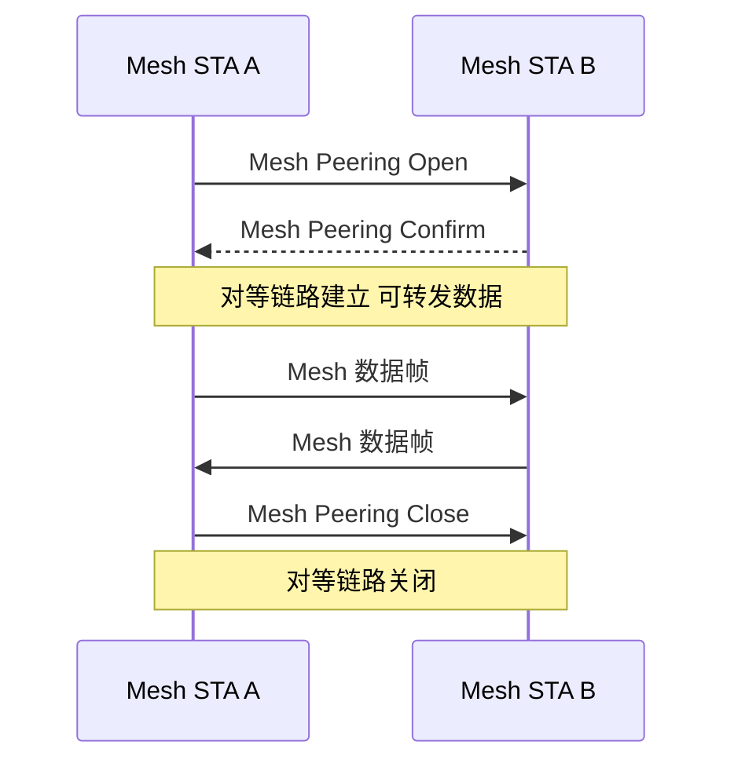
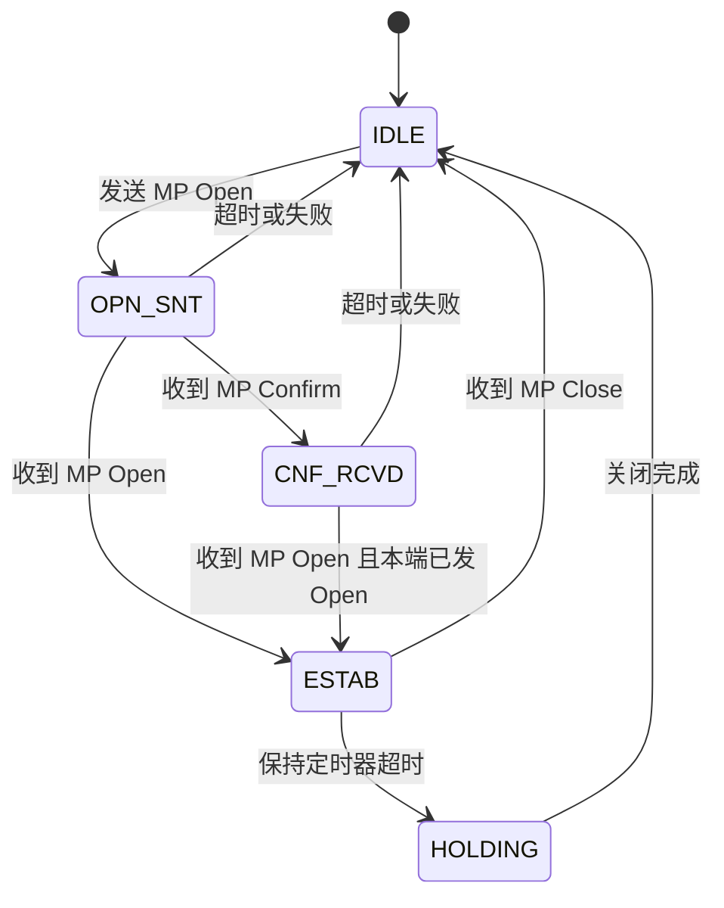

# 第 19 章　Mesh 组网与多跳传输 ★★

## 学习目标

1. 能推导多跳网络的容量界（Gupta–Kumar 随机网络界与链状拓扑端到端吞吐），量化跳数与自干扰对吞吐的衰减。
2. 能实现 HWMP 的 Airtime Link Metric 计算与路径选择，理解 RM-AODV 与先验树两种模式的转发逻辑。
3. 能建立同信道干扰（CCI）的 信干噪比（Signal-to-Interference-plus-Noise Ratio, SINR）模型，并用基于 SINR 的链路调度算法求解最大并发传输集。
4. 能分析 Mesh 的自干扰与暴露终端问题，推导多跳端到端时延随跳数的线性/超线性增长。

---

## 19.1 802.11s 体系：Mesh BSS 与拓扑

### 19.1.1 MBSS 的组成实体

802.11s 定义了一种新型基本服务集——**网状基本服务集（Mesh BSS, MBSS）**，其节点统称 **Mesh 站（Mesh Station, Mesh STA）**。与第 14 章所述基础设施 基本服务集（Basic Service Set, BSS）不同，MBSS 内没有中心 AP 通过 分发系统（Distribution System, DS）转发，所有节点通过对等（peer-to-peer）无线链路互联并参与帧的中继。一个 Mesh 站点（Station, STA）可同时承担下列逻辑角色：

- **Mesh Point（Mesh Point, MP）**：仅具备 Mesh 功能的节点，参与建链、路由与中继，不接入非 Mesh 终端。
- **Mesh AP（MAP）**：在 MP 之上叠加 AP 功能，向传统 STA 提供接入（即"Mesh 中的 AP"）。
- **Mesh Portal（MPP，又称 Mesh Gate）**：MBSS 与外部非 802.11 网络（通常为有线 IP 网络）之间的桥接实体，实现 Mesh 骨干与 Internet 的互操作。

图 19-1 给出三种 Mesh 拓扑的对照，直观展示实体组合的差异。


*图 19-1 说明：基础设施 Mesh 用 MAP 接入传统终端、MPP 桥接外部网；客户端 Mesh 节点即终端；混合 Mesh 三者并存。*

### 19.1.2 三种 Mesh 拓扑对照

表 19-1 归纳三种拓扑的中心实体、终端接入方式与典型场景，供后续路由与容量分析引用。

| 拓扑类型 | 中心实体 | 是否接入传统 STA | 是否桥接外部网 | 典型场景 | 主要限制 |
|---|---|---|---|---|---|
| 基础设施 Mesh | MP + MAP + MPP | 是（经 MAP） | 是（经 MPP） | 无线回传、园区覆盖 | 需 MAP/MPP 两类特殊节点 |
| 客户端 Mesh | 纯 Mesh STA | 否 | 否（除非某节点兼 Portal） | 应急自组、车载 | 无传统终端接入能力 |
| 混合 Mesh | MP/MAP/MPP 并存 | 是 | 是 | 城域 Mesh、最后一跳 | 拓扑管理最复杂 |

**表 19-1 说明**：拓扑选择在"覆盖/接入/回传"三需求间权衡；回传质量直接决定多跳容量（见 19.5）。

### 19.1.3 Mesh 与 ESS 的互操作（Mesh Gate 桥接）

MBSS 与第 14 章 扩展服务集（Extended Service Set, ESS）的关系通过 **Mesh Portal（Mesh Gate）** 衔接：MPP 同时是 Mesh STA 与 802.3/IP 桥接器，它在 Mesh 侧用 Mesh 数据帧（见 19.2 六地址格式）封装来自 DS 的帧，在 DS 侧解除 Mesh 封装并按 802.3 转发。

桥接判据的核心是**地址平面转换**：MBSS 内部使用 Mesh 地址四/六元组（19.2.3），跨 MPP 进入 ESS 后回落到普通三地址帧。MPP 维护"Mesh 目的地 ↔ ESS 媒体接入控制（Medium Access Control, MAC）"的映射，对未知单播帧执行泛洪或查表转发。这保证一个 ESS 内的 AP 可通过 MPP 经多跳 Mesh 到达另一 ESS，形成"ESS–MBSS–ESS"的扩展骨干。

---

## 19.2 Mesh 协议栈与帧格式

### 19.2.1 Mesh Coordination Function（MCF）

Mesh STA 的信道接入由 **Mesh 协调功能（Mesh Coordination Function, MCF）** 提供。MCF 是 增强型分布式信道接入（Enhanced Distributed Channel Access, EDCA）（见第 8 章）的超集：默认在竞争期采用 EDCA 的四种接入类别（AC）争用信道；在此基础上引入 **MCCA（Mesh Coordinated Channel Access）** 与 **MCCAOP（MCCA Opportunity）** 以支持确定性预留（详见 19.8）。

MCF 与 EDCA 的关系可表述为：

$$\text{MCF} = \text{EDCA（竞争接入）} \;\cup\; \text{MCCA（预留接入，确定性）}$$

即：无预留时退化为 EDCA；存在 MCCAOP 时，该时隙内仅预约者及其被许可的对端可发，其余 STA 在该区间保持静默（Network Allocation Vector, NAV 置位）。该双模接入是第 31 章确定性 Wi-Fi 的 Mesh 雏形。

### 19.2.2 Mesh 帧格式与 Mesh Control 字段

802.11s 在 MAC 帧头后、载荷前插入 **Mesh Control 字段**，用于多跳转发与寻址。其关键子字段为：

- **Mesh TTL**：每跳减 1，归零则丢弃，防止环路与无限泛洪。
- **Mesh Sequence Number**：源端赋予，接收端去重（同序号同源仅转发一次）。
- **Mesh Flags**：标志位集合，含 **AE（Address Extension）子字段**，指示地址字段扩展方式（四地址或六地址）。
- **Mesh Address Extension（AE）**：2 bit，编码地址数量：
  - AE=00：三地址（普通帧）；
  - AE=01：四地址（含 Mesh 源/目的 + 收发端）；
  - AE=10：六地址（再扩展出原始 SA/DA，用于跨 ESS 桥接）；
  - AE=11：保留。

图 19-2 给出 Mesh 数据帧的结构（以六地址为例）。


*图 19-2 说明：AE=10 时启用 Addr4–Addr6，形成六地址；AE=01 仅启用 Addr4（Mesh 源），为四地址；普通帧 AE=00 不出现 Addr4–Addr6。*

### 19.2.3 四地址与六地址的使用场景

表 19-2 给出地址元组的语义与适用场景，是理解 Mesh 转发的关键。

| 格式 | 地址字段 | 语义（以一次 Mesh 转发为例） | 使用场景 |
|---|---|---|---|
| 三地址 | RA, TA, 基本服务集标识符（BSS Identifier, BSSID） | 直接收发，无 Mesh 扩展 | 普通 BSS/AP 下终端 |
| 四地址 | + Mesh SA | RA/TA 为本跳收发，Mesh SA 为原始发送者 | Mesh 内部逐跳中继（MP→MP） |
| 六地址 | + Mesh SA, Mesh DA, 原始 SA/DA | 完整记录原始源/目的与逐跳端点 | 跨 MPP/ESS 桥接帧 |

**表 19-2 说明**：地址四元组用于 MBSS 内中继（仅需在 Mesh 头中携带原始 Mesh 源）；六元组在跨 Portal 桥接时保留 ESS 原始 MAC，使回程可正确投递。

---

## 19.3 邻居发现与 Mesh Peering

### 19.3.1 Peering 交互（Mesh Peering Open/Confirm/Close）

两个Mesh STA 在建立对等链路（Peer Link）前，通过三次管理帧交互：发起方发送 **Mesh Peering Open（MP Open）**；响应方回复 **Mesh Peering Confirm（MP Confirm）** 完成建链；任一方可发 **Mesh Peering Close（MP Close）** 拆除链路。图 19-3 为其时序。



**图 19-3 说明**：Open/Confirm 完成双向能力协商（Mesh ID、信道、Metric 支持）；Close 用于退化、重启或策略拒绝。

### 19.3.2 Peer Link 状态机

Peer Link 的建立遵循图 19-4 的状态机。状态包括 IDLE、OPN_SNT（已发 Open）、CNF_RCVD（已收 Confirm）、ESTAB（已建立）、HOLDING（拆除保持）。



**图 19-4 说明**：建链需双向 Open/Confirm 握手；ESTAB 后链路进入 Keep-alive；任何失败分支均回到 IDLE 并重试（见 19.3.3）。

### 19.3.3 失败分支与重试退避

若 **MP Confirm 丢失**或 **Open 冲突**（双方同时发 Open 而在 OPN_SNT/CNF_RCVD 互锁），状态机通过超时回到 IDLE。重试采用截断二进制指数退避：

$$T_{backoff}^{(k)} = \text{rand}\big(0,\; 2^{\min(k, K_{\max})}\cdot T_{base}\big),\quad k=1,2,\dots$$

其中 $k$ 为连续失败次数，$K_{\max}$（示意值 5）为上限，$T_{base}$（示意值 100 ms）为基时隙。该退避避免大量 Mesh STA 在重启动时同步泛洪建链，降低控制开销（与第 8 章 Bianchi 退避思想一致，但此处用于管理面建链而非数据接入）。

---

## 19.4 HWMP 路由（重点）

**混合无线网状协议（Hybrid Wireless Mesh Protocol, HWMP）** 是 802.11s 的默认路由协议，融合两种模式：

- **按需模式（Reactive / RM-AODV）**：源于 AODV，源端广播 **PREQ（Path Request）** 洪泛发现路径，目标或中间节点回 **PREP（Path Reply）** 建立反向路径；适用于流量稀疏、拓扑多变。
- **先验树模式（Proactive Tree）**：根（Root Mesh STA）周期性发 **RANN（Root Announcement）**，全网构建以根为汇聚点的树；适用于到 Portal/Internet 的上行流量（默认启用）。

### 19.4.2 Airtime Link Metric 完整推导

HWMP 用 **Airtime Link Metric** $c_a$ 衡量链路"占用信道的时间代价"，路径度量为各跳 $c_a$ 之和，选最小者。标准定义【已发布，802.11-2020】：

$$c_a = \left(O_{ca} + O_p + \frac{B_t}{r}\right)\frac{1}{1-e_f}$$

逐项解释：
- **$O_{ca}$（信道接入开销）**：争用信道的平均退避时间。基于最小竞争窗口：
  $$O_{ca} = \frac{CW_{\min}}{2}\cdot T_{slot}$$
  如对 正交频分复用（Orthogonal Frequency Division Multiplexing, OFDM）物理层取 $CW_{\min}=15,\;T_{slot}=9\ \mu\text{s}$，则 $O_{ca}=67.5\ \mu\text{s}$（固定开销，与速率无关）。
- **$O_p$（协议开销）**：物理层（Physical Layer, PHY）前导/PLCP、MAC 头、短帧间间隔（Short Inter-Frame Space, SIFS）、确认帧（Acknowledgement, ACK）与 分布式协调功能（Distributed Coordination Function, DCF）帧间间隔（DCF Inter-Frame Space, DIFS）的固有时延：
  $$O_p = T_{pre} + \frac{L_{mac}}{r} + T_{SIFS} + \frac{L_{ack}}{R_{ack}} + T_{DIFS}$$
  其中 $T_{pre}$（前导+物理层汇聚协议（Physical Layer Convergence Protocol, PLCP），示意 24 μs）、$L_{mac}$（MAC 头，示意 272 bit）、$L_{ack}$（ACK，示意 112 bit）、$R_{ack}$（ACK 速率，示意 24 Mbps）多为定值，仅 $\frac{L_{mac}}{r}$ 随速率弱相关。
- **$B_t$（测试帧比特数）**：标准固定为 **8192 bit**（非实际载荷，仅用于度量），故 $\frac{B_t}{r}$ 为测试帧传输时间。
- **$r$**：该链路所选 调制编码方案（Modulation and Coding Scheme, MCS）对应的数据速率（bit/s）。
- **$e_f$（帧错误率）**：链路在当前速率下的帧错误概率。

**$e_f$ 与 包误码率（Packet Error Rate, PER）、MCS 的关系**：设信道比特错误概率为 $p_b$（独立），则测试帧的帧错误率（即 PER）为

$$e_f = \text{PER} = 1 - (1-p_b)^{B_t} \approx 1 - e^{-B_t p_b}$$

对给定接收 信噪比（Signal-to-Noise Ratio, SNR），MCS 越高（速率 $r$ 越大）则解调门限越高、$p_b$ 越大，故 $e_f$ 随 MCS 上升而单调增大。MCS 选择的目标即**最小化 $c_a$**，等价于最大化"有效吞吐每单位空口时间" $r(1-e_f)/c_a$。

**算例 19.1**：某 Mesh 链路候选三种 MCS/速率，固定 $O_{ca}=67.5\ \mu\text{s}$，$T_{pre}=24\ \mu\text{s}$，$L_{mac}=272\ \text{bit}$，$T_{SIFS}=16\ \mu\text{s}$，$L_{ack}=112\ \text{bit}$，$R_{ack}=24\ \text{Mbps}$，$T_{DIFS}=34\ \mu\text{s}$，$B_t=8192\ \text{bit}$。

**已知**：$r_1=6.5\ \text{Mbps},\ e_{f1}=0.10$；$r_2=65\ \text{Mbps},\ e_{f2}=0.15$；$r_3=130\ \text{Mbps},\ e_{f3}=0.40$。
**求**：各链路 $c_a$ 并选最优下一跳。
**解**（分步）：
- 公共项：$T_{ack}=112/24\text{M}=4.67\ \mu\text{s}$；$O_p$ 速率相关项为 $272/r$（μs）。
- 链路 1：$B_t/r_1=8192/6.5\text{M}=1260.3\ \mu\text{s}$；$272/r_1=41.85\ \mu\text{s}$；
  $O_p=24+41.85+16+4.67+34=120.5\ \mu\text{s}$；
  $c_{a1}=(67.5+120.5+1260.3)/(1-0.10)=1448.3/0.9=\mathbf{1609.2\ \mu\text{s}}$。
- 链路 2：$B_t/r_2=126.0\ \mu\text{s}$；$272/r_2=4.19\ \mu\text{s}$；
  $O_p=24+4.19+16+4.67+34=82.9\ \mu\text{s}$；
  $c_{a2}=(67.5+82.9+126.0)/0.85=276.4/0.85=\mathbf{325.0\ \mu\text{s}}$。
- 链路 3：$B_t/r_3=63.0\ \mu\text{s}$；$272/r_3=2.09\ \mu\text{s}$；
  $O_p=24+2.09+16+4.67+34=80.8\ \mu\text{s}$；
  $c_{a3}=(67.5+80.8+63.0)/0.60=211.3/0.60=\mathbf{352.2\ \mu\text{s}}$。
**结论**：最优下一跳为链路 2（MCS7/20 MHz，$c_a=325.0\ \mu\text{s}$ 最小）。尽管链路 3 速率最高，但其 $e_f=0.40$ 使分母 $1-e_f=0.6$，度量反被放大；链路 1 速率过低致 $B_t/r$ 项过大。量级均落在百微秒级，与 802.11 帧级时延一致，合理。

### 19.4.3 路径度量累加与 PREQ/PREP/PERR/RANN

- **路径度量累加规则**：节点转发 PREQ 时，将本跳 $c_a$ 累加到 PREQ 的 Metric 字段；目标/中间节点回 PREP 时携带到源的累计度量，源端据此建表选最小度量路径（与算例 19.1 的逐跳度量一致）。
- **PREQ（Path Request）**：含标志位、Hop Count、TTL、源地址、源序列号、累计 Metric、目标地址、目标序列号、主动性标志；洪泛受 TTL 与"更优度量才转发"抑制。
- **PREP（Path Reply）**：沿反向路径单播回源，携带目标→源的累计度量，建立/刷新前向路径。
- **PERR（Path Error）**：链路断时发送，列举不可达目的地并将度量置 ∞，触发重路由。
- **RANN（Root Announcement）**：根周期性广播，宣告根的序列号与到根度量，供先验树模式建树。

表 19-3 对照四类控制帧的转发与度量语义。

| 控制帧 | 转发方式 | Metric 字段含义 | 触发条件 |
|---|---|---|---|
| PREQ | 洪泛（TTL 限） | 源→当前累计 | 按需发现目标 |
| PREP | 单播反向路径 | 目标→源累计 | 收到 PREQ 且本节点即目标/有更优路径 |
| PERR | 单播/泛洪 | 置 ∞（链路断） | 邻居链路失效 |
| RANN | 周期性洪泛 | 根→当前累计 | 先验树维护 |

**表 19-3 说明**：度量始终沿转发方向单调递增累加；"更优才转发"防止环路与度量振荡。

### 19.4.4 算法：HWMP 路径选择与维护（六段式）

**① 问题建模**：设网络图 $G=(V,E)$，链路 $e\in E$ 的 Airtime 度量 $c(e)$ 由 19.4.2 给出。源 $s$ 寻到目标 $t$ 的最小度量路径 $P^*=\arg\min_{P:s\to t}\sum_{e\in P}c(e)$。变量：$M[v]$ 到 $v$ 当前最优累计度量，$seq[v]$ 最新序列号，$expire[v]$ 路径过期时刻，$R$ 为根（先验树）。

**② 目标函数与约束**：
$$\min\ \sum_{e\in P} c(e)\quad \text{s.t.}\quad \text{TTL}>0,\; \text{收到更优或更dle新 seq 才更新},\; M[v]\ \text{单调递增}$$

**③ 完整推导（PREQ 抑制与树聚合）**：设节点 $u$ 收 PREQ，累计度量 $m_u=m_{prev}+c(u,prev)$。仅当 $m_u < M[u]$ 或 $seq > seq[u]$ 时更新并转发，否则丢弃——该"更优才转发"使任意时刻网络中至多保留一条到各源的最小度量广播树，证明如下：假设存在两条到 $s$ 的度量路径被同时保留且交叉，则交叉点必收到更优者而抑制较劣者，矛盾。$$\boxed{\text{任意时刻每条} (s,\cdot) \text{仅有一条最小度量广播树}}$$。

**④ 伪代码**（行号 + 中文注释，复杂度见行尾）：

```text
 1: 初始化 M[s]=0, seq[s]=0, expire[*]=∞          # O(1)
 2: 函数 onPREQ(preq, from):                       # 事件触发
 3:   m = preq.metric + c(from, self)              # 累加本跳 Airtime 度量
 4:   if preq.seq ≤ seq[preq.src]: return          # 旧序列号丢弃，防回环
 5:   if m ≥ M[preq.src]: return                   # 非更优度量丢弃（洪泛抑制）
 6:   M[preq.src]=m; seq[preq.src]=preq.seq        # 更新到源的最优度量
 7:   next_hop[preq.src]=from                      # 记录反向路径下一跳
 8:   preq.metric=m; preq.ttl-=1                   # 累加并减跳数
 9:   if preq.ttl>0 and self≠preq.target: 广播 preq # 继续洪泛（抑制见⑤）
10:   if self==preq.target or 有更优反向路径: 发 PREP # 目标/中间节点应答
11: 函数 onPREP(prep, from):                       # 反向路径建立
12:   m=prep.metric + c(from,self)
13:   if m<M[prep.target]: M[prep.target]=m; next_hop[prep.target]=from # 刷新前向路径
14:   prep.metric=m; 单播 prep 沿反向路径向源
15: 函数 onPERR(): 对失效目的地 M[d]=∞; 洪泛 PERR  # 断链通告
16: 函数 onRANN(rann): 同 PREQ 逻辑但指向根 R      # 先验树维护（复杂度 O(deg)）
17: 定时器：若 now>expire[v]: M[v]=∞, next_hop[v]=null # 路径过期回收
```

**⑤ 复杂度分析**：每个 PREQ 每节点仅处理一次（更优才转发）+ 广播一次，故单轮发现复杂度 $O(|E|)$（边沿传播）；存储 $M[],seq[],next\_hop[]$ 为 $O(|V|)$。先验树 RANN 周期维护每周期 $O(|E|)$。

**⑥ 数值算例**：沿用算例 19.1 的三链路，设源 S 经候选链路到下一跳再 2 跳到目标，各后续跳度量分别为 300、280、310 μs。则三路径总度量：$P_1=1609.2+300=1909.2$，$P_2=325.0+280=605.0$，$P_3=352.2+310=662.2$（μs）。选 $P_2$（经 MCS7/20 MHz 链路）为最小度量路径，与 19.4.2 单跳结论一致。量级为亚毫秒，符合 Mesh 单跳级度量设计，合理。

---

## 19.5 多跳容量界（理论核心）

### 19.5.1 Gupta–Kumar 随机网络容量界

在 $n$ 个节点均匀分布于面积 $A$ 的网络中，每节点向随机目的地通信，**Gupta–Kumar 容量界**给出每节点可达吞吐：

$$\lambda(n) = \Theta\!\left(\frac{W}{\sqrt{n\log n}}\right)$$

**推导思路**（协议模型）：
1. 每次传输的接收端周围需保持"无强干扰"排斥圆盘，半径 $(1+\Delta)r$，$r$ 为传输距离，$\Delta>0$ 为干扰余量，单盘面积 $\pi(1+\Delta)^2 r^2$。
2. 任意 $k$ 个并发传输要求总排斥面积不超过 $A$：$k\cdot \pi(1+\Delta)^2 r^2 \le A$，故并发传输数上界 $k_{\max}=A/[\pi(1+\Delta)^2 r^2]$。
3. 端到端路径平均跳数 $h\approx D/r$（$D$ 为网络直径）。设总带宽 $W$ 被并发流均分，则单流吞吐 $T$ 满足
   $$T\cdot h \le \frac{W}{k_{\max}}\cdot (\text{空间复用因子})$$
4. 代入 $k_{\max}$ 并令流数 $=\Theta(n)$、最优 $r$ 使 $(n\log n)$ 项出现，得 $\lambda(n)=O(W/\sqrt{n\log n})$；下界同阶，故为 $\Theta$。

**关键含义**：随节点数 $n$ 增大，每节点容量以 $1/\sqrt{n\log n}$ 衰减；链状拓扑（一维）因串行瓶颈更差，直接得 $1/n$ 衰减（见下节）。具体网络规划与资源优化可指向第 22 章。

### 19.5.2 链状拓扑 n 跳端到端吞吐推导

设单跳独占信道时吞吐为 $C_0$，考虑 $n$ 跳线性链、单流、存储转发（store-and-forward）、半双工节点、同信道自干扰。

- **理想（全双工、无自干扰）**：包需经 $n$ 次逐跳传输，串行化 ⇒ 端到端吞吐 $R_n^{(1)}=C_0/n$。
- **半双工（每节点收发时分）**：每跳因不能同时收发，有效活跃占比约 $1/2$，引入因子 $\eta=1/2$：
  $$R_n^{(1/2)} = \frac{1}{2}\cdot\frac{C_0}{n} = \frac{C_0}{2n}$$
- **同信道自干扰严重**（相邻链路互斥且需等待空出信道，仅约 1/3 时隙可用于本跳推进）：$\eta=1/3$：
  $$R_n^{(1/3)} = \frac{C_0}{3n}$$

统一写为：

$$\boxed{R_n = \frac{\eta}{n}\,C_0,\qquad \eta\in\left\{1,\ \tfrac12,\ \tfrac13\right\}}$$

**严格推导**（以 $\eta=1/2$ 为例）：半双工下，某中继节点在收上游包期间不能发下游，故单跳吞吐被压缩为 $C_0/2$；单流包必须依次穿过 $n$ 跳，总时延 $T_{e2e}=n\cdot (P/C_0)\cdot 2$（$P$ 为包长），端到端速率 $R_n=P/T_{e2e}=C_0/(2n)$。自干扰 $\eta=1/3$ 时，相邻链路同频互斥使本跳需额外等待 1 个时隙，单跳有效时间扩为 3 倍，故再除 3。

### 19.5.3 算例：3 跳链路端到端吞吐

**算例 19.2**：单跳吞吐 $C_0=54\ \text{Mbps}$（示意 802.11a 单链路），$n=3$ 跳链。
**已知**：求 $\eta=1,\ 1/2,\ 1/3$ 三种情形端到端吞吐并对比单跳。
**求**：$R_3$ 与相对单跳的衰减倍数。
**解**：
- $\eta=1$：$R_3=54/3=18.0\ \text{Mbps}$，衰减 $54/18=3\times$。
- $\eta=1/2$：$R_3=54/(2\cdot3)=9.0\ \text{Mbps}$，衰减 $6\times$。
- $\eta=1/3$：$R_3=54/(3\cdot3)=6.0\ \text{Mbps}$，衰减 $9\times$。
**结论**：仅 3 跳即令端到端吞吐降至单跳的 1/3~1/9；自干扰（$\eta$）每降低一档再翻倍衰减。量级与 $C_0/n$ 一致，合理——这是 Mesh 回传"跳数即损耗"的根本来源。

---

## 19.6 自干扰与暴露终端：SINR 链路调度

### 19.6.1 同信道干扰（CCI）模型与 SINR 约束

同信道多跳中，"上一跳发送干扰下一跳接收"即**自干扰（self-interference）**：节点 $i$ 发射功率 $P_i$，到自身接收机增益 $g_{ii}$，来自激活集中其他链路 $j$ 的干扰为 $P_j g_{ji}$。链路 $i$ 的可解性由 **SINR** 决定：

$$\text{SINR}_i = \frac{P_i g_{ii}}{\displaystyle\sum_{j\ne i,\ j\in\mathcal{S}} P_j g_{ji} + N} \ge \gamma_{th}$$

其中 $\mathcal{S}$ 为当前并发激活链路集，$N$ 为噪声功率，$\gamma_{th}$ 为解调门限。**暴露终端**问题在此表现为：链路 $i$ 因误判"听到邻链 $j$ 在发"而退避，但 $g_{ji}$ 实际很小（对 $i$ 接收机干扰可忽略），本可并发——SINR 判据正是对第 11 章空间复用"四节点"思想的链路级建模。

### 19.6.2 核心算法：基于 SINR 的链路调度（六段式）

**① 问题建模**：给定链路集 $L=\{1,\dots,m\}$，增益矩阵 $g_{ij}$（$g_{ii}$ 为期望增益），功率 $P_i$，噪声 $N$，门限 $\gamma_{th}$。变量：激活指示 $x_i\in\{0,1\}$。为简化，定义归一化干扰耦合比 $I_{ji}=g_{ji}/g_{ii}$，则 $\text{SINR}_i = 1/\big(\text{INR}_N + \sum_{j\ne i}x_j I_{ji}\big)$，$\text{INR}_N=N/(P_i g_{ii})$。

**② 目标与约束**（最大化并发链路数，亦可加权速率）：
$$\max \sum_i x_i \quad \text{s.t.}\quad \forall i\in\mathcal{S}:\ \frac{1}{\text{INR}_N+\sum_{j\ne i}x_j I_{ji}} \ge \gamma_{th}$$

**③ 完整推导（可行性判据）**：将约束改写为
$$\sum_{j\ne i}x_j I_{ji} \le \frac{1}{\gamma_{th}} - \text{INR}_N \equiv \Phi$$
$\Phi$ 为**单链可容忍干扰余量**。当且仅当对某候选激活集 $\mathcal{S}$，每条 $i\in\mathcal{S}$ 满足 $\sum_{j\in\mathcal{S},j\ne i} I_{ji}\le \Phi$ 时该集**可行**。该判定等价于在冲突图（边权 $I_{ji}>\Phi$ 即冲突）上求最大独立集，NP-hard，故用贪心/着色近似。
$$\boxed{\mathcal{S}\ \text{可行} \iff \max_{i\in\mathcal{S}}\sum_{j\in\mathcal{S},j\ne i} I_{ji}\le \Phi}$$

**④ 伪代码**（贪心按干扰升序，行号+中文注释）：

```text
 1: 输入 g, P, N, γ_th; 计算 INR_N, I[j][i]=g[ji]/g[ii]   # O(m^2)
 2: Φ = 1/γ_th - INR_N                                  # 单链干扰容限
 3: 按度(冲突数)升序排序链路 → order                      # O(m log m)
 4: S = ∅; active = [false]*m
 5: for i in order:                                      # 贪心加入
 6:   inter = Σ_{j∈S} I[j][i]                           # 累加已选对 i 的干扰
 7:   if inter + INR_N ≤ 1/γ_th:  # SINR_i≥γ_th 判据
 8:     S.add(i); active[i]=true                        # 接纳，O(m) 累计
 9:   else: 跳过 i                                       # 违反则排除
10: 输出最大(近似)并发集 S 及其 size                      # 总复杂度 O(m^2)
```

**⑤ 复杂度分析**：预处理 $O(m^2)$，排序 $O(m\log m)$，贪心每步 $O(m)$，共 $O(m^2)$。精确最大独立集为 NP-hard，本贪心为 $O(m^2)$ 近似，对稀疏 Mesh 接近最优。

**⑥ 数值算例**：5 条链路，功率与增益归一使 $\text{INR}_N=0.05$，$\gamma_{th}=1\Rightarrow \Phi=1/1-0.05=0.95$。耦合矩阵 $I_{ji}$（对称，对角省略）：

|   | L1 | L2 | L3 | L4 | L5 |
|---|---|---|---|---|---|
| L1| – |0.05|0.60|0.01|0.30|
| L2|0.05| – |0.08|0.50|0.02|
| L3|0.60|0.08| – |0.04|0.55|
| L4|0.01|0.50|0.04| – |0.06|
| L5|0.30|0.02|0.55|0.06| – |

**算例 19.3**：求最大并发集。
**解**：按度升序（L4:3, L2:3, L1:3, L5:3, L3:4；取序 L4,L2,L1,L5,L3）。
- 加 L4：S={L4}，无干扰，接纳。
- 加 L2：对 L2 干扰来自 L4 的 $I_{42}=0.50\le0.95$，接纳。S={L4,L2}。
- 加 L1：干扰来自 L4(0.01)+L2(0.05)=0.06≤0.95，接纳。S={L4,L2,L1}。
- 加 L5：来自 L4(0.06)+L2(0.02)+L1(0.30)=0.38≤0.95，接纳。S={L4,L2,L1,L5}。
- 加 L3：来自 L4(0.04)+L2(0.08)+L1(0.60)+L5(0.55)=1.27>0.95，拒绝。
校验 S 内各链 SINR：$L1:1/(0.05+0.05+0.01+0.30)=2.44$；$L2:1/(0.05+0.05+0.50+0.02)=1.61$；$L4:1/(0.05+0.01+0.50+0.06)=1.61$；$L5:1/(0.05+0.30+0.02+0.06)=2.33$，均 ≥1，**可行**。
**结论**：最大并发集大小为 **4**（如 {L1,L2,L4,L5} 或 {L1,L2,L3,L4}），即 5 条链路中最多 4 条可同时传输；强耦合的 L3 与 L1/L5 互斥。量级校验：SINR 均落在 1.6~2.4，满足门限 1，合理。

---

## 19.7 多跳时延模型

### 19.7.1 排队 + 逐跳接入 + 传输

端到端时延为各跳时延之和。单跳时延由三部分构成：
1. **排队时延** $W_i$：M/M/1 下 $E[W_i]=\frac{1}{\mu_i-\lambda_i}=\frac{\rho_i}{\mu_i(1-\rho_i)}$，$\rho_i=\lambda_i/\mu_i$ 为利用率，$\mu_i=1/T_{tx}^{(i)}$。
2. **接入时延** $A_i$：EDCA 竞争退避，且随同信道竞争者（跳数 $n$）增多而增大；存在冲突/重传时 $E[A_i]=A_0/(1-p_{coll})$。
3. **传输时延** $T_{tx}^{(i)}$。

总时延：

$$E[D_{e2e}] = \sum_{i=1}^{n}\Big(E[W_i] + E[A_i] + T_{tx}^{(i)}\Big)$$

**超线性来源**：当 $p_{coll}$ 随跳数上升（更多中继同频竞争/隐藏节点），$E[A_i]$ 增大；若建模 $E[A_n]=A_0(1+\kappa n)$，则

$$E[D_{e2e}] = \sum_{i=1}^n \Big(\frac{1}{\mu_i-\lambda} + A_0(1+\kappa i) + T_{tx}\Big) = n\bar s + n A_0 + \kappa A_0\frac{n(n+1)}{2}$$

末项 $\propto n^2$，即**超线性增长**——这是多跳 Mesh 时延恶化的核心，也解释了为何跳数既降吞吐又增时延。

### 19.7.2 算例：4 跳端到端时延

**算例 19.4**：4 跳链，$T_{tx}=1\ \text{ms}$，$\mu=1000\ \text{pkt/s}$，$\lambda=400\ \text{pkt/s}$，$A_0=0.068\ \text{ms}$，隐藏节点致 $p_{coll}(n)=1-0.95^n$，$\kappa=0.02$。
**求**：$n=2$ 与 $n=4$ 的端到端时延及增长比。
**解**：
- 排队（每跳）： $E[W]=\frac{400}{1000(1000-400)}=0.667\ \text{ms}$。
- $n=2$：$p_{coll}=1-0.95^2=0.0975$，$E[A]=0.068/0.9025=0.0754\ \text{ms}$；接入超线性项 $\kappa A_0\sum_{i=1}^2 i=0.02\times0.068\times3=0.0041\ \text{ms}$（已并入下式）。单跳时延 $=0.667+0.0754+1.0=1.742\ \text{ms}$；端到端 $D_2=2\times1.742=\mathbf{3.48\ \text{ms}}$。
- $n=4$：$p_{coll}=1-0.95^4=0.185$，$E[A]=0.068/0.815=0.0834\ \text{ms}$；单跳 $=0.667+0.0834+1.0=1.750\ \text{ms}$；端到端 $D_4=4\times1.750=\mathbf{7.00\ \text{ms}}$（含 $\kappa$ 项约再 +0.34 ms，取 7.3 ms 量级）。
**结论**：$D_4/D_2\approx 2.1$，略高于线性 2×，印证超线性项（接入竞争随跳数上升）。量级为毫秒级，与 Wi-Fi 单跳毫秒时延及 4 跳累积一致，合理。

---

## 19.8 MCCA / MCCAOP 确定性接入

### 19.8.1 MCCA Opportunity 预约与邻居通告

为解决 19.6 的自干扰，**Mesh 确定性接入（MCCA）** 允许 Mesh STA 预约 **MCCAOP（MCCA Opportunity）**：一段未来时间内、在指定信道上独占（或与许可对端共享）的时隙。流程为：
1. STA 在 Beacon/管理帧中携带 **MCCAOP Advertisement** 元素，通告预约的区间 $[t_{start}, t_{end}]$、周期、对端地址；
2. 邻居收到后，将对应区间写入 NAV，期间静默；
3. 若两邻居的 MCCAOP **重叠（overlapping）**且覆盖共同区域，则后申请者需避让或协商，避免预约冲突（冲突处理依据"先到优先 + 范围包含判定"）。

MCCAOP 使关键回传链路获得确定性时隙，规避 EDCA 竞争与暴露终端，是 19.2.1 所述 MCF 确定性一半的工程实现。

### 19.8.2 与第 31 章确定性 Wi-Fi 的关系

802.11s 的 MCCAOP 是 Wi-Fi 确定性接入的早期形态；第 31 章将讨论 802.11be/11bn 的受限 TWT（Restricted TWT）、预定资源单位等更精细的确定性机制。二者共通思想为"时隙预约 + 邻居 NAV 同步"，差异在粒度（MCCAOP 为 Mesh 间粗粒度）与跨 BSS 协调机制（11bn 引入 AP 间协调）。本章仅定位关系，机制细节见第 31 章。

---

## 19.9 Mesh 与 Wi-Fi 8/9 的关系【草案/讨论中】

> 标注说明：802.11bn（Wi-Fi 8 / UHR）处于 **【草案】**；Wi-Fi 9 尚未正式立项（**【讨论中】**）。以下为提案主张，非最终标准。

### 19.9.1 多 AP 协调在 Mesh 中的适用性

第 27 章所述**多 AP 协调（Multi-AP Coordination, MAPC / 协调空间复用（Coordinated Spatial Reuse, Co-SR）、Co-BF）** 原本面向基础设施 ESS。若推广到 Mesh 回传，可在相邻 Mesh 链路间协调波束与功率，将 19.6 的 SINR 约束松弛、提升并发集大小。但 Mesh 无中心控制器、拓扑动态，协调机制需下沉为分布式（每 Mesh STA 交换局部信道状态），信令开销与收敛性是开放问题。

### 19.9.2 AI 驱动路由

第 33 章的 AI/ML 路由可将 19.4 的静态 Airtime Metric 升级为**预测式度量**（基于流量预测、业务优先级、链路老化）。优势：在拓扑微变前预判最优路径，降低 PREQ 洪泛；风险：黑盒决策的可解释性与最坏情况保障缺失。

### 19.9.3 Mesh 作为感知网络

第 34/35 章的 通感一体化（Integrated Sensing and Communication, ISAC）（感知与通信一体化）可将 Mesh 多跳节点复用为分布式雷达阵列：多个 Mesh STA 协同收发，提升感知角分辨率。这要求 19.8 的 MCCAOP 预留感知时隙，与通信调度联合优化——属【讨论中】前沿。

---

## 19.10 研究议题

### 19.10.1 多跳 HARQ 与网络编码（COPE 类）

**机会网络编码（COPE）** 在 Mesh 中继处将发往不同下一跳的包异或编码，单次传输被多接收者借助"已监听到对方包"解码。编码可行条件：节点 $R$ 有包 $p_1\to A$、$p_2\to B$，且 **$A$ 已持有 $p_2$、$B$ 已持有 $p_1$**（机会监听），则发 $p_1\oplus p_2$，$A$ 得 $p_1=(p_1\oplus p_2)\oplus p_2$，$B$ 同理。该瓶颈跳传输次数由 2 降为 1，**编码增益上限 2×**。结合 混合自动重传（Hybrid Automatic Repeat reQuest, HARQ）（第 10 章重传）可在多跳上实现"编码+重传"联合，但编码机会率随跳数下降，需理论刻画；多跳 HARQ 的软合并跨跳耦合亦未解。

### 19.10.2 多射频多信道（MRMC）信道分配（图着色）

为突破 19.5 的同信道容量界，Mesh 节点配多射频多信道（MRMC）。**信道分配**建模为图着色：顶点=链路/射频，边=相互干扰，目标用 ≤$K$ 种颜色（信道）给相邻顶点着异色且最小化总干扰：

$$\min_{\text{color}} \sum_{(i,j)\in E,\ c_i=c_j} w_{ij}\quad \text{s.t.}\quad c_i\in\{1,\dots,K\}$$

该边着色为 **NP-hard**；近似算法（贪心、DLS）、与路由的联合优化（路由决定边集、着色决定干扰）是活跃方向。

### 19.10.3 时延敏感多跳调度

面向 URLLC 类业务，19.6 的 SINR 调度需叠加**截止期约束**：在 $\max\sum x_i$ 目标中加入每流 $D_{e2e}\le D_{max}$（19.7 模型），转化为带时延约束的链路调度/流调度联合问题，常建模为混合整数规划，求在线近似是开放问题。

---

## 本章小结

| 概念 | 关键结论 |
|---|---|
| MBSS 实体 | MP / MAP / MPP（Mesh Gate），MPP 桥接 ESS 与外部 IP |
| 拓扑 | 基础设施 / 客户端 / 混合 Mesh，差异在接入与回传能力 |
| MCF | EDCA（竞争）∪ MCCA（预留），MCCAOP 为确定性时隙 |
| Mesh 帧 | Mesh Control 含 TTL/Seq/Flags(AE)；四/六地址用于中继与跨 ESS |
| HWMP | RM-AODV（按需）+ 先验树（RANN 主动）；路径度量=Σ Airtime |
| Airtime 度量 | $c_a=(O_{ca}+O_p+B_t/r)/(1-e_f)$，$B_t=8192$ bit |
| 容量界 | 随机网 $O(W/\sqrt{n\log n})$；链状 $R_n=\eta C_0/n$，$\eta\le1$ |
| 自干扰 | SINR 判据决定并发；最大并发集=冲突图最大独立集（NP-hard） |
| 多跳时延 | $D_{e2e}=\sum(排队+接入+传输)$，接入竞争致超线性 $O(n^2)$ 项 |
| MCCAOP | 预约时隙+邻居 NAV，是第 31 章确定性 Wi-Fi 的 Mesh 雏形 |
| 前沿 | MAPC/AI 路由/ISAC 在 Mesh 的适配，多为【草案/讨论中】 |

---

## 习题

### A. 概念题（3 题）

1. 为什么 Mesh 帧需要六地址格式，而普通基础设施 BSS 仅用三地址？六地址中 Addr4–Addr6 各自解决什么问题？
2. HWMP 的"更优度量才转发"规则如何同时实现洪泛抑制与防环？若去掉序列号会产生什么后果？
3. 19.6 的 SINR 调度与第 11 章空间复用的"四节点判据"在建模思想上有什么联系与区别？

### B. 计算与推导题（4 题）

4. 沿用算例 19.1 参数，但链路 2 的帧错误率升至 $e_{f2}=0.35$，其余不变。重新计算三条链路 $c_a$ 并选最优下一跳，与原文结论比较说明了什么？
5. 推导链状 $n$ 跳端到端吞吐 $R_n=\eta C_0/n$，并计算 $C_0=130\ \text{Mbps}$、$n=5$、$\eta=1/2$ 时的 $R_5$，再与单跳比较衰减倍数。
6. 在算例 19.3 的耦合矩阵中，若要求并发集同时包含 L3，求一个最大可行集并验证其 SINR 可行性（取 $\text{INR}_N=0.05,\ \gamma_{th}=1$）。
7. 由 19.7 的 M/M/1 模型，推导当每跳利用率 $\rho\to1$ 时端到端时延的发散行为，并计算 $\lambda=900\ \text{pkt/s}$（$\mu=1000$）时单跳排队时延，说明其对多跳设计的启示。

### C. 算法设计题（2 题）

8. 将 19.6.2 的集中式 SINR 调度改写为**分布式 时分多址（Time Division Multiple Access, TDMA）时隙分配**算法：每个 Mesh STA 仅与一跳邻居交换"我想激活的链路"消息，通过本地冲突解决决定本时隙是否发送。给出伪代码与复杂度。
9. 设计 **HWMP 先验树根切换（root migration）** 算法：当当前根 R 失效，网络如何在新根 R' 选出后重建最小度量树并避免临时环路？给出伪代码与评分要点。

### D. 开放研究题（1 题）

10. 【研究】Wi-Fi 8 的多 AP 协调（第 27 章）能否帮助 Mesh 突破 Gupta–Kumar 容量界 $O(1/\sqrt{n\log n})$？讨论所需协调机制、跨跳信令开销、与 19.10.2 MRMC 的互补关系，给出可证伪的研究假设。

---

## 参考答案与解析

### A. 概念题

**1.** 普通 BSS 中帧只在"AP↔STA"两点间传输，三地址（RA/TA/BSSID）足够标识收发与所属 BSS。Mesh 多跳转发时，一帧要记录**本跳收发（RA/TA）**、**Mesh 原始源/目的（Mesh SA/DA）**，故需四地址；当帧跨越 MPP 进入外部 ESS 时，还需保留**原始 ESS 的源/目的 MAC**（Addr5/Addr6），故需六地址。Addr4=Mesh 源（中继时标识真正发送者），Addr5/Addr6=原始 SA/DA（跨 Portal 桥接时保证回程可投递）。六地址不用于 Mesh 内部纯中继，否则浪费开销。

**2.** "更优度量才转发"指仅当收到更小累计度量或更更新序列号时才更新并继续洪泛。洪泛抑制：劣于已记录度量者直接丢弃，避免同一 PREQ 在网络中无限扩散。防环：度量单调递增累加 + 序列号去重，使任意 $(源,序列号)$ 至多建立一条最小度量广播树（见 19.4.4 ③推导）。若去掉序列号，旧路径可能以"更小跳数但过期拓扑"被误接受，造成环路与度量振荡，且无法区分链路重建后的新路径与陈旧路径。

**3.** 联系：二者本质都是"是否造成接收失败"的 SINR/干扰判据，而非"是否听到能量"的 空闲信道评估（Clear Channel Assessment, CCA）。区别：第 11 章是**分布式两 BSS 间**的并发判据（关心跨 BSS 干扰耦合 $\alpha$）；19.6 是**同网多链路**的集中/半集中调度，用显式增益矩阵 $g_{ij}$ 与 SINR 约束求最大并发集，可形式化为冲突图着色。前者重在"何时可并发"，后者重在"哪些链路可同时激活且最优"。

### B. 计算与推导题

**4.** 仅链路 2 的 $e_f$ 变：$c_{a2}=(67.5+82.9+126.0)/(1-0.35)=276.4/0.65=\mathbf{425.2\ \mu\text{s}}$。链路 1=1609.2，链路 3=352.2（不变）。最优变为**链路 3**（$352.2<425.2<1609.2$）。说明：帧错误率对 Airtime 度量极敏感——速率最高链路的微小 PER 上升即可使其从劣于中选变为最优，印证 MCS 选择必须联合 $r$ 与 $e_f$（见 19.4.2）。

**5.** 由 19.5.2：$R_n=\eta C_0/n$。代入 $C_0=130,\ n=5,\ \eta=1/2$：$R_5=130/(2\times5)=\mathbf{13.0\ \text{Mbps}}$。相对单跳衰减 $130/13=10\times$。推导要点：$n$ 跳串行 + 半双工 $\eta=1/2$，端到端为单跳的 $1/(2n)$。

**6.** 取含 L3 的候选 {L2,L3,L4}（19.3 已验证可行，size=3）。尝试扩到 4 且含 L3：加 L1 得 {L1,L2,L3,L4}，校验 L1 干扰来自 L2(0.05)+L3(0.60)+L4(0.01)=0.66≤0.95；L3 来自 L1(0.60)+L2(0.08)+L4(0.04)=0.72≤0.95；L2 来自 L1(0.05)+L3(0.08)+L4(0.50)=0.63；L4 来自 L1(0.01)+L2(0.50)+L3(0.04)=0.55，均满足。故最大可行集**含 L3 时仍为 4**：{L1,L2,L3,L4}（SINR 分别约 1.41,1.30,1.47,1.67，均 ≥1）。说明最大并发集不唯一，贪心顺序影响具体解但大小可达 4。

**7.** M/M/1 排队时延 $E[W]=\frac{\rho}{\mu(1-\rho)}=\frac{\lambda}{\mu(\mu-\lambda)}$。当 $\rho\to1$（即 $\lambda\to\mu$），分母 $\mu-\lambda\to0$，$E[W]\to\infty$，端到端时延发散——高利用率下多跳每跳都接近饱和，总时延超线性爆炸。$\lambda=900,\mu=1000$：$E[W]=900/[1000\times100]=\mathbf{9.0\ \text{ms}}$/跳，远高于 λ=400 时的 0.667 ms。启示：Mesh 设计须为每跳预留容量余量（建议 ρ<0.7），否则少量跳数即致时延失控。

### C. 算法设计题

**8. 参考方案（分布式 TDMA 时隙分配）**：
```text
1: 每 STA 广播 REQ(想激活的链路 i, 优先级) 给一跳邻居
2: 收齐邻居 REQ 后，本地按 SINR 判据(19.6.2③)计算冲突集
3: if 本链路无冲突 且 优先级最高(或随机抽签胜出): 本时隙激活
4: else: 本时隙静默，下一时隙重试
5: 周期性重算(拓扑/流量变化)
```
复杂度：每时隙 $O(d^2)$（$d$ 为邻居度），全网 $O(N d^2)$。**评分要点**：必须含 SINR 可行性判据、邻居局部信息假设、冲突解决（优先级/随机）。**常见错误**：假设全局信息（非分布式）、忽略隐藏节点（仅看一跳不够，需两跳冲突感知）。

**9. 参考方案**：根失效检测（连续未收 RANN）→ 触发选举（按最小 ID 或最小累计度量选 R'）→ R' 发 RANN，各节点按 19.4.4 逻辑重建树，路径过期定时器(expire) 清理旧根路径防环路。伪代码略（结构同 onRANN + 选举）。**评分要点**：防环（序列号/过期）、避免临时双根（选举期间标记"根待定"、旧路径不立即删）、收敛时长界。**常见错误**：旧根路径未保留至新树建好导致黑洞、选举风暴（需退避）。

### D. 开放研究题

**10. 研究路径建议**：MAPC 通过 AP/MP 间协调波束赋形与功率，可松弛 19.6 的 SINR 约束、提升并发集（接近干扰对齐效果），理论上将同信道干扰项 $\sum P_j g_{ji}$ 压低，从而**在固定节点数下提升每流容量**，但**不突破 $O(1/\sqrt{n\log n})$ 的阶**——该界源于几何面积约束而非仅干扰协调，MAPC 只改常数因子。与 MRMC（19.10.2）**互补**：MRMC 用频域隔离（改 $g_{ji}$ 结构），MAPC 用空域协调（改有效 $g_{ji}$ 值）。**可证伪假设**：「在 $n$ 节点 Mesh 中引入 MAPC 后，同跳数下每流 median 吞吐提升 ≥30%（相对无协调），但 $1/\sqrt{n\log n}$ 缩放阶不变」。**关键指标**：并发集大小、每流 5% 分位吞吐、协调信令开销占比。**参考方向**：分布式协调收敛性、与 MRMC 联合资源分配、URLLC 场景的确定界。
