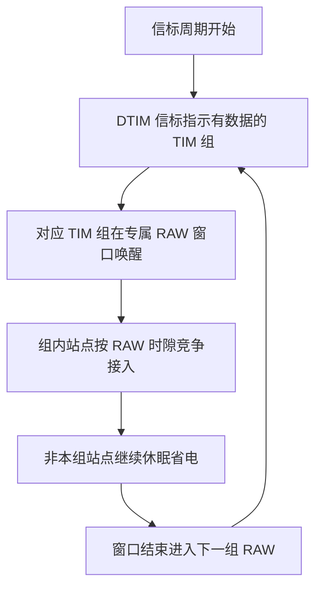
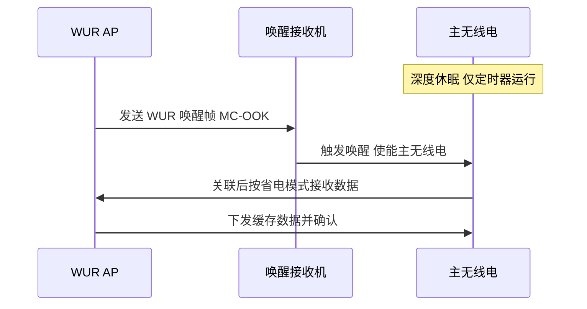

# 第 20 章　Wi-Fi HaLow 与物联网变体 ★

## 学习目标

1. 能从路径损耗模型（详见第 1 章）定量推导 Sub-1 GHz 相对 2.4 GHz 的覆盖增益，并核算 1 km 链路预算的可行性。
2. 能对照 802.11ac/ax 的正交频分复用（Orthogonal Frequency Division Multiplexing, OFDM）数模（numerology，含子载波间隔与符号时长），推导 802.11ah 的窄带数模及其覆盖增强机理。
3. 能计算 802.11ah 的调制编码方案（Modulation and Coding Scheme, MCS）速率、推导 1 MHz MCS0 接收灵敏度，并给出受限接入窗口（Restricted Access Window, RAW）与流量指示图（Traffic Indication Map, TIM）分段的容量与时延核算。
4. 能对比 802.11ah/802.11ba/802.11af/802.11p/802.11bd/802.11aj/802.11bb/802.11br 等变体的设计取舍，并设计 RAW 参数联合优化算法。

> 时效基准：2026 年 9 月。802.11ah（Wi-Fi HaLow）、802.11ba（WUR）、802.11af、802.11aj、802.11bb 均为【已发布】标准；802.11bd【已发布】；802.11br（光通信增强）标【草案】。涉及频段监管均注明地区与时间基准。

---

## 20.1 为什么需要 Sub-1 GHz

### 20.1.1 频率与路径损耗的定量关系

由第 1 章的 Friis 方程，自由空间损耗（Free-Space Path Loss, FSPL）的分贝形式为

$$
L_{fs}[\text{dB}] = 20\log_{10} d + 20\log_{10} f_{\rm MHz} + 32.44
$$

其中 $d$ 单位为米、$f_{\rm MHz}$ 单位为 MHz。可见损耗随频率按 $20\log_{10} f$ 单调上升，与距离按 $20\log_{10} d$ 上升。把 2.4 GHz 与 900 MHz 放在相同距离下比较，频率项之差为

$$
\Delta L_f = 20\log_{10}\frac{2400}{900} = 20\log_{10}(2.667) = 8.52\ \text{dB}
$$

即在**完全相同的发射功率、天线增益与距离**下，900 MHz 比 2.4 GHz 少用约 8.5 dB 的路径损耗——这 8.5 dB 直接转化为覆盖半径或链路余量的增益。在自由空间中，半径与频率成反比（$L_{fs}\propto f^2d^2$），故有

$$
\frac{d_{900}}{d_{2.4}} = \frac{f_{2.4}}{f_{900}} = \frac{2400}{900} = 2.67
$$

即 900 MHz 的覆盖半径约为 2.4 GHz 的 **2.67 倍**。在非视距（Non-Line-of-Sight, NLOS）对数距离模型中，$L(d)=L(d_0)+10n\log_{10}(d/d_0)$，频率项落在参考项 $L(d_0)$ 内，因此覆盖半径比变为

$$
\frac{d_{900}}{d_{2.4}} = 10^{\,0.852/n}
$$

当路径损耗指数 $n=2$（近自由空间）时为 2.67 倍，$n=3$（典型室内/稠密遮挡）时降为 $10^{0.284}\approx 1.92$ 倍。频率越低，覆盖优势在 NLOS 下虽然被衰减指数摊薄，但**物理上始终为正**。

### 20.1.2 穿透损耗随频率下降

除自由空间项外，材料穿透损耗也随频率上升。第 1 章表 1.3 显示 2.4/5/6 GHz 的混凝土承重墙穿透损耗从 12–20 dB 升到 20–28 dB。外推到 Sub-1 GHz：同类墙体对 900 MHz 的穿透损耗比 2.4 GHz **低约 3–6 dB**，比 5 GHz 低约 8–12 dB。原因是墙体介电损耗与趋肤深度均随波长增大而减小。因此 Sub-1 GHz 在"穿墙进地下室、穿透工厂金属货架间隙"类场景中具有不可替代性。

### 算例 20.1：2.4 GHz 与 900 MHz 覆盖半径比较

**已知**：某传感器链路预算允许的最大路径损耗 $L_{\max}=110\ \text{dB}$（由发射 等效全向辐射功率（Equivalent Isotropically Radiated Power, EIRP）、接收灵敏度、余量共同决定，两边相同），参考距离 $d_0=1\ \text{m}$ 处 $L(d_0)=20\log_{10}f_{\rm MHz}+32.44$。

**求**：两种频段在（a）自由空间、（b）$n=3$ NLOS 下的覆盖半径。

**解**：

（a）自由空间：$L_{\max}=20\log_{10}d+20\log_{10}f_{\rm MHz}+32.44$。

- 2.4 GHz：$110=20\log_{10}d_{2.4}+20\log_{10}2400+32.44=20\log_{10}d_{2.4}+99.04$ → $d_{2.4}=10^{(110-99.04)/20}=10^{0.548}=3.53\ \text{m}$（此处仅演示比例，实际取更大 $L_{\max}$ 量级见算例 20.2）。
- 900 MHz：$110=20\log_{10}d_{900}+20\log_{10}900+32.44=20\log_{10}d_{900}+91.52$ → $d_{900}=10^{0.924}=8.39\ \text{m}$。
- 比值 $d_{900}/d_{2.4}=8.39/3.53=2.38\approx 2.67$ 的量级（微小差异来自 $L(d_0)$ 取整）。

（b）$n=3$：$L_{\max}=L(d_0)+30\log_{10}(d/d_0)$，$d_0=1\ \text{m}$。

- 2.4 GHz：$110=99.04+30\log_{10}d_{2.4}$ → $d_{2.4}=10^{(10.96)/30}=10^{0.365}=2.32$。
- 900 MHz：$110=91.52+30\log_{10}d_{900}$ → $d_{900}=10^{0.616}=4.13$。
- 比值 $4.13/2.32=1.78\approx 10^{0.852/3}=1.92$ 量级。

**结论**：同一预算下，900 MHz 覆盖半径在视距约为 2.4 GHz 的 2.7 倍，在 $n=3$ 遮挡环境约为 1.8 倍；频率下降带来的增益在 NLOS 下被衰减指数部分抵消，但方向确定为正。

### 20.1.3 Sub-1 GHz 的频谱分配与监管（2026-09 基准）

802.11ah 工作在各国不同的免许可 Sub-1 GHz 子频段，且**无全球统一信道编号**（与 2.4/5/6 GHz 不同）。下表汇总主要区域（时间基准 2026-09，监管可能随 5G 重耕而调整）：

| 区域 | 子频段 (MHz) | 可用带宽 (MHz) | 备注 |
|---|---|---|---|
| 美国 | 902–904 / 904–920 / 920–928 | 1, 2, 4, 8, 16 | Part 15.247，最大 16 MHz |
| 中国 | 755–779 / 779–787 | 1（前段）；1, 2, 4, 8（后段） | 见下方说明 |
| 欧洲 | 863–868 | 1, 2 | ETSI EN 300 220，占空比受限 |
| 日本 | 916.5–927.5 | 1 | 11 个 1 MHz 信道 |
| 韩国 | 917.5–923.5 | 1, 2, 4 | — |
| 新加坡 | 866–869 / 920–925 | 1, 2 / 1, 2, 4 | — |
| 澳大利亚 | 915–920 / 920–928 | 1, 2, 4 / 1, 2, 4, 8 | — |

**中国情况（2026-09 核实）**：802.11ah 历史上可使用的 Sub-1G 频段为 **755–787 MHz**（前段 755–779 仅 1 MHz 信道，后段 779–787 支持 1/2/4/8 MHz）。但需注意两点：① 470–510 MHz 是中国主要的免许可 LPWA（低功耗广域网）频段（与 LoRa、Z-Wave 等共享），并非 802.11ah 主用；② 755–787 MHz 中的部分已随 5G 新空口（3GPP）（New Radio, NR）重耕被划为授权频谱，实际可部署的 802.11ah 频谱受限，工程落地以行业专网与特定认证设备为主。本书凡涉及中国 Sub-1G 频段均以此时间基准为准，部署前须查 SRRC/MIIT 最新公告。


*图 20-1　Sub-1 GHz 信道化：前段 755–779 MHz 仅 1 MHz 信道，后段 779–787 MHz 支持 1/2/4/8 MHz 组合但受 5G 重耕压缩；无全球统一信道编号。*

---

## 20.2 802.11ah 物理层

### 20.2.1 频段与信道化

802.11ah 的物理层可视为 **802.11ac 的 10 倍降频（10× down-clocking）** 版本。它定义 2/4/8/16 MHz 信道，并额外定义 1 MHz 信道用于超远覆盖；1 MHz 与 2 MHz 为**强制支持**。其 快速傅里叶变换（Fast Fourier Transform, FFT）规模与数据子载波数随带宽缩放：

| 带宽 (MHz) | FFT 规模 | 数据子载波 | 导频 | 1 MHz 重复支持 |
|---|---|---|---|---|
| 1 | 32 | 24 | 2 | S1G_DUP_1M |
| 2 | 64 | 52 | 4 | S1G_DUP_2M |
| 4 | 128 | 108 | 6 | — |
| 8 | 256 | 234 | 8 | — |
| 16 | 512 | 468 | 16 | — |

### 20.2.2 窄带数模推导（对照 11ac/ax）

**子载波间隔**：11ac 在 20 MHz 下子载波间隔 $\Delta f=312.5\ \text{kHz}$（64 点 FFT，符号时长 $3.2\ \mu\text{s}$）。11ah 的 2/4/8/16 MHz 模式直接复用 11ac 的 FFT 规模并做 10 倍降频，故

$$
\Delta f_{\rm ah} = \frac{312.5\ \text{kHz}}{10} = 31.25\ \text{kHz}
$$

1 MHz 模式用 32 点 FFT，子载波间隔同为 $1/(32\times 1\ \mu\text{s})\approx 31.25\ \text{kHz}$（有用符号时长 $32\ \mu\text{s}$），与上述一致。

**与 802.11ax 的对照**：11ax（High Efficiency, HE）子载波间隔为 $78.125\ \text{kHz}$、符号时长 $12.8\ \mu\text{s}$。因此

$$
\frac{\Delta f_{\rm ax}}{\Delta f_{\rm ah}}=\frac{78.125}{31.25}=2.5,\qquad
\frac{T_{\rm sym,ax}}{T_{\rm sym,ah}}=\frac{12.8}{32}=0.4=\frac{1}{2.5}
$$

即 **11ah 子载波间隔比 11ax 缩小 2.5 倍，符号时长放大 2.5 倍**。这带来两个覆盖增益：

1. **抗时延扩展**：循环前缀（Cyclic Prefix, CP）按同等比例放大（Guard Interval, GI = 4/8/16 $\mu\text{s}$，对应总符号 36/40/48 $\mu\text{s}$），对多径的容忍度提升 2.5 倍，适合大时延扩展的室外/工厂环境。
2. **覆盖增强**：更窄的子载波使接收机在相同带宽内的积分增益更高，且符号时长更长，对相位噪声与时钟漂移更鲁棒。

**保护间隔（GI）变体**：短 GI = 4 $\mu\text{s}$（总符号 36 $\mu\text{s}$）、长 GI = 8 $\mu\text{s}$（总符号 40 $\mu\text{s}$）、超长 GI = 16 $\mu\text{s}$（总符号 48 $\mu\text{s}$，专用于极限覆盖）。

### 20.2.3 MCS 0–10 与速率表

11ah 的 MCS 0–9 与 11ac 同构（BPSK 1/2 至 256-QAM 5/6），并新增 **MCS 10** 用于 1 MHz 超远覆盖：

- **MCS 8/9（256-QAM）仅在带宽 ≥ 2 MHz 时可用**，1 MHz 模式不支持；
- **MCS 10 = BPSK 1/2 且 2× 重复（repetition）**，**仅 1 MHz 模式**，速率约为 MCS0 的一半，换取约 3 dB 的处理增益。

**速率公式**（单空间流）：

$$
R = N_{\rm data}\times b_{\rm sym}\times r_c\times f_{\rm sym}\times N_{\rm ss}
$$

其中 $N_{\rm data}$ 为数据子载波数、$b_{\rm sym}$ 为每子载波比特数、$r_c$ 为码率、$N_{\rm ss}$ 为空间流数，$f_{\rm sym}$ 为符号速率（长 GI：$1/40\ \mu\text{s}=2.5\times10^4\ \text{sym/s}$；短 GI：$1/36\ \mu\text{s}\approx 2.78\times10^4\ \text{sym/s}$）。

**算例（内联推导）**：8 MHz、MCS 9（256-QAM，$b_{\rm sym}=8$，$r_c=5/6$）、短 GI。$N_{\rm data}=234$，$f_{\rm sym}=2.78\times10^4$：

$$
R = 234\times 8\times\frac{5}{6}\times 2.78\times10^4 \approx 4.33\times10^7\ \text{bps} = 43.3\ \text{Mbps}
$$

这即单流 8 MHz 的上限（用户常引的"约 40 Mbps"）。若扩展到 16 MHz（×2）或 4 流（×4），理论上限可达 ~347 Mbps，但 IoT 单设备多为 1 流，故本书以 **150 kbps（MCS10 1 MHz）–~40 Mbps（1 流 8 MHz MCS9）** 为典型区间。

| MCS | 调制 | 码率 | 1 MHz（长/短 GI） | 2 MHz（长/短 GI） | 4 MHz（长/短 GI） | 8 MHz（长/短 GI） |
|---|---|---|---|---|---|---|
| 0 | BPSK | 1/2 | 0.30 / 0.33 | 0.65 / 0.72 | 1.35 / 1.50 | 2.93 / 3.25 |
| 1 | 四相移键控（Quadrature Phase Shift Keying, QPSK） | 1/2 | 0.60 / 0.67 | 1.30 / 1.44 | 2.70 / 3.00 | 5.85 / 6.50 |
| 4 | 16-QAM | 3/4 | 1.80 / 2.00 | 3.90 / 4.33 | 8.10 / 9.00 | 17.55 / 19.50 |
| 7 | 64-QAM | 5/6 | 3.00 / 3.34 | 6.50 / 7.22 | 13.50 / 15.00 | 29.30 / 32.50 |
| 9 | 256-QAM | 5/6 | N/A | 8.67 / 9.63 | 18.0 / 20.0 | 39.0 / 43.33 |
| 10 | BPSK | 1/2 (rep2) | 0.15 / 0.17 | N/A | N/A | N/A |

> 单位：Mbps；N/A 表示该带宽/MCS 组合不可用。

### 20.2.4 覆盖增强特性

1. **1 MHz 重复模式（S1G_DUP）**：把 1 MHz 信号在更宽的占用带宽上重复发送（如 4 MHz 上重复 4 次），提升接收可靠性的同时仍保持 1 MHz 的窄带增益。
2. **超长 GI（16 $\mu\text{s}$）**：专为千米级覆盖设计，容忍极大时延扩展。
3. **行导频（Traveling Pilot）**：相比 11ac 的固定导频，11ah 新增行导频以更好地跟踪多普勒，支持移动接收。
4. **MCS10 重复**：如 20.2.3 所述，以半速率换取 ~3 dB 处理增益。

---

## 20.3 链路预算与覆盖（算例 20.2）

11ah 的接收灵敏度由热噪声底、噪声系数（Noise Figure, NF）、所需信噪比（Signal-to-Noise Ratio, SNR）与实现损耗决定：

$$
\boxed{S = -174 + 10\log_{10}B + NF + \gamma_{\rm req} + \Delta_{\rm impl}}
$$

其中 $B$ 为信道带宽（Hz），$\gamma_{\rm req}$ 为对应 MCS 的解调门限 SNR，$\Delta_{\rm impl}$ 为实现损耗。

**表 20-1　1 MHz MCS0/MCS10 链路预算（示意值，2026-09 典型低功耗芯片）**

| 项 | 符号 | 值 | 说明 |
|---|---|---|---|
| 发射 EIRP（Access Point, AP） | $P_{\rm tx}+G_{\rm tx}$ | 26 dBm | 20 dBm 传导 + 6 dBi 扇区天线 |
| 接收天线增益 | $G_{\rm rx}$ | 0 dBi | 终端全向 |
| 带宽 | $B$ | 1 MHz | 1 MHz 模式 |
| 热噪声底 | $-174+10\log_{10}B$ | −114 dBm | $10\log_{10}10^6=60$ |
| 噪声系数 | $NF$ | 6 dB | 低成本 IoT 接收机 |
| 所需 SNR（MCS0） | $\gamma_{\rm req}$ | 4 dB | BPSK 1/2，包误码率（Packet Error Rate, PER）≈10% |
| 实现损耗 | $\Delta_{\rm impl}$ | 1 dB | 估计/量化 |
| **灵敏度 MCS0** | $S_0$ | **−103 dBm** | 式 (20.3) |
| 重复处理增益 | $G_{\rm rep}$ | 3 dB | MCS10 的 rep2 |
| **灵敏度 MCS10** | $S_{10}$ | **−106 dBm** | $S_0+G_{\rm rep}$ |

### 算例 20.2：1 MHz MCS0/MCS10 的 1 km 覆盖可行性

**已知**：$f=900\ \text{MHz}$，发射 EIRP = 26 dBm，$S_0=-103\ \text{dBm}$，$S_{10}=-106\ \text{dBm}$，自由空间路径损耗模型。

**求**：1 km 处是否可通。

**解**：900 MHz、1 km 的自由空间损耗

$$
L_{fs}(1\ \text{km}) = 20\log_{10}(1000)+20\log_{10}(900)+32.44 = 60+59.08+32.44 = 151.5\ \text{dB}
$$

接收功率

$$
P_{\rm rx} = {\rm EIRP} + G_{\rm rx} - L_{fs} = 26 + 0 - 151.5 = -125.5\ \text{dBm}
$$

所需最低接收功率（取 MCS10，最鲁棒）为 $S_{10}=-106\ \text{dBm}$。链路余量

$$
M = P_{\rm rx} - S_{10} = -125.5 - (-106) = -19.5\ \text{dB}
$$

**结论**：在 900 MHz **纯自由空间**下，1 km 需要 EIRP $\ge S_{10}+L_{fs}=-106+151.5=45.5\ \text{dBm}$ 才能用 MCS10 连通，而典型 HaLow AP 的 EIRP（≈26–36 dBm）不足以支撑 1 km 自由空间链路。因此"1 km 覆盖目标"是**设计目标**，实际可达需满足以下之一：

- 使用更低频率（如 700 MHz，$L_{fs}\approx 149.3\ \text{dB}$，所需 EIRP 降至约 43 dBm）；
- 采用更高 EIRP 的 AP（定向高增益天线）；
- 处于半视距/地反射 constructive 环境（增益可达 +6 dB）；
- 仅承载极低速 MCS10 信标类业务。

**量纲检查**：$L_{fs}$ 单位为 dB，$P_{\rm rx}$ 单位 dBm，余量单位 dB，自洽；151.5 dB 对 1 km/900 MHz 属常识量级（2.4 GHz 同距离约 160 dB，差值恰为 8.5 dB，与 20.1.1 一致）。故 11ah 的"1 km"是**有利条件下的上限**，NLOS 稠密场景实际为数百米量级。

---

## 20.4 802.11ah MAC 层

### 20.4.1 S1G 帧格式压缩

传统 802.11 数据帧 媒体接入控制（Medium Access Control, MAC）头约 30–36 字节（帧控制 2 + 时长 2 + 三地址各 6 + 序列 2 + 服务质量（Quality of Service, QoS） 2 + HT 4）。11ah 引入 **S1G 短 MAC 头（S1G Short MAC header）**，利用分层 AID 替代完整 MAC 地址，将头压缩到约 2–6 字节，并提供：压缩的 QoS/HT Control、空数据分组（Null Data Packet, NDP）帧（NDP CTS/PS-Poll/ACK/Block-ACK 等）、以及 PV1 帧格式（用于 S1G 的精简变种）。

### 算例 20.4：小包场景下头压缩的吞吐提升

**已知**：传感器 payload $L_p=20\ \text{B}$，物理层（Physical Layer, PHY）速率 $R=0.3\ \text{Mbps}$（1 MHz MCS0），帧校验序列（Frame Check Sequence, FCS） = 4 B。

**求**：传统长头 vs S1G 短头的 MAC 效率。

**解**：

- 传统：MAC 开销 = 30（头）+ 4（FCS）= 34 B；PHY 前导/信令等效开销折算约 7.5 B（按 0.3 Mbps 约 200 $\mu\text{s}$ 前导）。总开销 41.5 B。效率 $\eta_{\rm leg}=20/(20+41.5)=32.5\%$。
- S1G 短头：MAC 开销 = 6（头）+ 4（FCS）= 10 B；S1G 前导更短，折算约 4 B。总开销 14 B。效率 $\eta_{\rm s1g}=20/(20+14)=58.8\%$。

吞吐提升比 $=58.8/32.5=1.81$ 倍。**结论**：小包 IoT 场景下，S1G 头压缩使有效吞吐接近翻倍，这是 11ah 在传感类业务上相对传统 Wi-Fi 的关键收益。

### 20.4.2 AID 分层结构与 TIM 分段

11ah 把关联标识符（Association Identifier, AID）扩展为 **13 bit**，支持最多 $2^{13}-1=8191$ 个站点（传统 11 仅 2007），并采用四级分层：

| 层级 | 位数 | 取值数 | 含义 |
|---|---|---|---|
| Page ID | 2 | 4 | 页（顶级分组） |
| TIM Group（Block） | 3 | 8 | 每页 8 个 TIM 组 |
| Sub-block | 5 | 32 | 每组 32 个子块 |
| 站点（Station, STA） index | 3 | 8 | 每子块 8 个站点 |

总容量 $=4\times8\times32\times8=8192$（AID 0 保留给组播）。**TIM 分段**把巨大的虚拟位图拆分到多个 Beacon：传送流量指示消息（Delivery TIM, DTIM） Beacon 先指示"哪些 TIM 组有数据"，只有被点名的 TIM 组在各自 TIM Beacon 窗口唤醒并解析子位图，其余组继续休眠。这把"全网点名"降级为"分组点名"，既缩短位图长度，又降低竞争域与功耗。与之相对，第 12 章的 non-TIM（非 TIM）站点采用反向轮询（如周期性 RAW/PRAW 窗口）主动上报，无需 AP 缓存。

### 20.4.3 RAW 机制

受限接入窗口（RAW）是 11ah 扩展大规模接入的核心：AP 在信标中通过 RPS（RAW Parameter Set）元素把站点划分为多个 RAW 组，每组分配专属的时间窗口与（可选）时隙集合；窗口内仅该组成员可竞争，窗口外站点休眠。跨时隙边界禁止传输规则避免组间干扰。

**图 20-2　RAW 分组接入时序（Mermaid）**



**图 20-3　RAW 时隙与分组时序**


*图 20-3　RAW 时隙与分组时序：一个 RAW 周期由 Beacon/DTIM 后接若干 RAW 组组成，每组含 K 个时隙、仅该组站点竞争，非本组站点在其它组窗口内休眠。*

RAW 把全网 $N$ 个站点的竞争域从 $N$ 降到组内规模 $S=N/G$，从而显著降低碰撞概率（详见算法 20.1）。

### 20.4.4 核心算法：RAW 参数联合优化（六段式）

下面以"给定 $N$ 个站点与每信标周期总 RAW 槽数 $K_{\rm tot}$，在接入时延约束下最大化成功接入量并最小化能耗"为目标，建立 RAW 的组数 $G$ 与每组槽数 $K$ 的联合优化。

**① 问题建模**

- 变量：组数 $G$（整数），每组站点数 $S=N/G$，每组时隙数 $K$（整数）。
- 参数：单槽时长 $t_s$，每组固定开销 $O_{\rm sym}$（RAW IE + 组头，单位槽），每槽成功概率模型见下。
- 假设：组内站点采用时隙 ALOHA 式尝试，尝试概率 $p$。

**② 目标函数与约束**

最大化成功接入量等价于让每组在其窗口内完成全部 $S$ 个站点的上传：

$$
\max_{G,K}\ \eta_{\rm succ},\qquad \text{s.t.}\quad K\cdot \eta(S)\ge S,\quad T_{\rm cycle}=G\,(O_{\rm sym}+K)\,t_s\le T_{\max}
$$

其中 $\eta(S)$ 为每组每槽成功服务站点数的期望，能耗指标取占空比 $\alpha=1/G$（组越多，单站休眠占比越高）。

**③ 完整推导**

单槽内恰好一个站点发送的概率（给定组大小 $S$、尝试概率 $p$）：

$$
P_s(S;p)=S\,p\,(1-p)^{S-1}
$$

对 $p$ 求极值：

$$
\frac{\partial P_s}{\partial p}=S(1-p)^{S-2}\big[(1-p)-p(S-1)\big]=0
\ \Rightarrow\ p^*=\frac{1}{S}
$$

代回得最优单槽成功率

$$
\boxed{\eta^*(S)=P_s(S;p^*)=\left(1-\frac{1}{S}\right)^{S-1}\xrightarrow{S\gg1}\frac{1}{e}\approx 0.368}
$$

于是每组所需时隙 $K^*(S)=\lceil S/\eta^*(S)\rceil\approx \lceil eS\rceil$（$S\ge 5$）。RAW 周期

$$
T_{\rm cycle}=G\,(O_{\rm sym}+K^*)t_s=\frac{N}{S}\,(O_{\rm sym}+eS)\,t_s
= N\,O_{\rm sym}\,t_s\cdot\frac{1}{S}+e\,N\,t_s
$$

占空比 $\alpha=1/G=S/N$。构造联合代价（权重 $w_L$ 为时延、$w_P$ 为能耗）

$$
J(S)=w_L\,T_{\rm cycle}+w_P\,\alpha
=w_L\!\left(\frac{N\,O_{\rm sym}\,t_s}{S}+eN t_s\right)+w_P\frac{S}{N}
$$

对 $S$ 连续求极小：

$$
\frac{dJ}{dS}=-w_L\frac{N\,O_{\rm sym}\,t_s}{S^2}+\frac{w_P}{N}=0
\ \Rightarrow\ S^2=\frac{w_L\,N^2\,O_{\rm sym}\,t_s}{w_P}
$$

$$
\boxed{S^*=N\sqrt{\frac{w_L\,O_{\rm sym}\,t_s}{w_P}},\qquad G^*=\frac{N}{S^*}=\sqrt{\frac{w_P}{w_L\,O_{\rm sym}\,t_s}}}
$$

**④ 伪代码**

```text
1  // 输入: N, t_s, O_sym, T_max, w_L, w_P
2  S_star = N * sqrt( (w_L * O_sym * t_s) / w_P )   // 最优每组站点数, 式(20.10)
3  S = max(1, round(S_star))                          // 整数化, 避免小于1
4  G = ceil(N / S)                                    // 组数
5  eta = (1 - 1/S)^(S-1)                              // 最优单槽成功率(≈1/e)
6  K = ceil(S / eta)                                  // 每组时隙数
7  T_cycle = G * (O_sym + K) * t_s                    // 周期
8  if T_cycle > T_max:                                // 时延越界则增大 S
9      S = S + 1;  goto 4                             // 重新求解直至满足
10 alpha = S / N                                      // 占空比(能耗指标)
11 输出: G, S, K, T_cycle, alpha
```

**⑤ 复杂度分析**：伪代码主体为若干 $O(1)$ 运算，第 8–9 行的回退循环最多执行 $O(\sqrt{N})$ 次（每步 $S$ 增 1），故时间复杂度 $O(\sqrt{N})$，空间 $O(1)$，可每个信标周期在线执行。

**⑥ 数值算例（N = 2000）**

**算例 20.3（RAW 参数优化）**：取 $t_s=2\ \text{ms}$，$O_{\rm sym}=2$ 槽，$w_L=w_P=1$：

$$
S^*=2000\sqrt{\frac{1\times2\times0.002}{1}}=2000\sqrt{0.004}=2000\times0.0632=126.5
$$

取整 $S=127$，$G=\lceil 2000/127\rceil=16$，$\eta^*=(1-1/127)^{126}\approx 1/e=0.368$，$K=\lceil 127/0.368\rceil=345$ 槽。周期

$$
T_{\rm cycle}=16\times(2+345)\times0.002=16\times347\times0.002=11.1\ \text{s}
$$

占空比 $\alpha=127/2000=6.4\%$。**量纲检查**：$G$（无量纲）$\times$ 槽（无量纲）$\times t_s(\text{s})=\text{s}$，自洽；与理论下限 $eN t_s=2.718\times2000\times0.002=10.87\ \text{s}$ 仅差 0.23 s（开销贡献），量级合理。对比"不分组"（单窗口 $S=2000$）：占空比 100%（全网全程清醒），RAW 把能耗降到 6.4%，而成功接入量/周期相同——证明 **RAW 的核心收益是功耗与时延边界，而非单纯吞吐**。

### 20.4.5 快速关联、RELAY 与 PV1

- **集中式认证/快速关联**：11ah 支持在 S1G 下的快速初始链路建立（Fast Initial Link Setup 思路延伸），降低大规模入网信令开销。
- **中继（RELAY）**：允许站点作为中继转发远端站点的流量，扩展覆盖（弥补 20.3 所示 1 km 自由空间缺口）。
- **PV1 帧格式**：S1G 专用的精简 MAC 帧版本，配合短头进一步压缩开销。

---

## 20.5 功耗与电池寿命

站点功耗由发射、接收、空闲侦听、休眠四态构成（详见第 12 章）。对 Sub-1G 传感器，关键是用**极低占空比**把空闲侦听替换为休眠。

### 算例 20.5：5000 mAh 电池的寿命估算

**已知**：电池容量 $C=5000\ \text{mAh}$，标称电压 $V=3.7\ \text{V}$；上报周期 $T_r=600\ \text{s}$（10 分钟）；活跃能耗：TX 100 mW（20 dBm）× 5 ms、唤醒 50 mW × 100 ms、RX 60 mW × 10 ms；休眠电流 $I_{\rm sleep}=50\ \mu\text{A}$。

**求**：理想电池寿命。

**解**：电池能量

$$
E_{\rm bat}=V\cdot C=3.7\times(5000\times10^{-3}\times3600)=3.7\times18000=66600\ \text{J}
$$

单周期活跃能耗：

$$
E_{\rm act}=0.1\times0.005+0.05\times0.1+0.06\times0.01=0.0005+0.005+0.0006=0.0061\ \text{J}=6.1\ \text{mJ}
$$

休眠能耗：$P_{\rm sleep}=3.7\times50\times10^{-6}=1.85\times10^{-4}\ \text{W}=185\ \mu\text{W}$。单周期总能耗

$$
E_{\rm cyc}=E_{\rm act}+P_{\rm sleep}\,T_r=0.0061+1.85\times10^{-4}\times600=0.0061+0.111=0.117\ \text{J}
$$

每日周期数 $144$，日能耗 $E_{\rm day}=144\times0.117=16.85\ \text{J}$。寿命

$$
T_{\rm life}=E_{\rm bat}/E_{\rm day}=66600/16.85=3953\ \text{天}\approx 10.8\ \text{年}
$$

**量纲检查**：$E_{\rm bat}$（J）/ $E_{\rm day}$（J/天）= 天，再 /365 = 年，自洽；休眠占单周期 $0.111/0.117=95\%$ 能耗，符合"长眠短发"的 IoT 模型。**结论**：理想模型下寿命达十年量级，但**实际受锂电池自放电（约 2–5%/月，对应 2–4 年）与休眠电流非理想限制**，真实寿命约为数年；若上报更频繁或休眠电流更高，寿命按 $T_r$ 与 $I_{\rm sleep}$ 线性缩短。

---

## 20.6 802.11ba 唤醒无线电（WUR）

唤醒无线电（Wake-Up Radio, WUR）【已发布，IEEE 802.11ba-2021】解决"空闲侦听最贵"问题（第 12 章）：让主无线电（Primary Connectivity Radio, PCR）完全关断，仅保留一个微瓦级 WUR 接收机监听唤醒帧。

### 20.6.1 OOK 调制与帧格式

WUR 采用**多载波开关键控（Multi-Carrier On-Off Keying, MC-OOK）**：在 20 MHz 主信道中占用 13 个中心子载波（中心子载波空），"开"符号携带能量、"关"符号静默。数据速率两档：

- 低速率（LDR）：62.5 kbps，同步序列 128 $\mu\text{s}$（2 $\mu\text{s}$/符号）；
- 高速率（HDR）：250 kbps，同步序列 64 $\mu\text{s}$（1 $\mu\text{s}$/符号）。

WUR 帧以传统 20 MHz 前导（L-STF/L-LTF/L-SIG）开头，使传统站点把介质视为忙，随后才是 WUR 专属的同步（WUR-Sync）与数据（WUR-Data）部分。

### 20.6.2 唤醒流程

**图 20-4　WUR 唤醒流程（Mermaid）**



### 20.6.3 省电增益推导

传统 PS 模式需周期性唤醒主无线电监听 Beacon/TIM，功耗为毫瓦级；WUR 监听仅微瓦级（目标 < 1 mW，典型数十–数百 $\mu\text{W}$）。设主无线电监听功耗 $P_{\rm listen}=75\ \text{mW}$，WUR 监听功耗 $P_{\rm WUR}=0.1\ \text{mW}$，监听占空比相同 $d$。省电比（监听段功率比）

$$
\frac{P_{\rm listen}}{P_{\rm WUR}}=\frac{75}{0.1}=750\ \text{倍}
$$

即**仅在唤醒监听环节，WUR 就把功耗降低约 750 倍**；再结合"仅在被点名时才唤醒 PCR"，整体待机能耗可下降 2–3 个数量级，使纽扣电池设备待机从数月延长到数年。

**算例（内联）**：若原 PS 模式每 100 ms 唤醒 2 ms 监听（$d=2\%$），$P_{\rm avg,PS}=0.02\times75=1.5\ \text{mW}$；WUR 模式全程 WUR 监听 $P_{\rm avg,WUR}=0.1\ \text{mW}$，仅在收到唤醒帧后短暂开启 PCR（占比可忽略）。平均功耗比 $1.5/0.1=15$ 倍，待机寿命相应延长约 15 倍。

### 20.6.4 算法：WUR 监听占空比联合优化（六段式）

下面把 20.6.3 的省电增益落成可计算的调度算法：给定唤醒时延上限，求最小监听占空比。

**① 问题建模**

- 变量：WUR Beacon 周期 $T_b$（AP 发送唤醒信标的间隔），STA 监听窗口 $t_{\rm cap}$（同步捕获所需最短时间）。
- 参数：最大可容忍唤醒时延 $L_{\max}$，WUR 监听功耗 $P_{\rm WUR}$，主无线电监听功耗 $P_{\rm listen}$。
- 假设：STA 在 $T_b$ 内随机相位进入监听，平均等待时延为 $T_b/2$。

**② 目标函数与约束**

最小化平均监听功耗

$$
\min_{T_b}\ P_{\rm avg}=P_{\rm WUR}\cdot\frac{t_{\rm cap}}{T_b}
\qquad \text{s.t.}\quad \frac{T_b}{2}\le L_{\max}
$$

**③ 完整推导**

时延约束给出 $T_b\le 2L_{\max}$。因 $P_{\rm avg}\propto 1/T_b$，取上界得最优周期 $T_b^*=2L_{\max}$。代入占空比 $d=t_{\rm cap}/T_b$：

$$
\boxed{d^*=\frac{t_{\rm cap}}{2L_{\max}},\qquad P_{\rm avg}^*=P_{\rm WUR}\cdot\frac{t_{\rm cap}}{2L_{\max}}}
$$

对比主无线电方案（以 Beacon 周期 $T_B$ 周期性唤醒监听，占空比 $d_B=t_{\rm cap}/T_B$，$T_B$ 同样受 $L_{\max}$ 约束取 $2L_{\max}$），两者占空比相同但功耗差一个因子 $P_{\rm WUR}/P_{\rm listen}\approx 10^{-3}$，即省电比即由该因子决定。

**④ 伪代码**

```text
1  // 输入: L_max, t_cap, P_WUR, P_listen
2  T_b = 2 * L_max                          // 最大允许周期, 满足时延约束
3  d_star = t_cap / T_b                     // 最优占空比
4  P_avg_WUR = P_WUR * d_star               // WUR 平均监听功耗
5  P_avg_legacy = P_listen * d_star         // 同占空比下主无线电监听功耗
6  save_ratio = P_avg_legacy / P_avg_WUR    // 省电倍数
7  输出: T_b, d_star, P_avg_WUR, save_ratio
```

**⑤ 复杂度分析**：全为 $O(1)$ 标量运算，可在每个关联建立时执行一次；若 $L_{\max}$ 随业务动态变化，每变更一次重算，复杂度 $O(1)$，无累积开销。

**⑥ 数值算例**：取 $L_{\max}=100\ \text{ms}$，$t_{\rm cap}=2\ \text{ms}$，$P_{\rm WUR}=0.1\ \text{mW}$，$P_{\rm listen}=75\ \text{mW}$。

$$
T_b^*=2\times0.1=0.2\ \text{s},\quad d^*=\frac{0.002}{0.2}=0.01,\quad P_{\rm avg}^*=0.1\times0.01=0.001\ \text{mW}=1\ \mu\text{W}
$$

省电倍数 ${\rm save}=75/0.1=750$ 倍（与 20.6.3 一致）。**量纲检查**：$t_{\rm cap}(\text{s})/T_b(\text{s})=$ 无量纲占空比，乘功率得功率，自洽；1 $\mu\text{W}$ 量级与 WUR 目标（<1 mW）吻合，合理。

---

## 20.7 其他 IoT 变体对比

下表汇总 Wi-Fi 家族中面向长距离、低功耗或特殊介质的变体（状态以 2026-09 为准）：

| 标准 | 频段 | 带宽 | 峰值速率 | 覆盖 | 功耗定位 | 典型应用 |
|---|---|---|---|---|---|---|
| 802.11ah（HaLow） | Sub-1G（0.7–0.9 GHz） | 1/2/4/8/16 MHz | ~40 Mbps（1流8M）–347 Mbps（4流16M） | 设计 1 km | 极低（休眠优化） | 大规模传感器、农业、工业 |
| 802.11af（WhiteFi） | TVWS 54–790 MHz | 6/7/8 MHz | ~568 Mbps（4流） | 数 km（低频） | 中 | 农村宽带、认知无线电 |
| 802.11p | 5.9 GHz | 10 MHz | 27 Mbps | 数百 m（车载） | 中 | V2X、车载通信 |
| 802.11bd | 5.9 GHz（及 60 GHz） | 10/20 MHz | ~27–54 Mbps | 车载增强 | 中 | 下一代 V2X |
| 802.11aj | 45 / 60 GHz（中国毫米波） | 540/1080 MHz（CMMG） | 最高 15 Gbps（45G） | 数 m–数十 m | 高 | 中国毫米波 无线局域网（Wireless LAN, WLAN） |
| 802.11bb | 800–1000 nm（光） | 20 MHz 等效 | 9.6 Gbps | 视距光链路 | 中 | LiFi、光通信 |
| 802.11br | 光通信增强 | — | — | — | — | 光通信增强【草案】 |

**要点**：

- **802.11af（TVWS）**：利用电视白频谱，认知无线电 + 地理频谱数据库接入，适合农村广覆盖，但设备生态弱。
- **802.11p / 802.11bd**：车载环境（V2X）， Outside Context of BSS（OCB）模式无关联直通信，10 MHz 信道对抗多普勒；802.11bd 增强速率与可靠性。
- **802.11aj**：中国主导的毫米波 amendment，在 45 GHz（CMMG）与 60 GHz 运行，是 802.11ad/ay 的中国频段适配版，**并非 C-V2X**（C-V2X 属 3GPP 体系，二者互补而非替代）。
- **802.11bb / 802.11br**：可见光/光无线通信（LiFi）及增强【草案】，适合电磁敏感或高密度光链路。

---

## 20.8 研究议题

1. **异构互补**：Sub-1G（覆盖/穿透）与 2.4/5/6 GHz（容量）构成异构多层，如何做跨频段的联合接入与负载均衡，使边缘 IoT 上行既远又省，热点下行既快又密。
2. **大规模随机接入 vs NB-IoT / LoRa**：11ah 的 RAW/TIM 分段与 3GPP NB-IoT 的窄带随机接入、LoRa 的 ALOHA 类机制，在设计哲学（集中调度 vs 纯竞争 vs 免调度）与容量—时延—功耗三角上各有取舍，值得从机制层对比（而非产业层）。
3. **人工智能（Artificial Intelligence, AI）驱动的 RAW 优化**：20.4.4 的闭式 $G^*,S^*$ 依赖权重 $w_L,w_P$ 的人工设定；若用流量预测与强化学习在线调节分组与时隙，可逼近时变业务下的最优。详见第 33 章（AI/学习驱动的 MAC 优化）。

---

## 本章小结

| 概念 | 关键公式 / 结论 | 典型值 |
|---|---|---|
| Sub-1G 频率增益 | $20\log_{10}(f_1/f_2)$ | 2.4→900 MHz: 8.5 dB ≈ 2.67× 半径（视距） |
| 11ah 数模 | $\Delta f=31.25\ \text{kHz}$，符号 32 $\mu\text{s}$，GI 4/8/16 $\mu\text{s}$ | 比 11ax 缩小 2.5× 间隔、放大 2.5× 符号 |
| 速率 | $R=N_{\rm data}b_{\rm sym}r_c f_{\rm sym}N_{\rm ss}$ | 1 流 8 MHz MCS9 = 43.3 Mbps |
| 灵敏度 | $S=-174+10\log_{10}B+NF+\gamma_{\rm req}+\Delta$ | 1 MHz MCS0 ≈ −103 dBm，MCS10 ≈ −106 dBm |
| 1 km 可行性 | 需 EIRP ≈ 45 dBm（自由空间 900 MHz） | 典型 AP 仅有利条件下达 1 km |
| AID/TIM | 13 bit：页2/组3/子块5/站3 → 8191 站 | TIM 分段降竞争域 |
| RAW 优化 | $S^*=N\sqrt{w_L O_{\rm sym}t_s/w_P}$，$G^*=N/S^*$ | N=2000 → G≈16, 占空比 6.4% |
| WUR 省电 | $P_{\rm listen}/P_{\rm WUR}$ | 监听段约 750× 降耗 |
| 电池寿命 | $T=E_{\rm bat}/(E_{\rm act}+P_{\rm sleep}T_r)\cdot(1/\text{天})$ | 理想十年级，受自放电限制数年 |

1. Sub-1 GHz 的覆盖优势来自 $20\log_{10}f$ 项（约 8.5 dB）与更低的穿透损耗，半径在视距下为 2.4 GHz 的约 2.7 倍。
2. 11ah 是 11ac 的 10 倍降频，子载波间隔 31.25 kHz、符号 32 $\mu\text{s}$，GI 变体提供抗多径与超远覆盖。
3. MCS 10 = BPSK 1/2 重复，仅 1 MHz，是 150 kbps 超远模式的来源；256-QAM 仅 ≥2 MHz 可用。
4. 1 km 是设计目标，纯自由空间需 ~45 dBm EIRP，常规设备靠低频/高增益/半视距实现。
5. S1G 短头把 MAC 头从 ~30 B 压到 ~6 B，小包效率从 32% 提升到 59%（约 1.8×）。
6. 13 bit AID + TIM 分段 + RAW 把全网竞争降到组内规模，是支撑 8191 站点与低功耗的关键。
7. RAW 的核心收益是功耗与时延边界而非吞吐；最优组数由权重 $w_L,w_P$ 与每群开销决定。
8. 802.11ba WUR 用 MC-OOK 微瓦级监听替代毫瓦级主无线电监听，省电达数百倍；与 11ah 互补构成"远+省"的 IoT 栈。

---

## 习题

### A. 概念题（3 题）

1. 为什么 900 MHz 相对 2.4 GHz 的覆盖增益在 NLOS 下会被路径损耗指数 $n$ 摊薄？给出定量关系并解释物理含义。
2. 802.11ah 的 MCS 10 与 11ac 的 MCS 9（256-QAM 5/6）在设计目的与可用性上有何根本区别？为什么 256-QAM 在 1 MHz 模式下被禁用？
3. RAW 把全网 $N$ 个站点的竞争降到组内 $S$ 个，但算法 20.1 显示成功接入量/周期与是否分组无关。那么 RAW 真正的收益是什么？请用占空比与时延边界说明。

### B. 计算与推导题（4 题）

4. 推导 2 MHz、MCS 7、短 GI 的 11ah 速率（数据子载波 52，64-QAM 5/6）。并与 8 MHz MCS 9 短 GI 比较倍率。
5. 某 11ah 链路：AP EIRP = 30 dBm，频率 900 MHz，接收灵敏度 MCS0（1 MHz）= −103 dBm，$n=3.2$ 的 NLOS 模型，$L(d_0)$ 取 900 MHz @1m。求可用覆盖半径（要求余量 ≥ 0）。
6. 由算法 20.1 的 $T_{\rm cycle}=N O_{\rm sym}t_s/S+eN t_s$，证明当每组开销 $O_{\rm sym}\to 0$ 时周期趋近理论下限 $eN t_s$，并解释该下限的物理意义。
7. WUR 监听功耗 0.15 mW，主无线电空闲监听 80 mW，原 PS 模式每 50 ms 唤醒 1 ms 监听。求改用 WUR 后平均监听功耗的降低倍数（PCR 仅在被唤醒后短暂开启，忽略其占比）。

### C. 算法设计题（2 题）

8. 设业务具有突发性：白天 $N_1=2000$ 站点高频上报、夜间仅 $N_2=200$ 站点心跳。设计一种"动态 RAW 分组"算法，根据实时在线站点数调整 $G$ 与 $K$，给出伪代码与复杂度。
9. 在 20.4.4 的基础上加入"每组最小成功概率"约束 $K\eta(S)\ge S$ 已含；现新增约束"任意站点最大接入时延 ≤ $D_{\max}$"。请修改目标/伪代码，使 $T_{\rm cycle}\le D_{\max}$ 被硬满足，并分析对 $G$ 的影响。

### D. 开放研究题（1 题）

10. 【研究】将 802.11ah 的 RAW/TIM 分段机制与 3GPP NB-IoT 的窄带随机接入（NPRACH）、LoRa 的纯 ALOHA 做机制层对比：在"每小区十倍站点数、相同电池约束、泊松业务"下，哪种机制在接入成功率—时延—功耗三角上更优？给出可仿真验证的指标与假设。

---

## 参考答案与解析

### A. 概念题

**A1.** 视距下 $L_{fs}\propto f^2d^2$，半径与频率成反比，900 MHz 为 2.4 GHz 的 2.67 倍。NLOS 用 $L(d)=L(d_0)+10n\log_{10}(d/d_0)$，频率项进入 $L(d_0)=20\log_{10}f+32.44$，故比较两频段得 $10n\log_{10}(d_{900}/d_{2.4})=20\log_{10}(2400/900)=8.52$，即 $d_{900}/d_{2.4}=10^{0.852/n}$。$n$ 越大（遮挡越重），指数分母越大，比值越接近 1——物理含义是 NLOS 下"额外衰减"主要来自距离幂次而非频率，频率优势的占比被稀释，但方向恒为正。

**A2.** MCS 9（256-QAM 5/6）追求峰值频谱效率，仅在高 SNR 的近距/宽带宽可用；MCS 10 专为最远覆盖，用 BPSK 1/2 再 2× 重复，速率减半换 ~3 dB 处理增益。256-QAM 在 1 MHz 禁用的根因是：1 MHz 仅 24 个数据子载波，信道估计与均衡在极低 SNR 下难以支撑 8 bit/符号的高阶调制；且 1 MHz 模式面向最远链路，高阶调制的解调门限（~30 dB SNR）远超该场景可达值，故标准直接禁用，只留 BPSK 系 MCS。

**A3.** RAW 的真正收益是**功耗与可界定时延**，而非吞吐：① 占空比 $\alpha=1/G$，分组越多单站休眠占比越高（算例 N=2000 由 100% 降至 6.4%）；② 非本组站点在其它组窗口内完全休眠，消除"全网点名"的空闲侦听；③ 跨组窗口正交，碰撞域从 $N$ 降到 $S$，时延上界 $T_{\rm cycle}$ 可被显式约束。吞吐/周期之所以与分组无关，是因为"总服务槽数 ≈ $eN$"这一下限由总站点数决定，分组只是把这段服务时间在不同站点间分时复用并叠加休眠。

### B. 计算与推导题

**B4.** $R=52\times6\times(5/6)\times(1/36\mu\text{s})=52\times5\times2.78\times10^4=7.22\times10^6\ \text{bps}=7.22\ \text{Mbps}$（短 GI $f_{\rm sym}=1/36\mu\text{s}=2.78\times10^4$）。8 MHz MCS9 短 GI = 43.33 Mbps。倍率 $43.33/7.22=6.0$ 倍，恰等于带宽比 8/2 乘以 MCS 效率比 $(8\times5/6)/(6\times5/6)=8/6=1.33$，即 $4\times1.33=5.33$？复核：速率比 = $(234/52)\times(8/6)=4.5\times1.333=6.0$，正确（带宽比 4，子载波比 4.5，调制比 1.333，积 6.0）。

**B5.** $L(d_0)$(900MHz@1m) $=20\log_{10}900+32.44=91.52\ \text{dB}$。允许最大路径损耗 $L_{\max}={\rm EIRP}-S=30-(-103)=133\ \text{dB}$。NLOS：$133=91.52+10\times3.2\log_{10}d$ → $\log_{10}d=(133-91.52)/32=1.299$ → $d=19.9\ \text{m}$。结论：30 dBm EIRP + NLOS($n=3.2$) 下 1 MHz MCS0 可用半径约 20 m；若换 MCS10（−106 dBm）则 $L_{\max}=136$，$d=10^{(136-91.52)/32}=23.6\ \text{m}$，仅增 ~19%。

**B6.** $T_{\rm cycle}=N O_{\rm sym}t_s/S+eN t_s$，当 $O_{\rm sym}\to0$ 时第一项消失，得 $T_{\rm cycle}\to eN t_s$。物理意义：每组需 $K\approx eS$ 槽才能以最优尝试概率服务 $S$ 个站点，全网共 $G=N/S$ 组顺序执行，总槽数 $=G\times eS=eN$——即"每个站点平均需 $e\approx2.718$ 个槽完成一次成功接入"是时隙 ALOHA 在最优 $p^*=1/S$ 下的理论代价，与分组方式无关，是 RAW 的吞吐天花板。

**B7.** 原 PS：$d=1/50=2\%$，$P_{\rm avg,PS}=0.02\times80=1.6\ \text{mW}$。WUR：全程 WUR 监听 $P_{\rm avg,WUR}=0.15\ \text{mW}$，PCR 开启占比忽略。降低倍数 $=1.6/0.15=10.7$ 倍。若计入 PCR 被唤醒后的短暂 RX/TX（假设每日总开启 1 s、功耗 100 mW），日额外能耗 $100\ \text{mW}\times1\ \text{s}=0.1\ \text{mJ}$，相对 WUR 日监听 $0.15\ \text{mW}\times86400\ \text{s}=12.96\ \text{mJ}$ 占比 <1%，结论不变。

### C. 算法设计题

**C8. 参考方案**：维护在线站点计数器 $N_{\rm on}$，按算法 20.1 周期性重算 $S^*,G^*,K^*$；当 $N_{\rm on}$ 变化超过阈值（如 ±20%）时触发重配置并在下一信标广播新 RPS。伪代码：

```text
1  每信标: 统计本周期活跃/在线站点 N_on
2  if |N_on - N_prev|/N_prev > 0.2:
3      S = round(N_on * sqrt(w_L*O_sym*t_s/w_P))
4      G = max(1, ceil(N_on / S)); K = ceil(S/eta(S))
5      将 (G,S,K) 写入 RPS 元素广播
6  N_prev = N_on
```

复杂度：每信标 $O(1)$；重配置频率受阈值限制，开销可忽略。评分要点：① 必须基于实测在线数而非关联总数；② 需设滞回阈值避免抖动；③ RPS 变更须与信标对齐以保证组内同步；常见错误是固定 $G$ 不随业务变化，导致闲时 overhead 浪费、忙时碰撞激增。

**C9. 参考方案**：硬约束 $T_{\rm cycle}\le D_{\max}$ 即 $G(O_{\rm sym}+K)t_s\le D_{\max}$。由 $K=\lceil S/\eta\rceil$、$S=N/G$ 代入得 $G(O_{\rm sym}+N/(G\eta))t_s\le D_{\max}$ → $G O_{\rm sym}t_s + N t_s/\eta \le D_{\max}$。因 $N t_s/\eta$（= $eN t_s$ 量级）与 $G$ 无关，故必须 $D_{\max}\ge eN t_s$；满足时 $G\le (D_{\max}-eN t_s)/(O_{\rm sym}t_s)$，即**时延上限给出组数上界**，组越多时延越易越界，因此优化转为在 $G\le G_{\max}$ 内取最大 $G$ 以最小化占空比。伪代码在算法 20.1 第 8 行前加 `G_max = floor((T_max - e*N*t_s)/(O_sym*t_s))`，令 `G = min(G, G_max)`。影响：严格时延约束会限制分组粒度，极端下退化为少组大窗口。

### D. 开放研究题

**D10. 研究路径建议**：建立统一仿真平台，固定小区面积、站点数 $N\in\{10^3,10^4\}$、泊松上报率 $\lambda$、电池容量与占空比约束。对比指标：① 接入成功率（碰撞/重传导致的丢包）；② 第 99 百分位接入时延；③ 单站日均能耗。关键假设：11ah 用 RAW 集中调度（低碰撞但信令开销随 $G$ 增）、NB-IoT 用 NPRACH 前导竞争+调度（覆盖增强但峰值速率低）、LoRa 用纯 ALOHA（简单但大规模下碰撞崩溃）。预期结论方向：超大连接低速率下 NB-IoT/LoRa 的免调度或窄带竞争更省信令，而 11ah RAW 在中等规模+需 IP 互通时更灵活；可参考第 33 章的 AI 调度进一步压低 11ah 信令开销。无唯一标准答案，重点在机制对比框架与可复现指标。

---

## 延伸阅读

- [IEEE] IEEE 802.11-2024, Clause 11（S1G / 11ah PHY-MAC）、Annex（各国 Sub-1G 分配）
- [IEEE] IEEE 802.11ba-2021, Wake-Up Radio (WUR) PHY/MAC 规范
- [IEEE] IEEE 802.11af-2014 / 802.11bd-2023 / 802.11aj-2018 / 802.11bb-2023
- [ACM] Park, H., et al., *IEEE 802.11ah for Massive M2M*, IEEE COMMAG, 2017（RAW/TIM 建模）
- [MDPI] "Multiple Access Control for Cognitive Radio-Based IEEE 802.11ah Networks", Sensors, 2018（AID 分层与 MAC）
- [IEEE] Bianchi, G., *Performance Analysis of the IEEE 802.11 分布式协调功能（Distributed Coordination Function, DCF）*, JSAC, 2000（第 8 章引用的饱和吞吐模型）
