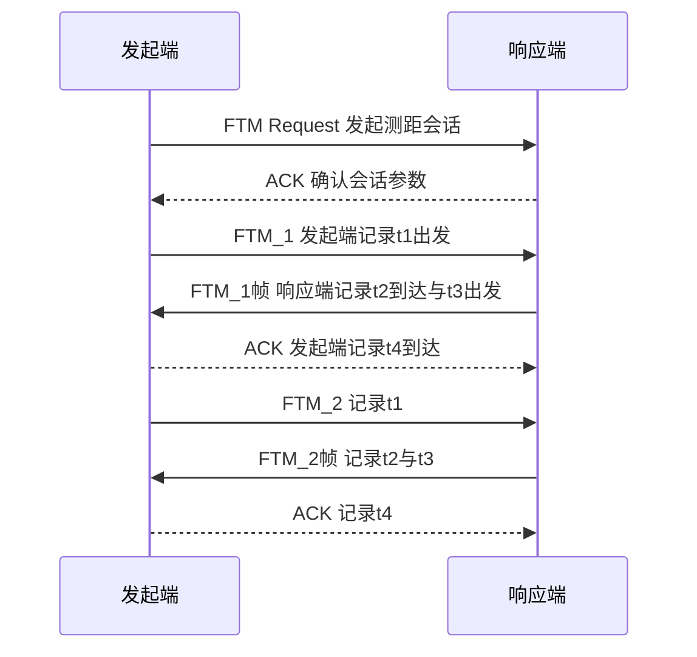
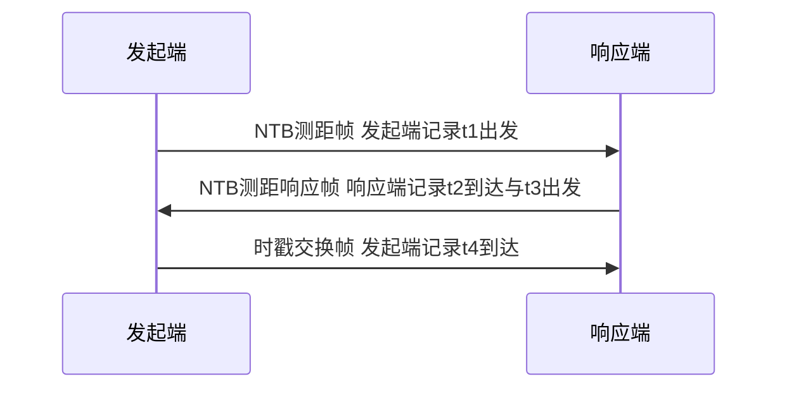

# 第 21 章　定位、测距与角度估计 ★★

> 本章承接第 1 章（多径信道 TDL 模型与时延扩展）、第 2 章（Orthogonal Frequency Division Multiplexing, OFDM 子载波与相位）、第 3 章（Multiple-Input Multiple-Output, MIMO 与 AoA 估计），系统建立 Wi-Fi 定位的数学基础：从几何精度因子（Geometric Dilution of Precision, GDOP）、Received Signal Strength（RSS，接收信号强度）测距，到基于飞行时间（Time of Flight, ToF）的精细测距（802.11mc FTM 与 802.11az NTB），再到 ToF 估计的克拉美–罗下界（Cramér–Rao Lower Bound, CRLB）、AoA/AoD（Angle of Arrival / Angle of Departure，到达角/出发角）估计（MUSIC 算法）与多站融合定位。本章给出的测距与测角是第 34、35 章 Wi-Fi 感知的物理层基石，应用层内容（如呼吸/手势感知）详见第 34/35 章，避免在此赘述。

## 学习目标

1. **能推导**：ToF 估计的 CRLB $\mathrm{var}(\hat\tau)\ge 1/(8\pi^2\beta^2\mathrm{SNR})$ 与距离界 $\sigma_d=c\sigma_\tau/2$，并说明带宽与精度的缩放关系。
2. **能实现**：802.11mc FTM 与 802.11az 下一代测距（Next-Generation TB Ranging, NTB）的测距流程，分解时钟漂移、时戳量化、首径检测、处理时延不对称四类误差并合成总误差。
3. **能做**：均匀线阵（Uniform Linear Array, ULA）下的 AoA 估计，完整推导 MUSIC 算法并给出其空间谱、复杂度与角度分辨率。
4. **能比较与设计**：加权最小二乘（Weighted Least Squares, WLS）多站融合解算、GDOP 对布站的影响，以及 RSS/ToF/AoA 三类方案的精度量级差异。

## 21.1　定位观测量与几何基础

### 21.1.1　五类观测量的原理与误差特性

Wi-Fi 定位可用六类（其中五类为距离/角度观测量，外加 RSS）基本测量。设待估位置为 $\mathbf{p}\in\mathbb{R}^2$（本章以二维为主，三维仅增加一维坐标），基站（Anchor，亦称 AP）位置 $\mathbf{a}_i$ 已知。

| 观测量 | 英文/缩写 | 物理原理 | 主要误差来源 | 典型精度量级 | 是否需要多站 |
|---|---|---|---|---|---|
| 到达时间 | Time of Arrival, ToA | 单程传播时延 $\tau=d/c$ | 需严格时间同步 | 亚米–米 | 是（≥3） |
| 到达时间差 | Time Difference of Arrival, TDoA | 双曲线交线 $\tau_i-\tau_j=\mathrm{const}$ | 基站间同步、多径 | 米级 | 是（≥3，差分式） |
| 往返时间 | Round-Trip Time, RTT | 双向测距抵消终端时钟（FTM/NTB） | 时钟漂移、首径检测 | 分米–米 | 否（单站可测距） |
| 到达角 | Angle of Arrival, AoA | 阵列相位差 $2\pi d\sin\theta/\lambda$ | 多径、阵元校准 | 度–十度 | 是（测角+测距或≥2 站） |
| 出发角 | Angle of Departure, 离开角（Angle of Departure, AoD） | 发射波束方向已知（下行） | 发射校准、多径 | 度–十度 | 是 |
| 接收信号强度 | Received Signal Strength, RSS | 对数距离路径损耗反推距离 | 阴影衰落、多径 | 米级（偏差大） | 是（≥3） |

**要点**：ToA 要求终端与所有基站时钟同步（最难），TDoA 只要求基站间互同步（相对易），RTT 通过双向测量把终端时钟误差抵消（FTM/NTB 采用），AoA/AoD 把几何约束从"圆/双曲线"变为"射线方向"。RSS 无需专用硬件但精度最差，是早期 Wi-Fi 定位（指纹法）的基础。

### 21.1.2　二维定位的几何解释

**ToA/RTT（测距）→ 圆交点**：每个基站给出一条以 $\mathbf{a}_i$ 为圆心、半径 $r_i$ 的圆。两站给出两个圆，相交于两点；三站可唯一确定（理想无噪时交于一点）。

**TDoA（测时差）→ 双曲线交点**：第 $i,j$ 站时差固定意味着目标到两站距离差 $|\mathbf{p}-\mathbf{a}_i|-|\mathbf{p}-\mathbf{a}_j|=c(\tau_i-\tau_j)$ 为常数，轨迹为双曲线。多站双曲线交于目标点。

**AoA → 射线交点**：每个基站测出一条从 $\mathbf{a}_i$ 出发、方位角 $\theta_i$ 的射线，两站射线交于目标点。


*图 21-1　三站二维定位几何：测距（ToA/RTT）给出圆、测时差（TDoA）给出双曲线、测角（AoA）给出射线，交点为目标位置。*

### 21.1.3　几何精度因子 GDOP

设第 $i$ 个观测量（以测距为例）对位置的偏导（Line-of-Sight 单位矢量）为

$$
\mathbf{u}_i=\frac{\mathbf{p}-\mathbf{a}_i}{\|\mathbf{p}-\mathbf{a}_i\|}\in\mathbb{R}^2,
$$

线性化得 $\delta r_i=\mathbf{u}_i^{\!T}\delta\mathbf{p}+n_i$。堆叠 $N$ 个观测：

$$
\delta\mathbf{r}=\mathbf{H}\,\delta\mathbf{p}+\mathbf{n},\qquad
\mathbf{H}=
\begin{bmatrix}
\mathbf{u}_1^{\!T}\\
\vdots\\
\mathbf{u}_N^{\!T}
\end{bmatrix}.
$$

在 $\mathbf{n}\sim\mathcal{N}(\mathbf{0},\sigma_r^2\mathbf{I})$ 下，位置估计误差协方差

$$
\mathbf{C}_{\mathbf{p}}=\sigma_r^2(\mathbf{H}^{\!T}\mathbf{H})^{-1}.
$$

**几何精度因子**定义为位置误差均方根与测距误差均方根之比：

$$
\boxed{\mathrm{GDOP}=\sqrt{\mathrm{tr}\big((\mathbf{H}^{\!T}\mathbf{H})^{-1}\big)}}
$$

更一般地，若观测含未知时钟偏置 $b$（ToA 情形），则增广状态 $\tilde{\mathbf{p}}=[\mathbf{p}^{\!T},b]^{\!T}$，$\mathbf{H}_i=[\mathbf{u}_i^{\!T},1]$，GDOP 同时反映位置与时钟维。GDOP 越小越好（理想值为 1，对应几何各向同性）。

**算例 21.1：三站等边三角形布站的 GDOP**。
已知目标位于原点 $(0,0)$，三基站等距环绕：
$\mathbf{a}_1=(1,0)$、$\mathbf{a}_2=(-0.5,0.866)$、$\mathbf{a}_3=(-0.5,-0.866)$（单位：km）。求 GDOP，并若测距误差 $\sigma_r=0.3\ \mathrm{m}$ 求位置误差均方根。

**解**：
各站到目标距离均为 $1\ \mathrm{km}$，故 $\mathbf{u}_i=-\mathbf{a}_i$（已单位化）：
$\mathbf{u}_1=(-1,0)$，$\mathbf{u}_2=(0.5,-0.866)$，$\mathbf{u}_3=(0.5,0.866)$。

$$
\mathbf{H}^{\!T}\mathbf{H}
=\sum_{i=1}^3\mathbf{u}_i\mathbf{u}_i^{\!T}
=\begin{bmatrix}1.5&0\\0&1.5\end{bmatrix}=1.5\,\mathbf{I}_2.
$$

$$
(\mathbf{H}^{\!T}\mathbf{H})^{-1}=\frac{1}{1.5}\mathbf{I}_2,\qquad
\mathrm{tr}= \frac{2}{1.5}=1.333.
$$

$$
\mathrm{GDOP}=\sqrt{1.333}=1.155.
$$

位置误差均方根 $=\mathrm{GDOP}\cdot\sigma_r=1.155\times0.3=0.347\ \mathrm{m}$。

**结论**：等边三角形对称布站使 $\mathbf{H}^{\!T}\mathbf{H}\propto\mathbf{I}$，几何各向同性，GDOP 接近理论下界 $1$（此处 $1.155$ 因仅 3 站、自由度有限）。若基站共线则 $\mathbf{H}^{\!T}\mathbf{H}$ 奇异、GDOP 发散——布站须避免"目标落在基站连线附近"。

## 21.2　基于接收信号强度的测距

### 21.2.1　对数距离模型与距离反推

对数距离路径损耗模型（详见第 1 章）以 dB 表示：

$$
\mathrm{PL}(d)=\mathrm{PL}(d_0)+10n\log_{10}\!\frac{d}{d_0}+X_\sigma,
\qquad X_\sigma\sim\mathcal{N}(0,\sigma_X^2),
$$

其中 $n$ 为路径损耗指数，$X_\sigma$ 为阴影衰落（零均值高斯，标准差 $\sigma_X$ dB）。由测得衰减 $P=\mathrm{PL}(d)-\mathrm{PL}(d_0)$ 反推距离：

$$
\hat d=d_0\,10^{P/(10n)}.
$$

### 21.2.2　距离估计方差推导

真实距离满足 $10n\log_{10}(d/d_0)=P-X_\sigma$，即

$$
d=d_0\,10^{(P-X_\sigma)/(10n)}=\hat d\cdot 10^{-X_\sigma/(10n)}.
$$

令 $\alpha=\ln 10/(10n)$，则 $10^{-X_\sigma/(10n)}=e^{-\alpha X_\sigma}$。对小幅 $X_\sigma$ 作一阶展开 $e^{-\alpha X_\sigma}\approx 1-\alpha X_\sigma$，故

$$
d\approx \hat d(1-\alpha X_\sigma)\quad\Rightarrow\quad d-\hat d\approx -\hat d\,\alpha X_\sigma.
$$

于是

$$
\boxed{\sigma_d\approx \frac{\ln 10}{10n}\,\sigma_X\,d}
$$

即距离估计的相对误差与阴影标准差 $\sigma_X$ 成正比、与路径指数 $n$ 成反比。

**算例（RSS 定位精度量级）**：取 $n=3$，$\sigma_X=4\ \mathrm{dB}$，$\hat d=5\ \mathrm{m}$。
$(\ln10)/(10n)=2.3026/30=0.07675$；
$\sigma_d=0.07675\times4\times5=1.54\ \mathrm{m}$。

**结论**：在 $5\ \mathrm{m}$ 处 RSS 测距标准差已达 $1.5\ \mathrm{m}$（相对误差约 $30\%$），且随距离线性放大。这正是现代方案转向 ToF/RTT 的根本原因——ToF 的精度由带宽与 信噪比（Signal-to-Noise Ratio, SNR）决定，不随距离恶化（见 21.4 节）。

## 21.3　飞行时间测距：802.11mc FTM 与 802.11az NTB

### 21.3.1　FTM 协议流程与时戳定义【已发布：802.11mc，含于 IEEE 802.11-2016】

精细时间测量（Fine Timing Measurement, FTM）在 媒体接入控制（Medium Access Control, MAC）层交换带高精度时戳的帧，用双向测量抵消终端时钟偏差。图 21-2 给出一次突发（Burst）中的帧时序。



图 21-2　802.11mc FTM 突发测距时序（Mermaid）。时戳定义：t1 发起端出发、t2 响应端到达、t3 响应端出发、t4 发起端到达。

四枚时戳含义：
- $t_1$：FTM 帧在**发起端**（Initiator）的出发时刻；
- $t_2$：FTM 帧在**响应端**（Responder）的到达时刻；
- $t_3$：确认帧（Acknowledgement, ACK）帧在响应端的出发时刻；
- $t_4$：ACK 帧在发起端的到达时刻。

**RTT 推导**：令单程飞行时间为 $\tau=d/c$，响应端处理/转发时延（turnaround）$T_{\mathrm{ta}}=t_3-t_2$。在两侧各自时钟上：

$$
t_4-t_1 = 2\tau + T_{\mathrm{ta}}\quad(\text{含往返传播与响应端停留}),
$$
$$
t_3-t_2 = T_{\mathrm{ta}}.
$$

两式相减消去响应端停留时间：

$$
\boxed{\mathrm{RTT}=(t_4-t_1)-(t_3-t_2)=2\tau}
\qquad\Rightarrow\qquad
\boxed{d=\frac{c\cdot\mathrm{RTT}}{2}}
$$

注意 FTM 用"RTT 减 turnaround"巧妙去除了响应端的未知处理时延——这正是 RTT 测距优于单向 ToA（无需全网同步）的关键。

### 21.3.2　FTM 误差来源分解与合成

实际时戳受四类误差污染，记距离误差 $\Delta d$：

1. **时钟漂移（双晶振偏差）**：发起端晶振偏差 $\delta_i$、响应端 $\delta_r$（单位 ppm）。由 21.3.1 推导，RTT 的计算残差（转换到真实时间）为
   $$
   \Delta\mathrm{RTT}=2\tau\,\delta_i+T_{\mathrm{ta}}(\delta_i-\delta_r),
   $$
   对应距离误差 $\Delta d_{\mathrm{clk}}=c\tau\,\delta_i+\frac{c}{2}T_{\mathrm{ta}}(\delta_i-\delta_r)=d\,\delta_i+\frac{c}{2}T_{\mathrm{ta}}(\delta_i-\delta_r)$。

2. **时戳量化**：量化步长 $q$（如 $1\ \mathrm{ns}$），量化误差近似均匀分布在 $[-q/2,q/2]$，标准差 $\sigma_{q}=q/\sqrt{12}$，距离项 $\sigma_{d,q}=(c/2)\sigma_q$。

3. **多径首径检测误差**：首径（first path）被后续强多径掩盖或提前/滞后检测，偏差 $\Delta t_{\mathrm{mp}}$（如 $10\ \mathrm{ns}$），距离误差 $\Delta d_{\mathrm{mp}}=(c/2)\Delta t_{\mathrm{mp}}$。

4. **处理时延不对称**：发起端 $t_1$ 出发与 $t_4$ 检测、响应端 $t_2$ 检测与 $t_3$ 出发的电路时延不完全对称，残差 $\Delta t_{\mathrm{proc}}$，距离误差 $(c/2)\Delta t_{\mathrm{proc}}$。

随机项按平方和合成：

$$
\boxed{\sigma_d=\sqrt{\sigma_{d,\mathrm{clk}}^2+\sigma_{d,q}^2+\sigma_{d,\mathrm{mp}}^2+\sigma_{d,\mathrm{proc}}^2}}
$$

**算例 21.2：FTM 误差合成**。
已知：距离 $d=10\ \mathrm{m}$，晶振 $\pm20\ \mathrm{ppm}$ 取最坏差分 $(\delta_i-\delta_r)=4\times10^{-5}$，$T_{\mathrm{ta}}=32\ \mu\mathrm{s}$，时戳量化 $q=1\ \mathrm{ns}$，首径检测误差 $\Delta t_{\mathrm{mp}}=10\ \mathrm{ns}$（偏置），处理不对称忽略。取 $c=3\times10^8\ \mathrm{m/s}$。

- 时钟项：$\sigma_{d,\mathrm{clk}}=d\,\delta_i+\frac{c}{2}T_{\mathrm{ta}}(\delta_i-\delta_r)$。取 $\delta_i=2\times10^{-5}$ 得 $d\delta_i=10\times2\times10^{-5}=2\times10^{-4}\ \mathrm{m}$；第二项 $(1.5\times10^8)(32\times10^{-6})(4\times10^{-5})=0.192\ \mathrm{m}$。合计约 $0.192\ \mathrm{m}$（主导为 turnaround 差分漂移）。
- 量化项：$\sigma_{d,q}=(1.5\times10^8)(1\times10^{-9}/\sqrt{12})=0.0433\ \mathrm{m}$。
- 首径项（偏置）：$\Delta d_{\mathrm{mp}}=(1.5\times10^8)(10\times10^{-9})=1.50\ \mathrm{m}$。

**结论**：FTM 总误差被**多径首径检测（约 1.5 m）**主导，时钟项约 $0.19\ \mathrm{m}$、量化项约 $0.04\ \mathrm{m}$ 可忽略。这解释了为何 802.11az 引入 长训练字段（Long Training Field, LTF）重复与更宽带宽以压制多径、提升首径可检测性。

### 21.3.3　多帧平均与突发参数

一次突发含 $N$ 组 RTT 测量 $\{d_k\}_{k=1}^N$，均值 $\bar d=\frac{1}{N}\sum d_k$。若各次独立同分布、方差 $\sigma_d^2$，则

$$
\boxed{\sigma_{\bar d}=\frac{\sigma_d}{\sqrt{N}}}
$$

即 $N$ 帧平均使标准差降为 $1/\sqrt{N}$。这正是 FTM 推荐"突发多帧 + 平均"的原因（代价是空口时长与功耗）。例：$N=16$ 时误差降至 $1/4$。

### 21.3.4　802.11az NTB 测距【已发布：IEEE 802.11az-2022】

下一代定位（Next Generation Positioning, NGP）在 802.11az 中标准化，提供 Trigger-Based（TB，触发式）与 Non-Trigger-Based（NTB，非触发式）两类测距。

**NTB 与 TB 差异**：TB 由发起端先发 Trigger 帧唤醒响应端再测距，适合多设备调度；NTB 仅用**一对往返帧**完成时戳交换，省去逐帧 ACK 与触发交互，显著减少空中接口交互次数，从而**降低时钟漂移的积累窗口**并节省功耗。NTB 还内建安全测距（secure ranging / protected FTM）防欺骗，并支持 HE-LTF（High Efficiency Long Training Field，高效长训练字段）重复与更多 LTF 数量以抗多径。

图 21-3 给出 NTB 的单次往返时戳交换。



图 21-3　802.11az NTB 单次往返测距时序（Mermaid）。时戳语义与 FTM 一致，但帧数更少、交互更快。

**NTB 的 RTT 公式**：与 FTM 同构，因 NTB 仍基于双向时戳 $(t_1,t_2,t_3,t_4)$：

$$
\boxed{\mathrm{RTT}_{\mathrm{NTB}}=(t_4-t_1)-(t_3-t_2),\qquad d=\frac{c\cdot\mathrm{RTT}_{\mathrm{NTB}}}{2}}
$$

**安全测距**：protected FTM 用消息完整性校验（如 SNonce/PNonce + HMAC）与加密时戳防止"距离欺骗"（攻击者在中间转发时延上作假以伪造近距）。**LTF 重复与 HE-LTF 数量的权衡**：更多 LTF 符号/重复提升首径检测信噪比与多径分辨（降低 $\sigma_{d,\mathrm{mp}}$），但增加时域开销与功耗；NTB 允许按需配置以在精度与时延间取舍。

**NTB 相对 FTM 的收益推导**：设 FTM 完成 $N$ 次测量需 $M_F$ 帧、总空口时长 $T_F$；NTB 单次往返仅需 $M_N\ll M_F$ 帧。时钟漂移误差正比于测量窗口内的累计时偏（见 21.3.2 的 $T_{\mathrm{ta}}$ 项实际被多次交互的总时延放大），故

$$
\frac{\sigma_{d,\mathrm{clk}}^{\mathrm{NTB}}}{\sigma_{d,\mathrm{clk}}^{\mathrm{FTM}}}\approx\frac{T_N}{T_F}\ll 1,
$$

即 NTB 在同等精度下空口时延与漂移积累显著降低；若保持相同时延预算，NTB 可把省下的帧数用于 LTF 重复，进一步压低多径项。**结论**：NTB 以"更少交互 + 可配置 LTF"同时改善精度与时延，是 802.11az 的核心进步。

## 21.4　ToF 估计的统计界：Cramér–Rao 下界【算法六段式·一】

### 21.4.1　问题建模

- **接收信号**：$r(t)=\alpha\,s(t-\tau)+n(t)$，$s(t)$ 为已知发射波形（能量 $E=\int|s(t)|^2dt$），$n(t)$ 为加性白高斯噪声（双边长功率谱密度 $N_0/2$），$\tau$ 为待估时延（此处 $\tau$ 表示 RTT，见 21.4.4 的距离映射）。
- **目标**：估计 $\tau$，给出方差下界；再映射到距离 $d=c\tau/2$。
- **假设**：噪声与信号不相关；波形已知；观测区间足够长以覆盖 $s(t-\tau)$。

### 21.4.2　目标函数与约束

以负对数似然（或 Fisher 信息）为准则，求 $\mathrm{var}(\hat\tau)$ 的下界：

$$
\mathrm{var}(\hat\tau)\ge \mathcal{I}^{-1}(\tau),\qquad
\mathcal{I}(\tau)=-\mathbb{E}\!\left[\frac{\partial^2}{\partial\tau^2}\ln p(\mathbf{r};\tau)\right].
$$

### 21.4.3　完整推导（不跳步）

**第 1 步：连续观测的似然**。在白高斯噪声下，条件概率密度（略去与 $\tau$ 无关常数）满足

$$
\ln p(r(t);\tau)\propto -\frac{1}{N_0}\int_0^T\big|r(t)-\alpha s(t-\tau)\big|^2dt.
$$

**第 2 步：对 $\tau$ 求一阶导**。利用 $\partial s(t-\tau)/\partial\tau=-s'(t-\tau)$（$s'=\frac{d}{dt}s$）：

$$
\frac{\partial}{\partial\tau}\ln p
=\frac{2\alpha}{N_0}\int r(t)\,s'(t-\tau)\,dt
-\frac{2\alpha^2}{N_0}\int s(t-\tau)s'(t-\tau)dt.
$$

第二项中被积函数 $s\,s'=\frac{1}{2}\frac{d}{dt}(s^2)$，在有限支撑上积分为零（边界项相消），故

$$
\frac{\partial}{\partial\tau}\ln p=\frac{2\alpha}{N_0}\int r(t)\,s'(t-\tau)\,dt.
$$

**第 3 步：对 $\tau$ 求二阶导（得分函数的导）**：

$$
\frac{\partial^2}{\partial\tau^2}\ln p
=\frac{2\alpha}{N_0}\int r(t)\,s''(t-\tau)\,dt,
$$
其中 $s''=\frac{d^2}{dt^2}s$。

**第 4 步：取负期望得 Fisher 信息**。代入 $r(t)=\alpha s(t-\tau)+n(t)$：

$$
\mathbb{E}\!\left[\frac{\partial^2}{\partial\tau^2}\ln p\right]
=\frac{2\alpha}{N_0}\int \alpha s(t-\tau)\,s''(t-\tau)\,dt
+\frac{2\alpha}{N_0}\underbrace{\mathbb{E}[n(t)]}_{0}\!\int s''dt.
$$

对第一项用分部积分两次（边界项为零，且 $\int s\,s''dt=-\int (s')^2dt$）：

$$
\mathbb{E}[\cdots]=\frac{2\alpha^2}{N_0}\left(-\int (s'(t-\tau))^2dt\right)
=-\frac{2\alpha^2}{N_0}\int (s'(t))^2dt.
$$

故 Fisher 信息

$$
\mathcal{I}(\tau)=\frac{2\alpha^2}{N_0}\int (s'(t))^2dt.
$$

**第 5 步：频域表达**。由帕塞瓦尔定理与傅里叶变换性质 $\mathcal{F}\{s'(t)\}=j2\pi f S(f)$：

$$
\int (s'(t))^2dt=\int |j2\pi f S(f)|^2df=4\pi^2\int f^2|S(f)|^2df.
$$

定义信号能量 $E=\int|S(f)|^2df$ 与**均方根带宽**

$$
\beta^2=\frac{\int f^2|S(f)|^2df}{\int|S(f)|^2df}
=\frac{\int f^2|S(f)|^2df}{E},
$$

则 $\int f^2|S(f)|^2df=\beta^2 E$，于是

$$
\mathcal{I}(\tau)=\frac{2\alpha^2}{N_0}\,4\pi^2\beta^2 E
=\frac{8\pi^2\alpha^2 E}{N_0}\,\beta^2.
$$

令 $\mathrm{SNR}=\alpha^2E/N_0$（接收信号功率×时间/噪声谱密度），得

$$
\mathcal{I}(\tau)=8\pi^2\beta^2\,\mathrm{SNR}.
$$

**第 6 步：下界**。

$$
\boxed{\mathrm{var}(\hat\tau)\ge \frac{1}{8\pi^2\beta^2\,\mathrm{SNR}}}
$$

距离映射：因 $d=c\tau/2$（$\tau$ 为 RTT），有

$$
\boxed{\sigma_d=\frac{c}{2}\,\sigma_\tau\ge \frac{c}{2}\,\frac{1}{2\pi\beta\sqrt{2\,\mathrm{SNR}}}}
$$

（即 $\sigma_d\ge \frac{c}{4\sqrt{2}\pi\beta\sqrt{\mathrm{SNR}}}$）。该界说明：**时延估计精度只取决于 RMS 带宽 $\beta$ 与 SNR，与波形具体形状无关**，只与能量在频域的二阶矩有关。

### 21.4.4　OFDM 系统的等效 RMS 带宽

OFDM 子载波在总带宽 $B$ 内近似平坦谱。对 $[-B/2,B/2]$ 上的均匀谱：

$$
\beta^2=\frac{\int_{-B/2}^{B/2}f^2df}{\int_{-B/2}^{B/2}df}
=\frac{B^3/12}{B}=\frac{B^2}{12}
\quad\Rightarrow\quad
\boxed{\beta\approx\frac{B}{\sqrt{12}}}
$$

代入 CRLB：$\mathrm{var}(\hat\tau)\propto 1/\beta^2\propto 1/B^2$，故 $\sigma_\tau\propto 1/B$，**带宽每翻倍，RMSE 减半（方差降为 1/4，约 6 dB/倍频程）**。从 $20\ \mathrm{MHz}$ 到 $320\ \mathrm{MHz}$（×16）RMSE 改善 16 倍（24 dB）。（注：常见"√2 倍"说法源于把带宽与 RMS 带宽不当地线性混用；本章以严格 CRLB 推导为准。）

**算例 21.3：CRLB 带宽对比**。
已知：$c=3\times10^8\ \mathrm{m/s}$，$\mathrm{SNR}=20\ \mathrm{dB}=100$（$\sqrt{\mathrm{SNR}}=10$），带宽分别 $B=20/80/320\ \mathrm{MHz}$。用 $\sigma_d=\frac{c\sqrt{3}}{4\pi B\sqrt{\mathrm{SNR}}}$（由 $\beta=B/\sqrt{12}$ 代入化简）。

- $B=20\ \mathrm{MHz}$：$\sigma_d=3\times10^8\times1.732/(4\pi\times2\times10^7\times10)=0.292\ \mathrm{m}$。
- $B=80\ \mathrm{MHz}$：$\sigma_d=0.0731\ \mathrm{m}$（恰为上式 1/4）。
- $B=320\ \mathrm{MHz}$：$\sigma_d=0.0183\ \mathrm{m}$。

**量级检查**：$20\to80\ \mathrm{MHz}$（带宽×4）误差 0.292/0.0731=4.0 倍；$20\to320$（×16）误差 0.292/0.0183≈16 倍，与 $\sigma\propto1/B$ 一致，量级合理（320 MHz 下亚分米、80 MHz 下约 7 cm、20 MHz 下约 30 cm，与 802.11az 标称 <1 m 相符）。

### 21.4.5　超分辨算法与首径检测对比

| 方法 | 原理 | 精度 | 复杂度 | 适用 |
|---|---|---|---|---|
| 匹配滤波/首径检测 | 相关峰检测 $\max_t|r\star s|$ | 受限于多径与量化 | 低 $O(B\cdot T_s)$ | FTM/NTB 实时 |
| MUSIC / ESPRIT | 子空间分解求超分辨时延/角度 | 近 CRLB、可分辨紧邻多径 | 高 $O(K^3)$ 特征分解 | 离线/感知（第 34 章） |

超分辨算法利用信号子空间结构突破"相关峰宽度"限制，逼近 21.4.3 的 CRLB，并能分辨时延差小于脉宽的紧邻多径——这是压制 21.3.2 首径误差（1.5 m 量级）的理论出路，详见第 34 章感知。

## 21.5　角度估计与多径分辨：AoA/AoD 与 MUSIC【算法六段式·二】

### 21.5.1　问题建模：均匀线阵阵列响应

- **阵列**：ULA，$N$ 个阵元，间距 $d$（常取 $\lambda/2$），阵元 $n$ 相对参考元的路径差为 $n d\sin\theta$。
- **导向矢量**：$a_n(\theta)=e^{-j2\pi n d\sin\theta/\lambda}$，写成向量
  $$
  \mathbf{a}(\theta)=\big[1,\,e^{-j2\pi d\sin\theta/\lambda},\dots,e^{-j2\pi(N-1)d\sin\theta/\lambda}\big]^{\!T}.
  $$
- **接收模型**（单快拍、单信号）：$\mathbf{x}=\mathbf{a}(\theta)s+\mathbf{n}$，其中 $s$ 为复幅度，$\mathbf{n}$ 为阵元噪声。多径/多信号情形 $\mathbf{x}=\sum_k\mathbf{a}(\theta_k)s_k+\mathbf{n}=\mathbf{A}\mathbf{s}+\mathbf{n}$。
- **目标**：由 $\mathbf{x}$ 估计 $\theta$。

### 21.5.2　目标函数与约束

以噪声子空间正交性为判决准则：若 $\theta$ 为真方向，则 $\mathbf{a}(\theta)$ 必落在信号子空间，与噪声子空间正交。

### 21.5.3　MUSIC 完整推导

**第 1 步：协方差矩阵**。对 $L$ 个快拍 $\mathbf{x}_1,\dots,\mathbf{x}_L$：
$$
\mathbf{R}=\frac{1}{L}\sum_{\ell=1}^L\mathbf{x}_\ell\mathbf{x}_\ell^{\!H}
=\mathbf{A}\mathbf{R}_s\mathbf{A}^{\!H}+\sigma_n^2\mathbf{I}.
$$

**第 2 步：特征分解**。$\mathbf{R}$ 为 $N\times N$ 厄米特阵，特征值降序 $\lambda_1\ge\cdots\ge\lambda_N$。信号数 $K$ 由 $\lambda_K\gg\lambda_{K+1}=\cdots=\sigma_n^2$ 判定。对应特征向量分块：
$$
\mathbf{R}=\big[\mathbf{E}_s\ \mathbf{E}_n\big]
\begin{bmatrix}\boldsymbol\Lambda_s&\\&\boldsymbol\Lambda_n\end{bmatrix}
\big[\mathbf{E}_s\ \mathbf{E}_n\big]^{\!H},
$$
其中 $\mathbf{E}_n\in\mathbb{C}^{N\times(N-K)}$ 张成**噪声子空间**。

**第 3 步：正交性**。对真实方向 $\theta_k$，$\mathbf{a}(\theta_k)$ 属信号子空间，故与 $\mathbf{E}_n$ 列正交：
$$
\mathbf{a}^{\!H}(\theta_k)\mathbf{E}_n\mathbf{E}_n^{\!H}\mathbf{a}(\theta_k)=0.
$$

**第 4 步：空间谱**。构造 MUSIC 谱并对方向扫描：
$$
\boxed{P_{\mathrm{MUSIC}}(\theta)=\frac{1}{\mathbf{a}^{\!H}(\theta)\mathbf{E}_n\mathbf{E}_n^{\!H}\mathbf{a}(\theta)}}
$$
谱峰位置即为各信号到达角估计。

**第 5 步：伪代码**（复杂度标于注释）。

```text
 1  function MUSIC(x, N, K):               // x: L×N 快拍矩阵
 2    R = x*x' / L                         // 协方差, O(L*N^2)
 3    [V, D] = eig(R)                      // 特征分解, O(N^3) 主导
 4    En = V(:, K+1:N)                     // 取 N-K 个最小特征向量
 5    for t = 1 to T:                      // 角度网格扫描
 6      a = steer(theta(t), N)             // 导向矢量, O(N)
 7      P(t) = 1 / (a'*En*En'*a)           // 空间谱, O(N*(N-K))
 8    end
 9    [~, idx] = findpeaks(P, K)           // 取 K 个最高峰
10    return theta(idx)                    // 角度估计
```

**第 6 步：复杂度分析**。时间复杂度 $O(LN^2+N^3+T\cdot N(N-K))$，主导为 $N^3$ 特征分解与 $LN^2$ 协方差估计；空间复杂度 $O(N^2+L N)$ 存 $\mathbf{R}$ 与快拍。相比匹配滤波 $O(BN)$，MUSIC 多了 $N^3$ 子空间分解，但换得超分辨能力。

### 21.5.4　角度分辨率与孔径

Rayleigh 限给出可分辨两邻近方向的最小角差。对 ULA，两方向 $\theta_1,\theta_2$ 的导向矢量内积随 $N d\sin\theta$ 的相位差变化，主瓣宽度量级：

$$
\boxed{\Delta\theta\approx \frac{\lambda}{N d\cos\theta}}
$$

即分辨率与**孔径** $Nd$ 成反比、与阵元数 $N$ 成反比，且在偏离法线（$\cos\theta$ 变小）时显著恶化（端射方向最差）。

**算例 21.4：ULA 角度分辨率**。
已知：$f=5\ \mathrm{GHz}$，$\lambda=c/f=3\times10^8/5\times10^9=0.06\ \mathrm{m}$，阵元数 $N=4$，间距 $d=\lambda/2=0.03\ \mathrm{m}$。

- 法线方向 $\theta=0$：$\Delta\theta\approx 0.06/(4\times0.03\times1)=0.5\ \mathrm{rad}=28.6^\circ$。
- 偏离 $\theta=60^\circ$：$\Delta\theta\approx 0.06/(4\times0.03\times0.5)=1.0\ \mathrm{rad}=57.3^\circ$。

**量级检查**：4 阵元半波长间距的 Rayleigh 限约 $28.6^\circ$（法线），在 $60^\circ$ 处翻倍至 $57^\circ$，与 $\cos\theta$ 分母一致；若要 $10^\circ$ 分辨率需 $N\approx 11$（同 $d$）。该量级合理，说明 Wi-Fi 设备（通常 2–4 天线）AoA 精度有限，需借助多径/多 接入点（Access Point, AP）融合。

### 21.5.5　相位校准与 CSI 净化（推导；应用见第 34 章）

第 2 章 信道状态信息（Channel State Information, CSI）相位受三类系统偏置污染，需先补偿再用于 AoA：

1. **采样频偏 （Sampling Frequency Offset, SFO）**：采样钟偏导致子载波 $k$ 上相位随 $k$ 线性旋转 $\phi_{\mathrm{SFO}}(k)=\phi_0^{\mathrm{SFO}}+2\pi k\Delta f_{\mathrm{sfo}} t/N$。
2. **载波频偏 （Carrier Frequency Offset, CFO）**：收发本振差导致全子载波共同相位随时刻 $t$ 线性旋转 $\phi_{\mathrm{CFO}}(t)=2\pi\Delta f_{\mathrm{cfo}}t$（与 $k$ 无关）。
3. **包检测时延 PDD**：每包定时偏差引入跨子载波的线性相位斜率 $\phi_{\mathrm{PDD}}(k)=2\pi\tau_{\mathrm{pdd}}k\Delta f$。

合并测量相位（天线 $m$、子载波 $k$）：

$$
\Phi_m(k)=2\pi\frac{d m\sin\theta}{\lambda}+\underbrace{\alpha k+\beta t+\gamma}_{\text{需校准项}},
$$

其中 $\alpha k$ 项（SFO+PDD）表现为**相位随子载波 $k$ 的斜率**，$\beta t$ 项（CFO）表现为**相位随时刻的斜率**。补偿方法：

- **去斜率**：对单天线各子载波相位做 $\Phi(k)$ 关于 $k$ 的线性拟合，减去斜率得 $\alpha k$ 项（消除 SFO/PDD）；
- **去时变**：跨连续包跟踪共同相位旋转拟合掉 $\beta t$（消除 CFO）。

**分工说明**：本章给出上述相位偏置模型与补偿推导；如何利用净化后的 CSI 做呼吸/手势等感知应用，详见第 34 章。

## 21.6　多站融合与定位解算

### 21.6.1　加权最小二乘 WLS 定位

对 $N$ 个测距 $r_i=\|\mathbf{p}-\mathbf{a}_i\|+n_i$，以 $\mathbf{W}=\mathrm{diag}(1/\sigma_{r,i}^2)$ 加权：

$$
\hat{\mathbf{p}}=\arg\min_{\mathbf{p}}\sum_{i=1}^N w_i\big(r_i-\|\mathbf{p}-\mathbf{a}_i\|\big)^2.
$$

线性化（见 21.1.3 的 $\mathbf{H}$）：$\delta\mathbf{r}\approx\mathbf{H}\delta\mathbf{p}$，加权正规方程

$$
\hat{\mathbf{p}}=\mathbf{p}_0+(\mathbf{H}^{\!T}\mathbf{W}\mathbf{H})^{-1}\mathbf{H}^{\!T}\mathbf{W}\,\delta\mathbf{r},
$$

用 Gauss-Newton 迭代至收敛（初值 $\mathbf{p}_0$ 取质心或三边解）。伪代码：

```text
 1  function WLS(r, A, W, p0):               // r:测距, A:基站坐标, W:权
 2    p = p0
 3    for iter = 1 to MaxIter:
 4      for i = 1 to N:                       // 构造 H 与残差
 5        ri = norm(p - A(i))                 // 当前预测距离
 6        u  = (p - A(i)) / ri                // LOS 单位矢量
 7        H(i,:) = u;  z(i) = r(i) - ri       // O(N)
 8      G = H'*W*H                            // O(N*2^2)
 9      dp = inv(G) * H'*W*z                   // 2x2 求逆 O(1)
10      p = p + dp
11      if norm(dp) < eps: break               // 收敛
12    return p
```

**算例（WLS 解算）**：三基站 $\mathbf{a}_1=(0,0)$、$\mathbf{a}_2=(100,0)$、$\mathbf{a}_3=(0,100)$（m），真实目标 $\mathbf{p}=(30,40)$。无噪测距 $r_1=50$、$r_2=80.62$、$r_3=67.08$。以基站 1 为参考做线性化：
对 $i=2$：$2(x_1-x_i)x+2(y_1-y_i)y=r_i^2-r_1^2-(x_i^2-x_1^2)-(y_i^2-y_1^2)$，代入得 $-200x=-6000\Rightarrow x=30$；
对 $i=3$：$-200y=-8000\Rightarrow y=40$。
**结论**：线性化最小二乘在无噪下精确恢复 $(30,40)$；有噪时 $\mathbf{W}$ 按各链路方差加权，方差小的链路（高 SNR/短距）贡献更大，解算误差下界由 GDOP 与 $\sigma_r$ 共同决定。

### 21.6.2　滤波与轨迹平滑

对运动目标，单帧解算后接**卡尔曼滤波**（线性运动模型 + WLS 观测）或**粒子滤波**（非高斯/非线性的多径环境）平滑轨迹、抑制突变。滤波仅改善"轨迹连续性"，不降低单帧 CRLB——与第 34 章感知中的跟踪算法一脉相承。

### 21.6.3　指纹定位

CSI 幅度/相位指纹 + 机器学习（如 kNN、神经网络）在离线建库、在线匹配，规避多径建模难题。其训练与特征工程详见第 33 章（机器学习方法），本章仅指出：指纹法精度受限于环境时变，但无需显式测距，是 RSS 之后另一主流路线。

## 21.7　320 MHz 定位与 802.11bk【已发布：IEEE 802.11bk-2025】

> 核实说明：802.11bk 于 2025-05-28 获 IEEE SA 批准、2025-09-05 出版（IEEE 802.11bk-2025），本书时效基准 2026-09 下应标【已发布】。它把 802.11az 的 FTM/NTB 协议扩展到 802.11be 的 320 MHz 信道。

由 21.4.4 的 CRLB，距离下界 $\sigma_d\propto 1/B$。从 $20\ \mathrm{MHz}$（传统）到 $320\ \mathrm{MHz}$（802.11bk）：

$$
\frac{\sigma_{d}(20)}{\sigma_{d}(320)}=\frac{320}{20}=16.
$$

即 320 MHz 把 CRLB（RMSE）压低 **16 倍**；以分贝计，每带宽翻倍约 **6 dB**（RMSE），20→320 MHz 共 4 个倍频程即 **24 dB** 改善。结合 802.11az 的 LTF 重复与多天线，320 MHz 定位有望逼近 超宽带（Ultra-Wideband, UWB）的厘米级——这正是 802.11bk 的核心价值。

## 21.8　研究议题

1. **多径辅助定位（multipath-assisted positioning / SLAM）**：把多径从"误差源"变为"虚拟锚点"，用环境几何约束提升精度（与第 34/35 章感知耦合）。
2. **单 AP 定位**：利用反射径 + AoA 在仅一个 AP 下解算位置，降低部署成本。
3. **通感一体化中的定位**：定位作为感知子功能并入 通感一体化（Integrated Sensing and Communication, ISAC）框架（第 34/35 章）。
4. **隐私与定位**：精细测距泄露位置隐私，需与安全机制协同（第 18 章、第 35 章）。
5. **毫米波定位**：60 GHz / 802.11ay 及未来毫米波利用超大带宽与窄波束获更高精度（第 36 章）。

## 本章小结

1. 五类观测量中 RTT（FTM/NTB）以双向测量抵消终端时钟，AoA/AoD 把几何约束变为射线方向，RSS 精度最差（米级偏差）。
2. GDOP $=\sqrt{\mathrm{tr}((\mathbf{H}^{\!T}\mathbf{H})^{-1})}$，布站应避免目标落在基站连线附近（否则 $\mathbf{H}^{\!T}\mathbf{H}$ 近奇异）。
3. RSS 距离方差 $\sigma_d\approx(\ln10/(10n))\sigma_X d$，随距离线性放大——这是转向 ToF 的根本动因。
4. FTM 的 $\mathrm{RTT}=(t_4-t_1)-(t_3-t_2)$ 消去响应端停留；误差由时钟漂移、量化、首径检测、处理不对称合成，其中**多径首径检测（约 1.5 m）主导**。
5. NTB 以单对往返帧 + 可配置 LTF 同时改善精度与时延，并内建安全测距防欺骗。
6. ToF 的 CRLB：$\mathrm{var}(\hat\tau)\ge 1/(8\pi^2\beta^2\mathrm{SNR})$，$\sigma_d=c\sigma_\tau/2$；OFDM 下 $\beta\approx B/\sqrt{12}$，带宽翻倍 RMSE 减半。
7. MUSIC 用噪声子空间正交性 $\mathbf{a}^{\!H}(\theta)\mathbf{E}_n\mathbf{E}_n^{\!H}\mathbf{a}(\theta)=0$ 构造空间谱，复杂度主导于 $N^3$ 特征分解，可超分辨逼近 CRLB。
8. AoA 分辨率 $\Delta\theta\approx\lambda/(Nd\cos\theta)$，与孔径 $Nd$ 成反比、偏离法线恶化；4 阵元 5 GHz 法线限约 $28.6^\circ$。

**关键结论/参数速查表**

| 项目 | 公式 / 数值 | 备注 |
|---|---|---|
| GDOP | $\sqrt{\mathrm{tr}((\mathbf{H}^{\!T}\mathbf{H})^{-1})}$ | 等边三角形 3 站 ≈ 1.155 |
| RSS 距离方差 | $\sigma_d\approx(\ln10/(10n))\sigma_X d$ | $n=3,\sigma_X=4$ dB → 1.54 m@5 m |
| FTM RTT | $(t_4-t_1)-(t_3-t_2)$ | 消去 turnaround |
| 时钟漂移项 | $d\delta_i+\frac{c}{2}T_{\mathrm{ta}}(\delta_i-\delta_r)$ | ±20 ppm 最坏 ≈ 0.19 m |
| 多帧平均 | $\sigma_{\bar d}=\sigma_d/\sqrt{N}$ | $N=16$ → 1/4 |
| CRLB(时延) | $1/(8\pi^2\beta^2\mathrm{SNR})$ | $\beta\approx B/\sqrt{12}$ |
| 带宽缩放 | $\sigma_d\propto 1/B$ | 翻倍→RMSE 减半（6 dB） |
| CRLB 数值 | 20/80/320 MHz → 0.292/0.073/0.018 m | SNR=20 dB |
| AoA 分辨率 | $\lambda/(Nd\cos\theta)$ | 4 阵元 5 GHz：28.6°(法线) |
| 相位校准 | 去斜率($\alpha k$)+去时变($\beta t$) | SFO/PDD/CFO 模型 |

## 习题

### A. 概念题（3 题）

1. 为什么 RTT 测距（FTM/NTB）不需要终端与基站严格时间同步，而 ToA 需要？请说根因。
2. FTM 用 $(t_4-t_1)-(t_3-t_2)$ 计算 RTT，为何能消去响应端的未知处理时延？若发起端自身处理时延不对称会怎样？
3. 为何 4 天线 Wi-Fi 设备的 AoA 精度在偏离法线方向会显著变差？从阵列孔径与 $\cos\theta$ 项解释。

### B. 计算与推导题（4 题）

4. 由对数距离模型推导 $\sigma_d\approx(\ln10/(10n))\sigma_X d$（给出一阶展开步骤）。
5. 三基站坐标 $(0,0),(200,0),(0,150)$（m），目标真实 $(60,80)$ m，测距无噪，用线性化最小二乘求目标坐标（写出方程组与解）。
6. 已知 $\beta=B/\sqrt{12}$，SNR=100，分别求 $B=40\ \mathrm{MHz}$ 与 $B=160\ \mathrm{MHz}$ 下的 CRLB 距离下界，并求相对改善 dB。
7. ULA $N=8$、$d=\lambda/2$、$f=5.6\ \mathrm{GHz}$，求法线方向 AoA 分辨率（弧度与度），并与 $N=4$ 比较。

### C. 算法设计题（2 题）

8. 设计"多帧 FTM 突发 + 平均"的测距流程伪代码，要求包含时钟漂移与首径误差的抑制说明，并给出常见错误。
9. 给出 MUSIC 估计 AoA 的完整流程（含协方差估计、信源数判定、谱峰搜索），说明如何用净化后 CSI（21.5.5）作为输入。

### D. 开放研究题（1 题）

10. 多径辅助定位把多径视为"虚拟锚点"。请设计一种利用 802.11az NTB + MUSIC 超分辨提取多径 AoA/ToA 并联合建图的研究路径，列出关键指标（精度、可分辨多径数、环境时变鲁棒性）与可参考方向。

## 参考答案与解析

### A. 概念题

1. **根因**：ToA 测量的是单程传播时延 $\tau=d/c$，必须把接收时刻换算到统一时基，故所有节点需同步。RTT 是"发起端发→对方回→发起端收"的闭环，全程只用发起端一只钟读 $t_1,t_4$（及对方钟读 $t_2,t_3$ 经相减消去），终端自身时钟绝对偏差不参与结果，只需双方晶振短期稳定，故无需全网同步。
2. **消去原理**：$t_4-t_1$ 包含往返传播 $2\tau$ 与响应端停留 $T_{\mathrm{ta}}$；$t_3-t_2$ 正是 $T_{\mathrm{ta}}$（在响应端同一钟上度量）。相减后 $T_{\mathrm{ta}}$ 抵消。**发起端不对称**：若发起端 $t_1$ 出发与 $t_4$ 检测电路时延不等，该差值是常值偏置，直接叠加到 RTT，造成固定距离偏置，需硬件校准或双向多次平均。
3. **根因**：分辨率 $\Delta\theta\approx\lambda/(Nd\cos\theta)$。偏离法线时 $\cos\theta$ 变小，分母减小使 $\Delta\theta$ 变大（如 60° 处翻倍）；物理上远端射线的相邻阵元相位差 $\propto\sin\theta$，大角度时有效孔径投影 $Nd\cos\theta$ 缩短，波束变宽，故精度恶化。

### B. 计算与推导题

4. **解**：$10n\log_{10}(d/d_0)=P-X_\sigma$，$d=\hat d\cdot10^{-X_\sigma/(10n)}= \hat d\,e^{-(\ln10/(10n))X_\sigma}$。令 $\alpha=\ln10/(10n)$，一阶展开 $e^{-\alpha X_\sigma}\approx1-\alpha X_\sigma$，得 $d-\hat d\approx-\hat d\,\alpha X_\sigma$，$\mathrm{var}(d)=\hat d^2\alpha^2\mathrm{var}(X_\sigma)$，即 $\sigma_d=(\ln10/(10n))\sigma_X d$。
5. **解**：线性化（以站 1 为参考）：$2(x_1-x_i)x+2(y_1-y_i)y=r_i^2-r_1^2-(x_i^2-x_1^2)-(y_i^2-y_1^1)$。
   站 2：$(x_2,y_2)=(200,0)$，$r_2=\sqrt{(60-200)^2+80^2}=\sqrt{19600+6400}=\sqrt{26000}=161.25$，$r_1=100$。方程：$-400x=(161.25^2-100^2)-(200^2)= (26000-10000)-40000=-24000\Rightarrow x=60$。
   站 3：$(0,150)$，$r_3=\sqrt{60^2+(80-150)^2}=\sqrt{3600+4900}=\sqrt{8500}=92.20$。方程：$-300y=(92.20^2-100^2)-(150^2)= (8500-10000)-22500=-24000\Rightarrow y=80$。解得 $(60,80)$，与真实一致。
6. **解**：$\sigma_d=\frac{c\sqrt{3}}{4\pi B\sqrt{\mathrm{SNR}}}$。SNR=100，$\sqrt{\mathrm{SNR}}=10$，$c=3\times10^8$。
   $B=40\ \mathrm{MHz}$：$\sigma_d=3\times10^8\times1.732/(4\pi\times4\times10^7\times10)=0.103\ \mathrm{m}$。
   $B=160\ \mathrm{MHz}$：$\sigma_d=0.0258\ \mathrm{m}$。
   相对改善（方差）：$0.103^2/0.0258^2=15.94\approx16$（4× 带宽→16× 方差）。RMSE 改善 4 倍 = $20\log_{10}4=12\ \mathrm{dB}$。
7. **解**：$\lambda=3\times10^8/5.6\times10^9=0.0536\ \mathrm{m}$，$d=\lambda/2=0.0268\ \mathrm{m}$。
   $N=8$：$\Delta\theta=0.0536/(8\times0.0268)=0.25\ \mathrm{rad}=14.3^\circ$。
   $N=4$：$\Delta\theta=0.0536/(4\times0.0268)=0.50\ \mathrm{rad}=28.6^\circ$。$N$ 翻倍分辨率减半。

### C. 算法设计题

8. **参考方案**：(a) 发起端发 FTM Request 协商 burst 参数（帧数 $N$、LTF 重复）；(b) 循环 $N$ 次收发 FTM/ACK 收集 $(t_1,t_2,t_3,t_4)$ 得 $N$ 个 RTT→距离 $d_k$；(c) 丢弃离群值后 $\bar d=\mathrm{mean}(d_k)$，按 $\sigma_{\bar d}=\sigma_d/\sqrt{N}$ 降噪；(d) 用 LTF 重复与首径检测算法抑制多径项。
   **评分要点**：RTT 公式正确、多帧平均、$N$ 与精度/功耗权衡。
   **常见错误**：忽略 $T_{\mathrm{ta}}$ 差分时钟项、把量化误差当偏置而非随机项、未去离群值致平均失效。
9. **参考方案**：(a) 取多天线多子载波 CSI 矩阵，先按 21.5.5 去斜率/去时变净化；(b) 对空间协方差 $\mathbf{R}$ 特征分解，以特征值间隙判 $K$；(c) 在 $[-\pi/2,\pi/2]$ 网格算 $P_{\mathrm{MUSIC}}(\theta)=1/(\mathbf{a}^{\!H}\mathbf{E}_n\mathbf{E}_n^{\!H}\mathbf{a})$ 取峰。
   **评分要点**：净化在前、信源数判定、子空间正交性表述。
   **常见错误**：用未校准相位（含 CFO 斜率）直接进 MUSIC 致谱峰偏移、混淆信号/噪声子空间维度。

### D. 开放研究题

10. **研究路径建议**：(1) 用 802.11az NTB 获取多帧 RTT 与多天线 CSI；(2) 以 MUSIC/ESPRIT 在时延-角度二维谱上超分辨提取直射径与反射径的 (ToA, AoA)；(3) 把反射径几何约束（镜面反射/散射体位置）纳入因子图或 SLAM，联合估计终端位姿与环境地图；(4) 用第 34/35 章滤波跟踪抑制环境时变。
   **关键指标**：单跳测距 CRLB（带宽决定）、可分辨多径时延/角度间隔（MUSIC 分辨率）、多径辅助后 GDOP 改善、环境变化下的重定位鲁棒性。
   **可参考方向**：multipath-assisted SLAM、Wi-Fi sensing（第 34/35 章）、UWB 与 Wi-Fi 融合、神经隐式场景表征。
