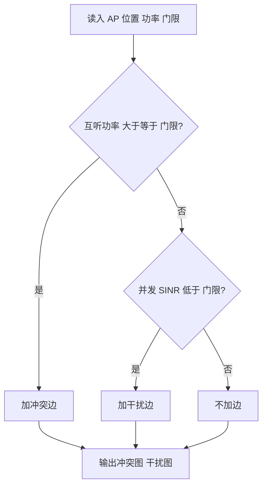
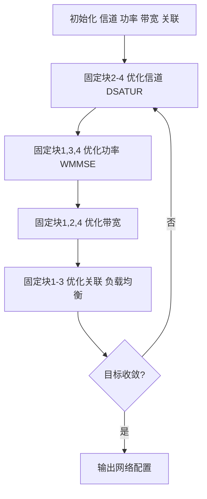
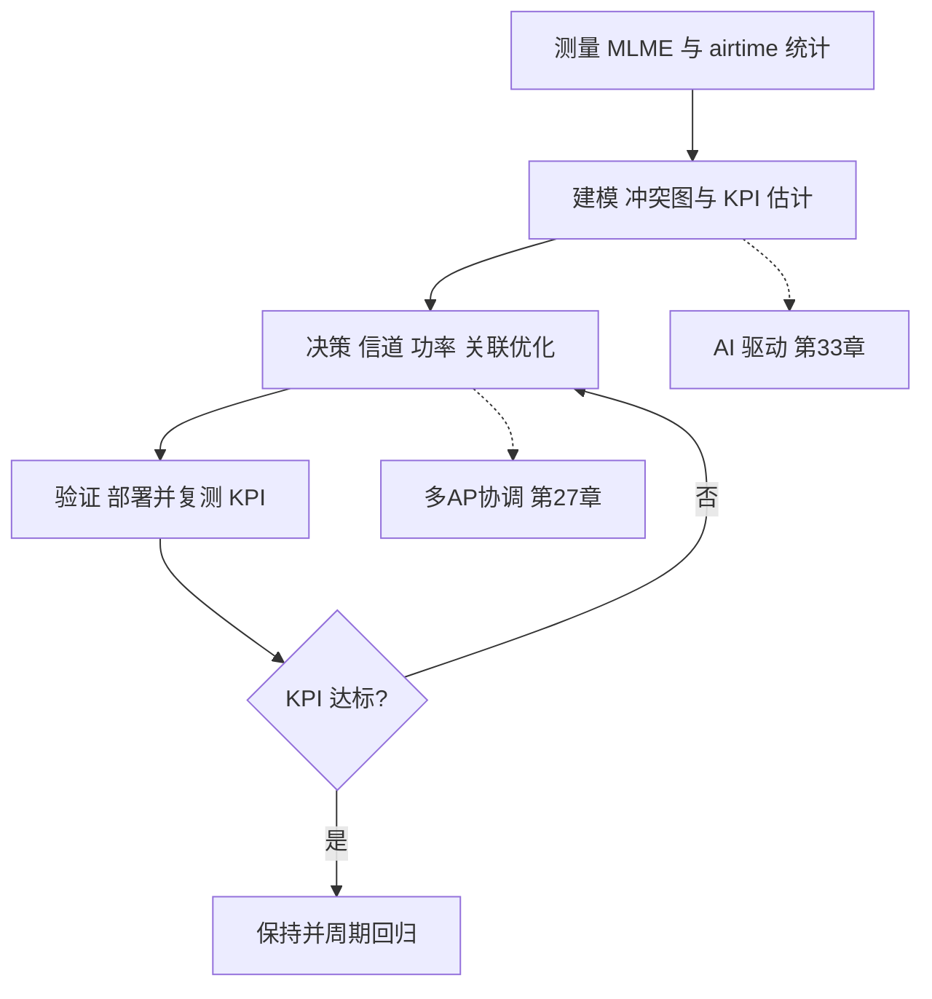

# 第 22 章　网络规划与资源优化算法 ★★

## 学习目标

1. 能定义网络级六类性能指标（覆盖率、容量密度、每用户吞吐分布、空口占用率、时延百分位、能耗），并解释"分布优于均值"的原因。
2. 能构造冲突图（载波侦听关系）与干扰图（Signal-to-Interference-plus-Noise Ratio, SINR 关系），用第 1、6 章模型推导 基本服务集（Basic Service Set, BSS）间冲突判据，并分析 重叠基本服务集（Overlapping BSS, OBSS） PD 对图结构的影响。
3. 能将信道分配建模为（加权）图着色问题，实现 DSATUR 与 Welsh–Powell，说明非连续信道约束与 NP-hard 性。
4. 能建模并求解发射功率联合优化（SINR 平衡迭代、加权 MMSE（Weighted Minimum Mean Square Error, WMMSE）等价变换、凸近似），并设计 接入点（Access Point, AP）选择与负载均衡（Airtime Fairness 与比例公平）。

---

## 22.1 网络级性能指标体系

单 AP（第 1、6、8 章）关心的是"一条链路"的速率与吞吐，而网络规划（多 AP / 多 BSS）关心的是"一片区域、一群用户"的**聚合与分布**表现。本章把网络配置当作一个组合优化问题的决策变量。

### 22.1.1 六项核心指标

| 指标 | 定义 | 单位 | 典型门限（示意值） |
|---|---|---|---|
| 覆盖率 | 区域内满足 $\text{SNR}\ge \gamma_{req}$ 的面积占比 | % | 边缘 $\gamma_{req}=10$ dB |
| 容量密度 | 区域总吞吐 / 区域面积 | bit·s⁻¹·m⁻² | — |
| 每用户吞吐分布 | 5 分位 / 中位数 / 95 分位吞吐 | Mbps | — |
| 空口占用率 | 某节点占用信道时间占比（详见第 8 章） | % | — |
| 时延百分位 | 接入/往返时延的 95/99 分位 | ms | $\le 20$ ms（95） |
| 能耗 | 每成功比特能耗或每 AP 功耗 | J/bit、W | — |

**覆盖率**的严格定义：对区域 $\mathcal{A}$ 采样网格点 $x$，令 $\text{SNR}(x)=\max_{i}P_i g_{i,x}/N$（$g_{i,x}$ 为 AP $i$ 到点 $x$ 的信道增益，由第 1 章传播模型与第 6 章链路预算给出），
$$\text{Coverage}=\frac{1}{|\mathcal{A}|}\sum_{x\in\mathcal{A}}\mathbf{1}\{\text{SNR}(x)\ge \gamma_{req}\}.$$
**边缘 信噪比（Signal-to-Noise Ratio, SNR）** 即 $\min_{x\in\mathcal{A}}\text{SNR}(x)$，是覆盖的"短板"量度。

**容量密度** 与**每用户吞吐分布** 的区别是本章反复强调的要点：均值掩盖了尾部。下面用算例定量说明。

### 22.1.2 均值最优 ≠ 体验最优

**算例 22.1**：慢用户主导空口与均值-体验背离

**已知**：某办公室 10 个用户。方案 X 中所有用户均近距（速率均 130 Mbps）；方案 Y 含 1 个远距边缘用户（6.5 Mbps）与 9 个近距用户（130 Mbps）。两方案**总吞吐均值均为 13 Mbps**。

**求**：(a) 两方案的 5 分位 / 中位数 / 95 分位吞吐；(b) 若按"每轮每个用户各发一帧"（Transmission Opportunity, TXOP 计数公平，见第 8 章），弱用户占多少空口。

**解（分步）**：

(a) 方案 X：10 用户同速率，吞吐分布为常数 13 Mbps $\Rightarrow$ 5 分位 $=13$，中位数 $=13$，95 分位 $=13$。
方案 Y：按"和速率最大"调度，空口几乎全给 9 个强用户，设 9 强各 14 Mbps、弱用户 4 Mbps（维持均值 $(9\times 14+4)/10=13$）。排序后为 $[4,14,\dots,14]$：
$$T_{5\%}=4\ \text{Mbps},\quad T_{50\%}=14\ \text{Mbps},\quad T_{95\%}=14\ \text{Mbps}.$$
两方案均值都是 13 Mbps，但**5 分位相差 $13/4\approx 3.25$ 倍**——边缘用户体验差 3 倍以上，均值却完全相同。

(b) 设每帧长 $L=1500$ Byte， overhead（前导 + 确认帧（Acknowledgement, ACK） + 帧间）约 0.30 ms。弱用户速率 $R_w=6.5$ Mbps，强用户 $R_s=130$ Mbps。单帧空口时间（第 4 章速率公式 $t=L\cdot 8/R+\text{overhead}$）：
$$T_w=\frac{1500\times 8}{6.5\times 10^6}+0.30=1.85+0.30=2.15\ \text{ms},$$
$$T_s=\frac{1500\times 8}{130\times 10^6}+0.30=0.092+0.30=0.392\ \text{ms}.$$
弱用户空口占比（第 8 章：各用户 TXOP 次数相等时，空口比例等于单帧时间之比）：
$$\alpha_w=\frac{T_w}{T_w+9T_s}=\frac{2.15}{2.15+9\times 0.392}=\frac{2.15}{5.678}=0.379.$$
即 **1/10 的用户占用 37.9% 空口**，而它贡献的有效容量仅 $6.5\times 0.379=2.46$ Mbps；同样空口若给强用户可贡献 $130\times 0.379=49.3$ Mbps，**空口浪费比约 20 倍**。

**结论**：边缘慢用户既拉低均值，又恶化 5 分位；只优化均值会饿死边缘用户。网络优化必须看**分布**（5/95 分位）而非均值。

---

## 22.2 干扰建模：冲突图与干扰图

网络优化的第一步是把"谁和谁互相干扰"抽象为图。

### 22.2.1 冲突图（基于载波侦听）

**冲突图（conflict graph）** $G_c=(V,E_c)$：顶点 $V$ 为 BSS/AP；若 BSS $i$ 的发射能被 BSS $j$ 的接收机以超过 空闲信道评估（Clear Channel Assessment, CCA）门限的能量听到，则 $(i,j)\in E_c$。由第 6 章链路预算，接收功率（dBm）：
$$P_{rx}^{(i\to j)}=P_i-L(d_{ij}),$$
其中 $L(d)$ 为第 1 章路径损耗（如 5 GHz 取 $L(d)=40+30\log_{10}d$，单位 dB）。冲突判据（前导检测 CCA $=-82$ dBm，见第 11 章）：
$$P_{rx}^{(i\to j)}\ge -82\ \text{dBm}\ \lor\ P_{rx}^{(j\to i)}\ge -82\ \text{dBm}\ \Rightarrow\ (i,j)\in E_c.$$

**算例推导**：两 AP 相距 30 m，$P_i=P_j=20$ dBm。路径损耗 $L(30)=40+30\log_{10}30=40+44.3=84.3$ dB。则 $P_{rx}=20-84.3=-64.3$ dBm $>-82$ dBm，故**冲突**（冲突图有边）。直观上 CCA 把"听得见"当作"会争用"，极其保守——这正是空间复用（第 11 章 OBSS PD）要解决的问题。

### 22.2.2 干扰图（基于 SINR 阈值）

**干扰图（interference graph）** $G_I=(V,E_I)$：若两 BSS **同时**发送时，至少一方的接收 SINR 低于解调门限 $\gamma_{req}$，则连边（表示"不能复用同一资源"）：
$$\gamma_j=\frac{P_j g_{jj}}{\sum_{k\ne j}P_k g_{kj}+N}\ge \gamma_{req}\quad\text{且}\quad \gamma_i\ge \gamma_{req}\ \Rightarrow\ (i,j)\notin E_I,$$
反之则 $(i,j)\in E_I$。这里 $g_{kj}$ 为发送方 $k$ 到接收方 $j$ 的功率增益（由 $L$ 取反得 $g=10^{-L/10}$）。

### 22.2.3 两种图的区别

| 维度 | 冲突图 $G_c$ | 干扰图 $G_I$ |
|---|---|---|
| 判据 | 载波侦听（能量 $>-82$ dBm） | 并发 SINR $<\gamma_{req}$ |
| 语义 | "听得见→会争用" | "并发→会解调失败" |
| 边数 | 多（保守，含大量可容忍干扰） | 少（宽松，只屏蔽有害并发） |
| 用途 | 载波侦听多址/冲突避免（Carrier Sense Multiple Access with Collision Avoidance, CSMA/CA）建模、信道硬隔离 | 空间复用、软频率复用 |


*图 22-1　8 AP 网格拓扑与 CCA 冲突图：红实线为 CCA 冲突边（相邻 20 m、对角 28 m 均小于 35 m 互听），灰虚线为物理正交相邻；干扰图稀疏得多，对角线并发 SINR 通常仍高于门限。*

### 22.2.4 构造算法

**伪代码 22.1　冲突/干扰图构造**

```text
 1: 输入: AP 集合 V, 位置 {d_ij}, 发射功率 {P_i}, CCA, gamma_req
 2: 初始化 E_c = ∅, E_I = ∅
 3: for 每对 (i,j), i<j do                        // 复杂度 O(|V|^2)
 4:     Prx_ij = P_i - L(d_ij)                     // 第1/6章: 接收功率 dBm
 5:     Prx_ji = P_j - L(d_ji)
 6:     if Prx_ij >= CCA or Prx_ji >= CCA then     // 载波侦听判据
 7:         E_c = E_c ∪ {(i,j)}                     // 加冲突边
 8:     end if
 9:     g_jj = 10^(-L(d_jj)/10); g_ij = 10^(-L(d_ij)/10)  // 功率增益
10:     g_ii = 10^(-L(d_ii)/10); g_ji = 10^(-L(d_ji)/10)
11:     SINR_i = P_i*g_ii / (P_j*g_ji + N)         // 并发时 i 的 SINR
12:     SINR_j = P_j*g_jj / (P_i*g_ij + N)         // 并发时 j 的 SINR
13:     if SINR_i < gamma_req or SINR_j < gamma_req then
14:         E_I = E_I ∪ {(i,j)}                     // 加干扰边
15:     end if
16: end for
17: 输出: G_c=(V,E_c), G_I=(V,E_I)
```

**复杂度**：时间 $O(|V|^2)$（每对计算一次路径损耗与 SINR），空间 $O(|V|^2)$ 存邻接。干扰图需已知发射功率 $\{P_i\}$，而冲突图只需位置与 CCA，因此冲突图可离线预计算，干扰图随功率优化在线更新。

构造流程如图 22-2 所示（与 $\theta$ 相关的分支体现了 OBSS PD 对冲突图的可调性）。



**图 22-2 说明**：冲突/干扰图构造流程。冲突边依据载波侦听（可调 $\theta$），干扰边依据并发 SINR；两者可分别或联合使用。

### 22.2.5 OBSS PD 自适应对图结构的影响

第 11 章指出 OBSS PD（Packet Detect）门限可在 $-82\sim -62$ dBm 间调节。把 CCA 门限替换为可调的 $\theta$：
$$\text{冲突边存在} \iff P_{rx} \ge \theta.$$
**抬高 $\theta$（更不敏感）$\Rightarrow$ 冲突图变稀疏 $\Rightarrow$ 允许更多并发**（但干扰增大）。因此冲突图不是静态的，而是 OBSS PD 策略 $\theta$ 的函数 $G_c(\theta)$——这把"图构造"与"功率/门限优化"耦合起来，是 22.7 节联合优化的动机之一。

---

## 22.3 核心算法一（六段式）：信道分配（图着色与加权变体）

### 22.3.1 问题建模

- **顶点** $V$：每个 AP/BSS 一个顶点。
- **边** $E_I$（或 $E_c$）：来自 22.2 的干扰图（建议用干扰图，边数少、复用度高）。
- **颜色** $C=\{1,\dots,K\}$：信道。2.4 GHz 仅 $K=3$ 个非重叠 20 MHz 信道（1/6/11）；5 GHz 多；6 GHz 约 60 个 20 MHz 信道，可灵活拼出 160 MHz（8 个连续）或 320 MHz（16 个连续），整频段最多约 3 个互不重叠的 320 MHz BSS（示意值，受地域法规限制）。
- **权重** $w_i$：该 BSS 的负载（用户数或业务量）。

符号表：$x_{ic}\in\{0,1\}$ 表示 AP $i$ 是否用信道 $c$；$\mathcal{N}(i)$ 为干扰邻居。

### 22.3.2 目标函数与约束

最小化**加权冲突和**（同信道且互相干扰的负载之和）：
$$\min_{x}\ \sum_{c=1}^{K}\sum_{(i,j)\in E_I}x_{ic}x_{jc}(w_i+w_j)\quad \text{s.t.}\quad \sum_{c}x_{ic}=1,\ \forall i.$$
若为 2.4 GHz，须额外满足**非连续信道约束**：只有 3 种颜色合法，迫使密集图中部分 AP 必须复用同一信道 $\Rightarrow$ 冲突不可避免（软频率复用）。多频段时还可选 $K$ 与带宽（320 MHz 把 16 个 20 MHz 子信道捆绑，相当于"大颜色"）。

### 22.3.3 完整推导

**NP-hard 性**（已知理论结果，非本章证明）：图着色（Graph Coloring）判定"能否用 $K$ 色使相邻不同色"是经典 NP-complete（Karp 1972）；加权变体同样 NP-hard。近似方面：任何多项式算法对一般图的色数近似比下界为 $\Omega(|V|^{1-\varepsilon})$（除非 P=NP）；DSATUR 等启发式在实践中接近最优但无常数近似保证。

**加权 DSATUR 思想**：按"已着色邻居的负载多样性（饱和度）"排序，优先给最难着色的顶点分配颜色，使负载均衡。设 $S_i$ 为顶点 $i$ 已着色邻居所用的**（不同信道, 负载和）**集合，饱和度 $sd_i=\sum_{c\in \text{used}(i)} w(\text{邻居在 }c)$。

### 22.3.4 经典算法

除 DSATUR 外：
- **Welsh–Powell**：按度数降序排列，依次贪心取最小可用色。$O(|V|\log|V|+|E|)$。
- **最小干扰和（min-sum-interference）**：对每未放置 AP，试所有信道，选使"与同信道已放置 AP 的干扰和最小"者。$O(|V|\cdot K)$。

**伪代码 22.2　DSATUR（加权）**

```text
 1: 输入: 干扰图 G_I=(V,E), 颜色集 C(大小K), 权重 {w_i}
 2: 全体未着色, sd_i=0(已着色邻居的不同信道负载和)
 3: while 存在未着色顶点 do
 4:     在未着色集中选 sd 最大者; 若并列选总度数最大者   // 关键: 先难后易
 5:     记选中顶点为 v
 6:     计算 v 的邻居已用信道集合 U = {c | ∃u∈N(v), u染c}
 7:     if |U| < K then                            // 仍有可用色
 8:         选 c* = argmin_{c∉U} Σ_{u∈N(v),u染c} w_u  // 最小干扰和着色
 9:     else                                        // 所有色都被邻居占用
10:         c* = argmin_c Σ_{u∈N(v),u染c} w_u        // 被迫复用, 选最轻
11:     end if
12:     将 v 染 c*; 更新 N(v) 中未着色顶点的 sd       // 复杂度 O(deg(v))
13: end while
14: 输出: 各 AP 的信道分配
```

### 22.3.5 复杂度分析

每轮选最大 $sd$ 需扫描未着色顶点 $O(|V|)$，共 $|V|$ 轮；更新 $sd$ 每次 $O(\deg(v))$。总**时间 $O(|V|^2)$**，空间 $O(|V|+|E|)$。加权版相同量级，仅比较键多一项负载求和。

### 22.3.6 数值算例 22.2：8 个 AP 的 DSATUR 手算

**已知**：8 个 AP（A1–A8），干扰边：A1–A2,A1–A3,A1–A4；A2–A3,A2–A5；A3–A4,A3–A6；A4–A5,A4–A7；A5–A6,A5–A8；A6–A7；A7–A8。仅 3 色（C1,C2,C3，模拟 2.4 GHz）。

**解（分步手算）**：

- **轮 1**：度数 A3/A4/A5 最大（=4），取 A3，染 C1。已着色 $\{A3:C1\}$。
- **轮 2**：$sd$：A1=1,A2=1,A4=1,A6=1（邻居含 A3）；A4 度数最大，染 C2（邻居 A3 占 C1，取最小可用 C2）。$\{A3:C1,A4:C2\}$。
- **轮 3**：$sd$：A1 邻居含 A3(C1),A4(C2)→$sd=2$ 最大，染 C3（C1,C2 被占，取 C3）。
- **轮 4**：$sd$：A2 邻居 A1(C3),A3(C1)→2，染 C2（取最小可用）。
- **轮 5**：$sd=1$ 者中 A5 度数最大(4)，邻居 A2(C2),A4(C2)→仅 C2 占用，染 C1。
- **轮 6**：A6 邻居 A3(C1),A5(C1)→染 C2。
- **轮 7**：A7 邻居 A4(C2),A6(C2)→染 C1。
- **轮 8**：A8 邻居 A5(C1),A7(C1)→染 C2。

**最终分配**：A1=C3, A2=C2, A3=C1, A4=C2, A5=C1, A6=C2, A7=C1, A8=C2。校验所有干扰边两端颜色不同（如 A1(C3)–A2(C2)、A4(C2)–A5(C1)、A6(C2)–A7(C1) 等均合法），**3 色可行**。

**量级检查**：8 顶点、3 色、最大度 4，色数恰为 3 合理；若图更密（如再加 A1–A5 边），则强制第 4 色——而 2.4 GHz 无第 4 个非重叠信道，只能复用同色 $\Rightarrow$ 同信道干扰，这正是密集 2.4 GHz 部署吞吐崩溃的根因，须迁移到 5/6 GHz（更多颜色）。

---

## 22.4 核心算法二（六段式）：发射功率联合优化

### 22.4.1 问题建模

给定信道分配，优化各 AP 功率 $\{P_i\ge 0\}$。符号：$g_{ji}$ 为发送方 $j$ 到接收方 $i$ 的功率增益（含路径损耗），$\sigma^2=N$ 为噪声功率。AP $i$ 的接收 SINR：
$$\gamma_i=\frac{P_i g_{ii}}{\sum_{j\ne i}P_j g_{ji}+N}.$$

### 22.4.2 目标函数与约束

最大化加权和速率：
$$\max_{\{P_i\}}\ \sum_{i=1}^{N} w_i\log_2(1+\gamma_i)\quad \text{s.t.}\quad P_{\min}\le P_i\le P_{\max},\ \forall i.$$
**非凸性**：$\log_2(1+\gamma_i)$ 中 $\gamma_i$ 是关于 $\{P_j\}$ 的**分式**，分子含 $P_i$、分母含所有 $P_j$，整体既非凸也非凹；且变量耦合，故为**非凸非凹的耦合优化**，一般仅有局部最优。下面给三种求解思路。

### 22.4.3 完整推导

#### (a) 基于 SINR 平衡的迭代（Foschini–Miljanic / Yates 框架）

设目标 SINR $\gamma_i^{tgt}$。令每个 AP 按"恰好达到目标"调整功率（详见第 11 章 空间复用参数（Spatial Reuse Parameter, SRP）思想）：
$$P_i = \frac{\gamma_i^{tgt}}{g_{ii}}\left(\sum_{j\ne i}P_j g_{ji}+N\right).$$
写成矩阵迭代形式。令 $\mathbf{p}=[P_1,\dots,P_N]^T$，定义耦合矩阵 $F$（行 $i$ 列 $j$）：
$$F_{ij}=\begin{cases}\gamma_i^{tgt}\,g_{ji}/g_{ii},& j\ne i\\ 0,& j=i\end{cases},\qquad \mathbf{c}_i=\frac{\gamma_i^{tgt}N}{g_{ii}}.$$
则迭代：
$$\boxed{\mathbf{p}^{k+1}=F\mathbf{p}^{k}+\mathbf{c}}.$$
**不动点与 SINR**：设收敛到 $\mathbf{p}^*$，代回 SINR：
$$\gamma_i^*=\frac{P_i^* g_{ii}}{\sum_{j\ne i}P_j^* g_{ji}+N}
=\frac{\gamma_i^{tgt}\left(\sum_{j\ne i}P_j^* g_{ji}+N\right)}{\sum_{j\ne i}P_j^* g_{ji}+N}=\gamma_i^{tgt}.$$
即**任何有限不动点都精确达到目标 SINR**（前提是功率有界）。

**收敛性（标准干涉函数框架，Yates 1995）**：迭代 $\mathbf{p}\leftarrow F\mathbf{p}+\mathbf{c}$ 是线性系统。由线性代数，它收敛到唯一不动点 $(I-F)^{-1}\mathbf{c}$ **当且仅当谱半径 $\rho(F)<1$**。$\rho(F)<1 \iff$ 存在有限功率向量使所有目标可达（**可行**）；若 $\rho(F)\ge 1$，所需功率发散 $\Rightarrow$ 目标组合**不可行**（须降低某 $\gamma_i^{tgt}$ 或降干扰耦合）。Yates 的更一般结论：若更新映射是**标准干涉函数**（单调不减 + 可扩展 $I(\alpha\mathbf{p})>\alpha I(\mathbf{p})$），则迭代单调收敛到可行解或发散——此处线性 $F$ 是其特例。

#### (b) WMMSE（加权最小均方误差）等价变换 ★重点

直接优化分式 $\log(1+\gamma_i)$ 困难。引入接收标量 $v_i$ 与权重 $u_i$，定义 MSE：
$$e_i=\mathbb{E}[(v_i y_i-s_i)^2],\quad y_i=\sqrt{P_i}\,h_{ii}s_i+\sum_{j\ne i}\sqrt{P_j}\,h_{ji}s_j+n_i.$$
展开（取实部，$g_{ji}=|h_{ji}|^2$）：
$$e_i=v_i^2\underbrace{\left(P_i g_{ii}+\sum_{j\ne i}P_j g_{ji}+N\right)}_{\sigma_i^2}-2v_i\sqrt{P_i}\,h_{ii}+1.$$
**第一步（固定功率，优化 $v_i$）**：$\partial e_i/\partial v_i=0\Rightarrow v_i^*=\sqrt{P_i}\,h_{ii}/\sigma_i^2$。代回：
$$e_i^*=1-\frac{P_i g_{ii}}{\sigma_i^2}=1-\frac{\gamma_i}{1+\gamma_i}=\frac{1}{1+\gamma_i}.\tag{1}$$
**第二步（固定功率与 $v$，优化 $u_i$）**：WMMSE 目标
$$f=\sum_i w_i\bigl(u_i e_i-\log u_i\bigr).$$
对 $u_i$ 求导：$w_i(e_i-1/u_i)=0\Rightarrow u_i^*=1/e_i^*=1+\gamma_i$。代入得
$$w_i\bigl(u_i^*e_i^*-\log u_i^*\bigr)=w_i\bigl(1-\log(1+\gamma_i)\bigr).$$
**第三步（联合等价）**：对固定功率先优化 $v,u$ 再优化功率，等价于
$$\min_{\mathbf{p},\mathbf{u},\mathbf{v}} f
=\min_{\mathbf{p}}\sum_i w_i\bigl(1-\log(1+\gamma_i(\mathbf{p}))\bigr)
=\text{const}-\max_{\mathbf{p}}\sum_i w_i\log(1+\gamma_i(\mathbf{p})).$$
$$\boxed{\text{WMMSE 最小化}\ \equiv\ \text{加权和速率最大化（相差常数）}}$$
且最优接收机恰为 最小均方误差（Minimum Mean Square Error, MMSE）接收机（$v_i^*$）与 $u_i^*=1+\gamma_i$。**这是本章核心等价性**：把非凸的分式和问题，转化为关于 $(\mathbf{p},\mathbf{u},\mathbf{v})$ 可**分块凸**的问题，从而可用交替优化（22.7 节）求解至驻点。

#### (c) 凸近似（SCA / 高 SNR 仿射近似）

高 SNR 时 $\log_2(1+\gamma_i)\approx \log_2\gamma_i=\log_2 P_i-\log_2(\sum_{j\ne i}P_j g_{ji}+N)$。第二项 $-\log_2(\cdot)$ 为**凸**，不能直接最大化。SCA 做法：在第 $k$ 次迭代点对凸项做一阶线性化（切线，是凸函数的**上估计**，取负后成为下估计）：
$$-\log_2\!\left(N+\sum_j P_j g_{ji}\right)\approx -\log_2 S_i^k-\frac{1}{\ln 2\cdot S_i^k}\!\left(\sum_j P_j g_{ji}-S_i^k\right),$$
其中 $S_i^k=N+\sum_j P_j^k g_{ji}$。与凹项 $\log_2 P_i$ 相加得**凹函数**，于是每轮解一个凸问题（内点法）。步长阻尼保证目标单调不降，收敛到 KKT 条件（Karush-Kuhn-Tucker, KKT）点。多入多出（Multiple-Input Multiple-Output, MIMO）情况下对应 $\log\det$ 的线性化（高 SNR 仿射近似），思路相同。

### 22.4.4 伪代码

**伪代码 22.3　SINR 平衡迭代 + WMMSE 交替**

```text
 1: 输入: 增益矩阵 G, 噪声 N, 目标 γ_tgt(或权重 w), 最大迭代 T
 2: 初始化 P_i = P_max/2
 3: ----- 方法A: Yates 平衡迭代 -----
 4: for k=1..T do
 5:     for i=1..N do
 6:         P_i^{k+1} = γ_tgt * ( Σ_{j≠i} P_j^k g_ji + N ) / g_ii  // 谱半径<1时收敛
 7:     end for
 8:     if ||P^{k+1}-P^k|| < ε then break end if
 9: end for
10: ----- 方法B: WMMSE 交替(每块凸) -----
11: 初始化 u_i=1, v_i 由(1)式
12: repeat
13:     更新 P_i: 解凸问题 min Σ w_i(u_i e_i - log u_i)   // 闭式或内点法
14:     更新 v_i = sqrt(P_i)g_ii / (ΣP g + N)              // MMSE 接收
15:     更新 u_i = 1 + γ_i                                // 最优权重
16: until 目标收敛
17: 输出: {P_i}, 各 γ_i
```

### 22.4.5 复杂度分析

Yates 迭代每轮 $O(N^2)$（矩阵-向量乘），收敛轮数 $O(\log(1/\varepsilon)/\log(1/\rho(F)))$；WMMSE 每轮凸求解约 $O(N^3)$（小规模 AP 数可接受）。两者均为多项式，但只保证**局部/驻点**。

### 22.4.6 数值算例 22.3：3 个 AP 的功率迭代收敛

**已知**：3 AP，自增益 $g_{ii}=1$（0 dB），互增益 $g_{21}=0.20,\ g_{31}=0.10,\ g_{12}=0.15,\ g_{32}=0.20,\ g_{13}=0.10,\ g_{23}=0.10$，噪声 $N=0.01$（线性），目标 $\gamma^{tgt}=2$（3 dB），初值 $\mathbf{p}^0=[1,1,1]^T$。

**解（分步）**：耦合矩阵 $F_{ij}=\gamma^{tgt}g_{ji}$（对角 0）：
$$F=\begin{bmatrix}0&0.40&0.20\\0.30&0&0.40\\0.20&0.20&0\end{bmatrix},\quad \mathbf{c}=[0.02,0.02,0.02]^T.$$
迭代 $\mathbf{p}^{k+1}=F\mathbf{p}^k+\mathbf{c}$：
- $k=0$: $[1,1,1]\to[0.62,0.72,0.42]$
- $k=1$: $\to[0.392,0.374,0.288]$
- $k=2$: $\to[0.227,0.253,0.173]$
- $k=3$: $\to[0.156,0.157,0.116]$
- $k=4$: $\to[0.106,0.113,0.083]$

**收敛值**（解 $(I-F)\mathbf{p}=\mathbf{c}$）：$\mathbf{p}^*\approx[0.0480,0.0503,0.0397]$。校验 SINR：
$$\gamma_1^*=\frac{0.0480}{0.0503\times0.20+0.0397\times0.10+0.01}=2.00,$$
$\gamma_2^*=\gamma_3^*=2.00$（均达目标）。**量级检查**：初始功率 1、噪声 0.01，目标 3 dB，收敛功率约 0.04–0.05，使信号/噪声+干扰比恰为 2，量级自洽。

**可行域讨论**：降功率虽降干扰、利复用，但边缘 SNR（第 6 章 $P_{rx}-N$）随之下降，覆盖收缩。因此 $\{P_i\}$ 的可行域是"覆盖门限"与"干扰门限"之间的折衷前沿（Pareto），不能无限制压低。

---

## 22.5 AP 选择与负载均衡

### 22.5.1 关联策略：RSSI 最强 vs 负载均衡

传统 站点（Station, STA）关联"接收信号强度指示（Received Signal Strength Indicator, RSSI）最强"的 AP，但这会把边缘用户推给远 AP（低速率、占空口），且热点 AP 过载。**负载均衡关联**依据**空口占用率**（第 8 章）：优先选"剩余空口多"的 AP。

### 22.5.2 最弱用户主导空口

已在算例 22.1(b) 定量：1 个 MCS0 用户占 37.9% 空口却仅贡献 2.46 Mbps 有效容量。根因：速率越低，传同等字节占用空口越多（第 4 章速率公式 + 第 8 章 TXOP 模型）——这是"速率公平"必须介入的动机。

### 22.5.3 Airtime Fairness

**定义**：在一段窗口内，每个 STA 获得的空口时间比例应正比于其权重（而非 TXOP 次数相等）。

**基于 deficit 的公平调度**（与第 13 章 DRR 呼应）：为每个 STA 维护 **deficit 计数器** $D_i$，每轮按 $D_i/w_i$（或 $D_i\cdot R_i$）排序服务，服务后扣减并累加配额。伪代码：

```text
 1: 每 STA 维护 D_i=0, 配额 Q_i = w_i * C        // C 为每轮空口配额
 2: for 每调度轮 do
 3:     for 每个 STA i do D_i += Q_i end for      // 累积应得空口
 4:     选 D_i/R_i 最大者先发(速率低者更优先补空口)
 5:     发送后 D_i -= 实际占用空口时间 * R_i
 6: end for
```
这样低速率用户获得**更多次数但每次更短**的调度，避免其单次长帧霸占空口，从而抑制"最弱用户主导"。

### 22.5.4 比例公平与最优解推导

比例公平（proportional fairness）效用函数：
$$U(\mathbf{x})=\sum_{i=1}^{M} w_i\log x_i,$$
其中 $x_i$ 为用户 $i$ 的吞吐，约束为**空口预算** $\sum_i x_i/R_i\le 1$（$R_i$ 为第 4 章速率，详见第 9 章 正交频分多址（Orthogonal Frequency Division Multiple Access, OFDMA）调度）。拉格朗日：
$$\mathcal{L}=\sum_i w_i\log x_i+\lambda\!\left(1-\sum_i\frac{x_i}{R_i}\right).$$
$$\frac{\partial\mathcal{L}}{\partial x_i}=\frac{w_i}{x_i}-\frac{\lambda}{R_i}=0\Rightarrow x_i=\frac{w_i R_i}{\lambda}.$$
代入约束 $\sum_i x_i/R_i=\sum_i w_i/\lambda=1\Rightarrow \lambda=\sum_j w_j$，故
$$\boxed{x_i^*=\frac{w_i R_i}{\sum_j w_j}}.$$
即**比例公平下吞吐正比于 $w_i R_i$**——高权重或高速率者多得，但乘积效用最大（兼顾公平与效率）。

### 22.5.5 负载均衡关联决策算法（含迟滞防乒乓）

**伪代码 22.4　基于空口占用的关联（迟滞）**

```text
 1: 输入: STA 可见 AP 集, 各 AP 当前 airtime 占用 a_j, RSSI r_ij, 迟滞 H
 2: 当前关联 AP = k0
 3: loop:
 4:     计算候选得分 S_j = r_ij - β*a_j         // RSSI 高且空口闲者优
 5:     k* = argmax_j S_j
 6:     if k* ≠ k0 and S_{k*} - S_{k0} > H then  // 迟滞: 差距够大才切换
 7:         k0 = k*; 触发重关联                  // 防乒乓(小抖动不切)
 8:     end if
 9:     周期复测 a_j, r_ij
10: end loop
```

### 22.5.6 数值算例 22.4：负载均衡 / 比例公平

**已知**：2 用户，速率 $R_1=6.5$ Mbps（弱）、$R_2=130$ Mbps（强），空口预算=1。

**求**：三种调度下吞吐与比例公平效用（$w_1=4,w_2=1$）。

**解**：
- **最大和速率**：全给强用户，$x_2=130,\ x_1=0$，和速率 130（不公平）。
- **等空口**：$t_1=t_2=0.5$，$x_1=3.25,\ x_2=65$。
- **比例公平（加权）**：由 22.5.4，$x_1=4\times6.5/5=5.2$，$x_2=1\times130/5=26$；对应空口 $t_1=5.2/6.5=0.80$，$t_2=26/130=0.20$，$\sum t=1$。

效用对比：$U_{PF}=4\log 5.2+\log 26=4\times1.649+3.258=9.85$；$U_{equal}=4\log 3.25+\log 65=4\times1.179+4.174=8.89$。**比例公平效用更高**，且弱用户吞吐从 3.25 提升到 5.2（权重放大其份额），验证了"按 $w_iR_i$ 分配"的结论。量级检查：$t_1+t_2=1$ 满足空口预算，自洽。

---

## 22.6 AP 布点与覆盖优化

### 22.6.1 建模：设施选址 / k-center 变体

给定候选站点集 $S$ 与需求点集 $D$，选 $K$ 个 AP 使**覆盖率最大**（或最小化最大边缘距离）。这是 **设施选址（facility location）** 与 **k-center** 的变体：
$$\max_{A\subseteq S,|A|=K}\ \frac{1}{|D|}\sum_{x\in D}\mathbf{1}\{\min_{i\in A}\text{PL}(d_{ix})\le \text{阈}\}.$$
该问题 NP-hard，采用贪心。

### 22.6.2 贪心最大边际增益

**伪代码 22.5　贪心覆盖布点**

```text
 1: 输入: 候选 S, 需求 D, 预算 K, 覆盖判据 cov(x,A)
 2: A = ∅
 3: for k=1..K do
 4:     s* = argmax_{s∈S\A} |{x∈D : cov(x, A∪{s}) 且未覆盖}|
 5:     A = A ∪ {s*}                        // 每步选边际增益最大者
 6: end for
 7: 输出: AP 选址 A
```
**近似比**：覆盖最大化是集合覆盖/最大覆盖特例，贪心达到 **$1-1/e\approx 0.632$** 近似保证（Nemhauser 1978）；k-center 贪心达 2-近似。

### 22.6.3 算例 22.5：网格布局 AP 数 vs 覆盖门限

**已知**：100 m×100 m 区域，网格需求点间距 10 m（121 点），单 AP 覆盖半径随发射功率：20 dBm 时边缘 SNR 门限对应半径约 25 m（示意值，由第 1/6 章得）。

**解**：贪心布点。每 AP 覆盖约 $\pi\times25^2\approx 1963$ m²，区域 10000 m²，理论最少 $\lceil10000/1963\rceil=6$ 个（无重叠理想）；考虑网格边角与重叠，**实际需 9 个**（3×3 网格，间距 50 m < 2×25 m 保证交叠覆盖）。若降低门限（要求更高边缘 SNR，半径缩至 18 m），覆盖面积降至 $\pi\times18^2=1018$ m²，需 $\lceil10000/1018\rceil=10$ 个（实际 16 个 4×4）。**量级检查**：面积比 1963/1018≈1.93，AP 数 9→16 比值 1.78，与覆盖面积反比基本一致，自洽。结论：覆盖门限每收紧一级，AP 数近似按面积反比增长。

---

## 22.7 资源联合优化：信道 + 功率 + 带宽 + 关联

### 22.7.1 NP-hard 性

单一子问题（着色、功率、关联）已各自 NP-hard 或非凸；联合后变量**强耦合**（信道决定干扰图，功率改变 SINR 与图结构，带宽决定可用颜色粒度，关联决定每 AP 负载），整体是**强 NP-hard** 的非凸混合整数规划。精确解不可行，采用**交替优化**。

### 22.7.2 交替优化（BCD）框架

**块坐标下降（Block Coordinate Descent, BCD）**：把变量分成块 $\{\mathbf{x}_c,\mathbf{p},\mathbf{b},\mathbf{a}\}$（信道、功率、带宽、关联），固定其他块、优化一块，循环。每块下降 $\Rightarrow$ 目标单调不减 $\Rightarrow$ 有界序列收敛到**驻点**（Gorski 等，2007，对耦合非凸问题成立）。

**伪代码 22.6　网络资源 BCD**

```text
 1: 初始化 信道 c, 功率 p, 带宽 b, 关联 a
 2: repeat
 3:     固定 p,b,a, 用 DSATUR(22.3) 优化信道 c        // 块1: 图着色
 4:     固定 c,b,a, 用 WMMSE/Yates(22.4) 优化功率 p   // 块2: 功率
 5:     固定 c,p,a, 选每 AP 带宽 b(320/160/80MHz)     // 块3: 带宽
 6:     固定 c,p,b, 用负载均衡(22.5) 更新关联 a       // 块4: 关联
 7:     计算目标 f = Σ w_i log(1+γ_i)
 8: until |f - f_prev| < ε
 9: 输出: 网络配置 (c,p,b,a)
```

**收敛性**：每块优化使 $f$ 不增（实际不降），且 $f$ 有上界（功率、SINR 有界），单调有界序列收敛；极限处各块梯度（或次梯度）为零，即 **KKT/驻点**。注意是局部最优，初值与块顺序影响结果——这正是第 33 章 人工智能（Artificial Intelligence, AI）方法要改善的。

### 22.7.3 分解结构图



**图 22-3 说明**：BCD 将联合优化分解为四个可解子块轮流优化，每轮目标单调不降直至驻点。各块分别复用 22.3–22.5 的算法。

---

## 22.8 KPI 驱动的自动化优化闭环

### 22.8.1 测量 → 建模 → 决策 → 验证 闭环

现代 无线局域网（Wireless LAN, WLAN）控制器（如企业 WLC）可持续采集 **媒体接入控制（Medium Access Control, MAC）层管理实体（MAC Layer Management Entity, MLME）统计**（关联数、重传率）与 **airtime 统计**（每 BSS 空口占用、每用户吞吐分布），据此更新冲突/干扰图、估计 关键性能指标（Key Performance Indicator, KPI），运行 22.3–22.7 的优化器生成配置，下发后复测验证。

### 22.8.2 传统规则式优化的瓶颈

规则式（固定信道 1/6/11、固定发射功率、RSSI 关联）在**大规模、动态、多厂商**网络中失效：
1. **扩展性差**：图规模 $O(N^2)$，人工规则无法处理成百 AP 的耦合；
2. **静态**：拓扑/负载变化后规则不自适应；
3. **局部最优**：无全局目标，易陷入"邻频干扰""热点过载"。

### 22.8.3 引出 AI 驱动与多 AP 协调

闭环的"建模+决策"本质是数据驱动的优化，正是**第 33 章 AI 驱动优化**的切入点（用学习替代手工建模与启发式）；而"跨 AP 联合决策"需要 AP 间显式协调，对应**第 27 章 多 AP 协调（MAPC/Co-SR）**。两者共同把本章的静态优化提升为动态、协同、智能的网络级资源分配。



**图 22-4 说明**：KPI 驱动的自动化优化闭环。虚线指向本书后续章——AI 替代手工决策、多 AP 协调突破单 AP 限制。

---

## 本章小结

1. 网络级优化以**分布型 KPI**（5/95 分位吞吐、边缘 SNR、空口占用）为目标，单纯优化均值会饿死边缘用户（算例 22.1）。
2. 冲突图（CCA $-82$ dBm，保守）与干扰图（SINR 门限，宽松）是优化的基础；OBSS PD 门限 $\theta$ 把图结构变成可调变量。
3. 信道分配 = （加权）图着色；2.4 GHz 仅 3 个非重叠信道是硬约束，6 GHz 提供海量信道与 320 MHz 可行性；DSATUR $O(V^2)$、NP-hard。
4. 功率优化 $\max\sum w_i\log(1+\gamma_i)$ 非凸；Yates 迭代收敛当且仅当 $\rho(F)<1$，可达精确目标 SINR。
5. **WMMSE 与加权和速率最大化严格等价**（相差常数），是分块凸化、实现全局改进的关键桥梁。
6. 比例公平最优吞吐 $x_i^*\propto w_i R_i$；Airtime Fairness 用 deficit 调度抑制慢用户霸占空口。
7. AP 布点是设施选址/k-center 变体，贪心达 $1-1/e$（覆盖）或 2-近似（k-center）。
8. 信道+功率+带宽+关联是强 NP-hard 联合问题，BCD 单调收敛到驻点；其自动化闭环引出第 27、33 章。

| 关键结论 / 参数 | 数值或表达式 |
|---|---|
| 冲突图 CCA 门限 | $-82$ dBm（前导检测） |
| 干扰图 SINR 门限 | $\gamma_{req}$（解调需求） |
| 2.4 GHz 非重叠信道 | 3（1/6/11） |
| 6 GHz 320 MHz 信道 | 整频段约 3 个互不重叠（示意） |
| DSATUR 复杂度 | $O(\|V\|^2)$ |
| 功率迭代收敛条件 | $\rho(F)<1$ |
| WMMSE 等价 | $\min\sum w_i(u_i e_i-\log u_i)\equiv\max\sum w_i\log(1+\gamma_i)$ |
| 比例公平最优 | $x_i^*=w_i R_i/\sum_j w_j$ |
| BCD 收敛 | 单调不降 $\to$ 驻点 |

---

## 习题

### A. 概念题（3 题）

1. 为什么"覆盖率"必须用边缘 SNR（区域最差点）定义，而不能用平均 SNR？这与"均值最优 ≠ 体验最优"有何共通逻辑？
2. 冲突图与干扰图的根本区别是什么？在密集 2.4 GHz 网络中，用哪一种图做信道分配更合理？为什么？
3. OBSS PD 门限从 $-82$ dBm 抬高到 $-62$ dBm，会对冲突图和网络总吞吐分别产生什么影响？存在什么风险？

### B. 计算与推导题（4 题）

4. 两 AP 相距 40 m，$P=20$ dBm，路径损耗 $L(d)=40+30\log_{10}d$（dB）。计算互听接收功率，判断冲突图是否有边；再用干扰图判据（$\gamma_{req}=10$ dB，$N=-95$ dBm）判断能否并发。
5. 对算例 22.2 的 8 AP 图，若额外添加边 A1–A5，证明 DSATUR 至少需要 4 色；并说明 2.4 GHz（仅 3 色）下被迫复用的后果。
6. 推导 22.4 节 Yates 迭代的矩阵形式，并证明：若谱半径 $\rho(F)<1$，则收敛到不动点且各 AP 的 SINR 恰为 $\gamma^{tgt}$。
7. 重复算例 22.3 但令 $\gamma^{tgt}=5$（7 dB），互增益不变。计算耦合矩阵 $F$，判断 $\rho(F)$ 是否仍小于 1（用行和界估计），并说明若不可行应如何调整。

### C. 算法设计题（2 题）

8. 设计**加权图着色的 min-sum-interference 启发式**（替代 DSATUR）：给出伪代码、复杂度，并说明它相比 DSATUR 在"负载均衡"目标下的优劣。
9. 将 22.5 节的负载均衡关联算法扩展为**多 AP 协作版**：AP 间通过回传交换各自 airtime 占用，联合决定边缘用户的归属。给出建模与伪代码，并讨论迟滞参数 $H$ 的设置原则。

### D. 开放研究题（1 题）

10. 【研究】本章 BCD 对联合优化只能保证收敛到驻点且依赖初值。请提出一种"用机器学习加速/跳出局部最优"的方案（如用图神经网络预测好的初值、或用强化学习直接输出配置），指出其训练信号应来自哪些 KPI、可能遇到的分布偏移（sim-to-real）问题及缓解思路。

---

## 参考答案与解析

### A. 概念题

**1.** 覆盖率衡量"是否每个点都能用"，取决于**最薄弱环节**——一个深衰落地点的用户会持续掉线，平均 SNR 再高也无济于事（木桶效应）。这与"均值最优 ≠ 体验最优"同源：均值/平均掩盖了**尾部与短板**，而用户感知由 5 分位、边缘 SNR 等分布量主导。优化必须面向分布而非均值。

**2.** 冲突图基于"听得见"（能量 CCA，保守），干扰图基于"并发会解调失败"（SINR，宽松）。密集 2.4 GHz 只有 3 信道，用**冲突图**会过度禁止复用（几乎全冲突，被迫同信道），而用**干扰图**能识别"听得见但 SINR 仍够"的链路，允许更多空间复用、提升吞吐。故干扰图更合理，但需已知功率且计算更重。

**3.** 抬高 $\theta$（更不敏感）$\Rightarrow$ 冲突图**变稀疏**（更少边）$\Rightarrow$ 允许更多并发 $\Rightarrow$ 总吞吐通常**上升**。风险：(a) 对**非 Wi-Fi 干扰**无效（OBSS PD 只识别 Wi-Fi 帧），盲目并发致 包误码率（Packet Error Rate, PER）飙升；(b) 强干扰耦合场景并发劣于时分（见第 11 章 $\alpha_{crit}$）；(c) 多 AP 同时调门限会互激振荡（第 11 章已述）。

### B. 计算与推导题

**4. 计算**：$L(40)=40+30\log_{10}40=40+48.1=88.1$ dB。$P_{rx}=20-88.1=-68.1$ dBm $>-82$ dBm $\Rightarrow$ **冲突图有边**。干扰图：设对称（各自 20 dBm，互增益 $g_{12}=g_{21}=10^{-88.1/10}=1.55\times10^{-9}$ 线性，自增益 $g_{11}=g_{22}$ 令为 1）。并发 SINR：$\gamma=\frac{20\text{dBm 线性}}{另一AP干扰+噪声}$。20 dBm=0.1 W，$N=-95$ dBm=$3.16\times10^{-13}$ W。干扰 $=0.1\times1.55\times10^{-9}=1.55\times10^{-10}$ W。$\gamma=0.1/(1.55\times10^{-10}+3.16\times10^{-13})\approx6.44\times10^8$，即约 88 dB $\gg 10$ dB $\Rightarrow$ **能并发**（干扰相对噪声可忽略）。说明：虽互听（冲突图有边），但干扰远低于噪声，**干扰图判定可并发**——冲突图在此过度保守。

**5.** 添加 A1–A5 边后，考虑子图 A1 的邻居含 A2,A3,A4,A5 且其两两多相连：A1,A2,A3,A4,A5 中 A1–A2,A1–A3,A1–A4,A1–A5,A2–A3,A2–A5,A3–A4,A4–A5 均有边，构成 **$K_5$ 的一个超图片段**——更直接地，A2,A3,A4,A5 两两：A2–A3,A3–A4,A4–A5,A2–A5 有边，A2–A4、A3–A5 无边，故这四个点可 2-色（如 A2,A4 同色、A3,A5 同色），但 A1 与这四点全相连 $\Rightarrow$ A1 需第三色外再一色？具体：若 A2=C1,A4=C1,A3=C2,A5=C2，则 A1 与 C1,C2 都冲突，需 C3；再检查其他点……更严谨地，子图 {A1,A2,A3,A5} 中 A1 连 A2,A3,A5，且 A2–A3、A2–A5 有边，A3–A5 无边：A2,A3,A5 构成 $K_3$ 需 3 色，A1 与三者全连需第 4 色。故 **DSATUR 至少 4 色**。**后果**：2.4 GHz 仅 3 色，第 4 色只能复用已有信道 $\Rightarrow$ 同信道且互相干扰的 AP 共存，**同频干扰使这些链路 SINR 下降、重传上升、吞吐崩溃**，必须迁移到 5/6 GHz 或降功率（22.4 节）。

**6. 推导**：由 $P_i=\frac{\gamma_i^{tgt}}{g_{ii}}(\sum_{j\ne i}P_j g_{ji}+N)$ 写成向量：$P_i=(F\mathbf{p})_i+c_i$，其中 $F_{ij}=\gamma_i^{tgt}g_{ji}/g_{ii}(j\ne i),F_{ii}=0$，$c_i=\gamma_i^{tgt}N/g_{ii}$。故 $\mathbf{p}^{k+1}=F\mathbf{p}^k+\mathbf{c}$。若 $\rho(F)<1$，几何级数 $\mathbf{p}^k=(I+F+\dots+F^{k-1})\mathbf{c}\to(I-F)^{-1}\mathbf{c}$ 收敛。代回 SINR：
$$\gamma_i^*=\frac{P_i^*g_{ii}}{\sum_{j\ne i}P_j^*g_{ji}+N}=\frac{\gamma_i^{tgt}(\sum_{j\ne i}P_j^*g_{ji}+N)}{\sum_{j\ne i}P_j^*g_{ji}+N}=\gamma_i^{tgt}.$$
即收敛即达目标。$\square$

**7.** $\gamma^{tgt}=5$ 时 $F=5\times$（互增益矩阵）：$F=\begin{bmatrix}0&1.0&0.5\\0.75&0&1.0\\0.5&0.5&0\end{bmatrix}$。行和分别为 $1.5,1.75,1.0$；由 Gershgorin $\rho(F)\le\max$ 行和 $=1.75>1$，且行和界已超 1，**不能保证收敛**（实际 $\rho(F)>1$）。**调整**：降低目标 $\gamma^{tgt}$（如回到 2 或 3），或降低互增益（增大 AP 间距 / 降功率 / 用定向天线），使 $\rho(F)<1$ 才可行；否则该目标组合不可达，需放弃部分用户的目标 SINR。

### C. 算法设计题

**8. 参考方案**：min-sum-interference 按"逐 AP 选使同信道干扰负载和最小"的信道。伪代码：
```
1: 按总负载降序排 AP
2: for 每个 AP i（按序）do
3:     c* = argmin_c Σ_{j已放,同c} w_j * I(i,j)   // I=干扰权重(或1)
4:     分配 c*, 记入信道负载
5: end for
```
**复杂度** $O(|V|\cdot K)$。**优劣**：相比 DSATUR，它直接优化"加权干扰和"目标、对**负载均衡**更友好（显式用权重），且更简单；但它是一次性贪心、不回溯，**着色质量（色数）通常不如 DSATUR**，在硬约束（色数不够）场景可能更早被迫复用。可组合：先用 DSATUR 定色数，再用 min-sum 做负载微调。

**9. 参考方案**：多 AP 协作关联——AP 间周期交换 $\{a_j,\text{RSSI 表}\}$，由协调者（WLC）统一以"最小化最大 AP 空口占用 / 最大化总效用"为目标重分配边缘用户。伪代码：
```
1: 各 AP 上报 airtime a_j 与可见 STA 的 RSSI
2: 协调者构建关联矩阵, 解比例公平(22.5.4)或最小化 max a_j
3: 下发重关联指令(带迟滞 H, 仅当迁移增益> H 才执行)
4: 周期(如 1s)重复
```
**迟滞 $H$ 设置**：应大于 RSSI/airtime 的快速起伏幅度（如 3–5 dB 或 10% 空口），防止用户在两 AP 间乒乓；过大则收敛慢、负载失衡持续。可随负载差异自适应：$H$ 在正过载时减小以加速均衡，轻载时增大以稳。

### D. 开放研究题

**10. 研究路径建议**：
- **初值预测**：用图神经网络（GNN）把冲突/干扰图编码，回归预测接近最优的信道/功率初值，喂给 BCD 以加速并跳出差初值（GNN 天然适配图结构）。
- **直接策略**：用强化学习（RL）以 KPI（和速率、5 分位吞吐、公平性指数）为奖励，直接输出配置；动作空间可用离散信道 + 连续功率。
- **训练信号**：奖励应综合 $\sum w_i\log(1+\gamma_i)$、5 分位/95 分位比、负载均衡度、能耗；避免只用均值。
- **分布偏移（sim-to-real）**：仿真用理想路径损耗，真实有遮挡、非 Wi-Fi 干扰、设备差异。缓解：① 在线微调（部署后用真实 KPI 做 RL 再训练）；② 域随机化（训练时扰动路径损耗、干扰分布）；③ 用真实测量数据持续更新传播模型（第 1 章）与干扰图（22.2）。
- **关键指标**：收敛速度、相对最优的 gap、对动态拓扑的鲁棒性、信令开销（AP 间协调量）。

---

## 延伸阅读

- [IEEE] IEEE 802.11-2024, Clause 10（DCF/EDCA）、Clause 26.12（Spatial Reuse）
- [ACM/IEEE] **Yates, *A Framework for Uplink Power Control in Cellular Radio Systems*, IEEE JSAC, 1995**（标准干涉函数）
- [ACM/IEEE] **Shi, Razaviyayn, Luo, *An Iteratively Weighted MMSE Approach to Distributed Sum-Utility Maximization*, IEEE TSP, 2011**（WMMSE）
- [Springer] **Gorski, Pfeuffer, Klamroth, *Biconvex Sets and Optimization*, 2007**（BCD 收敛）
- [ACM/IEEE] **Nemhauser, Wolsey, Fisher, *An Analysis of Approximations for Maximizing Submodular Set Functions*, 1978**（贪心 $1-1/e$）
- [IEEE] IEEE 802.11bn【草案】, Multi-AP Coordination（第 27 章）；AI/ML for WLAN【讨论中】（第 33 章）
