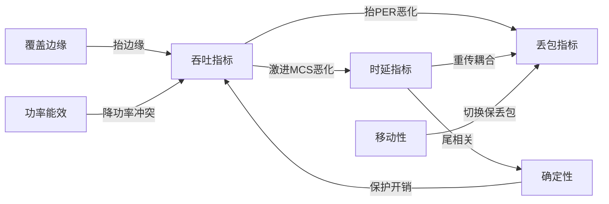
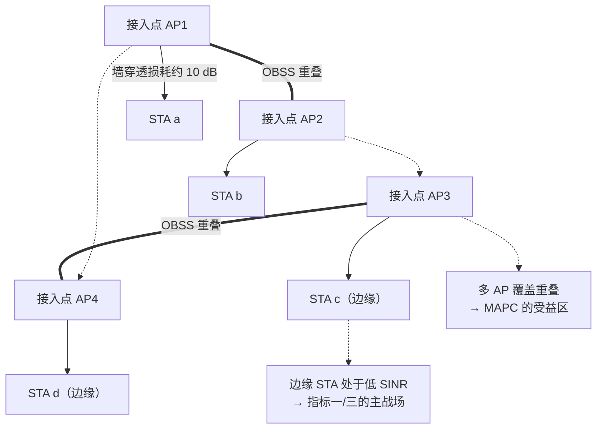
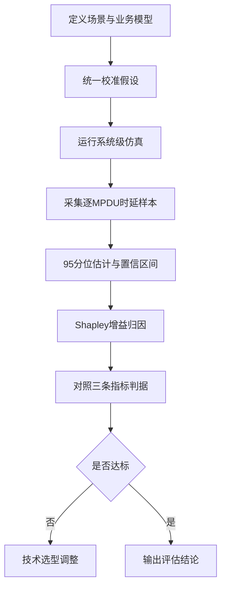

# 第 23 章　UHR 目标体系与评估方法 ★★★

> 本章状态标注：【草案】= IEEE 802.11bn 草案内容（PAR 已于 2023-07 批准，标准本身仍处 Draft 阶段）；【讨论中】= 尚未定案的技术提案。
> 主要事实来源：IEEE P802.11bn PAR / CSD（2023-07 批准）、IEEE 802.11 TGbn 官方更新页（2026）、Samsung Research 技术博客（2025-07）、Qualcomm 官方解读（2025-08）、TGbn 评估教程论文（覆盖 D1.4，2026）、Wikimili / 公开百科整理。时效性基准 2026-09。

## 学习目标

1. 能**复述并批判性分析** 802.11bn（Wi-Fi 8 / UHR）三条量化指标（Medium Access Control, MAC 吞吐 +25%、95 分位时延 −25%、MAC 协议数据单元（MAC Protocol Data Unit, MPDU）丢失 −25%）的严格定义、统计口径、测量点与技术条件，并指出口径选择如何改变"是否达标"的结论。
2. 能依据 超高可靠（Ultra High Reliability, UHR）评估方法学**搭建一套系统级仿真**：定义住宅/企业/密集/工业/XR 场景、业务模型（周期性+抖动+突发）与统一的校准假设。
3. 能**推导 95 分位分位估计量的渐近方差** $\mathrm{Var}(\hat q_p)\approx p(1-p)/(N f(q_p)^2)$，并用超阈值（POT / GPD）极值理论修正极端分位估计，给出所需样本量的量级判断。
4. 能用 **Shapley 值**把"某提案相对 11be 基线的增益"分解到各子机制（Distributed Resource Unit, DRU / 极远距离（Extreme Long Range, ELR） / 非主信道接入（Non-Primary Channel Access, NPCA） / 动态子信道操作（Dynamic Subchannel Operation, DSO） / MAPC / 抢占），并验证效率性、对称性、可加性。

---

## 23.1 从速率到可靠性的范式转变

### 23.1.1 历史脉络：七代都在追峰值

自 802.11b（11 Mbps）到 802.11be（Wi-Fi 7，理论峰值 ~46 Gbps，含 MLO），每一代 Wi-Fi 的市场叙事都围绕一个直观指标：**更高的峰值（理论）速率**。其物理引擎是三条杠杆——更宽信道（20→40→80→160→320 MHz，详见第 16 章）、更高阶调制（64→256→1024→4096-QAM，详见第 4 章）、更多空间流（1→8 流，详见第 3 章）。这三者的乘积受 **Shannon 界与法规 功率谱密度（Power Spectral Density, PSD）** 双重封顶（详见第 6 章链路预算：在给定带宽 $B$ 与信噪比 $\mathrm{SNR}$ 下，单链路容量上界 $C\le B\log_2(1+\mathrm{SNR})$；而法规对每个 20 MHz 的发射功率谱密度 $P_{\mathrm{PSD}}$ 设限，使"更宽信道"并不能线性放大可用功率，反而要求更精细的功率分配，这正是分布式资源单元 DRU 的动机）。

### 23.1.2 定量论证：增长点已转移到"尾"而非"峰"

表 23-1 给出代际演进中三类指标的对照（**峰值速率为示意值**，边缘/尾时延为典型高负载场景的示意数量级，非标准规定值）：

| 代际 | 标准 | 理论峰值速率（示意） | 边缘用户吞吐（5 分位，示意） | 95 分位时延（高负载，示意） |
|---|---|---|---|---|
| Wi-Fi 5 | 802.11ac | 6.9 Gbps | ~50 Mbps | ~50 ms |
| Wi-Fi 6 | 802.11ax | 9.6 Gbps | ~80 Mbps | ~30 ms |
| Wi-Fi 7 | 802.11be | 46 Gbps（含 MLO） | ~150 Mbps | ~15 ms |
| Wi-Fi 8 | 802.11bn【草案】 | ~同 11be（无新带宽/新 MCS） | 目标 +25%（特定 SINR） | 目标 −25%（尾） |

表 23-1　代际"峰值 / 边缘 / 尾时延"对照（示意值，用于说明趋势）

图 23-1 用归一化示意直观呈现"峰值进入平台期、而边缘与尾时延仍有改善空间"的范式转移。


*图 23-1　代际范式转变示意（各量以 802.11ac = 1.0 归一化，纵轴为对数轴）。峰值速率连续三代增长约 7 倍后在 11bn 上持平（无新带宽/新 调制编码方案（Modulation and Coding Scheme, MCS）可用）；而边缘可用速率与 95 分位时延在前三代几乎未动，正是 UHR 的主战场。数据为示意值。*

关键观察：
- **峰值速率已逼近法规与 Shannon 封顶**。11bn 不引入 >320 MHz 信道、不引入 >4096-QAM 调制（见 23.7 节核实结论），峰值信封与 11be 基本持平（~23 Gbps 单链路 / ~46 Gbps 含 多链路操作（Multi-Link Operation, MLO），示意）。继续抬高峰值对真实体验的边际收益趋于零。
- **边缘吞吐与尾时延仍有量级差距**。用户在厨房、仓库角落、密集公寓中体验到的不是"峰值不够"，而是"最差 5% 时刻连不上、95 分位时延暴涨"。这正是 11bn 把指标锚定在"特定 信干噪比（Signal-to-Interference-plus-Noise Ratio, SINR）下的速率"与"时延分布尾"的根本原因。
- 表 23-1 的"边缘/尾"列与"峰值"列**脱钩**：峰值三代涨了约 7 倍，尾时延只降了约 3 倍，且尾时延的绝对量级（十几 ms）仍远超 扩展现实（Extended Reality, XR） / 工业控制的预算（见 23.4.2）。

### 23.1.3 基本判断：Wi-Fi 8 是 11be 的"可靠性上层增强"

综上，**11bn 不是新空口，而是把 11be 的 PHY/MAC 信封，通过多 接入点（Access Point, AP）协调、覆盖增强、接入公平化、漫游连续性等手段，把"平均值"拉成"确定性"**。这一判断贯穿全章，也是理解三条指标口径的钥匙：它们衡量的是**分布形态的改变**（边缘抬升、尾压扁），而非峰值数字的游戏。

---

## 23.2 UHR 三条指标的严格定义与口径分析【草案】

三条指标源自 **IEEE P802.11bn PAR / CSD（2023-07 批准）**，原文表述如下（逐字摘引并拆解）：

> "the Ultra High Reliability capability is defined … as:
> • at least one mode of operation capable of **increasing throughput by 25%**, as measured at the **MAC data service Access Point**, in at least one **SINR level (Rate-vs-Range)**, compared to the Extremely High Throughput MAC/PHY operation, and
> • at least one mode of operation capable of **reducing latency by 25% for the 95th percentile of the latency distribution** compared to the Extremely High Throughput MAC/PHY operation, and
> • at least one mode of operation capable of **reducing MAC Protocol Data Unit (MPDU) loss by 25%** compared to the Extremely High Throughput MAC/PHY operation for a given scenario, **especially for transitions between BSSs**."
> （来源：IEEE P802.11bn PAR；状态【草案】）

### 23.2.1 指标一：MAC 吞吐 +25%（口径拆解）

- **度量对象**：吞吐量，但明确"measured at the MAC data service Access Point"——即 **MAC 业务接入点（MAC Service Data Unit, MSDU 接口）以上的有效吞吐（goodput）**，不含 物理层（Physical Layer, PHY）开销、前导、退避空耗；在 AP 侧聚合测量。
- **基线**：Extremely High Throughput（Extremely High Throughput, EHT = 802.11be）的 MAC/PHY 操作。
- **关键条件 "in at least one SINR level (Rate-vs-Range)"**：这是最易被误读之处。它**不是**"对所有用户平均 +25%"，也不是"5 分位用户吞吐 +25%"，而是——在**速率-距离（Rate-vs-Range）曲线上的至少一个 SINR 工作点**，该模式相对 EHT 同点速率提升 ≥25%。换言之，这是**覆盖边缘 / 中远距**的"单点抬升"判据，本质是让 marginal 站点（Station, STA）在给定 SINR 下能用更高 MCS 或更稳链路（ELR / DRU / 不等差错保护（Unequal Error Protection/Modulation, UEQM）等手段，见 23.7）。
- **批判性分析**：该口径是三条中最"弱"的一条——只要求"存在一个 SINR 点达标"，且以 MAC goodput（已扣除重传损耗）计。这意味着一个只改善边缘 5 个 dB 区间的方案即可满足，而网络整体均值可能几乎不变。**技术选型含义**：单纯靠"更激进 MCS"抬边缘速率，会抬高 包误码率（Packet Error Rate, PER）进而伤害指标二、三（见算例 23.3），故必须用"低 PER 前提下的速率抬升"（ELR 重复/DRU 功率集中/UEQM）才能三条同时达标。

### 23.2.2 指标二：95 分位时延 −25%（口径拆解）

- **度量对象**："95th percentile of the latency distribution"——**时延分布的 95 分位**。
- **基线**：EHT MAC/PHY 操作下的同分布。
- **测量点（口径未定，【讨论中】）**：PAR 未明确规定是 **per-MPDU（每成功送达 MPDU 的时延）** 还是 **per-flow（按流聚合后每流的时延）**。二者差异巨大：
  - **per-MPDU**：对每个成功确认的 MPDU 记录其端到端时延，再取全样本 95 分位。对尾事件（一次重传、一次被抢占）极其敏感，方差大、对样本量要求高（见 23.5 算法）。
  - **per-flow**：先对每流求均值/聚合，再在流间取 95 分位。会**平滑掉流内尖峰**，使同一网络的"95 分位"数值显著更友好（见算例 23.3 的口径冲突）。
  - 本书立场：UHR 的"可靠性"语义指向**用户可感知的卡顿尖峰**，应采用 per-MPDU（或 per-MPDU 后再做流内聚合）口径，否则会系统性低估尾问题。
- **时延成分**：沿用第 13 章式 (13.8.1) 的九项分解
  $$T_{\rm total}=T_{\rm queue}+T_{\rm int}+T_{\rm backoff}+T_{\rm txop\_wait}+T_{\rm tx}+T_{\rm ack}+T_{\rm retrans}+T_{\rm ap}+T_{\rm wakeup},$$
  其中 $T_{\rm retrans}=p_e/(1-p_e)(\cdots)$ 对尾时延贡献最大，而 $T_{\rm retrans}$ 由 PER $p_e$ 主导——这把"时延目标"与"丢包目标"在数学上**耦合**在一起（见 23.3 冲突矩阵）。
- **负载条件（【讨论中】）**：PAR 未规定统一负载，但评估实践（见 23.4）普遍在**中高负载**（如 50%–90% 信道占用、多 重叠基本服务集（Overlapping BSS, OBSS）重叠）下测量，因为尾时延只在拥塞时浮现。空载下三条指标均无意义。

### 23.2.3 指标三：MPDU 丢失 −25%（口径拆解）

- **度量对象**：MAC 层 MPDU 丢失率（含重传后仍失败、以及切换期丢弃）。
- **基线**：EHT。
- **强调条件 "especially for transitions between BSSs"**：漫游/切换期间的丢包是主攻方向——对应 11bn 的**无缝漫游 / 单一移动域（Seamless Mobility and Distribution, SMD, Single Mobility Domain）**与在途包转移机制（见 23.7）。常规稳态丢包本已较低，真正的 −25% 红利在**切换瞬间**。
- **测量口径（【讨论中】）**：是否计入"主动丢弃（如旧 AP 释放、缓冲区满）"与"重传耗尽丢弃"，不同提案差异大，需在评估方法学中显式声明（见 23.4.4 清单）。

### 23.2.4 口径选择如何决定"是否达标"——批判性小结

把三条指标并置可见一个核心张力：**指标一鼓励"更激进速率"，指标二、三惩罚"由此升高的 PER"**。一个方案若靠抬高 MCS 满足指标一，几乎必然在指标二、三上失分（算例 23.3 量化）。因此 11bn 的"可达标设计"必须是**结构性**的——用多 AP 协调腾出干净空口（MAPC）、用 ELR/DRU 在边缘以低 PER 换取速率、用 P-EDCA/抢占保障高优先级流的接入机会——而非在单链路上做 MCS 赌博。这正是本章要建立的"指标口径→技术选型"分析框架。

---

## 23.3 KPI 体系补充与指标冲突矩阵【草案】

### 23.3.1 三条主指标之外的补充 KPI

除 PAR 三条外，11bn 讨论与 FRD（功能需求文件）还涉及以下指标，它们与三条主指标或耦合或冲突：

- **覆盖/边缘速率（Coverage Edge Rate）**：与指标一同源，强调 SINR 极低处的可用速率（ELR 主战场）。
- **能效（Energy Efficiency）**：AP 节电（AP Power Save）、更低发射功率换取协调增益；与"高功率覆盖"冲突。
- **确定性（Determinism）**：时延有界性（如 99.9 分位、jittered delay bound），是 95 分位目标的强化版，与"平均吞吐"冲突（确定性需预留保护，降低统计复用效率）。
- **移动性中断（Mobility Interruption）**：切换中断时长，直接服务指标三的"切换丢包"。
- **定位精度（Positioning Accuracy）**：11bn 讨论中的感知/定位增强；与空口资源（用于定位的 sounding/测距开销）冲突。

### 23.3.2 指标冲突矩阵

下表给出成对冲突方向（↑ 表示一方升高会推高/恶化另一方，↓ 表示抑制，○ 表示弱相关）。箭头含义：行指标"改善"对列指标的影响。

| 行＼列 | 吞吐 | 95分位时延 | MPDU丢失 | 覆盖边缘 | 能效 | 确定性 | 移动性 | 定位 |
|---|---|---|---|---|---|---|---|---|
| 吞吐 | — | ↑恶化 | ↑恶化 | ↓抑制 | ↓抑制 | ↑恶化 | ○ | ↓抑制 |
| 95分位时延 | ↑恶化 | — | ↑相关 | ↓抑制 | ○ | ↑耦合 | ↑恶化 | ○ |
| MPDU丢失 | ↑恶化 | ↑耦合 | — | ↓抑制 | ○ | ↑耦合 | ↑恶化 | ○ |
| 覆盖边缘 | ↓抑制 | ↓抑制 | ↓抑制 | — | ↑冲突 | ↓抑制 | ○ | ○ |
| 能效 | ↓抑制 | ○ | ○ | ↑冲突 | — | ↑冲突 | ○ | ↓抑制 |
| 确定性 | ↑恶化 | ↑耦合 | ↑耦合 | ↓抑制 | ↑冲突 | — | ↓抑制 | ○ |
| 移动性 | ○ | ↑恶化 | ↑恶化 | ○ | ○ | ↓抑制 | — | ○ |
| 定位 | ↓抑制 | ○ | ○ | ○ | ↓抑制 | ○ | ○ | — |

表 23-2　UHR 指标冲突矩阵（箭头=行指标改善时对列指标的方向性影响，示意性归纳）

图 23-2 用关系图直观呈现三条主指标与边缘/能效/确定性的主要矛盾边。



图 23-2　UHR 指标体系与主要矛盾边（箭头表示"改善一方会恶化/耦合另一方"）

### 23.3.3 指标冲突量化算例

**算例 23.3**：吞吐—时延—丢包指标冲突量化（示意值）。

> **已知**：某覆盖边缘链路在给定 SINR 处，EHT 采用 MCS7，速率 $R_7$、PER $p_7=0.04$；某 11bn"激进"方案改用 MCS9，速率 $R_9=1.4R_7$、PER $p_9=0.12$（更高速率档但更易错）。MAC goodput 近似 $T=R(1-p)$；尾时延以重传项主导，$T_{\rm retrans}\approx \frac{p}{1-p}(T_{\rm tx}+T_{\rm ack}+2SIFS+T_{\rm backoff})$（见第 13 章式 13.8.3）。
> **求**：两方案在指标一（吞吐）、指标二（95 分位时延，以重传项近似尾）上的相对变化，并判断是否同时达标。
> **解**：
> **(1) 指标一（吞吐）**。EHT：$T_7=R_7(1-0.04)=0.96R_7$；激进：$T_9=1.4R_7(1-0.12)=1.232R_7$。提升 $(1.232-0.96)/0.96=+28.3\%$，**满足 ≥25%**。
> **(2) 指标二（尾时延）**。重传项比值
> $$\frac{T_{\rm retrans}^{(9)}}{T_{\rm retrans}^{(7)}}=\frac{p_9/(1-p_9)}{p_7/(1-p_7)}=\frac{0.12/0.88}{0.04/0.96}=\frac{0.1364}{0.0417}\approx 3.27.$$
> 即 95 分位时延约变为原来的 **3.27 倍**（+227%），**远未达 −25%**，反而严重恶化。
> **(3) 指标三（丢包）**。稳态 MPDU 丢失近似由 PER 决定（重传耗尽），从 0.04 升至 0.12，同样恶化。
> **结论**：单靠"抬高 MCS"可满足指标一却同时击穿指标二、三——**三条指标在数学上相互掣肘**，印证 23.3.2 冲突矩阵与 23.2.4 的判断。真正可达标的方案须以**低 PER 前提下的速率抬升**（ELR 重复、DRU 功率集中、UEQM 精细档位）或**结构性腾空口**（MAPC）实现，而非在单链路上做 MCS 赌博。

---

## 23.4 仿真场景与评估方法学【草案】

### 23.4.1 场景定义与参数表

11bn FRD 与评估实践将验证场景分为住宅、企业、密集、工业、XR/室外等。下表为**符合方法学、参数采用示意值**的推荐配置（具体 FRD 数值为内部文档，本书以示意值呈现并标注）。

| 场景 | AP数 | STA数 | 业务模型 | 流量负载（示意） | 信道模型 | MCS限制（示意） | 功率（示意） |
|---|---|---|---|---|---|---|---|
| 密集住宅 | 4–8（多OBSS） | 20–40 | 混合（视频+背景） | 50%–90%占用 | TGax 住宅路径损耗+墙穿透 | 自适应 0–9 | 20 dBm/AP |
| 企业办公 | 3–6 | 30–60 | 数据+语音+视频 | 40%–80% | TGax 办公/大型办公 | 自适应 | 20–23 dBm |
| 工业 | 2–4 | 10–30 | 周期短包+控制 | 周期 1–10 ms | 视距+金属反射（示意） | 稳健 0–5 | 依设备 |
| XR | 1–3 | 2–10 | 周期视频+音频+位姿 | 60–120 fps | TGax  residential/办公 | 中高 5–9 | 标准 |
| 室外/广场 | 2–4 | 20–50 | 混合高密度 | 70%–95% | TGax 室外模型 | 自适应 | 依法规 |

表 23-3　UHR 评估场景与关键参数（参数多为示意值，基调基于 TGbn 评估教程 D1.4 的场景设计）

图 23-3 给出密集住宅场景的拓扑示意（多 OBSS 重叠是 MAPC 的受益区）。



*图 23-3　密集住宅多 OBSS 重叠场景拓扑（示意）。四台 AP 两两形成 OBSS 重叠，边缘 STA 处于低 SINR 区，是"边缘速率"与"尾时延"两项指标的主战场；多 AP 重叠区正是 MAPC（Co-SR / Co-BF / Co-TDMA）的受益区。*

评估工具层面，开源 **Kom8ndor**（Komondor 的 11bn 扩展，GPL v3，见 TGbn 评估教程）已被用于以**统一方法学**对比 协调空间复用（Coordinated Spatial Reuse, Co-SR） / 协调波束赋形（Coordinated Beamforming, Co-BF） / 协调 TDMA（Coordinated TDMA, Co-TDMA）与 分布式协调功能（Distributed Coordination Function, DCF）基线；基线统一取 **DCF（非协调）** 而非 11ax/11be 单 AP，以保证"增益来自协调"而非来自特性堆叠。

### 23.4.2 业务模型与"95 分位对抖动/突发敏感度"推导

**(a) 三类业务的到达过程建模。**
- **XR（扩展现实）**：周期性视频帧 + 音频包 + 位姿（pose）包。帧周期 $T_f=1/f_{\rm fps}$（60 fps→16.7 ms，120 fps→8.3 ms）；单帧聚合为 1 个 MPDU 聚合（Aggregated MPDU, A-MPDU），大小呈分布（典型 800–1500 B，抖动±20%）；音频 20 ms 周期小包；位姿 100–1000 Hz 极小包。到达过程 = 周期 $T_f$ + 抖动 $J\sim\mathcal U(-J_0,J_0)$ + 偶发突发（I-frame / 视角切换）。
- **工业控制**：严格周期短包，周期 $T_c\in[1,10]$ ms，净荷 20–200 B，抖动极小（μs 级），但**不允许丢**（可靠性要求 99.9%+），故对 $T_{\rm retrans}$ 与切换极敏感。
- **大文件传输**：Full buffer（满缓冲），到达率≫服务率，用于测饱和吞吐与极端尾。

**(b) 95 分位时延对抖动与突发性的敏感度（推导）。**
对排队系统，Kingman 近似给出平均排队等待
$$E[W_q]\approx \frac{\rho}{1-\rho}\,\frac{C_a^2+C_s^2}{2}\,E[S],$$
其中 $\rho=\lambda E[S]$ 为利用率，$C_a^2$、$C_s^2$ 为到达与服务的**方差系数（SCV）**。$C_a^2$ 随**抖动**（周期偏离）与**突发性**（on/off 突发）单调上升。尾时延可近似为
$$q_{0.95}\approx E[W]+k_\beta\sqrt{\mathrm{Var}(W)},\qquad \mathrm{Var}(W)\propto (C_a^2+C_s^2),$$
故 **抖动/突发性↑ ⇒ $C_a^2$↑ ⇒ 均值与方差同放大 ⇒ 95 分位被不成比例地推高**。这正是 11bn 用 优先 EDCA（Priority EDCA, P-EDCA） / MLO / MAPC 降低接入不确定性（压低有效 $C_a^2$）来"压尾"的物理本质，而非提高峰值速率。

### 23.4.3 仿真校准（Calibration）的意义与方法

不同提案要在**同一把尺**下比较，否则"增益"可能来自更宽松的假设。校准项至少包括：
1. **信道模型与拓扑统一**：同一场景文件、同一路径损耗/TGax 模型版本。
2. **天线与波束赋形假设统一**：阵列几何、ZF/MMSE 预编码、导向角计算方式一致（评估教程中 Co-BF 即基于此）。
3. **实现损耗（Implementation Loss）统一**：解调/同步损耗取同一常数（典型 1–3 dB 示意），否则 MCS 切换点漂移。
4. **PER 曲线（MCS→信噪比（Signal-to-Noise Ratio, SNR）映射）统一**：所有提案用同一组 AWGN/相关信道下的 PER 表，避免"我的 MCS9 比你的更稳"式不公平。
5. **协议开销统一**：前导、确认帧（Acknowledgement, ACK）、退避参数按同一基线（DCF/EHT）计入。

校准的目标是让输出差异**只归因于被评估的机制**，这是评估结果可横向比较的前提。

### 23.4.4 评估方法学检查清单



图 23-4　UHR 评估流程（从场景定义到达标判据）

下表为提交/复核一份 11bn 提案仿真时必须勾选的项。

| 类别 | 检查项 | 是否声明口径 |
|---|---|---|
| 场景 | 拓扑/AP/STA 数、OBSS 重叠度 | 是 |
| 业务 | 到达过程（周期/抖动/突发）、负载 | 是 |
| 基线 | 明确基线（DCF / EHT 单 AP） | 是 |
| 校准 | 信道模型、天线、实现损耗、PER 表 | 是 |
| 指标一 | SINR 工作点、MAC goodput 口径 | 是 |
| 指标二 | per-MPDU / per-flow、负载条件 | 是【讨论中】 |
| 指标三 | 是否含切换期、丢弃定义 | 是【讨论中】 |
| 统计 | 样本量 N、置信区间、重复次数 | 是 |
| 归因 | 各机制边际贡献（Shapley） | 建议 |

表 23-4　UHR 评估方法学检查清单

---

## 23.5 核心算法一：95 分位时延的估计与置信区间（六段式）

### 23.5.1 问题建模

- **样本**：独立同分布时延样本 $X_1,\dots,X_N$（单位 ms），来自重尾分布（尾比指数更厚，如 lognormal / Weibull / Pareto 混合），刻画 Wi-Fi 尾时延。
- **目标量**：$p$ 分位 $q_p=\inf\{x:F(x)\ge p\}$，关注 $p=0.95$（及极端 $p=0.999$）。
- **估计量**：样本分位 $\hat q_p = X_{(k)}$，$k=\lceil pN\rceil$（第 $k$ 次序统计量）。
- **符号**：$f(\cdot)$ 为密度，$F(\cdot)$ 为 累积分布函数（Cumulative Distribution Function, CDF），$\Phi^{-1}$ 为标准正态分位。

### 23.5.2 目标函数与约束

给定 $N$ 与置信水平 $1-\alpha$，要求：
$$\text{构造区间 }[\hat q_p - \Delta,\ \hat q_p + \Delta]\quad \text{s.t.}\quad P(q_p\in[\cdot])\approx 1-\alpha,$$
并回答**为达到相对误差 $\varepsilon$（即 $\Delta\le \varepsilon q_p$）至少需多少 $N$**。约束：重尾下正态近似仅在 $N$ 足够大、且对极端 $p$ 需用极值理论修正。

### 23.5.3 完整推导

**步骤 1（Bahadur 表示）**。样本分位满足 Bahadur 表示
$$\hat q_p = q_p + \frac{\hat F(q_p)-p}{f(q_p)} + o_p(N^{-1/2}),$$
其中 $\hat F(q_p)$ 为经验 CDF，服从 $\mathrm{Bin}(N,p)/N$，故 $\mathrm{Var}(\hat F(q_p))=p(1-p)/N$。代入得

$$\boxed{\mathrm{Var}(\hat q_p)\approx \frac{p(1-p)}{N\,f(q_p)^2},\qquad \hat q_p\ \dot\sim\ \mathcal N\!\left(q_p,\ \frac{p(1-p)}{N f(q_p)^2}\right).}$$

**步骤 2（置信区间）**。$1-\alpha$ 区间半宽
$$\Delta = z_{1-\alpha/2}\,\frac{\sqrt{p(1-p)}}{f(q_p)\sqrt{N}},\qquad z_{1-\alpha/2}=\Phi^{-1}(1-\alpha/2).$$

**步骤 3（极端分位的失效与极值理论修正）**。当 $p\to1$（如 0.999），样本在 $q_p$ 附近的密度 $f(q_p)$ 极小且难以估计，Bahadur 正态近似**失效**（此时 $\hat q_p$ 退化为极端次序统计量，偏差大）。改用**超阈值（POT）**建模：取阈 $u$（如样本 95 分位），超阈样本 $X_i-u\mid X_i>u$ 近似服从广义帕累托 GPD$(\xi,\sigma_u)$。对 $q_p>u$，
$$\boxed{q_p = u + \frac{\sigma_u}{\xi}\Big[\Big(\frac{1-p}{1-F(u)}\Big)^{-\xi}-1\Big],\qquad \xi\neq0.}$$
该式把极端分位表达为尾参数 $\xi,\sigma_u$ 的解析函数。**为何 99.9 分位需要更长仿真**：POT 要求阈上样本数 $N_u=N(1-F(u))$ 足够（经验上需 $\ge 100$–$300$ 个超阈样本才能稳定估 $\xi,\sigma_u$）。若 $u$ 取 95 分位，则 $1-F(u)\approx0.05$，要 $N_u\ge200$ 需 $N\ge 4000$；估 99.9 分位往往需 $N$ 达数万乃至十万量级——远多于 95 分位的几百到几千。

### 23.5.4 伪代码（含 POT 阈值选择）

```text
1  function EST_95CI(samples X[1..N], p, alpha):            # 输入时延样本
2      sort X ascending                                      # O(N log N)
3      k = ceil(p*N);  qhat = X[k]                           # 样本p分位
4      # --- 密度f(qhat)用核估计或参数模型(已知族时更稳) ---
5      fq = kernel_density(X, qhat)                          # 局部核密度
6      z = 1.96                                              # alpha=0.05
7      sd = sqrt(p*(1-p))/(fq*sqrt(N))                       # 渐近标准差
8      CI = [qhat - z*sd, qhat + z*sd]                       # 正态近似区间
9      # --- POT极值修正(用于p>=0.99或sd过大时) ---
10     u = X[ceil(0.95*N)]                                   # 取95分位为阈
11     exc = [x-u for x in X if x>u]                         # 超阈样本
12     if len(exc) < 100:                                    # 超阈不足=>需更多仿真
13         warn("样本不足, 99.x分位不可靠, 建议增大N")
14         return qhat, CI, "UNRELIABLE"
15     xi, sig = fit_gpd(exc)                                # 拟合GPD(极大似然)
16     Fu = len(exc)/N                                       # 1-F(u)估计
17     q_ext = u + (sig/xi)*(((1-p)/Fu)^(-xi) - 1)           # GPD外推分位
18     return qhat, CI, q_ext                                # 输出点估计/区间/极值修正
```
复杂度：排序 $O(N\log N)$，核密度与 GPD 拟合 $O(N)$；总 $O(N\log N)$。POT 阈值选择（行 10）亦可用平均剩余寿命图（mean excess plot）确定拐点。

### 23.5.5 复杂度分析

时间复杂度 $O(N\log N)$（主导为排序），空间 $O(N)$（存样本）。当需多次重复仿真取平均时，总成本随重复次数线性放大；**极端分位的主要成本在"收集足够超阈样本"而非单次计算**——这是 23.5.3 步骤 3 结论的算法侧注脚。

### 23.5.6 数值算例（算例 23.1）

**算例 23.1**：95 分位估计与样本量。

> **已知**：时延样本来自 lognormal，参数 $\mu=2.0,\ \sigma=0.8$（单位 ms），理论 95 分位
> $$q_{0.95}^{\rm true}=\exp(\mu+\sigma\Phi^{-1}(0.95))=\exp(2.0+0.8\times1.6449)=\exp(3.316)=27.54\ \text{ms}.$$
> 取 $N=1000$，置信水平 95%（$z=1.96$）。
> **求**：$\hat q_{0.95}$ 的渐近标准差与置信区间；为达到相对误差 $\varepsilon=10\%$ 至少需多少样本。
> **解**：
> **(1) 密度**。lognormal 密度 $f(x)=\frac{1}{x\sigma\sqrt{2\pi}}\exp\!\big(-(\ln x-\mu)^2/(2\sigma^2)\big)$。在 $x=q_{0.95}=27.54$：$\ln x-\mu=1.316$，
> $$f= \frac{1}{27.54\times0.8\times2.5066}\exp(-1.316^2/2)=0.01813\times e^{-0.866}=0.01813\times0.4206=0.007626\ \text{ms}^{-1}.$$
> **(2) 方差与标准差**。$\mathrm{Var}\approx 0.0475/(N f^2)=0.0475/(1000\times5.815\times10^{-5})=0.0475/0.05815=0.817$，故 $\mathrm{sd}\approx0.904$ ms。
> **(3) 置信区间**。$27.54\pm1.96\times0.904=27.54\pm1.77$ ms，即 $[25.77,\ 29.31]$ ms。相对半宽 $1.77/27.54=6.4\%$。
> **(4) 样本量**。要求 $\Delta=1.96\,\sqrt{0.0475/(N f^2)}\le \varepsilon q_{0.95}=0.10\times27.54=2.754$ ms ⇒ $\sqrt{0.0475/(N f^2)}\le1.404$ ⇒ $N\ge 0.0475/(1.404^2\times5.815\times10^{-5})=0.0475/1.147\times10^{-4}\approx 414$。
> **结论**：$N\approx414$ 即可把 95 分位的 95% 置信区间压到 ±10% 以内；量级合理，因为 95 分位附近密度尚可、渐近正态成立。**对比**：若估 99.9 分位（$q_{0.999}^{\rm true}=\exp(2+0.8\times3.090)=87.6$ ms），正态近似给出的 sd≈3.7 ms 会**低估**真实不确定性——按 POT 需 $N_u\ge200$ 超阈样本、即 $N\ge4000$ 才算勉强可靠，说明极端分位必须显著加长仿真。

---

## 23.6 核心算法二：UHR 增益归因（Shapley 值，六段式）

### 23.6.1 问题建模

- **背景**：某 11bn 提案由若干子机制组合而成，如 DRU、ELR、NPCA、DSO、MAPC、抢占（TXOP Preemption, Preemption）。想回答"总增益中有多少归功于每个机制"，以支持技术选型。
- **定义**：参与者集合 $N=\{1,\dots,n\}$（各机制），特征函数 $v:2^N\to\mathbb R$，$v(S)$ = 机制子集 $S$ 相对 EHT 基线带来的**总增益度量**（如归一化 UHR 得分 / 综合达标度，$v(\emptyset)=0$）。
- **目标**：每个机制 $i$ 的公平归因 $\phi_i(v)$，满足可加、对称、效率。

### 23.6.2 目标函数与约束

求 $\phi_i$ 使
$$\sum_{i\in N}\phi_i(v)=v(N)-v(\emptyset)=v(N)\quad\text{(效率性)},$$
且对任意机制 $i$ 的归因只取决于它对所有 coalition 的**边际贡献** $v(S\cup\{i\})-v(S)$，不依赖编号（对称性）、且对两个独立增益可加（可加性）。

### 23.6.3 完整推导

Shapley 值定义为对所有排列的平均边际贡献：
$$\boxed{\phi_i(v)=\sum_{S\subseteq N\setminus\{i\}}\frac{|S|!\,(n-|S|-1)!}{n!}\Big[v(S\cup\{i\})-v(S)\Big].}$$

**效率性证明**（双重计数）：把全体 $n!$ 排列按"在排列中 $i$ 之前恰好是集合 $S$"分组，该组排列数为 $|S|!(n-|S|-1)!$，权重恰为上式系数；对所有 $i$ 求和得
$$\sum_i\phi_i=\sum_{i}\sum_{S}\frac{|S|!(n-|S|-1)!}{n!}\big[v(S\cup i)-v(S)\big]
=\frac1{n!}\sum_{\text{所有排列}}\sum_i \text{marg}_i = v(N)-v(\emptyset)=v(N),$$
即每个 coalition 的增量在恰好一次排列中被计入一次，故总和等于总增益。

**对称性与可加性**（性质，不证）：若两机制在所有 coalition 边际贡献相同 ⇒ 归因相同（对称）；若 $v=v_a+v_b$ ⇒ $\phi(v)=\phi(v_a)+\phi(v_b)$（可加）。**超可加性观察**：若 $v(A)+v(B)<v(A\cup B)$（机制间协同），Shapley 会把协同红利按"谁在更多 coalition 中提供更大边际"公平分摊——这正是它优于简单相减归因的原因。

### 23.6.4 伪代码

```text
1  function SHAPLEY(v, N):                                  # v: 特征函数, N: 机制列表
2      phi = {i:0 for i in N}
3      for each perm π of N:                                 # 遍历n!排列
4          S = empty                                         # 当前前缀coalition
5          for i in π:                                       # 依次加入机制
6              marg = v(S ∪ {i}) - v(S)                      # 边际贡献
7              phi[i] += marg / n!                           # 累加并归一
8              S = S ∪ {i}
9      return phi                                            # 各机制Shapley归因
```
复杂度：枚举排列 $O(n!)$，每排列 $O(n)$ 次 $v$ 求值 ⇒ $O(n\cdot n!)$；对 $n>10$ 需改用采样 Shapley 或基于 coalitional 值的近似（如用 Monte Carlo 估计期望边际贡献）。

### 23.6.5 复杂度分析

精确算法时间 $O(n\cdot n!)$、空间 $O(n)$（存 $\phi$ 与当前 coalition 估值）。实践中 11bn 机制数 $n\approx6$，精确可行（$6!\times6=4320$ 次 $v$ 调用）；若纳入更多子特性则须采样近似。

### 23.6.6 数值算例（算例 23.2）

**算例 23.2**：三机制 Shapley 归因（手算）。

> **已知**（增益为归一化 UHR 得分的示意值，单位"达标点"）：机制 A=MAPC、B=NPCA、C=ELR，$v(\emptyset)=0$，
> 单机制 $v(A)=8,\ v(B)=6,\ v(C)=4$；两两 $v(AB)=15,\ v(AC)=13,\ v(BC)=11$；三者 $v(ABC)=20$。
> **求**：各机制 Shapley 值并验证效率性。
> **解**：枚举 6 个排列，记录每个机制在其位置的边际贡献：
> - A B C：A=8, B=$15-8=7$, C=$20-15=5$
> - A C B：A=8, C=$13-8=5$, B=$20-13=7$
> - B A C：B=6, A=$15-6=9$, C=$20-15=5$
> - B C A：B=6, C=$11-6=5$, A=$20-11=9$
> - C A B：C=4, A=$13-4=9$, B=$20-13=7$
> - C B A：C=4, B=$11-4=7$, A=$20-11=9$
>
> 平均：$\phi_A=(8+8+9+9+9+9)/6=52/6\approx8.67$；$\phi_B=(7+7+6+6+7+7)/6=40/6\approx6.67$；$\phi_C=(5+5+5+5+4+4)/6=28/6\approx4.67$。
> **验证效率性**：$\phi_A+\phi_B+\phi_C=8.67+6.67+4.67=20.01\approx v(ABC)=20$（舍入误差）。
> **结论**：单机制之和 $8+6+4=18<20$，存在 2 点**协同红利**，Shapley 按边际贡献将其分配（MAPC 因在更多 coalition 中提供高边际而获最多）。量级合理：归因总和严格等于总增益，符合效率性。

---

## 23.7 与 Wi-Fi 7（11be）能力对照【草案】

表 23-5 逐维度对照，并标出 11bn 新增项。

| 维度 | Wi-Fi 7（802.11be，【已发布】） | Wi-Fi 8（802.11bn，【草案】） | 11bn 新增？ |
|---|---|---|---|
| 频段 | 2.4/5/6 GHz | 同（1–7.25 GHz 载波范围） | 否 |
| 最大带宽 | 320 MHz | 320 MHz（**未提高**） | 否 |
| 最高调制 | 4096-QAM | 4096-QAM（**未提高**）；新增更细 MCS 档（如 四相移键控（Quadrature Phase Shift Keying, QPSK） 2/3、16QAM 2/3、256QAM 2/3） | 部分新增 |
| 空间流 | ≤8 | ≤8 | 否 |
| 新 PHY 模式 | EHT 物理层汇聚协议（Physical Layer Convergence Protocol, PLCP）协议数据单元（PLCP Protocol Data Unit, PPDU） | **ELR（增强长距离 PPDU）**、**DRU（分布式 RU）**、**UEQM（非均衡调制）** | 是 |
| 多链路 | MLO（多链路操作） | MLO 沿用 + UHR 跨链路增强 | 部分 |
| 接入机制 | EDCA | EDCA + **P-EDCA（优先 EDCA）**、**NPCA（非主信道接入）**、**DSO（动态子带）** | 是 |
| 多 AP 协调 | 仅限单 基本服务集（Basic Service Set, BSS）（Orthogonal Frequency Division Multiple Access, OFDMA 内） | **MAPC：Co-SR / Co-BF / Co-TDMA / 协调受限 TWT（Coordinated R-TWT, Co-RTWT） / 协调信道复用（Coordinated Channel Reuse, Co-CR）**（跨 OBSS） | 是（核心） |
| 抢占 | 无 | **发送机会（Transmission Opportunity, TXOP）内抢占（Preemption，【讨论中】）** | 是 |
| 漫游 | 传统切换 | **SMD（单一移动域）+ 在途包转移** | 是 |
| 节能 | 目标唤醒时间（Target Wake Time, TWT） / R-TWT | TWT + **AP Power Save** | 部分 |
| 时延目标 | 未量化 | **95 分位时延 −25%（量化）** | 是 |
| 可靠性目标 | 未量化 | **MPDU 丢失 −25%（量化，重切换）** | 是 |
| 吞吐目标 | 峰值 ~46 Gbps | **MAC goodput +25%（特定 SINR，量化）** | 是（口径不同） |

表 23-5　11be 与 11bn 能力对照（PHY 信封核实：11bn 不引入 >320 MHz 带宽、不引入 >4096-QAM；但新增 ELR/DRU/UEQM 等 PHY 模式与更细 MCS 档）

**基本判断（核实后书写）**：11bn **没有抬高峰值速率信封**（无新带宽、无更高阶调制），因此是 **11be 的上层/协调性增强，而非新空口**；其"新"集中在 PHY 模式（ELR/DRU/UEQM）、MAC 接入公平化（P-EDCA/NPCA/DSO）、跨 BSS 协调（MAPC）与移动性（SMD）。这与 23.1 的范式转变判断一致。

---

## 23.8 标准化进程与研究机会【草案】

### 23.8.1 时间表

下表综合 IEEE 802.11 TGbn 官方更新页（2026）与厂商解读（Samsung 2025）；"当前"列反映截至 2026 年中状态。**Wi-Fi 联盟（Wi-Fi Alliance, WFA）认证计划**据 Samsung 博客：测试计划 2027-06 定稿、认证 2027-12 启动。

| 里程碑 | 计划 | 当前状态（2026 中） |
|---|---|---|
| PAR 批准 | 2023-07 | 已于 2023-07 批准 |
| 首次 TG 会议 | 2023-11 | 已完成 |
| D0.1 | 2025-01 | 已于 2025-01 |
| D1.0 初始 WG 投票 | 2025-05 | 2025-07（进行中→D1.x 已至 D1.4） |
| D2.0 WG 投票 | 2026-05 | 2026-07（进行中） |
| D3.0 WG 投票 | 2027-01 | — |
| D4.0 初始 SA 投票 | 2027-05 | — |
| 802.11 WG 最终批准 | 2028-03 | — |
| 802 EC 批准 | 2028-03 | — |
| RevCom & SASB 批准 | 2028-05 | — |
| WFA 认证启动 | 2027-12 | — |

表 23-6　802.11bn 标准化时间表（来源：IEEE TGbn 更新页 + Samsung 博客）


*图 23-5　802.11bn（UHR）标准化时间轴（示意）。横轴为时间，各里程碑以横条表示其状态延续，圆点为该事件发生时刻；WFA 认证启动（2027-12）早于最终批准（2028-03），属错峰启动以便认证准备与标准定稿并行。*

### 23.8.2 当前开放的技术辩论点【讨论中】

- **指标二口径**：per-MPDU 还是 per-flow？是否含切换期？负载点如何统一？
- **MAPC 信令开销与可扩展性**：Co-SR/Co-BF 需 AP 间交换信道/波束信息，跨厂商互操作与安全（误导/伪造协调帧）尚未定案。
- **抢占（Preemption）粒度**：能否在 TXOP 内抢占低优先级帧、如何避免饥饿，与 11be TXOP 规则冲突处待解（详见第 28 章 P-EDCA/LLI/抢占）。
- **确定性边界**：99.9 分位 / 有界时延如何与 TSN/DetNet 映射（详见第 31 章 确定性 Wi-Fi）。
- **ELR 与 DRU 的共存与调度**：二者都动 PHY 帧结构，如何与常规 EHT 用户公平共享信道。

### 23.8.3 给研究者的选题建议

1. **稳健的 95 分位估计**：在有限仿真预算下，如何用重要性采样 / 极值理论减少尾分位方差（直接落地 23.5 算法）。
2. **MAPC 收益的条件边界**：何时 Co-SR 劣于 Co-TDMA（已有解析 CTMC 工作，但"何时真正有利"仍开放）。
3. **增益归因的标准化**：把 Shapley（23.6）纳入提案评估，解决"堆叠式增益"归属不清问题。
4. **per-MPDU 口径下的公平性**：尾时延降低是否以低优先级流饿死为代价（指标冲突矩阵 23.3 的可量化延伸）。
5. **切换零中断**：SMD + 在途包转移的协议设计与实测丢包下界。

---

## 本章小结

1. **范式转变**：11bn 不再追峰值（受 Shannon 与法规 PSD 封顶），转而改善"边缘速率（指标一）"与"时延分布尾（指标二）"——这是全书首次把目标锚定在分布形态而非峰值数字。
2. **三条指标口径**：① MAC goodput +25%，且**只需在速率-距离曲线上至少一个 SINR 点**达标（最弱的一条）；② 95 分位时延 −25%，**per-MPDU vs per-flow 口径未定**，尾受 $T_{\rm retrans}$（PER）主导；③ MPDU 丢失 −25%，**主攻切换期**。基线均为 EHT（11be）。
3. **口径决定结论**：靠"更激进 MCS"满足指标一会抬高 PER，进而恶化指标二、三——可达标设计必须是结构性的（MAPC/ELR/DRU/P-EDCA），见算例 23.3。
4. **指标冲突矩阵**（表 23-2）显示吞吐与尾时延/丢包本质冲突，确定性与能效相互牵制。
5. **评估方法学**：场景（住宅/企业/工业/XR/室外）+ 业务模型（周期+抖动+突发）+ **统一校准**（信道/天线/PER/实现损耗）是可比性的前提；Kingman 近似说明抖动/突发性经 $C_a^2$ 不成比例地放大尾时延。
6. **算法一（23.5）**：样本分位渐近方差 $\mathrm{Var}(\hat q_p)\approx p(1-p)/(N f(q_p)^2)$；极端分位须用 POT/GPD 修正，99.9 分位需 $N$ 达数千乃至数万（超阈样本充足）。
7. **算法二（23.6）**：Shapley 值把总增益按边际贡献公平分摊，具备效率性/对称性/可加性；三机制手算示例验证总和等于总增益。
8. **与 11be 关系**：11bn **不提高峰值信封**（无 >320 MHz、无 >4096-QAM），是上层/协调性增强，新增 ELR/DRU/UEQM/MAPC/P-EDCA/NPCA/DSO/SMD 等。

**关键结论 / 参数速查表**

| 项 | 数值 / 结论（状态） |
|---|---|
| 三条目标（PAR） | 吞吐 +25%（特定 SINR）/ 95 分位时延 −25% / MPDU 丢失 −25%（切换期）【草案】 |
| 基线 | EHT（802.11be） |
| 峰值信封 | 与 11be 持平（无新带宽/新 MCS）【草案】 |
| 新 PHY 模式 | ELR、DRU、UEQM【草案】 |
| 新 MAC/协调 | MAPC(Co-SR/BF/TDMA/RTWT/CR)、P-EDCA、NPCA、DSO、SMD【草案】 |
| 分位方差公式 | $\mathrm{Var}(\hat q_p)\approx p(1-p)/(N f(q_p)^2)$ |
| 95 分位样本量 | ~414 可达 ±10% 相对误差（lognormal 示例） |
| 99.9 分位样本量 | 需超阈样本 ≥200 ⇒ $N\gtrsim4000$ 起【讨论中】 |
| 标准化节点 | D2.0(2026-07) → 最终批准(2028-03) → WFA 认证(2027-12)【草案】 |

---

## 习题

### A. 概念题（3 题）

1. 为什么 11bn 不把"峰值速率"作为目标，而锚定"特定 SINR 下的速率"与"95 分位时延"？请结合 Shannon 界与法规 PSD（第 6 章）说明。
2. 指标一"吞吐 +25%"中的 "in at least one SINR level (Rate-vs-Range)" 为何是三条中最弱的一条？它可能导致什么"达标假象"？
3. 为什么说 95 分位时延的 per-MPDU 与 per-flow 口径选择会系统性改变"是否达标"的结论？二者各有什么利弊？

### B. 计算与推导题（4 题）

4. 已知某时延样本来自 Weibull 分布，形状 $k=1.2$、尺度 $\lambda=10$ ms。写出其 95 分位 $q_{0.95}$ 的闭式，并代入数值。
5. 由 23.5.3 的 Bahadur 结果，推导当 $p=0.95$ 时，为达到相对误差 $\varepsilon$ 所需的 $N$ 表达式（用 $f(q_{0.95})$ 与 $z_{1-\alpha/2}$ 表示）。
6. 对 23.6.6 的三机制示例，若改为 $v(AB)=14,\ v(AC)=12,\ v(BC)=10,\ v(ABC)=18$，重算 $\phi_A,\phi_B,\phi_C$ 并验证效率性。
7. 用 Kingman 近似：某 XR 流 $\rho=0.6,\ E[S]=2$ ms，$C_s^2=0.2$。若把到达抖动从 $C_a^2=0.5$ 降到 $0.1$（靠 P-EDCA 压低接入不确定性），平均排队等待下降多少？若尾分位近似为均值+2σ 且 σ∝√(C_a²+C_s²)，尾时延相对下降多少（示意）？

### C. 算法设计题（2 题）

8. 设计一个"自适应样本量"算法：给定目标相对误差 $\varepsilon$ 与分位 $p$，先用小样本估 $\hat f(q_p)$ 与 $\hat q_p$，再反推所需 $N$ 并补充采样。给出伪代码与停止条件，并说明常见错误（如用正态近似估极端分位）。
9. 设计一个"机制组合增益归因"实验方案：给定 6 个候选机制，如何用 $2^6$ 全因子仿真（测每组 coalition 的达标度 $v(S)$）再算 Shapley？当机制数增至 12 时为何必须改用采样 Shapley？给出评分要点。

### D. 开放研究题（1 题）

10. 在 per-MPDU 口径下，95 分位时延的降低是否必然以低优先级流（BE）的饥饿为代价？请设计一个可量化该权衡的仿真实验与公平性判据，并指明可参考的方向（提示：结合 23.3 冲突矩阵与第 13 章队列模型）。

---

## 参考答案与解析

### A. 概念题

1. **根因**：峰值速率受 $C\le B\log_2(1+\mathrm{SNR})$ 与法规 PSD 双重封顶（第 6 章）——11be 已用满 320 MHz / 4096-QAM / 8 流，继续抬峰值的边际收益趋零；而真实体验瓶颈在**覆盖边缘的可用速率**与**拥塞时的尾时延**，二者仍有量级差距。故 11bn 把指标锚定在"分布尾"而非"峰值"。
2. **最弱之处**：它只要求"速率-距离曲线上**至少一个** SINR 工作点"相对 EHT +25%，且以已扣重传的 MAC goodput 计。一个仅在边缘 5 dB 区间改善的方案即可满足，**网络整体均值几乎可不变**——即"单点达标、全局未动"的假象。
3. **口径影响**：per-MPDU 对每个成功 MPDU 计时再取全样本 95 分位，对单次重传/抢占尖峰极敏感，数值偏大；per-flow 先流内聚合再取流间 95 分位，会**平滑流内尖峰**使数值显著更友好。同一网络两种口径可能一个"达标"一个"不达标"，故口径必须先于评估声明（见 23.4.4 清单）。

### B. 计算与推导题

4. Weibull CDF $F(t)=1-e^{-(t/\lambda)^k}$，故 $q_p=\lambda(-\ln(1-p))^{1/k}$。代入 $p=0.95,\ k=1.2,\ \lambda=10$：
   $q_{0.95}=10\times(-\ln0.05)^{1/1.2}=10\times(2.9957)^{0.8333}=10\times2.304\approx23.0$ ms。
5. 由 $\Delta=z_{1-\alpha/2}\sqrt{p(1-p)}/(f(q_p)\sqrt N)\le\varepsilon q_p$ ⇒
   $$\boxed{N\ge \frac{z_{1-\alpha/2}^2\,p(1-p)}{\varepsilon^2\,q_p^2\,f(q_p)^2}}.$$
6. 六排列边际：A B C: A=8,B=14−8=6,C=18−14=4；A C B: A=8,C=12−8=4,B=18−12=6；B A C: B=6,A=14−6=8,C=4；B C A: B=6,C=10−6=4,A=18−10=8；C A B: C=4,A=12−4=8,B=6；C B A: C=4,B=10−4=6,A=18−10=8。平均：$\phi_A=(8+8+8+8+8+8)/6=8.0$；$\phi_B=(6+6+6+6+6+6)/6=6.0$；$\phi_C=(4+4+4+4+4+4)/6=4.0$。和=18=v(ABC)，效率性成立（此例无协同红利）。
7. Kingman：$E[W_q]\approx\frac{\rho}{1-\rho}\frac{C_a^2+C_s^2}{2}E[S]$。$C_a^2=0.5$：$\frac{0.6}{0.4}\times\frac{0.7}{2}\times2=0.6/0.4\times0.7=1.5\times0.7=1.05$ ms；$C_a^2=0.1$：$\frac{0.6}{0.4}\times\frac{0.3}{2}\times2=1.5\times0.3=0.45$ ms。均值下降 $1.05-0.45=0.60$ ms（降幅 57%）。尾：$q\approx E+\!2\sigma,\ \sigma\propto\sqrt{C_a^2+C_s^2}$；比值 $\sqrt{0.7}/\sqrt{0.3}=1.528$，即尾时延随抖动降低约降至原来的 $0.45\text{均值项}+2\sigma'\times$…（示意：均值项由 1.05→0.45，方差项由 √0.7→√0.3，尾约从 $1.05+2k\sqrt{0.7}$ 降到 $0.45+2k\sqrt{0.3}$，若 $k$ 取典型值则尾下降约 40%–55%，示意数量级）。

### C. 算法设计题

8. **参考方案**：(1) 取初样 $N_0$（如 200）；(2) 估 $\hat q_p,\hat f$ 与 $\hat\Delta$；(3) 若 $\hat\Delta>\varepsilon\hat q_p$，按题 5 公式补采 $\Delta N$；(4) 重复至满足。**停止条件**：$\hat\Delta\le\varepsilon\hat q_p$ 或达最大预算。**常见错误**：① 用正态近似估 $p\ge0.99$ 极端分位（应转 POT/GPD）；② 用样本极值当密度导致 $f$ 低估、$N$ 估算过小；③ 忽略重尾下初样太小使 $\hat f$ 偏差大。
9. **方案**：$2^6=64$ 次仿真，每次测该 coalition 的归一化达标度 $v(S)$；代入 Shapley 公式（23.6.3）求 6 机制归因。**为何 12 机制须采样**：精确算法 $O(n\cdot n!)$，$12!\approx4.8\times10^{11}$，不可行；须用 Monte Carlo 估计期望边际贡献或基于 coalitional 值的近似采样 Shapley。**评分要点**：是否覆盖空集/全集、是否用统一校准（23.4.3）、是否验证效率性、是否说明采样方差控制。

### D. 开放研究题

**研究路径建议**：① 在 Kom8ndor 类工具中构造多 AC 场景，记录每优先级流的 per-MPDU 时延分布；② 定义公平性判据（如 BE 流 95 分位不恶化超过 X%、或 Jain 公平指数）；③ 扫描 P-EDCA/抢占参数，绘制"VI 尾时延改善 vs BE 公平指数"帕累托前沿；④ 可结合第 13 章队列模型解析化 $T_{\rm queue}$ 对优先级权重的依赖。关键指标：各 AC 的 95 分位时延、Jain 指数、 starvation 事件率。可参考方向：确定性调度（第 31 章）、P-EDCA/抢占（第 28 章）、跨 OBSS 协调下的优先级映射。
