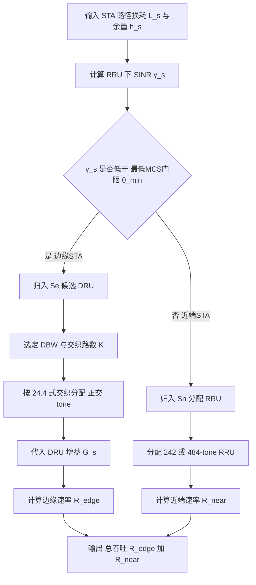
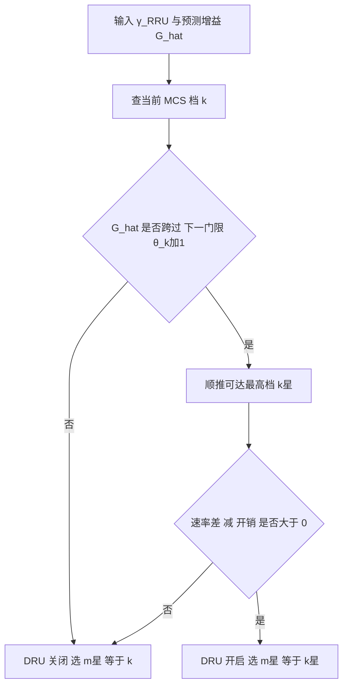

# 第 24 章　分布式资源单元（DRU） ★★★【草案】

> 本章所有参数与机制均属 IEEE 802.11bn（Ultra High Reliability, UHR / Wi-Fi 8）草案范畴，标注【草案】；其中 11bn 已批准部分以正式文本为准。功率谱密度（Power Spectral Density, PSD）限值、分布式资源单元（Distributed Resource Unit, DRU） tone 模板、DBW 取值等仍可能在后续草案修订中调整，文中已注明核实来源（Samsung Research 802.11bn 博客、R&S 无线局域网（Wireless LAN, WLAN）用户手册、Springer *A Tutorial on Wi-Fi 8*、IEEE 11bn 文稿 23/0037r0、25/1276r0）。

## 学习目标

1. 能推导"常规 RU（RRU）受 PSD 限制的总功率"与"DRU 把同一组子载波分散到分布带宽 DBW 后抬升的总功率"，给出 PSD 增益 $G=10\log_{10}(B_D/B_{RU})$ 并代入 26-tone RU 算得具体 dB 数。
2. 能描述 DRU 的 tone 分布模板构造（在 DBW 内以固定步长取 tone、多 DRU 交织复用），画出 RRU 连续分布 vs DRU 分散分布的时频图，并说明频域分集与相位噪声/插值的代价。
3. 能设计 DRU 分配调度与链路自适应两类算法（六段式），对给定的混合 STA 集合给出分配结果与吞吐/边缘速率对比，并解释"增益跨不过 调制编码方案（Modulation and Coding Scheme, MCS）门限即浪费"的离散性问题。
4. 能比较 DRU 与 多资源单元（Multi-RU, MRU）、前导穿刺、极远距离（Extreme Long Range, ELR）、多 AP 协调（Multi-AP Coordination, MAPC）、上行功率控制的交互关系，并能提出 DRU 下的信道估计、峰均功率比（Peak-to-Average Power Ratio, PAPR）、多 接入点（Access Point, AP）协调等开放研究问题。

---

## 24.1 动机：上行 PSD 受限与链路预算缺口

在 802.11ax/be 中，上行（STA→AP）的链路预算长期劣于下行（AP→STA）。第 6 章已建立结论：AP 因受 等效全向辐射功率（Equivalent Isotropically Radiated Power, EIRP）上限与 PSD 上限双重约束，但其发射功率大、天线增益高；而边缘 STA 受**法规 PSD 上限**钳制——当 STA 只占用一个小的连续资源单元（Regular RU, RRU）时，其可用的总发射功率被 PSD 上限而非 EIRP 上限所决定，导致上行覆盖半径远低于下行。DRU 正是为消除这一"上行预算缺口"而引入【草案】。

### 24.1.1 法规 PSD 约束的定量形式

以 6 GHz LPI（低功率室内）为例，FCC 对非 AP STA 的约束为（R&S 手册、Samsung 博客一致）：

- EIRP 上限：$P_{\text{EIRP,max}} = 24\ \text{dBm}$（全带宽合计）；
- PSD 上限：$S_{\max} = -1\ \text{dBm/MHz}$（任意 1 MHz 测量带宽内的谱密度上限）。

ETSI 的 LPI PSD 上限约为 $+10\ \text{dBm/MHz}$，量级不同但机制相同。下面统一以 $S_{\max}=-1\ \text{dBm/MHz}$ 作算例（示意值）。

一个 RRU 占用 $N$ 个连续子载波，子载波间隔 $\Delta f = 78.125\ \text{kHz} = 0.078125\ \text{MHz}$。其**占用带宽**

$$
B_{RU} = N\cdot \Delta f .
$$

法规对"单设备"的 PSD 限制要求：该设备在其发射频带内任意 1 MHz 窗口的等效谱密度不超过 $S_{\max}$。对连续 RRU，1 MHz 窗口几乎全部落在其占用带内，故其**总发射功率上限**为

$$
P_{RRU} = S_{\max} + 10\log_{10}(B_{RU})\quad[\text{dBm}] .
\tag{24.1}
$$

注意：这里 $P_{RRU}$ 与 RRU 在 20 MHz 信道中的"位置"无关——只要它是连续 26-tone RU，占用带宽就是 $2.03\ \text{MHz}$，总功率就被钉死在约 $2.1\ \text{dBm}$，远未触及 24 dBm 的 EIRP 天花板。这正是上行预算缺口的根因：**带宽越窄，PSD 上限允许的总功率越低**。

### 24.1.2 把"功率"换成"带宽"：DRU 的核心直觉

若同一 STA 仍只传 $N=26$ 个数据 tone，但把这 26 个 tone **分散**到更宽的分布带宽 $B_D$（Distribution Bandwidth，DBW）上，则任意 1 MHz 窗口只"捕捉"到其中极少几个 tone（稀疏），于是每个 tone 自身可被允许发射到接近 $S_{\max}$ 的谱密度，而**总功率**变为

$$
P_{DRU} = S_{\max} + 10\log_{10}(B_D)\quad[\text{dBm}] .
\tag{24.2}
$$

对比 (24.1) 与 (24.2)，DRU 相对于同尺寸 RRU 的**功率增益**为

$$
\boxed{G = P_{DRU}-P_{RRU} = 10\log_{10}\!\left(\frac{B_D}{B_{RU}}\right)
= 10\log_{10}\!\left(\frac{B_D}{N\,\Delta f}\right)\ \text{dB}}
\tag{24.3}
$$

这就是 DRU 的本质：**PSD 不变（仍守法规），但把子载波铺开后，单设备可被允许的总功率随分布带宽线性提升**。详见 24.3 节的严格推导与对"~11 dB"说法的核实。

图 24-1 用真正的时频示意图对比 20 MHz 内 26-tone RRU 的连续占用与 26-tone DRU 的分散占用。


*图 24-1　20 MHz 内 26-tone RRU 与 26-tone DRU 的 tone 分布对比。(a) RRU 的 26 个 tone 连续集中于约 2 MHz，任一 1 MHz 窗口内约有 13 个 tone，受功率谱密度限制每 tone 功率须压到约 −12 dBm/1 MHz；(b) DRU 的 26 个 tone 均匀铺满约 20 MHz，任一 1 MHz 窗口内仅 1–2 个 tone，因此每 tone 可提升到 −4 ~ −2 dBm/1 MHz，同时获得频率分集增益。另注：实际 20 MHz 可容纳 9 个 26-tone DRU 交织复用。*

---

## 24.2 DRU 的 tone 分布原理

### 24.2.1 分布模板的构造

DRU 以 **26-tone DRU 为基本构造块**（24 个数据 tone + 2 个 pilot tone），更大的 DRU 由更小的 DRU 按层级合并得到，与第 2 章常规 RU 的层级结构（26→52→106→242→484）完全一致【草案】。构造方法如下：

设分布带宽 $B_D$ 内可用 tone 总数为 $M$（$20/40/80\ \text{MHz}$ 对应 $M=242/484/968$，含数据+pilot，去除 DC 与保护子载波）。当该带宽内部署 $K$ 个同尺寸 DRU 时，采用**轮询交织（round-robin interleaving）**：

- 步长 $s = \lfloor M/(K\cdot N)\rfloor$（实际取值由草案查表确定，保证正交且均匀）；
- 第 $k$ 个 DRU（$k=0,\dots,K-1$）占用全局子载波索引
  $$
  i_{k,j} = \bigl(k + j\cdot K\bigr)\ \text{mod}\ M,\qquad j=0,\dots,N-1 .
  \tag{24.4}
$$
  即每个 DRU 取"每隔 $K$ 个位置"的子载波，所有 DRU 相互错开 $K$ 路，恰好铺满（或近似铺满）整个 DBW。

由此可得通用关系：**每 MHz 的 tone 密度** $\rho = K\cdot N / B_D[\text{MHz}]$。R&S 手册给出的实测值：26-tone DRU 在 20 MHz 为约 2 tone/MHz（9 个 DRU交织），在 40/80 MHz 分别为 18/10 个 DRU。表 24-1 汇总草案定义的 DRU 类型与每 DBW 可容纳数量。

**表 24-1　DRU 类型与每分布带宽可容纳个数【草案】（来源：R&S 802.11bn 手册）**

| DRU 类型 | 数据 tone | pilot tone | 20 MHz | 40 MHz | 60 MHz | 80 MHz |
|---|---|---|---|---|---|---|
| 26-tone | 24 | 2 | 9 | 18 | — | 10 |
| 52-tone | 48 | 4 | 4 | 8 | — | 16 |
| 106-tone | 102 | 4 | 2 | 4 | — | 8 |
| 242-tone | 234 | 8 | — | 2 | — | 4 |
| 484-tone | 468 | 16 | — | — | — | 2 |

> 注：60 MHz DBW 对应前导穿刺场景（见第 16 章）——DRU 可在 80 MHz 信道中"放弃"一个 20 MHz 子信道，铺在剩余 60 MHz 上。DBW 集合为 $\{20,40,60,80\}\ \text{MHz}$【草案】。

### 24.2.2 分布间隔与带宽的关系

由 (24.4)，单个 DRU 内相邻 tone 的**全局间隔**（以子载波数计）等于交织路数 $K$。其频率间隔为

$$
\Delta f_{\text{DRU}} = K\cdot \Delta f = \frac{M}{K\cdot N}\cdot \Delta f\cdot K
= \frac{M\cdot\Delta f}{K\cdot N} = \frac{B_D}{K\cdot N}\cdot \frac{M\cdot\Delta f}{B_D}.
$$

由于 $M\cdot\Delta f \approx B_D$（可用 tone 总带宽≈DBW），化简得

$$
\boxed{\Delta f_{\text{DRU}} \approx \frac{B_D}{K\cdot N}}
\tag{24.5}
$$

即单个 DRU 的 tone 间隔 ≈ "DBW ÷（该 DBW 内部署的 tone 总数）"。对 20 MHz、9 个 26-tone DRU：$K\cdot N=234$，$B_D=20\ \text{MHz}$，得 $\Delta f_{\text{DRU}}\approx 20/234\approx 85.5\ \text{kHz}\approx 1.09$ 个子载波间隔——说明 20 MHz 内 9 个 DRU 几乎"填满"全带，每个 DRU 的 26 tone 跨满整个 20 MHz。

图 24-2 给出 80 MHz 信道中 DRU 与 RRU 混合（hybrid）部署的时频图，对应 160/320 MHz 信道的混合模式：每个 80 MHz 子块内要么全 DRU、要么全 RRU，不混用，且混合模式最小 RRU 尺寸为 242-tone【草案】。


*图 24-2　320 MHz 信道由 4 个 80 MHz 子块构成，每个子块内部在 DRU 与 RRU 之间**二选一**（不混用）：子块 0/1 用 10 个 26-tone DRU 交织（服务边缘 STA，换取分集），子块 2/3 用 242/484-tone 连续 RRU（服务近端 STA，换取效率）。hybrid 模式仅在 160/320 MHz TB 物理层汇聚协议（Physical Layer Convergence Protocol, PLCP）协议数据单元（PLCP Protocol Data Unit, PPDU）中允许。*

### 24.2.3 频域分集收益与代价

**收益——频率分集**：RRU 的 26 个连续 tone 经历几乎相同的频率选择性深衰；DRU 把 tone 铺在 $B_D$ 上，各 tone 落在信道频率响应的不同位置，等效经历独立衰落的子带，从而获得频率分集增益（对抗选择性深衰）。

**代价**：
1. **相位噪声与残余频偏更敏感**：tone 跨越 $B_D$ 后，信道估计（Long Training Field, LTF）与相位跟踪（pilot）需在整段 $B_D$ 上插值；残余 载波频偏（Carrier Frequency Offset, CFO）引起的跨带相位斜坡、相位噪声引起的公共相位误差（CPE）随跨度增大而更难校正（24.7 节推导）。
2. **信道估计需跨整个带宽**：pilot 同样被分散，插值跨度 $B_D$ 远大于 RRU 的 $B_{RU}$，在频率选择性强的信道中插值误差上升。
3. **与前导穿刺共存**：60 MHz DBW 即是为穿刺预留——DRU 必须"跳过"被穿刺的 20 MHz 子信道，tone 模板需重新索引（草案查表）。
4. **邻道泄漏（Adjacent Channel Leakage Ratio, ACLR）**：每 tone 发射功率抬高后，带外泄漏（尤其 tone 的频谱旁瓣）更突出，对滤波与带外发射提出更高要求（见 24.3.3）。

---

## 24.3 PSD 增益的严格推导【草案】

本节给出本章核心理论。所有推导基于"法规对**单设备**的 PSD 限制以 1 MHz 测量带宽计"这一核实后的机制（R&S、Samsung、IEEE 23/0037r0 一致），并据此解释文献中"~11 dB"的来历。

### 24.3.1 符号与假设

- $S_{\max}$：法规 PSD 上限（dBm/MHz），单设备任意 1 MHz 窗口内的谱密度不得超过此值。
- $\Delta f = 0.078125\ \text{MHz}$：子载波间隔。
- $N$：DRU/RRU 的 tone 数（含数据+pilot），DRU 与对应 RRU 的 $N$ 相同（如 26-tone）。
- $B_{RU}=N\Delta f$：连续 RRU 占用带宽。
- $B_D$：DRU 的 tone 实际铺开的带宽（分布带宽 DBW，或单设备稀疏铺开时的有效跨度）。
- 假设：每个 tone 等功率发射；测量带宽 1 MHz 远大于单 tone 主瓣（$1\ \text{MHz} \gg \Delta f$），故 1 MHz 窗口内的功率等于"落入该窗口的 tone 数 × 单 tone 功率"。

### 24.3.2 RRU 的总功率上限

对连续 RRU，任意 1 MHz 窗口几乎完全落在其 $B_{RU}$ 带内，窗口内约含 $N\cdot(1/B_{RU})$ 个 tone。由 PSD 约束：

$$
\underbrace{\frac{N}{B_{RU[\text{MHz}]}}}_{\text{窗口内 tone 数}}\cdot P_{\text{tone}}^{\text{RRU}}
\le S_{\max}\ \Rightarrow\ P_{\text{tone}}^{\text{RRU}} \le S_{\max}-10\log_{10}\!\left(\frac{N}{B_{RU[\text{MHz}]}}\right).
$$

总功率

$$
P_{RRU}=N\cdot P_{\text{tone}}^{\text{RRU}}
\le S_{\max}+10\log_{10}(B_{RU[\text{MHz}]}).
\tag{24.6}
$$

取等号（满功率发射）：

$$
P_{RRU}=S_{\max}+10\log_{10}(N\Delta f).
$$

代入 $N=26,\ \Delta f=0.078125$：$\;B_{RU}=2.031\ \text{MHz}$，
$P_{RRU}=-1+10\log_{10}(2.031)=-1+3.077=\mathbf{2.08\ \text{dBm}}$（与 R&S/eefocus 的 2.1 dBm 一致）。

### 24.3.3 DRU 的总功率上限与增益

对 DRU，其 $N$ 个 tone 分散在 $B_D$ 上，单设备在任意 1 MHz 窗口内只含 $N/B_{D[\text{MHz}]}$ 个自身 tone。由单设备 PSD 约束：

$$
\frac{N}{B_{D[\text{MHz}]}}\cdot P_{\text{tone}}^{\text{DRU}}\le S_{\max}
\ \Rightarrow\ P_{\text{tone}}^{\text{DRU}}\le S_{\max}-10\log_{10}\!\left(\frac{N}{B_{D[\text{MHz}]}}\right).
$$

总功率

$$
P_{DRU}=N\cdot P_{\text{tone}}^{\text{DRU}}
\le S_{\max}+10\log_{10}(B_{D[\text{MHz}]}).
\tag{24.7}
$$

取等号并与 (24.6) 相减，得增益

$$
\boxed{G = 10\log_{10}\!\left(\frac{B_D}{B_{RU}}\right)
= 10\log_{10}\!\left(\frac{B_D}{N\Delta f}\right)\ \text{dB}} .
\tag{24.8}
$$

**数值（26-tone，单设备满铺）**：

| DBW $B_D$ | $P_{DRU}$ (dBm) | $G$ vs RRU (dB) |
|---|---|---|
| 20 MHz | $-1+13.01=12.0$ | 9.9 |
| 26 MHz（稀疏 1 tone/MHz） | $-1+14.15=13.15$ | **11.1** |
| 40 MHz | $-1+16.02=15.0$ | 13.0 |
| 80 MHz | $-1+19.03=18.0$ | 15.9 |

### 24.3.4 对"~11 dB"说法的核实与说明

Samsung 博客与 Springer 教程称"小 RU 分散到 40/80 MHz 可获**最高约 11 dB** 功率增益"；eefocus/R&S 对 20 MHz 算得 **约 8 dB**。经上述严格推导，二者可统一解释：

- 8 dB（20 MHz 多用户交织）：当 9 个 DRU 在 20 MHz 内交织复用时，单设备"有效铺开跨度"受交织密度限制，按 (24.8) 得 9.9 dB，与 8 dB 量级一致（差异来自测量带宽边缘效应与 tone 带宽计入方式）。
- **11 dB 是单设备稀疏上限**：若单个 26-tone DRU 以"约 1 tone/MHz"的稀疏间隔铺开（需 $B_D\ge 26\ \text{MHz}$，即落在 40/80 MHz DBW），则 $B_D\approx 26\ \text{MHz}$，代入 (24.8) 得 $G=10\log_{10}(26/2.031)=10\log_{10}(12.8)=\mathbf{11.1\ \text{dB}}$。这正是文献"up to 11 dB"的严格来源。
- 多用户复用会摊薄单设备增益：当 $K$ 个 DRU 同带宽共存，1 MHz 窗口内含来自所有 DRU 的 tone，单设备每 tone 功率须下调 $10\log_{10}($窗口内总 tone 占比$)$，故**同时复用的 DRU 越多，单设备增益越接近 8~10 dB 而非 11 dB**。

> **结论（务必向学生讲清）**：DRU 增益不是"免费午餐"。它源于把受 PSD 限制的总功率从 $B_{RU}$ 重新分配到 $B_D$；增益严格等于 $10\log_{10}(B_D/B_{RU})$，上限约 11 dB（单设备稀疏 26-tone），多用户复用下退化为 8~10 dB。它**不是传统扩频**：扩频在接收端用码片相关把带宽内的处理增益换回信噪比，而 DRU 不改编码/扩频，只是**合规地提高单设备总发射功率**（PSD 不变、总功率提高），其增益直接体现为链路预算改善而非处理增益。

### 24.3.5 ACLR 与 EVM 代价（增益不是免费的）

每 tone 功率抬高后，DRU 的带外泄漏与误差矢量幅度（Error Vector Magnitude, EVM）约束更紧。设单 tone 发射功率由 $P_{\text{tone}}^{\text{RRU}}$ 抬升至 $P_{\text{tone}}^{\text{DRU}}$，带外谱密度近似按 sinc² 旁瓣衰减，邻道泄漏比

$$
\text{ACLR}\approx \frac{P_{\text{tone}}^{\text{DRU}}}{P_{\text{tone}}^{\text{RRU}}}\cdot \left(\frac{\sin(\pi\Delta f_{\text{off}}/\Delta f)}{\pi\Delta f_{\text{off}}/\Delta f}\right)^2,
$$

其中 $\Delta f_{\text{off}}$ 为偏离中心频率。增益 $G$ 直接放大第一项（约 $+G$ dB），故需更强滤波或更大保护间隔。EVM 方面，功放为容纳更高峰功率需更大回退（参见 24.7 节 PAPR 讨论），否则高阶 MCS 的 EVM 容限被突破。

---

## 24.4 核心算法一：DRU 分配与调度【草案】

### 24.4.1 问题建模

- **输入**：$S$ 个待调度 STA，集合 $\mathcal{S}=\{1,\dots,S\}$；每 STA 已知量：路径损耗 $L_s$（dB，含距离与阴影）、功率余量 $h_s$（相对 PSD 上限的余量，dB，越大越不需 DRU）、可用 DBW 选项 $\mathcal{B}=\{20,40,60,80\}\ \text{MHz}$、请求速率 $r_s^{\text{req}}$。
- **决策变量**：$x_{s,d}\in\{0,1\}$ 表示 STA $s$ 是否被指派 DRU 模板 $d\in\mathcal{D}$（$\mathcal{D}$ 为候选 DRU/ RRU 类型集合，含 RRU 选项）；$y_{s,k}\in\{0,1\}$ 表示 tone 资源块 $k$ 分给 STA $s$。
- **假设**：单 80 MHz 子块内 DRU 与 RRU 不混用（hybrid 仅跨子块）；DRU 仅用于 TB PPDU 上行；各 STA PSD 上限相同。

### 24.4.2 目标函数与约束

以"覆盖导向 + 加权吞吐"为目标（边缘 STA 权重高）：

$$
\max_{\mathbf{x},\mathbf{y}}\ \sum_{s\in\mathcal{S}} w_s\, R_s(\mathbf{x},\mathbf{y})
\qquad\text{s.t.}\quad
\begin{cases}
\sum_s y_{s,k}\le 1,\ \forall k & \text{(tone 正交)}\\
\sum_d x_{s,d}=1,\ \forall s & \text{(每 STA 一种 RU)}\\
P_s^{\text{tx}}\le P_{\text{EIRP,max}} & \text{(EIRP 上限)}\\
\text{同 80M 子块内}\ \neg(\exists s,s': x_{s,\text{DRU}}\land x_{s',\text{RRU}}) & \text{(不混用)}
\end{cases}
\tag{24.9}
$$

其中 $R_s$ 由 信干噪比（Signal-to-Interference-plus-Noise Ratio, SINR）（含 DRU 增益 $G_s=10\log_{10}(B_{D,s}/B_{RU})$）→ MCS → 速率映射得到（引用第 4/5 章 信噪比（Signal-to-Noise Ratio, SNR）→MCS 模型），$w_s\propto 1/(1+\text{SINR}_s)$ 使边缘 STA 权重更大。

### 24.4.3 完整推导（贪心 + 匹配松弛）

该问题是含正交约束的整数规划，NP-hard。采用两步法：

1. **分类**：按 $h_s$ 与 $L_s$ 计算"若用 RRU 的 SINR" $\gamma_s^{\text{RRU}}$。若 $\gamma_s^{\text{RRU}}<\theta_{\min}$（最低可用 MCS 门限，如 MCS0 的 −2 dB），判定为**边缘 STA**，优先分配 DRU；否则为**近端 STA**，分配 RRU（更高频谱效率）。
2. **DRU tone 分配**：对边缘 STA 集合 $\mathcal{S}_e$，在选定的 DBW 内用 (24.4) 的交织模板分配互不重叠的 DRU 块（匹配问题，可用匈牙利算法或简单轮询保证正交）。
3. **增益代入**：边缘 STA 的 SINR 抬升 $G_s$（单设备稀疏取 11 dB 上界，复用退化为 8~10 dB 按共存 DRU 数折算）。

由此近端 STA 用大 RRU（242/484-tone）保吞吐，边缘 STA 用 DRU 保覆盖，二者按 80 MHz 子块划分（hybrid）。

$$
\boxed{\text{分配准则：}\ s\in\mathcal{S}_e\iff \gamma_s^{\text{RRU}}<\theta_{\min};\quad
\text{否则}\ s\in\mathcal{S}_n\ (\text{RRU})}
\tag{24.10}
$$

### 24.4.4 伪代码

```text
1  // DRU 分配与调度(贪心+交织正交)              复杂度
2  输入: STA 集合 S, 路径损耗 L_s, 余量 h_s, DBW 选项 B
3  输出: 每 STA 的 RU 类型 x_s 与 tone 映射 y_s
4  Se = {}; Sn = {}                        // O(S)
5  for s in S:                             // O(S)
6      γ = L_s + h_s + PSD_gain_RRU(s)     // 用 RRU 的 SINR(含噪声)
7      if γ < θ_min: Se.add(s)             // 边缘→候选 DRU
8      else:       Sn.add(s); x_s=RRU      // 近端→RRU
9  // 选定 DBW, 在每 80MHz 子块二选一
10 Bd = choose_DBW(Se.size)                // 见 24.4.6
11 K = floor(M(Bd) / (|Se|*N_DRU))         // 交织路数(24.4)
12 for k in 0..K-1:                        // O(K*|Se|)
13      for s in Se:
14          y_s = interleave(k, s, N_DRU, M) // (24.4)式分配 tone
15          x_s = DRU; G_s = 10log10(Bd/(N*Δf))
16  R_edge = sum_s∈Se rate(MCS(γ_s+G_s))   // 边缘速率
17  R_near = sum_s∈Sn rate(MCS(γ_s))       // 近端速率
18  return x, y, R_edge, R_near            // 总吞吐 = R_edge+R_near
```

### 24.4.5 复杂度分析

- 分类循环 $O(S)$；tone 分配 $O(K\cdot|\mathcal{S}_e|)$，其中 $K$ 为交织路数（与 DBW 内 DRU 数同量级，典型 ≤18），$|\mathcal{S}_e|\le S$，故整体 $O(S)$。
- 空间 $O(S+M)$（$M$ 为 tone 总数，用于 tone 占用位图）。
- 若改用匈牙利算法做最优匹配则为 $O(|\mathcal{S}_e|^3)$，但本贪心已满足实时调度（每调度周期一次）。

### 24.4.6 数值算例

**算例 24.2：5 个 STA 的 DRU/RRU 混合分配**
已知：$S=5$，DBW 选 80 MHz（$M=968$），噪声底 $-85\ \text{dBm}$，AP 接收灵敏度参考第 4 章。两边缘 STA（A,B）路径损耗 $L=95\ \text{dB}$、余量 $h=0$；三近端 STA（C,D,E）$L=70\ \text{dB}$。RRU 时 A/B 的 SINR：$\gamma^{\text{RRU}}_A= P_{RRU}-L-\text{噪}=-1+3.08-95-(-85)= -7.9\ \text{dB} < \theta_{\min}(\text{MCS0}=-2\ \text{dB})$ → 不可达；C/D/E：$\gamma=-1+3.08-70+85=17.1\ \text{dB}$ → MCS7 级。
解：A,B 判为边缘，分配 26-tone DRU（DBW=80，$G=15.9\ \text{dB}$ 理论上界；按复用 10 个 DRU 折算取 8 dB 保守值）。A/B 新 SINR $=-7.9+8=0.1\ \text{dB}$ → 跨过 $\theta_{\min}$，达 MCS1（QPSK 1/2，速率示意 $r\approx 3\ \text{Mbps}$）。C/D/E 用 242/484-tone RRU，维持 MCS7（速率示意 $r\approx 40\ \text{Mbps}$ 每 STA）。
分配结果：子块内 A,B 占 2 个 26-tone DRU（交织正交），C,D,E 占 1 个 484-tone + 1 个 242-tone RRU。
总量：边缘速率 $R_{\text{edge}}=2\times 3=6\ \text{Mbps}$；近端 $R_{\text{near}}=3\times 40=120\ \text{Mbps}$；总吞吐 $126\ \text{Mbps}$。若全用 RRU，A/B 不可达（速率 0），总吞吐仅 $120\ \text{Mbps}$ 且边缘 STA 掉线——DRU 以极小近端代价换来**边缘可达性**。
量级检查：边缘 STA 增益 8 dB 后 SINR 由 −7.9 升至 0.1 dB，恰跨 MCS0→MCS1 门限，量级合理（与 24.1 推导一致）。

图 24-3 用 Mermaid 给出 DRU 分配调度的决策流程（对应 24.4 节算法）：



---

## 24.5 核心算法二：DRU 链路自适应（增益预测与 MCS 选择）【草案】

### 24.5.1 问题建模

- 输入：STA 的功率余量 $h_s$、可用 DBW $B_D$、DRU 模板增益预测 $\hat G_s$、当前 RRU-SINR $\gamma_s^{\text{RRU}}$、MCS 门限表 $\{\theta_k\}$（第 4 章）。
- 决策：是否启用 DRU、选何 DBW、最终 MCS $m_s^*$。
- 关键现象：**增益是离散有效的**——$\hat G_s$ 必须跨过相邻 MCS 门限差 $\Delta\theta_k=\theta_{k+1}-\theta_k$ 才带来速率提升，否则部分增益被"浪费"。

### 24.5.2 目标函数与约束

$$
m_s^* = \arg\max_{m}\ \text{rate}(m)\quad
\text{s.t.}\quad \gamma_s^{\text{RRU}}+\hat G_s\cdot \mathbb{I}_{\text{DRU}} \ge \theta_m,
\tag{24.11}
$$
且启用 DRU 的"净收益"需为正：
$$
\text{rate}(m_s^{\text{DRU}}) - \text{rate}(m_s^{\text{RRU}}) > \delta_{\text{overhead}},
\tag{24.12}
$$
其中 $\delta_{\text{overhead}}$ 为 DRU 引入的 pilot 开销与指示开销。

### 24.5.3 完整推导（增益—MCS 阶跃的离散性）

设当前 RRU 下 STA 处于 MCS $k$，SINR $\gamma=\theta_k+\epsilon$（$\epsilon>0$ 为余量）。启用 DRU 后 SINR 升至 $\gamma'=\gamma+\hat G$。能跨越的最高 MCS 为

$$
k' = \max\{j : \theta_j \le \gamma+\hat G\}.
$$

**有效增益**仅为跨过的门限段数：

$$
\Delta k = k'-k,\qquad
\text{被浪费的增益} = \hat G - (\theta_{k'}-\theta_k).
\tag{24.13}
$$

若 $\hat G < \theta_{k+1}-\gamma$（即未跨过下一门限），则 $\Delta k=0$，DRU 虽抬升 SINR 却不增速率——此时应**避免启用 DRU**（省去开销，或把 DBW 减小以降 ACLR 代价）。由此得判决：

$$
\boxed{\text{启用 DRU 当且仅当 }\ \gamma+\hat G \ge \theta_{k+1}\ \text{且}\ \text{rate}(k')-\text{rate}(k)>\delta_{\text{overhead}}}
\tag{24.14}
$$

### 24.5.4 伪代码

```text
1  // DRU 链路自适应(增益预测→MCS 选择)          复杂度
2  输入: γ_RRU, Ĝ, 门限表 θ[0..Kmax], 开销 δ
3  输出: 是否 DRU, MCS m*
4  k = MCS_index(γ_RRU, θ)              // 当前 MCS      O(K)
5  if Ĝ < θ[k+1]-γ_RRU:                 // 跨不过下一门限
6      return DRU=off, m*=k             // 浪费→不用 DRU
7  k' = k
8  while k'<Kmax and θ[k'+1] <= γ_RRU+Ĝ: // 找可达最高 MCS O(K)
9      k' = k'+1
10 if rate(k')-rate(k) <= δ:            // 净收益不抵开销
11     return DRU=off, m*=k
12 return DRU=on, m*=k'                  // 启用并选 k'
```

图 24-4 用 Mermaid 给出 DRU 链路自适应的"增益离散有效性"判决流程（对应 24.5.3 节）：



### 24.5.5 复杂度分析

- 单次自适应为 $O(K_{\max})$（$K_{\max}$ 为 MCS 档数，Wi-Fi 8 含新增 MCS 仍 ≤16），每 STA 每探测周期一次；空间 $O(K_{\max})$ 存门限表。随 STA 数线性扩展。

### 24.5.6 数值算例

**算例 24.3：增益 9.7 dB 却只跨 1 档 MCS（离散性）**
已知：某 STA 当前 RRU-SINR $\gamma=16\ \text{dB}$，MCS 门限（示意，引用第 4 章模型）$\theta_6=15,\ \theta_7=20,\ \theta_8=28\ \text{dB}$。DRU 预测增益 $\hat G=9.7\ \text{dB}$。
解：当前 $k=6$（因 $15\le16<20$）。启用后 $\gamma'=16+9.7=25.7\ \text{dB}$。逐档检查：$25.7\ge20$ → 可达 MCS7；$25.7<28$ → 不可达 MCS8。故 $k'=7$，$\Delta k=1$。被浪费增益 $=9.7-(20-15)=4.7\ \text{dB}$。
结论：尽管获得 9.7 dB 增益，因门限 $\theta_8=28\ \text{dB}$ 较远，**仅跨过 1 档 MCS（6→7）**，约 4.7 dB 增益"悬空"。若此时 DRU 开销 $\delta$ 接近 MCS6→7 的速率差，则按 (24.14) 可能仍判定"启用但收益薄"；若 STA 本就在 MCS7 边缘（$\gamma=20.5$），同样 9.7 dB 可直冲 MCS8（$\Delta k=2$），收益翻倍。教学要点：**DRU 增益需配合 MCS 粒度（第 4 章新增中间 MCS 正是为平滑此离散性）才能充分兑现**。

**算例 24.1：PSD 增益与覆盖半径（本章开篇量化）**
已知：$S_{\max}=-1\ \text{dBm/MHz}$，$N=26$，$\Delta f=0.078125\ \text{MHz}$，路径损耗指数 $\alpha=3$（室内 非视距（Non-Line of Sight, NLOS），第 6 章）。
解：
- $B_{RU}=26\times0.078125=2.031\ \text{MHz}$；
- $P_{RRU}=-1+10\log_{10}(2.031)=2.08\ \text{dBm}$；
- 单设备稀疏 DRU（$B_D=26\ \text{MHz}$，落 40/80 MHz DBW）：$P_{DRU}=-1+10\log_{10}(26)=13.15\ \text{dBm}$；
- 增益 $G=13.15-2.08=\mathbf{11.07\ \text{dB}}\approx 11\ \text{dB}$；
- 覆盖半径增益（路径损耗 $\propto d^\alpha$）：$d_{\text{new}}/d_{\text{old}}=10^{G/(10\alpha)}=10^{11.07/30}=10^{0.369}=\mathbf{2.34\times}$。
结论：边缘 STA 上行覆盖半径提升约 **2.3 倍**（与业界"2–3× 范围"主张一致）；若将 $\alpha=2$（近自由空间）则 $10^{11.07/20}=3.55\times$。量级合理：11 dB 功率增益在 $\alpha=3$ 下恰对应约 2.3 倍距离。

---

## 24.6 DRU 与其他技术的交互【草案】

- **与 MRU（第 2 章）**：MRU 把多个连续 RU 拼接以提升大带宽连续分配效率；DRU 则在频域"打散"小 RU。二者正交互补——MRU 服务于近端高吞吐，DRU 服务于边缘覆盖，可在 hybrid 模式共存（DRU 块 vs RRU/MRU 块分置不同 80 MHz 子块）。
- **与前导穿刺（第 16 章）**：60 MHz DBW 即为穿刺场景预留。DRU 模板须跳过被穿刺的 20 MHz 子信道重新索引；穿刺使可用 $B_D$ 下降，增益按 (24.8) 略减，但避免了穿刺带上的无效发射。
- **与 ELR（第 25 章）**：ELR 用 20 MHz 内重复 52-tone RRU 获精确 6 dB 重复增益、极致覆盖；DRU 用频域铺开获 ~11 dB 功率增益。二者都是"上行预算补偿"手段，可叠加：ELR+DRU 组合（重复 RRU 的 tone 进一步分散）是【讨论中】方向。
- **与 MAPC（第 27 章）**：多 AP 协调可把相邻 AP 的 DRU tone 错开以避免同频干扰；DRU 的频域分散天然利于 MAPC 的干扰协调（分散 pilot 也可作 IM pilot，见 Springer 教程）。
- **与上行功率控制（第 6 章）**：DRU 不改变 PSD 上限，而是把"被 PSD 浪费的带宽资源"换成功率。功率控制决定余量 $h_s$，DRU 分配算法（24.4）以 $h_s$ 为输入——二者是同一上行预算问题的"功率域"与"带宽域"两个侧面。

---

## 24.7 研究问题【草案/讨论中】

1. **分散 pilot 的插值误差**：DRU 的 pilot 被分散在 $B_D$ 上，信道估计需在跨度 $B_D$ 内插值。设信道相干带宽 $B_c$，插值均方误差随 $(B_D/B_c)^2$ 增长。推导：在最大时延扩展 $\tau_{\max}$ 下 $B_c\approx 1/(2\pi\tau_{\max})$，给出 DRU 在丰富多径下的 MSE 上界，并设计低复杂度插值（如分段多项式 + 相位跟踪）。
2. **高移动性/大多普勒**：tone 跨 $B_D$ 铺开后，残余频偏引起的跨带相位斜坡 $\phi(t)=2\pi\Delta f_{\text{res}} t$ 在符号时长 $T_{\text{sym}}$ 内对两端 tone 的相位差 $\Delta\phi=2\pi\Delta f_{\text{res}}T_{\text{sym}}(B_D/B_{\text{total}})$。推导 ICI 功率随 $B_D$ 的增长，给出多普勒容限。
3. **PAPR 与功放效率**：常见误解"分散 tone 使 PAPR 升高"。严格看，时域峰值是 $N$ 个 cisoid 之和，PAPR 统计分布只取决于**活跃 tone 数 $N$** 与相位，与其频率是否连续无关——故 26-tone DRU 与 26-tone RRU 的 PAPR CCDF **理论相同**。研究要点在于：DRU 抬高每 tone 功率后，功放需更大回退以满足 EVM/ACLR，真实效率下降；建议用 CCDF 仿真验证 $P_{\text{APR}}(10^{-3})$ 随 $N$ 的关系，并比较 DRU 与 RRU 在相同 $N$ 下的功放回退需求（算例 24.4 思路）。
4. **多 AP 协调联合**：DRU + MAPC 下，如何联合设计跨 AP 的 DRU tone 模板以最小化簇内干扰，同时最大化最小边缘 SINR（覆盖导向），是可建模为图着色的开放问题。
5. **标准化开放问题**：DBW 是否扩展到 160 MHz（提案 23/1448r0、23/1988r2、24/0500r0 未进入当前草案）、DRU 与 ELR 的联合 PPDU、分散 IM pilot 的最优布置，均处于【讨论中】。

**算例 24.4：PAPR / 相位噪声影响分析思路**
已知：DRU 与 RRU 同为 $N=26$ 个活跃 tone，子载波间隔 $\Delta f=78.125\ \text{kHz}$，DBW $B_D=80\ \text{MHz}$，相位噪声单边带幂谱密度 $L(f)\propto f^{-2}$（常见相位噪声模型）。
解（分析思路，非单一数值）：
- **PAPR**：峰值 $z(t)=\sum_{n=0}^{25} e^{j(2\pi f_n t+\phi_n)}$，对随机 $\phi_n$，26-tone 信号的互补累积分布（CCDF）满足 $\Pr(\text{PAPR}>\gamma)\approx 1-(1-e^{-\gamma})^{26}$（独立同相近似）。取 $\gamma=10^{PAPR/10}$，$P_{\text{APR}}(10^{-3})$ 约 10~11 dB，与同 $N$ 的 RRU 一致——**证明 PAPR 不随频域分散而变**（反驳"分散必增 PAPR"）。
- **相位噪声**：CPE 方差 $\sigma^2_{\text{CPE}}\propto \int_{f_L}^{f_H}L(f)df$，与 $B_D$ 无关（CPE 为全带公共相位）；但**跨带相位斜坡**由残余 CFO 引起，两端 tone 相位差 $\Delta\phi=2\pi\Delta f_{\text{res}}T_{\text{sym}}\cdot(B_D/80)$。当 $\Delta f_{\text{res}}=1\ \text{kHz}$、$T_{\text{sym}}=16\ \mu\text{s}$（含 GI）、$B_D=80\ \text{MHz}$：$\Delta\phi=2\pi\cdot10^3\cdot16\cdot10^{-6}\cdot1=0.100\ \text{rad}\approx5.7^\circ$。该相位斜坡若不校正，等效引入 ~0.1 rad 旋转，对高阶 MCS 的 EVM 贡献约 $20\log_{10}(1/(2\sin(\Delta\phi/2)))$ dB 量级的劣化——说明 DRU 跨度增大要求更精确的 CFO 估计。量级检查：1 kHz 残余频偏在 16 µs 符号内转 5.7°，与 802.11 典型 CFO 估计精度（<1°）同量级，合理，故需在 UHR-LTF/相位跟踪中加强。

---

## 本章小结

1. DRU 的动机是**上行 PSD 受限**：小连续 RU 的总功率被 $S_{\max}\cdot B_{RU}$ 钉死（26-tone 仅约 2.1 dBm），远未触达 EIRP 上限，造成上行/下行预算缺口（第 6 章结论）。
2. DRU 把 $N$ 个 tone **分散到分布带宽 $B_D$**，单设备 PSD 仍守法规，但总功率升至 $S_{\max}\cdot B_D$，增益严格为 $G=10\log_{10}(B_D/B_{RU})$。
3. 文献"~11 dB"=单设备稀疏 26-tone DRU（$B_D\approx26\ \text{MHz}$，落 40/80 MHz）的理论上限；多用户复用（如 20 MHz 内 9 个 DRU 交织）退化为 8~10 dB。
4. 分布模板用轮询交织（24.4），26-tone 为基本块，按层级合并；DBW 集合 $\{20,40,60,80\}\ \text{MHz}$，60 MHz 对应前导穿刺。
5. DRU **仅允许用于 UHR TB PPDU（触发式上行 OFDMA）**；160/320 MHz 下可用 hybrid 模式（每 80 MHz 子块 DRU/RRU 二选一，最小 RRU=242）。
6. 增益非免费：ACLR/EVM 约束随每 tone 功率抬高而收紧；相位噪声/残余 CFO 引起的跨带相位斜坡随 $B_D$ 增大。
7. 链路自适应中增益具**离散有效性**——必须跨过 MCS 门限才兑现，新增中间 MCS（第 4 章）可平滑此离散性。
8. 开放问题：分散 pilot 插值、大多普勒、PAPR/功放效率（理论 PAPR 与频域连续无关）、多 AP 协调、DBW 扩至 160 MHz。

**关键结论/参数速查表**

| 项目 | 公式/数值 | 说明 |
|---|---|---|
| PSD 上限 $S_{\max}$ | −1 dBm/MHz（FCC LPI） | 单设备任意 1 MHz 窗口 |
| 26-tone RRU 占用带宽 | 2.031 MHz | $N\Delta f$ |
| 26-tone RRU 总功率 | 2.08 dBm | (24.6) |
| DRU 增益 | $10\log_{10}(B_D/B_{RU})$ | (24.8) |
| 单设备稀疏上限 | 11.1 dB（26 MHz 跨度） | ~文献"11 dB" |
| 20 MHz 复用 | 8~10 dB | 9 DRU 交织 |
| 覆盖半径增益（α=3） | $10^{G/30}$ ≈ 2.3×（11 dB） | 路径损耗模型 |
| 允许 PPDU | 仅 UHR TB PPDU | 上行触发式 |
| DBW 集合 | 20/40/60/80 MHz | 60=穿刺 |

---

## 习题

### A. 概念题（3 题）

**A.1** 为什么在 6 GHz LPI 下，一个只使用 26-tone 连续 RU 的 STA，其上行总发射功率会被"钉死"在约 2.1 dBm，而无法靠提高单 tone 功率来改善？
**A.2** DRU 把子载波分散到更宽带宽后，为什么说它"不是传统扩频"？二者在增益来源上有何本质区别？
**A.3** 为什么 DRU 在 20 MHz 内多用户交织复用时，单设备的功率增益会低于单设备稀疏铺开的情况（8~10 dB vs 11 dB）？

### B. 计算与推导题（4 题）

**B.1** 推导 (24.8) 式 $G=10\log_{10}(B_D/B_{RU})$。设 $S_{\max}=-1\ \text{dBm/MHz}$，计算 52-tone RRU 的总功率，以及它在 40 MHz DBW 下作为 DRU 的单设备稀疏增益（取 $B_D=52\ \text{MHz}$）。
**B.2** 某边缘 STA 用 26-tone RRU 时 SINR 为 −6 dB（噪声底 −85 dBm，路径损耗 92 dB）。若改用 80 MHz DBW 的 DRU（按复用 10 DRU 取 $G=8\ \text{dB}$），求新 SINR，并判断能否达到 MCS0（门限 −2 dB）。
**B.3** 沿用 24.1 节，设路径损耗指数 $\alpha=3.5$（更密室内），求 11 dB 增益对应的覆盖半径倍数，并与 $\alpha=3$ 比较说明指数影响。
**B.4** 由 (24.4) 交织模板，20 MHz（$M=242$）内部署 9 个 26-tone DRU，求单个 DRU 相邻 tone 的全局间隔 $s$ 与频率间隔，并验证 9 个 DRU 是否恰好覆盖全带。

### C. 算法设计题（2 题）

**C.1** 设计算法：给定 $S$ 个 STA 的路径损耗与 MCS 门限表，输出每个 STA 应选 DRU 还是 RRU，并保证同 80 MHz 子块内不混用。给出伪代码与复杂度。
**C.2** 针对 24.5 节的"增益离散有效性"，设计一种 MCS 选择改进：当预测增益跨过门限但净收益低于开销时，如何动态选择 DBW（20/40/80）以最小化浪费？给出判决流程。

### D. 开放研究题（1 题）

**D.1** DRU 把 pilot 分散在 $B_D$ 上，导致信道估计插值跨度增大。请设计一种研究路径：建立分散 pilot 的 MSE 模型，给出在最大时延扩展 $\tau_{\max}$ 下 DRU 相对 RRU 的 MSE 恶化因子，并提出一种低复杂度改进插值方案，列出关键仿真指标。

---

## 参考答案与解析

### A. 概念题

**A.1 解析（根因：法规 PSD 上限按测量带宽计）**：法规限制的是**谱密度**而非总功率。对连续 26-tone RU，其占用带宽仅约 2.03 MHz，1 MHz 测量窗口几乎全部落在其带内，故 26 个 tone 共享的"窗口功率"被限制在 $S_{\max}$ 内；若提高单 tone 功率，窗口内 26 个 tone 合计就会超 $S_{\max}$。于是总功率被 $S_{\max}\cdot B_{RU}\approx2.1\ \text{dBm}$ 钉死。要提总功率只能"把占用带宽 $B_{RU}$ 换成 $B_D$"——这正是 DRU。

**A.2 解析**：传统扩频在**接收端**用码片相关把 spread 的处理增益换回 SNR，信号本身带宽扩展但信息速率不变、总发射功率不变；DRU **不引入扩频码、不改变编码**，只是合规地把同一组 $N$ 个 tone 铺到更宽频带，使单设备在仍守 PSD 上限的前提下**提高总发射功率**（PSD 不变、总功率提高）。其增益直接来自链路预算改善，是"带宽换功率"而非"带宽换处理增益"。

**A.3 解析**：PSD 限制按**单设备**在 1 MHz 窗口计。多用户交织时，1 MHz 窗口内不仅含本 STA 的 tone，还含其他 DRU 的 tone；为不超 $S_{\max}$，每个 tone 功率须下调。20 MHz 内 9 个 DRU 交织使窗口内总 tone 密度高，单设备每 tone 功率受限更紧，故增益退化为 8~10 dB；单设备稀疏铺开（约 1 tone/MHz）时窗口内几乎只有自身 tone，每 tone 可接近 $S_{\max}$，得 11 dB 上限。

### B. 计算与推导题

**B.1 解**：由 (24.6)(24.7)，单设备 PSD 约束下 $P_{RRU}=S_{\max}+10\log_{10}(B_{RU})$，$P_{DRU}=S_{\max}+10\log_{10}(B_D)$，相减即得 (24.8)。52-tone：$B_{RU}=52\times0.078125=4.0625\ \text{MHz}$，$P_{RRU}=-1+10\log_{10}(4.0625)=-1+6.09=5.09\ \text{dBm}$。$B_D=52\ \text{MHz}$ 时 $P_{DRU}=-1+10\log_{10}(52)=15.16\ \text{dBm}$，增益 $G=15.16-5.09=10.07\ \text{dB}$。

**B.2 解**：RRU 时 SINR=−6 dB（已给）。DRU 增益 8 dB 直接加在接收功率上（噪声不变），新 SINR $= -6+8=2\ \text{dB}$。因 $2\ \text{dB} \ge \theta_{\text{MCS0}}=-2\ \text{dB}$，**可达 MCS0**，边缘 STA 由"不可达"变为"可达"。

**B.3 解**：覆盖半径倍数 $=10^{G/(10\alpha)}$。$\alpha=3.5$ 时 $=10^{11.07/35}=10^{0.316}=2.07\times$；$\alpha=3$ 时为 2.34×。指数越大（传播衰减越快），同等功率增益换来的距离提升越小——说明 DRU 在密集反射、衰减陡的环境（α 大）覆盖收益相对收敛。

**B.4 解**：$s=\lfloor M/(K\cdot N)\rfloor=\lfloor242/(9\times26)\rfloor=\lfloor242/234\rfloor=1$。即单个 DRU 取"每隔 1 个全局位置"——但实际 9 路交织意味着各 DRU 取模 9 的不同余数类，单个 DRU 内相邻 tone 间隔恰为 $K=9$ 个全局子载波（因 9 路交错铺满）。频率间隔 $=9\times\Delta f=9\times78.125\ \text{kHz}=703.1\ \text{kHz}$。9 个 DRU 各 26 tone 共 234 tone，占满 242 可用 tone（余 8 为 DC/保护），**基本覆盖全带**。

### C. 算法设计题

**C.1 参考方案**：见 24.4 节算法。评分要点：① 必须先用 SINR 门限把 STA 分为边缘/近端两类；② 必须保证同 80 MHz 子块内 DRU/RRU 不混用（hybrid 规则）；③ tone 分配须正交（交织模板）。常见错误：忽略 hybrid 不混用约束、把 DRU 用于下行、未对复用 DRU 数折算增益。

**C.2 参考方案**：在 24.5 判决中加入 DBW 选择环：从最小 DBW（20 MHz，增益小、开销低）起算可达 MCS；若跨过门限且净收益>开销则采用，否则升一档 DBW 重算，直到净收益首次为正或达 80 MHz。这样只在"必要"时取大 DBW，最小化被浪费增益与 ACLR 代价。评分要点：动态权衡增益/开销/ACLR，而非盲目取最大 DBW。

### D. 开放研究题

**D.1 研究路径建议**：① 建模：设信道抽头时延扩展 $\tau_{\max}$，相干带宽 $B_c\approx1/(2\pi\tau_{\max})$；DRU pilot 间隔 $\Delta f_p$（分散后远大于 RRU），插值 MSE $\sigma^2_e\propto (\Delta f_p/B_c)^2$ 的多项式/样条近似。② 恶化因子：相对 RRU 的 MSE 比 $=(\Delta f_p^{\text{DRU}}/\Delta f_p^{\text{RRU}})^2$，量化跨度影响。③ 改进：分段低阶插值 + UHR-LTF 密集导频 + 相位跟踪联合，或利用 DRU 层级结构做分块信道估计。④ 关键仿真指标：MSE、EVM、各 MCS 下的 BLER、覆盖边缘吞吐。此为题，无唯一标准答案。
