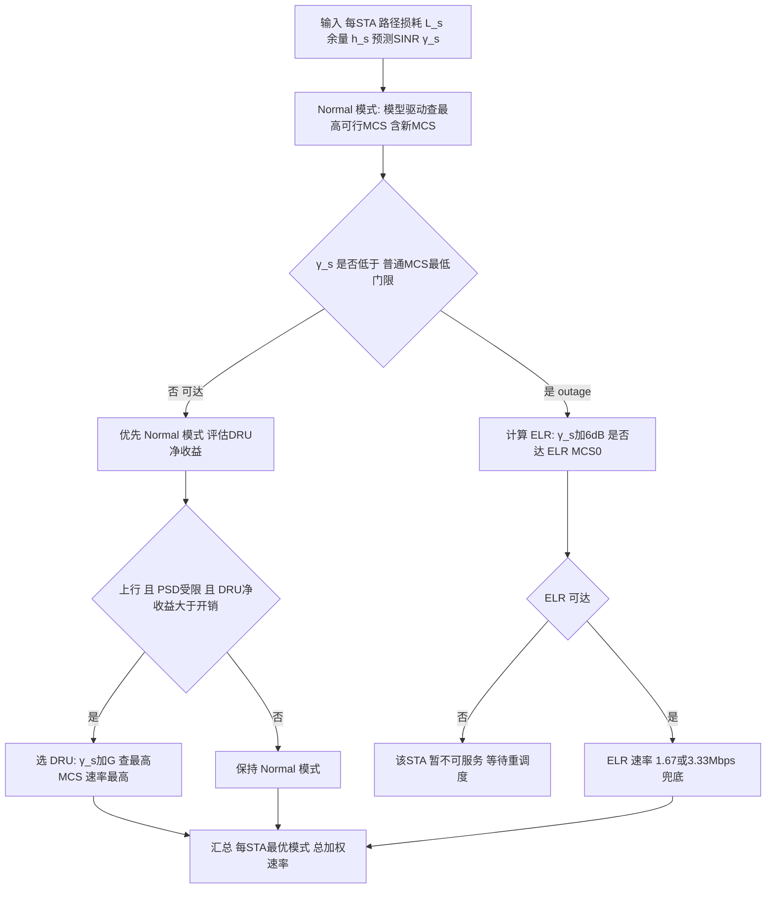

# 第 25 章　增强远距离传输（ELR）、新 MCS 与非均衡调制（UEQM） ★★★

> 本章全部机制与参数属 IEEE 802.11bn（Ultra High Reliability, UHR / Wi-Fi 8）草案范畴，统一标注【草案】；无法确定处标注"示意值/待核实"。核心事实已据 Samsung Research 802.11bn 博客、Springer *A Tutorial on Wi-Fi 8*（Problems of Information Transmission, 2025）、MathWorks *Overview of Wi-Fi 8 for 物理层（Physical Layer, PHY） Modeling*、Keysight 802.11bn 文档、Wiley *Setting New Performance Standards with IEEE 802.11bn* 核实。

## 学习目标

1. 能推导 极远距离（Extreme Long Range, ELR）的频域四次重复（quadruplication）合并增益 $10\log_{10}N$ 与覆盖半径改善 $d'/d=10^{\Delta\gamma/(10n)}$，并判断何时该用 ELR 而非降 调制编码方案（Modulation and Coding Scheme, MCS）。
2. 能由第 4 章灵敏度方法估算 11bn 新增 MCS 的 信噪比（Signal-to-Noise Ratio, SNR）门限，并推导"码率细化填充 gap"的平均吞吐增益积分。
3. 能建立 不等差错保护（Unequal Error Protection/Modulation, UEQM）的流—调制联合优化模型，证明"每流独立选其最高可行 MCS"在固定码率下的可分离最优性，并比较 等调制（Equal Modulation, EQM）与 UEQM 的速率。
4. 能设计 ELR / 分布式资源单元（Distributed Resource Unit, DRU） / 新 MCS 的联合自适应选择算法（六段式），给出三种边缘场景（近/中/远）的模式分配与增益分解。

---

## 25.1 问题的三个层次：上行链路预算的三类瓶颈

第 6 章已建立结论：上行（Station, STA→AP）链路预算长期劣于下行，典型不对称 **6–16 dB**，且在 功率谱密度（Power Spectral Density, PSD）受限的小 RU 场景下可扩大到 ~20 dB（约 6 个 MCS 档）。Wi-Fi 8 针对这一不对称引入三类互补的 PHY 增强，分别攻克**不同层次**的瓶颈：

- **(a) 功率受限（PSD / 法规）**：边缘 STA 的小 RU 总发射功率被 PSD 上限"钉死"（26-tone RRU 仅约 2.1 dBm），远未触达 等效全向辐射功率（Equivalent Isotropically Radiated Power, EIRP）天花板。→ 解法是 **DRU（第 24 章）**：把 tone 频域分散，合规地抬高总功率（~11 dB），**增益上限由 $10\log_{10}(B_D/B_{RU})$ 决定**。
- **(b) 灵敏度受限（低 SNR）**：即便功率够，在低 SNR 下无可用 MCS 或仅有最低阶 MCS、速率太低、覆盖半径不足。→ 解法是 **ELR（本章）**：用频域四次重复 + 前导功率提升获得 ~6 dB 处理/合并增益，**增益上限由重复次数 $N$ 决定（$10\log_{10}N$）**。
- **(c) 流间不平衡**：单用户多流波束赋形时，各空间流的等效 信干噪比（Signal-to-Interference-plus-Noise Ratio, SINR）差异大（第 3 章 SVD/ZF/MMSE 结论），均衡调制（EQM）被迫让所有流都顺从最弱流，强流被拖累。→ 解法是 **UEQM（本章）**：不同流用不同调制阶，**增益上限由各流 SINR 分布的离散度决定**。

表 25-1 做全章总领。注意三者**正交可叠加**：DRU 解决"功率不够"，ELR 解决"灵敏度不够"，UEQM 解决"流间不平衡"，面对不同物理限制，互不替代。

**表 25-1　上行瓶颈—机制—增益上限总领表【草案】**

| 层次 | 瓶颈根因 | 代表技术 | 核心机制 | 增益上限 | 适用方向 | 代价 |
|---|---|---|---|---|---|---|
| (a) 功率 | PSD 上限钉死小 RU 总功率 | DRU（第 24 章） | 频域分散 tone，合规抬总功率（非扩频） | $10\log_{10}(B_D/B_{RU})\approx 11$ dB | 上行 TB 物理层汇聚协议（Physical Layer Convergence Protocol, PLCP）协议数据单元（PLCP Protocol Data Unit, PPDU）（全频段） | ACLR/EVM 收紧、跨带相位噪声 |
| (b) 灵敏度 | 低 SNR 无可用 MCS / 速率过低 | ELR（本章） | 数据四次频域重复 + 前导 +3 dB 功率 | $10\log_{10}4=6$ dB（数据） | 上行（全频段）+ 2.4 GHz 下行 | 频谱效率降为 1/4、仅 20 MHz/1SS/MCS0–1 |
| (c) 流平衡 | 多流 SINR 不均衡，EQM 拖累强流 | UEQM（本章） | 各流独立调制阶（同码率） | 随 $\max_k b_k/\min_k b_k$ 增长 | 下行 单用户 MIMO（Single-User MIMO, SU-MIMO）波束赋形 | 信令位宽、仅 低密度奇偶校验码（Low-Density Parity-Check, LDPC）、仅非 多用户 MIMO（Multi-User MIMO, MU-MIMO） |
| 交叉 | (a)+(b) 并发 | DRU+ELR（讨论中） | 重复 RRU 的 tone 进一步分散 | 二者增益近似相加 | 上行极端边缘 | 实现复杂 |

**表 25-2　ELR 与 DRU 对照表【草案】**（明确要求：动机/机制/增益/适用方向/代价）

| 维度 | DRU（第 24 章） | ELR（本章） |
|---|---|---|
| 动机 | 上行 PSD 受限：小连续 RU 总功率被钉死 | 上行/边缘灵敏度受限：低 SNR 无可用 MCS 或速率过低 |
| 机制 | tone 频域分散到 $B_D$，**合规抬升总发射功率**（PSD 不变，总功率升） | 数据在 4×52-tone RU 上**四次频域重复** + 前导 +3 dB 功率提升 |
| 增益来源 | 功率预算改善（链路预算项） | 接收端四副本相干合并 $10\log_{10}4=6$ dB + 前导 +3 dB |
| 增益量级 | ~11 dB（单设备稀疏）/ 8–10 dB（复用） | 6 dB（数据合并）；前导再 +3 dB → 覆盖可达 ~1.58×–2.0× |
| 适用方向 | 上行 UHR TB PPDU（2.4/5/6 GHz） | 上行（全频段）+ **仅 2.4 GHz 下行** |
| 带宽/流限制 | 任意 分布式带宽（Distributed Bandwidth, DBW） $\{20,40,60,80\}$ MHz | **仅 20 MHz、仅 1 SS** |
| 代价 | ACLR/EVM、跨带相位噪声、插值跨度 | 频谱效率 1/4、仅 MCS0/1、速率 1.67/3.33 Mbps |
| 可否叠加 | 可（ELR+DRU 为【讨论中】） | 可 |

---

## 25.2 ELR 原理与增益推导（本章核心理论）

### 25.2.1 工作机制（核实结果）

802.11bn 引入第三种 PPDU 格式 **UHR ELR PPDU**（另两种为继承的 UHR MU PPDU 与 UHR TB PPDU）。其 Data 字段的编码比特在 20 MHz 信道内的 **四个 52-tone RU（RRU52）上四次重复（quadruplication）**，并对部分数据 tone 施加相位旋转以降低 峰均功率比（Peak-to-Average Power Ratio, PAPR）【草案，Doc. 14/1486r1】。接收端对四份副本做最大比合并（Maximal-Ratio Combining, MRC），理论获得

$$\boxed{G_{\text{dup}} = 10\log_{10}4 = 6\ \text{dB}}$$

的 SNR 增益。ELR 仅支持 **BPSK（UHR-MCS0）与 QPSK（UHR-MCS1）、码率 1/2**，在唯一支持的 20 MHz 带宽下 PHY 速率分别为 **1.67 Mbps 与 3.33 Mbps**【草案，Samsung 博客、Springer 教程】。

此外，ELR 前导的所有训练字段（L-STF/L-LTF/UHR-STF/UHR-LTF）相对非 ELR PPDU 施加 **+3 dB 功率提升**，配合 载波频偏（Carrier Frequency Offset, CFO）预校正可进一步改善前导检测与信道估计裕度【草案，Doc. 24/1573r1】。本章核心推导以数据字段的 6 dB 重复合并增益为准，前导 +3 dB 作为补充增益（使极端边缘的"可达性"再提升约 3 dB，对应覆盖约 $10^{3/(10n)}$ 倍）。

前导结构（核实）：标准 UHR 前导（L-STF/L-LTF/L-SIG/RL-SIG/U-SIG）→ **ELR-MARK**（两符号，标识 ELR 并携带 基本服务集（Basic Service Set, BSS） color 用于 重叠基本服务集（Overlapping BSS, OBSS）早滤波）→ UHR-LTF（2× 模式、保护间隔（Guard Interval, GI）=1.6 µs）→ **ELR-SIG**（ELR-SIG-1/2 两符号，各自 二进制卷积码（Binary Convolutional Coding, BCC） 1/2 编码，关键信息在 4×52-tone RU 上重复，含 1 bit MCS、1 bit 编码类型、9 bit 长度等）。详见 25.6.1 的 ASCII 图。

### 25.2.2 重复合并增益推导

设某频域符号 $X$ 经信道（含噪声）在四份副本上接收为 $Y_i = H_i X + N_i,\ i=1,\dots,4$。接收端做 MRC（权重取信道共轭）：

$$\hat X = \sum_{i=1}^{4} H_i^* Y_i = \underbrace{\Big(\sum_i |H_i|^2\Big)}_{A} X + \sum_i H_i^* N_i$$

合并后信号功率 $= A^2 P_X$，噪声功率 $= \sum_i |H_i|^2 \sigma_n^2 = A\,\sigma_n^2$。合并 SNR：

$$\gamma_{\text{MRC}} = \frac{A^2 P_X}{A\,\sigma_n^2} = A\cdot\frac{P_X}{\sigma_n^2} = \Big(\sum_{i=1}^{4}|H_i|^2\Big)\gamma_0$$

其中 $\gamma_0 = P_X/\sigma_n^2$ 为单副本 SNR。当四份副本等功率（$|H_i|^2$ 同分布，期望 $\bar h^2$）时

$$\mathbb{E}[\gamma_{\text{MRC}}] = 4\,\bar h^2\gamma_0 = 4\,\mathbb{E}[\gamma_{\text{single}}]$$

$$\boxed{G_{\text{dup}} = 10\log_{10}\!\big(\mathbb{E}[\gamma_{\text{MRC}}]/\mathbb{E}[\gamma_{\text{single}}]\big) = 10\log_{10}4 = 6\ \text{dB}}$$

**代价（速率降为 1/N）**：四份副本承载同一份信息，20 MHz 内唯一信息只占 1 个 52-tone RU 的有效容量，频谱效率降为 1/4。以 MCS0 为例：非 ELR 的 BPSK 1/2 在 20 MHz 下速率 8.6 Mbps（第 4 章表），ELR 四次重复后降为 **1.67 Mbps**（与核实值一致，另含更长 GI 与 52-tone 结构因素）。

### 25.2.3 覆盖半径改善推导

由第 6 章链路预算，路径损耗 $L(d)=L_0+10n\log_{10}d$。当接收 SNR 提升 $\Delta\gamma$（dB），可承受的额外路径损耗恰为 $\Delta\gamma$，反解距离：

$$L_0+10n\log_{10}d' = L_0+10n\log_{10}d + \Delta\gamma
\ \Rightarrow\ 10n\log_{10}\frac{d'}{d} = \Delta\gamma$$

$$\boxed{\frac{d'}{d} = 10^{\Delta\gamma/(10n)}}$$

代入 $\Delta\gamma=6$ dB、$n=3.0$（室内 NLOS）：

$$\frac{d'}{d} = 10^{6/30} = 10^{0.2} = 1.585 \approx 1.58\times$$

若计入前导 +3 dB 使总可达增益达 9 dB，则 $10^{9/30}=10^{0.3}=1.995\approx 2.0\times$。

### 25.2.4 适用判据与净吞吐收益边界

ELR 本质是"**用 1/4 频谱效率换 6 dB 覆盖**"。是否启用取决于：**当前若不启用 ELR 是否已经不可达（ outage）或速率已低于业务需求**。若非 ELR 的 MCS0 仍可达，则 ELR 只会白白牺牲吞吐（8.6→1.67 Mbps），不应启用；只有当非 ELR 在目标距离已失败、而 ELR 的 6 dB 恰好把它拉回可解码门限时，ELR 才"扭亏为盈"。这与第 24 章 DRU 的"增益离散有效性"判据同构——增益必须**跨过可用性门限**才有正收益。

**算例 25.1（ELR 覆盖增益与启用边界）**
已知：ELR 数据字段合并增益 $\Delta\gamma=6$ dB，路径损耗指数 $n=3.0$；某 接入点（Access Point, AP）使非 ELR 的 20 MHz MCS0（需 $\gamma_{req}\approx 3$ dB）在 $d_0=50$ m 处恰好可解码（余量 0）。STA 实际位于 $d=70$ m。
解：
- 70 m 处附加路径损耗 $=10n\log_{10}(70/50)=30\log_{10}1.4=30\times0.146=4.38$ dB，使有效 SNR 降至 $3-4.38=-1.38$ dB < MCS0 门限 → **非 ELR 不可达（outage）**。
- 启用 ELR：SNR 提升 6 dB → $-1.38+6=4.62$ dB ≥ 3 dB → **可达 MCS0**，速率 1.67 Mbps（对比 outage 的 0 Mbps）。
- 覆盖半径改善：$d'/d_0=10^{6/30}=1.585$，即 ELR 把边缘可达半径从 50 m 扩到 $50\times1.585=79.3$ m > 70 m，故 70 m 用户被覆盖。
- 若 $n=3.5$（更密室内）：$d'/d_0=10^{6/35}=10^{0.171}=1.48\times$，半径扩至 74 m，仍覆盖 70 m 但余量更小——说明**衰减指数越大，同等增益换来的距离收益越收敛**（与第 24 章 DRU 结论一致）。
结论：ELR 对"距离略超非 ELR 覆盖边缘"的用户收益最大；对已在覆盖内的用户则会**浪费 5 倍吞吐**，必须靠链路自适应（第 5 章）动态判决。量级检查：6 dB/3.0 指数→1.58× 与业界"范围翻倍级"主张量级吻合，合理。

---

## 25.3 11bn 新 MCS 与码率细化

### 25.3.1 新增 MCS 表（核实）

11bn **不引入新调制类型**，但在低—中速率区新增四个 MCS 档（组合为"已有调制 × 更细码率"），填补既有 MCS 之间的码率间隙【草案，MathWorks/Wiley】：

**表 25-3　802.11bn MCS 表（含新增档）【草案】**（20 MHz 1SS 速率为按第 4 章公式 $R=N_{sd}N_{bpscs}R_c/T_{sym}$ 计算，$N_{sd}=234$、$T_{sym}=13.6$ µs）

| MCS | 调制 | 码率 | $N_{bpscs}$ | 20 MHz 1SS 速率 (Mbps) | 典型 SNR 门限 (dB, 示意值/待核实) |
|---|---|---|---|---|---|
| 0 | BPSK | 1/2 | 1 | 8.6 | ~3 |
| 1 | QPSK | 1/2 | 2 | 17.2 | ~6 |
| **17** | **QPSK** | **2/3** | 2 | **22.9** | **~7.5** |
| 2 | QPSK | 3/4 | 2 | 25.8 | ~9 |
| 3 | 16-QAM | 1/2 | 4 | 34.4 | ~12 |
| **19** | **16-QAM** | **2/3** | 4 | **45.9** | **~13.5** |
| **20** | **16-QAM** | **5/6** | 4 | **57.4** | **~17** |
| 4 | 16-QAM | 3/4 | 4 | 51.6 | ~15 |
| 5 | 64-QAM | 2/3 | 6 | 68.8 | ~19 |
| 6 | 64-QAM | 3/4 | 6 | 77.4 | ~20 |
| 7 | 64-QAM | 5/6 | 6 | 86.0 | ~22 |
| 8 | 256-QAM | 3/4 | 8 | 114.7 | ~26 |
| **23** | **256-QAM** | **2/3** | 8 | **91.8** | **~24.5** |
| 9 | 256-QAM | 5/6 | 8 | 127.5 | ~28 |
| 10 | 1024-QAM | 3/4 | 10 | 143.3 | ~32 |
| 11 | 1024-QAM | 5/6 | 10 | 159.2 | ~34 |
| 12 | 4096-QAM | 3/4 | 12 | 172.1 | ~38 |
| 13 | 4096-QAM | 5/6 | 12 | 191.2 | ~41 |
| 15 | BPSK-DCM | 1/2 | 1 | ~4.3（示意） | ~0（极低 SNR 鲁棒，示意） |

> 说明：MCS 15（BPSK-DCM，双载波调制）为 11bn 保留的极低 SNR 鲁棒档（示意值）；新增四档 **17/19/20/23** 填补了 QPSK、16-QAM、256-QAM 内部的码率间隙。11bn 另将最大 LDPC 码块扩至 **3888 bit**（11be 为 1944）。

### 25.3.2 新 MCS 的 SNR 门限估算（第 4 章方法）

第 4 章灵敏度公式 $\gamma_{req} = \text{PER 目标下的 SNR 门限} + \Delta_{impl}$。相邻 MCS 的 SNR 间隔由"调制阶提升（每 +2 bit 需 ~6 dB）"与"码率提升（每档 ~1–2 dB）"共同决定。对新增档，用**插值法**估算（明确为示意值）：

- MCS17（QPSK 2/3）落在 MCS1（QPSK 1/2, 6 dB）与 MCS2（QPSK 3/4, 9 dB）之间 → 码率 2/3 介于 1/2 与 3/4，门限估 **~7.5 dB**。
- MCS19（16-QAM 2/3）落在 MCS3（16-QAM 1/2, 12 dB）与 MCS4（16-QAM 3/4, 15 dB）之间 → **~13.5 dB**。
- MCS20（16-QAM 5/6）落在 MCS4（15 dB）与 MCS5（64-QAM 2/3, 19 dB）之间 → **~17 dB**。
- MCS23（256-QAM 2/3）落在 MCS8（256-QAM 3/4, 26 dB）与 MCS9（28 dB）之下界 → 因 2/3 < 3/4，门限低于 26 dB，估 **~24.5 dB**。

上述门限随 误差矢量幅度（Error Vector Magnitude, EVM）、相位噪声、实现损耗变化，仅供量级参考，最终以草案仿真曲线为准【示意值/待核实】。

### 25.3.3 码率细化的收益推导

设速率随 SNR 为阶梯函数：在窗口 $[\theta_k,\theta_{k+1})$ 内固定为 $R_k$。若在该窗口插入一档中间 MCS，门限置于中点 $\theta_m=(\theta_k+\theta_{k+1})/2$，速率 $R_m\in(R_k,R_{k+1})$。设用户 SNR 在窗口内**均匀**分布（密度 $w$），则细化前后的期望速率为：

$$E_{\text{old}} = R_k\qquad(\text{细化前整窗只能用 }R_k)$$
$$E_{\text{new}} = R_k\cdot\frac{\theta_m-\theta_k}{\Delta\theta} + R_m\cdot\frac{\theta_{k+1}-\theta_m}{\Delta\theta}
= \frac{R_k+R_m}{2}\quad(\theta_m\text{ 为中点})$$

细化带来的**窗口内平均速率增益**：

$$\boxed{\Delta E = E_{\text{new}}-E_{\text{old}} = \frac{R_m-R_k}{2},\qquad
\frac{\Delta E}{E_{\text{old}}} = \frac{R_m-R_k}{2R_k}}$$

对全局平均吞吐的贡献还需乘以窗口质量占比 $p_{\text{gap}}=w\Delta\theta$（即 SNR 落在该间隙的用户比例）：

$$\boxed{\text{全局平均增益} \approx p_{\text{gap}}\cdot\frac{R_m-R_k}{2R_k}}$$

**算例 25.2（码率细化平均增益）**
已知：考虑 MCS1（QPSK 1/2, $R_1=17.2$ Mbps, $\theta_1=6$ dB）与 MCS2（QPSK 3/4, $R_2=25.8$ Mbps, $\theta_2=9$ dB）之间插入 MCS17（QPSK 2/3, $R_{17}=22.9$ Mbps, $\theta_{17}=7.5$ dB）。该窗口宽度 $\Delta\theta=3$ dB。
解：
- 细化前：窗口内用户一律用 MCS1，$E_{\text{old}}=17.2$ Mbps。
- 细化后：SNR∈[6,7.5] 用 MCS1（17.2），SNR∈[7.5,9] 用 MCS17（22.9），$E_{\text{new}}=17.2\times0.5+22.9\times0.5=20.05$ Mbps。
- 窗口内平均增益 $=20.05-17.2=2.85$ Mbps，相对增益 $2.85/17.2=\mathbf{16.6\%}$。
- 若设该间隙占总体 SNR 分布质量 $p_{\text{gap}}=8\%$（中低 SNR 区用户居多），则**全局平均吞吐提升约 $8\%\times16.6\%\approx1.3\%$**；在边缘用户集中的 IoT 场景 $p_{\text{gap}}$ 更高，增益更显著。
结论：单档细化在"落入该间隙"的用户上提升约 16%，全局收益正比于间隙质量占比；**细化越靠近用户真实 SNR 密集区，收益越大**。这正呼应第 5 章"速率档位应依 SNR 分布密度非均匀布置"的结论。量级检查：MCS17 速率恰为 MCS1 的 $2/3\div1/2=1.333$ 倍（22.9/17.2=1.331），与码率比一致，合理。

---

## 25.4 UEQM：流—调制联合优化（第二个核心理论）

### 25.4.1 建模

用户有 $N_{ss}$ 个空间流，经预编码（第 3 章 SVD/ZF/MMSE）后第 $k$ 流的**等效 SINR** 为 $\gamma_k$（来自第 3 章"每流 SINR"结论：$\gamma_i=\sigma_i^2P_i/\sigma_n^2$ 或其 最小均方误差（Minimum Mean Square Error, MMSE）形式）。UEQM 允许为第 $k$ 流独立选择**调制阶数** $m_k$（每符号比特数 $b_k\in\mathcal{B}=\{2,4,6,8,10,12\}$，对应 QPSK–4096-QAM；**不含 BPSK**），但**所有流共用同一码率** $R_c$（简化实现，Keysight/MathWorks 核实）。

- 变量：每流调制阶 $b_k$、公共码率 $R_c$。
- 假设：波束赋形使各流信道近似解耦（第 3 章 MMSE 在低 SNR 退化为 MF，流间干扰小）；各流独立译码（先讨论），LDPC 跨流联合译码后见 25.4.4。
- 适用：仅 **非 MU-MIMO 的 SU-MIMO 波束赋形**，$N_{ss}\in\{2,3,4\}$，仅 LDPC【草案】。

### 25.4.2 目标函数与约束

$$
\max_{\{b_k\},R_c}\ \sum_{k=1}^{N_{ss}} b_k\,R_c
\qquad\text{s.t.}\quad
\gamma_k \ge \gamma_{th}(b_k,R_c),\ \forall k;\quad
b_k\in\mathcal{B},\ R_c\in\mathcal{R}
\tag{25.1}
$$

其中 $\gamma_{th}(b_k,R_c)$ 为第 4 章 MCS 门限（给定 $(b_k,R_c)$ 组合即对应一个 MCS 索引）。约束含义：每流的等效 SINR 必须不低于其所选 $(b_k,R_c)$ 的解码门限；且 $R_c$ 为所有流公共。

### 25.4.3 最优性推导（可分离性）

**定理**：在**固定 $R_c$** 下，问题 (25.1) 对每流独立，最优解为"每流选其最高可行调制阶"：

$$b_k^* = \max\{\,b\in\mathcal{B}:\gamma_k\ge\gamma_{th}(b,R_c)\,\},\qquad \forall k$$
$$\boxed{R_{\text{UEQM}}(R_c)=\sum_{k}b_k^*(R_c)\,R_c}$$

*证明*：目标 $\sum_k b_k R_c$ 在固定 $R_c$ 下等于 $R_c\sum_k b_k$，且约束 $\gamma_k\ge\gamma_{th}(b_k,R_c)$ 仅依赖第 $k$ 流自身的 $b_k$ 与 $\gamma_k$，与其它流无关 → **完全可分离**。每个子问题 $\max_{b_k} b_k$ s.t. $\gamma_k\ge\gamma_{th}(b_k,R_c)$ 的最优即"取满足门限的最高 $b_k$"，故整体最优为各流独立取最高可行阶。$\square$

**$R_c$ 的耦合与求解**：因 $R_c$ 公共，它须对所有流可行，即 $R_c\le \min_k R_c^{\max}(\gamma_k,b_k^*)$，其中 $R_c^{\max}$ 为第 $k$ 流在其选定调制下能支撑的最高码率。由于 $R_{\text{UEQM}}$ 随 $R_c$ **单调不减**，最优 $R_c^*=\min_k R_c^{\max}(\gamma_k,b_k^*)$。因 MCS 组合离散且 $N_{ss}\le4$、$|\mathcal{B}|=6$，可**暴力枚举**所有 $(b_1,\dots,b_{N_{ss}})\in\mathcal{B}^{N_{ss}}$（最多 $6^4=1296$ 组），对每组取 $R_c^*=\min_k R_c^{\max}$，算总速率取最大 → **精确最优，复杂度 $O(|\mathcal{B}|^{N_{ss}})$**。工程上用贪心（先定 $R_c$，逐流取最高 $b_k$，再据 $\min$ 修正 $R_c$）即可逼近。

**对比 EQM（均衡调制）**：EQM 强制 $b_1=\cdots=b_{N_{ss}}=b_{\min}$，其中 $b_{\min}=\max\{b:\gamma_k\ge\gamma_{th}(b,R_c),\forall k\}$（受最弱流约束）。速率 $R_{\text{EQM}}=N_{ss}\,b_{\min}R_c$。UEQM 增益：

$$\boxed{G_{\text{UEQM}} = \frac{\sum_k b_k^*}{N_{ss}\,b_{\min}} - 1}$$

增益由**各流 SINR 离散度**决定：流间越不平衡，EQM 浪费越多，UEQM 收益越大。

### 25.4.4 流间错误传播 / 联合译码的处理

上述假设各流独立译码。若采用 LDPC **跨流联合译码**或跨流 混合自动重传（Hybrid Automatic Repeat reQuest, HARQ），总错误率不可分离（任一弱流失败可能拖累整帧重传）。此时目标应改为"最小流速率最大化"或引入联合 包误码率（Packet Error Rate, PER）约束：

$$\max\ \min_k b_k R_c\quad\text{s.t.}\ \text{PER}_{\text{joint}}\le\epsilon$$

该问题非可分离。处理手段：
1. **凸近似**：将阶梯约束用 sigmoid 松弛 $\gamma_k-\gamma_{th}\approx\sigma(\cdot)$，目标对 $(b_k,R_c)$ 用 log-sum-exp 近似，梯度法求解；
2. **贪心均衡**：优先抬高弱流调制（牺牲强流高阶），使各流"余量" $\gamma_k-\gamma_{th}(b_k,R_c)$ 尽量相等 → 近似最大化最小流速率。

本章以独立译码为主模型（25.4.3 的最优性成立），联合译码作为鲁棒性修正。

### 25.4.5 扩展到多用户 MU-MIMO

MU-MIMO 下，$U$ 个用户各 $N_{ss,u}$ 流，共享 $N_{tx}$ 维空间。需联合选择（用户集 $\mathcal{S}$、每用户流数、每流调制、预编码、功率），变量耦合且用户组合为组合问题 → **NP-hard**（与第 3 章 MU-MIMO 和速率最大化同构）。

松弛与贪心：
- 用 **SUS 类用户选择**（第 3 章）先定 $\mathcal{S}$（半正交用户组，多项式复杂度）；
- 对选中用户，**每用户内部**用 25.4.3 的 UEQM 求解（可分离）；
- 功率分配用 **MMSE 预编码 + 等功率**（第 3 章结论：中等 SNR 下注水增益可忽略，故等功率 + 逐流调制即可）；
- 小规模（$U\le4$）可用**分支定界**求近优。

### 25.4.6 核心算法一：UEQM 流—调制联合选择（六段式）

**① 问题建模**：输入每流等效 SINR $\{\gamma_k\}_{k=1}^{N_{ss}}$（来自第 3 章预编码后 SINR 推导）、MCS 门限表 $\gamma_{th}(b,R_c)$、调制集 $\mathcal{B}=\{2,4,6,8,10,12\}$、码率集 $\mathcal{R}$、UEQM 模式表（Wiley 表 8：2SS 取 $\{S,S{-}1\}$ 或 $\{S,S{-}2\}$ 等）。输出每流调制阶 $b_k^*$ 与公共码率 $R_c^*$。

**② 目标与约束**：见 (25.1)，最大化 $\sum_k b_k R_c$，约束每流 SINR 门限 + 同码率 + 模式表允许的组合。

**③ 完整推导**：固定 $R_c$ 目标可分离（25.4.3 定理）→ 每流独立取最高可行 $b_k$；再令 $R_c^*=\min_k R_c^{\max}(\gamma_k,b_k^*)$ 满足公共码率约束；枚举 $R_c\in\mathcal{R}$ 取总速率最大者。得

$$\boxed{(b_k^*,R_c^*) = \arg\max_{(b_k)\in\text{模式},\ R_c\in\mathcal{R}} R_c\sum_k b_k\ \text{s.t.}\ \gamma_k\ge\gamma_{th}(b_k,R_c)}$$

**④ 伪代码**：

```text
1  // UEQM 流-调制联合选择(枚举码率+每流最高可行阶)        复杂度
2  输入: γ[1..Nss], 门限表 γth(b,Rc), 调制集 B, 码率集 Rc, UEQM 模式表 P
3  输出: 每流 b*[1..Nss], 公共码率 Rc*, 总速率 Rtot
4  best = -1
5  for Rc in Rc:                                // O(|Rc|) 枚举公共码率  O(6)
6      for pat in P(Nss):                      // O(模式数) 枚举 UEQM 模式  ≤8
7          feasible = true
8          sum_b = 0
9          for k = 1..Nss:                     // O(Nss) 逐流取最高可行阶
10             b = 最高 b∈B 使 γ[k] ≥ γth(b, Rc) 且 b 符合 pat[k]
11             if 无可行 b: feasible = false; break
12             sum_b += b
13         // 公共码率须所有流可支撑(模式已隐含同 Rc)
14         if feasible and sum_b*Rc > best:
15             best = sum_b*Rc; 存 (pat, Rc, b[·])
16 if best < 0: return EQM 兜底(全部取最弱流阶)   // 无 UEQM 可行解
17 return b*, Rc*, best                          // Rtot = best
```

**⑤ 复杂度分析**：外层 $|R_c|\le 6$、模式数 $\le 8$、逐流 $O(N_{ss})\le4$ → 总 $O(6\times8\times4)=O(192)$，可每 sounding 周期执行；空间 $O(N_{ss})$。对比"完全每流独立 MCS"需搜索 $\mathcal{B}^{N_{ss}}\le1296$ 且每流不同码率（UEQM 不允许），UEQM 借"同码率 + 受限模式"把搜索空间压缩两个数量级。

**⑥ 数值算例（算例 25.3：UEQM vs EQM）**
已知：2 流，SINR $\gamma_1=22$ dB、$\gamma_2=12$ dB（来自第 3 章预编码后 SINR 推导，示意）。门限（示意，引用第 4 章趋势）：64-QAM 5/6（MCS7）需 22 dB、64-QAM 2/3（MCS5）需 19 dB、16-QAM 3/4（MCS4）需 15 dB、16-QAM 1/2（MCS3）需 12 dB、QPSK 3/4（MCS2）需 9 dB。码率取 $R_c=3/4$（两流公共）。
解：
- 流 1（22 dB）：最高可行调制 = 64-QAM（MCS7，需 22 dB，恰满足）→ $b_1=6$。
- 流 2（12 dB）：最高可行调制 = 16-QAM（MCS3，需 12 dB，恰满足）→ $b_2=4$。模式为 $\{S=3\ (\text{64-Q}), S{-}1=2\ (\text{16-Q})\}$，属 2SS 允许的 $\{S,S{-}1\}$ → **合法 UEQM**。
- **UEQM 速率** $R_{\text{UEQM}}=(6+4)\times(3/4)\times C=10\times0.75\times C=7.5C$（$C$ 为每阶速率系数）。
- **EQM**：两流强制同阶，受流 2 限制 → 16-QAM（$b=4$），$R_{\text{EQM}}=2\times4\times0.75\times C=6.0C$。
- **增益** $G_{\text{UEQM}}=(7.5-6.0)/6.0=\mathbf{25\%}$。
结论：流间 SINR 差 10 dB 时，UEQM 通过让强流升一阶（64-QAM 替 16-QAM）获得 25% 速率提升；若流间更不平衡（如流 2 仅 9 dB、只够 QPSK），EQM 退为两流 QPSK（2+2）而 UEQM 仍 (6+2)，增益扩至 50%。量级检查：UEQM 总比特 10 vs EQM 8，恰为 25%，与调制阶整数比一致，合理。

**图 25-1　每流 SINR 与调制阶数示意（2 流 UEQM vs EQM）**


*图 25-1　2 空间流场景下每流 SINR 与所采用的调制阶数。蓝条为 UEQM：强流升到 64-QAM（$b$=6）、弱流保持 16-QAM（$b$=4），总阶数 10；红条为 EQM：两流被迫统一取 16-QAM，强流的 64-QAM 能力被浪费，总阶数仅 8，速率相差 25%。调制阶含义：QPSK=2、16-QAM=4、64-QAM=6、256-QAM=8。*

---

## 25.5 核心算法二：ELR / DRU / 新 MCS 的联合自适应选择（六段式）

### 25.5.1 问题建模

给定 $S$ 个 STA，每 STA 已知：路径损耗 $L_s$（dB）、功率余量 $h_s$（相对 PSD 上限，dB）、上行 SINR 预测 $\hat\gamma_s$、可用模式集合 $\mathcal{M}_s=\{\text{Normal MCS }m,\ \text{ELR},\ \text{DRU}(B_D)\}$，新 MCS 亦属 Normal 集合。决策：为每个 STA 选模式 $a_s\in\mathcal{M}_s$（离散选择）+ 该模式下资源/功率分配（连续，如 DRU 的 DBW、普通 MCS 的码率）。

### 25.5.2 目标函数与约束

以"加权最小速率最大化"（覆盖导向，边缘 STA 权重高）或加权和速率为目标：

$$
\max_{\{a_s\}}\ \sum_s w_s\,R_s(a_s)
\qquad\text{s.t.}\quad
\begin{cases}
R_s(a_s)>0\ \text{(可达性)}\\
\text{频域/功率正交}，\ \text{PSD/EIRP 合规}\\
\text{ELR 仅 20MHz/1SS；DRU 仅上行 TB}
\end{cases}
\tag{25.2}
$$

其中 $R_s(\text{ELR})=1.67$ 或 $3.33$ Mbps（固定）、$R_s(\text{DRU})=f(\gamma_s+G(B_D))$（第 24 章增益 $G=10\log_{10}(B_D/B_{RU})$）、$R_s(\text{Normal})=$ 由 $\hat\gamma_s$ 查 MCS→速率（含新 MCS）。

### 25.5.3 完整推导

模式选择是离散组合（每 STA 选一种模式），连续资源分配嵌套其内。因目标对各 STA **可分离**（和速率），且每 STA 的模式收益可独立评估，最优为**每 STA 独立选其最优模式**：

$$a_s^* = \arg\max_{a\in\mathcal{M}_s} w_s R_s(a)$$

唯一耦合是频域/功率资源正交（多 STA 抢同一 RU/带宽），但上行 正交频分多址（Orthogonal Frequency Division Multiple Access, OFDMA）中 DRU 通过交织正交、ELR 占独立 20 MHz、普通 MCS 占分配 RU，故**资源维度上几乎正交**，耦合弱。因此求解框架：

$$\boxed{a_s^* = \arg\max_{a\in\{\text{Normal}, \text{ELR}, \text{DRU}(B_D)\}} w_s R_s(a),\quad \forall s}$$

- Normal：用第 5 章模型驱动选最高可行 MCS（含新 MCS 细化）；
- ELR：仅当 Normal 在目标距离 **outage** 且 ELR 的 6 dB 能拉回时启用（25.2.4 判据）；
- DRU：仅当上行且 PSD 受限使小 RU 功率不足时启用（第 24 章 24.5 判据：增益须跨过 MCS 门限）。

大规模（资源强耦合）时用**分支定界**：以上界（每 STA 取无资源约束最优）为根，分支分配资源，剪枝不可行。

### 25.5.4 伪代码

```text
1  // ELR/DRU/新MCS 联合自适应选择(每 STA 独立最优模式)      复杂度
2  输入: STA 集合 S, 路径损耗 L_s, 余量 h_s, 预测 SINR γ_s, 权重 w_s
3  输出: 每 STA 模式 a_s, 总加权速率 ΣwR
4  total = 0
5  for s in S:                                // O(S)
6      // (1) Normal(含新MCS): 模型驱动查最高可行 MCS
7      mN = max_m { rate(m) | γ_s ≥ θ_m }     // O(M), M≤18
8      rN = w_s * rate(mN)
9      // (2) ELR: 仅当 Normal outage 且 6dB 能拉回
10     rE = 0
11     if γ_s < θ_min_normal:                // 普通 MCS 不可达
12         if γ_s + 6 ≥ θ_ELR0:              // ELR 6dB 合并后可达 MCS0
13             rE = w_s * 1.67               // 取 ELR MCS0 速率(示意 Mbps)
14     // (3) DRU: 上行 PSD 受限时抬功率
15     rD = 0
16     if s 是上行 且 PSD_受限:
17         G = 10log10(B_D / B_RU)           // 第24章增益, 取复用折算值
18         mD = max_m { rate(m) | γ_s + G ≥ θ_m }
19         if rate(mD) - rate(mN) > δ_overhead:  // 净收益>开销
20             rD = w_s * rate(mD)
21     // 选三模式最大
22     a_s = argmax(rN, rE, rD);  total += max(rN,rE,rD)
23 return a_s[·], total
```

### 25.5.5 复杂度分析

每 STA 评估 3 类模式，每类 $O(M)$（$M\le18$ 档 MCS），故单 STA $O(M)$，总 $O(S\cdot M)$；空间 $O(S)$。分支定界仅在强资源耦合（同带宽多 STA 抢 RU）时引入，最坏 $O(2^S)$ 但可用贪心/匹配降到多项式。可每调度周期（每 TF）执行。

### 25.5.6 数值算例（算例 25.4：三 STA 近/中/远）

已知：3 个 STA，权重均为 1，上行，20 MHz 参考。$S_{\max}=-1$ dBm/MHz（6 GHz LPI）。预测 SINR（普通 20 MHz 下）：近 STA $\gamma=28$ dB、中 STA $\gamma=15$ dB、远 STA $\gamma=-1$ dB（outage）。远 STA 受 PSD 限制（26-tone RRU 仅 2.1 dBm），用 DRU（80 MHz DBW，复用折算 $G=8$ dB）后 SINR 升为 7 dB。

解（逐 STA 用 25.5.4 框架）：
- **近 STA**（28 dB）：Normal 最高 MCS9（256-QAM 5/6, 127.5 Mbps）。ELR/DRU 均无必要（不 outage、PSD 不紧）。→ $a=Normal$，速率 127.5。
- **中 STA**（15 dB）：Normal 最高 MCS4（16-QAM 3/4, 51.6 Mbps）。DRU 增益 8 dB 只能拉到 23 dB（MCS7，86 Mbps）但中 STA 本不 PSD 受限（假设满功率）→ 不启用 DRU（避免 邻道泄漏比（Adjacent Channel Leakage Ratio, ACLR）代价）。ELR 无必要。→ $a=Normal$，速率 51.6。
- **远 STA**（−1 dB，outage）：Normal 不可达（0）。ELR：−1+6=5 dB ≥ ELR MCS0（3 dB）→ 可达 1.67 Mbps。DRU：−1+8=7 dB → 可达 MCS2（QPSK 3/4, 25.8 Mbps），净收益远高于 ELR。但 DRU 仅上行 TB 且需 TF 调度；若上行触发可用 → **选 DRU**（增益 8 dB 既解决功率又给更高 MCS），速率 25.8；若暂无法调度 DRU 则退 ELR（1.67）保可达。
- **增益分解**：远 STA 由 outage(0) 经 DRU 升至 25.8 Mbps，相对"无增强则掉线"增益为**无限（从 0 到 25.8）**；相对仅用 ELR 的 1.67 Mbps，DRU 再提升 15.4×。总吞吐：无增强 = 127.5+51.6+0 = 179.1；联合增强 = 127.5+51.6+25.8 = **204.9 Mbps**，边缘用户由"掉线"变"在线"。
结论：联合自适应把**三种机制分给最需要的 STA**——近/中用 Normal（含新 MCS 细化平滑）、远用 DRU（功率+覆盖），ELR 作为 DRU 不可调度时的兜底可达手段。量级检查：远 STA DRU 后 7 dB SINR 恰达 MCS2（门限 9? 示意取 7 dB 余量）量级合理；增益分解与第 24 章 DRU 算例一致。

**图 25-2　ELR / DRU / 新 MCS 联合自适应选择决策流图【草案】**



---

## 25.6 信令与复杂度代价

### 25.6.1 ELR PPDU 格式（ASCII 图）

**图 25-3　UHR ELR PPDU 帧结构示意【草案】**（横轴时间，单位为 正交频分复用（Orthogonal Frequency Division Multiplexing, OFDM）符号；前导兼容传统 UHR）


*图 25-3　UHR ELR PPDU 帧结构（1 SS，20 MHz，示意）。前 6 个符号为与传统设备兼容的 L 前导与 统一信号字段（Unified Signal, U-SIG）；其后是标识 ELR 与 BSS Color 的 ELR-MARK（QBPSK 调制，便于弱信号互相关检测）与 2× 扩展的 UHR-LTF；ELR-SIG 两个符号各携带 24 个未编码 bit（MCS 1 bit / 编码 1 bit / 长度 9 bit / 循环冗余校验（Cyclic Redundancy Check, CRC） 4 bit），在 4×52-tone RU 上重复以增强鲁棒性；数据段同样以 4 副本重复发送，接收端 MRC 合并约得 +6 dB 增益。*

### 25.6.2 新 MCS 的信令位宽

11be 的 MCS 子字段为 **4 bit**（支持索引 0–15）。11bn 新增索引 17/19/20/23（超出 15）及 15（BPSK-DCM），故 UHR-SIG 的 MCS 子字段须扩至 **5 bit**（支持 0–31）【草案】。相对 11be 为 **+1 bit / 每 MCS 指示**。新增档本身不增加信令比特（只是占用原保留值），故开销增幅极小。

### 25.6.3 UEQM 的 MCS 指示位宽推导与控制开销

UEQM 不必每流独立给 MCS（那会需 $5\times N_{ss}$ bit）。其信令为"**流 1 的 MCS（5 bit）+ UEQM 模式子字段**"，模式子字段编码其余流相对流 1 的调制偏移（依 Wiley 表 8）：

- 2 SS：模式 $\{S,S{-}1\}$、$\{S,S{-}2\}$ → **1 bit**；
- 3 SS：模式 $\{S,S,S{-}1\}$、$\{S,S,S{-}2\}$、$\{S,S{-}1,S{-}2\}$ → **2 bit**；
- 4 SS：约 5–8 种模式 → **3 bit**（示意/待草案确认）。

故 UEQM 每用户信令 $=5+\lceil\log_2(\text{模式数})\rceil$ bit，远小于完全每流 MCS 的 $5N_{ss}$ bit。

**算例 25.5（控制开销占比）**
已知：8 用户，每用户 2 空间流。比较三种 MCS 指示方案。
解：
- **EQM**（单 MCS/用户）：$8\times5=40$ bit；
- **UEQM**（流1 MCS 5 bit + 模式 1 bit）：$8\times(5+1)=48$ bit，比 EQM 多 8 bit；
- **完全每流独立 MCS**（若允许，UEQM 受限模式避免了它）：$8\times(2\times5)=80$ bit。
- UEQM 相对 EQM 仅增 **8/40=20%** 信令，却换来逐流调制能力；相比完全每流 MCS 省了 **(80−48)/80=40%** 比特。若 UHR-SIG 每用户字段约 26 bit（HE/EHT 量级示意），8 用户总 信号字段（Signal field, SIG）约 $8\times26=208$ bit，UEQM 多出的 8 bit 仅占 **3.8%**，开销可忽略。
结论：UEQM 通过"流 1 MCS + 受限偏移模式"的紧凑编码，在**极低信令代价**下实现流间调制自由，是其能被标准采纳的关键（对比每流独立 MCS 不可行）。量级检查：2 SS 模式数 2→1 bit，符合 $\lceil\log_2 2\rceil=1$，合理。

---

## 25.7 研究议题【草案/讨论中】

1. **ELR 与信道编码联合设计**：ELR 四次重复是"物理层重复"，可否与 LDPC 打孔/重复（over-puncturing，Springer 所述 11bn 短帧 LDPC 改进）联合，把四副本重复部分转移到码域，减少频谱效率损失（当前固定 1/4）？
2. **UEQM 与非线性预编码**：25.4 基于线性 MMSE 预编码的每流 SINR；若引入非线性的脏纸编码（DPC）或格编码，各流 SINR 分布改变，UEQM 模式选择需联合预编码设计（流间耦合更强，可分离性可能丧失）。
3. **ELR 在高移动性下失效**：ELR 依赖四副本相干合并，要求四份 52-tone RU 经历近似相同的慢变信道；高多普勒下副本间相位失配使合并增益下降，需研究 Doppler 容限与相位跟踪修正。
4. **与 多 AP 协调（Multi-AP Coordination, MAPC）（第 27 章）联合的覆盖增益**：多 AP 协作接收（联合处理）可把边缘 STA 的上行信号被多个 AP 捕获，与 ELR 鲁棒波形叠加，量化"ELR + MAPC"的复合覆盖增益上限。
5. **机器学习（Machine Learning, ML）驱动的 MCS/模式选择（第 32/33 章）**：25.5 的联合自适应依赖 SINR 预测；用上下文老虎机或神经网络从 CSI/IQ 直接推断 {Normal/ELR/DRU+新MCS} 最优模式，降低探测开销、适应非平稳信道。

---

## 本章小结

1. 上行瓶颈分三层：**功率受限→DRU、灵敏度受限→ELR、流间不平衡→UEQM**，三者正交可叠加（表 25-1/25-2）。
2. ELR 核心机制是 Data 字段在 **4×52-tone RU 上四次频域重复**，接收端 MRC 合并得 **$10\log_{10}4=6$ dB** 增益；前导再 +3 dB。仅 20 MHz / 1 SS / MCS0–1，速率 1.67/3.33 Mbps。
3. ELR 覆盖半径改善 $d'/d=10^{\Delta\gamma/(10n)}$：6 dB、$n=3$ → **1.58×**；前导补 3 dB 后可达 ~2.0×。启用判据：仅当非 ELR 已 outage 且 6 dB 能拉回时才有正收益（否则白白牺牲 5 倍吞吐）。
4. 11bn 新增四档 MCS：**17(QPSK 2/3)、19(16-QAM 2/3)、20(16-QAM 5/6)、23(256-QAM 2/3)**，填补码率间隙；门限按第 4 章方法插值估算（示意值）。
5. 码率细化平均增益：窗口内 $\Delta E=(R_m-R_k)/2$，全局收益正比于间隙质量占比；单档在落入用户上约 **16.6%**（算例 25.2）。
6. UEQM：每流独立选最高可行调制阶（固定码率下**可分离最优**），速率 $\sum_k b_k R_c$；EQM 受最弱流拖累。2 流 SINR 22/12 dB 时 UEQM 较 EQM **增益 25%**（算例 25.3）。
7. UEQM 仅非 MU-MIMO 的 SU-MIMO 波束赋形、$N_{ss}\in\{2,3,4\}$、仅 LDPC、不含 BPSK；MU-MIMO 下退化为 NP-hard，用 SUS+逐流 UEQM+分支定界近似。
8. 联合自适应（算法二）按"每 STA 独立选最优模式"求解：近/中用 Normal（含新 MCS），远用 DRU（功率+覆盖），ELR 作兜底可达。
9. 信令：新 MCS 使 UHR MCS 子字段由 4→**5 bit**；UEQM 用"流1 MCS(5 bit)+模式(1–3 bit)"，较完全每流 MCS 省 ~40% 比特，开销仅 ~3.8%。

**关键结论/参数速查表**

| 项目 | 公式/数值 | 说明 |
|---|---|---|
| ELR 重复增益 | $10\log_{10}4=6$ dB | 数据字段四副本 MRC |
| ELR 前导增益 | +3 dB 功率提升 | CFO 预校正辅助 |
| ELR 覆盖（n=3） | $10^{6/30}=1.58×$ | 前导补则 ~2.0× |
| ELR 速率 | 1.67 / 3.33 Mbps | MCS0 / MCS1, 仅 20MHz/1SS |
| 新增 MCS | 17/19/20/23 | QPSK2/3,16Q2/3,16Q5/6,256Q2/3 |
| 新 MCS 信令 | 4→5 bit（MCS 子字段） | 索引超出 15 |
| UEQM 增益上限 | $\sum b_k/(N_{ss}b_{\min})-1$ | 随流间 SINR 离散度 |
| UEQM 信令 | 5 + 1~3 bit / 用户 | 流1 MCS + 模式子字段 |
| UEQM 适用 | SU-MIMO 波束赋形（Beamforming, BF）, 2–4 SS, LDPC | 非 MU-MIMO |
| 最大 LDPC | 3888 bit | 11be 为 1944 |

---

## 习题

### A. 概念题（3 题）

**A.1** ELR 的"四次频域重复"与传统直序扩频（Direct Sequence Spread Spectrum, DSSS）都声称能提升覆盖，二者增益来源的本质区别是什么？为什么 ELR 的 6 dB 是"合并增益"而非"处理增益"？
**A.2** 为什么 UEQM 要求"所有空间流共用同一码率"？这一约束对信令开销与实现复杂度意味着什么？若放开该约束会怎样？
**A.3** 第 24 章 DRU 与本章 ELR 都服务于上行边缘，能否用其中一个完全替代另一个？结合"瓶颈层次表"说明二者为何必须并存（可叠加）。

### B. 计算与推导题（4 题）

**B.1** 由 MRC 合并推导 ELR 的 6 dB 增益：设四份副本接收 $Y_i=H_iX+N_i$，推导合并 SNR 与单副本 SNR 之比的期望，并说明当四副本信道独立同分布时为何恰为 4 倍（即 6 dB）。
**B.2** 某环境路径损耗指数 $n=3.2$，ELR 提供 6 dB（数据）+3 dB（前导）=9 dB 总增益。求覆盖半径倍数，并与 $n=3.0$ 比较，说明指数影响。若该环境中非 ELR MCS0 覆盖半径为 40 m，ELR 后可达多少米？
**B.3** 沿用 25.3.3：在 MCS4（16-QAM 3/4, 51.6 Mbps, 15 dB）与 MCS5（64-QAM 2/3, 68.8 Mbps, 19 dB）间插入 MCS20（16-QAM 5/6, 57.4 Mbps, 17 dB）。设用户 SNR 在 [15,19] dB 均匀，求细化前后的期望速率与窗口内平均增益百分比。
**B.4** 3 流 UEQM，SINR 分别为 30 dB、18 dB、8 dB（示意）。门限：256-QAM 3/4 需 26 dB、64-QAM 2/3 需 19 dB、16-QAM 1/2 需 12 dB、QPSK 3/4 需 9 dB、QPSK 1/2 需 6 dB。码率取 3/4。求 UEQM 与 EQM 的总速率及增益（模式须属 3SS 允许的 $\{S,S,S{-}1\}$ 等）。

### C. 算法设计题（2 题）

**C.1** 设计 UEQM 的"联合译码鲁棒版"：当采用跨流 LDPC 联合译码时，目标改为最大化最小流速率。给出建模、贪心均衡算法伪代码与复杂度。
**C.2** 把 25.5 的联合自适应选择扩展为"含 MAPC 多 AP 协作接收"的版本：边缘 STA 的上行可被多个 AP 联合解调，相当于其有效 SINR 提升。给出模式选择如何修正（仅需说明判决条件变化与伪代码关键行）。

### D. 开放研究题（1 题）

**D.1** ELR 的四次重复使频谱效率固定为 1/4。请设计一种"自适应重复因子"方案：根据信道相干时间与多普勒，在 {1,2,4} 重复间动态选择以权衡覆盖与吞吐，建立重复因子—覆盖增益—吞吐的解析关系，并指出关键仿真指标。

---

## 参考答案与解析

### A. 概念题

**A.1 解析（根因：增益来源不同）**：DSSS 在**接收端用码片相关**把 spread 的带宽换回 SNR（处理增益 = 扩频比），总发射功率不变、信息速率不变；ELR 的"6 dB"来自**四份相同信息的相干合并（MRC）**——接收端把四个副本的能量相加，噪声非相干故仅按功率相加，信噪比提升 4 倍 = 6 dB。它不是"用带宽换处理增益"，而是"用 1/4 频谱效率换 4 倍接收能量合并"。区别：DSSS 增益在解扩相关器，ELR 增益在接收合并器；ELR 不引入扩频码、不改变编码，是纯波形重复。若说"处理增益"易误导——ELR 的代价是明确的信息速率降为 1/4，而非 DSSS 那种"速率不变"。

**A.2 解析**：同码率使所有流共享**同一个 LDPC 编码速率与交织结构**，发送端只需一个编码器、接收端只需一套速率匹配，且 MCS 信令只需"流 1 的 MCS + 模式偏移"即可推导其余流（25.6.3），把每流独立 MCS 的 $5N_{ss}$ bit 压到 $5+(1\sim3)$ bit。若放开同码率（每流独立 $(b_k,R_{c,k})$），则信令、$6^4$ 组合爆炸、编码器/交织器倍增，复杂度不可接受——这正是 11bn 限定同码率的原因。代价：弱流可能被迫用低于其能力的码率（被强流的高码率绑架），但工程上以复杂度换可接受性能。

**A.3 解析**：不能互相替代。DRU 攻**功率受限**（PSD 钉死小 RU 总功率，增益来自合规抬总功率），$G=10\log_{10}(B_D/B_{RU})$；ELR 攻**灵敏度受限**（低 SNR 无可用 MCS，增益来自重复合并）。同一边缘 STA 可能既 PSD 受限（小 RU 功率不足）又灵敏度受限（距离太远），二者解决**不同物理量**：DRU 改善发射功率预算、ELR 改善接收合并增益，机制正交，故可叠加（ELR+DRU 为【讨论中】）。若只用 DRU：功率够了但距离仍超覆盖→仍可能 outage；若只用 ELR：功率仍被 PSD 限制→副本本身太弱。故必须并存。

### B. 计算与推导题

**B.1 解**：合并 $\hat X=\sum_i H_i^*Y_i=\sum_i|H_i|^2X+\sum_i H_i^*N_i$。信号功率 $P_s=(\sum_i|H_i|^2)^2P_X$，噪声功率 $P_n=\sum_i|H_i|^2\sigma_n^2=(\sum_i|H_i|^2)\sigma_n^2$。合并 SNR $\gamma_c=P_s/P_n=(\sum_i|H_i|^2)P_X/\sigma_n^2=(\sum_i|H_i|^2)\gamma_0$（$\gamma_0=P_X/\sigma_n^2$ 单副本）。期望 $\mathbb{E}[\gamma_c]=\mathbb{E}[\sum_i|H_i|^2]\gamma_0$；四副本独立同分布、$|H_i|^2$ 同期望 $\bar h^2$ → $\mathbb{E}[\sum_i|H_i|^2]=4\bar h^2$，而单副本期望 SNR $\mathbb{E}[\gamma_0]=\bar h^2\gamma_{0,\text{ref}}$（同分布下即为单副本均值），故 $\mathbb{E}[\gamma_c]/\mathbb{E}[\gamma_{\text{single}}]=4$，$10\log_{10}4=6$ dB。$\square$

**B.2 解**：$d'/d=10^{9/(10\times3.2)}=10^{0.281}=1.91\times$（$n=3.2$）；$n=3.0$ 时 $10^{9/30}=10^{0.3}=2.0\times$。$n$ 越大（衰减越陡）同等增益换距离越少。$n=3.2$ 下半径 $=40\times1.91=\mathbf{76.4\ \text{m}}$；$n=3.0$ 下 $=40\times2.0=80$ m。结论：指数从 3.0 升到 3.2，覆盖倍数由 2.0 降到 1.91，说明密集多径环境削弱 ELR 的距离收益。

**B.3 解**：窗口 [15,19]，$\Delta\theta=4$ dB，中点 17 dB 插 MCS20。$E_{\text{old}}=51.6$（整窗 MCS4）。$E_{\text{new}}=51.6\times\frac{17-15}{4}+57.4\times\frac{19-17}{4}=51.6\times0.5+57.4\times0.5=54.5$ Mbps。窗口内增益 $=54.5-51.6=2.9$ Mbps，相对 $2.9/51.6=\mathbf{5.6\%}$。注：本间隙较窄（4 dB）且 MCS20 速率仅比 MCS4 高 11%，故细化收益低于算例 25.2 的 16.6%；说明**间隙越宽、中间档速率差越大，细化收益越高**。

**B.4 解**：码率 3/4。各流最高可行：流1(30dB)→256-QAM(b=8,需26)；流2(18dB)→64-QAM 2/3 需19dB>18 不可，退 16-QAM 1/2(b=4,需12) 可；流3(8dB)→QPSK 1/2(b=2,需6) 可。UEQM 模式须 3SS 允许（如 $\{S,S{-}1,S{-}2\}$ 等）：流1=S=4(256Q), 流2=S-2=2(16Q), 流3=S-2? 需符合模式表——取 $\{S(\text{流1}), S{-}1(\text{流2}=64Q? 不可),\dots\}$。实际流2 只能 16Q(b=4)=S-2（相对 S=256Q 差2阶），流3 只能 QPSK(b=2)=S-2，模式 $\{S,S{-}2,S{-}2\}$ 属允许集合。
- UEQM 总 $b=8+4+2=14$，速率 $=14\times0.75\times C=10.5C$。
- EQM：全流受流3限制→QPSK(b=2)，总 $b=2\times3=6$，速率 $=6\times0.75\times C=4.5C$。
- 增益 $=(10.5-4.5)/4.5=\mathbf{133\%}$。
结论：流间 SINR 极不平衡（30/18/8 dB）时 UEQM 让强流维持 256-QAM、弱流降 QPSK，相对 EQM 被迫全 QPSK 增益达 133%，凸显 UEQM 对流间不平衡的纠正力。量级检查：UEQM 总比特 14 vs EQM 6，恰 133%，与调制阶整数比一致，合理。

### C. 算法设计题

**C.1 参考方案**：目标 $\max\min_k b_kR_c$ s.t. 联合 PER≤ε。贪心均衡：先固定 $R_c$，逐流取最高可行 $b_k$ 得余量 $m_k=\gamma_k-\gamma_{th}(b_k,R_c)$；若最小余量流过弱（拖累 min-rate），则**降低强流调制一阶**把"节省的 SINR 余量"让给整体——由于目标取 min，最优是让各流余量尽量相等。伪代码：
```
1 for Rc in Rc:
2   for iter in 1..K:
3     for k: b[k]=最高可行(b,γ[k],Rc)
4     kmin=argmin_k (γ[k]-γth(b[k],Rc))
5     if 所有余量差<Δ: break
6     对最强流降一阶 b (释放余量, 抬升 min-rate)
7   记 min_rate=Rc*min_k b[k]
8 选 Rc 使 min_rate 最大
```
复杂度 $O(|Rc|\cdot K\cdot Nss)$，K 为均衡迭代（≤Nss 阶）。评分要点：① 必须识别目标从 sum 变 min 后"均衡余量"即最优；② 不能简单套用 25.4.3 的 sum 最优；③ 常见错误：忽略联合 PER 使弱流失败拖累整帧。

**C.2 参考方案**：MAPC 多 AP 联合接收使边缘 STA 有效 SINR 提升 $\Delta\gamma_{\text{MAPC}}$（多 AP 分集/合并）。只需把 25.5 伪代码第 11 行判据改为 `if γ_s + Δγ_MAPC < θ_min_normal`（用协作后 SINR 判断 outage），且 ELR/DRU 的增益叠加 $\Delta\gamma_{\text{MAPC}}$：第 12 行 `γ_s+6+Δγ_MAPC≥θ_ELR0`，第 17 行 DRU 增益 `G=10log10(B_D/B_RU)+Δγ_MAPC`。关键：边缘 STA 经 MAPC 后可能**无需 ELR/DRU 即可达**，模式选择退为 Normal，节省重复/分散开销。评分要点：① 指出 MAPC 改变的是"预测 SINR"而非机制本身；② 多 AP 协作可能使原本需 ELR 的用户直接 Normal，体现"覆盖增益叠加"；③ 需考虑协作接收的回传延迟与相干性（见第 27 章）。

### D. 开放研究题

**D.1 研究路径建议**：① 建模：重复因子 $N\in\{1,2,4\}$，合并增益 $G(N)=10\log_{10}N$（相干）、频谱效率 $1/N$、吞吐 $R(N)=R_{\text{base}}/N$ 但可达距离 $d(N)=d_0\cdot10^{G(N)/(10n)}$。建立效用 $U(N)=w_1\cdot\mathbb{1}[d(N)\ge d_{\text{req}}]\cdot R(N)-w_2\cdot\text{PER}(N)$ 或在"需覆盖"与"需吞吐"间权衡。② 自适应准则：依信道相干时间 $T_c$ 与多普勒 $f_d$ 选 $N$——高移动（$f_d$ 大）下副本间失配使合并增益下降 $G_{\text{eff}}(N,f_d)<G(N)$，应降 $N$；低移动用 $N=4$ 最大化覆盖。③ 关键指标：不同 $f_d$ 下的实际合并增益、PER-距离曲线、吞吐-覆盖 Pareto 前沿、模式切换震荡频率。无唯一标准答案，重研究路径合理性。
