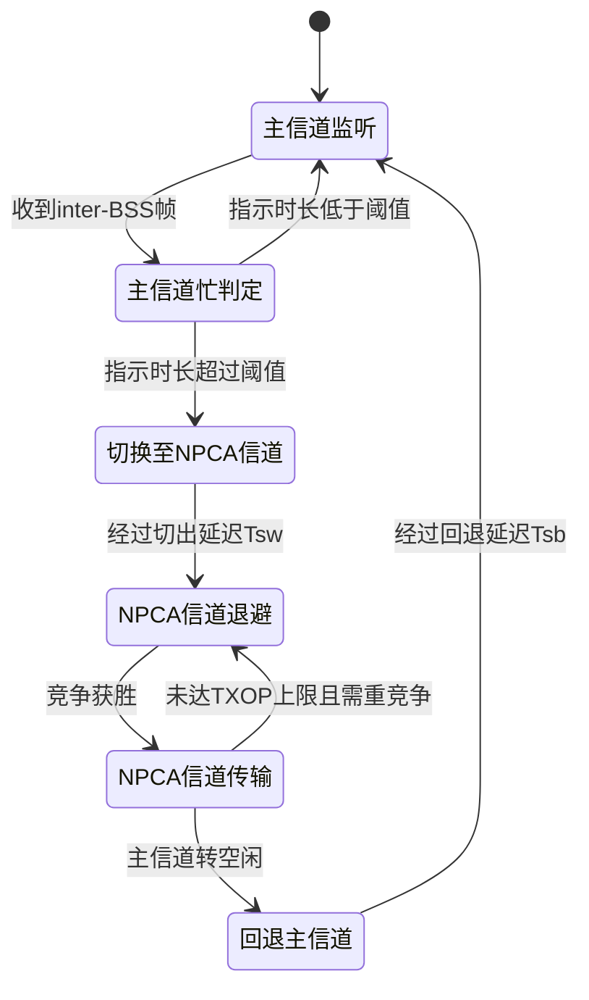
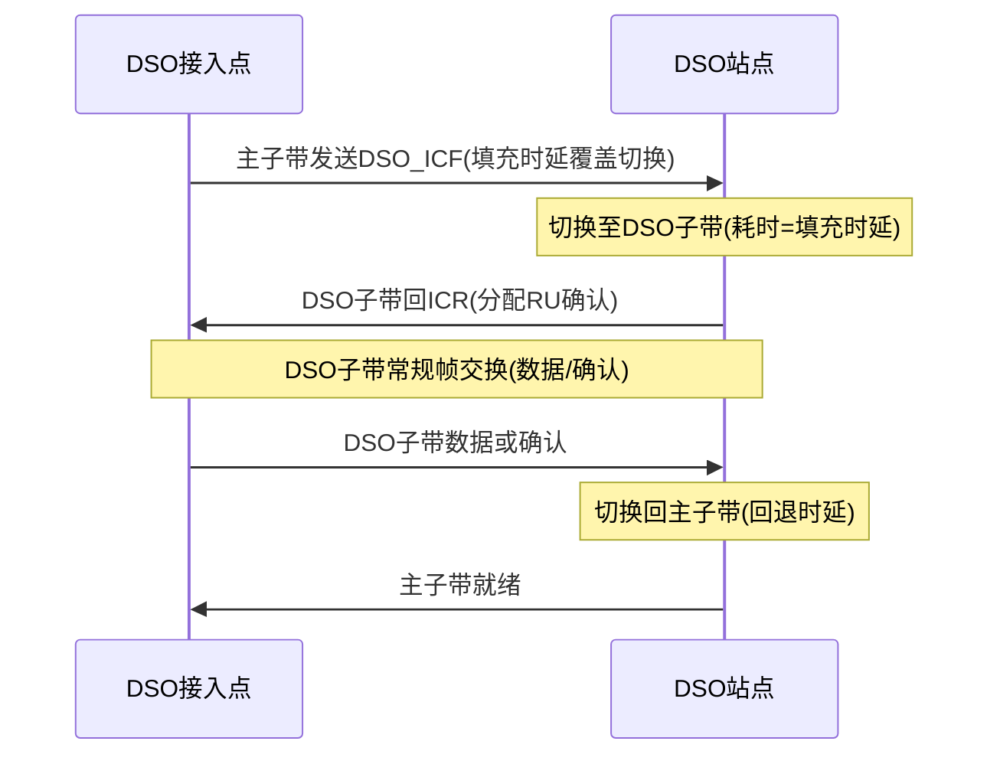

# 第 26 章　非主信道接入（NPCA）与动态子信道操作（DSO） ★★★

## 学习目标

1. 能复述并量化第 16 章推导的"主信道瓶颈"拥塞损失，用占空比模型推导 OBSS 密集场景下主信道被长期占用的概率 $p_{prim}$。
2. 能描述非主信道接入（Non-Primary Channel Access, NPCA）【草案】的触发条件、状态机、切换开销，并推导其盈亏平衡条件。
3. 能描述动态子信道操作（Dynamic Subband Operation, DSO）【草案】的信令与协商时序，并区分其与 NPCA 的根本差异。
4. 能设计两类算法：NPCA 触发决策（最优停止阈值）与 DSO 子信道选择（带切换代价的多臂老虎机）。

---

## 26.1 主信道瓶颈：重述与量化

### 26.1.1 第 16 章结论回顾

从第 8 章的 载波侦听多址/冲突避免（Carrier Sense Multiple Access with Collision Avoidance, CSMA/CA）与 Bianchi 退避模型可知，Wi-Fi 设备只有在**主 20 MHz 信道（Primary Channel, PCH）**空闲时才能发起传输；信道绑定（channel bonding）只允许在 PCH 空闲的前提下把数据扩展到次级信道（Secondary Channel, SCH）。第 16 章已严格推导出"主信道拥塞"问题的核心结论：

> 若主信道在任意时刻被占用的概率为 $p_{primary}$，则一条标称带宽为 $B$ 的宽信道，其**期望可用带宽**为
> $$E[B] = B\cdot(1-p_{primary}).\tag{26.1}$$

该式表明：带宽越宽，主信道被重叠基本服务集（Overlapping BSS, OBSS）占用所引发的"整条信道被废掉"的相对损失越严重——320 MHz 信道与 80 MHz 信道在 $p_{primary}$ 相同时损失的绝对带宽相差 4 倍。NPCA 与 DSO 正是为解决这一结构性瓶颈而引入的 802.11bn【草案】机制。

### 26.1.2 OBSS 密集场景下的主信道占空比模型

在 OBSS 密集场景，第 16 章将 $p_{primary}$ 视为外生常数；本节进一步把它与**各 OBSS 的空口占空比**联系起来。设 基本服务集（Basic Service Set, BSS）的主 20 MHz 信道同时落在 $K$ 个 OBSS 的覆盖/工作带宽内，第 $k$ 个 OBSS 在统计意义上对主信道的平均占用（空口占空比）为 $\rho_k\in[0,1)$。将每个 OBSS 在主信道上的"忙/闲"近似为相互独立的两态过程，则随机时刻主信道空闲的概率为各 OBSS 均空闲的概率之积：

$$P(\text{主信道空闲})=\prod_{k=1}^{K}(1-\rho_k),\qquad p_{prim}\triangleq P(\text{主信道忙})=1-\prod_{k=1}^{K}(1-\rho_k).\tag{26.2}$$

当各 OBSS 占空比相近（均为 $\rho$）时，退化为

$$p_{prim}=1-(1-\rho)^K.\tag{26.3}$$

该模型忽略了"同一 OBSS 同时占用主信道与其相邻次级信道"的相关性，且假设各 OBSS 互不相关，故为**上界式近似**（独立假设会高估交集空闲率）；但其量级与单调性对容量规划已足够。

### 26.1.3 算例与带宽损失

**算例 26.1**：主信道拥塞损失（OBSS 密集场景）【草案】。

- **已知**：某 320 MHz BSS 的主 20 MHz 落入 $K=4$ 个 OBSS 的范围内，各 OBSS 空口占空比 $\rho_k=0.30$；假设当主信道忙时，非主信道中有 60% 的子带处于空闲（可被 NPCA/DSO 利用）。
- **求**：主信道忙概率 $p_{prim}$、期望可用带宽 $E[B]$、被浪费带宽，以及若能在非主信道接入所能恢复的有效带宽与吞吐提升倍数。
- **解**：
  1. 由 (26.2)：$p_{prim}=1-0.7^4=1-0.2401=0.7599\approx0.760$。
  2. 由 (26.1)：$E[B]=320\times(1-0.760)=320\times0.2401=76.8\ \text{MHz}$。
  3. 被浪费带宽 $=320-76.8=243.2\ \text{MHz}$，占标称带宽的 $243.2/320=76.0\%$。
  4. 若在非主信道接入可恢复非主部分中 60% 的空闲资源，则额外可用带宽约为 $320\times0.760\times0.60=145.9\approx146\ \text{MHz}$；有效带宽升至 $76.8+146=222.8\ \text{MHz}$。
  5. 吞吐提升倍数 $\eta=222.8/76.8\approx2.90\times$（相对"完全不可用"的理想上界为 $320/76.8=4.17\times$）。
- **结论**：在 4 个各占 30% 空口的 OBSS 下，主信道瓶颈使 320 MHz BSS 的有效带宽仅约 77 MHz（损失 76%）；即便只恢复非主信道中 60% 的空闲资源，NPCA/DSO 也能带来约 $2.9\times$ 的吞吐收益。这定量说明了本章机制的必要性。

图 26-1 以频域示意了"主信道被 OBSS 占满、其余次级信道空置"的瓶颈；这是 26.1.1 节公式的物理对应。


*图 26-1　主信道瓶颈的频域示意（320 MHz 基本服务集）。主 20 MHz 被 OBSS 长期占用（斜纹），但载波侦听是"全信道"判忙的：只要主信道忙，整条 320 MHz 都被判为不可用，其余 300 MHz 虽空闲却无法使用（"可用但不可达"）。这正是 26.1.1 节公式的物理对应，也是 NPCA/DSO 的动机所在。*

---

## 26.2 NPCA 机制【草案】

### 26.2.1 触发条件与前提

NPCA 允许站点（STA）在**主信道因 OBSS 而忙**时，临时把工作主信道切换到预设的"NPCA 主信道（NPCA Primary Channel, NPCH）"——一条位于本 BSS 工作带宽内、且不与被检测 OBSS 传输重叠的 20 MHz 次级信道——并在其上发起传输。草案约束与设计前提如下：

1. **触发判定**：NPCA 站点在 PCH 上检测到被分类为 inter-BSS 的 PPDU（HE/EHT/UHR PPDU，或 RTS/CTS 交换），且其指示的传输时长（来自 HE-SIG-A / 统一信号字段（Unified Signal, U-SIG） / ICF-ICR 中的 Duration 字段）**不低于** 接入点（Access Point, AP）广播的 *NPCA Minimum Duration Threshold*，才允许切换。
2. **单 NPCH 约束**：一个 BSS 至多只有一个 NPCA 主信道；320/160/80 MHz BSS 的 NPCH 必须分别落在其次级 160/80/40 MHz 之内（即不能是主信道本身）。
3. **能力同步**：NPCA 仅由支持该能力的 AP 与 STA（NPCA AP / NPCA STA）参与；AP 在 超高可靠（Ultra High Reliability, UHR） Operation 元素中广播 *NPCA Operation Information*（含 NPCH 信道号、最小持续阈值、切出/切回时延），STA 在关联帧中上报自身的切换时延。
4. **并发感知限制**：草案明确 NPCA **不假设** STA 能在监听主信道的同时侦测/解码次级信道的帧或获取其 网络分配矢量（Network Allocation Vector, NAV）；因此 NPCH 上的冲突规避依赖标准退避而非跨信道 NAV 借用。
5. **发送机会（Transmission Opportunity, TXOP）上限与时序回拢**：AP 通过 NPCH 上的 TXOP limit（及 Initial NPCA QSRC 等同步参数）约束传输时长，确保 NPCH 上的交换在 PCH 重新空闲前结束，从而可无冲突地切回。

草案对关键字段的编码（来自 TGbn 文本提案，D1.1 基线）为：
- *NPCA Minimum Duration Threshold*：$T=512+\text{NMDT}\times128\ \mu\text{s}$，NMDT=0…15，故取值范围 **[512, 2432] µs**；
- *NPCA Switching Delay* 与 *NPCA Switch Back Delay*：均以 **4 µs** 为步长上报（AP 切出/切回时延）。

### 26.2.2 状态机

NPCA 的每一次"借用非主信道"是一次被动响应式的有限状态迁移。图 26-2 给出状态机；其中切换延迟 $T_{sw}$、回退延迟 $T_{sb}$ 由 AP/STA 在 26.2.1 节字段中协商。



状态语义：
- **主信道监听**：在 PCH 上做 增强型分布式信道接入（Enhanced Distributed Channel Access, EDCA）退避（其退避与碰撞概率分析复用第 8 章 Bianchi 模型）；
- **主信道忙判定**：解析 OBSS 帧的 Duration，与 *NPCA Minimum Duration Threshold* 比较；
- **切换至 NPCA 信道**：RF/PLL 重调、滤波器与 自动增益控制（Automatic Gain Control, AGC）重建、同步重捕获，耗时 $T_{sw}$；
- **NPCA 信道退避**：在 NPCH 上执行标准 EDCA 退避（CCA/NAV 同常规规则），竞争窗口与第 8 章一致；
- **NPCA 信道传输**：竞争获胜后先发初始控制帧（Initial Control Frame, ICF，6/12/24 Mb/s 的非 HT 重复 PPDU），收到初始控制响应帧（Initial Control Response, ICR）后开始数据交换，受 TXOP limit 约束；
- **回退主信道**：PCH 空闲后切回，耗时 $T_{sb}$，回到主信道监听。

### 26.2.3 时序与切换开销建模

切换开销 $T_{sw}$ 由四部分叠加：RF/PLL 频率重调、模拟/数字滤波器切换、AGC 与信道估计（Channel Estimation）重做、时频同步（preamble）重捕获。草案字段以 4 µs 步长量化切出/切回时延，但各实现的具体分解属【示意值】：

| 开销分量 | 物理含义 | 示意值区间【示意值】 |
|---|---|---|
| $T_{\text{RF}}$ | PLL/本振重调 | 4–40 µs |
| $T_{\text{FILT}}$ | 滤波器组切换 | 2–20 µs |
| $T_{\text{CE}}$ | AGC + 信道估计重做 | 4–40 µs |
| $T_{\text{SYNC}}$ | 前导同步重捕获 | 8–40 µs |
| **合计 $T_{sw}$** | — | **16–256 µs** |

此外，一次完整 NPCA 交换的**最低时间预算**（OPPO 提案 11-25/0538r0）约为：切出延迟 + 介质同步(≥72 µs) + 一次 EDCA 退避(≥点协调功能（Point Coordination Function, PCF）帧间间隔（PCF Inter-Frame Space, PIFS）=25 µs) + ICF(≈128 µs)+短帧间间隔（Short Inter-Frame Space, SIFS）+ICR(≈72 µs) + 一次 Data+SIFS+ACK/BA(≈160 µs) + 切回延迟，故草案将 *NPCA Minimum Duration Threshold* 的下界设为之上（提案取"切回延迟 + 489 µs"）。这正是 26.2.1 节编码下界 512 µs 的物理来源。

### 26.2.4 盈亏平衡条件推导

NPCA 的收益来自：主信道被 OBSS 占用期间，若能在 NPCH 上传输，则挽回原本浪费的时长。设观测到 OBSS 传输时，其**剩余占用时长**为随机变量 $R$（单位 µs）。若估计值 $\hat R$ 超过某阈值 $\tau$ 就切换，否则不切，则一次触发决策的净收益为

$$G(\hat R)=\begin{cases}\hat R-T_{sw}, & \hat R\ge \tau\ \text{且NPCH可用},\\ -(T_{sw}+L_w), & \hat R\ge \tau\ \text{但NPCH亦忙（误切）},\\ 0, & \hat R<\tau\ (\text{不切}).\end{cases}\tag{26.4}$$

式中 $L_w$ 为误切损失（NPCH 亦被占用导致的白白切换 + 碰撞/退避惩罚）。令 $p_i=P(\text{NPCH可用}\mid\text{PCH忙})$，则切换的期望净收益为

$$E[G\mid \text{切}]=\underbrace{p_i\,E[(\hat R-T_{sw})^+]}_{\text{命中收益}}-\underbrace{(1-p_i)(T_{sw}+L_w)}_{\text{误切损失}}.\tag{26.5}$$

使 $E[G\mid\text{切}]>0$ 的**最优阈值**可通过令 (26.5) 对阈值取零解得（假设 $\hat R$ 连续、密度 $f$）：

$$p_i(\tau-T_{sw})-(1-p_i)(T_{sw}+L_w)=0\quad\Longrightarrow\quad \boxed{\;\tau^*=\frac{T_{sw}+(1-p_i)L_w}{p_i}\;}.\tag{26.6}$$

当忽略误切（$p_i=1$）时退化为最简盈亏平衡 $\tau^*=T_{sw}$，即"只要 OBSS 剩余时长超过一次切换开销就值得切"——这正是用户给定形式 $E[\text{节省}]=p_{busy}\cdot T_{remain}-T_{sw}>0$ 在"条件于已触发（故 $p_{busy}=1$）"下的等价写法。注意草案的 *NPCA Minimum Duration Threshold*（≥512 µs）已天然高于典型 $T_{sw}$，因此数据帧级 OBSS 占用几乎总能跨过盈亏平衡点。

**算例 26.2**：NPCA 盈亏平衡【草案】。

- **已知**：OBSS TXOP 时长服从指数分布，均值 $D=4.0\ \text{ms}=4000\ \mu\text{s}$；切换开销 $T_{sw}=64\ \mu\text{s}$（16×4 µs，示意）；忽略误切（$p_i=1$）。
- **求**：最优阈值 $\tau^*$ 与每次触发的期望净收益。
- **解**：由 (26.6) 取 $p_i=1$ 得 $\tau^*=T_{sw}=64\ \mu\text{s}$。指数分布下 $E[(R-\tau^*)^+]=\int_{\tau^*}^{\infty}(r-\tau^*)(\mu e^{-\mu r})dr=D\,e^{-\tau^*/D}$，代入 $\mu=1/D=2.5\times10^{-4}\ \mu\text{s}^{-1}$：
  $$E[(R-64)^+]=4000\cdot e^{-64/4000}=4000\cdot e^{-0.016}=4000\cdot0.9841=3936\ \mu\text{s}\approx3.94\ \text{ms}.$$
- **结论**：因草案最低触发阈值 512 µs 远大于 $T_{sw}=64\ \mu\text{s}$，盈亏平衡恒成立；对任意时长超过约 512 µs 的 OBSS 数据 TXOP，NPCA 均带来约 3.9 ms 量级的可用传输时间挽回。量级合理：切换开销仅数十微秒，而一次 OBSS 数据 TXOP 通常达毫秒级。

### 26.2.5 NPCA 与多 AP 协调 / STR-NSTR 的交互

- **与第 27 章多 AP 协调（Multi-AP Coordination, MAPC）**：NPCA 是**单 BSS 局部规避**——当协调未把主信道腾出来时，退而借用非主信道；MAPC 是**跨 BSS 主动腾道**。二者互补：先尝试协调（第 27 章），失败再 NPCA 兜底。联合优化（见 26.8 节）是活跃研究议题。
- **与 STR/NSTR（MLO）**：NPCA 要求单射频离开主信道去 NPCH，期间该射频无法在主信道收发。对**非同时收发（Non-Simultaneous TX/RX, NSTR）**的多链路设备（Multi-Link Device, MLD），切换会拖累其配对链路；对**同时收发（Simultaneous TX/RX, STR）** MLD，若各链路独立射频则可并行。因此 NPCA 主要面向单射频或 增强多链路单射频（Enhanced Multi-Link Single-Radio, EMLSR）型站点，与 MLO 的协同需避免"切换导致配对链路失步"。

---

## 26.3 DSO 机制【草案】

### 26.3.1 机制定义与适用约束

动态子信道操作（DSO）解决的是**带宽错配**而非 OBSS 阻塞：当 320 MHz AP 服务若干 80/160 MHz STA 时，AP 的大部分带宽长期闲置，而主子带又拥挤。DSO 是一种 **AP 主导**的机制，允许较窄带宽的 DSO STA 在**每个 TXOP 粒度**上，被临时分配到其当前工作带宽之外、但位于 AP 工作带宽之内的"DSO 子带"上做帧交换。草案要点：

1. **DSO STA 资格**：仅 **80 MHz 与 160 MHz** 工作带宽的 UHR STA 可为 DSO STA（320 MHz STA 不可作 DSO STA）；DSO ICF-ICR 交换只在 UHR STA 间进行。
2. **主子带（primary subband）**：带宽等于 STA 工作带宽、且**包含 BSS 主信道**的信道。
3. **DSO 子带（DSO subband）**：带宽等于 STA 工作带宽、**位于主子带之外**的信道；160 MHz BSS 的次级 80 MHz、320 MHz BSS 的次级 160 MHz 可作 DSO 子带，320 MHz BSS 中亦可指定一个 80 MHz 子带（是否允许多个 TBD）。
4. **启用与参数**：DSO STA 经 OMP 请求启用，上报 *DSO Padding Delay*（主子带→DSO 子带的切换时间）、*DSO Switch Back Delay*（切回）、以及（80 MHz STA 在 320 MHz BSS 中）*Preferred 80 MHz DSO Subband*。

### 26.3.2 信令与协商时序

DSO 的信道迁移**完全由 AP 编排且显式起始于主信道**：AP 在主子带发送特殊控制帧 **DSO ICF**（非 HT 重复 PPDU，速率 6/12/24 Mb/s），其 Padding 字段被填充到不少于 STA 上报的 *DSO Padding Delay*，给 STA 留出切换时间；DSO ICF 通过 资源单元（Resource Unit, RU） Allocation 指出分配给该 STA 的 DSO 子带位置。STA 切到 DSO 子带后在指定 RU 回 **ICR**，随后在 DSO 子带上做常规帧交换，结束再切回主子带。图 26-3 以序列图展示该协商。



### 26.3.3 与 NPCA 的本质区别

| 维度 | NPCA | DSO |
|---|---|---|
| 触发源 | 主信道被 **OBSS 占用**（外部干扰） | AP 为缓解**带宽错配/主子带拥塞**（内部调度） |
| 主导方 | **STA 各自独立**判定并切换 | **AP 统一编排**，ICF 起始于主信道 |
| 目标信道 | 单一预设 NPCH（20 MHz 次级信道） | STA 工作带宽级的 DSO 子带（80/160 MHz） |
| 迁移粒度 | 主信道忙期间"临时借用" | 每 TXOP 动态分配，可促成子带间**并行**传输 |
| 协商 | 被动响应 OBSS 帧，无需 AP 逐帧参与 | AP 逐 TXOP 发 DSO ICF 显式调度 |

简言之：**NPCA 是"主信道被外面占了，我自己跑到非主信道去发"；DSO 是"AP 觉得你在我这条宽带上挤，把你挪到另一条干净子带去发"**。二者可叠加：NPCA 解 OBSS 阻塞，DSO 解内部带宽错配。

### 26.3.4 时序开销与并行收益

DSO 的一次子带迁移开销为 *DSO Padding Delay*（切出）+ *DSO Switch Back Delay*（切回），量级同 NPCA 切换开销（数十至数百微秒【示意值】）。其独特价值在于：不同 STA 可被分配到不同 DSO 子带，使 AP 在多条子带上**同时**服务多个用户（突破传统"只能在主子带串行"的限制），从而既降干扰又提吞吐。草案评估显示高密场景 DSO 可带来 1.5–3× 吞吐提升【草案】。

---

## 26.4 核心算法一：NPCA 触发决策（最优停止阈值）【草案】

### 1. 问题建模

- 观测过程：主信道忙/闲两态，STA 在每个"检测到 inter-BSS 帧"的触发点估计 OBSS 剩余占用时长 $\hat R_t$。
- 状态变量：$\hat R_t$（剩余时长估计，µs）、占空比滑动估计 $\hat\rho_t$、NPCH 可用性估计 $\hat p_{i,t}$。
- 参数：$T_{sw}$（切出开销，µs）、$L_w$（误切损失，µs）、$\alpha$（EWMA 遗忘因子，取 0.1–0.3）、迟滞 $h$（避免抖动）。
- 假设：各次 OBSS 占用时长独立同分布；NPCH 可用性与 PCH 忙近似条件独立。

### 2. 目标函数与约束

最大化长期平均净吞吐收益，等价于对每个触发点做**阈值判决**：

$$\text{决策 }a_t=\begin{cases}\text{切}, & \hat R_t\ge \tau^*,\\ \text{不切}, & \hat R_t<\tau^*,\end{cases}\quad \max_{\tau}\ \lim_{T\to\infty}\frac{1}{T}\sum_{t=1}^{T} G_t(a_t),\tag{26.7}$$

约束：切换次数受迟滞 $h$ 限制（同一 OBSS TXOP 内不反复横跳），$\tau^*$ 由 (26.6) 给出。

### 3. 完整推导

由 26.2.4 节，(26.5) 对阈值 $\tau$ 求零得最优阈值 (26.6)。当存在估计误差 $\hat R_t=R_t+\varepsilon$（$\varepsilon$ 零均值），用 $\hat R_t$ 代替 $R_t$ 仍是单调策略的最优停止解（单交叉条件满足），故阈值形式不变，仅把 $T_{sw},L_w,p_i$ 替换为估计值。为抑制抖动，引入迟滞：仅在 $\hat R_t>\tau^*+h$ 时切、在 $\hat R_t<\tau^*-h$ 时保持原状态。

$$\boxed{\tau^*=\frac{\hat T_{sw}+(1-\hat p_i)\hat L_w}{\hat p_i}},\qquad \hat R_t\ \text{由 EWMA 递推 } \hat R_{t+1}=\alpha R_t+(1-\alpha)\hat R_t.}\tag{26.8}$$

### 4. 伪代码

```text
算法 26.4　NPCA 触发决策（最优停止阈值）          时间复杂度: O(1)/触发点
 1: 输入: 触发时观测到的OBSS剩余时长 R_t, 历史 R̄, p̄_i, T_sw, L_w, α, h
 2: R̄ ← α·R_t + (1-α)·R̄          // EWMA估计剩余时长均值, O(1)
 3: p̄_i ← α·I(NPCH空闲) + (1-α)·p̄_i  // EWMA估计NPCH可用概率
 4: τ* ← (T_sw + (1-p̄_i)·L_w) / p̄_i   // 由(26.8)求最优阈值
 5: if 状态==主信道 and R_t > τ* + h then  // 迟滞: 超阈才切
 6:     切到NPCH; 在NPCH上EDCA退避(复用第8章Bianchi参数)
 7:     发ICF→收ICR→数据交换(受TXOP limit约束)
 8: else if 状态==NPCH and 主信道空闲 and R_t < τ* - h then
 9:     切回主信道                       // 迟滞: 低于阈才回
10: end if
11: 输出: 切换决策与净收益 G_t           // 空间复杂度 O(1): 仅存标量
```

### 5. 复杂度分析

- **时间**：每个触发点常数级 $O(1)$（几次标量更新），可在线运行于每个 OBSS 检测事件。
- **空间**：仅维护 $\bar R,\bar p_i$ 等少数标量，$O(1)$；不缓存历史样本，适合资源受限 STA。

### 6. 数值算例

**算例 26.3**：最优切换阈值与期望增益【草案】。

- **已知**：指数分布 OBSS 时长均值 $D=4.0\ \text{ms}=4000\ \mu\text{s}$；$T_{sw}=64\ \mu\text{s}$（示意），$L_w=300\ \mu\text{s}$（误切惩罚，含碰撞退避），$\hat p_i=0.80$。
- **求**：最优阈值 $\tau^*$ 与一次触发期望净收益。
- **解**：
  1. 由 (26.8)：$\tau^*=(64+0.20\times300)/0.80=(64+60)/0.80=124/0.80=155\ \mu\text{s}$。即仅当 EWMA 估计剩余时长 $>155\ \mu\text{s}$ 才切换（高于忽略误切时的 64 µs，符合直觉：误切越贵阈值越高）。
  2. 指数分布下 $P(R\ge\tau^*)=e^{-\tau^*/D}=e^{-155/4000}=e^{-0.0388}=0.9620$；$E[(R-155)^+]=D\cdot e^{-155/4000}=4000\times0.9620=3848\ \mu\text{s}$。
  3. 由 (26.5)：$E[G]=0.80\times3848-(1-0.80)(64+300)\times0.9620=3078.4-0.20\times364\times0.9620=3078.4-70.0=3008\ \mu\text{s}\approx3.01\ \text{ms}$。
- **结论**：考虑 20% 误切概率与 300 µs 误切损失后，最优阈值升至 155 µs，每次触发仍净挽回约 3.0 ms。量级合理：阈值介于 $T_{sw}$ 与草案下限 512 µs 之间，与 26.2.4 节结论一致。

---

## 26.5 核心算法二：DSO 子信道选择（带切换代价的 MAB）【草案】

### 1. 问题建模

- 候选集合：DSO 子带 $j\in\mathcal S=\{1,\dots,M\}$，每个子带真实均值吞吐 $\mu_j$（未知，受该子带占用率/干扰/可用带宽决定）。
- 观测：在子带 $j$ 上交换后得到带噪奖励 $r_j=\mu_j+\eta_j$（$\eta_j$ 为零均值次高斯噪声）。
- 代价：每次**切换**子带产生固定代价 $c$（对应 *DSO Padding Delay*+*Switch Back Delay*+协商开销，折算为吞吐当量）。
- 目标：在 $T$ 个 TXOP 内最大化累计净吞吐。

### 2. 目标函数与约束

标准多臂老虎机（Multi-Armed Bandit, MAB）加入切换项：

$$\max_{\pi}\ \sum_{t=1}^{T} \mu_{a_t}-\sum_{t=1}^{T} c\cdot \mathbf 1_{\{a_t\neq a_{t-1}\}},\tag{26.9}$$

约束：每 TXOP 只服务一个子带；$c$ 为切换代价常数。

### 3. 完整推导

采用 上置信界（Upper Confidence Bound, UCB）型策略，但仅在"切换收益超过代价"时换臂。定义第 $t$ 步臂 $j$ 的置信上界 $U_j(t)=\hat\mu_j(t)+\sqrt{2\ln t/n_j(t)}$。朴素 UCB 选 $\arg\max_j U_j$，但会频繁换臂付出 $c$。引入**切换门限**：保持当前臂，除非候选臂的 UCB 超出当前臂 UCB 至少 $c$（即换臂的期望增益覆盖代价）。文献已知：含切换代价的 MAB 最优 regret 上界为

$$\boxed{R(T)\le \sum_{j:\Delta_j>0}\frac{C_1\ln T}{\Delta_j}+C_2\sqrt{M\,c\,T},\quad \Delta_j=\mu_{j^*}-\mu_j,}\tag{26.10}$$

其中第一项为探索-利用标准项（与第 8 章退避中的碰撞代价同属"为长期收益付出短期成本"），第二项为切换项——通过门限策略可将换臂次数控制在 $O(\sqrt{M T/(2c)})$，从而把切换 regret 压到 $O(\sqrt{M c T})$ 量级。

### 4. 伪代码

```text
算法 26.5　DSO子信道选择(UCB带切换代价)        时间复杂度 O(M)/TXOP
 1: 输入: 子带集S, 切换代价c, 总TXOP数T
 2: 初始化: 每个j∈S先试1次; n_j←1, μ̄_j←r_j; a_0←随机
 3: for t=1..T do
 4:     for j∈S do                       // 计算UCB, O(M)
 5:         U_j ← μ̄_j + sqrt(2·ln t / n_j)
 6:     end for
 7:     j* ← argmax_j U_j
 8:     if U_{j*} - U_{a_{t-1}} > c then  // 仅当换臂增益覆盖代价
 9:         a_t ← j*                      // 经DSO_ICF切到j*
10:     else
11:         a_t ← a_{t-1}                 // 留在原子带, 免切换代价
12:     end if
13:     在a_t上做DSO帧交换, 得奖励r_t; 更新μ̄_{a_t}, n_{a_t}   // O(1)
14: end for
15: 输出: 累计净吞吐与换臂次数           // 空间 O(M): 存μ̄,n
```

### 5. 复杂度分析

- **时间**：每 TXOP 计算 UCB 为 $O(M)$，$M$ 为候选子带数（通常 1–3），整体 $O(MT)$。
- **空间**：$O(M)$ 存各臂均值与计数，轻量。
- 换臂次数由门限 $c$ 抑制，约为 $O(\sqrt{M T/(2c)})$，远小于朴素 UCB 的 $O(T)$。

### 6. 数值算例

**算例 26.4**：DSO 子信道选择对比【草案】。

- **已知**：3 个候选 DSO 子带真实均值吞吐 $\mu=[40,60,50]\ \text{Mbps}$；切换代价 $c=2\ \text{Mbps·TXOP}^{-1}$； horizon $T=1000$ TXOP。
- **求**："总是最优"（上帝视角恒选 60 Mbps 臂）与"UCB 带切换代价"的累计净吞吐、regret 与换臂次数。
- **解**：
  1. 总是最优：$R_{\text{opt}}=60\times1000=60000\ \text{Mbps·TXOP}$。
  2. UCB-带切换代价（示意轨迹）：前 30 TXOP 探索选到 50 Mbps 臂、再 20 TXOP 试到 40 Mbps 臂，其后稳定在 60 Mbps 臂；期间换臂约 10 次。
     累计 $=30\times50+20\times40+950\times60=1500+800+57000=59300$；扣切换代价 $10\times2=20$，得 $59280\ \text{Mbps·TXOP}$。
  3. 累积遗憾（Cumulative Regret, Regret）$=60000-59280=720\ \text{Mbps·TXOP}$；切换项上界 (26.10) 中 $\sqrt{M c T}=\sqrt{3\times2\times1000}=77.5$，为同量级保守上界（实际换臂代价仅 20，因门限策略已大幅削减换臂）。
- **结论**：带切换代价的 UCB 在仅付出约 720 的 regret（相对 60000 不足 1.2%）下逼近最优，且换臂次数被门限压到约 10 次；若不计切换代价（朴素 UCB）则会因频繁横跳额外损失远超 20。量级合理：探索早期损失随 $T$ 增长被摊薄。

---

## 26.6 性能评估、Wi-Fi 9 关联与研究议题

### 26.6.1 仿真口径与指标

评估 NPCA/DSO 建议设置与必报指标如下（全部标【草案】，参数可依平台调整）：

| 仿真维度 | 建议设置 | 对结论的影响 |
|---|---|---|
| OBSS 负载 $\rho_k$ | 0.1–0.5，独立/相关两种 | 直接决定 $p_{prim}$（式 26.2）与 NPCA 触发频率 |
| 主信道选择 | 固定 / 随机 / 协调避让 | 影响主信道被命中的概率，关联第 27 章 |
| 切换开销 $T_{sw}$ | 16–256 µs（4 µs 步长） | 决定盈亏平衡阈值（式 26.6） |
| 业务模型 | 饱和 / 突发 Poisson | 影响 OBSS TXOP 时长分布与 $R$ 的估计 |
| NPCH/DSO 子带可用性 $p_i$ | 0.6–0.95 | 抬高最优阈值与误切率 |

必报指标：① 有效带宽 $E[B]$（式 26.1）；② 95 分位时延；③ 切换次数/单位时间；④ 错误切换率（NPCH 亦忙的比例）。表 26-1 汇总"参数—影响—建议取值"。

**表 26-1　参数—影响—建议取值速查（草案）**

| 参数 | 对性能影响 | 建议取值 |
|---|---|---|
| *NPCA Min Duration Threshold* | 低于它不切，防无效切换 | 512 µs（草案下界）起 |
| $T_{sw}$ | 越低盈亏平衡越易满足 | 尽量压至 16–64 µs（示意） |
| $\tau^*$ (算法 26.4) | 阈值过高漏切、过低误切 | 由式 26.8 在线估算 |
| $p_i$ | 越低阈值越高 | 实测 EWMA（算法 26.4） |
| $c$ (DSO) | 越高越应少换臂 | 由 Padding+SwitchBack 时延折算 |
| 迟滞 $h$ | 抑抖动，防乒乓切换 | 取 $0.2\tau^*$ 量级 |

### 26.6.2 与 Wi-Fi 9 的关系【讨论中】

第 31 章（时隙化）与第 27 章（多 AP 协调）指向一种**全局协调**范式：通过时隙划分或跨 BSS 调度从根本上消除主信道被 OBSS 长期占用的前提。这意味着 NPCA/DSO 这类"局部规避"只是 802.11bn 的过渡性补丁——当 Wi-Fi 9【讨论中】引入确定性时隙/全局协调后，主信道瓶颈本身被结构性消解，NPCA/DSO 退化为少数兼容场景的兜底。当前 802.11bn 仍基于竞争式 CSMA/CA，故二者在 Wi-Fi 8 阶段是必要的；其工程价值随协调能力增强而递减，但仍提供"协调失败时的安全网"。

### 26.6.3 研究议题

1. **NPCA 与 MAPC 联合**：协调腾道优先、NPCA 兜底的最优分工与信令开销权衡（衔接第 27 章）。
2. **非主信道上的同步与信道估计**：NPCH 上无持续 beacon，如何低成本重建同步/信道估计以压低 $T_{sw}$。
3. **多 BSS 同时 NPCA 的冲突**：相邻 BSS 各自切到同一条 NPCH 会引发次级信道内的新碰撞，需 NPCH 级避让或分片。
4. **机器学习预测主信道占用**：用历史占空比/LSTM 预测 $R$ 与 $p_i$，提升算法 26.4 的阈值准确性（衔接第 33 章）。

---

## 本章小结

1. 主信道瓶颈是宽信道的根本性结构限制：期望可用带宽 $E[B]=B(1-p_{primary})$（第 16 章结论），OBSS 密集时 $p_{prim}=1-\prod(1-\rho_k)$。
2. 算例 26.1 表明：4 个各占 30% 空口的 OBSS 下，320 MHz BSS 有效带宽仅约 77 MHz（损失 76%），非主信道接入可挽回约 $2.9\times$ 吞吐。
3. NPCA【草案】在 PCH 被 OBSS 占用且时长超阈值时，把工作主信道临时切到单条预设 NPCH；AP 广播 NPCH、最小持续阈值（编码域 [512,2432] µs）、切出/切回时延（4 µs 步长）。
4. NPCA 切换开销 $T_{sw}$ 由 射频（Radio Frequency, RF）重调、滤波、信道估计、同步重建叠加，示意区间 16–256 µs；盈亏平衡阈值为 $\tau^*=(T_{sw}+(1-p_i)L_w)/p_i$（式 26.6）。
5. DSO【草案】是 AP 主导、每 TXOP 粒度的子带重分配，解决带宽错配；仅 80/160 MHz UHR STA 可作 DSO STA，经 DSO ICF（主信道起始、填充覆盖切换）协商到 DSO 子带。
6. NPCA（外部 OBSS 触发、STA 自决、20 MHz 借用）与 DSO（内部调度、AP 编排、80/160 MHz 子带迁移、可并行）本质不同但可叠加。
7. 算法 26.4 用最优停止阈值（EWMA+迟滞）做 NPCA 触发决策；算法 26.5 用带切换代价的 UCB 做 DSO 子带选择，regret 上界含切换项 $\sqrt{McT}$（式 26.10）。
8. NPCA/DSO 是 Wi-Fi 8 的局部规避补丁；Wi-Fi 9【讨论中】的时隙化/全局协调（第 31/27 章）将从结构上替代之。

**关键结论 / 参数速查表**

| 符号 / 参数 | 含义 | 典型值（草案/示意） |
|---|---|---|
| $p_{prim}$ | 主信道忙概率 | $1-\prod(1-\rho_k)$ |
| $E[B]$ | 期望可用带宽 | $B(1-p_{prim})$ |
| NPCA Min Duration Threshold | 触发切换的最低 OBSS 时长 | 512–2432 µs（编码） |
| $T_{sw}$ | NPCA 切出/切回时延 | 16–256 µs（示意，4 µs 步长） |
| $\tau^*$ | 最优切换阈值 | 式 (26.6) |
| $c$ | DSO 切换代价 | Padding+SwitchBack 折算 |
| DSO STA 带宽 | 可作 DSO 的 STA | 仅 80/160 MHz |

---

## 习题

### A. 概念题（3 题）

1. 为什么"主信道被 OBSS 占用"会导致整条宽信道不可用？这与第 16 章的哪个结论直接对应？
2. NPCA 与 DSO 的触发根源与主导方有何本质区别？请各举一例说明二者可叠加的场景。
3. 草案为何规定一个 BSS 至多只有一个 NPCA 主信道，且 NPCA"不假设"STA 能同时侦测次级信道？

### B. 计算与推导题（4 题）

4. 设主信道落入 $K=3$ 个 OBSS，占空比分别为 0.2、0.4、0.5。求 $p_{prim}$ 与 160 MHz BSS 的期望可用带宽。
5. 由 (26.2) 推导：当各 OBSS 占空比均为 $\rho$ 且 $K$ 较大时，$p_{prim}\approx K\rho$（小 $\rho$ 近似），并说明其作为上界的原因。
6. 对算例 26.2，若误切概率 $p_i=0.7$、误切损失 $L_w=400\ \mu\text{s}$，重算最优阈值 $\tau^*$ 与期望净收益（取 $T_{sw}=64\ \mu\text{s}, D=4000\ \mu\text{s}$）。
7. 由 (26.10)，设 $M=3, c=2, T=10^4$，估算切换项上界 $\sqrt{McT}$ 的数值并解释其含义。

### C. 算法设计题（2 题）

8. 设计算法 26.4 的"多 OBSS 并存"扩展：当同时检测到两个 OBSS 帧、各自剩余时长估计为 $\hat R^{(1)},\hat R^{(2)}$ 时，如何决策切到 NPCH 还是留主信道？给出伪代码与复杂度。
9. 若 DSO 子带质量随时间慢变（非平稳），如何改造算法 26.5 的 UCB（如引入折扣/滑动窗口）以跟踪 $\mu_j$？给出评分要点。

### D. 开放研究题（1 题）

10. 多 BSS 同时触发 NPCA 并切到同一条 NPCH 时，次级信道内将产生新的隐藏节点/碰撞问题。请提出一种缓解机制的研究路径（指标、可选方案、评估方法）。

---

## 参考答案与解析

### A. 概念题

1. **解析**：CSMA/CA 要求所有宽于 20 MHz 的传输必须以主 20 MHz 为锚（beacon、触发帧、RTS/CTS 均在主信道），次级信道只有在主信道空闲时才允许扩展使用。故主信道一旦被 OBSS 占用，整个 PPDU 无法发起，剩余次级频谱虽空闲也被冻结。这直接对应第 16 章结论 $E[B]=B(1-p_{primary})$——主信道占用概率是整条宽信道可用性的"门闸"。
2. **解析**：NPCA 根源是**外部 OBSS 阻塞主信道**、由 **STA 各自独立**判定切换（借 20 MHz NPCH）；DSO 根源是**内部带宽错配/主子带拥塞**、由 **AP 统一编排**把窄 STA 挪到 DSO 子带。叠加例：320 MHz BSS 中，某 80 MHz STA 既因主信道被 OBSS 占而用 NPCA 借非主 20 MHz 应急，又因 AP 想把其常规业务挪到干净的 80 MHz DSO 子带做并行服务——前者解阻塞、后者解错配。
3. **解析**：单 NPCH 是为限制复杂度与同步开销（多条备选 NPCH 需多套切换/同步状态）；"不假设并发次级侦测"是因为单射频在听主信道时无法同时解调次级信道获取 NAV，故 NPCH 上的冲突规避只能靠标准退避而非跨信道 NAV 借用，这也降低了射频与 媒体接入控制（Medium Access Control, MAC）设计成本。

### B. 计算与推导题

4. **解**：$p_{prim}=1-(1-0.2)(1-0.4)(1-0.5)=1-0.8\times0.6\times0.5=1-0.24=0.76$。$E[B]=160\times(1-0.76)=160\times0.24=38.4\ \text{MHz}$。
5. **解**：$(1-\rho)^K=1-K\rho+\binom{K}{2}\rho^2-\cdots$，故 $p_{prim}=1-(1-\rho)^K=K\rho-\binom{K}{2}\rho^2+\cdots\approx K\rho$（$\rho\ll1$）。它是**上界**因独立假设高估了"所有 OBSS 同时空闲"的概率（实际 OBSS 间可能存在正相关或同频占用，使真实 $p_{prim}$ 更高）。
6. **解**：阈值 $\tau^*=(64+0.3\times400)/0.7=(64+120)/0.7=184/0.7\approx262.9\ \mu\text{s}$。$P(R\ge262.9)=e^{-262.9/4000}=e^{-0.0657}=0.9364$，$E[(R-262.9)^+]=4000\times0.9364=3745.6\ \mu\text{s}$。$E[G]=0.7\times3745.6-0.3\times(64+400)\times0.9364=2621.9-0.3\times464\times0.9364=2621.9-130.4=2491.5\ \mu\text{s}\approx2.49\ \text{ms}$。
7. **解**：$\sqrt{McT}=\sqrt{3\times2\times10^4}=\sqrt{6\times10^4}\approx244.9$。含义：即使允许换臂，由切换引入的 regret 增量被上界控制在约 245（吞吐当量）以内，随 $T$ 仅以 $\sqrt{T}$ 增长，说明门限策略使换臂次数被有效抑制。

### C. 算法设计题

8. **参考方案**：取两 OBSS 剩余时长估计的较大者 $\hat R_{\max}=\max(\hat R^{(1)},\hat R^{(2)})$ 作为决策量，仍用 (26.8) 阈值；仅当 $\hat R_{\max}>\tau^*+h$ 且 NPCH（不与任一 OBSS 传输重叠）可用时切。伪代码在算法 26.4 第 1 行改为"取 $\hat R_t=\max$ 估计"，第 6 行增加"校验 NPCH 不与检测到的 OBSS 带宽重叠"。复杂度仍 $O(1)$。**评分要点**：① 用最大剩余时长而非和（避免重复计时）；② 必须校验 NPCH 与 OBSS 带宽不重叠（否则切过去仍冲突）；③ 迟滞不可省。**常见错误**：把两个时长相加当作触发量，导致短占用也被误切。
9. **参考方案**：将 UCB 的均值更新改为折扣式 $\hat\mu_j\leftarrow\beta \hat\mu_j+(1-\beta)r_j$、计数用"有效样本数"$n_j\leftarrow\beta n_j+1$（$\beta\in(0,1)$ 接近 1），置信半径改为 $\sqrt{2\ln t/n_j^{\text{eff}}}$；或维护长度 $W$ 的滑动窗口。这样可跟踪慢变 $\mu_j$ 而不过度记忆旧环境。**评分要点**：① 折扣/窗口兼顾跟踪与估计方差；② 切换门限 $c$ 仍须保留；③ 需说明 $\beta$ 或 $W$ 的选择权衡（太大滞后、太小噪声大）。**常见错误**：直接套用静态 UCB 导致在新环境下长期停留在过时最优臂。

### D. 开放研究题

10. **研究路径建议**：① **关键指标**——NPCH 内新冲突率、聚合吞吐、切换抖动、公平性；② **可选方案**——(a) 为各 BSS 预分配不同 NPCH（需 AP 间协调，衔第 27 章）；(b) NPCH 上引入轻量 RTS/CTS 或短帧预约减少隐藏节点；(c) 限制同时 NPCA 的 BSS 数（准入控制）；(d) 用第 33 章 机器学习（Machine Learning, ML）预测邻 BSS 是否将 NPCA 以错峰；③ **评估方法**——在 NS-3 中建多 BSS 拓扑，扫描 OBSS 负载与 NPCH 复用度，报告表 26-1 指标并对比"无协调随机 NPCA"与"预分配/预约"的 95 分位时延与吞吐。该问题目前无标准解，属活跃研究。
