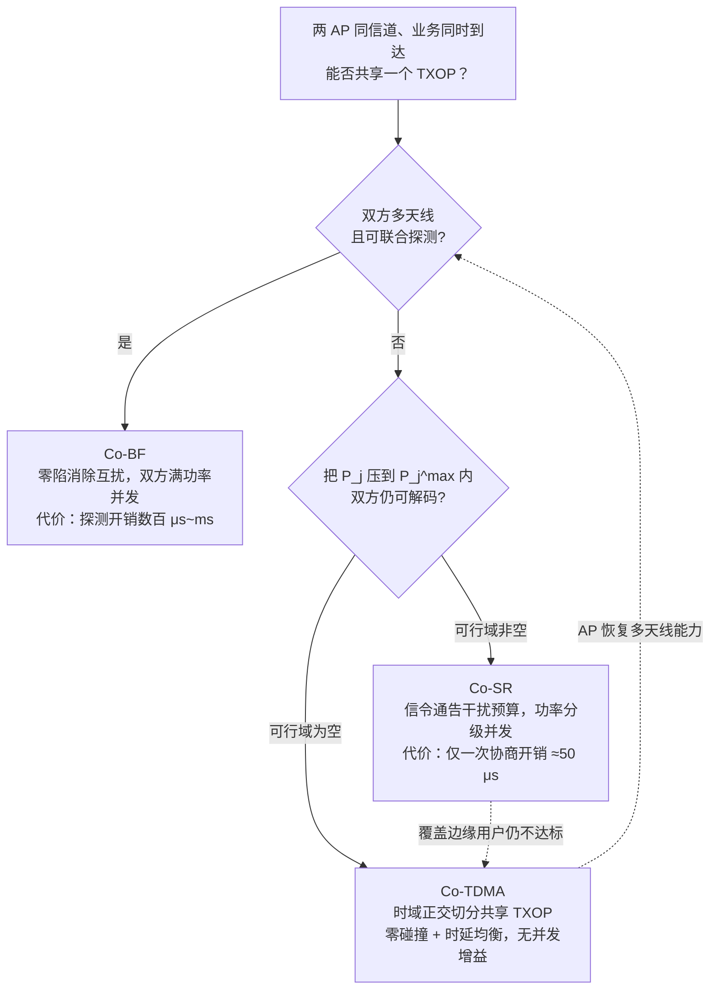
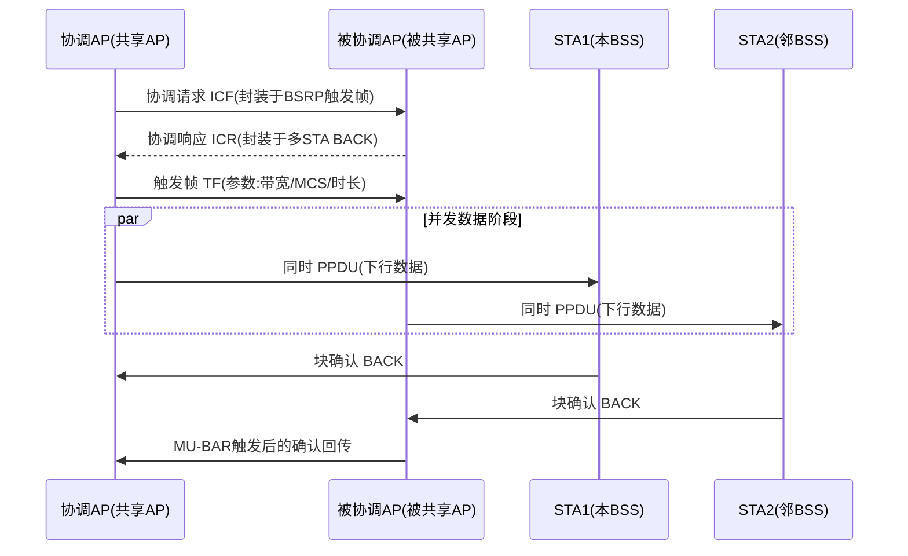
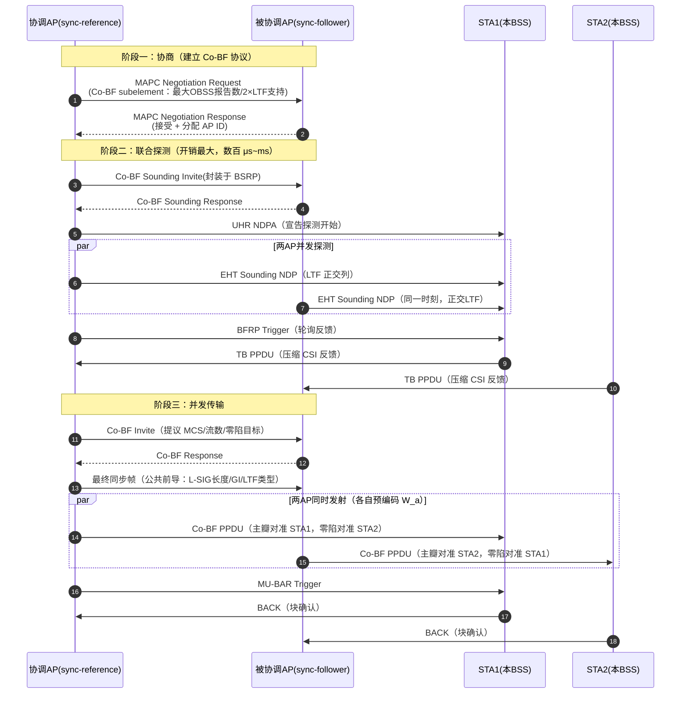
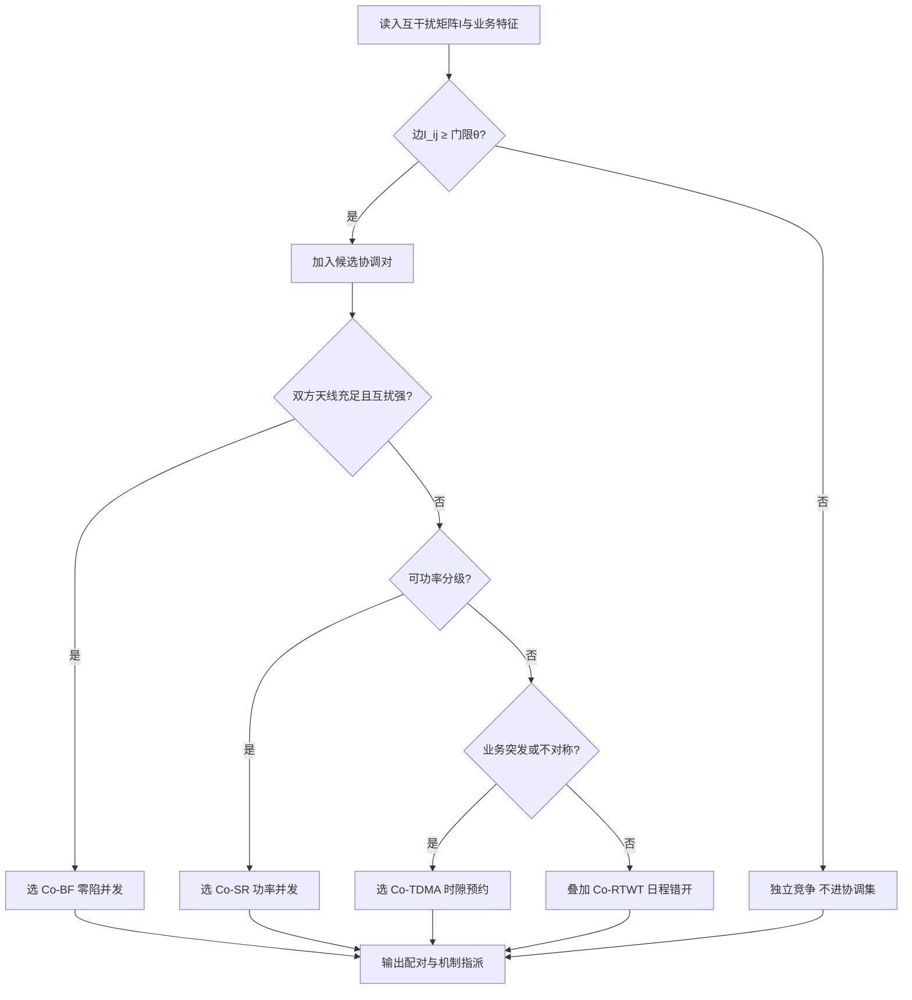

# 第 27 章　多 AP 协调（MAPC） ★★★

> 本章所述 802.11bn（Wi-Fi 8 / UHR）机制均处于标准草案阶段，按规范统一标注：**【草案】**表示 11bn 草案（本文以 Draft 1.4 / D1.4 为准）；**【讨论中】**表示尚未定案或属 Wi-Fi 9 前瞻提案。

## 学习目标

1. 能复述 MAPC 的协调框架（发现—协商—操作—拆除）、协调集与角色定义，区分 发送机会（Transmission Opportunity, TXOP）级协调与调度级协调，并画出协调信令时序。
2. 能推导 Co-SR（协调空间复用）中被协调 AP 的最大允许发射功率公式与可行性条件，计算并发增益。
3. 能推导 Co-BF（协调波束赋形）的协调 ZF / 协调 最小均方误差（Minimum Mean Square Error, MMSE）预编码及零陷自由度约束，估算 CSI 误差下的残余干扰与零陷深度损失。
4. 能设计协调集划分与子机制选择算法，并定量权衡协调开销与收益（盈亏平衡条件）。
5. 能对给定部署场景**判断该用哪个子机制**（Co-SR / Co-TDMA / Co-BF），并说明判据、流程与预期效果（27.1.4、27.1.5）。

---

## 27.1 为什么需要多 AP 协调

传统 Wi-Fi 的信道接入是**完全分布式且自私**的：每个接入点（Access Point, AP）作为独立基本服务集（Basic Service Set, BSS）竞争空口，把邻 BSS 视为"要容忍的噪声"。在密集部署（企业、工厂、公寓、场馆）中，几十个 AP 在同一信道上此起彼伏地回退与碰撞，导致覆盖边缘（cell-edge）用户可靠性崩溃——这正是 802.11bn 把目标从"峰值速率"转向"超高可靠性（Ultra High Reliability, UHR）"的根本动机【草案】。

### 27.1.1 冲突图 + 博弈：独立竞争的低效

把网络建模为**冲突图（interference/conflict graph）** $\mathcal{G}=(\mathcal{V},\mathcal{E})$：节点 $v\in\mathcal{V}$ 为 AP（或 BSS），边 $(i,j)\in\mathcal{E}$ 表示二者同信道传输时相互干扰超过可解码门限。这与第 22 章的网络级干扰图一脉相承，但第 22 章把"信道分配与功率"作为优化变量，本章进一步把"协调"加入优化变量。

在独立竞争下，各 BSS 是一个**非合作博弈**的参与者：策略为"何时接入、以多大功率"，收益为自身吞吐。纳什均衡（如 增强型分布式信道接入（Enhanced Distributed Channel Access, EDCA）下各 BSS 均分接入概率）是**低效的**——它等价于把共享信道当作"零和"资源来抢，忽略了"我若能对你的接收机无害，我们本可同时传"的正和可能。这正是 MAPC（Multi-AP Coordination，多 AP 协调）要修正的范式：**从竞争到协同**。

### 27.1.2 信息论上界：干扰信道 → 广播 / 已知干扰信道

从信息论看，两个独立 BSS 同信道并发构成一个**干扰信道（interference channel）**，其容量区 $\mathcal{C}_{\text{IC}}$ 受限于互扰。而 MAPC 通过协调（功率通告、波束零陷、时隙预约）使干扰对接收端"可知、可控甚至可消除"，信道模型退化为：

- **Co-SR / 协调 TDMA（Coordinated TDMA, Co-TDMA）**：干扰功率被约束在可容忍预算内 → 近似**带干扰约束的并行信道**，容量区向"并发"方向扩张；
- **Co-BF**：通过零陷把交叉链路增益压到近零 → 近似**发射端已知的干扰信道 / 干扰对齐（interference alignment）**情形，和速率逼近"无互扰"上界；
- 极限情形（Wi-Fi 9 的 分布式 MIMO（Distributed MIMO, D-MIMO） / 联合发送（Joint Transmission, J-TX），见第 36 章）则是把多 AP 天线合并为**分布式天线阵列**，容量区趋近一个**巨大 多入多出（Multiple-Input Multiple-Output, MIMO）广播信道（BC）**。

定性结论：协调把"干扰信道"的容量区 $\mathcal{C}_{\text{IC}}$ 扩张为"已知/可消除干扰"的容量区 $\mathcal{C}_{\text{coord}}\supset\mathcal{C}_{\text{IC}}$，这就是 MAPC 增益的信息论根源。

### 27.1.3 场景—适用子机制映射

| 部署场景 | 主要瓶颈 | 首选子机制 | 协调粒度 | 关键约束 |
|---|---|---|---|---|
| 邻 BSS 强互扰、视距（Line of Sight, LOS）可见 | 交叉干扰阻断并发 | **Co-BF** | TXOP 级 | 11bn 限 2 AP、每站点（Station, STA）≤2 流、总流 ≤4【草案】 |
| 邻 BSS 可功率分级 | 功率过高致互扰 | **Co-SR** | TXOP 级 | 每 TXOP 协商，2 AP 同时传【草案】 |
| 业务突发、负载不对称 | 空口争用碰撞 | **Co-TDMA** | TXOP 级 | 共享 TXOP 内时隙划分 |
| 周期性低时延流量 | 跨 BSS 目标唤醒时间（Target Wake Time, TWT）冲突 | **协调受限目标唤醒时间（Coordinated Restricted TWT, Co-RTWT）** | 调度级 | 基于 TSF 对齐的受限目标唤醒时间（Restricted TWT, R-TWT）日程【草案】 |
| 点对点（Peer-to-Peer, P2P）组间同信道 | P2P 互扰 | **协调 P2P 信道（Coordinated Channel for P2P, Co-CR）** | 信道级 | 推荐信道列表【草案】 |
| 全网天线联合（前瞻） | 单 AP 天线不足 | **D-MIMO / J-TX** | 帧级 | Wi-Fi 9【讨论中】 |

> 说明：表中 Co-RTWT、Co-CR 属调度/信道级协调，不直接作用于单帧；Co-BF/SR/TDMA 属 TXOP 级（微秒尺度），直接决定单帧交换【草案】。

### 27.1.4 选型决策流程

上表是"结果"，实际部署时需要一条**可执行的判断链**。三个 TXOP 级子机制的选型判据可归纳为三个问题，按顺序问：

1. **能做波束赋形吗？**（双方都是多天线 AP，且能完成联合探测取到跨 BSS 信道状态信息（Channel State Information, CSI））——能，则首选 **Co-BF**：它把互扰压到近零，允许双方**满功率**并发，增益最大。
2. **不能做 BF，那么"降功率"能换来合格信干噪比吗？**——把 $P_j$ 压到 27.4.1 的 $P_j^{\max}$ 之内后，双方仍都能解码（可行域非空），则用 **Co-SR**：不需探测开销，只要一次信令通告干扰预算。
3. **都不行（几何上强视距互扰，降功率必有一方收不到）**——那就放弃并发，用 **Co-TDMA**：把共享 TXOP 在时域切给各 AP，以"零碰撞 + 时延均衡"取胜。



> 图注：选型不是一次性决定——它随信道与用户位置变化。边缘用户移动导致交叉增益抬升、可行域收缩时，Co-SR 可自动退回 Co-TDMA；这正是 27.8 的"子机制选择"算法要动态求解的问题。

### 27.1.5 三个子机制的典型应用场景

下表把三个子机制落到具体部署形态，是后续 27.3–27.5 各节"场景与效果"小节的索引：

| 子机制 | 典型场景 | 场景特征（为什么它合适） | 效果量级（示意） |
|---|---|---|---|
| **Co-TDMA** | 企业办公区视频会议并发；公寓楼晚间流媒体；场馆多 AP 同时承载 | 业务**突发且负载不对称**（某 BSS 队列突然积压），空口争用导致碰撞；两者几何上强视距互扰，无并发可能 | 最差队列时延由"三倍"降为均衡；总吞吐达理论上限 |
| **Co-SR** | 商场中庭两层 AP 错层覆盖；写字楼相邻会议室；工厂车间相邻工位 | 交叉链路**远弱于**本链（隔墙/隔层衰减 $10\sim20$ dB），有充足功率余量可压；不需探测，成本敏感 | 并发概率显著提升，覆盖边缘用户吞吐约翻倍 |
| **Co-BF** | 体育馆看台密集小站；机场候机厅；开放式办公区（LOS 强互扰） | 双方都是**多天线** AP，交叉链路强到"降功率也救不了"，**必须靠空间零陷**才能并发 | 互扰被压到近零，可服务用户数受自由度约束（见 27.5.4） |

三个子机制的效果对比见图 27-5（数值为示意值，用于说明量级与相对关系）：


*图 27-5　2-AP 协调集、典型企业密集部署下三种子机制的效果对比。Co-TDMA 几乎不改善边缘吞吐（时域切分不产生并发增益）但显著压时延；Co-SR 因并发带来中等增益；Co-BF 三项指标最优，代价是探测开销与自由度消耗。具体数值随拓扑变化，此处仅示意相对关系。*

---

## 27.2 协调框架与信令【草案】

11bn 定义了一个**统一且可扩展**的 MAPC 框架，由四类通用程序组成：MAPC Discovery（发现）、MAPC Agreement Management（协商/更新/拆除）、MAPC Authentication（认证，可选）、MAPC per-scheme operation（各子机制操作）。所有交互通过一个新元素 **MAPC Element（MAPC 参数集）**承载，内含各子机制 profile、AP ID、安全字段与子元素。

### 27.2.1 协调集组建与维护

- **发现**：AP 广播/单播 **MAPC Discovery Request**（公共动作帧，Category 4），邻居回 **MAPC Discovery Response**，均携带 MAPC Element 通告自身支持的子机制能力。
- **协商**：请求方发 **MAPC Negotiation Request**，响应方逐子机制接受/拒绝，成功后建立"协议（agreement）"并互分配 **AP ID**。
- **维护/拆除**：任一方可用同类 Request/Response 指示"协议更新"或"协议拆除（teardown）"。
- **约束**：11bn 中一对 AP 对 Co-BF、Co-SR、Co-TDMA **各至多建立一个协议**；对 Co-RTWT 可每一条 R-TWT 日程一个协议；Co-CR 允许多个。即**协调以"AP 对"为基本单元（2-AP 限制）**【草案】。

### 27.2.2 角色定义与交互时序

- **协调 AP（Coordinating AP）/ 共享 AP（Sharing AP）**：赢得 TXOP 的 AP，负责发起协调、分配资源、发送最终同步帧。
- **被协调 AP（Coordinated AP）/ 被共享 AP（Shared AP）**：被邀请参与并发传输或接收 TXOP 时隙分配的 AP。
- **Co-BF 专用**：**同步参考 AP（sync-reference AP）**与**同步跟随 AP（sync-follower AP）**，用于 载波频偏（Carrier Frequency Offset, CFO）校正（跟随方按参考方 空数据帧宣告（NDP Announcement, NDPA）做频率预校正，目标频差 ≤350 Hz）【草案】。

下图给出一次典型 TXOP 级协调（以 Co-SR/Co-BF 共享 TXOP 为例）的信令时序：



> 图 27-2　MAPC 协调时序（协调请求 → 响应 → 触发 → 并发数据 → 确认）。Co-TDMA 在 TF 后改为"被协调 AP 先 允许发送（Clear To Send, CTS）再在分配时隙传 PPDU"，并以 **MAPC TXOP Return** 帧提前归还空口【草案】。

### 27.2.3 协调开销的定量模型

协调收益必须扣除开销。对一个共享 TXOP（最大时长 $T_{\text{PPDU,max}}=5484\ \mu\text{s}$【草案】），开销由三部分组成：

1. **协商帧开销**（每 TXOP 一次）：初始控制帧（Initial Control Frame, ICF）(160 bit) + 初始控制响应（Initial Control Response, ICR）(112 bit) + TF(160 bit)，以及 inter-frame 间隔 短帧间间隔（Short Inter-Frame Space, SIFS）($16\ \mu\text{s}$)。控制帧以速率 $R_c$（取 24 Mbps 高效率（High Efficiency, HE）控制）发送，则
   $$O_{\text{sig}}=\frac{160+112+160}{R_c}+2T_{\text{SIFS}}\approx \frac{432}{24\times10^6}+32\ \mu\text{s}\approx 50\ \mu\text{s}.$$
2. **探测与 CSI 反馈开销**（仅 Co-BF）：UHR NDPA + 双 AP 并发 空数据帧（Null Data Packet, NDP） + 波束成形报告轮询（Beamforming Report Poll, BFRP）触发 + TB PPDU（压缩波束反馈），量级为数百 $\mu\text{s}$ 至数 ms，且随需要获取的跨 BSS 报告数增加【草案】。
3. **同步开销**（Co-BF）：最终同步帧携带公共前导参数（Legacy Signal, L-SIG 长度、保护间隔（Guard Interval, GI）、长训练字段（Long Training Field, LTF）类型、UHR-LTF 符号数）以实现两 AP 时间/频率同步。

**盈亏条件**：令单次协调带来的并发增益吞吐为 $\Delta R$（bps），共享 TXOP 净数据时长约 $T_d$，则收益 $\Delta R\cdot T_d$ 须大于开销时间内本可独立传输的吞吐 $R_0\cdot O$，即
$$\boxed{\Delta R\cdot T_d \ge R_0\cdot O_{\text{total}}}$$
否则协调得不偿失。典型 $O_{\text{total}}\sim 50\ \mu\text{s}$（Co-SR/TDMA）相对 $T_d\sim 5\ \text{ms}$ 仅约 1%，收益易覆盖；但 Co-BF 的探测开销更大，需更谨慎（见 27.5.4）。

### 27.2.4 协调粒度与同步要求

- **TXOP 级（微秒）**：Co-BF、Co-SR、Co-TDMA 在每次 TXOP 按需协商，直接决定单帧交换【草案】。
- **调度级**：Co-RTWT 协调 R-TWT 日程、Co-CR 协调 P2P 信道，不直接作用于单帧。
- **同步要求**：Co-BF 须两 AP 帧级时间/频率同步（同步参考/跟随机制、公共前导）；Co-RTWT 依赖 **TSF（Time Synchronization Function）**对齐，把对端请求的 TWT 映射到本地 TSF；Co-SR 的并发 PPDU 也要求发端时间对齐。跨 AP 时钟同步与 **TBTT（Target Beacon Transmission Time）**对齐是协调窗口成立的前提。

下图给出多 AP 拓扑、干扰链路与零陷的空间关系示意：


*图 27-1　两 AP 各服务本 BSS 用户；AP2→STA1 为交叉干扰链路（红），AP1 对 STA2a、AP2 对 STA1b 方向打零陷（蓝波瓣），使邻 BSS 用户"不可见"，从而两 BSS 可满功率并发（详见 27.5）。本图回答"**零陷打向哪个方向**"——是空间布局层面的示意（拓扑 + 链路 + 波瓣指向），左右两幅对比"无协调"与"Co-BF"；至于"**打完之后波束长什么样、零陷到底多深**"，由 27.5.1d 的图 27-4 用极坐标方向图定量给出。两图互为补充，非重复：图 27-1 看关系，图 27-4 看数值。*

> 下一节起，27.3、27.4、27.5 分别按"典型场景 → 完整流程 → 场景效果（配图）→ 算法"四步展开三个 TXOP 级子机制。

---

## 27.3 Co-TDMA：协调集内时隙分配【草案】

**Co-TDMA（协调时分多址）**把赢得的 TXOP 在参与 AP 间做**无碰撞的时隙划分**：协调 AP 先传，随后用 **多用户 RTS（Multi-User Request To Send, MU-RTS） TXS Trigger** 触发被协调 AP 在分配时隙内传 PPDU，必要时以 **MAPC TXOP Return** 提前归还空口。它保留了与传统 分布式协调功能（Distributed Coordination Function, DCF）的兼容（留出部分时间给竞争接入），且 EDCA 仅可分配不低于主 AC 优先级的时长【草案】。

其核心是**协调集内的时隙（空口时长）分配问题**：如何在多个 BSS 间分割共享 TXOP，使系统效用最大且公平。

### 27.3.1 典型应用场景

**场景 A：企业办公区的视频会议并发**。三层办公楼每层一个 AP，同信道。上午十点多个会议室同时开视频会议：会议室所在 BSS 上行队列瞬间积压数百包，而走廊 BSS 几乎空闲。无协调时三个 AP 各自回退竞争——积压的 BSS 因为"抢得不够频繁"而排长队，会议出现卡顿与抖动；空闲 BSS 却白白占着空口。

**场景 B：公寓楼晚间的流媒体高峰**。住户 AP 密集堆叠，晚上 20:00–23:00 多个 BSS 同时播放高码率视频。业务是**长突发**而非短包，碰撞代价高（一次碰撞浪费整个长 PPDU）。

**场景 C：场馆多 AP 同时承载**。演唱会/赛事现场，几十个 AP 共同服务同一片看台，看台某处的 AP 因用户聚集而负载远超邻 AP。

**为什么选 Co-TDMA**：这三个场景的共同特征是——**业务量在 BSS 间严重不对称，且 AP 之间几何上强互扰（视距或仅隔薄墙），没有任何功率或波束手段能换来并发**。此时并发本身就是奢望，唯一能做的是把"抢"变成"分"：把一次 TXOP 按队列积压比例切成几段，各 AP 在自己的时段内独占空口。收益不在峰值速率，而在**消除碰撞开销**与**时延均衡**（最差队列不再被"饿死"）。

### 27.3.2 完整交互流程

Co-TDMA 的一次共享 TXOP 包含如下阶段（对应图 27-2(a) 下半部分的时间轴）：

1. **协调 AP 赢 TXOP**：协调 AP（本例为 AP1）按常规 EDCA 赢得一次 TXOP，决定把空口分享给被协调 AP。
2. **协商**：协调 AP 发 **初始化控制帧（Initial Control Frame, ICF）**（可封装于 缓冲状态报告轮询（Buffer Status Report Poll, BSRP）触发帧），携带分配意图；被协调 AP 回 **ICR**。两端据 27.2.3 扣除协调开销。
3. **触发与分配**：协调 AP 发 **多用户请求发送（Multi-User Request To Send, MU-RTS）触发帧（Trigger Frame, TF）**，其中 **TXS（TXOP Sharing）子字段**指示每个被协调 AP 可用的起始时刻与时长。被协调 AP 回 **CTS** 确认占用。
4. **协调 AP 传输**：协调 AP 在其分配时段内传本 BSS 数据（图示占 $\alpha_1=0.60$）。
5. **被协调 AP 传输**：到达各自时隙后，被协调 AP 传其 PPDU（$\alpha_2=0.30$、$\alpha_3=0.10$），互不重叠。
6. **提前归还**：若某 AP 队列提前清空，发 **MAPC TXOP Return** 帧归还剩余空口，避免浪费。
7. **确认**：各 AP 收本 BSS STA 的块确认（Block ACK, BACK），共享 TXOP 结束。

### 27.3.3 场景效果

下图把"无协调竞争"与"Co-TDMA 分配"放在同一时间轴对比，并给出对应算例 27.1 的时延与吞吐效果：


*图 27-2　(a) 无协调时三个 BSS 各自回退竞争，空隙与碰撞（红色斜纹）吞掉大量空口；(b) Co-TDMA 在共享 TXOP 内按 $\alpha_b$ 无碰撞切分。(c) 队列时延：无协调时积压最多的 BSS1 等 135 ms，Co-TDMA 把三者都压到 60 ms；(d) 总吞吐达理论 200 Mbps、空口有效利用率由约 62% 升到约 96%。*

**读图要点**：

- (a) 上半部分的**空隙**是回退与帧间间隔的浪费，**红色斜纹块**是碰撞后的重传——两者合计占掉近四成空口；
- (b) 下半部分除了开头 0.45 ms 的协商开销几乎无浪费，这就是"N 段时隙"的好处；
- (c) 的关键不是平均时延下降，而是**方差归零**：三队列时延被拉到同一条线上（60 ms），这正是比例公平分配的可验证推论（见算例 27.1 的推导）。

### 算法 27.1：Co-TDMA 协调集内比例公平时隙分配（六段式）

**1. 问题建模**
- 变量：协调集 $\mathcal{S}=\{1,\dots,M\}$（$M$ 个 BSS），共享 TXOP 时长 $T$；分配空口占比 $\alpha_b\ge 0$，$\sum_{b\in\mathcal{S}}\alpha_b=1$。
- 参数：BSS $b$ 链路容量 $c_b$（固定 调制编码方案（Modulation and Coding Scheme, MCS）下为常数，bps），权重 $w_b>0$（Quality of Service, QoS 优先级或与队列积压 $Q_b$ 成正比），活跃集 $\mathcal{A}\subseteq\mathcal{S}$（仅 $Q_b>0$ 的 BSS 参与）。
- 假设：各 BSS 在分配时隙内以满容量传输，无碰撞；开销已从 $T$ 中扣除。

**2. 目标函数与约束**
吞吐 $R_b=\alpha_b c_b$。比例公平（Proportional Fair, PF）目标为最大化加权对数和：
$$\max_{\boldsymbol{\alpha}}\ \sum_{b\in\mathcal{A}} w_b\log R_b \quad \text{s.t.}\quad \sum_{b\in\mathcal{A}}\alpha_b=1,\ \alpha_b\ge 0.$$

**3. 完整推导**
因 $\log R_b=\log\alpha_b+\log c_b$，常数 $\sum w_b\log c_b$ 可略，问题化为 $\max\sum w_b\log\alpha_b$。引入拉格朗日乘子 $\mu$：
$$\mathcal{L}=\sum_{b\in\mathcal{A}} w_b\log\alpha_b-\mu\Big(\sum_{b\in\mathcal{A}}\alpha_b-1\Big).$$
对 $\alpha_b$ 求偏导并令为零：
$$\frac{\partial\mathcal{L}}{\partial\alpha_b}=\frac{w_b}{\alpha_b}-\mu=0 \quad\Rightarrow\quad \alpha_b=\frac{w_b}{\mu}.$$
代入约束 $\sum_b\alpha_b=1$：$\sum_b w_b/\mu=1\Rightarrow \mu=\sum_{k\in\mathcal{A}}w_k$。故
$$\boxed{\alpha_b^\star=\frac{w_b}{\sum_{k\in\mathcal{A}}w_k},\quad b\in\mathcal{A};\qquad \alpha_b^\star=0,\ b\notin\mathcal{A}.}$$
若取 $w_b\propto Q_b$（最大权重调度），则 $\alpha_b^\star=Q_b/\sum Q_k$，可证明此分配使各 BSS 的排队时延趋于相等（$D_b=Q_b/R_b\propto Q_b/(Q_b c_b/\sum Q)=const$），实现"最满队列优先、全局时延均衡"。

**4. 伪代码**

```text
 1: 输入: 协调集S, 各BSS容量c_b, 队列Q_b, 共享TXOP时长T
 2: A = { b∈S | Q_b > 0 }              # 仅活跃BSS参与, 排除空闲者
 3: W = Σ_{b∈A} Q_b                    # 权重取积压(也可取QoS优先级)
 4: for each b∈A:
 5:     α_b = Q_b / W                 # 比例公平闭式解, O(|A|)
 6:     T_b = α_b * T                 # 分配空口时长
 7: 归一化检查: if Σα_b ≠ 1: 重新归一化  # 数值保护
 8: 输出: 时隙分配 { (b, T_b) }        # 协调AP据此发MU-RTS TXS触发
 复杂度: 时间 O(|S|), 空间 O(|S|)
```

**5. 复杂度分析**
时间复杂度 $O(|S|)$（一次遍历求和与归一化），空间 $O(|S|)$。对比独立 EDCA 下公平性需经长期统计收敛，Co-TDMA 在单次 TXOP 即达 PF 最优，且零碰撞。

**6. 数值算例（见算例 27.1）**

---

**算例 27.1：三 BSS 的 Co-TDMA 时隙分配与吞吐/时延对比**
- **已知**：协调集 $S=\{1,2,3\}$，链路容量 $c_1=c_2=c_3=200\ \text{Mbps}$，各 BSS 队列积压 $Q_1=600,\ Q_2=300,\ Q_3=100$（包，每包 $1.2\times10^4$ 比特）。取权重 $w_b=Q_b$。
- **求**：PF 时隙分配 $\alpha_b$、吞吐 $R_b$、排队时延 $D_b$；并与独立 EDCA（三竞争者均分空口、效率 $\eta=0.8$）对比。
- **解**：
  - 活跃集 $A=\{1,2,3\}$，$W=600+300+100=1000$。
  - $\alpha_1^\star=600/1000=0.6,\ \alpha_2^\star=0.3,\ \alpha_3^\star=0.1$。
  - $R_1=0.6\times200=120\ \text{Mbps},\ R_2=60\ \text{Mbps},\ R_3=20\ \text{Mbps}$。
  - 队列比特量 $Q_1^{\text{bit}}=600\times1.2\times10^4=7.2\ \text{Mbit}$，同理 $Q_2^{\text{bit}}=3.6,\ Q_3^{\text{bit}}=1.2\ \text{Mbit}$。
  - 时延 $D_b=Q_b^{\text{bit}}/R_b$：$D_1=7.2/120=0.06\ \text{s}=60\ \text{ms}$，$D_2=3.6/60=60\ \text{ms}$，$D_3=1.2/20=60\ \text{ms}$（三者相等，印证时延均衡）。
  - 独立 EDCA：每 BSS 实得吞吐约 $\frac{1}{3}\times200\times0.8\approx53.3\ \text{Mbps}$，时延 $D_1=7.2/53.3\approx135\ \text{ms},\ D_2\approx68\ \text{ms},\ D_3\approx23\ \text{ms}$。
- **结论**：Co-TDMA 总吞吐 $120+60+20=200\ \text{Mbps}$ 达理论上限（独立竞争因碰撞/开销与"交替占用"实际更低且最满队列等待 $135\ \text{ms}$）；Co-TDMA 把最差时延从 $135\ \text{ms}$ 压到 $60\ \text{ms}$ 且三队列等时延。量级合理：分配比例与积压比同阶，时延单位为 $10^1\ \text{ms}$ 级符合 无线局域网（Wireless LAN, WLAN）缓冲预期。

---

## 27.4 Co-SR：协调空间复用【草案】

**Co-SR（Coordinated Spatial Reuse，协调空间复用）**让两个 BSS 在同一 TXOP **同时传输**，但通过 AP 间显式信令控制各自发射功率，使对方接收机的信干噪比（Signal-to-Interference-plus-Noise Ratio, SINR）仍达标。它是第 11 章重叠基本服务集（Overlapping BSS, OBSS）PD（自适应功率封顶）的"进阶版"：从"各 AP 猜一个保守功率"升级为"共享 AP 把可容忍的干扰预算**通告**给被协调 AP"【草案】。

### 27.4.1 核心推导：被协调 AP 的最大允许发射功率

设共享 AP（记为 $i$）赢得 TXOP，以功率 $P_i$ 向其用户 STA $i$ 发送；被协调 AP（记为 $j$）以功率 $P_j$ 向 STA $j$ 同时发送。记：
- $g_{i\to rx}\triangleq h_{ii}$：AP $i$ 到本 BSS 接收机 STA $i$ 的信道增益（接收功率/发射功率）；
- $g_{j\to rx}\triangleq h_{ji}$：AP $j$ 到 STA $i$ 的**交叉**信道增益；
- $N$：STA $i$ 处底噪功率。

STA $i$ 处 SINR（把 AP $j$ 的并发传输视为干扰）为
$$\text{SINR}_i=\frac{P_i\,g_{i\to rx}}{P_j\,g_{j\to rx}+N}.$$
要求 $\text{SINR}_i\ge \gamma_{\text{req}}$（$\gamma_{\text{req}}$ 为解码所需门限，线性值）。于是
$$P_i\,g_{i\to rx}\ge \gamma_{\text{req}}\big(P_j\,g_{j\to rx}+N\big).$$
移项解 $P_j$：
$$P_j\,g_{j\to rx}\le \frac{P_i\,g_{i\to rx}}{\gamma_{\text{req}}}-N
\quad\Rightarrow\quad
P_j\le \frac{1}{g_{j\to rx}}\left(\frac{P_i\,g_{i\to rx}}{\gamma_{\text{req}}}-N\right).$$
故被协调 AP 的**最大允许发射功率**为
$$\boxed{P_j^{\max}=\frac{1}{g_{j\to rx}}\left(\frac{P_i\,g_{i\to rx}}{\gamma_{\text{req}}}-N\right)}$$
（令功率上限 $P_{\max}$ 时取 $P_j^{\star}=\min(P_{\max},P_j^{\max})$）。

**可行性讨论**：
- 若分子 $\frac{P_i g_{i\to rx}}{\gamma_{\text{req}}}-N<0$，则 $P_j^{\max}<0$——即"即便对方零干扰，共享 AP 自身的接收 SINR 也达不到 $\gamma_{\text{req}}$"，或几何上不可行，**直接判不可行**。
- 还需保证 STA $j$ 自身可解码：$\text{SINR}_j=\frac{P_j g_{j\to j}}{P_i g_{i\to j}+N}\ge\gamma_{\text{req}}$，得下界
  $$P_j^{\min}=\frac{\gamma_{\text{req}}\big(P_i g_{i\to j}+N\big)}{g_{j\to j}}.$$
- **可行域**非空当且仅当 $P_j^{\min}\le P_j^{\max}$；否则回退到 Co-TDMA（时域正交）【草案】。

> 上式即 11bn Co-SR 的"干扰预算"思想：共享 AP 把自己的干扰容限 $I_i^{\max}=\frac{P_i g_{i\to rx}}{\gamma_{\text{req}}}-N$ 通告给对端，对端在其交叉增益 $g_{j\to rx}$ 约束下选功率。

### 27.4.2 与第 11 章 OBSS PD 的关系

第 11 章的 OBSS PD 是**分布式、猜测式**的：AP 用固定/自适应的能量检测门限被动避让。Co-SR 把"猜测"升级为"通告"——由共享 AP 主动给出可容忍的干扰电平，把空间复用从"悲观退避"变为"受控并发"，从而提高并发概率与频谱效率【草案】。

### 27.4.3 典型应用场景

**场景 A：商场中庭的两层 AP 错层覆盖**。一层 AP 与二层 AP 同信道、垂直错开布置。此时**交叉链路**（一层 AP → 二层用户）穿过楼板衰减 $15\sim20$ dB，远弱于本链路。无协调时，二层 AP 只要检测到一层 AP 的信号超过 OBSS PD 门限就退避，白白放弃并发。

**场景 B：写字楼相邻会议室**。两个 AP 隔一道承重墙，墙衰减约 $12\sim15$ dB。两个会议室各有自己的投屏与视频流，业务同时到达，但互不构成致命干扰。

**场景 C：工厂车间相邻工位**。金属设备形成的遮挡使交叉增益低，但设备启停会造成信道波动——需要在每个 TXOP 重新评估（这正是 Co-SR "每 TXOP 协商" 的用武之地）。

**为什么选 Co-SR**：共同特征是**交叉链路衰减比本链路大 $10\sim20$ dB**，因此存在一段"双方都能解码"的功率余量。Co-SR 抓住这段余量：共享 AP 只需**一次信令通告**自己的干扰容限 $I_i^{\max}$，被协调 AP 按其交叉增益反推功率上界即可。**它不需要联合探测、不需要多天线**，开销仅约 $50\ \mu\text{s}$（相对 Co-BF 的数百 $\mu\text{s}\sim$ms 探测开销），是单天线/低成本 AP 的性价比之选。

### 27.4.4 完整交互流程

1. **协调 AP 赢 TXOP**，判定可尝试 Co-SR（双方已有 Co-SR 协议）。
2. **通告干扰预算**：协调 AP 在 ICF/专用子元素中携带 $I_i^{\max}=\frac{P_i g_{i\to rx}}{\gamma_{\text{req}}}-N$，即"我能容忍的最大外来干扰功率"。
3. **被协调 AP 计算功率**：被协调 AP 测得其到 STA $i$ 的交叉增益 $g_{j\to rx}$（由本 BSS 内的信道测量或历史 CSI 估计），按 $P_j^{\max}=I_i^{\max}/g_{j\to rx}$ 取功率上界，并校验自身可解码下界 $P_j^{\min}$。
4. **响应**：被协调 AP 在 ICR 中回"接受并发"（并可选报其实际将用的功率/MCS）或"拒绝"。
5. **并发传输**：协调 AP 发 TF 给出共同参数（带宽、时长、保护间隔（Guard Interval, GI）），两 AP 在**同一时刻**开始发 PPDU。
6. **确认与回落**：各自收 BACK；若 STEP 3 判定可行域为空，则回退 Co-TDMA 并在响应中指明（见下图流程分支）。

### 27.4.5 场景效果与功率可行域

下图左侧给出干扰预算的几何含义，右侧给出功率可行域——这是理解 Co-SR "为什么能并发"的关键：


*图 27-3　(a) AP i（共享）满功率发射，AP j（被协调）的功率受两条链路钳制：向下不能低于 $P_j^{\min}$（否则自家 STA j 收不到），向上不能超过 $P_j^{\max}$（否则压垮 STA i）。(b) 把两个约束画在同一功率轴上：绿色区间即可行域 $[21,99]$ mW。速率曲线在可行域内单调上升，据 27.4.1 的边界定理，最优取在可行域上界 $P_j^\star=99$ mW（此时 STA i 的 SINR 恰好贴住门限 $\gamma_{\text{req}}$）。*

**读图要点**：

- 左侧虚线红色链路是**交叉干扰**，它越弱 → $g_{j\to rx}$ 越小 → $P_j^{\max}$ 越大 → 可行域越宽、并发越容易；
- 右侧两条红竖线的**间距**就是"能并发"的余地。间距收缩到零，Co-SR 就不可行；
- 曲线在 99 mW 处取到最优，说明**压到上界**比"保守取小功率"更好——这是反直觉但可证明的结论（见边界定理的推导）。

### 27.4.6 与 Co-TDMA 的互补关系

Co-SR 与 Co-TDMA 不是二选一，而是**同一套信令框架下的两个档次**：Co-SR 尝试并发，失败则回落 Co-TDMA。回落判据由 27.4.1 的可行域是否非空给出，**不需要额外的探测或测量**（$g$ 的值双方在协商字段里已有）。这使 Co-SR 成为一种"低风险高回报"的协调——最坏情况退化为 Co-TDMA，不会比不协调更差，仅多付约 $50\ \mu\text{s}$ 的协商开销。

### 算法 27.2：Co-SR 功率—用户联合调度（六段式）

**1. 问题建模**
- 变量：被协调 AP $j$ 的发射功率 $P_j\in(0,P_{\max}]$，及其所选用户集合（在可并发用户中挑选使效用最大者）。
- 参数：双方信道增益 $g_{i\to rx},g_{j\to rx},g_{i\to j},g_{j\to j}$，底噪 $N$，门限 $\gamma_{\text{req}}$，权重 $w_i,w_j$，速率函数 $R_b(P)$（连续 Shannon 代理或离散 MCS）。
- 假设：协调以 AP 对为单位（2-AP 限制），每 TXOP 协商一次【草案】。

**2. 目标函数与约束**
$$\max_{P_j,\ \text{用户选择}}\ w_i\log R_i(P_i,P_j)+w_j\log R_j(P_i,P_j)$$
$$\text{s.t.}\quad \text{SINR}_i\ge\gamma_{\text{req}},\ \text{SINR}_j\ge\gamma_{\text{req}},\ 0<P_j\le P_{\max},\ P_i=P_{\max}.$$

**3. 完整推导**
依据 Wilhelmi & Bellalta（arXiv:2608.11971）的**结构定理**：任意帕累托最优功率对必满足 $\max(P_i,P_j)=P_{\max}$。证明思路：固定功率比 $\rho=P_i/P_j$，令 $P_i(\lambda)=\rho\lambda P_j,\ P_j(\lambda)=\lambda P_j$，则 $\text{SINR}_i(\lambda)=\frac{h_{ii}\rho P_j}{N_0/\lambda+h_{ji}P_j}$ 随 $\lambda$ 严格递增，故放大 $\lambda$ 至边界可帕累托支配任意内点。于是二维搜索降为两次一维边界搜索（edge1: $P_i=P_{\max}$ 释 $P_j$；edge2: $P_j=P_{\max}$ 释 $P_i$）。
- **连续速率**：在 $P_i=P_{\max}$ 边上对 $P_j$ 做一维（三分）搜索最大化 PF。
- **离散 MCS**：速率仅取决于自身接收功率且在满足 CE 后与之单调，边缘最优直接把待优化 AP 推到其可行区间顶部，得闭式
  $$\boxed{P_k^\star=\min\!\big(P_{\max},\,P_k^{\text{ceil}}\big)}$$
  其中 $P_k^{\text{ceil}}$ 即上文 $P_j^{\max}$（取 $k=j$）。两候选点（edge1/edge2）用真实 MCS 下的 PF 目标择优。
**可行性**：若 $P_j^{\min}>P_j^{\max}$（或 $P_j^{\max}<0$），判不可行并回退 Co-TDMA。

**4. 伪代码**

```text
 1: 输入: g_{i→rx},g_{j→rx},g_{i→j},g_{j→j},N,γ_req,P_max
 2: P_i = P_max                          # 共享AP满功率(边界定理)
 3: I_max = P_i*g_{i→rx}/γ_req - N      # 共享AP的干扰预算
 4: if I_max <= 0:                      # 分子为负→不可行
 5:     return FALLBACK_Co_TDMA         # 回退时域正交
 6: P_ceil = I_max / g_{j→rx}           # 被协调AP功率上界(=P_j^max)
 7: P_floor = γ_req*(P_i*g_{i→j}+N)/g_{j→j}  # 自身可解码下界
 8: if P_floor > P_ceil:               # 可行域为空
 9:     return FALLBACK_Co_TDMA
 10: P_j = min(P_max, P_ceil)           # 取可行上界(连续情形可三分微调)
 11: 选用户: 在P_j下使w_j·log R_j最大的并发用户
 12: 输出: (P_i,P_j), 用户对            # 写回Co-SR信令
 复杂度: 时间 O(1)+用户枚举O(K), 空间 O(1)
```

**5. 复杂度分析**
时间 $O(K)$（$K$ 为候选并发用户数，边界闭式几乎 $O(1)$），空间 $O(1)$。这恰能塞进一个 TXOP 的协商窗口，无需 brute-force 二维搜索【草案】。

**6. 数值算例（见算例 27.2）**

---

**算例 27.2：两 BSS 的 Co-SR 允许功率与并发增益**
- **已知**（示意值，单位 mW）：$P_{\max}=100$，$g_{i\to rx}=0.01$（AP $i$→STA $i$，$-20$ dB），$g_{j\to rx}=0.001$（AP $j$→STA $i$，$-30$ dB），$g_{i\to j}=0.0002$（AP $i$→STA $j$），$g_{j\to j}=0.01$（AP $j$→STA $j$），$N=0.001$，$\gamma_{\text{req}}=10$（约 $10$ dB）。
- **求**：$P_j^{\max}$、可行性下界 $P_j^{\min}$、并发增益。
- **解**：
  - 上界：$P_j^{\max}=\frac{1}{0.001}\left(\frac{100\times0.01}{10}-0.001\right)=1000\times(0.1-0.001)=1000\times0.099=\boxed{99\ \text{mW}}$。
  - 下界：$P_j^{\min}=\frac{10\times(100\times0.0002+0.001)}{0.01}=\frac{10\times(0.02+0.001)}{0.01}=\frac{0.21}{0.01}=21\ \text{mW}$。
  - 可行域 $21\le P_j\le 99\ \text{mW}$ 非空；按边界定理取 $P_j^\star=99\ \text{mW}$。
  - 此时 $\text{SINR}_i=\frac{100\times0.01}{99\times0.001+0.001}=\frac{1}{0.1}=10=\gamma_{\text{req}}$（贴门限），$\text{SINR}_j=\frac{99\times0.01}{100\times0.0002+0.001}=\frac{0.99}{0.021}\approx47.1$。
  - **并发增益**：两 BSS 同 TXOP 同时传，相对独立竞争（交替占用、各半空口）和速率约翻倍。
- **不可行对照**：若将 $g_{i\to j}$ 改为 $0.002$，则 $P_j^{\min}=\frac{10\times(0.2+0.001)}{0.01}=201\ \text{mW}>99\ \text{mW}=P_j^{\max}$ → 可行域空，回退 Co-TDMA。量级合理：增益 $g$ 取 $10^{-2}\sim10^{-3}$（对应 $10\sim30$ dB 路径损耗）为室内 WLAN 典型值。

---

## 27.5 Co-BF：协调波束赋形（本章重点）【草案】

**Co-BF（Coordinated Beamforming，协调波束赋形）**让协调 AP **联合探测（joint sounding）**获取跨 BSS 信道状态信息（CSI），设计预编码使：对本 BSS 用户增益最大、对邻 BSS 用户**零陷（null steering）**。它直接依赖第 3 章的 MIMO 预编码（ZF/MMSE）、用户选择与 CSI 反馈。零陷使两 BSS 互"不可见"，可满功率并发，最受益于覆盖边缘用户【草案】。

### 27.5.1 联合探测与同步

Co-BF 包含"请求—探测—并发传输"三阶段【草案】：
1. **协商**：MAPC 参数集内含 **Co-BF subelement**，通告支持的最大 OBSS 探测报告数、可存的联合探测报告数、是否支持 $2\times$LTF + $0.8\ \mu\text{s}$ GI。
2. **联合探测**：协调 AP 发 **Co-BF 信道探测（Channel Sounding, Sounding） Invite**（封装于 BSRP 下一代测距（Next-Generation TB Ranging, NTB）帧）→ 响应方 **Co-BF Sounding Response** → 协调 AP 发 **UHR NDPA** → 两 AP **同时发 极高吞吐量（Extremely High Throughput, EHT） Sounding NDP**（利用 LTF 训练矩阵的正交列，使接收 STA 能分离两 AP 贡献）→ **BFRP Trigger** 收集 **TB PPDU**（压缩 CSI 反馈），两 AP 均获得跨 BSS CSI。
3. **并发传输**：协调 AP 发 **Co-BF Invite** 提议参数 → 响应方 **Co-BF Response** → 最终 **同步帧**（由共享 AP 发送，携带公共前导参数）→ 两 AP 同时发 Co-BF PPDU → **MU-BAR Trigger** + 各自 BACK。

**11bn 限制**（D1.4）【草案】：Co-BF 传输**限 2 AP**；每接收 STA 最多 2 空间流；所有接收 STA 总流数 ≤4；跨两 AP 的接收 STA 总数 ≤4。另设 sync-reference/sync-follower AP 做 CFO 校正（频差 ≤350 Hz）。

### 27.5.1b 典型应用场景

**场景 A：体育馆看台密集小站**。看台每 30 m 一个 AP，同信道，视距（Line of Sight, LOS）可见，交叉链路仅比本链路弱 $3\sim6$ dB——此时**降功率救不了**：把 $P_j$ 压到能保护 STA i 的程度，STA j 自己也收不到了（可行域为空，见 27.4.1）。唯一出路是让 AP1 的波束在 STA2 方向上"挖一个坑"。

**场景 B：机场候机厅**。开阔空间、高密度用户，AP 之间无遮挡。用户多为下行视频/网页突发。

**场景 C：开放式办公区**。大平层无隔断或仅矮隔断，AP 之间强互扰，但用户与 AP 之间是**近距 LOS**——这恰好满足零陷的前提（需要的是"分得开"的方向，而不是"多径丰富"）。

**为什么必须是 Co-BF**：这三个场景的判据是**"可行域为空"**——Co-SR 的功率手段已经用尽。此时只有空间自由度能救：用天线把交叉链路的增益压到近零（$-30$ dB 以下），等效于人为把 $g_{j\to rx}$ 变小到 Co-SR 也能工作的水平，但代价是要消耗天线自由度。**选择依据因此非常清晰**：

| 判据 | 选 Co-SR | 选 Co-BF |
|---|---|---|
| 交叉链路相对衰减 | $>10$ dB（有功率余量） | $<6$ dB（功率余量不够） |
| AP 天线数 | 任意（含单天线） | 多天线（≥2，典型 4） |
| 是否愿意付探测开销 | 不愿（$50\ \mu\text{s}$ 级） | 愿（数百 $\mu\text{s}\sim$ms） |
| 对 CSI 时效的要求 | 低（只需交叉增益标量） | 高（需完整跨 BSS 信道矩阵） |

### 27.5.1c 完整交互流程（三阶段细化）

Co-BF 的完整流程比 Co-SR/TDMA 长得多，因为它多了"探测"这一整个阶段。下图给出阶段划分与关键帧：



**流程要点**：

- **阶段二的 LTF 正交列**是双 AP 探测能分离的前提——两个 AP 用同一组训练矩阵的不同列，STA 才能把"来自 AP1 的信道"与"来自 AP2 的信道"分开（详见第 16 章的前导与 LTF 设计）；
- **CFO 校正**由 sync-reference/sync-follower 机制完成：跟随方按参考方的 NDPA 做频率预校正，目标频差 ≤350 Hz【草案】，否则两个 PPDU 的频率偏移会破坏前导相关；
- **最终同步帧**携带公共前导参数（L-SIG 长度、GI、LTF 类型、UHR-LTF 符号数），使两 AP 的 PPDU 在接收端看起来像"一次多天线发射"；
- 阶段二相对阶段三的时长比是 Co-BF 经济性的核心——探测贵、传输便宜，因此 **Co-BF 只有在单次 TXOP 足够长、或后续可复用同一份 CSI 时才划算**（见 27.2.3 的盈亏条件与 27.5.4 的开销讨论）。

### 27.5.1d 场景效果：零陷方向图

下图直观看 Co-BF 到底在空域做了什么——每个 AP 的波束主瓣对准**自家**用户、零点对准**对方**用户：


*图 27-4　4 天线均匀线阵（Uniform Linear Array, ULA）在 Co-BF 下的方向图（按 C-ZF 预编码计算）。(a) AP1 主瓣对准 −32° 的 STA1，零陷对准 +18° 的 STA2；(b) AP2 对称处理，主瓣对准 +32°、零陷对准 −18°。两个方向图在对方用户方向上都形成 −30 dB 以下的深零陷，等效于"互相看不见"，从而可满功率并发。**与图 27-1 的分工**：图 27-1 是空间布局示意（哪些节点、哪条是交叉链路、零陷朝哪打），本图是该布局对应的**定量方向图**（主瓣增益、零陷深度、副瓣电平）。读图顺序建议：先看图 27-1 建立几何直觉，再看本图验证"零陷究竟能压到多深"。*

**读图要点**：

- **绿三角（主瓣）**与**红三角（零陷）**必须落在相反方向上——这就是"协调"的物理含义：单 AP 波束赋形只关心自己的用户，Co-BF 要额外为**对方的**用户牺牲一个自由度；
- 零陷是**方向性的**，不是能量降低：在主瓣方向 AP1 仍满功率（0 dB），只是在 STA2 方向打了洞。这与 Co-SR 的"整体降功率"有本质区别；
- 零陷深度有限（此例约 −30 dB），且**随 CSI 误差变浅**——当估计信道 $\hat H$ 与真实 $H$ 有偏差时，零点会"漂移"离开目标方向，残余干扰随之抬升（见 27.5.3 的残余泄漏公式）；
- 副瓣（图中其他小瓣）仍会向邻 BSS 泄漏少量能量，这是 C-ZF 无法消除的部分，属于"零陷深度"与"主瓣增益"的折中。

### 27.5.2 协调 ZF（C-ZF）预编码与和速率

设参与 AP 集合 $\mathcal{A}$（11bn 中 $|\mathcal{A}|=2$），总发射天线 $N_{\text{tx}}=\sum_{a\in\mathcal{A}}N_{\text{tx}}^a$。需服务的本 BSS 用户索引集 $\mathcal{U}_d$，需零陷的邻 BSS 用户（干扰受害者）索引集 $\mathcal{U}_n$。把"期望信道"与"零陷信道"纵向拼接为联合信道矩阵
$$H=\begin{bmatrix}H_d\\ H_n\end{bmatrix}\in\mathbb{C}^{(|\mathcal{U}_d|+|\mathcal{U}_n|)\times N_{\text{tx}}},$$
其中 $H_d$ 的每行是某本 BSS 用户到所有 AP 天线的信道行向量，$H_n$ 的每行是某邻 BSS 用户（零陷目标）的信道行向量。**协调 ZF（C-ZF）**预编码为
$$\boxed{W=H^H\big(HH^H\big)^{-1}\in\mathbb{C}^{N_{\text{tx}}\times(|\mathcal{U}_d|+|\mathcal{U}_n|)}}$$
（$W$ 的列对应各"流"，其中前 $|\mathcal{U}_d|$ 列承载数据、后 $|\mathcal{U}_n|$ 列是被强制为零的零陷约束方向）。AP $a$ 取 $W$ 中属于自己天线的行构成 $W_a$ 用于发射。

- **零陷验证**：对任一零陷目标用户 $n$，其接收信号 $y_n=h_n^H W s=h_n^H H^H(HH^H)^{-1}s$。因 $H$ 含行 $h_n^H$，有 $h_n^H H^H=(HH^H)_n$（第 $n$ 行），故 $y_n=(HH^H)_n(HH^H)^{-1}s=e_n^T s$，仅当 $s$ 第 $n$ 项非零才非零——而零陷方向对应数据 $s_n=0$，故**对邻 BSS 用户干扰严格为零**。
- **每用户 SINR**（理想 CSI、零陷精确）：仅余本 BSS 内多用户干扰与噪声。对数据用户 $u$，
  $$\text{SINR}_u=\frac{|h_u^H w_u|^2}{\sum_{v\in\mathcal{U}_d\backslash\{u\}}|h_u^H w_v|^2+N_u}.$$
  因 C-ZF 在 $\mathcal{U}_d$ 内亦做 ZF，分子为波束增益、分母仅噪声（理想下交叉项为零），故 $\text{SINR}_u\approx\frac{\|h_u^H w_u\|^2}{N_u}$。
- **和速率**：$R_{\text{sum}}=\sum_{u\in\mathcal{U}_d}\log_2(1+\text{SINR}_u)$。

### 27.5.3 协调 MMSE / RZF 与 CSI 误差鲁棒性

C-ZF 在信道估计误差下会因**噪声增强**而退化。引入正则化得**协调正则化 ZF（C-RZF / C-MMSE）**：
$$\boxed{W_{\text{MMSE}}=\big(HH^H+\lambda I_{N_{\text{tx}}}\big)^{-1}H^H\in\mathbb{C}^{N_{\text{tx}}\times|\mathcal{U}_d|}}$$
其中 $\lambda>0$ 为正则项（与噪声功率 $\sigma^2$ 相关，最优 $\lambda^\star\propto\sigma^2$）。C-MMSE 不再追求零陷"精确为零"，而是**在波束增益、零陷深度与噪声增强之间折中**，在有限/误差 CSI 下和速率通常**优于** C-ZF（尤其高 信噪比（Signal-to-Noise Ratio, SNR）或天线余量小时）。

**CSI 误差下的残余干扰**：设估计信道 $\hat H=H+\Delta H$，$\mathbb{E}[\|\Delta H\|_F^2]=\sigma_e^2$。预编码按 $\hat H$ 计算，则对零陷目标 $n$ 的**残余泄漏功率**
$$\mathbb{E}\big[|\Delta h_n^H w|^2\big]\approx \sigma_e^2\,\|w\|^2$$
（误差分量与预编码向量内积，量级随 $\|w\|^2$ 与误差方差线性增长）。由此带来 SINR 损失
$$\Delta\text{SINR}\approx -\frac{\sigma_e^2\|w\|^2}{N_u+\text{期望信号}}.$$
结论：**零陷深度受 CSI 时效性根本限制**——CSI 越旧/误差越大，零陷越"漏"，并发增益越退化（呼应 27.9 研究议题）。

### 27.5.4 零陷的自由度消耗

每个零陷方向消耗一个空间自由度（spatial DoF）。令 $N_{\text{serv}}$ 为可同时服务的本 BSS 数据流数，$N_{\text{null}}=|\mathcal{U}_n|$ 为零陷数，则
$$\boxed{N_{\text{serv}}\le \sum_{a\in\mathcal{A}}N_{\text{tx}}^a - N_{\text{null}}}$$
即"总天线数 = 数据流 + 零陷 + （可选余量用于阵列增益）"。该式直接给出**可服务用户数上界**：想零陷掉 $K$ 个邻 BSS 用户，就至少腾出 $K$ 根天线，剩余才用于本 BSS 复用。这也是 11bn 把总流数限为 4 的硬件动因之一【草案】。

### 算法/流程：Co-BF 联合探测—预编码计算

以下伪代码把 27.5.1c 的三阶段流程与 27.5.2 的预编码计算合成一个可实现的判决—执行流程；注意步骤 4–8 是**探测开销**，是 Co-BF 的主要代价：

```text
 1: 输入: 协调AP a, 被协调AP b, 各自天线数 N_a/N_b, 邻BSS用户集 U_n
 2: # ---- 阶段一：能力协商 ----
 3: 若 a,b 未建立 Co-BF 协议: 发 Negotiation Request/Response, 建立协议与 AP ID
 4: 若 a.support_2xLTF 且 b.support_2xLTF: 选 2×LTF + 0.8μs GI  # 略降探测开销
 5: # ---- 阶段二：联合探测（O(百μs~ms)） ----
 6: a 发 Sounding Invite(封装BSRP) → b 回 Sounding Response
 7: a 发 UHR NDPA；a,b 同时发 EHT Sounding NDP（LTF 取正交列）
 8: a 发 BFRP Trigger；各 STA 回 TB PPDU 压缩 CSI
 9: a,b 各自拼装 H = [H_d; H_n]                 # H_d 期望信道, H_n 零陷目标信道
10: 若 rank(H) < |U_d|+|U_n|: return FALLBACK_Co_SR_or_TDMA   # 自由度不足
11: 若 CSI 时效 age > τ_csi: return FALLBACK（零陷会漂移）
12: # ---- 阶段三：预编码与并发发射 ----
13: if mode == "C-ZF":
14:     W = H^H * inv(H * H^H)                    # 零陷精确为零
15: else:  # C-MMSE / C-RZF
16:     W = inv(H*H^H + λI) * H^H                 # λ* ∝ σ²，折中零陷深度与噪声增强
17: a 发 Co-BF Invite(提议 MCS/流数) → b 回 Response
18: a 发最终同步帧(公共前导参数)；a 取 W 中自身行 W_a, b 取 W_b
19: a,b 同时发 Co-BF PPDU；各自主瓣对准本 BSS、零陷对准邻 BSS
20: a,b 分别收本 BSS STA 的 BACK（经 MU-BAR Trigger）
21: 输出: 本轮和速率 R_sum; 并将 CSI 与年龄登记, 供后续复用
复杂度: 预编码 O(N_tx³)（矩阵求逆）; 探测帧交互 O(K)（K 为反馈 STA 数）
```

**算例 27.3：2 AP × 4 天线、4 用户的 Co-BF 和速率与零陷**
- **已知**（示意值）：AP1、AP2 各 $N_{\text{tx}}=4$ 天线，各服务 2 个本 BSS 用户；为护邻 BSS，各需对对方 2 个用户打零陷（$N_{\text{null}}=2$）。每接收天线 SNR $\rho=20$（$13$ dB），噪声归一。$N_{\text{serv}}=4$。
- **求**：比较（a）独立 波束赋形（Beamforming, BF）（无协调，时域互斥）、（b）C-ZF、（c）C-MMSE 的和速率与零陷深度。
- **解**：
  - **自由度校验**：$N_{\text{serv}}+N_{\text{null}}=4+2=6\le N_{\text{tx}}^{\text{tot}}=8$，可行，且每 AP 用 4 天线承 2 数据 + 2 零陷（4 约束，恰好可解）。
  - **(a) 独立 BF**：两 BSS 不能并发（互扰），各占约 50% 空口。每 AP 内 ZF（4 天线、2 用户）每流 SINR$\approx\frac{N-K}{K}\rho=\frac{4-2}{2}\times20=20$，单 AP 和速率 $2\log_2(1+20)\approx 8.78\ \text{bps/Hz}$；因时域互斥，**系统总速率 $\approx 8.78\ \text{bps/Hz}$**（仅一个在传）。
  - **(b) C-ZF**：两 AP 同时传。每 AP 用 4 天线解 2 数据 + 2 零陷，阵列增益约 1/流，每流 SINR$\approx\rho=20$，单 AP 和速率同样 $8.78\ \text{bps/Hz}$，但**并发** → 系统总速率 $2\times8.78=\boxed{17.56\ \text{bps/Hz}}$，约 **2.0×** 于独立。零陷深度：理想 CSI 下对邻 BSS 用户干扰严格为 0（$-\infty$ dB）。
  - **(c) C-MMSE**：正则化缓解噪声增强，在 $\rho=20$（中高 SNR）下和速率 $\ge$ C-ZF；当 CSI 有误差 $\sigma_e^2$ 时优势更明显，但零陷深度退化为有限值（残余泄漏 $\propto\sigma_e^2\|w\|^2$）。
- **结论**：Co-BF 的核心收益来自"并发 + 零陷消除互扰"，在 2-AP/4 流限制下可达约 2 倍和速率；代价是步骤 3–4 的探测开销，需满足 27.2.3 的盈亏条件。量级合理：单流 SINR 与 $\rho$ 同阶（$10^1$），和速率为 $10^0\sim10^1\ \text{bps/Hz}$ 符合 4 天线 MIMO 量级。

---

**算例 27.4：Co-BF 探测开销的盈亏平衡（场景化）**

- **已知**（示意值）：某体育馆看台两 AP，$N_{tx}=4$，共享 TXOP 数据时长 $T_d$。Co-BF 探测开销 $O_{\text{BF}}=800\ \mu\text{s}$（NDPA+并发 NDP+BFRP+TB PPDU），Co-SR 协商开销 $O_{\text{SR}}=50\ \mu\text{s}$。Co-BF 相对 Co-SR 的额外增益 $\Delta R=80\ \text{Mbps}$（因 Co-SR 在此场景下可行域为空、实际只能回退 Co-TDMA，故以 Co-TDMA 为对照：$\Delta R_{\text{BF vs TDMA}}$）。Co-TDMA 基线吞吐 $R_0=200\ \text{Mbps}$。
- **求**：Co-BF 相对 Co-TDMA 的盈亏平衡时长 $T_d^{\text{be}}$。
- **解**：
  - 盈亏条件 $ \Delta R\cdot T_d \ge R_0\cdot O_{\text{BF}} $；
  - $T_d^{\text{be}}=\frac{R_0 O_{\text{BF}}}{\Delta R}=\frac{200\times10^6\times800\times10^{-6}}{80\times10^6}=\frac{160\times10^3}{80\times10^6}$… 逐量代入：$R_0 O_{\text{BF}}=200\times10^6\times800\times10^{-6}=160\times10^3\ \text{bit}=1.6\times10^5\ \text{bit}$；
  - $T_d^{\text{be}}=1.6\times10^5/(80\times10^6)=2\times10^{-3}\ \text{s}=2\ \text{ms}$。
- **结论**：共享 TXOP 的数据时长须 **≥2 ms** 才值得为 Co-BF 付探测成本。11bn 单 TXOP 上限 $T_{\text{PPDU,max}}=5484\ \mu\text{s}$【草案】，即一次 TXOP 最多约 5.5 ms → 只要不是极短帧交换，Co-BF 都划算；但若业务是大量短包（如 VoIP、控制报文，单次 TXOP 仅数百 $\mu\text{s}$），探测开销占比将超过 100%，此时应改用 **CSI 复用**（多轮 TXOP 共用一次探测结果）或退回 Co-SR/TDMA。量级合理：$T_d^{\text{be}}=2$ ms 处于 TXOP 上限的同一数量级（$10^0$ ms），说明**判据是"边缘可行"而非"轻松满足"**，这正是 Co-BF 需要慎重的地方。
---

## 27.6 Co-RTWT：协调受限 TWT【草案】

**Co-RTWT（Coordinated Restricted TWT，协调受限 TWT）**把第 12 章的 R-TWT 从单 BSS 保护扩展到**跨 BSS 协调**：协调 AP 在 Beacon 的 Restricted TWT Parameter Set 广播活跃日程；被协调 AP 把请求的 TWT 映射到本地 **TSF**，通过 Beacon 通知其 STA 应用保护；传输前确保在本 BSS 受保护服务期（Service Period, SP）前完成，持 TXOP 时确保内部传输在 SP 前结束。标识由"广播 TWT ID + 请求 AP 的 媒体接入控制（Medium Access Control, MAC）"给出【草案】。

**冲突概率推导**：设两邻 BSS 各自有 R-TWT 受保护 SP，时长 $\tau_1,\tau_2$，随机偏移落入周期 $T$ 内。两区间在 $[0,T)$ 上独立均匀随机，其**重叠（冲突）概率**近似为
$$\mathbb{P}_{\text{conflict}}\approx \frac{\tau_1+\tau_2}{T}\quad(\tau_1+\tau_2\ll T).$$
协调后通过 TSF 对齐把两 SP **错开或合并**，使冲突概率降为
$$\boxed{\mathbb{P}_{\text{conflict}}^{\text{coord}}\approx 0\ \text{（或显著降低）}}.$$
这意味着跨 BSS 的周期流量不再互相"踩踏"，丢包与尾时延下降，直接服务 11bn "25% 更少丢包"目标【草案】。

---

## 27.7 其他机制：Co-CR 与协调正交频分多址（Coordinated OFDMA, Co-OFDMA）【草案/讨论中】

- **Co-CR（Coordinated Channel for P2P，协调 P2P 信道）**：配合 TXOP Sharing for P2P Groups（TXSPG），两 AP 交换 **Co-CR profile**（推荐信道列表、周期/超时），生效后通过 Beacon/Probe Response/(Re)Association Response 通告 P2P 信道，使不同 P2P 组占用不同信道而互不干扰【草案】。
- **Coordinated 正交频分多址（Orthogonal Frequency Division Multiple Access, OFDMA）（协调 OFDMA）**：把第 9 章的 OFDMA 触发调度从单 BSS 扩展到多 AP——协调 AP 在共享 TXOP 内为被协调 AP 的用户分配 RU（Resource Unit），频域正交避免互扰【讨论中，未全入 D1.4】。它与 Co-TDMA 是"频分 vs 时分"的对偶。
- **与 Wi-Fi 9 的关系**：Co-BF/SR/TDMA 均为 **2-AP、TXOP 级**协调；Wi-Fi 9 的 **D-MIMO / J-TX（见第 36 章）**将把协调升级为**多 AP 帧级联合收发（≥3 AP、全局资源分配）**，是本章机制的规模化延伸【讨论中】。

---

## 27.8 协调集划分与子机制选择（算法）【草案】

给定全网拓扑与干扰关系，需先**划分协调集**（哪些 AP 对必须协调），再为每对**选择子机制**。注意 11bn 协调以 AP 对为单位（2-AP 限制），故"协调集"实际是**配对 + 机制指派**问题；更大协调集（≥3）留待 Wi-Fi 9 D-MIMO。

### 算法 27.3：协调集划分与子机制选择（六段式）

**1. 问题建模**
- 输入：AP 集合 $\mathcal{V}$，互干扰强度矩阵 $I_{ij}\in[0,1]$（由路径损耗/RSSI 测得，越大互扰越强），每 AP 天线数 $N_{\text{tx}}^a$、业务特征（周期/突发/对称）。
- 变量：配对集合 $\mathcal{P}$（每对至多 2 AP），每对机制 $m\in\{\text{Co-BF},\text{Co-SR},\text{Co-TDMA},\text{Co-RTWT},\text{none}\}$。
- 阈值：干扰门限 $\theta$（高于则需协调）。

**2. 目标函数与约束**
$$\min\ \sum_{(i,j)\in\mathcal{P}}\text{cost}(i,j,m_{ij})+\lambda_c\cdot(\text{总协调开销})$$
$$\text{s.t.}\quad |(i,j)|\le 2\ \text{(11bn限制)},\quad I_{ij}\ge\theta\Rightarrow (i,j)\in\mathcal{P}\ \text{或退避},\quad \text{cost}\ \text{含收益−开销权衡}.$$

**3. 完整推导**
- **划分**：先建冲突图，保留 $I_{ij}\ge\theta$ 的边（强互扰必须协调）。由于 2-AP 限制，对每条强边独立成"协调对"；若节点度数 >1（如链式 A-B-C），按**边权（干扰强度）降序贪心配对**，避免同一 AP 在多对间冲突（或允许多独立对、但单 TXOP 仅激活一对）。
- **机制选择判据**（决策树）：
  - 若双方天线充足且 LOS/强互扰 → **Co-BF**（用零陷消除互扰，满功率并发）；
  - 若互扰中强但天线不足做零陷 → **Co-SR**（功率分级并发）；
  - 若业务突发/负载不对称、互扰随时间变化 → **Co-TDMA**（时隙预约，零碰撞）；
  - 若含周期性低时延流量 → 叠加 **Co-RTWT**（日程错开）。
  选择使"并发收益 − 协调开销"最大者（用 27.2.3 盈亏条件判定）。



> 图 27-4　子机制选择决策树（Mermaid flowchart）。协调集划分流程同理：先按 $\theta$ 截边，再按边权贪心配对。

**4. 伪代码**

```text
 1: 输入: 干扰矩阵I, 天线N^a, 业务B^a, 门限θ
 2: E = { (i,j) | I_ij ≥ θ }             # 强互扰边, O(|V|^2)
 3: 按I_ij降序排序E                        # 贪心: 先配最强对
 4: P = ∅; used = ∅
 5: for each (i,j) in E:                 # 2-AP限制: 每AP至多一对(可放宽)
 6:     if i∉used and j∉used:
 7:         m = SELECT(i,j,N^i,N^j,B^i,B^j)  # 决策树选机制
 8:         P = P ∪ {(i,j,m)}; used+= {i,j}
 9:     else if 单AP已用:                 # 冲突, 跳过或延时配对
 10:        记冲突, 留待下一TXOP
 11: 输出: 配对与机制指派 P
 复杂度: 时间 O(|V|^2 log|V|)(排序), 空间 O(|V|^2)
```

**5. 复杂度分析**
建边与排序 $O(|\mathcal{V}|^2\log|\mathcal{V}|)$，选择判据 $O(1)$。对大规模网络可对冲突图做**社区检测（community detection）**先粗分簇再配对，降到近线性；但 11bn 的 2-AP 限制使问题本质是小规模配对，开销可控【草案】。

**6. 数值算例（见算例 27.5）**

---

**算例 27.5：四 AP 的协调集划分**
- **已知**：AP 集合 $\{A,B,C,D\}$，互干扰强度（0–1，越大互扰越强）：
  $I_{AB}=0.8,\ I_{BC}=0.6,\ I_{CD}=0.8,\ I_{AC}=0.2,\ I_{AD}=0.05,\ I_{BD}=0.15$。门限 $\theta=0.5$。各 AP 4 天线；A–B 互扰强且 LOS，C–D 中等。
- **求**：协调集划分与机制指派。
- **解**：
  - 强边：$I_{AB}=0.8\ge0.5$、$I_{BC}=0.6\ge0.5$、$I_{CD}=0.8\ge0.5$ → 边集 $\{AB,BC,CD\}$。
  - 按边权降序：$CD(0.8),\ AB(0.8),\ BC(0.6)$。贪心配对：先配 $CD$（C,D 均空闲）→ 协调对 $(C,D)$；再配 $AB$（A,B 均空闲）→ 协调对 $(A,B)$；$BC$ 中 B 已用，标记冲突、留待后续 TXOP（或 B 在另一 TXOP 与 C 协调）。
  - 机制：A–B 强互扰且 LOS、天线足 → **Co-BF**；C–D 互扰中等 → **Co-SR**（功率分级并发）。
  - 输出：$\mathcal{P}=\{(A,B,\text{Co-BF}),\ (C,D,\text{Co-SR})\}$，弱边 $AC,AD,BD$ 不进协调集（独立竞争即可）。
- **结论**：在 2-AP 限制下，连通冲突图 $\{A-B-C-D\}$ 被分解为最强边配对；若未来放宽到 ≥3 AP 协调（D-MIMO，第 36 章），可整体作为一个协调集做全局资源分配。量级合理：门限 $\theta=0.5$ 与 WLAN 强/弱干扰分界一致。

---

## 27.9 研究议题

1. **协调开销 vs CSI 时效性的根本矛盾**：Co-BF 的探测/反馈开销随 AP、用户数增长，而无线信道时变使 CSI 迅速老化，零陷"漏"掉（见 27.5.3）。如何设计低开销、鲁棒的联合探测是核心开放问题【草案】。
2. **可扩展性（scalability）**：11bn 限 2 AP 协调；超过 2–3 个 AP 的协调（联合零陷、全局调度）正是 Wi-Fi 9 D-MIMO / J-TX 与全局资源分配的方向（见第 36 章）【讨论中】。
3. **协调与 人工智能（Artificial Intelligence, AI）**：用机器学习预测业务/信道、预建立协调集与机制选择（决策树可学习化），呼应第 33 章【讨论中】。
4. **公平性与协调激励（博弈视角）**：多厂商/多运营主体下，AP 有无动力参与协调（可能"搭便车"或泄露信息）？需设计激励机制与跨 AP 信誉/合约【讨论中】。
5. **隐私与跨 AP 信息共享**：CSI、业务负载、位置在 AP 间共享带来隐私与安全风险，尤其跨厂商场景；如何在"够协调"与"最少披露"间折中【讨论中】。

---

## 本章小结

1. MAPC 把 Wi-Fi 从"独立 BSS 竞争"推向"协同 BSS"，信息论上把干扰信道容量区扩张为已知/可消除干扰的容量区。
2. 框架四程序：发现—协商—（认证）—各子机制操作；以 MAPC Element 承载；协调以 **AP 对**为单元（11bn 2-AP 限制）【草案】。
3. TXOP 级机制（Co-BF/SR/TDMA）直接决定单帧；调度级（Co-RTWT/Co-CR）协调日程/信道【草案】。
4. Co-TDMA：PF 时隙分配闭式 $\alpha_b^\star=w_b/\sum w_k$，单次 TXOP 即达最优、零碰撞（算法 27.1）。
5. Co-SR：被协调 AP 最大功率 $P_j^{\max}=\frac{1}{g_{j\to rx}}\big(\frac{P_i g_{i\to rx}}{\gamma_{\text{req}}}-N\big)$；负分子或 $P_j^{\min}>P_j^{\max}$ 即不可行，回退 Co-TDMA（算法 27.2）【草案】。
6. Co-BF：C-ZF 预编码 $W=H^H(HH^H)^{-1}$ 把邻 BSS 用户放进零陷集；C-MMSE 加正则项 $\lambda I$ 抗 CSI 误差；自由度约束 $N_{\text{serv}}\le\sum N_{\text{tx}}^a-N_{\text{null}}$（27.5）【草案】。
7. 协调须过盈亏关：$\Delta R\cdot T_d\ge R_0\cdot O_{\text{total}}$；Co-BF 探测开销最大需谨慎。
8. 协调集划分 + 机制选择可形式化为"按干扰门限截边、贪心配对、决策树选机制"（算法 27.3）【草案】。
9. **选型判据**（27.1.4）：先问"能否 BF"→能则 Co-BF；否则问"降功率后是否双方可解码"→可行则 Co-SR；再否则 Co-TDMA。Co-SR 与 Co-TDMA 共用信令框架，可行域为空即自动回落。
10. **场景分工**（27.1.5、27.3.1、27.4.3、27.5.1b）：Co-TDMA 适用于负载不对称 + 强互扰（收益在时延均衡）；Co-SR 适用于交叉衰减 $>10$ dB 且有功率余量（性价比最高，开销 $50\ \mu\text{s}$）；Co-BF 适用于交叉衰减 $<6$ dB、可行域为空且双方多天线（增益最大，代价是探测开销与自由度）。

**关键结论 / 参数速查表**

| 项目 | 取值 / 公式 | 说明 |
|---|---|---|
| 共享 TXOP 上限 $T_{\text{PPDU,max}}$ | $5484\ \mu\text{s}$ | D1.4【草案】 |
| 控制帧长 | ICF/TF 160 bit, ICR 112 bit | 协商开销 |
| SIFS / 仲裁帧间间隔（Arbitration Inter-Frame Space, AIFS） | $16\ \mu\text{s}$ / $34\ \mu\text{s}$ | 帧间间隔 |
| Co-SR 被协调功率上界 | $P_j^{\max}=\frac{1}{g_{j\to rx}}(\frac{P_i g_{i\to rx}}{\gamma_{\text{req}}}-N)$ | 负则不可行 |
| Co-TDMA PF 份额 | $\alpha_b^\star=w_b/\sum w_k$ | 权重∝队列→时延均衡 |
| Co-BF 预编码 | $W=H^H(HH^H)^{-1}$（C-ZF） | 零陷精确 |
| Co-BF 自由度 | $N_{\text{serv}}\le\sum N_{\text{tx}}^a-N_{\text{null}}$ | 每零陷耗 1 DoF |
| Co-BF 探测开销盈亏平衡 | $T_d\ge R_0 O_{\text{BF}}/\Delta R$（算例 27.4 取 2 ms） | TXOP 上限 5.5 ms，属边缘可行 |
| 选型判据（一句话） | 能 BF → Co-BF；降功率可行 → Co-SR；否则 Co-TDMA | 见 27.1.4 流程图 |
| 11bn Co-BF 限制 | 2 AP、每 STA≤2 流、总流≤4、接收 STA≤4 | D1.4【草案】 |
| CFO 校正目标 | 频差 ≤350 Hz | sync-ref/follower【草案】 |

---

## 习题

### A. 概念题（3 题）

1. 为什么传统独立 BSS 竞争在密集部署下低效？用冲突图与非合作博弈解释，并说明 MAPC 如何改变这一范式。
2. Co-SR 与第 11 章的 OBSS PD 自适应功率控制有何本质区别？为什么说前者把"猜测"变为"通告"？
3. 11bn 中 Co-BF 为何限制为 2 个 AP？这一限制对协调集划分算法（算法 27.3）意味着什么？

### B. 计算与推导题（4 题）

4. 由 $\text{SINR}_i=\frac{P_i g_{i\to rx}}{P_j g_{j\to rx}+N}\ge\gamma_{\text{req}}$ 完整推导 $P_j^{\max}$，并说明分子为负时的物理含义。
5. 三 BSS 协调集，权重 $w=[0.4,0.4,0.2]$，链路容量均为 $150\ \text{Mbps}$。求 Co-TDMA 的 $\alpha_b^\star$ 与各 BSS 吞吐；若独立 EDCA 每 BSS 实得 $150\times0.8/3\approx40\ \text{Mbps}$，比较总吞吐。
6. 设 $P_{\max}=200\ \text{mW}$，$g_{i\to rx}=0.02$，$g_{j\to rx}=0.002$，$N=0.002$，$\gamma_{\text{req}}=10$。求 $P_j^{\max}$。若此时 $g_{i\to j}=0.001$、$g_{j\to j}=0.02$，求 $P_j^{\min}$ 并判断可行性。
7. 两 AP 各 4 天线，各服务 2 用户，需对对方 2 用户零陷。验证自由度约束，并说明若想额外再服务 1 个本 BSS 用户是否可行。

### C. 算法设计题（2 题）

8. 设计 Co-BF 的"联合探测—预编码"伪代码（含同步帧与最终同步），并说明探测开销为何是主要代价。
9. 当协调集内某 AP 同时与多个邻 AP 强互扰（冲突图节点度 >1）时，如何修改算法 27.3 以避免同一 AP 在多个协调对中冲突？给出方案与复杂度变化。

### D. 开放研究题（1 题）

10. 协调开销（尤其 Co-BF 的 CSI 探测）与信道时效性存在根本矛盾。请提出一种"低开销鲁棒协调"的研究路径，给出关键指标与可参考方向（可结合第 33 章 AI 与第 36 章 D-MIMO）。

---

## 参考答案与解析

### A. 概念题

1. **解析**：独立竞争下，每个 BSS 是冲突图节点，边表示同信道互扰；各 BSS 作为非合作博弈参与者抢空口，纳什均衡（均分接入）是零和式的低效均衡，把"可正和"的并发机会浪费掉。MAPC 通过功率通告、零陷、时隙预约把干扰变"可知/可控/可消除"，把博弈从竞争转为协同，扩张容量区。
2. **解析**：OBSS PD 是分布式、被动的——AP 用能量检测门限自行保守退避，互不通信；Co-SR 是集中式协商——共享 AP 主动把"可容忍干扰预算"通告对端，对端在其交叉增益约束下选功率，把空间复用从"悲观避让"升级为"受控并发"。
3. **解析**：2-AP 限制源于协议复杂度的现实折中（同步、探测、信令、CFO 校正都在两 AP 间定义）。这意味着算法 27.3 中协调集本质是**配对问题**而非一般图聚类；高节点度 AP 不能同时参与多个协调对，需贪心/调度错开。

### B. 计算与推导题

4. **解析**：由 $P_i g_{i\to rx}\ge\gamma_{\text{req}}(P_j g_{j\to rx}+N)$ 得 $P_j g_{j\to rx}\le P_i g_{i\to rx}/\gamma_{\text{req}}-N$，故 $P_j\le\frac{1}{g_{j\to rx}}(P_i g_{i\to rx}/\gamma_{\text{req}}-N)=P_j^{\max}$。分子 $P_i g_{i\to rx}/\gamma_{\text{req}}-N<0$ 表示：即便对端零干扰（$P_j=0$），共享 AP 自身接收 SINR 仍达不到 $\gamma_{\text{req}}$，或几何不可行，判不可行。
5. **解析**：$\alpha^\star=[0.4,0.4,0.2]/\!1=[0.4,0.4,0.2]$；吞吐 $[60,60,30]\ \text{Mbps}$，总 $150\ \text{Mbps}$。独立 EDCA 总 $3\times40=120\ \text{Mbps}<150$，且 Co-TDMA 零碰撞、更公平。
6. **解析**：$P_j^{\max}=\frac{1}{0.002}(\frac{200\times0.02}{10}-0.002)=500\times(0.4-0.002)=500\times0.398=\boxed{199\ \text{mW}}$。$P_j^{\min}=\frac{10\times(200\times0.001+0.002)}{0.02}=\frac{10\times0.202}{0.02}=101\ \text{mW}$。因 $101\le199$，可行域非空，可行。
7. **解析**：$N_{\text{serv}}+N_{\text{null}}=4+2=6\le 8$，可行。若再服务 1 本 BSS 用户，则 $N_{\text{serv}}=5$，$5+2=7\le8$ 仍满足自由度约束，但需注意 11bn 总流数 ≤4 的硬性限制【草案】——协议上不允许，尽管天线余量够。此题凸显"天线自由度"与"标准流数限制"两层约束。

### C. 算法设计题

8. **参考方案**：见 27.5.1 与 27.5 流程块：Invite→Response→UHR NDPA→并发 NDP（正交 LTF）→BFRP→TB PPDU（CSI）→按 $H=[H_d;H_n]$ 算 $W$（或 C-MMSE）→Invite→Response→最终同步帧（公共前导）→并发 PPDU→MU-BAR→BACK。**评分要点**：必须含"联合探测获取跨 BSS CSI"与"最终同步帧实现两 AP 帧级同步"两步。**常见错误**：忽略 CFO 校正（sync-ref/follower）与探测开销，把 Co-BF 当成纯单 AP BF。
9. **参考方案**：(a) 把冲突图按边权降序贪心配对，标记已用 AP，度 >1 的冲突边延后到不同 TXOP 轮流激活（时分复用地参与不同对）；(b) 或引入"协调调度表"，给每对分配不重叠的协调窗口。**复杂度**：贪心仍为 $O(|\mathcal{V}|^2\log|\mathcal{V}|)$，但激活时需多窗口调度，增加 $O(\text{对数窗口数})$ 管理开销。**常见错误**：允许多对共用同一 AP 同 TXOP，违背 2-AP 限制导致信令/同步冲突。

### D. 开放研究题

10. **研究路径建议**：(1) **CSI 老化感知协调**——用过期 CSI 做零陷时，显式建模残余泄漏 $\mathbb{E}[|\Delta h^H w|^2]\approx\sigma_e^2\|w\|^2$，仅在"零陷收益 > 泄漏代价"时触发 Co-BF（结合 27.2.3 盈亏条件）；(2) **压缩/隐式 CSI 与增量探测**——降反馈开销，或只在信道变化超阈值时重探；(3) **AI 预测**（第 33 章）——用历史 CSI/业务预测协调集与机制，减少实时信令；(4) **迈向 D-MIMO**（第 36 章）——把多 AP 天线池化做帧级联合收发，从根上消除跨 BSS 干扰而非零陷抵消。**关键指标**：协调开销占比、零陷深度(dB)、CSI 老化时间常数、和速率增益、尾时延(95 分位)。**方向**：可参考 11bn Tutorial（arXiv:2606.13759）、Co-SR 功率分配（arXiv:2608.11971）与 Wi-Fi 8 综述。
