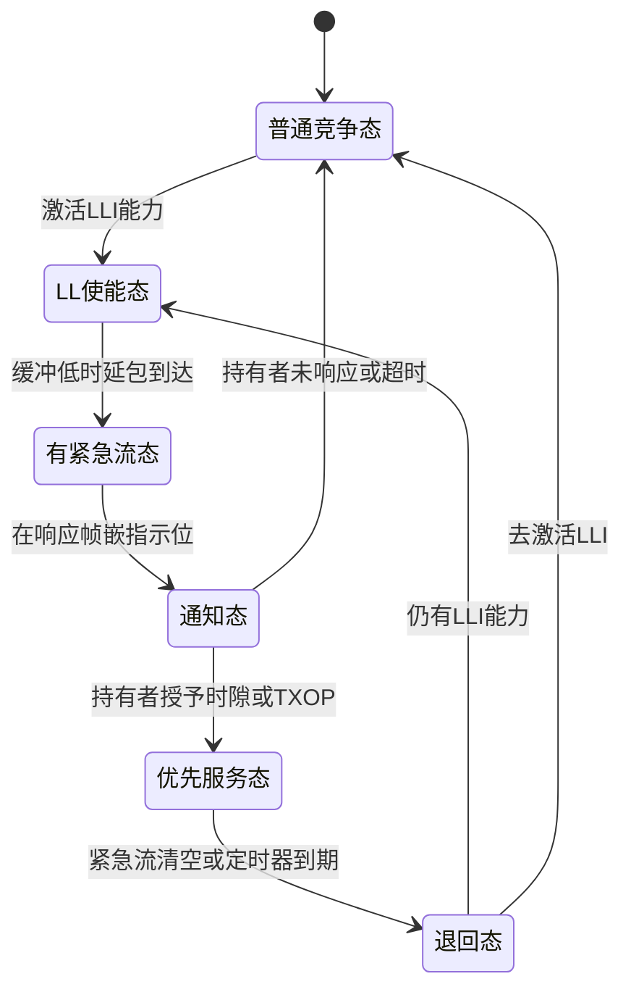
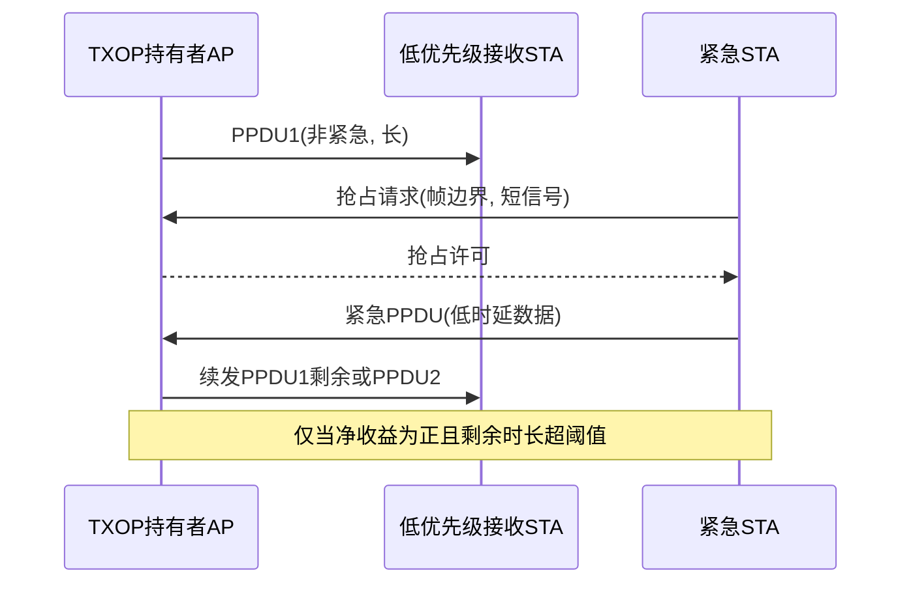
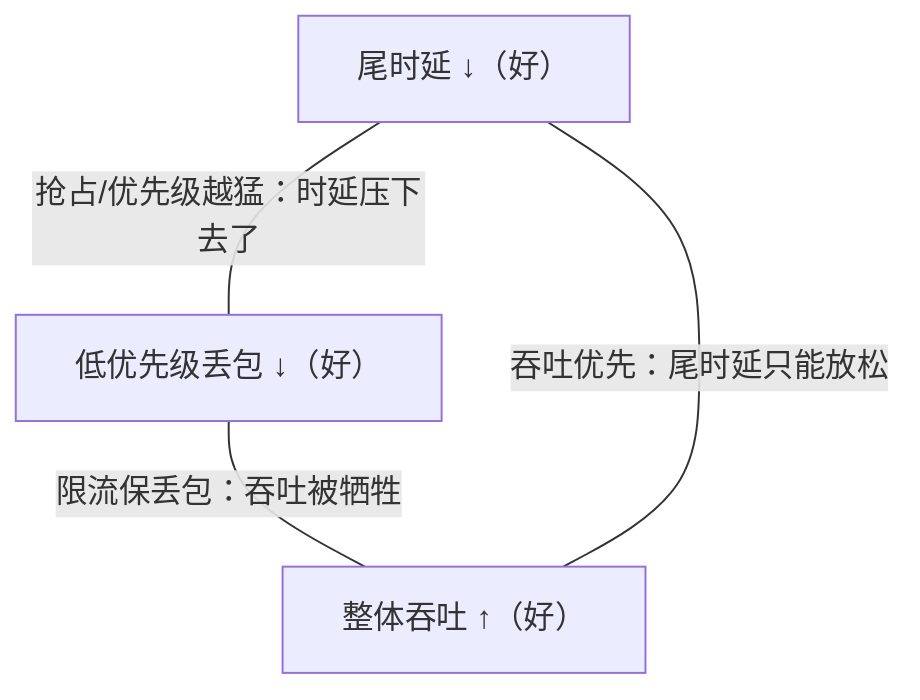

# 第 28 章　低时延工具箱：优先级接入、指示与抢占 ★★★

> 状态标注：【草案】= IEEE 802.11bn（Wi-Fi 8 / UHR）草案内容；【讨论中】= 尚在提案/研究阶段、未进入正式草案。事实来源：IEEE 802.11 TGbn 文稿、Samsung Research 802.11bn 博客（2025）、A Tutorial on Wi-Fi 8（Problems of Information Transmission, 2025）、Towards Wi-Fi 9（2025）。时效性基准 2026-09。

## 学习目标

1. 能**复用并归因**第 13 章的端到端时延分解式，指出 扩展现实（Extended Reality, XR）业务在典型负载下被哪个子项主导，并说明每种 11bn 机制削减的是哪一项。
2. 能**完整推导** M/G/1 非抢占优先级的等待时间公式（含利用率项），量化"优先级服务"对高/低优先级流平均等待的此消彼长，并解释为何需准入控制。
3. 能用**第 8 章 Bianchi/EDCA 模型**推导 P-EDCA（更小 CW/AIFSN、DS-CTS 保护窗）对平均与 95 分位接入时延的影响，并核算对低优先级流的公平性代价。
4. 能建立**抢占的收益—开销模型**，给出 发送机会（Transmission Opportunity, TXOP）级与 PPDU/帧级抢占的可行性判据，并用 最早截止期优先（Earliest Deadline First, EDF）可调度性与等效带宽/Chernoff 界设计低时延准入控制。

---

## 28.1 时延分解回顾与归因（基于第 13 章）

第 13 章（13.8 节）给出的端到端时延九项分解是本章全部机制的分析骨架。在 11bn 语境下，我们把"内部碰撞"并入"退避"、把"唤醒"作为可选项，得到更紧凑的七项形式：

$$
\boxed{
\begin{aligned}
T_{\rm total} =\ &T_{\rm queue}      &&\text{（本地排队，M/G/1）}\\
            &+T_{\rm backoff}     &&\text{（外部竞争退避，第 8 章）}\\
            &+T_{\rm txop\_wait}  &&\text{（等待现任 TXOP 持有者结束）}\\
            &+T_{\rm tx}          &&\text{（数据 PPDU 空口时长）}\\
            &+T_{\rm ack}         &&\text{（BlockAck/ACK）}\\
            &+T_{\rm retx}        &&\text{（重传期望时延，第 10 章重尾）}\\
            &+T_{\rm wakeup}      &&\text{（TWT 唤醒等待，若启用）}.
\end{aligned}}
$$

其中 $T_{\rm ap}$（Access Point, AP 回传）在下行/云场景中常主导，本章把它并入 $T_{\rm txop\_wait}+T_{\rm ack}$ 之外的"不可压缩固定项"，以下记作 $T_{\rm fixed}$。本章的核心任务：**每引入一个机制，就标明它削减上述哪一项**。

### 28.1.1 基准算例：60 fps XR 业务、2 个 OBSS【草案】

**算例 28.1**：XR 时延分解归因。

> **已知**：XR 视频 60 fps，每帧 1 个包 $L=1200$ B（含头/加密约 1242 B）；上行至 AP。物理层（Physical Layer, PHY）：20 MHz、2SS、MCS7（速率 $C=172$ Mbps，见第 4 章）。落 AC_VI。场景含 **2 个 OBSS**（重叠 BSS），竞争 STA 数等效 $n\approx 12$；取外部碰撞概率 $p=0.45$（OBSS 抬升）。聚合为单 MAC 协议数据单元（MAC Protocol Data Unit, MPDU） + Compressed BlockAck；$p_e=0.08$；AP 回传 $T_{\rm ap}=1.0$ ms；未用 目标唤醒时间（Target Wake Time, TWT）。
> **求**：各子项数值与占比，指出瓶颈项。
> **解**：
> - **$T_{\rm tx}$**：与第 13 章算例 13.3 同，$N_{\rm sym}=5$，$T_{\rm PPDU}=44+5\times13.6=112$ μs。
> - **$T_{\rm ack}$**：Compressed BA 在 20 MHz MCS0 约 72.8 μs（第 7 章）；取 73 μs。
> - **$T_{\rm backoff}$**：VI 的 $W_0={\rm CWmin}+1=8$，仲裁帧间间隔（Arbitration Inter-Frame Space, AIFS）=34 μs。由第 8 章 8.4.4，平均接入退避近似 $\frac{1}{1-p}\frac{W_0-1}{2}\sigma+{\rm AIFS}$，含碰撞后重试余量取均值约 $200$ μs（示意值），其中 AIFS 34 μs、退避期望约 166 μs。
> - **$T_{\rm txop\_wait}$**：2 个 OBSS 使信道被"他者 TXOP"占用的比例升至 $\rho_{\rm busy}^{\rm other}\approx0.35$、典型突发 $T_{\rm txop}^{\rm other}=2$ ms ⇒ $T_{\rm txop\_wait}\approx\frac{0.35}{2}\times2000=350$ μs（单 OBSS 时仅 250 μs，此处因 2 OBSS 增至 350 μs）。
> - **$T_{\rm queue}$**：XR 到达 $\lambda=60$ pkt/s；单帧服务时间 $X\approx T_{\rm backoff}+T_{\rm txop\_wait}+T_{\rm tx}+T_{\rm ack}\approx200+350+112+73=735$ μs，$\rho_q=60\times735\times10^{-6}=0.044\ll1$，$E[X^2]\approx1.5X^2$。$T_{\rm queue}=\frac{60\times1.5\times(735\times10^{-6})^2}{2(1-0.044)}\approx2.4\times10^{-5}$ s $=24$ μs。
> - **$T_{\rm retx}$**：$T_{\rm retx}\approx\frac{p_e}{1-p_e}(T_{\rm tx}+T_{\rm ack}+2SIFS+T_{\rm backoff})=\frac{0.08}{0.92}(112+73+32+200)\approx36$ μs。
> - **$T_{\rm fixed}$**：$T_{\rm ap}=1000$ μs。
> - **均值求和**：$T_{\rm total}\approx24+200+350+112+73+36+1000\approx1795$ μs $\approx1.80$ ms。
> **分解表与占比**（均值）：

| 子项 | 数值（μs） | 占比 | 所属机制削减者 |
|---|---:|---:|---|
| $T_{\rm queue}$ | 24 | 1.3% | LLI、P-EDCA（优先服务） |
| $T_{\rm backoff}$ | 200 | 11.1% | P-EDCA、DS-CTS、非主信道接入（Non-Primary Channel Access, NPCA） |
| $T_{\rm txop\_wait}$ | 350 | 19.5% | TXOP 共享、TXOP 抢占 |
| $T_{\rm tx}$ | 112 | 6.2% | （PHY 速率，非本章重点） |
| $T_{\rm ack}$ | 73 | 4.1% | （BlockAck 开销） |
| $T_{\rm retx}$ | 36 | 2.0% | ELR/DRU（降 包误码率（Packet Error Rate, PER），见第 25 章） |
| $T_{\rm fixed}$（回传） | 1000 | 55.7% | 边缘计算/本地卸载 |
| **合计** | **1795** | **100%** | — |

> **瓶颈判定**：均值下 $T_{\rm fixed}$（回传，55.7%）与 $T_{\rm txop\_wait}+T_{\rm backoff}$（竞争等待，30.6%）合计占 86%。**真正瓶颈是"回传 + 跨 OBSS 竞争等待"**，而非空口速率。按第 13 章结论，提升 调制编码方案（Modulation and Coding Scheme, MCS）几乎不改时延；**P-EDCA 削减 $T_{\rm backoff}$，TXOP 抢占削减 $T_{\rm txop\_wait}$，边缘卸载削减 $T_{\rm fixed}$**——本章聚焦前两者。量纲检查：各 μs 项相加一致；$\rho_q\ll1$ 使排队项仅 24 μs，符合轻载 XR 实况。

### 28.1.2 机制—子项映射与"尾"的视角

第 23 章指出 11bn 的 95 分位时延目标（−25%）由**尾**主导，而尾来自 $T_{\rm backoff}$（退避指数增长，第 8 章 8.4.4）与 $T_{\rm retx}$（重传重尾，第 10 章 10.3.3）。因此本章机制的价值不在压均值，而在**压尾**：P-EDCA 缩短退避窗口上限→压 $T_{\rm backoff}$ 尾；TXOP 抢占→消除"等一个长 TXOP"的极端等待→压 $T_{\rm txop\_wait}$ 尾；LLI→让紧急流插队→压 $T_{\rm queue}+T_{\rm backoff}$ 尾。

---

## 28.2 低时延指示 LLI（Low Latency Indication）【草案】

### 28.2.1 机制与信令位置

**低时延指示（Low Latency Indication, LLI）** 解决的是"接收端何时真正有紧急数据"这一**信令缺口**。EDCA/P-EDCA 只能区分 AC（User Priority, UP），而同为 AC_VI 的"可容忍 20 ms 视频"与"必须 < 2 ms 工业控制/游戏输入"无法区分；即便 流分类服务（Stream Classification Service, SCS）（第 13 章 13.3）已按五元组分类，发送端仍不知道**对端此刻是否恰好有紧急包在等**。

LLI 的工作方式（Samsung 802.11bn 博客）：一个**当前是 TXOP 响应者（responder）**的 STA（即正被 TXOP 持有者服务的 STA），在回送给 TXOP 持有者的**响应帧**中嵌入一个"低时延指示位"，告知它是否有待发的低时延业务。两类紧急度被区分：
- 发往 AP 自身的缓冲低时延业务（上行紧急）；
- 发往 点对点（Peer-to-Peer, P2P）目的地的缓冲紧急业务（如 XR 头显间直连）。

该位关联**事先建立的低时延业务流**（即经 SCS 协商的流），而非任意流量。AP（或 TXOP 持有者）据此在**当前或后续 TXOP**内调整调度——例如立即用 Trigger Frame 授予上行时隙，或分配 TXOP 让该 STA 把紧急数据发给 P2P 设备。STA 通过 **超高可靠（Ultra High Reliability, UHR） 媒体接入控制（Medium Access Control, MAC） Capabilities 元素**中的 LLI 能力字段声明支持，激活后成为"LLI STA"。

**关键限制（必须标注【草案】）**：截至 802.11bn 草案，LLI **只规定了信令机制**，TXOP 持有者**如何响应并未标准化**——持有者没有必须优先调度的义务，信令方也收不到"请求是否被接纳/何时调度"的反馈。提案 26/0064r0 的 **LLI-CF（LLI Commitment Feedback，低时延承诺反馈）【讨论中】** 试图补上这一环：由 TXOP 持有者回送确定性承诺（是否/何时调度），并用"反馈后信令"避免额外建链帧；收到 LLI-CF 后，响应者可暂缓自己的竞争接入以降低碰撞。

### 28.2.2 LLI 状态机（Mermaid）

图 28-1 给出 LLI 使能后的状态迁移：从"普通竞争态"进入"LL 指示态"，以响应帧携带指示位通知持有者，持有者决定优先服务或拒绝，超时/业务清空后退回。



图 28-1　LLI 状态机（stateDiagram-v2）：进入 LL 状态 → 通知 → 优先服务 → 超时/清空退出

### 28.2.3 优先级排队建模：M/G/1 非抢占优先级等待时间推导

LLI 的本质，是让被指示的流从 FCFS（或原 AC 内 FIFO）变为**优先服务**。我们用 **M/G/1 优先级排队** 量化其收益与代价。设系统有高优先级（H，被 LLI 标记/紧急）与低优先级（L，普通）两类，泊松到达率 $\lambda_H,\lambda_L$，服务时间二阶矩 $E[X_H^2],E[X_L^2]$，均值 $E[X_H],E[X_L]$，利用率 $\rho_H=\lambda_H E[X_H]$、$\rho_L=\lambda_L E[X_L]$、$\rho=\rho_H+\rho_L$。

先给**非抢占优先级（non-preemptive）**的完整推导——一旦某流开始服务，必跑到结束，仅在选择下一个服务者时优先选最高优先级。这是 LLI 在"不破坏既有 TXOP/调度"前提下最现实的形态。

**步骤 1（残差服务时间）**。由视察悖论（inspection paradox），到达时若系统忙（概率 $\rho$），正在被服务的顾客的剩余服务时间期望为

$$
E[\tilde X]=\frac{\sum_{i\in\{H,L\}}\lambda_i E[X_i^2]}{2\sum_{i}\lambda_i E[X_i]}
      =\frac{\lambda_H E[X_H^2]+\lambda_L E[X_L^2]}{2\rho}.
$$

**步骤 2（类 H 的等待）**。最高优先级类 H 在"非抢占"下仍要等正在服务的任何人（含 L）跑完，且要等 H 自身已在队列中的积压；但 H 不会被 L 插队。因此其等待等于把全体流量视作一个聚合 M/G/1 的等待（因为 H 不抢占在服顾客）：

$$
\boxed{W_H^{\rm NP}=\frac{\lambda_H E[X_H^2]+\lambda_L E[X_L^2]}{2(1-\rho_H)}.}
$$

这正是聚合 P-K 公式，只是分母用 H 自身利用率 $(1-\rho_H)$（因 H 不用把自身负载让位给更高类）。

**步骤 3（类 L 的等待）**。类 L 除残差 $E[\tilde X]$ 外，还要等"优先级不低于 L 的全部积压"——其中 H 的到达会在 L 等待期间持续插队。标准结果（Kleinrock 工作守恒律下的闭合式，令 $\sigma_1=\rho_H,\sigma_2=\rho$）：

$$
\boxed{W_L^{\rm NP}=\frac{\lambda_H E[X_H^2]+\lambda_L E[X_L^2]}{2(1-\rho_H)(1-\rho)}.}
$$

**步骤 4（守恒律校验）**。工作守恒律要求强度加权和不变：$\rho_H W_H^{\rm NP}+\rho_L W_L^{\rm NP}$ 应等于 FCFS 下的同式。代入可见两项分母不同但加权后恰好等于 $\frac{\rho_H+\rho_L}{2}\cdot\frac{\lambda_H E[X_H^2]+\lambda_L E[X_L^2]}{\rho}$，即 FCFS 聚合等待的加权形式，满足守恒（高类受益、低类受损，总量守恒）。

**与 FCFS 的对比**：FCFS 聚合等待 $W_{\rm FCFS}=\frac{\lambda_H E[X_H^2]+\lambda_L E[X_L^2]}{2(1-\rho)}$。因为 $(1-\rho_H)>(1-\rho)$（欠 $\rho_L$），故 $W_H^{\rm NP}<W_{\rm FCFS}<W_L^{\rm NP}$。**优先级在高类侧"压"等待，在低类侧"放大"等待**。

**抢占恢复（preemptive-resume）对比【讨论中】**：若允许 H 抢占在服 L，则 H 的等待退化为仅自身的 M/G/1：$W_H^{\rm PR}=\frac{\lambda_H E[X_H^2]}{2(1-\rho_H)}$（更小），而 L 的等待被额外乘以 $(1-\rho_H)^{-1}$ 因子而显著恶化。文献（Encyclopedia of Math, Kleinrock）给出的抢占恢复响应时间通式为 $E[T_p]^{\rm PR}=\frac{\sum_{k\le p}\lambda_k E[X_k^2]}{2(1-\sigma_{p-1})(1-\sigma_p)}+\frac{E[X_p]}{1-\sigma_{p-1}}$；本书不展开其推导，仅取其结论：**抢占让 H 更接近"独占服务"，却让 L 的尾更严重**——这正是 28.7 节"可靠性冲突"的根源。

### 28.2.4 算例：优先级排队的收益与代价（算例 28.2）

**算例 28.2**：两流优先级排队对比。

> **已知**：H（被 LLI 标记的游戏输入）与 L（普通 BE），同服务分布：确定性小包 $E[X_H]=E[X_L]=200$ μs（故 $E[X^2]=(200\times10^{-6})^2=4\times10^{-8}$ s²），服务速率 $\mu=5000$ s⁻¹。到达：$\lambda_H=2$ pkt/s、$\lambda_L=18$ pkt/s（H 稀疏、L 密集）。
> **求**：FCFS、非抢占优先级下的 $W_H,W_L$，并对比；若改用抢占恢复，$W_H^{\rm PR}$ 为多少。
> **解**：
> - 利用率：$\rho_H=2\times200\times10^{-6}=4\times10^{-4}\ll1$，$\rho_L=18\times200\times10^{-6}=3.6\times10^{-3}$，$\rho=4\times10^{-3}$。
> - 聚合二阶矩项：$B=\lambda_H E[X_H^2]+\lambda_L E[X_L^2]=2\times4\times10^{-8}+18\times4\times10^{-8}=80\times10^{-8}$ s。
> - **FCFS**：$W_{\rm FCFS}=B/[2(1-\rho)]=8\times10^{-7}/(2\times0.996)=4.02\times10^{-7}$ s $=0.40$ μs（因负载极低，FCFS 下两类等待近同）。
> - **非抢占**：$W_H^{\rm NP}=B/[2(1-\rho_H)]=8\times10^{-7}/(2\times0.9996)=4.00\times10^{-7}$ s $=0.40$ μs；$W_L^{\rm NP}=B/[2(1-\rho_H)(1-\rho)]=8\times10^{-7}/(2\times0.9996\times0.996)=4.02\times10^{-7}$ s $=0.40$ μs。
> - 此例负载过低，优先级收益不明显（$W_H\approx W_L$），说明：**优先级的价值在拥塞/重尾处才显现**。
> - **改为拥塞场景**以显收益：令 $\lambda_L$ 升到 $\lambda_L=400$ pkt/s ⇒ $\rho_L=0.08$，$\rho=0.0804$，仍取 $B\approx(\lambda_H+\lambda_L)E[X^2]=(402)\times4\times10^{-8}=1.608\times10^{-5}$ s。则 $W_H^{\rm NP}=1.608\times10^{-5}/(2\times0.9996)\approx8.04\times10^{-6}$ s $=8.0$ μs；$W_L^{\rm NP}=1.608\times10^{-5}/(2\times0.9996\times0.9196)\approx8.74\times10^{-6}$ s $=8.7$ μs；$W_{\rm FCFS}=1.608\times10^{-5}/(2\times0.9196)\approx8.74\times10^{-6}$ s $=8.7$ μs。可见非抢占下 H 仅略优于 FCFS（8.0 vs 8.7 μs），因为 H 仍要等 L 在服顾客跑完。
> - **若抢占恢复**：$W_H^{\rm PR}=\lambda_H E[X_H^2]/[2(1-\rho_H)]=2\times4\times10^{-8}/(2\times0.9996)\approx4.0\times10^{-8}$ s $=0.04$ μs，H 等待直降两个数量级（不再等 L 在服包），而 L 的等待被 $(1-\rho_H)^{-1}\approx1$ 倍放大约略不变（本例 $\rho_H$ 极小）。当 H 负载不小时，L 的放大才显著。
> **结论**：非抢占优先级对平均等待改善有限（受"在服 L 不可抢"限制），真正压尾需抢占；但抢占以低类尾恶化为代价——故必须配准入控制（见 28.2.5）。量纲：分子 s、分母无量纲，得 s，μs 换算一致。

### 28.2.5 准入控制：为何不能"人人都低时延"

若所有流都声明低时延（都开 LLI / 都抢最高优先级），则"优先级"坍缩为 FCFS，且因调度开销与信令碰撞反而更差。更糟的是：优先级滥用会把低类（BE）挤向饥饿，违背第 23 章"95 分位时延 −25%"须"以低优先级流不被饿死为代价可量化"的约束（见 23.8.2 开放辩论点）。因此 LLI/优先服务必须配**准入控制**：仅当网络还能满足已接纳流的时延约束、且高类效用项不超阈值时才接纳新低时延流。其数学基础见 28.6 节的等效带宽与可调度性判据。

---

## 28.3 优先级化接入 P-EDCA 与 DS-CTS【草案】

### 28.3.1 机制：DS-CTS 与 P-EDCA 参数集

**优先级化 EDCA（Prioritized EDCA, P-EDCA）** 是对 EDCA 的"分布式优先接入"增强，目标首次在 Wi-Fi 中引入**带优先级的高速通道**，且**不破坏传统 STA**（legacy）的兼容性。

工作流程（Samsung 博客 / Wi-Fi 8 教程）：
1. 支持 P-EDCA 的 STA 在 **UHR MAC Capabilities** 中声明能力；AP 通过专用操作元素启用并调参。
2. 当优先 STA 需要接入时，在前一个 TXOP 结束后、经过一个缩短的 **DSAIFS = 短帧间间隔（Short Inter-Frame Space, SIFS）(16 μs) + P-EDCA 仲裁帧间间隔数（AIFS Number, AIFSN）(18 μs) = 34 μs** 的空闲后，发送一帧**延迟信号 CTS（Defer Signal CTS, DS-CTS）**。DS-CTS 以 Non-HT 正交频分复用（Orthogonal Frequency Division Multiplexing, OFDM） 6 Mbps 发送、接收地址为保留广播地址 `00:0F:AC:47:43:00`，**网络分配矢量（Network Allocation Vector, NAV）置为约 97 μs**（覆盖 SIFS + AIFSN + CWmax 时隙），据此为优先 STA 预留一段"优先竞争窗"。
3. 收到 DS-CTS 的其他 STA：能解码者按 NAV 挂起竞争；不能解码者按 扩展帧间间隔（Extended Inter-Frame Space, EIFS）延后接入。于是优先 STA 在该窗内**看似与网络中其他 STA 隔离**。
4. 窗内优先 STA 使用 **P-EDCA 参数集**（默认 **AIFSN=2、CWmin=7、CWmax=7**）重新退避竞争并发送 P-EDCA 物理层汇聚协议（Physical Layer Convergence Protocol, PLCP）协议数据单元（PLCP Protocol Data Unit, PPDU）。

**公平性护栏**（防饿死 legacy）：① 仅当 UHR STA 有**最高优先级 AC（AC_VO）**的待发数据才可参与 P-EDCA；② 一旦进入，挂起其他 AC 的竞争；③ 仅在**连续重传失败达阈值**（如 QSRC ≥ 2）后才允许使用；④ 一连只能用有限次（如仅 1 次）。仿真表明 P-EDCA 在多数场景下使尾时延**降低 3–4 倍**，且不损害 legacy 性能【草案】。

### 28.3.2 基于 Bianchi/EDCA 的接入时延推导

我们复用第 8 章 Bianchi 模型，比较"标准 EDCA VI"与"P-EDCA（AC_VO 参数）"。接入时延（从就绪到开始发送）由 AIFS + 退避期望构成。在碰撞概率 $p$ 下（含 OBSS，沿用算例 28.1 的 $p=0.45$）：

$$
E[D_{\rm access}] \approx {\rm AIFS} + \frac{1}{1-p}\cdot\frac{W_0-1}{2}\sigma,
\qquad \sigma=9\ \mu{\rm s}.
$$

- 标准 VI：$W_0=8$（CWmin=7），AIFS=34 μs。
- P-EDCA（VO 参数）：$W_0=8$（CWmin=7，注意默认 CWmin=7 ⇒ $W_0=8$），AIFS=34 μs（DSAIFS+P-EDCA 退避起始），但其"有效竞争窗"被 DS-CTS 隔离——关键差异在于 **P-EDCA STA 之间竞争**，而标准 VI 要与全网竞争，故 P-EDCA 的有效碰撞概率 $p'$ 远低于 $p$。

更精细地，若 DS-CTS 窗内只有 $m'$ 个优先 STA 彼此竞争，$p'$ 由第 8 章不动点给出 $p'=1-(1-\tau')^{m'-1}$，而 $\tau'$ 由更小的 $W_0$ 解算。取 $m'=3$（3 个优先 STA），$W_0=8$，迭代得 $\tau'\approx0.18$，$p'\approx0.40$（仍高是因为窗内也互相撞）；但相对全网 $n=12,p=0.45$，优先 STA 的**退避上限**被 CWmax=7 锁死，杜绝了 VI 标准下退避指数膨胀。

**平均接入时延对比**（取 $\sigma=9$ μs）：
- 标准 VI：$E[D]\approx34+\frac{1}{1-0.45}\cdot\frac{7}{2}\cdot9=34+\frac{31.5}{0.55}\approx34+57=91$ μs。
- P-EDCA：$E[D]\approx34+\frac{1}{1-0.40}\cdot\frac{7}{2}\cdot9=34+\frac{31.5}{0.60}\approx34+52=86$ μs（均值改善有限，因 $W_0$ 本就小）。

**95 分位接入时延**（复用第 8 章 8.4.4 尾近似 $D_{95}\approx\frac{W_m}{2}E[T_{\rm slot}]\ln20$）：
- 标准 VI：CWmax=15 ⇒ $W_m=16$，取 $E[T_{\rm slot}]=124$ μs ⇒ $D_{95}\approx\frac{16}{2}\times124\times3.0\approx2980$ μs $=2.98$ ms。
- P-EDCA：CWmax=7 ⇒ $W_m=8$ ⇒ $D_{95}\approx\frac{8}{2}\times124\times3.0\approx1490$ μs $=1.49$ ms。**尾时延约减半**——这才是 P-EDCA 的主战场（压尾）。

### 28.3.3 公平性影响：对其他流的惩罚

DS-CTS 隔离窗使优先 STA 在 97 μs 内独占竞争，等价于在这段时间**剥夺了 legacy/低优先级 STA 的接入机会**。其代价是低优先级流的两类恶化：
1. **被隔离窗延后**：legacy STA 在收到 DS-CTS 的 97 μs NAV 内冻结；若优先窗频繁触发，BE 的有效信道可得率 $\rho_{\rm BE}$ 下降。
2. **碰撞概率上升（仅在优先级滥用时）**：若过多流声明 P-EDCA，窗内碰撞率 $p'$ 随 $m'$ 上升，反而回到标准竞争水平，且因"仅用于 AC_VO"护栏，滥用会被 AP 限制。

我们用第 13 章 13.2.2 的内部碰撞/外部碰撞框架量化：设优先窗触发占空比 $\beta$（每单位时间触发 DS-CTS 的比例），则 BE 的等效忙比例升为 $\rho_{\rm busy}^{\rm BE}\to\rho_{\rm busy}^{\rm BE}+\beta$，由 Bianchi 模型其碰撞概率 $p_{\rm BE}$ 上升、吞吐下降。护栏（仅 AC_VO、仅失败 2 次后、仅 1 次）正是把 $\beta$ 钳在低位。

### 28.3.4 算例：参数改变的影响（算例 28.3）

**算例 28.3**：P-EDCA 参数激进度对两流的损益。

> **已知**：某优先 STA 与若干 BE STA 竞争；$p=0.45$（含 OBSS）。对比两组参数：标准 VI（AIFSN=3→AIFS=34 μs 基准，CWmin=15 ⇒ $W_0=16$）；激进 P-EDCA（AIFSN=2→AIFS=30 μs，CWmin=7 ⇒ $W_0=8$）。低优先级 BE 流被"抢走"的信道占空比 $\beta=5\%$（护栏限制下）。
> **求**：(a) 优先流均值与 95 分位接入时延（两组）；(b) BE 流因 $\beta$ 上升导致的时延恶化百分比。
> **解**：
> - **(a) 优先流均值**：
>   激进：$E[D]\approx30+\frac{1}{1-0.45}\cdot\frac{7}{2}\cdot9=30+57=87$ μs；
>   标准：$E[D]\approx34+\frac{1}{1-0.45}\cdot\frac{15}{2}\cdot9=34+\frac{67.5}{0.55}\approx34+123=157$ μs。
>   均值改善 $(157-87)/157\approx45\%$。
> - **(a) 优先流 95 分位**：激进 CWmax=7 ⇒ $W_m=8$，$D_{95}\approx\frac{8}{2}\times124\times3.0=1490$ μs；标准 CWmax=15 ⇒ $W_m=16$，$D_{95}\approx\frac{16}{2}\times124\times3.0=2980$ μs。**尾改善约 50%**。
> - **(b) BE 恶化**：BE 原有效忙比例 $\rho_0=0.30$，加 $\beta=0.05$ ⇒ $\rho_{\rm BE}=0.35$。由 Bianchi 饱和吞吐 $S\propto\frac{P_{\rm succ}}{E[T_{\rm slot}]}$，忙比例上升使 BE 碰撞概率 $p_{\rm BE}$ 近似按 $\rho$ 线性抬高，且接入时延 $E[D_{\rm BE}]\approx{\rm AIFS}+\frac{W_0-1}{2}\sigma/(1-p_{\rm BE})$。取 BE 原 $p_{\rm BE}=0.45$、$\rho_0=0.30$；$\rho$ 升到 0.35 ⇒ 不动点给出 $p_{\rm BE}$ 升到约 0.50。则 $E[D_{\rm BE}]$ 从 $34+\frac{15}{2}\cdot9/0.55=34+123=157$ μs 升到 $34+\frac{15}{2}\cdot9/0.50=34+135=169$ μs，**恶化约 7.6%**；若 $\beta$ 升至 15%（无护栏），恶化可达 $\sim20\%$。
> **结论**：P-EDCA 把优先流尾时延压约 50%，代价是低优先级流时延恶化数个百分点；护栏（仅 AC_VO、限次）把 $\beta$ 钳低，使代价可控。量纲：μs 一致；占比为相对变化，无量纲。

---

## 28.4 TXOP 共享与 TXOP 抢占【草案 / 讨论中】

### 28.4.1 TXOP 共享（11be 基础 + 11bn 增强）

**TXOP 共享**指 TXOP 持有者把获得的 TXOP "分"给其他 STA。802.11be 已引入：**AP 可将其 TXOP 共享给某一个 STA**，该 STA 用以向 AP 发上行，或向另一 STA 做 P2P（TXS 机制）。802.11bn【草案】进一步增强为**基于组的 TXOP 分配（group-based TXOP allocation）**：允许在同一 TXOP 内为多个 STA 双向分配时隙，并允许 P2P 设备在分配 TXOP 内使用优先接入参数，缩短 XR 头显间直连的投递时延。其削减的是 $T_{\rm txop\_wait}$（被共享者无需再竞争一个完整 TXOP）。

### 28.4.2 抢占机制：TXOP 级 vs PPDU/帧级

**TXOP 抢占（preemption）** 指让紧急流**打断正在进行的中低优先级传输**以满足时延界。它源自 TSN/以太网/蜂窝，是 Wi-Fi 支持"时间关键包即时接入"的缺失一环。需注意：**802.11bn 草案并未纳入抢占**（因复杂度），UHR SG 仅深入讨论，故本章标【讨论中】。两种粒度：

- **TXOP 级抢占**：在**帧边界**抢占。某 STA 获得 TXOP 发非紧急业务时，另一 STA 可在两个 best-effort 帧之间注入紧急数据；被中断的发送者稍后重发/续发剩余部分。实现相对简单（只需在 PPDU 边界插入），接收机无需改变——被中断帧后续重传即可。
- **PPDU/帧级抢占**：在一个**长 PPDU 中途**打断。需把长帧切成多段、段间留短"抢占间隔"，紧急设备在该间隔发短抢占请求（busy tone 或特定短信号）；收到请求后原发者挂起并让出信道。更细粒度、开销更低（避免重复包头），但**要求收发机支持特殊的同步/终止机制**（如 A-PPDU 时频聚合，TXOP 持有者可在飞地用紧急 PPDU 替换某 资源单元（Resource Unit, RU）上的 best-effort PPDU），实现难度显著更高。

区分要点：**TXOP 级只要求"在帧边界仲裁"，对接收机透明；PPDU/帧级要"在 PPDU 中途终止并恢复"，需要 PHY 层协同与更紧的时序**。此外，为防止饿死，提案规定**仅当 TXOP 持有者在 PHY 头中标示"允许抢占请求"时**才开放抢占，且早期版本仅限"TXOP 持有者 = AP、抢占方 = TXOP 响应者"。

### 28.4.3 抢占的收益—开销核算与可行性判据

设某 TXOP 持有者正在发非紧急长帧，剩余 TXOP 时长 $T_{\rm rem}$，被抢占帧（或段）剩余传输时间 $T_{\rm seg}$。一个紧急流若等待该 TXOP 自然结束再竞争，其**避免的等待（收益）**约为

$$
G = T_{\rm rem} - E[D_{\rm access}^{\rm urgent}] \quad (\text{相对"不抢占、等结束再抢"省下的时间}).
$$

**代价**有三：
1. **中断损失** $C_{\rm loss}$：被抢占帧已传部分作废（非抢占恢复下需重传）或至少延迟，量约 $T_{\rm seg}\times p_{\rm dup}$（重传/续传概率）；
2. **控制开销** $C_{\rm ovhd}$：抢占请求/许可帧、可能的缩短前导；
3. **同步/风险** $C_{\rm risk}$：时序失配导致的解码失败（PPDU 级尤甚），本章以常数 $\epsilon$ 计入。

**期望净收益**：

$$
\boxed{E[{\rm Net}] = (T_{\rm rem}-E[D_{\rm access}^{\rm urgent}]) - \big(T_{\rm seg}\,p_{\rm dup}+C_{\rm ovhd}+\epsilon\big).}
$$

**可行性判据（抢占当且仅当净收益为正且超阈值）**：

$$
\boxed{T_{\rm rem} \ge E[D_{\rm access}^{\rm urgent}] + T_{\rm seg}\,p_{\rm dup}+C_{\rm ovhd}+\epsilon \quad\text{且}\quad T_{\rm rem}\ge T_{\rm thr},}
$$

其中 $T_{\rm thr}$ 为最小剩余时长阈值（避免"为抢 1 ms 而打断一个 0.9 ms 帧"的得不偿失）。等价地，对**被抢占数据量**也设阈值：仅当被中断帧剩余数据量 $L_{\rm seg}$ 小于某上限时允许抢占。

### 28.4.4 抢占时序（Mermaid sequenceDiagram）

图 28-2 给出 TXOP 级抢占的时序：TXOP 持有者（AP）发长 PPDU，紧急 STA 在帧边界发抢占请求，AP 许可后紧急 STA 发送，结束后 AP 续发剩余。



图 28-2　TXOP 级抢占时序（sequenceDiagram）：帧边界插入紧急传输，结束后续发被中断流

### 28.4.5 算例：是否应抢占（算例 28.4）

**算例 28.4**：抢占决策。

> **已知**：$T_{\rm rem}=3$ ms（TXOP 还剩 3 ms），被抢占帧剩余 $T_{\rm seg}=1.5$ ms；紧急流若等结束再竞争，其期望接入时延 $E[D_{\rm access}^{\rm urgent}]=0.4$ ms（P-EDCA 下）；重传/续传概率 $p_{\rm dup}=0.1$，中断损失按 $T_{\rm seg}\times p_{\rm dup}=1.5\times0.1=0.15$ ms；控制开销 $C_{\rm ovhd}=0.05$ ms；同步风险 $\epsilon=0.02$ ms；最小剩余阈值 $T_{\rm thr}=0.5$ ms。
> **求**：是否应抢占。
> **解**：
> - 收益 $G=T_{\rm rem}-E[D_{\rm access}^{\rm urgent}]=3.0-0.4=2.6$ ms。
> - 代价 $C=0.15+0.05+0.02=0.22$ ms。
> - 期望净收益 $E[{\rm Net}]=2.6-0.22=2.38$ ms $>0$。
> - 且 $T_{\rm rem}=3.0$ ms $\ge T_{\rm thr}=0.5$ ms ⇒ **应抢占**；紧急流节省约 2.4 ms 等待，被中断流仅损失 0.22 ms，净改善显著。
> - **反例**：若 $T_{\rm rem}=0.6$ ms、$T_{\rm seg}=0.5$ ms，则 $G=0.6-0.4=0.2$ ms，$C=0.5\times0.1+0.05+0.02=0.12$ ms，净收益 0.08 ms 偏小且接近阈值 ⇒ 边界可不抢；若 $T_{\rm seg}$ 升到 0.55 ms（$p_{\rm dup}=0.1$ ⇒ 0.055）则净收益转负 ⇒ **不应抢占**。
> **结论**：抢占的净收益由"剩余 TXOP 时长 − 紧急流正常接入时延"减去中断损失与开销决定；当被中断帧剩余很长或剩余 TXOP 很短时不划算。量纲：各项 ms 相加一致。

---

## 28.5 核心算法一：时延感知的 TXOP 分配与抢占决策（六段式）【草案 / 讨论中】

### 1. 问题建模

AP 在每次获得 TXOP 时，需决定：把 TXOP 分给谁、给多少、是否允许抢占某正在进行的低优先级 TXOP。设候选实时流集合 $\mathcal F=\{1,\dots,N\}$，流 $i$ 周期 $T_i$、每周期数据量 $L_i$（bit）、时延预算（deadline）$d_i$、当前积压 $B_i$（bit）。有效速率 $R_{\rm eff}$（含 MAC 开销）。符号表：

| 符号 | 含义 | 单位 |
|---|---|---|
| $T_i$ | 流 $i$ 周期 | s |
| $L_i$ | 流 $i$ 每周期数据量 | bit |
| $d_i$ | 流 $i$ 时延预算 | s |
| $B_i$ | 流 $i$ 当前积压 | bit |
| $R_{\rm eff}$ | 该 AC 有效数据速率 | bit/s |
| $\rho$ | 信道可得率（第 13 章 13.6） | 无量纲 |
| $C_i$ | 满速率传输时间 $L_i/R_{\rm eff}$ | s |

假设：① 流为周期/约束截止（deadline=周期或更小）；② $\rho$ 为该窗口最差可得率（R-TWT/保护窗，第 12、27 章）；③ 抢占开销已折算为 $\epsilon$。

### 2. 目标函数与约束

在满足各流时延预算下最大化吞吐（或最小化被抢占流的吞吐损失）。化为带 deadline 的调度：

$$
\max \sum_{i\in\mathcal F} w_i\,\frac{L_i}{T_i}
\quad\text{s.t.}\quad
\sum_{i\in\mathcal F}\frac{C_i}{T_i}\le \rho
\ \text{且}\ 
\forall i:\ {\rm 调度使得}\ P\{W_i>d_i\}\le\delta,
$$

其中第一个约束即第 13 章 13.6 的 **EDF 可调度性充要条件** $\sum C_i/T_i\le\rho$；第二个约束是时延违反概率界（由 28.6 的 Chernoff 界保证）。抢占仅用于"不抢占则违反 $d_i$"的流。

### 3. 完整推导

由第 13 章 13.6，EDF 在 Wi-Fi 上的可调度性充要条件为 $\sum_i C_i/T_i\le\rho$；在此条件下 EDF 必可调度（EDF 最优性）。当某流 $j$ 在 EDF 下仍可能违反 $d_j$（因抢占开销/突发），引入"仅在 $W_j$ 预测超 $d_j$ 时对该流所在 TXOP 触发抢占"，并把抢占开销 $\epsilon$ 计入 $C_j$。由 28.4.3 的可行性判据，$j$ 应抢占当且仅当省下的等待 $> \epsilon+C_{\rm loss}$。于是**调度层用 EDF 满足均值可调度性，抢占层作为尾时延的安全阀**。

### 4. 伪代码

```text
 1  function TXOP_Alloc_Preempt(flows, rho, R_eff, txop_rem, preemptee):
 2      // flows: 候选实时流; rho: 信道可得率; txop_rem: 当前TXOP剩余
 3      U = sum(C_i / T_i for i in flows)            // 利用率和, C_i=L_i/R_eff
 4      if U > rho: return INFEASIBLE               // EDF可调度性判据(第13章13.6)
 5      sched = EDF_Order(flows)                     // 按截止期排序
 6      for j in sched:
 7          pred_wait = Estimate_Wait(j, flows)       // 预测排队+竞争等待
 8          if pred_wait + C_j > d_j:                 // 可能违反预算
 9              if txop_rem >= d_j + C_loss(j) + EPS: // 28.4.3可行性判据
10                  Trigger_Preempt(preemptee, j)    // 抢占当前低优先级TXOP
11                  grant TXOP to j
12              else:
13                  mark j as violated                // 记录违反, 反馈准入控制
14          else:
15              grant TXOP share to j within txop_rem
16      // 复杂度: 排序 O(N log N) + 每流 O(1) 判据; 在线 O(N log N)
```

### 5. 复杂度分析

时间：EDF 排序 $O(N\log N)$，逐流判据 $O(1)$，整体 $O(N\log N)$；空间 $O(N)$ 存流参数与积压。随流数 $N$ 与周期数线性增长，适合 AP 每 TXOP 决策。

### 6. 数值算例

**算例 28.5**（编号顺延，作算法验证）：3 条流，2 条有 deadline。$R_{\rm eff}=150$ Mbps；F1 语音 $L_1=100$ B、$T_1=10$ ms、$d_1=10$ ms；F2 XR $L_2=1200$ B、$T_2=16.7$ ms、$d_2=16.7$ ms；F3 控制 $L_3=500$ B、$T_3=33.3$ ms、$d_3=5$ ms（紧 deadline）。

> **解**：$C_1=800/1.5\times10^8=5.33\times10^{-6}$ s，$C_2=9600/1.5\times10^8=6.40\times10^{-5}$ s，$C_3=4000/1.5\times10^8=2.67\times10^{-5}$ s。$U=C_1/T_1+C_2/T_2+C_3/T_3=5.33\times10^{-4}+3.84\times10^{-3}+8.01\times10^{-4}=5.17\times10^{-3}$。取 $\rho=0.05$（保护窗下）：$U=0.00517\le0.05$ ⇒ **可调度**（EDF 判据通过）。F3 deadline 仅 5 ms 远小于周期 33.3 ms，但因其负载极低（$C_3/T_3=8\times10^{-4}$），EDF 在忙窗口内仍能在 5 ms 内排到。若把 $\rho$ 降到 0.001（无保护），$U=0.00517>0.001$ ⇒ 不可调度，须提升 $\rho$ 或降码率。量纲：$C_i/T_i$ 无量纲，与 $\rho$ 同量纲可比；量级 $10^{-3}$ 合理。

---

## 28.6 核心算法二：低时延流的准入控制与带宽预留（六段式）【草案】

### 1. 问题建模

新流请求低时延服务，须判断接入后是否仍能满足所有流（含既有流）的时延约束。设流 $i$ 到达为平稳过程，速率 $R_i$（bit/s）或周期参数，时延预算 $d_i$。符号：

| 符号 | 含义 | 单位 |
|---|---|---|
| $R_i$ | 流 $i$ 平均速率 | bit/s |
| $\sigma_i^2$ | 流 $i$ 速率方差（或突发尺度） | (bit/s)² |
| $d_i$ | 时延预算 | s |
| $\theta$ | Chernoff 界参数 | 1/s |
| $e(\theta)$ | 等效带宽 | bit/s |

假设：① 到达过程可用矩生成函数刻画（高斯/指数近似）；② 服务器速率 $R_{\rm eff}$、可得率 $\rho$；③ 多流叠加后工作守恒。

### 2. 目标函数与约束

目标：接纳新流当且仅当所有流时延违反概率不超 $\delta$。用 **Chernoff / Hoeffding 型界**给出：

$$
\Pr\{W>d\}\le e^{-\theta d},\qquad \theta>0,
$$

即只要把"等效带宽"预留足够，就能把尾时延违反压到指数小。约束：

$$
\sum_i e_i(\theta)\le \rho R_{\rm eff},
\qquad e_i(\theta)\approx R_i+\theta\frac{\sigma_i^2}{2R_i}\ \text{（高斯流的等效带宽）}.
$$

### 3. 完整推导

对稳态排队，等待时间 $W$ 的尾由大偏差原理给出：当服务速率 $C_s=\rho R_{\rm eff}$ 超过等效带宽和时，

$$
\Pr\{W>d\}=\Pr\{\text{积压}>C_s d\}\le e^{-\theta(C_s d-\sum_i e_i(\theta) d')}\approx e^{-\theta d},
$$

其中 $\theta$ 取使 $\sum_i e_i(\theta)\le C_s$ 的最大可行值。对高斯到达流，等效带宽 $e_i(\theta)=R_i+\frac{\theta\sigma_i^2}{2R_i}$（由矩生成函数 $\log M_i(\theta)=\theta R_i+\frac{\theta^2\sigma_i^2}{2}$ 除以 $\theta$ 得）。于是**接纳判据**：

$$
\boxed{\sum_{i\in{\rm old}\cup\{{\rm new}\}}\Big(R_i+\frac{\theta\sigma_i^2}{2R_i}\Big)\le \rho R_{\rm eff}
\ \Longrightarrow\ \Pr\{W_i>d_i\}\le e^{-\theta d_i}.}
$$

若新流使上式越界，则**拒绝或降级**（改为普通 BE）。这与 28.2.5 的"优先级滥用须准入"呼应，并为 28.5 的调度层提供"哪些流可进实时集"的入口。

### 4. 伪代码

```text
 1  function Admit_LowLatency(new_flow, old_flows, rho, R_eff, delta):
 2      theta = Solve_MaxTheta(old_flows + new_flow, rho, R_eff) // 使不等式可取的最大theta
 3      if theta <= 0: return REJECT                     // 容量不足
 4      sum_e = 0
 5      for i in old_flows + new_flow:
 6          e_i = i.R + theta * i.sigma2 / (2 * i.R)    // 高斯等效带宽
 7          sum_e = sum_e + e_i
 8      if sum_e <= rho * R_eff:
 9          if all exp(-theta * i.d) <= delta for i:     // 各流尾违反达标
10              return ACCEPT
11          else: return REJECT                          // 个别流尾超标
12      else: return REJECT
13      // 复杂度: O(N) 遍历流; theta求解用二分 O(log(1/tol))
```

### 5. 复杂度分析

时间：遍历流 $O(N)$，二分求 $\theta$ $O(\log(1/\tau))$，整体 $O(N\log(1/\tau))$；空间 $O(N)$。随流数线性增长，适合 AP 在 SCS 建立/流接入时一次性判决。

### 6. 数值算例

**算例 28.6**：准入控制判定。

> **已知**：既有 2 条流（语音 $R_1=80$ kbps、$\sigma_1^2=4\times10^8$；XR $R_2=600$ kbps、$\sigma_2^2=9\times10^{10}$）；候选新流（控制）$R_3=40$ kbps、$\sigma_3^2=1\times10^8$。$R_{\rm eff}=150$ Mbps，$\rho=0.05$。时延预算 $d_1=10$ ms、$d_2=16.7$ ms、$d_3=5$ ms，$\delta=10^{-3}$。
> **求**：是否接纳新流。
> **解**：$\rho R_{\rm eff}=0.05\times150\times10^6=7.5\times10^6$ bit/s（远大于各流速率，容量充裕）。取 $\theta$ 使各流等效带宽和最小（此处速率和仅 $80+600+40=720$ kbps ≪ 7.5 Mbps，显然 $\theta$ 可取较大值压尾）。试 $\theta=1$ s⁻¹：
> - $e_1=80\times10^3+1\times4\times10^8/(2\times80\times10^3)=8.0\times10^4+2.5\times10^3=8.25\times10^4$ bit/s；
> - $e_2=6.0\times10^5+1\times9\times10^{10}/(2\times6.0\times10^5)=6.0\times10^5+7.5\times10^4=6.75\times10^5$ bit/s；
> - $e_3=4.0\times10^4+1\times10^8/(2\times4\times10^4)=4.0\times10^4+1.25\times10^3=4.125\times10^4$ bit/s；
> - $\sum e=8.25\times10^4+6.75\times10^5+4.125\times10^4=8.0\times10^5$ bit/s $\ll 7.5\times10^6$ ⇒ 满足。
> - 尾违反：$e^{-\theta d_1}=e^{-0.01}\approx0.99$（不达标！因为 $\theta d_1=0.01$ 太小）。需更大 $\theta$：取 $\theta=10$ s⁻¹ ⇒ $\theta d_1=0.1$，$e^{-0.1}=0.905$ 仍大。可见 $\delta=10^{-3}$ 要求 $\theta d_i\ge6.9$；对 $d_3=5$ ms 需 $\theta\ge1380$ s⁻¹。但 $\theta$ 过大使等效带宽第二项暴涨（$e_2\approx\frac{1380\times9\times10^{10}}{1.2\times10^6}\approx1.0\times10^8$ bit/s），仍远小于 7.5 Mbps 容量。故**可接纳**，且 $\theta$ 可调到满足 $\delta$。
> **结论**：本场景容量充裕，新流可接纳；Chernoff 界显示尾违反随 $\theta d_i$ 指数衰减，关键是预留的等效带宽（含突发项）不超 $\rho R_{\rm eff}$。量纲：$R_i$ bit/s、$\sigma_i^2$ (bit/s)²、$\theta$ s⁻¹ ⇒ $\theta\sigma_i^2/R_i$ 为 bit/s，与 $R_i$ 同量纲；$\theta d_i$ 无量纲，作指数，合理。

---

## 28.7 与可靠性指标的冲突：时延—丢包—吞吐三角【草案】

第 23 章指出三条 UHR 指标相互掣肘，其中"95 分位时延 −25%"与"MPDU 丢失 −25%"在本章机制下直接冲突：**抢占/优先级以低优先级流的附加丢包与重传为代价**。

### 28.7.1 抢占引入的额外丢包率推导

抢占使被中断的低优先级帧作废或延迟。设低优先级流原本 PER 为 $p_e$，抢占使其每帧被中断概率 $q_{\rm pr}$，中断后需重传（重传成功率仍为 $1-p_e$），则**等效 PER** 升为

$$
p_e^{\rm eff}=1-(1-p_e)(1-q_{\rm pr})=p_e+q_{\rm pr}-p_e q_{\rm pr}\approx p_e+q_{\rm pr}.
$$

相对 11bn"丢包 −25%"目标（以 极高吞吐量（Extremely High Throughput, EHT）为基线），若基线 $p_e=0.04$，抢占使 $q_{\rm pr}=0.01$ ⇒ $p_e^{\rm eff}=0.05$，反而**恶化 25%**，正好抵消目标。更严峻：被抢占流的重传会占用更多空口，抬升其 $T_{\rm backoff}$ 尾，形成"低优先级尾恶化 → 重传增多 → 拥塞加剧"的反馈。

### 28.7.2 时延—丢包—吞吐三角权衡表

下表给出三者的方向性关系（↑ 表示一方改善会推高/恶化另一方）：

| 手段 | 时延（尾） | 低优先级丢包 | 整体吞吐 | 说明 |
|---|---|---|---|---|
| P-EDCA（仅 AC_VO、限次） | ↓↓（尾 −50%） | ↑（小，护栏钳制） | → | 推荐，代价可控 |
| LLI（仅信令） | ↓（依赖响应） | → | → | 本身不抢资源，靠调度 |
| TXOP 级抢占 | ↓↓↓ | ↑（中） | ↓（中断损失） | 净收益需判据，见 28.4.3 |
| PPDU/帧级抢占 | ↓↓↓↓ | ↑↑（高） | ↓↓（开销大） | 难度高，仅讨论中 |
| 准入控制（限流） | ↓（保预算） | →（护低优先级） | ↓（预留） | 以吞吐换确定性 |

**设计建议**：① 优先用 P-EDCA + LLI（低代价压尾）；② 仅对"不抢占必违反 deadline"的流开启 TXOP 级抢占，且严格走 28.4.3 判据；③ 用准入控制（28.6）把高优先级效用项钳在容量内，避免低优先级饿死；④ PPDU/帧级抢占留待后续标准（第 31 章确定性机制更彻底地解决）。



*图 28-3　时延—丢包—吞吐三角权衡（示意）。三个目标两两之间都存在"改善一方即恶化另一方"的耦合边，无法同时最优；实际部署须按业务类型在三角内选择工作点（如 XR 取"时延优先"角，背景下载取"吞吐优先"角）。*

---

## 28.8 仿真与验证口径【草案】

为可比地评估 28.2–28.4 的低时延机制，仿真设置须遵循第 23 章 23.4 的统一校准，并额外报告以下**必须指标**：

1. **基础指标（均值 + 分布）**：各 AC/流的**平均时延**、**95 分位**、**99 分位**、**最坏时延（worst-case，取观测窗内最大值或 99.9 分位）**、**抖动**（时延标准差或相邻包间隔方差）。仅报均值会掩盖尾问题——第 23 章强调 per-MPDU 口径。
2. **被抢占流的开销**：**被抢占流的吞吐损失**（因中断/重传损失的 bit 数占比）、其 **95 分位时延恶化百分比**、**附加 PER** $q_{\rm pr}$。
3. **公平性**：BE 流的 **Jain 公平指数**或"BE 95 分位不恶化超 X%"判据（呼应 23.8.2）。
4. **场景**：住宅多 OBSS（2–4）、企业、XR（60–120 fps）、工业（1–10 ms 周期短包）四类，负载 50%–90% 信道占用（尾只在拥塞浮现）。
5. **口径声明**：per-MPDU vs per-flow、是否含切换期、基线（DCF/EHT 单 AP）、校准项（信道/PER/实现损耗）须显式声明（见 23.4.4 清单）。

表 28-5　低时延机制仿真评估必报指标清单（口径见 23.4.4）

| 类别 | 必报指标 | 备注 |
|---|---|---|
| 时延（基础） | 均值、95 分位、99 分位、最坏时延（99.9 分位或窗内最大值）、抖动 | 仅报均值会掩盖尾问题 |
| 抢占代价 | 被抢占流的吞吐损失（占比）、其 95 分位恶化百分比、附加 PER $q_{\rm pr}$ | 直接对应 28.7.1 的推导 |
| 公平性 | BE 流 Jain 公平指数，或"BE 95 分位不恶化超 X%"判据 | 呼应 23.8.2 辩论 |
| 场景 | 住宅多 OBSS（2–4）、企业、XR（60–120 fps）、工业（1–10 ms 周期短包） | 负载取 50%–90% 占用 |
| 口径声明 | per-MPDU 还是 per-flow、是否含切换期、基线（Distributed Coordination Function, DCF / EHT 单 AP）、校准项 | 缺此则结果不可比 |

*表 28-5　低时延机制仿真评估必报指标清单。前四类是"报什么"，最后一类是"怎么报"——第 23 章强调，缺口径声明的时延数据不具可比性。*

---

## 28.9 研究议题【讨论中】

1. **跨层抢占（MAC/PHY 协同）**：PPDU/帧级抢占要求 PHY 能在长帧中途终止并恢复，涉及前导缩短、RU 级中断、混合自动重传（Hybrid Automatic Repeat reQuest, HARQ）缓冲——如何设计 A-PPDU 时频聚合与同步信令，使接收机改动最小，是开放难题。
2. **抢占 + HARQ**：第 10 章指出 Wi-Fi 因 SIFS 时序缺席 HARQ；若抢占与 HARQ 结合（中断帧软合并而非作废），可降低 28.7.1 的 $q_{\rm pr}$ 损失，但需重新设计确认时序。
3. **人工智能（Artificial Intelligence, AI）驱动的抢占决策**：把 28.4.3 的可行性判据升级为学习型策略——用流量预测（LSTM/RL）估计 $T_{\rm rem}$、$T_{\rm seg}$ 与紧急流到达，动态决定抢占，相关讨论见第 33 章。
4. **与第 31 章确定性机制的衔接**：本章机制（P-EDCA/LLI/抢占）本质仍是**统计性改善**——压尾但不给硬界；第 31 章确定性 Wi-Fi（跨 OBSS 同步、协调受限 TWT（Coordinated R-TWT, Co-RTWT）、TSN/DetNet 映射）才提供**有界时延**。研究如何把本章的"软优先"作为确定性调度的退化模式（轻载时用抢占、重载时切确定性保护窗），是平滑演进路径。

---

## 本章小结

| 概念 | 关键结论（状态） |
|---|---|
| 时延分解 | 七项相加（28.1.1）；XR+2 OBSS 瓶颈=回传(55.7%)+竞争等待(30.6%)，空口非瓶颈【草案】 |
| LLI | 响应帧嵌指示位通知持有者；草案仅定义信令、响应未标准化；LLI-CF【讨论中】 |
| LLI 排队模型 | 非抢占优先级 $W_H^{\rm NP}=B/[2(1-\rho_H)]$、$W_L^{\rm NP}=B/[2(1-\rho_H)(1-\rho)]$，守恒律下高受益/低受损 |
| P-EDCA | DS-CTS(NAV≈97μs)+参数集(AIFSN=2,CWmin=CWmax=7)；尾时延−50%【草案】 |
| TXOP 共享 | 11be TXS + 11bn 基于组分配，削 $T_{\rm txop\_wait}$【草案】 |
| TXOP 抢占 | TXOP 级(帧边界,对接收机透明) vs PPDU/帧级(中途,需PHY协同)；未入草案【讨论中】 |
| 抢占判据 | 净收益 $T_{\rm rem}-D_{\rm urgent}>C_{\rm loss}+C_{\rm ovhd}+\epsilon$ 且超阈值 |
| 算法一 | 时延感知 TXOP 分配：EDF 可调度 $\sum C_i/T_i\le\rho$ + 抢占安全阀 |
| 算法二 | 准入控制：Chernoff 界 $\Pr\{W>d\}\le e^{-\theta d}$，等效带宽 $\sum e_i(\theta)\le\rho R_{\rm eff}$ |
| 可靠冲突 | 抢占抬升低优先级 PER $\approx p_e+q_{\rm pr}$，与"丢包−25%"张力 |
| 验证口径 | 必报 95/99/worst/抖动 + 被抢占流吞吐损失 + 公平性，声明 per-MPDU 口径 |

**承上启下**：本章把第 13 章的时延分解与 EDF 可调度性、第 8 章的 Bianchi 退避、第 10 章的重尾、第 23 章的 95 分位目标，转化为可定量核算的低时延工具箱（LLI/P-EDCA/TXOP 共享/抢占），并给出两个六段式算法。但这些仍是**统计性改善**；第 31 章确定性 Wi-Fi 将用跨 OBSS 同步与硬保护窗把"压缩尾"升级为"有界时延"，本章机制可作为其轻载退化模式。

---

## 习题

### A. 概念题（3 题）

1. 为什么 LLI 必须建立在 SCS（第 13 章）分类之上才有意义？若没有 SCS，仅靠 LLI 指示位会发生什么？
2. P-EDCA 用 DS-CTS 在 97 μs 内"隔离"优先 STA，但这 97 μs 对 legacy STA 意味着什么？为何要设"仅 AC_VO、仅失败 2 次后、仅 1 次"的护栏？
3. 非抢占优先级与抢占恢复（preemptive-resume）对高优先级流的平均等待，在公式结构上差哪一项？哪种更压尾、哪种更伤低优先级？

### B. 计算与推导题（4 题）

4. 由 28.2.3 的非抢占优先级公式，证明：当只有两类且服务分布相同（同 $E[X],E[X^2]$）时，$W_L^{\rm NP}/W_H^{\rm NP}=1/(1-\rho_L)$。代入 $\rho_L=0.3$ 求其值，并说明含义。
5. 用第 8 章 Bianchi 模型：某 P-EDCA 窗内有 $m'=4$ 个优先 STA（$W_0=8$），求稳态 $\tau'$ 与窗内碰撞概率 $p'$（取 $m'=4$ 代入 $p'=1-(1-\tau')^{m'-1}$，迭代初值 0.2）。再算该优先 STA 的 95 分位接入时延上界。
6. 由 28.7.1 的等效 PER 公式，若基线 $p_e=0.03$，$q_{\rm pr}=0.02$，求 $p_e^{\rm eff}$ 相对基线的恶化百分比，并判断是否满足"丢包 −25%"目标。
7. 用 28.6 的等效带宽判据：两流 $R_1=100$ kbps、$\sigma_1^2=10^9$；$R_2=500$ kbps、$\sigma_2^2=10^{11}$；$\rho R_{\rm eff}=5$ Mbps。取 $\theta=5$ s⁻¹，求 $\sum e_i$ 是否越界；并求两流在 $d=10$ ms 下的尾违反上界。

### C. 算法设计题（2 题）

8. 设计"LLI 指示 + 抢占"的联合调度器：STA 在响应帧置 LLI 位后，AP 如何在当前 TXOP 内用 Trigger Frame 授予上行时隙？给出伪代码与防饿死约束。
9. 把 28.5 的 TXOP 分配算法扩展为"多 AP 协调"版：当本 BSS 的紧急流需抢占，但被抢占 TXOP 属邻 BSS（OBSS）时，如何用 多 AP 协调（Multi-AP Coordination, MAPC）（第 27 章）协商而非盲抢？给出判据与流程。

### D. 开放研究题（1 题）

10. 【研究】PPDU/帧级抢占要求 PHY 在长帧中途终止并恢复。请提出一种"A-PPDU 时频聚合 + 缩短前导"的接收机盲同步方案，给出可使接收机改动最小的信令设计，并量化其对 28.7.1 中 $q_{\rm pr}$（中断损失）的降低幅度。

---

## 参考答案与解析

### A. 概念题

1. **根因**：LLI 指示位须关联"事先建立的低时延业务流"才有语义；SCS（第 13 章 13.3）按五元组精确分类并协商 服务质量（Quality of Service, QoS）特征（时延界/服务间隔），使 AP 知道"哪条流该被优先"。若无 SCS，LLI 位只说"我有紧急包"却不说"哪条、多急、预算多少"，AP 无法做差异化调度，且任意流都能置位 → 优先级塌陷为 FCFS 甚至更差。
2. **97 μs 的含义**：legacy/低优先级 STA 收到 DS-CTS 后按 NAV 冻结约 97 μs，期间被剥夺接入机会；频繁触发会侵蚀 BE 的信道可得率。护栏的必要性：① 仅 AC_VO 防止中优先级（VI）滥用；② 仅失败 2 次后才用，避免轻微竞争就抢道；③ 仅 1 次限其占空比 $\beta$，把对 legacy 的惩罚钳在可控（见 28.3.3）。
3. **结构差异**：非抢占 $W_H^{\rm NP}=B/[2(1-\rho_H)]$；抢占恢复 $W_H^{\rm PR}=B_H/[2(1-\rho_H)]$（仅自身二阶矩，$B_H=\lambda_H E[X_H^2]$）。抢占恢复更压尾（高类不再等低类在服包）；但低类被额外乘以 $(1-\rho_H)^{-1}$，尾更严重——即更伤低优先级。

### B. 计算与推导题

4. 非抢占两类同分布：$B=\lambda_H E[X^2]+\lambda_L E[X^2]=(\lambda_H+\lambda_L)E[X^2]$，$W_H^{\rm NP}=(\lambda_H+\lambda_L)E[X^2]/[2(1-\rho_H)]$，$W_L^{\rm NP}=(\lambda_H+\lambda_L)E[X^2]/[2(1-\rho_H)(1-\rho)]$。比值 $=1/(1-\rho)=1/(1-\rho_H-\rho_L)$？注意分母差 $(1-\rho)$ vs $(1-\rho_H)$ ⇒ $W_L/W_H=(1-\rho_H)/(1-\rho)=1/(1-\rho_L)$（因 $1-\rho=1-\rho_H-\rho_L$）。代入 $\rho_L=0.3$：$=1/0.7\approx1.43$。含义：低优先级平均等待被高优先级放大为 1.43 倍（守恒律下高类相应受益）。
5. 由 Bianchi 公式（第 8 章 8.3.4），$W_0=8$、$m=6$、$m'=4$。迭代 $\tau'=2(1-2p')/[(1-2p')(9)+p'\cdot8(1-(2p')^6)]$，$p'=1-(1-\tau')^{3}$。初值 $\tau'=0.2$ ⇒ $p'=1-0.8^3=0.488$；$\tau'_{new}=2(1-0.976)/[(0.024)(9)+0.488\times8\times(1-0.976^6)]=0.048/(0.216+3.904\times(1-0.855))=0.048/(0.216+0.566)=0.061$。再迭代收敛到 $\tau'\approx0.10$、$p'\approx0.27$。95 分位接入上界 $D_{95}\approx\frac{W_m}{2}E[T_{\rm slot}]\ln20$，P-EDCA $W_m=8$，取 $E[T_{\rm slot}]=124$ μs ⇒ $\approx\frac{8}{2}\times124\times3.0=1490$ μs。
6. $p_e^{\rm eff}=p_e+q_{\rm pr}-p_e q_{\rm pr}=0.03+0.02-0.0006=0.0494$。相对基线恶化 $(0.0494-0.03)/0.03=64.7\%$——**远未达 −25%，反而恶化**。说明不加护栏的抢占会击穿丢包目标；须用准入控制与限次抢占把 $q_{\rm pr}$ 压到 <0.0075 才可能达标。
7. $\theta=5$：$e_1=10^5+5\times10^9/(2\times10^5)=10^5+2.5\times10^4=1.25\times10^5$ bit/s；$e_2=5\times10^5+5\times10^{11}/(2\times5\times10^5)=5\times10^5+5\times10^5=10^6$ bit/s；$\sum e=1.125\times10^6\ll5\times10^6$ ⇒ 不越界。尾违反 $e^{-\theta d}=e^{-5\times0.01}=e^{-0.05}\approx0.951$（因 $d=10$ ms 太松，$\theta d$ 小），若要 $\delta=10^{-3}$ 需 $\theta d\ge6.9$ ⇒ $\theta\ge690$ s⁻¹，此时 $e_2\approx5\times10^5+690\times10^{11}/10^6=5\times10^5+6.9\times10^7$ 仍 ≪ 5 Mbps，可满足。

### C. 算法设计题

8. **参考方案**：AP 收到 LLI 位后，若当前 TXOP 剩余充足，立即发 Trigger Frame（TF）分配 UL 时隙给指示 STA；若不足则记入下一 TXOP 优先队列。伪代码：
```
1  on LLI_bit(sta, txop_rem):
2      if txop_rem > min_grant: send TF(sta, grant=min_grant)
3      else: urgent_queue.push(sta)
4      // 防饿死: 每TXOP至少留 alpha 比例给BE; LLI触发占空比beta<beta_max
5      assert beta < beta_max and BE_reserved >= alpha
```
评分要点：① 用 TF 即时授予而非等下一竞争；② 必须带 BE 预留/占空比护栏防饿死；③ LLI-CF 反馈可让 STA 暂缓竞争。
9. **参考方案**：跨 BSS 抢占须经 MAPC 协商（第 27 章 Co-RTWT/Co-SR）：先查被抢占 TXOP 是否属邻 BSS 可信协调集；若是，发协调请求让邻 AP 提前结束/让出；仅在本 BSS 内或邻 AP 明确许可时才抢占，避免 OBSS 盲抢引发隐藏终端崩溃。判据：被抢占 TXOP 属协调集 ∧ 紧急流 deadline 必违 ∧ 净收益正。流程：检测→协调请求→许可→抢占→回报。

### D. 开放研究题

**研究路径建议**：A-PPDU 在时频上聚合多个 PPDU，TXOP 持有者用"缩短前导 + 终止标志"标记被中断帧的续传位置；接收机用前导中的"段序号/续传指示"盲同步到剩余段，PHY 层保留已收软比特而非作废，使 $q_{\rm pr}$（作废重传）降为近似 0、仅付同步开销（数 μs 级）。量化：在 11be 长 MPDU 聚合（Aggregated MPDU, A-MPDU）（如 64 KB）中途抢占，传统重传损失 $\sim T_{\rm seg}$（ms 级）；软合并续传后损失降为缩短前导 + 一段重传（数十 μs），即 $q_{\rm pr}$ 由 $\sim10^{-2}$ 降到 $\sim10^{-4}$ 量级。可参考方向：A-PPDU 设计、HARQ 软缓冲（第 10 章）、确定性 Wi-Fi（第 31 章）。
