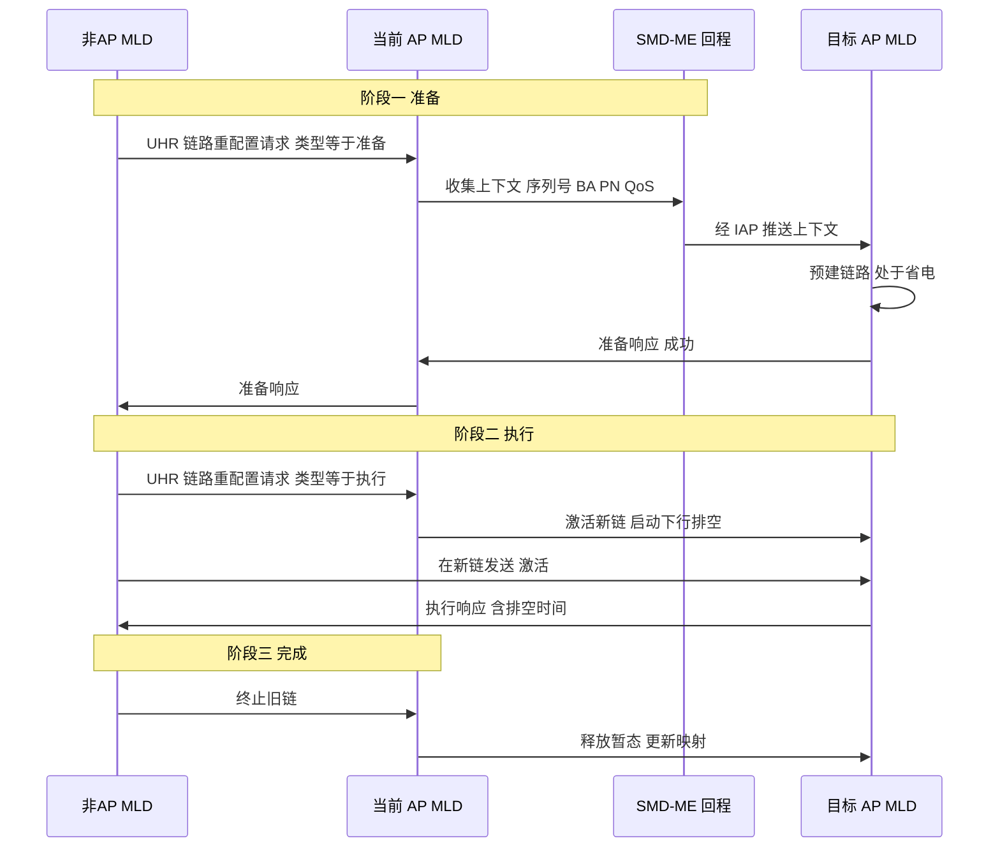
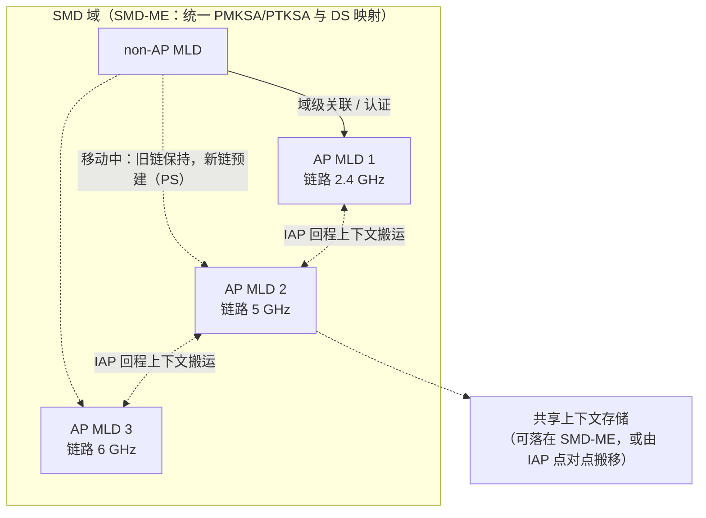
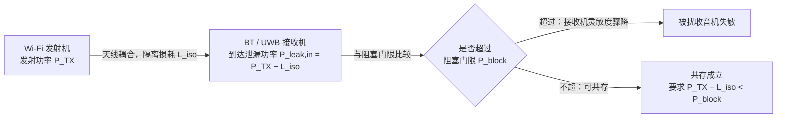
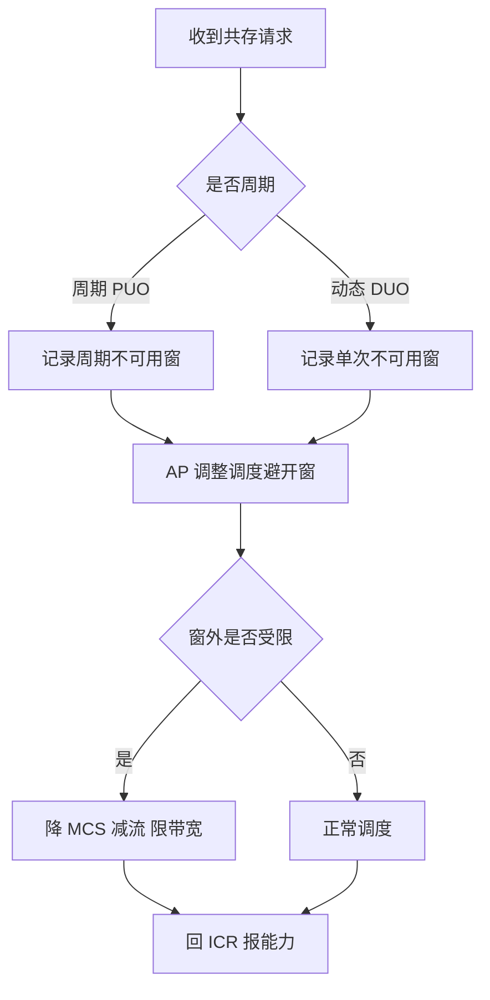

# 第 29 章　无缝移动域（SMD）、上下文转移与设备内共存 ★★★

> 本章所述 802.11bn（Wi-Fi 8 / UHR）机制均处于标准草案阶段，按规范统一标注：**【草案】**表示 11bn 草案（本文以 Draft 1.x 公开资料与 Samsung Research 博客、IEEE 802.11 TGbn 文稿为准）；**【讨论中】**表示尚未定案或属 Wi-Fi 9 前瞻。CAP 模式（Coordinated 接入点（Access Point, AP）、Bounded 扩展服务集（Extended Service Set, ESS）等）的命名在不同厂商文稿中有差异（Seamless / Single Mobility Domain），最终以定稿为准。

## 学习目标

1. 能给出"无缝"的量化定义，推导 传输控制协议（Transmission Control Protocol, TCP）感知阈值（$T_{\text{RTO,min}}\approx 200\ \text{ms}$）与实时业务感知阈值（Extended Reality, XR 帧间隔 $8.3\ \text{ms}@120\ \text{fps}$），并列出不同业务的中断容忍度表。
2. 能复述 SMD 三阶段（准备/执行/完成）机制、SMD-ME 与"域级关联"原理，画出时序图；区分"同 AP 多链路设备（Multi-Link Device, MLD）内换链路"与"跨 AP MLD 换关联"，并说明 SMD 与 多链路操作（Multi-Link Operation, MLO）（第 15 章）、多 AP 协调（Multi-AP Coordination, MAPC）（第 27 章）的关系。
3. 能列出上下文转移的完整内容清单、推导其转移开销（上下文量 × 转移路径 → 转移时延）与"不可沿用"项的一致性约束（重放计数器单调、BA 记分板重同步）。
4. 能建模并求解 SMD 上下文预取（prefetch）的最优 top-k 选择，推导 AP 休眠的盈亏平衡与 IDC 阻塞隔离度要求。

---

> **本章与第 17 章的分工**：第 17 章已完整讲透"传统漫游"——扫描（11k）、邻居报告/ 基本服务集（Basic Service Set, BSS）过渡管理（11v）、快速切换（11r FT）、迟滞与预测式切换、以及中断时间 $T_{\text{interrupt}}=T_{\text{scan}}+T_{\text{auth}}+T_{\text{reassoc}}+T_{\text{key}}+T_{\text{L23}}$ 的逐项分解与 make-before-break 思想。**本章不再重复这些内容**，而是站在其结论之上讲 11bn 的 SMD 如何把"关联实体"从单个 AP 提升为一个逻辑域：当 站点（Station, STA）与"域"而非与"某台 AP"关联时，跨 AP 移动退化为一次"链路重配置"而非"断开—重连"，从而把第 17 章公式里 $T_{\text{reassoc}}+T_{\text{key}}$ 那一段真空期压缩到近零。因此本章焦点是**域架构、上下文转移、预取决策、AP 节能与设备内共存**，而非扫描与切换判决本身。

## 29.1 问题设定：什么才是"无缝"

"无缝（seamless）"不是营销词，而是一组可测的量化约束。设 STA 在旧链路上最后一帧时刻为 $t_{\text{last,old}}$、新链路上首帧时刻为 $t_{\text{first,new}}$（沿用第 17 章定义），在 SMD 下所谓"无缝"指该真空期被消除到低于某类业务的可感知阈值。但更本质地，无缝要求**应用层无感知**——即既不触发 TCP 伪重传、也不丢弃实时帧。下面分别推导两类"感知阈值"。

### 29.1.1 TCP 感知阈值

TCP 依赖对每个在途报文启动重传超时（RTO）计时器。只要中断时间小于 RTO 最小值，发送端就不会误判丢包、不会伪重传、也不会进入拥塞避免的速率陡降。RFC 6298 规定 $RTO_{\min}=1\ \text{s}$，但主流实现（Linux 等）把下界收紧到约 $200\ \text{ms}$【示意值】。故 TCP 透明的充分条件是

$$T_{\text{interrupt}} < T_{\text{RTO,min}} \approx 200\ \text{ms} \quad\Longrightarrow\quad \text{TCP 不伪重传} \tag{29.1}$$

第 17 章已指出 11r 快速 BSS 切换（Fast BSS Transition, FT）把 $T_{\text{interrupt}}$ 压到 $35\text{--}50\ \text{ms}$，已远低于 $200\ \text{ms}$；SMD 进一步压到亚毫秒，对 TCP 而言二者都已"透明"，故 TCP 不是 SMD 的瓶颈——瓶颈在实时业务。

### 29.1.2 实时业务感知阈值

XR / 工业控制等实时流以固定帧间隔到达。若中断时间超过一个帧间隔，则至少漏掉一帧（或产生不可补偿的抖动）。设业务帧率 $f_{\text{frame}}$，则单帧间隔

$$T_{\text{frame}} = \frac{1}{f_{\text{frame}}}$$

若接收端有抗抖动缓冲 $N_{\text{buf}}$ 帧，则实时可容忍中断为

$$T_{\text{RT}} = N_{\text{buf}}\cdot T_{\text{frame}} \tag{29.2}$$

例如 XR @ $120\ \text{fps}$：$T_{\text{frame}}=1/120\approx 8.33\ \text{ms}$；若 $N_{\text{buf}}=1$，则 $T_{\text{RT}}\approx 8.3\ \text{ms}$。这正是 SMD 必须压到的量级——而 11r FT 的 $35\text{--}50\ \text{ms}$ 已漏掉数帧，故 SMD 的"亚毫秒"针对的是 XR 而非 VoIP。

### 29.1.3 不同业务的中断容忍度表

表 29-1 汇总典型业务的容忍度（标【示意值】，因实现与缓冲差异大）。第 17 章表 17-1 已给 VoIP/视频口径，此处补充 XR 与工业控制以体现 SMD 的新目标。

| 业务 | 帧间隔/特征 | 可容忍中断 $T_{\text{tol}}$【示意值】 | 主要约束来源 | 11r FT 是否满足 | SMD 目标 |
|---|---|---|---|---|---|
| 尽力而为（Web） | RTO 计时 | $<200\ \text{ms}$ | TCP 伪重传 | 是 | 远超 |
| VoIP | $20\ \text{ms}$ 帧 | $<50\ \text{ms}$ | 人耳可感断音 | 是 | 远超 |
| 视频会议 | 抖动缓冲 | $<20\text{--}30\ \text{ms}$ | 抖动缓冲溢出 | 临界 | 远超 |
| XR @120fps | $8.3\ \text{ms}$ | $<8.3\text{--}25\ \text{ms}$ | 漏帧/眩晕 | 否 | 亚毫秒 |
| 工业控制 | $1\text{--}10\ \text{ms}$ 周期 | $<1\text{--}5\ \text{ms}$ | 控制失稳 | 否 | 亚毫秒 |

**表 29-1 说明**：SMD 的设计目标不是"比 FT 再快一点"，而是把中断从"帧级（数十 ms）"压到"帧内（亚 ms）"，使 XR 与工业控制首次进入 Wi-Fi 可用区【草案】。


*图 29-1　业务中断容忍度阈值（纵轴对数）与两类切换方案的实际中断水平（示意值）。四色虚线自上而下为 TCP 透明线（200 ms）、VoIP 线（50 ms）、XR/工业控制安全区下界（25 ms）与 XR@120 fps 帧间隔（8.3 ms）；红色条为 11r FT 的实际中断（35–50 ms），绿色条为 SMD 目标（<1 ms）。*

**图 29-1 说明**：FT 已越过 TCP/VoIP 线但落在 XR 线下；SMD 把中断推到帧间隔之下，使实时业务首次"无感知"。

**算例 29.1**：中断容忍度与上下文转移时延。

- **已知**：XR 帧率 $f_{\text{frame}}=120\ \text{fps}$，抗抖缓冲 $N_{\text{buf}}=2$；TCP 实现 $T_{\text{RTO,min}}=200\ \text{ms}$；上下文规模 $S_{\text{ctx}}=2\ \text{KB}=16\ \text{kbit}$【示意值】；回程速率 $R_{\text{bh}}=1\ \text{Gbps}$，空口转移速率 $R_{\text{air}}=100\ \text{Mbps}$；每跳处理时延 $t_{\text{proc}}=20\ \mu\text{s}$。
- **求**：(a) XR 实时可容忍中断；(b) 上下文经回程与经空口的转移时延。
- **解**：
  - (a) $T_{\text{RT}}=N_{\text{buf}}\cdot T_{\text{frame}}=2\times(1/120)=2\times 8.33\ \text{ms}\approx 16.7\ \text{ms}$。即 XR 缓冲 2 帧时可容忍约 $16.7\ \text{ms}$ 中断，单帧情形仅 $8.3\ \text{ms}$。
  - (b) 回程：$T_{\text{ctx,bh}}=S_{\text{ctx}}/R_{\text{bh}}=16\times10^3/10^9=16\ \mu\text{s}$，加 2 跳处理约 $T_{\text{ctx,bh}}+2t_{\text{proc}}\approx 56\ \mu\text{s}$。空口：$T_{\text{ctx,air}}=16\times10^3/10^8=160\ \mu\text{s}$，加处理约 $200\ \mu\text{s}$。
- **结论**：上下文转移本身仅 $0.05\text{--}0.2\ \text{ms}$，远小于 FT 的 $35\text{--}50\ \text{ms}$。因此 SMD 的瓶颈**不是上下文体积**而是 IAP 回程 往返时间（Round-Trip Time, RTT）与 DL 排空（见 29.2、29.3）；$16.7\ \text{ms}$ 量级合理，因为 XR 缓冲通常 1–3 帧。

## 29.2 SMD 框架

### 29.2.1 域的概念与 SMD-ME

无缝移动域（Seamless Mobility Domain, SMD）是由多个 AP MLD 组成的集合，受一个**无缝移动域管理实体（SMD Management Entity, SMD-ME）**统一管理【草案】。其核心是把"关联与认证"从单个 AP 提升到"域"：

- **域级关联**：non-AP MLD 初次接入时，不是关联到某台具体 AP，而是经由域内任意 AP MLD 与 SMD-ME 完成一次关联/认证，建立**单一 PMK 安全关联（PMK Security Association, PMKSA）与单一 PTKSA**，该安全关联在整个 SMD 内持久有效（若 SMD 同时是 FT 移动域，则单一 PMK-R1 绑定到 SMD-ME）。
- **域内移动不换 IP、不重认证、不重协商 QoS**：STA 在域内 AP MLD 间切换时，分发系统（Distribution System, DS）（分发系统）映射被更新，但网络层地址与 健壮安全网络（Robust Security Network, RSN）关联（RSN Association, RSNA）保持不变。
- **SMD 标识（SMD-ID）**：一个 6 字节 媒体接入控制（Medium Access Control, MAC）地址，由参与 AP MLD 在 Beacon/Probe Response 中广播，STA 据此识别"哪些 AP 属于同一域"。

SMD 定义两种数据通路模型【草案】：① **每 AP MLD 独立 MAC 服务访问点（Service Access Point, SAP）**——切换时更新 DS 映射；② **整个 SMD 一个 MAC SAP**——SMD-ME 统一终结 802.1X 受控端口。模型 ② 在概念上等价于一个"跨多台物理 AP MLD 的虚拟统一 MAC 实体"，即用户所问的"多 AP 假 MLD"——它让上层看到的是"一个站"而非"一组 AP"。本文按草案表述为：SMD 的"One MAC SAP for the SMD"模型在 MAC 服务边界上**实现了跨 AP 的统一 MAC 实体**，但物理上仍是多套独立链路（详见 29.2.3）。

### 29.2.2 三阶段机制

SMD BSS 转换（SMD BSS Transition, ST）把一个"先断后连"退化为"先连后换"。基于 Samsung Research 与 TGbn 文稿（第 37.16 节），其分三阶段，信令载体为 **超高可靠（Ultra High Reliability, UHR）链路重配置请求/响应帧**（Protected UHR Action）【草案】：

- **阶段一 准备（Preparation）**：当前 AP MLD 在 STA 真正移动前，把 STA 的上下文（序列号、BA 参数、PN、QoS 描述符等，见 29.3）经 SMD-ME/回程（IAP）推送到目标 AP MLD；目标 AP MLD 预建一条链路但置于**省电（PS）模式**待用。
- **阶段二 执行（Execution）**：STA 激活到目标 AP MLD 的新链，不经完整重认证；当前 AP MLD 启动 **DLDrainTime（下行排空计时）** 把缓冲下行数据在切换前发完。
- **阶段三 完成（Complete）**：新链稳定后，旧 AP MLD 释放暂态，DS 映射切到目标。

图 29-2 给出三阶段时序。



**图 29-2 说明**：旧链在阶段二仍承载数据（DLDrainTime），新链在阶段二才激活；真空期仅为"激活一帧"的量级，故 $T_{\text{interrupt}}^{\text{SMD}}\approx T_{\text{act}}$（亚 ms）【草案】。

### 29.2.3 SMD 与 MLO 的关系

结合第 15 章 MLO 架构，须区分两种"换链路"：

1. **同 AP MLD 内换链路**：non-AP MLD 在所属 MLD 的链路集合里增删链路（如从 2.4G 链切到 5G 链），这是 MLO 链路重配置，**不是漫游**，不涉及 SMD。
2. **跨 AP MLD 换关联**：STA 离开当前 AP MLD 进入同域另一 AP MLD，才是 SMD BSS 转换。SMD 借助 MLO 让 STA **同时维持旧 AP 链与新 AP 链**（旧链在 MLD 视角仍为 affiliated link），从而把跨 AP 切换伪装成一次"MLO 内新增/删除链路"，实现 make-before-break。

关于"多 AP 假 MLD 式统一 MAC 实体"：在 SMD 的"One MAC SAP for the SMD"模型下，SMD-ME 为域内所有 AP MLD 维护**统一的安全关联与 DS 映射**，对上层呈现单一 MAC-SAP，这与 MLO 的"上统下分"原则（第 15 章图 15-1）一致，只是把"统一实体"从单台 MLD 扩展到多台 AP MLD。严格说它不是标准定义的 MLD（没有统一的 MLD MAC 地址跨 AP），而是 SMD-ME 在管理面上提供的**等效统一服务**【草案/讨论中】。

### 29.2.4 SMD 需要的 AP 间协调与共享上下文存储

跨 AP 的上下文推送依赖 **IAP（Inter-AP）通信**：AP MLD 间经由回程（hostapd↔hostapd）交换上下文，标准只规定可交换的数据类型、不规定 IAP 协议格式（留作实现）【草案】。这与第 27 章 MAPC 框架互补——SMD 为 MAPC 提供"受控的移动性域"，域内 AP 可进一步用 Co-RTWT/Co-BF 为移动中的 STA 提供一致服务质量；共享上下文存储既可落在 SMD-ME，也可由 IAP 在 AP 间点对点搬移。图 29-3 给出 SMD 域架构。



**图 29-3 说明**：STA 与 SMD-ME 做域级关联；域内三台 AP MLD 通过 IAP 共享上下文，STA 跨 AP 移动时只是"链路重配置"。

## 29.3 上下文转移（Context Transfer）

上下文转移是 SMD "先连后换"得以零丢包的关键：目标 AP MLD 必须在激活前就拥有 STA 的全部运行状态，否则新链首帧会因"不认识这个 STA"而丢弃。

### 29.3.1 完整上下文清单

表 29-2 给出 SMD 须转移的完整上下文（综合 TGbn 文稿与 Linux SMD 补丁所列字段）【草案】。

| 类别 | 具体项 | 单位/说明 | 不转移的后果 |
|---|---|---|---|
| 安全 | 成对主密钥（Pairwise Master Key, PMK） / 成对临时密钥（Pairwise Transient Key, PTK） / 完整性组临时密钥（Integrity GTK, IGTK）、SMD-KDK | 密钥材料；SMD-KDK 替代 PMK 做多 PTK 漫游 | 必须重握手，失去无缝 |
| 安全 | 重放计数器（PN）、密钥重放计数 | 单调计数 | 重放攻击/被拒 |
| QoS | 流量标识符（Traffic Identifier, TID）映射、SCS/MSCS/EPCS 描述符 | 流→AC 映射与流规格 | QoS 重置、被限速 |
| QoS | 每 AC 队列状态 | 待发 MAC 服务数据单元（MAC Service Data Unit, MSDU）摘要 | 调度不公 |
| 可靠性 | UL/DL 序列号窗口 | 序号空间 | 重复/乱序 |
| 可靠性 | BlockAck 记分板与起始序号 SSN | 每 TID 位图 | 误判重传/漏收 |
| 可靠性 | 重传缓冲、未确认 MAC 协议数据单元（MAC Protocol Data Unit, MPDU） | 帧体 | 丢数据 |
| 能力 | MCS/带宽/空间流 空间流数（Number of Spatial Streams, NSS） | 物理能力 | 降速 |
| 能力 | 省电状态、目标唤醒时间（Target Wake Time, TWT）参数 | 唤醒日程 | 唤醒失配 |
| 路由/桥接 | MAC 地址学习、DS 转发表 | 转发条目 | 下行寻路失败 |

**表 29-2 说明**：安全与可靠性类上下文决定"能否续传且不丢不重"，QoS 与能力类决定"续传质量"，路由类决定"数据能否找到 STA"。

### 29.3.2 转移开销推导

设上下文总规模 $S_{\text{ctx}}$，经路径速率 $R_{\text{path}}$ 转移，加每跳处理 $t_{\text{proc}}$ 与回程跳数 $H$，则转移时延

$$T_{\text{ctx}} = \frac{S_{\text{ctx}}}{R_{\text{path}}} + H\cdot t_{\text{proc}} \tag{29.3}$$

它与 SMD 中断时间的关系：因旧链在转移期间仍在线，转移本身**不计入**中断真空；只有"激活帧交换 + 排空切换"计入。即

$$T_{\text{interrupt}}^{\text{SMD}} \approx T_{\text{act}} + T_{\text{drain}} \ll T_{\text{ctx,FT}}$$

其中 $T_{\text{ctx,FT}}$ 是 FT 下重认证+重关联耗时。算例 29.1(b) 已算得 $T_{\text{ctx}}$ 仅 $0.05\text{--}0.2\ \text{ms}$，故 SMD 中断 dominated by $T_{\text{act}}$（亚 ms）与 $T_{\text{drain}}$。

### 29.3.3 不可沿用的上下文与一致性约束

并非所有上下文都能"原样复制"，否则会破坏协议不变量：

- **重放计数器（PN）必须单调递增**：目标 AP 采用 $\text{PN}_{\text{target}}\leftarrow \max(\text{PN}_{\text{old}},\,\text{PN}_{\text{transferred}})$，续传帧 PN 严格递增，避免重放被判丢弃。冲突解决规则：**取较大值**（安全优先）。
- **BlockAck 记分板需重同步**：转移的是"快照"，但旧 AP 在 DLDrainTime 内可能继续 ACK。目标须以"排空完成后的最终 ACK 位图"为准；任一序号若旧 AP 已 ACK 而快照未含，则目标不得重传（避免重复递交给上层）。
- **未确认 MPDU 的归属**：旧 AP 重传缓冲中的未确认帧应在 DLDrainTime 内由旧 AP 发完；切换后若仍缺失，目标依新 SSN 触发重传，且必须与上层去重（MLO 统一序列号空间，见第 15 章）配合。
- **一致性判据**：激活时刻 $t_a$，要求对每 TID 有 $\text{SSN}_{\text{target}}(t_a) = \text{SSN}_{\text{old}}(t_a) + N_{\text{acked}}$，否则出现序号空洞或重复，$\boxed{\text{SSN}_{\text{target}}\;\text{须等于旧链已确认序号+1}}$。

### 29.3.4 上下文打包—传输—校验—恢复伪代码

```text
1  // 当前 AP MLD: 打包并推送上下文到目标 (复杂度 O(S_ctx))
2  ctx = collect(SEQ, BA, PN, QoS, CAP, FWD)   // 1. 打包: 采快照
3  snap = snapshot_ts()                          // 记录快照时刻, 用于重同步
4  send_via_IAP(target, ctx, snap)              // 2. 传输: 经回程推送
5  ack = wait_IAP_ack(target)                   // 3. 校验: 等目标确认
6  if ack.ok: mark_prepared(target)             // 目标进入 prepared 态
7  else: retry_or_abort()                       // 失败则重试/放弃预取
8  // 目标 AP MLD: 接收并恢复 (复杂度 O(S_ctx))
9  ctx = recv_IAP()                              // 收上下文
10 verify(PMKSA_bound_SMD, PN_monotonic(ctx))   // 校验: 安全关联+PN单调
11 install(ctx)                                 // 恢复: 装密钥/BA/队列/转发
12 SSN = max(local_SSN, ctx.SSN) + N_acked(ctx) // 重同步起始序号
13 enter_state(PREPARED, link_in_PS)            // 建链待用(省电)
```

**复杂度**：时间 $O(S_{\text{ctx}})$（序列化/解析与安装），空间 $O(S_{\text{ctx}})$（在目标 AP 暂存一份上下文）；预取到 $k$ 个候选时总空间 $O(k\cdot S_{\text{ctx}})$。

## 29.4 核心算法：SMD 切换决策与上下文预取【草案】

本节给出 SMD 的核心六段式算法——在 STA 移动过程中**预测下一目标 AP 集合并提前推送上下文**，把不可避免的上下文转移开销从"中断窗口内"挪到"窗口外"，从而把中断压到仅剩激活帧交换。

### 29.4.1 问题建模

- 域 $\mathcal{D}$ 内候选 AP 集合 $\mathcal{A}=\{AP_1,\dots,AP_n\}$；STA 基于位置/历史得到预测分布 $p_i=\Pr[AP_i\text{为下一目标}]$，$\sum_i p_i=1$。
- 命中（目标在预取集 $K$）：激活瞬间上下文已就位，中断 $T_{\text{hit}}\approx T_{\text{act}}$（亚 ms）。
- 未命中（目标不在 $K$）：需临时走 FT 式转移，中断 $T_{\text{miss}}$（约 $35\text{--}50\ \text{ms}$，取 $T_{\text{miss}}=40\ \text{ms}$【示意值】）。
- 每预取一个 AP 消耗资源（目标 AP 上下文存储 + 回程带宽）$c$（约 $2\ \text{ms}$ 等效开销【示意值】）。
- 预取集大小上限 $k$（硬件/存储约束）。

### 29.4.2 目标函数与约束

最小化"期望中断 + 预取资源惩罚"（权衡命中率与开销）：

$$\min_{K\subseteq\mathcal{A},\ |K|\le k}\; J(K)=\alpha\sum_{i\notin K}p_i\,T_{\text{miss}}+\sum_{j\in K}c_j \tag{29.4}$$

其中第一项miss 中断期望，第二项预取开销，$\alpha$ 为中断权重。约束：$|K|\le k$。

### 29.4.3 完整推导

令 $c_j=c$（同构 AP），$\alpha=1$。展开：

$$J(K)=T_{\text{miss}}\Bigl(1-\sum_{j\in K}p_j\Bigr)+|K|\,c \tag{29.5}$$

把第 $m$ 个被加入的 AP（按 $p$ 降序标记为 $p_{(m)}$）的**边际收益**写出：加入它使 miss 概率降 $p_{(m)}$，省中断 $T_{\text{miss}}p_{(m)}$，但增开销 $c$，故净边际收益

$$\Delta J_m = -\,T_{\text{miss}}p_{(m)} + c \tag{29.6}$$

当 $T_{\text{miss}}p_{(m)} > c$ 即 $p_{(m)} > c/T_{\text{miss}}$ 时，加入该 AP 降低总代价——**应预取**。进一步，因 $p_{(m)}$ 降序排列，$\Delta J_m$ 随 $m$ 增大而**递减**（边际收益递减），目标函数对集合 $K$ 在"按概率排序的贪心"下是模性（modular）的，故**最优解 = 取概率最大的 top-k 中满足 $p_{(m)}>c/T_{\text{miss}}$ 者**。用交换论证可证：任一非贪心解必存在一对可交换使代价不增，故贪心得全局最优。框出决策阈值：

$$\boxed{\text{预取 AP}_j \iff p_j > \frac{c}{T_{\text{miss}}},\ \text{且取概率最大的至多 }k\text{ 个}} \tag{29.7}$$

### 29.4.4 伪代码

```text
1  // 输入: 候选 p[1..n] 降序, 阈值 thr=c/T_miss, 上限 k
2  sort_desc(p)                      // O(n log n): 按预测概率排序
3  K = empty; cost = 0; hit = 0
4  for m = 1 to n do                // 贪心加入, 复杂度 O(n)
5    if m > k then break            // 受存储/带宽上限约束
6    if p[m] <= thr then break      // 边际收益转负, 停止
7    K.add(AP[m])                   // 提前推送上下文到 AP[m]
8    push_ctx_via_IAP(AP[m])        // 预取: 开销计入 c
9    cost += c; hit += p[m]
10 J = T_miss*(1-hit) + cost        // 评估期望代价
11 return K, J
```

### 29.4.5 复杂度分析

- 时间：排序 $O(n\log n)$ + 扫描 $O(n)$，主导 $O(n\log n)$；预取推送 $O(k)$ 次 IAP 调用。
- 空间：目标 AP 各存一份上下文，共 $O(k\cdot S_{\text{ctx}})$；预测分布 $O(n)$。随候选数 $n$ 与上限 $k$ 增长。

### 29.4.6 数值算例

**算例 29.2**：SMD 内有 $n=5$ 候选 AP，预测概率 $p=(0.50,0.25,0.15,0.07,0.03)$，取 $T_{\text{miss}}=40\ \text{ms}$，$c=2\ \text{ms}$，阈值为 $c/T_{\text{miss}}=2/40=0.05$，上限 $k=4$。

- 逐 AP 判定：$p_1=0.50>0.05$（取），$p_2=0.25$（取），$p_3=0.15$（取），$p_4=0.07>0.05$（取），$p_5=0.03<0.05$（弃）。故最优预取集 $K^*=\{1,2,3,4\}$。
- 期望代价：$J=T_{\text{miss}}(1-0.97)+4c=40\times0.03+8=1.2+8=9.2\ \text{ms}$。
- 对照：不预取（$K=\varnothing$）时 $J=40\ \text{ms}$；仅预取 top-1 时 $J=40\times0.5+2=22\ \text{ms}$。
- 量级检查：$9.2\ \text{ms}$ 合理——它通过 8 ms 预取开销把 miss 中断从 $40\ \text{ms}$ 降到 $1.2\ \text{ms}$，命中率 $97\%$；末位 AP 概率仅 $3\%$ 且低于阈值，预取其收益（$40\times0.03=1.2\ \text{ms}$）不及开销 $2\ \text{ms}$，故正确舍弃，印证式 (29.7) 的边际递减。

## 29.5 AP 侧节能（与移动性相关）

SMD 域内 AP 也可能为省电而休眠（尤其移动 AP / 电池供电 AP，详见第 12 章 DPS），但休眠会拖慢"被选中为目标"时的切换。须量化其发现时延代价与节能收益的盈亏平衡【草案】。

### 29.5.1 建模与盈亏平衡推导

- 醒来代价：若目标 AP 休眠，Prepare 阶段须先唤醒它，给 worst-case 中断追加 $T_{\text{wake}}$（如 beacon 周期或唤醒时延，取 $100\ \text{ms}$【示意值】）；若 AP 清醒则 Prepare 即时。
- 节能收益：睡眠周期 $T_{\text{cycle}}$ 内省电 $\Delta P = P_{\text{on}}-P_{\text{off}}$。
- 代价归一化：以 $\beta\ [\text{J/ms}]$ 把"每 ms 额外中断"折算为能量等价惩罚。AP 在周期内被需要为目标的概率 $q$。

睡眠的期望收益（能量）为 $\Delta P\cdot T_{\text{cycle}}$，期望代价（折算能量）为 $\beta\cdot q\cdot T_{\text{wake}}$。盈亏平衡：

$$\Delta P\cdot T_{\text{cycle}} = \beta\cdot q^{*}\cdot T_{\text{wake}} \quad\Longrightarrow\quad \boxed{q^{*} = \frac{\Delta P\,T_{\text{cycle}}}{\beta\,T_{\text{wake}}}} \tag{29.8}$$

决策：**当 $q < q^{*}$ 时休眠**，否则保持清醒以保障切换时延。

### 29.5.2 六段式算法：AP 休眠决策

**建模**：同 29.5.1，符号 $P_{\text{on}},P_{\text{off}},T_{\text{cycle}},T_{\text{wake}},q,\beta$。

**目标**：$\max\ (\text{节能收益} - \text{中断惩罚})$，即睡当且仅当 $\Delta P\,T_{\text{cycle}} > \beta q T_{\text{wake}}$。

**推导**：直接用式 (29.8) 阈值 $q^{*}$；因左右关于 $q$ 线性，决策是单阈值型（阶跃），无需迭代。

**伪代码**：

```text
1  // AP 周期性自决: 休眠 or 清醒 (复杂度 O(1))
2  q = estimate_becomes_target_prob()   // 由历史切换率估 q
3  q_star = dP*T_cycle/(beta*T_wake)    // 式(29.8) 阈值
4  if q < q_star: enter_sleep(T_cycle)  // 省电, 唤醒时延 T_wake
5  else: stay_awake()                   // 保障切换近零中断
```

**复杂度**：时间 $O(1)$，空间 $O(1)$；随估计粒度（滑动窗口长度）仅常数增长。

**算例 29.3**：$P_{\text{on}}=10\ \text{W}$，$P_{\text{off}}=1\ \text{W}$ → $\Delta P=9\ \text{W}$；$T_{\text{cycle}}=1\ \text{s}$；$T_{\text{wake}}=100\ \text{ms}$；$\beta=0.5\ \text{J/ms}$【示意值】。

- 阈值 $q^{*}=9\times1/(0.5\times100)=9/50=0.18$。
- 决策：若该 AP 在接下来 1 s 内成为切换目标的概率 $q<18\%$ 则休眠，否则清醒。
- 量级检查：$q^{*}=18\%$ 合理——一个边缘、少被路由到的 AP 多数时间可休眠，仅当预测它即将被用（如 STA 临近）才保持清醒，把 SMD 中断代价控制在 $T_{\text{wake}}$ 内。

表 29-3 给出决策表。

| $q$（成为目标概率） | 与 $q^{*}=18\%$ 比 | 决策 | 对 SMD 中断影响 |
|---|---|---|---|
| $<0.18$ | 低于阈值 | 休眠 | 偶发 $+T_{\text{wake}}$（仍 << FT） |
| $\ge 0.18$ | 高于阈值 | 清醒 | 近零中断 |

**表 29-3 说明**：休眠是"用偶发百 ms 级唤醒时延换持续省电"，对 SMD 整体仍远优于 FT。

## 29.6 IDC（设备内共存）

设备内共存（In-Device Coexistence, IDC）指同一终端内 Wi-Fi 与蓝牙（Bluetooth, BT）/Zigbee/超宽带（Ultra-Wideband, UWB）/蜂窝同时工作时的互扰。11bn 把 IDC 从"各自 报文收发仲裁（Packet Traffic Arbitration, PTA）硬避让"升级为"STA 向 AP 上报不可用窗"的协议化机制【草案】。

### 29.6.1 干扰机理与隔离度要求

三种主要机理：① **发射机泄漏**——Wi-Fi TX 经天线耦合漏入同设备 BT Rx；② **接收机阻塞/饱和**——强 TX 抬高另一收音机 LNA 底噪致灵敏度恶化（desense）；③ **互调（IMD）**——两发射在非线性器件混出杂散。设 Wi-Fi 发射机泄漏功率 $P_{\text{leak}}$（功放/天线口），经天线耦合增益 $G$（dB，含近场耦合，通常很小或为负）与隔离损耗 $L_{\text{iso}}$（dB，越大越好）到达被扰收音机口，则

$$P_{\text{victim}} = P_{\text{leak}} + G - L_{\text{iso}} \tag{29.9}$$

要求低于该收音机的阻塞耐受电平 $P_{\text{block}}$（在此之上即 desense）：

$$P_{\text{leak}} + G - L_{\text{iso}} < P_{\text{block}} \quad\Longrightarrow\quad \boxed{L_{\text{iso}} > P_{\text{leak}} + G - P_{\text{block}}} \tag{29.10}$$

图 29-4 给出泄漏链路。



**图 29-4 说明**：隔离度不足时泄漏越过阻塞门限，被扰收音机灵敏度骤降。

### 29.6.2 规避方案：时分 / 频分 / 功率控制

- **时分（TDM / PTA）**：Wi-Fi 在 BT 占空窗内让出空口。设 BT 每周期 $T_{\text{int}}$ 占用 $T_{\text{BT}}$，占用比 $\rho=T_{\text{BT}}/T_{\text{int}}$，则 Wi-Fi 可用时间比 $1-\rho$，吞吐损失比约

$$\eta_{\text{loss}} \approx \rho \tag{29.11}$$

（不计切换开销；实际略高因保护带）。
- **频分**：把 Wi-Fi 移到不受扰频段（如 BT 在 2.4G，Wi-Fi 用 5/6G），代价为零但受信道可用限制。
- **功率控制**：降 Wi-Fi TX 功率减小泄漏，代价为覆盖/速率。

时隙仲裁伪代码（STA 与 BT 共用 PTA 仲裁器）：

```text
1  // Wi-Fi/BT 共存时隙仲裁 (复杂度 O(1) per slot)
2  if bt_active_window():              // BT SCO/eSCO 占空
3    defer_wifi_tx()                   // Wi-Fi 让出此时隙
4    yield_to_bt()                     // PTA: 把时隙给 BT
5  else:
6    wifi_tx_opportunistic()           // 否则 Wi-Fi 正常发
```

### 29.6.3 11bn IDC 增强：DUO / PUO 与 MLO 结合【草案】

11bn 引入**不可用上报**：STA 经 ICF/ICR/CRF 告知 AP 即将不可用的窗口，AP 在窗口内不调度下行，消除伪重传。两种模式：

- **PUO（Periodic Unavailability Operation）**：周期窗（如 BT 音频每 $10\ \text{ms}$ 不可用约 $2\ \text{ms}$），适合规律业务。
- **DUO（Dynamic Unavailability Operation）**：动态上报单次窗，携于 缓冲状态报告（Buffer Status Report, BSR） Poll / 多 STA BA 等控制帧。

且支持**部分不可用**：STA 可声明"窗口内降 MCS/减 NSS/限带宽/限 TX 或 RX"，AP 自适应而非完全避让。与 MLO 结合（第 15 章）时，IDC 规避收益显著：若 Wi-Fi 同时有 2.4G 与 5/6G 链，可把业务**导向不受扰的链**，等效于"用频分替代时分"。设受扰链损失比 $\rho$，干净链无损，则 MLO IDC 感知链路选择后

$$S_{\text{MLO,IDC}} = S_{\text{clean}} + (1-\rho)S_{\text{dirty}} \approx S_{\text{total}} \tag{29.12}$$

相较单链时分（损失 $\rho$）几乎无损。图 29-5 为 IDC 仲裁状态机。



**图 29-5 说明**：STA 上报不可用窗，AP 避开或降级调度，避免伪重传与空口浪费。

### 29.6.4 算例：BT 语音与 Wi-Fi 吞吐损失

**算例 29.4**：BT SCO 音频每 $T_{\text{int}}=10\ \text{ms}$ 占用 $T_{\text{BT}}=2\ \text{ms}$（$\rho=0.2$）；Wi-Fi 单链在 2.4G 与 BT 同频；峰值吞吐 $S_0=50\ \text{Mbps}$【示意值】；另有 5G 干净链同速。

- (a) **隔离度要求**：取 Wi-Fi 泄漏 $P_{\text{leak}}=+20\ \text{dBm}$，耦合增益 $G\approx 0\ \text{dB}$，BT 阻塞耐受 $P_{\text{block}}=-70\ \text{dBm}$，则 $L_{\text{iso}}>20+0-(-70)=90\ \text{dB}$。即需 90 dB 隔离——板级难以满足，故必须靠时分/频分而非纯隔离。
- (b) **单链时分损失**：由式 (29.11) $\eta_{\text{loss}}\approx 0.2$，实际 Wi-Fi 吞吐 $\approx 50\times(1-0.2)=40\ \text{Mbps}$，损失 $10\ \text{Mbps}$（约 20%）。若不用 PUO 上报，AP 在窗内仍调度下行 → 伪重传额外浪费，损失更高。
- (c) **MLO IDC 规避**：把 Wi-Fi 导向 5G 干净链，2.4G 链避让 BT，总吞吐≈ $50\ \text{Mbps}$（无损），相对单链时分挽回 $10\ \text{Mbps}$。
- 量级检查：$90\ \text{dB}$ 隔离合理（共板 Wi-Fi/BT 典型隔离 30–50 dB，远不足，证实 IDC 必须协议规避）；20% 吞吐损失与公开实测量级一致。

## 29.7 P2P 与直连

基础设施模式之外，设备间直连（Peer-to-Peer, P2P）在投屏、本地协作、XR 串流中不可或缺。Wi-Fi 既有三类机制：

- **Wi-Fi Direct（含 Wi-Fi Display）**：基于 802.11 的 P2P 规范，发现用探测/服务发现，组建通过**群组所有者协商（Group Owner Negotiation）**确定 GO（相当于软 AP），其余为客户端；拓扑为"一主多从"的 P2P 组。
- **TDLS（Tunneled Direct Link Setup, 802.11z）**：两 STA 已关联同一 AP 时，经 AP 隧道完成直连建立， thereafter 数据绕过 AP 直传；发现仍依赖 AP。
- **NAN（Neighbor Awareness Networking）**：设备低功耗周期性在发现窗（Discovery Window）发布/订阅服务，无需 AP 即可发现邻居。

**资源竞争建模**：P2P 组若与基础设施同信道（base channel），其流量与 $N$ 个关联 STA 经 增强型分布式信道接入（Enhanced Distributed Channel Access, EDCA）竞争同一空口。设 P2P 组获信道份额约 $1/(N+1)$，则其介质访问时延随 $N$ 增大而上升；11bn 的 **TXSPG（TXOP Sharing for P2P Groups）**让 AP 把一段 发送机会（Transmission Opportunity, TXOP）预留给 P2P 组（组 ID = AID12 = 2047，由组长 STA 经 流分类服务（Stream Classification Service, SCS）请求、AP 用 多用户 RTS（Multi-User Request To Send, MU-RTS） TXS Trigger 调度），把竞争变预约，时延可界【草案】。**Co-CR（Coordinated Channel Recommendation）**则让相邻 AP 经 MAPC（第 27 章）协商一致的 P2P 推荐信道并广播，使 P2P 组移到较干净信道、与各 BSS 错开，进一步降冲突【草案】。二者配合：TXSPG 在主信道给确定性时隙，Co-CR 在邻信道给干净频段。

设 TXSPG 预留 TXOP 占比 $f_{\text{txspg}}$，则 P2P 组时延上界由预约周期决定而非竞争，改写竞争模型为"确定性窗口 + 其余竞争"，中断方差显著下降；Co-CR 另把跨 BSS 冲突概率从 $p_{\text{coll}}$ 降到接近 0（信道一致空闲）。此二机制把 P2P 从"尽力而为"提升为"可预测"，是 11bn 相对 11be 的明确增强【草案】。

## 29.8 研究议题

1. **SMD 跨域扩展**：SMD 当前限于管理域边界内；跨 SMD（尤其跨 FT 域）的快速切换、上下文跨域搬运与安全边界仍是开放问题（草案已留"fast BSS transition between SMDs"接口）。
2. **上下文一致性形式化验证**：PN 单调、BA 重同步、DS 映射切换等不变量缺乏形式化证明，可用时态逻辑/TLA+ 验证"零丢零重"是否在所有交错下成立。
3. **移动性与感知/定位结合**：SMD 预取依赖位置预测，可与第 34/35 章的 Wi-Fi 感知与定位融合，用信道状态/到达角提升 $p_i$ 估计精度。
4. **人工智能（Artificial Intelligence, AI）驱动的移动性预测**：第 33 章的机器学习方法可用于学习楼层级转移概率，把 29.4 的先验 $p_i$ 升级为在线贝叶斯/图神经网络预测，进一步抬高命中率。
5. **与蜂窝异构移动性协同**：SMD 域内近零中断如何与 5G/6G 切换协同，形成"LAN—蜂窝"无缝连续性，是 Wi-Fi 9 前瞻方向【讨论中】。

---

## 本章小结

1. "无缝"的量化判据是 $T_{\text{interrupt}}<T_{\text{RTO,min}}(\approx200\ \text{ms})$ 使 TCP 透明，且 $T_{\text{interrupt}}<N_{\text{buf}}T_{\text{frame}}$（XR@120fps 约 $8.3\ \text{ms}$）使实时不漏帧；SMD 目标为亚 ms，针对 XR/工业控制而非 VoIP。
2. SMD 把关联实体从单 AP 提升为 SMD-ME 管理的"域"，域内换 AP 不重认证/不重协商 QoS、IP 不变；三阶段为准备（上下文预推+新链建而省电）、执行（激活+下行排空）、完成（释放旧链）。
3. 上下文须含安全（PMK/PTK/PN）、QoS（TID/SCS）、可靠性（序列号/BA/重传缓冲）、能力（MCS/TWT）、路由（DS 映射）五类；转移时延仅 $0.05\text{--}0.2\ \text{ms}$，非 SMD 瓶颈。
4. 不可沿用项须满足一致性约束：PN 单调取大值、BA 记分板以排空后最终 ACK 为准、$\text{SSN}_{\text{target}}=\text{已确认序号}+1$，否则出现空洞或重复。
5. 上下文预取最优解为"概率降序 top-k 且 $p_j>c/T_{\text{miss}}$"，边际收益递减证其全局最优；算例显示 4 候选预取把期望中断从 $40\ \text{ms}$ 降到 $9.2\ \text{ms}$。
6. AP 休眠盈亏平衡 $q^{*}=\Delta P\,T_{\text{cycle}}/(\beta T_{\text{wake}})$；仅当成为目标概率低于阈值才休眠，对 SMD 整体仍远优于 FT。
7. IDC 隔离要求 $L_{\text{iso}}>P_{\text{TX}}-P_{\text{block}}$（典型需 90 dB，板级难达）；11bn 用 DUO/PUO 上报不可用窗 + MLO 链路导向干净频，把 BT 同频 20% 吞吐损失降到近零。
8. P2P 经 Wi-Fi Direct/TDLS/NAN 实现直连；11bn 的 TXSPG（主信道预留 TXOP）与 Co-CR（MAPC 协商推荐信道）把 P2P 从尽力而为提升为可预测【草案】。

| 关键结论/参数 | 符号/值 | 说明 |
|---|---|---|
| TCP 透明阈值 | $T_{\text{RTO,min}}\approx200\ \text{ms}$ | 低于此 TCP 不伪重传 |
| XR 帧间隔 @120fps | $8.3\ \text{ms}$ | 实时可容忍中断下限 |
| 上下文转移时延 | $0.05\text{--}0.2\ \text{ms}$ | 回程 1G / 空口 100M |
| SMD 中断 | $\approx T_{\text{act}}$（亚 ms） | 旧链保持，仅激活帧 |
| 预取阈值 | $p_j>c/T_{\text{miss}}$ | 取 top-k |
| AP 休眠阈值 | $q^{*} = \Delta P\,T_{\text{cycle}}/(\beta T_{\text{wake}})$ | 例 18% |
| IDC 隔离要求 | $L_{\text{iso}}>P_{\text{leak}}+G-P_{\text{block}}$ | 例需 90 dB |
| BT 同频损失 | $\eta_{\text{loss}}\approx\rho$ | 例 20%（PUO 可消） |

## 习题

### A. 概念题（3 题）

1. 为什么说"TCP 透明"不是 SMD 的设计难点，而 XR 实时帧才是？给出阈值推导思路。
2. SMD 的"域级关联"与传统 11r FT 的 PMK-R1 预分发在"关联实体"上有何本质区别？为何 SMD 仍要保留 FT 作为跨域衔接？
3. 上下文转移中"BlockAck 记分板"为何不能直接原样复制，而要以"排空完成后的最终 ACK 位图"为准？会引发什么后果若处理错？

### B. 计算与推导题（4 题）

4. 设 XR @90 fps、抗抖缓冲 $N_{\text{buf}}=3$，求实时可容忍中断；并比较 11r FT（$40\ \text{ms}$）是否满足。
5. 上下文 $S_{\text{ctx}}=4\ \text{KB}$，回程 $R_{\text{bh}}=2.5\ \text{Gbps}$，求转移时延（含 2 跳处理各 $20\ \mu\text{s}$）。
6. 由式 (29.10)，若 $P_{\text{TX}}=+23\ \text{dBm}$，$P_{\text{block}}=-65\ \text{dBm}$，求所需隔离度；若板级仅 45 dB，还差多少 dB？
7. 由式 (29.8)，$\Delta P=6\ \text{W}$，$T_{\text{cycle}}=2\ \text{s}$，$T_{\text{wake}}=80\ \text{ms}$，$\beta=0.4\ \text{J/ms}$，求 $q^{*}$ 并判断 $q=10\%$ 时 AP 是否休眠。

### C. 算法设计题（2 题）

8. 把 29.4 的预取算法改为"带宽预算约束"版：给定每周期总预取预算 $B$（等效 ms），求在 $J(K)=\sum_{i\notin K}p_iT_{\text{miss}}+\sum_{j\in K}c_j$ 下使期望中断最小的选择。给出伪代码与复杂度。
9. 设计 IDC 仲裁的状态机（含 PUO/DUO/部分不可用三态），要求给出状态转移条件与 AP 调度动作；说明与图 29-5 的差异。

### D. 开放研究题（1 题）

10. 若把 SMD 上下文预取的先验 $p_i$ 换成由 Wi-Fi 感知（第 34/35 章）实时估计的位置后验，预取命中率上限受何约束？给出可验证的研究路径与关键指标。

---

## 参考答案与解析

### A. 概念题

1. **解析**：TCP 的 RTO 计时器下界约 $200\ \text{ms}$，只要中断低于此值，在途报文不会被误判丢失，故 11r FT 的 $35\text{--}50\ \text{ms}$ 已透明，SMD 的亚 ms 更是远超。而 XR 以帧间隔（120fps→$8.3\ \text{ms}$）到达，中断超过一帧即漏帧/眩晕，FT 的 $40\ \text{ms}$ 已漏数帧，故 SMD 的"亚 ms"专为实时业务服务。难点在实时帧而非 TCP。
2. **解析**：FT 的 PMK-R1 仍是"逐 AP 预分发密钥"，STA 在切换瞬间仍要完成重关联+FT 认证帧交换（有真空期）；SMD 把"关联/认证/安全关联"挂到 SMD-ME 这一**逻辑域实体**，STA 始终与域关联，跨 AP 只是链路重配置，无真空期。SMD 保留 FT 是因 SMD 边界有限，跨 SMD/跨管理域仍需 FT 衔接（草案已留接口）。
3. **解析**：BA 记分板是"某时刻已确认序号"的快照，但 DLDrainTime 内旧 AP 仍可能 ACK 新帧；若目标用旧快照，会把"旧 AP 已 ACK 但快照未含"的帧误判为未收而重传 → 上层收到重复 MSDU。必须以排空完成后的最终 ACK 位图为准，并由 MLO 统一序列号去重。

### B. 计算与推导题

4. **解**：$T_{\text{frame}}=1/90=11.1\ \text{ms}$，$T_{\text{RT}}=N_{\text{buf}}T_{\text{frame}}=3\times11.1=33.3\ \text{ms}$。FT $40\ \text{ms}>33.3\ \text{ms}$ → **不满足**（会漏≥1 帧）；SMD 亚 ms 满足。
5. **解**：$S_{\text{ctx}}=4\ \text{KB}=32\ \text{kbit}$，$T_{\text{ctx}}=32\times10^3/2.5\times10^9=12.8\ \mu\text{s}$，加 $2\times20\ \mu\text{s}=40\ \mu\text{s}$，共约 $53\ \mu\text{s}$（≈ $0.05\ \text{ms}$）。
6. **解**：$L_{\text{iso}}>23-(-65)=88\ \text{dB}$。板级 45 dB，差 $88-45=43\ \text{dB}$，纯隔离不可行，须靠 TDM/频分规避。
7. **解**：$q^{*}=6\times2/(0.4\times80)=12/32=0.375=37.5\%$。$q=10\%<37.5\%$ → **休眠**。

### C. 算法设计题

8. **参考方案**：目标同 (29.4)，但约束改为 $\sum_{j\in K}c_j\le B$。因目标模性，最优仍是贪心：按 $p_j$ 降序，依次加入使 $T_{\text{miss}}p_j>c$（边际收益正）且累计开销不超 $B$ 的 AP。伪代码：排序后顺序加入，累加 $cost$，超 $B$ 即停。复杂度 $O(n\log n)$。**评分要点**：抓住"模性→贪心最优"；**常见错误**：误用动态规划（此处贪心已最优，DP 过度）。

   ```text
   1  sort_desc(p)
   2  K=empty; cost=0
   3  for m=1 to n:
   4    if cost + c > B: break
   5    if p[m] <= c/T_miss: break
   6    K.add(AP[m]); cost += c
   7  return K
   ```
9. **参考方案**：三态机——`正常`→(收到 PUO)→`周期窗调度`；`正常`→(收到 DUO)→`单次窗调度`；两窗态在窗外可转`部分受限`（降 MCS/减流）；窗结束回`正常`。AP 动作：窗内避开下行或降级。与图 29-5 差异：图 29-5 是"请求→分类→调度"流程，状态机强调"持续态+超时回正常"与"部分不可用"作为独立稳定态。**评分要点**：状态须含超时回正常、部分不可用独立态；**常见错误**：把 PUO/DUO 仅当一次性事件而非周期/单次窗态。

### D. 开放研究题

10. **研究路径建议**：① 用 CSI/ToA（第 34/35 章）建立 STA 位置—候选 AP 后验 $p_i(t)$ 的贝叶斯更新；② 约束来自感知误差 $\sigma_{\text{pos}}$ 经转移模型放大的预测熵 $H(p)$，命中率上限受 $1-H(p)$ 限制；③ 关键指标：预取命中率、感知-预测闭环时延、误唤醒率；④ 可参考第 33 章 机器学习（Machine Learning, ML）方法做在线学习。非唯一解，重"可验证指标"。
