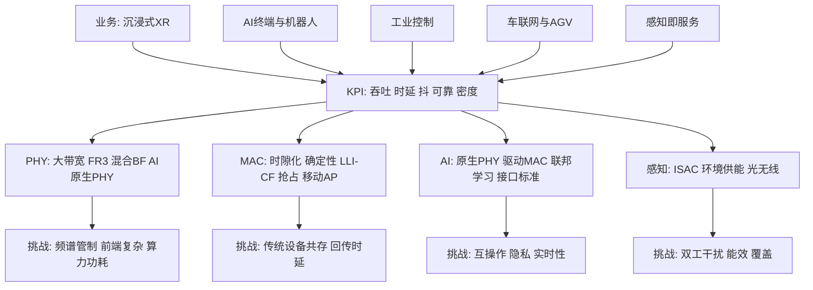
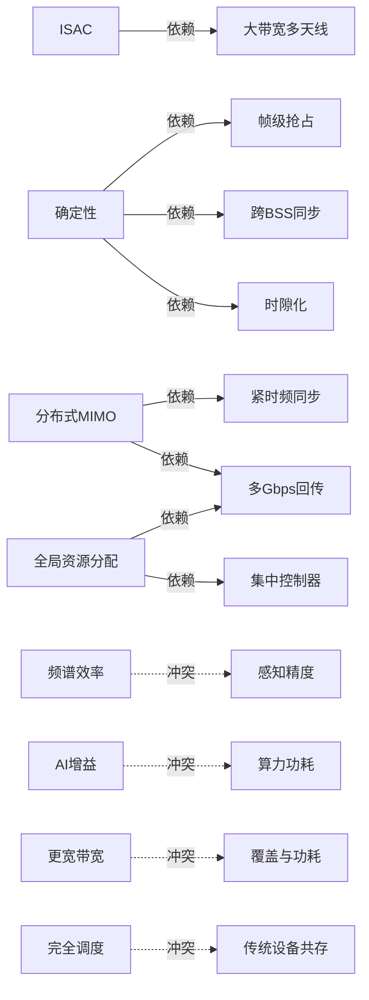

# 第 30 章　Wi-Fi 9：愿景、KPI 与路线图 ★★★

> **时效声明**：本章时效基准为 2026 年 9 月。截至此时，IEEE（电气与电子工程师协会，Institute of Electrical and Electronics Engineers）802.11bn（Wi-Fi 8）处于【草案】阶段（Draft 2.0 已于 2026 年 8 月完成工作组投票）；Wi-Fi 9（后 802.11bn 修正案，暂称 802.11bX）尚未正式立项，其立项载体 **无线局域网智能组网（WLAN Intelligent Networking, WIN）研究组（Study Group, SG）** 于 2026 年 7 月全会获批成立【已确定（组织决策）】。本章所有具体 KPI 数值与候选技术均为【讨论中】的提案主张或【本文推测】，非最终标准。凡引用论文或标准文稿之处均标注来源类型。

## 学习目标

1. 能基于沉浸式扩展现实（eXtended Reality, XR）、工业控制、人工智能（Artificial Intelligence, AI）终端等业务的量化需求，推导 Wi-Fi 9 的关键性能指标（Key Performance Indicator, KPI）目标区间，并论证其"吞吐非瓶颈、确定性为瓶颈"的结构性结论。
2. 能绘制 Wi-Fi 9 候选技术的四层全景图（物理层（Physical Layer, PHY）/ 媒体接入控制（Medium Access Control, MAC）/ AI / 感知），并指出各项技术的原理一句话、成熟度与主要挑战。
3. 能建立并求解"给定候选技术集合，判断某组 KPI 是否可达"的可达性分析（feasibility / gap analysis）模型，区分可加增益与交互项。
4. 能在标准未定、技术成熟度不确定的条件下，用贝叶斯后验更新或实物期权框架给出研发路线图的最优投入决策。

## 30.1 从 Wi-Fi 8 到 Wi-Fi 9：定位与本章地图

第 23 章给出了 Wi-Fi 8（802.11bn，超高可靠，Ultra High Reliability, UHR）的三大指标（吞吐、尾时延、丢包率各较 Wi-Fi 7 提升 ≥25%）与评估方法【草案】。第 31–36 章将分别展开确定性、AI、通感、新频谱等专题。本章是**第五篇的开篇与"地图"**，任务有三：

1. 把读者从"已立项的 Wi-Fi 8"带到"尚未立项的 Wi-Fi 9"，论证其驱动力与量化目标；
2. 给出候选技术全景及其依赖/冲突关系，明确与后续章节的分工（见表 30-1），避免抢戏；
3. 提供研究者可操作的"可达性分析"与"路线图决策"两套方法论，并指出 10–15 个可发表选题。

Wi-Fi 8 的标志性转向是"从追峰值速率转向保证确定性"【草案】。Wi-Fi 9 在此基础上进一步把范式从"优化孤立指标"推向"同时综合吞吐、时延、可靠与智能"——论文称之为**从尽力而为（best-effort）到保证性能（guaranteed performance）的范式转移**【讨论中】。

表 30-1 给出本章与后续章的分工，是读者定位自身研究方向的索引。

**表 30-1　本章与第 31–36 章的分工**（单位：章号）

| 主题 | 本章（第 30 章）的定位 | 后续展开章节 | 关系 |
|---|---|---|---|
| 确定性 MAC | 提出需求与候选机制清单 | 第 31 章 | 本章给地图，第 31 章给机制与协议 |
| AI / 机器学习（Machine Learning, ML） | 给出 AI-native 与接口标准化框架 | 第 32、33 章 | 本章定义边界，第 32/33 章给算法 |
| 通感一体化（Integrated Sensing and Communication, ISAC） | 列为新能力之一并提依赖 | 第 34、35 章 | 本章提依赖，第 34/35 章给波形与估计 |
| 新频谱 / 光无线 | 列为 PHY 候选并标冲突 | 第 36 章 | 本章标冲突，第 36 章给共存与协调 |

## 30.2 驱动力分析（定量）

Wi-Fi 9 的驱动力可分为**业务驱动**与**技术驱动**两类。与历史上"每代翻倍数率"不同，Wi-Fi 9 的驱动力来自"现有能力在某些场景下的结构性缺口"【讨论中】。

### 30.2.1 业务驱动（定量需求）

**（1）沉浸式 XR（扩展现实）**。场地娱乐（XR 场馆）是严苛测试床：十余台头显需 1 Gbps@5 ms，动作捕捉相机高达 9 Gbps@3 ms，触觉设备 100 Mbps@1 ms【讨论中，源自 25/2381r1】。消费级 XR 向无绳、全天候形态演进，需"持续多吉比特渲染流 + 超低运动到光子（motion-to-photon）时延 + 高能效"三者同时满足【讨论中，源自 26/0177r0】。

**（2）工业控制与机器人**。工厂自动化对关键控制报文要求极低丢包，最差时延下探至**亚毫秒**；远程操控（含 AI 使能）需确定性时延以支撑"感知卸载到边缘"的切分架构；协作机器人、温控约 10 ms，机器人运动控制亚毫秒，远程监测可达 100 ms【讨论中，源自 26/0179r0、26/0182r2】。安全性关键环路要求接近有线的可靠性（六九，99.9999%）。

**（3）车联网 / 自动导引车（Automated Guided Vehicle, AGV）**。自动驾驶市场被识别为增长用例：高精地图下载、传感器数据共享、流媒体；技术报告【讨论中，源自 26/0187r3】指出在业务发现、车速下的切换性能、车车中继协调方面存在关键缺口。

**（4）AI 终端**。AI 颠覆了传统业务的不对称性：历史下行:上行约 9:1，AI 交互显著抬高上行（企业网年增约 30%）【讨论中，源自 26/0180r0】。端侧推理的同步需求、分布式训练/推理的通信量，使"上行容量、低时延、确定性"成为首要目标。单设备上行流可飙至 25 Mbps【讨论中，源自 26/0180r0】。

**（5）感知即服务（Sensing-as-a-Service）**。802.11bf（Wireless LAN, WLAN Sensing）已于 2025 年 5 月【已发布】，定义了信道状态信息（Channel State Information, CSI）采集与感知-通信资源协调（站点管理实体，Station Management Entity, SME）机制，为 Wi-Fi 9 的 ISAC（通感一体化）提供数据源与接口基础。

### 30.2.2 技术驱动：Wi-Fi 8 之后仍无法解决的问题

Wi-Fi 8 在 sub-7 GHz 未引入任何 PHY 速率提升（无超 4096-QAM、无超 320 MHz）【草案】。其遗留的、需 Wi-Fi 9 解决的技术清单（均为【讨论中】提案主张）：

- **确定性**：载波侦听多址/冲突避免（Carrier Sense Multiple Access with Collision Avoidance, CSMA/CA）概率接入无法在有限时间内保证传输机会；
- **跨多 AP 的可扩展性**：当前多 AP 协调（Multi-AP Coordination, MAPC）仅限成对接入点（Access Point, AP）协调，缺全局资源视图；
- **AI 与空口的耦合**：缺标准化的数据采集/模型分发/联邦学习接口；
- **频谱上限**：sub-7 GHz 带宽触顶，新频谱（频率范围 3（Frequency Range 3, FR3）7–24 GHz）受管制不确定；
- **感知能力**：通感一体化的波形、双工与分辨率仍待定义。

### 30.2.3 "业务需求 vs 现有能力"差距表

下面给出定量差距。表中"现有能力"取 Wi-Fi 8 在典型（非极限）条件下的可实现值（示意值，量级来自论文与公开资料）；"缺口倍数"=目标/现有。结论性观察：**吞吐缺口多数 ≤10× 且可通过已有手段逼近，而确定性与可靠性缺口达 10–100×，是 Wi-Fi 9 的真正瓶颈。**

**表 30-2　业务需求 vs 现有（Wi-Fi 8 级）能力差距**（数值为示意值，【讨论中】）

| 业务 | 需求指标 | 现有能力（示意） | 目标（示意） | 缺口倍数 | 是否满足于 Wi-Fi 8 |
|---|---|---|---|---|---|
| XR 渲染流 | 下行吞吐 | 2 Gbps（边缘） | 0.5–1 Gbps | 0.25–0.5× | 是（吞吐充裕） |
| XR 运动控制 | 抖动 | 10–30 ms | ≤1 ms | 10–30× | **否（瓶颈）** |
| 工业运动控制 | 最坏时延 | 5 ms（95%） | ≤1 ms | 5× | **否** |
| 安全关键环路 | 可靠性 | 99.9%（三九） | 99.9999%（六九） | 10³× | **否** |
| AI 上行 | 上行吞吐 | 公平共享 | 25 Mbps/设备持续 | 视并发 | 部分 |
| 定位 | 精度 | 0.5 m（802.11az 级） | ≤0.1–0.3 m | 2–5× | 部分 |
| 感知分辨率 | 角度/多普勒 | 802.11bf 基线 | 更高 | 待定 | 待定 |

## 30.3 量化 KPI 提案：目标值区间与推导依据

本节整理论文与提案中的目标，并把"提案主张"与"已确定"分开。需强调：Wi-Fi 9 的所有 KPI 均为【讨论中】，下表"目标值"是多方提案的区间，**不是标准已定值**。

**表 30-3　Wi-Fi 9 候选 KPI 与目标区间**（全部【讨论中】）

| KPI | 目标值区间（提案） | 推导依据（倒推来源） | 备注 |
|---|---|---|---|
| 峰值吞吐 | 23→100 Gbps（峰值派主张） | 部分提案主张"百吉比特"目标【讨论中，26/0154r1】 | 与"现实边缘吞吐"分离 |
| 持续用户体验吞吐 | ≥10 Gbps（现实距离/信噪比，Signal-to-Noise Ratio, SNR） | 工作组的"现实距离下持续 10 Gbps"提案【讨论中，26/0196r0】 | 替代"峰值"叙事 |
| 最坏时延（关键流） | <5 ms（受管环境） | 关键流最坏时延界提案【讨论中，26/0180r0】 | 确定性核心 |
| 亚毫秒时延 | <1 ms（机器人运动控制） | 工业运动控制需求【讨论中，26/0182r2】 | 需时隙化+同步 |
| 抖动 | ≤1 ms | 时间敏感应用对抖动敏感【讨论中，25/2381r1】 | 与绝对时延同等重要 |
| 时延可靠度 | 99.999%（五九） | 紧急流满足时延的概率【讨论中，25/2381r1】 | "几九"保证 |
| 丢包可靠度 | 99.9999%（六九） | 最严苛沉浸/工业场景【讨论中，25/2381r1、26/0180r0】 | 接近有线 |
| 连接密度 | 单场地数十 XR 用户/AP 群 | 场地娱乐密度【讨论中，25/2381r1】 | 可扩展性指标 |
| 定位精度 | ≤0.1–0.3 m（cm 级） | 继承并超越 802.11az【讨论中】 | 通感协同 |
| 感知分辨率 | 高角度/多普勒分辨 | ISAC 需要大带宽+多天线 | 与吞吐权衡 |
| 能效 | bit/J 提升；"零比特零瓦" | AP 静态近零功耗愿景【讨论中，26/0154r1】 | 与高吞吐冲突 |
| 成本/功耗 | 不显著增加 | 设备形态因子约束【讨论中，26/0154r1】 | 天线数受限 |

**KPI 推导方法论**：KPI 不应"拍脑袋"，而应由业务倒推。下面用**算例 30.1**演示"XR 业务 → 所需码率/抖动"的倒推，并据此定位瓶颈维度。

**算例 30.1（KPI 倒推：8K 双眼 120 fps 的 XR）**【讨论中，示意值】

- **已知**：单眼 8K（7680×4320）@120 fps，采用类 HEVC 编码后单眼码率约 250 Mbps（示意）；双眼立体渲染流合计下行 $R_{\downarrow}\approx 500\ \text{Mbps}$；上行承载位姿/触觉控制 $R_{\uparrow}\approx 80\ \text{Mbps}$；运动到光子（motion-to-photon）时延预算 $L_{\text{budget}}=20\ \text{ms}$；抖动预算 $J_{\text{budget}}\le 1\ \text{ms}$。
- **求**：相对 Wi-Fi 8 级能力，吞吐与抖动各自缺口。
- **解**：
  1. 吞吐：Wi-Fi 8 边缘可达约 2 Gbps（示意），所需 0.5 Gbps 下行 → 吞吐缺口 $2/0.5=4\times$，即吞吐**充裕**（满足）。
  2. 抖动：设 Wi-Fi 8 在竞争密集下 95% 抖动约 $J_8\approx 15\ \text{ms}$（示意），目标 $1\ \text{ms}$ → 抖动缺口 $15\times$。
  3. 可靠度：目标 99.999%（五九），Wi-Fi 8 典型 99.9%（三九）→ 需提升两个数量级（$10^2\times$）。
- **结论**：该业务的**绑定约束是抖动与可靠度，而非吞吐**。这从单业务层面印证了表 30-2 的结构性结论——Wi-Fi 9 应以确定性/可靠性为第一性目标，峰值吞吐为次要叙事。量级合理：8K@120fps 的编码码率落在数百 Mbps 量级，与场馆级 1 Gbps 头显需求同阶。

## 30.4 候选技术全景（四类）

论文把候选技术按协议层分为四类【讨论中】，表 30-4 给出每项"原理一句话 + 关键挑战 + 成熟度"。图 30-1 用 Mermaid 画出"驱动 → KPI → 技术 → 挑战"的分层全景。

**图 30-1　Wi-Fi 9 候选技术全景（驱动→KPI→技术→挑战）**



**表 30-4　候选技术—解决的指标—成熟度—主要挑战大表**（状态均【讨论中】除非注明）

| 层 | 技术 | 原理一句话 | 解决的主要指标 | 成熟度 | 主要挑战 |
|---|---|---|---|---|---|
| PHY | 更大带宽（480/640 MHz、非连续聚合） | 在 6 GHz 拓宽连续/聚合信道以提升容量 | 峰值/边缘吞吐 | 经典方向 | 宽信道获信道概率随密度下降 |
| PHY | FR3 新频谱（7–24 GHz） | 利用第六代移动通信（6th Generation, 6G）命名的 7–24 GHz 大带宽 | 吞吐上限 | 经典方向 | 需国际电信联盟无线电通信部门（ITU Radiocommunication Sector, ITU-R）/ 管制介入，长周期不确定 |
| PHY | 混合波束赋形 | 模拟粗指向+数字精 steer，限射频（Radio Frequency, RF）链数 | 覆盖/频谱效率（Spectral Efficiency, SE）/协同波束赋形（Coordinated Beamforming, Co-BF） | 新提案（源自 11ad/ay） | 前端架构、训练开销 |
| PHY | 新波形 / pilotless | 省略训练符号提 SE，ML 取信道 | SE | 新提案 | 需新帧结构，对传统兼容 |
| PHY | AI-native PHY（神经接收机） | 神经网络（Neural Network, NN）替代/增强信道估计均衡解调 | SE/可靠 | 新提案 | 算力、实时、可验证性 |
| MAC | 时隙化与确定性 | 跨 重叠基本服务集（Overlapping BSS, OBSS）同步时隙，静态/动态分配 | 时延/抖/可靠 | 新提案 | 与传统随机接入共存难 |
| MAC | 低时延指示承诺反馈（LLI Commitment Feedback, LLI-CF） | 对低时延请求给确定性承诺反馈 | 时延可预测 | 扩展 11bn | 需定义传输机会（Transmission Opportunity, TXOP）持有者义务 |
| MAC | 帧级抢占 | 切分帧插入抢占间隔传紧急帧 | 最坏时延 | 11bn 讨论未纳入 | 复杂度、前导开销 |
| MAC | 移动 AP（车载/无人机） | 回传感知 MAC + 设备内共存（In-Device Coexistence, IDC） | 移动服务质量（Quality of Service, QoS） | 新提案 | 蜂窝回传抖动、热/功耗 |
| 网络 | 超两 AP 协调 | 三及以上 AP 联合调度 | 密度/SE | 扩展 11bn | 调度与同步复杂度 |
| 网络 | 全局资源分配 | 集中控制器跨 基本服务集（Basic Service Set, BSS）联合调度 | SE/公平 | 新提案 | 需低时延回传 |
| 网络 | 分布式多输入多输出（Multiple-Input Multiple-Output, MIMO；联合传输 Joint Transmission, J-TX） | 多 AP 虚拟单多天线系统 | 吞吐/可靠 | 11bn 推迟 | 多 Gbps 回传+紧同步 |
| AI | AI 驱动 MAC | 预测流量/干扰主动分配 | 时延/SE | 厂商已实现 | 标准化参数接口 |
| AI | 联邦学习 | 跨设备协同训练不聚原始数据 | 隐私/泛化 | 新提案 | 梯度聚合、带宽 |
| AI | 数据/模型接口标准 | 规定采集、分发、版本、回滚 | 互操作 | 新提案 | 灵活性与锁定 |
| 感知 | ISAC（通感一体化） | 同一波形/资源同时通信与感知 | 感知分辨率 | 新提案（见 34/35 章） | 双工干扰、SE 权衡 |
| 感知 | 环境供能通信（802.11bp） | 射频能量收集供能自供能终端 | 能效/覆盖 | 【草案】初始草稿 | 能量-通信权衡 |
| 感知 | 光无线（802.11br） | 400–600/1200–1600 nm 光链路 | 频谱稀缺 | 【草案】初始草稿 | RF 受限场景、指向性 |

> 说明：802.11bp（环境供能）、802.11br（增强光通信）、802.11bq（集成毫米波）为**并行修正案**，不属 802.11bX 本身，但为 Wi-Fi 9 提供可复用工具【草案】。

## 30.5 技术依赖与冲突关系

候选技术并非独立，存在**依赖**（缺之不可行）与**冲突**（此消彼长）。理解二者是可行路线图的前提。

### 30.5.1 依赖关系

- **ISAC → 大带宽 + 多天线**：感知分辨率依赖大带宽（距离分辨）与多天线（角度分辨）。
- **确定性 → 时隙化 + 跨 BSS 同步 + 帧级抢占**：三者缺一不可地逼近有界时延。
- **AI-native PHY → 新帧结构 / pilotless 前导**：神经接收机与无导频接收需改物理层汇聚协议数据单元（PLCP Protocol Data Unit, PPDU）。
- **分布式 MIMO（J-TX）→ 多 Gbps 回传 + 紧时频同步**：数据共享与相干合并的硬约束。
- **全局资源分配 → 集中控制器 + 低时延回传**：实时跨 BSS 调度的基础。

### 30.5.2 冲突关系

- **频谱效率 vs 感知精度**：感知占用时频资源，降低通信 SE（双工/占空比冲突）。
- **AI 增益 vs 算力功耗**：NN 推理增益以终端/AP 算力与功耗为代价。
- **更宽带宽 vs 覆盖与功耗**：480/640 MHz 与 FR3 提升吞吐但缩小覆盖、增功耗。
- **完全调度 vs 传统设备共存**：全调度假设所有设备守时隙，传统随机接入设备破坏时序。
- **高吞吐（多 SS/宽频）vs 成本/形态因子**：天线数与 RF 链受设备体积与成本约束。

**图 30-2　依赖 / 冲突关系图**（实线为依赖，虚线为冲突）



**表 30-5　依赖 / 冲突关系矩阵**（Y 行依赖/冲突于 X 列；D=依赖，C=冲突，·=无关）

| 行＼列 | 大带宽 | FR3 | 时隙化 | 抢占 | 多天线 | 回传 | 传统共存 | AI 算力 |
|---|---|---|---|---|---|---|---|---|
| ISAC | D | D | · | · | D | · | · | · |
| 确定性 | · | · | D | D | · | · | C | · |
| J-TX | · | · | · | · | D | D | · | · |
| 全局分配 | · | · | D | · | · | D | · | · |
| 频谱效率 | · | · | · | · | · | · | · | C（感知） |
| AI 增益 | · | · | · | · | · | · | · | C（功耗） |
| 完全调度 | · | · | D | · | · | · | C | · |

## 30.6 标准化路线图与研究方法学

### 30.6.1 IEEE 802.11 的组织与流程（仅机制）

下列流程机制为 IEEE 802.11 的常规立项路径【已发布（流程机制）】，只讲机制不讲沿革：

1. **WNG SC（Wireless Next Generation Standing Committee）**：前瞻论坛，孵化新方向，可催生 Study Group / 专题兴趣组（Topic Interest Group, TIG）/ 常设委员会（Standing Committee, SC）。
2. **Study Group（SG）**：界定场景、量化目标、形成项目授权请求（Project Authorization Request, PAR）与标准开发准则（Criteria for Standards Development, CSD）。
3. **PAR / CSD**：项目授权请求与标准开发准则，需 802 局域网/城域网标准委员会（LAN/MAN Standards Committee, LMSC）批准。
4. **任务组（Task Group, TG）**：技术提案磋商，演进出 Draft 0.x → 1.0。
5. **Draft 与批准**：工作组（Working Group, WG）投票 → 标准协会标准委员会（Standards Association Standards Board, SASB）批准 → 发布；随后 Wi-Fi 联盟启动认证。

**图 30-4　标准立项流程（机制）**


### 30.6.2 时间线与状态（每条标注：已确定 / 推测）

依据 2026 年 9 月可核实信息：

- **802.11bn（Wi-Fi 8）**：Draft 1.0（2025-08）已完成，D2.0 工作组初始投票 LB296 于 2026-08-03 至 09-02 关闭、76.5% 通过【草案，已确定进度】；目标批准 2028，认证约 2028【推测】。
- **Wi-Fi 9 立项载体 WIN SG**：2026-07 全会由 WG 与 802 LMSC 批准成立【已确定（组织决策）】；论文与 Lansford 综述预测 PAR/CSD 约 2027-03、Draft 0.1 约 2028-09、Draft 1.0 约 2029-05、WG 批准约 2030 末、认证 2031 末–2032 初【全部推测】。
- **并行 TG**：
  - 802.11bq（集成毫米波 42–71 GHz）：PPDU 格式已定，审查技术提案，目标 ~2027【草案】；
  - 802.11bt（后量子密码）：D1.0 于 2026-08 投票（LB297，89.3%），目标 2028【草案】；
  - 802.11br（增强光通信）：初始草稿，目标 2028【草案】；
  - 802.11bp（环境供能）：初始草稿，预计 2026-09【草案】；
  - 802.11bf（WLAN Sensing）：2025-05【已发布】；
  - 802.11bh（随机化 MAC 地址）：2024-09【已发布】；802.11bk（320 MHz 定位）：2025-06【已发布】；
  - 802.11bi（增强隐私）：SA 投票中，预计 2026 下半年发布【草案，接近发布】；
  - **AI Offload SG**：2026-03 成立，PAR 待 2026-11 的 802 评审【已确定（成立）】；
  - **人工智能/机器学习常设委员会（AI/ML Standing Committee, AIML SC）**：2024 起运行，2026-07 发布首份年度技术报告【已发布（常设委员会）】。


*图 30-5 说明：各修正案与组织实体的标准化进度甘特图。绿色为已发布，蓝色为草案/进度确定，橙色为 Wi-Fi 9 立项载体（WIN SG）；★ 标记已确定事件，其余时间点为论文与综述的推测值。*

### 30.6.3 给研究者的建议

- **早期介入**：SG 阶段（即现在）的 KPI 定义之争往往比技术之争更重要——先定义"衡量什么"，再争论"怎么实现"。
- **文稿贡献 + 仿真校准**：用可复现的仿真（而非口号）支撑 KPI 目标，是提案被采纳的关键。
- **区分可标准化与厂商私有**：AI 增益若依赖私有模型则难以互操作；优先贡献"数据/模型接口"类可标准化部分。

## 30.7 与 6G / 国际移动通信 2030（International Mobile Telecommunications 2030, IMT-2030）的关系

Wi-Fi 9 与 6G 在场景、指标、技术上有大量重合（确定性、AI-native、ISAC），但分工明确。判据是**覆盖 / 移动性 / 成本 / 频谱**四要素。

**表 30-6　Wi-Fi 9 与 6G / IMT-2030 对照**（Wi-Fi 9 列【讨论中】）

| 维度 | Wi-Fi 9（非授权） | 6G / IMT-2030（授权） | 关系 |
|---|---|---|---|
| 频谱 | 非授权（2.4/5/6 GHz，争取 FR3） | 授权（含 FR3 7–24 GHz、更高频段） | 互补（频谱角色不同） |
| 覆盖 | 室内/热点，单 AP 数十米 | 广域连续覆盖 | 分工（室内 vs 广域） |
| 移动性 | 有限（Seamless Mobility and Distribution, SMD 域内切换） | 全移动性、高铁/车载 | 分工 |
| 成本/部署 | 低，即插即用 | 高，需运营商基建 | Wi-Fi 优势 |
| 确定性 | 受管环境的时隙化+同步 | 时间敏感网络（Time-Sensitive Networking, TSN）/ 确定性网络（Deterministic Networking, DetNet）原生 | 趋同目标，机制互补 |
| AI-native | AIML SC + AI Offload SG | 原生空口（AI-native air interface） | 趋同，互学 |
| ISAC | 802.11bf 起步，Wi-Fi 9 深化 | 6G 核心能力 | 重合，共用波形研究 |
| 与蜂窝融合 | 非独立、补充容量 | 主控 | 互补 |

**互补 vs 竞争的技术判据**：当业务落在"低成本、室内/热点、低移动性"象限 → Wi-Fi 9 互补占优；当业务需"广域连续、高移动性、网络级服务等级协议（Service Level Agreement, SLA）" → 6G 占优。二者在 ISAC 波形、AI-native 接收机等底层技术上**竞争式互学**，但在部署与经济性上**互补**。

## 30.8 核心算法（六段式）：Wi-Fi 9 KPI 可达性分析

本算法解决：给定候选技术集合及其增益/代价模型，判断某组 KPI 是否可达（feasibility / gap analysis）。它把第 23 章的 Shapley 思路用于增益归因。

### 30.8.1 问题建模

- 候选技术集 $\mathcal{T}=\{1,\dots,K\}$，决策变量 $x_k\in\{0,1\}$ 表示是否采纳技术 $k$。
- 指标集 $\mathcal{M}$（如吞吐、时延、抖、可靠度九数、定位精度、能效）。
- 基线向量 $\mathbf{b}=(b_m)$：Wi-Fi 8 在典型条件下可实现值（对数域）。
- 技术 $k$ 对指标 $m$ 的可加增益 $g_{k,m}$（dB 域；可靠性用"九数"增益，单位 nines）。
- 交互项 $I_{kl,m}$：技术 $k,l$ 联合时的成对增益修正（来自第 23 章 Shapley 交互余项）。
- 代价向量 $\mathbf{c}=(c_k)$（成本/功耗预算），上限 $C_{\max}$。

### 30.8.2 目标函数与约束

求 $\mathbf{x}\in\{0,1\}^K$ 使
$$\min_{\mathbf{x}}\; \sum_{m} \max\!\big(0,\ \log G_m - \log a_m(\mathbf{x})\big)$$
满足 $a_m(\mathbf{x})\ge G_m\ (\forall m)$ 且 $\sum_k c_k x_k\le C_{\max}$。其中可达值（对数域）：
$$\log a_m = \log b_m + \frac{1}{10}\sum_k x_k g_{k,m} + \frac{1}{10}\sum_{k<l}x_k x_l I_{kl,m}$$
（线性指标用 dB；可靠性九数直接相加）。这是带二次交互项的 0–1 整数规划（Integer Programming, IP）。

### 30.8.3 完整推导

**步骤 1（对数域线性化）**：对乘法型增益 $a_m=b_m\cdot 10^{\Delta_m/10}$，取 $\log_{10}$ 得可加形式，交互项保留为二次项。

**步骤 2（Shapley 归因）**：把多技术联合总增益 $\Delta_m$ 分解为各技术边际贡献之和加交互余项，交互余项即 $I_{kl,m}$，满足 $\sum_k \phi_k+\sum_{k<l}I_{kl,m}=\Delta_m$（$\phi_k$ 为第 23 章 Shapley 值）。

**步骤 3（可达域刻画）**：在 dB 域，单技术点 $\mathbf{p}_k=\mathbf{b}+\mathbf{g}_k/10$；采纳子集 $S$ 对应点 $\mathbf{p}_S=\mathbf{b}+\frac1{10}\sum_{k\in S}\mathbf{g}_k+\frac1{10}\sum_{k<l\in S}I_{kl}$。全体可达点集合 $\mathcal{R}=\{\mathbf{p}_S:S\subseteq\mathcal{T}\}$（$2^K$ 个）。$\mathcal{R}$ 的**凸包** $\mathrm{conv}(\mathcal{R})$ 给出线性规划（Linear Programming, LP）松弛后的外近似可达域。

**步骤 4（判定）**：目标 KPI 向量 $\mathbf{G}$ 落在 $\mathcal{R}$ 中某点上方（逐维 $\ge$）即"精确可达"；落在 $\mathrm{conv}(\mathcal{R})$ 中但非 $\mathcal{R}$ 点，则"凸组合可达但需分数采纳（物理不可实现）"，判为不可达并报告缺口。

$$\boxed{\text{Feasible}\iff \exists\,\mathbf{x}\in\{0,1\}^K:\ \log_{10}G_m\le \log_{10}b_m+\frac1{10}\sum_k x_k g_{k,m}+\frac1{10}\sum_{k<l}x_k x_l I_{kl,m},\ \forall m,\ \sum_k c_k x_k\le C_{\max}}$$

### 30.8.4 伪代码

```text
 1: 输入 b_m, g_{k,m}, I_{kl,m}, G_m, c_k, C_max        // 基线/增益/交互/目标/代价
 2: best_gap ← +∞; best_x ← None
 3: for 每个子集 S ⊆ {1..K} do                         // 穷举 2^K，O(2^K)
 4:     a_m ← b_m; cost ← 0
 5:     for k in S: a_m ← a_m + g_{k,m}/10; cost ← cost + c_k
 6:     for k<l in S: a_m ← a_m + I_{kl,m}/10          // 加交互项
 7:     if cost > C_max: continue                      // 预算约束剪枝
 8:     gap ← Σ_m max(0, log10(G_m) - a_m)            // 计算缺口
 9:     if gap < best_gap: best_gap ← gap; best_x ← S // 记录最优子集
10: end for
11: if best_gap == 0: 输出 "可达，方案 best_x"
12: else: 输出 "不可达，最小缺口 best_gap，缺技术建议"   // 指导补哪些技术
```

复杂度：时间 $O(2^K\cdot(K^2+M))$，空间 $O(K+M)$。当 $K$ 大时用 LP 松弛（凸包）求外近似，$O(\mathrm{poly}(K,M))$ 但仅给出可达性上界。

### 30.8.5 复杂度分析

穷举随技术数 $K$ 指数增长（NP-hard 本质）；LP 松弛随 $K,M$ 多项式增长但可能过估可达性。实践中 $K\le 20$ 可剪枝穷举，更大则依赖 LP/启发式。

### 30.8.6 数值算例（算例 30.2）

- **已知**（【讨论中】示意）：取 3 项技术 $S=\{\text{大带宽}(480/640\text{MHz}),\ \text{时隙化确定性},\ \text{AI-native PHY}\}$。基线峰值吞吐 $b_T=23\ \text{Gbps}$（802.11be 级），目标峰值 $G_T=100\ \text{Gbps}$。增益：大带宽 $g_T=+3\ \text{dB}$，AI-native $g_T=+1.5\ \text{dB}$，时隙化对吞吐 $0\ \text{dB}$（忽略交互）。可靠性基线三九（$b_R=3$），目标五九（$G_R=5$）；增益：时隙化 $+2$ 九、AI $+0.5$ 九。最坏时延基线 $5\ \text{ms}$，目标 $<5\ \text{ms}$（时隙化使其降至 $1\ \text{ms}$）。
- **求**：该组合能否满足"峰值 100 Gbps + 时延可靠度 99.999%"？
- **解**：
  1. 吞吐可达 $a_T=23\cdot10^{(3+1.5)/10}=23\cdot10^{0.45}=23\times2.82\approx 65\ \text{Gbps}$。
  2. 缺口 $\log_{10}(100/65)=\log_{10}1.54\approx 0.187\ \text{dB}$ 域缺口约 $1.9\ \text{dB}$（即 $100/65\approx1.54\times$）。
  3. 可靠性可达 $3+2+0.5=5.5$ 九 $=99.9997\%\ge 5$ 九 → **满足**。
  4. 时延 $1\ \text{ms}<5\ \text{ms}$ → **满足**。
- **结论**：该 3 技术组合**满足可靠性与最坏时延，但峰值 100 Gbps 不可达**（缺约 1.9 dB）。需补"分布式 MIMO（J-TX，约 +6 dB 吞吐）"或"FR3 新频谱"方可达标。量级合理：23 Gbps 经 ~4.5 dB 增益到 65 Gbps，符合 dB 乘法。

## 30.9 核心算法（六段式）：技术路线图决策分析

在标准未定、技术成熟度不确定的条件下，研究者/厂商应如何分配有限的研发预算？本算法用**贝叶斯后验更新 + 多臂老虎机（Thompson Sampling）**建模。

### 30.9.1 问题建模

- 候选技术臂 $i\in\{1,\dots,K\}$，其"成功（被标准采纳且商用可行）"为伯努利，成功概率 $p_i$ 未知。
- 先验 $p_i\sim\mathrm{Beta}(\alpha_i^0,\beta_i^0)$（取 $(1,1)$ 为无信息先验）。
- 每次对臂 $i$ 投入一次试点，观测结果 $y\in\{0,1\}$（成功/失败）。
- 价值 $v_i$：若成功带来的预期收益（如 KPI 贡献、市场）。
- 目标：多轮投入下最大化累积期望净收益 $\sum_i \mathbb{E}[p_i v_i]$。

### 30.9.2 目标函数与约束

每轮选臂 $a_t=\arg\max_i \tilde p_i v_i$，其中 $\tilde p_i\sim\mathrm{Beta}(\alpha_i,\beta_i)$ 为从后验抽样。预算约束 $\sum_t 1\le T$（总试点次数）。等价于最大化信息价值（减少 $p_i$ 不确定性）与期望收益的平衡。

### 30.9.3 完整推导

**步骤 1（贝叶斯更新）**：先验 $\mathrm{Beta}(\alpha,\beta)$，观测成功则 $(\alpha,\beta)\leftarrow(\alpha+1,\beta)$；失败则 $(\alpha,\beta)\leftarrow(\alpha,\beta+1)$。后验均值 $\hat p=\alpha/(\alpha+\beta)$。

**步骤 2（Thompson Sampling 最优性）**：在伯努利多臂下，按后验抽样选臂的累积遗憾（regret）以 $O(\sqrt{KT\ln T})$ 界增长，是最优阶【讨论中，理论结论】。

**步骤 3（实物期权视角）**：若"现在投入"成本 $c$，未来收益折现值 $V$，则等待的期权价值 $=\mathbb{E}[\max(0,V_{\text{future}}-c)]$；当后验不确定性高（$\alpha+\beta$ 小）时，等待的信息价值大于立即投入，应延后——这正是"标准早期先参与文稿、晚下重注"的依据。

$$\boxed{a_t=\arg\max_i \tilde p_i v_i,\quad \tilde p_i\sim\mathrm{Beta}(\alpha_i,\beta_i);\quad (\alpha,\beta)\leftarrow(\alpha+y,\beta+1-y)}$$

### 30.9.4 伪代码

```text
 1: 初始化 每臂 (α,β) ← (1,1); 价值 v_i; 预算 T        // 无信息先验
 2: for t = 1..T do                                      // 共 T 次试点
 3:     for i in 1..K: 抽样 ~p_i ← Beta(α_i, β_i)        // 从后验抽样
 4:     a ← argmax_i (~p_i * v_i)                        // 选期望收益最高臂
 5:     执行试点, 观测 y ∈ {0,1}                          // y=成功
 6:     if y==1: α_a ← α_a + 1  else: β_a ← β_a + 1      // 贝叶斯更新
 7:     记录累积收益 y * v_a                             // 统计遗憾
 8: end for
 9: 输出 各臂后验均值 α/(α+β) 与推荐优先投入臂          // 指导路线图
```

复杂度：每轮 $O(K)$ 抽样+选臂，总 $O(KT)$；更新 $O(1)$。

### 30.9.5 复杂度分析

时间随臂数 $K$ 与总试点 $T$ 线性；空间 $O(K)$。相比穷举 $2^K$ 方案，贝叶斯多臂在不确定性下显著更省。

### 30.9.6 数值算例（算例 30.3）

- **已知**（【讨论中】示意）：两候选臂 A=确定性时隙化（$v_A=80$），B=FR3 新频谱（$v_B=120$）。先验均 $(1,1)$。第 1 轮后：A 试点成功（观测 $y=1$），B 试点失败（$y=0$）。
- **求**：更新后 posterior，并决定下一轮优先投入哪条路线。
- **解**：
  1. A 后验 $\mathrm{Beta}(1+1,1)=\mathrm{Beta}(2,1)$，均值 $\hat p_A=2/3\approx0.667$。
  2. B 后验 $\mathrm{Beta}(1,1+1)=\mathrm{Beta}(1,2)$，均值 $\hat p_B=1/3\approx0.333$。
  3. 期望收益：A 为 $0.667\times80=53.3$；B 为 $0.333\times120=40.0$。
  4. 因 $53.3>40.0$，**下一轮优先投入 A**（确定性时隙化）；B 因早期失败且价值虽高但不确定性仍大，暂列观察（实物期权：延后重注，待更多证据）。
- **结论**：早期失败不应立即放弃高价值臂，但贝叶斯决策在本例明确把有限预算导向已验证的 A。量级合理：Beta 更新后均值随单次观测从 0.5 偏移到 0.667/0.333，符合共轭先验性质。

## 30.10 开放研究议题清单

下列 10–15 个议题覆盖第 31–36 章，可作论文选题库（均【讨论中】前沿）：

1. **跨 BSS 时隙同步的抖动界**：在异步晶体与不同步回传下，如何给出有界抖动的理论上界？难点：时钟漂移建模；评估：仿真最坏时延累积分布函数（Cumulative Distribution Function, CDF）。
2. **绿色字段（Greenfield）模式的共存隔离**：频率/时间/空间隔离下，如何保证与传统设备初始关联且不碎片化生态？难点：隔离域定义；评估：共存吞吐量损失。
3. **AI-native PHY 的可验证性能界**：神经接收机相对传统 DSP 的增益在何种信道模型下可证明？难点：泛化界；评估：标准化信道仿真。
4. **无导频（pilotless）接收的帧结构设计**：如何在不破坏传统设备解调前提下嵌入 ML 前导？难点：后向兼容；评估：误块率曲线。
5. **联邦学习在 MAPC 中的梯度聚合**：空中计算（over-the-air）梯度聚合的功率-精度权衡？难点：信道异质；评估：收敛轮数。
6. **ISAC 的波形-感知双工干扰消除**：同时通信与感知时的自干扰消除下界？难点：双工；评估：感知均方误差（Mean Square Error, MSE）vs 通信 SE 帕累托。
7. **分布式 MIMO（J-TX）的回传-同步联合设计**：在有限回传容量下逼近容量增益的调度？难点：紧同步；评估：可达和率。
8. **全局资源分配的回传感知调度**：低时延回传不可得时的分布式近似最优？难点：信息滞后；评估：SE/公平。
9. **移动 AP 的回传感知 MAC**：蜂窝回传抖动下如何保证客户端 QoS？难点：跨制式耦合；评估：尾时延。
10. **FR3（7–24 GHz）前端与信道模型**：该频段室内信道与 RF 前端可行性？难点：管制+前端；评估：链路预算。
11. **确定性 MAC 与传统设备的公平共存调度**：混合部署下传统设备的性能退化界？难点：保护间隔；评估：共存公平指数。
12. **KPI 定义的形式化方法论**：如何把业务 SLA 自动倒推为可测 KPI（闭环）？难点：指标耦合；评估：倒推误差。
13. **环境供能（802.11bp）与通信的能效联合**：能量收集-传输调度的最优停等？难点：能量因果；评估：bit/J。
14. **光无线（802.11br）与射频的多链路操作（Multi-Link Operation, MLO）波分复用**：光/射频链路切换的时延？难点：指向性；评估：中断概率。
15. **标准早期 KPI 之争的博弈建模**：多家提案下共识形成的均衡？难点：多方效用；评估：演化博弈。

## 本章小结

1. Wi-Fi 9 由"业务驱动（XR/机器人/AI/车联网/感知）+ 技术驱动（确定性/跨 AP 可扩展/AI 耦合/频谱上限/感知）"共同催生，范式从峰值速率转向保证性能【讨论中】。
2. 量化差距显示**绑定约束是抖动与可靠度（10–100× 缺口），而非吞吐**；KPI 应由业务倒推而非拍脑袋。
3. 候选技术分 PHY/MAC/网络/AI/感知四类，全景见图 30-1；其依赖与冲突见图 30-2 与表 30-5，是可行路线图的硬约束。
4. 标准化路径：WNG SC → WIN SG（2026-07 已成立★）→ PAR → TG → Draft → 批准（2030 末推测）→ 认证（2031–2032 推测）；并行 TG 见时间线。
5. 与 6G 在 ISAC/AI-native 上竞争式互学，在覆盖/移动性/成本/频谱上互补，判据见第 30.7 节。
6. 两个六段式算法提供可操作方法论：KPI 可达性分析（算例 30.2）与路线图贝叶斯决策（算例 30.3）。
7. 研究者应在 SG 早期介入 KPI 定义，并以可复现仿真支撑提案；15 个开放议题可作选题库。

**表 30-7　关键结论 / 参数速查**

| 项 | 数值/结论 | 状态 |
|---|---|---|
| Wi-Fi 9 SG | WIN SG，2026-07 成立 | 已确定（组织决策） |
| Wi-Fi 8 | D2.0 投票 2026-08（76.5%），批准 2028 | 草案/推测 |
| 峰值 KPI 主张 | 100 Gbps（提案） | 讨论中 |
| 持续吞吐目标 | ≥10 Gbps（现实距离） | 讨论中 |
| 最坏时延/抖动 | <5 ms / ≤1 ms | 讨论中 |
| 可靠度 | 五九~六九 | 讨论中 |
| 吞吐缺口（XR） | ≤4×，充裕 | 讨论中 |
| 抖动缺口（XR） | 10–30×，瓶颈 | 讨论中 |
| 算法一 | KPI 可达性（IP/LP） | 方法论 |
| 算法二 | 路线图贝叶斯/多臂 | 方法论 |

## 习题

### A. 概念题（3 题）

1. 为什么论文认为 Wi-Fi 9 应从"追峰值速率"转向"保证确定性"？这与 Wi-Fi 8 的转向有何异同？
2. 什么是 LLI-CF？它与 802.11bn 的 链路级信息（Link Level Information, LLI）有何本质区别？为何需要它？
3. 依赖与冲突有何区别？请以"ISAC 依赖大带宽"与"频谱效率冲突于感知精度"各说明。

### B. 计算与推导题（4 题）

1. 单眼 4K@90 fps 编码后约 120 Mbps，双眼立体合计 240 Mbps 下行、上行 40 Mbps。若 Wi-Fi 8 边缘可达 2 Gbps、95% 抖动 15 ms，目标抖动 1 ms，求吞吐缺口与抖动缺口倍数。
2. 基线峰值 23 Gbps，采用大带宽（+3 dB）与 AI-native（+1.5 dB），求可达峰值；目标 100 Gbps，求缺口 dB 与倍数。
3. 可靠性基线三九（99.9%），时隙化 +2 九、AI +0.5 九，求可达九数；目标五九（99.999%）是否满足？若目标六九（99.9999%）呢？
4. 两臂 A/B 先验均为 (1,1)，A 连续两次成功、B 一次成功一次失败，求各自后验均值并决策下一轮投入。

### C. 算法设计题（2 题）

1. 设计算法：给定候选技术增益矩阵与预算，输出"满足全部 KPI 的最小代价子集"。要求给出伪代码与复杂度。
2. 设计"跨 BSS 时隙化调度器"的 Thompson Sampling 变体：把"同步质量"作为隐藏成功概率，给出更新与选臂步骤。

### D. 开放研究题（1 题）

1. 选择一个第 30.10 节的开放议题（如 ISAC 双工干扰消除），给出研究路径建议、关键指标与可参考方向。

## 参考答案与解析

### A. 概念题

1. **解析**：根因是 sub-7 GHz 带宽与空间流已触顶，峰值速率仅在理想条件可达且边际体验收益递减；而 XR/工业/AI 的绑定约束是确定性而非峰值【讨论中】。Wi-Fi 8 已开始转向可靠性（Ultra High Reliability, UHR），Wi-Fi 9 是把"保证性能"从单 BSS 推向跨 BSS、跨层与智能化，是同一转向的深化而非另起炉灶。
2. **解析**：LLI（802.11bn）只信令低时延需求，TXOP 持有者无标准化义务响应；LLI-CF 增加**确定性承诺反馈**（何时调度），使响应方可信赖并降低竞争开销【讨论中】。本质区别：从"告知需求"到"承诺服务"。
3. **解析**：依赖=缺之不可行（ISAC 需大带宽换距离分辨、多天线换角度分辨）；冲突=此消彼长（感知占用资源降低通信 SE）。两者共同决定技术组合的可行性。

### B. 计算与推导题

1. **解**：吞吐缺口 $2/0.24\approx 8.3\times$（充裕）；抖动缺口 $15/1=15\times$。结论：吞吐非瓶颈，抖动为瓶颈。
2. **解**：可达 $23\cdot10^{0.45}=23\times2.82\approx 65\ \text{Gbps}$；缺口 $\log_{10}(100/65)=0.187\ \text{dB}$ 域，约 $1.9\ \text{dB}$，倍数 $1.54\times$。
3. **解**：可达 $3+2+0.5=5.5$ 九（99.9997%）→ 满足五九；六九需 6 九，差 0.5 九，**不满足**，需补技术。
4. **解**：A：Beta(3,1)，均值 3/4=0.75；B：Beta(2,2)，均值 0.5。期望收益若 $v_A=v_B$ 则投 A；若 $v_B>1.5v_A$ 才考虑 B。下一轮优先 A。

### C. 算法设计题

1. **参考方案**：最小代价可行子集 = 在算法 30.8 的 IP 上，把目标改为 $\min \sum c_k x_k$ s.t. 全部 KPI 满足。伪代码同 30.8 但记录满足约束的最小代价子集。**评分要点**：正确加预算约束、用对数域、处理交互项。**常见错误**：忽略交互项导致高估/低估增益；把可靠性当线性而非九数相加。
2. **参考方案**：把"同步质量" $q_i$ 建模为 Beta 后验，每轮观测同步误差是否低于门限作为 $y$；选臂 $a=\arg\max \tilde q_i v_i$；更新同 30.9。**评分要点**：隐藏成功概率的后验更新、与调度动作耦合。**常见错误**：把同步质量当已知常数，失去贝叶斯价值。

### D. 开放研究题

1. **研究路径建议**：① 建立同时通信+感知的联合波形与自干扰信道模型；② 推导双工干扰消除下"感知 MSE vs 通信 SE"的帕累托前沿；③ 用第 30.8 节可达域刻画"在给定吞吐约束下可达的感知分辨率"。**关键指标**：感知 MSE、角度/多普勒分辨率、通信 SE、自干扰消除比。**可参考方向**：802.11bf 的 SME 机制、第 34/35 章 ISAC 波形、MIMO 自干扰消除。无唯一标准答案。
