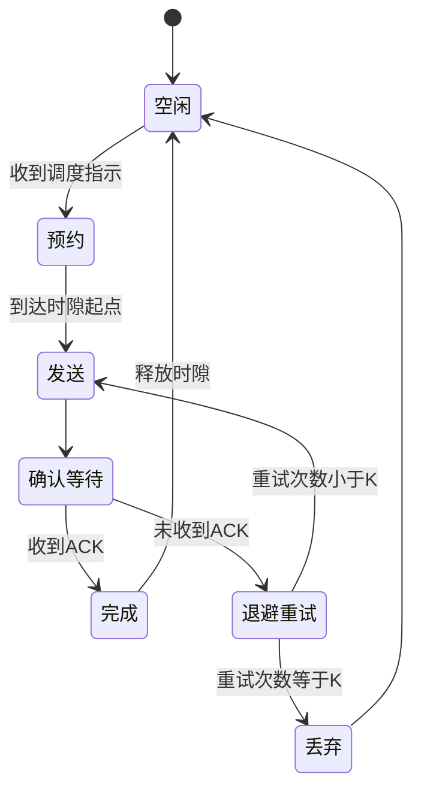
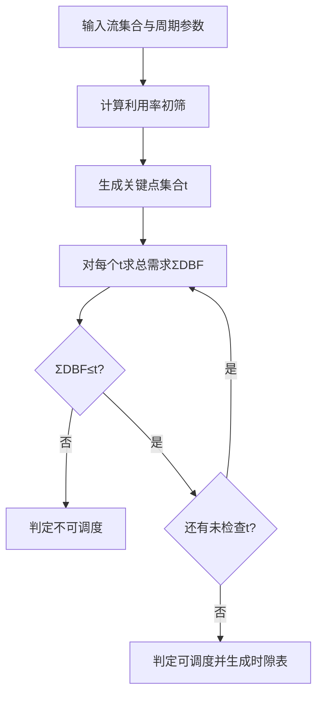
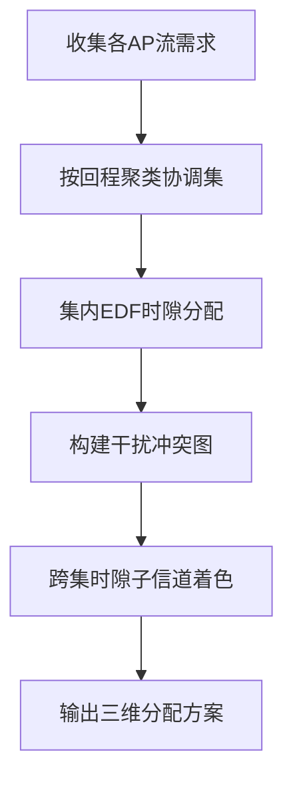
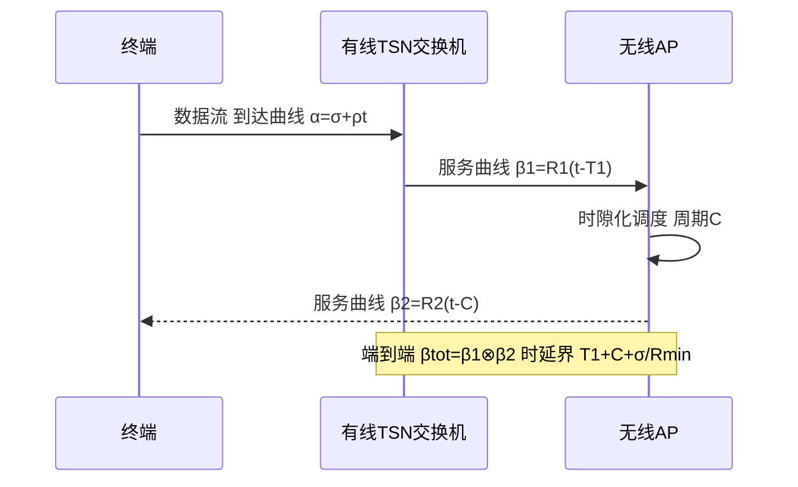

# 第 31 章　确定性 Wi-Fi：时隙化、同步与可证明的时延界 ★★★

> 本章定位为 Wi-Fi 9（后 802.11bn 世代，截至 2026-09 仍处研究组（Study Group, SG）阶段，修正案代号暂称 "802.11bX"）研究前沿【讨论中】。其核心主张：用**预约式时隙调度**根本替代第 28 章所述 11bn 的"统计性低时延工具箱"（优先增强分布式信道接入（Prioritized Enhanced Distributed Channel Access, P-EDCA）、低时延指示（Low Latency Indication, LLI）、非主信道接入（Non-Primary Channel Access, NPCA）、帧抢占），把 Wi-Fi 从"降低均值与分位"推进到"可证明的时延上界"。涉及 Wi-Fi 9 的机制名称与参数如未特别说明，均为提案主张，非最终标准。

## 学习目标

1. 能严格区分"低时延"与"确定性"，并论证载波侦听多路访问/冲突避免（Carrier Sense Multiple Access with Collision Avoidance, CSMA/CA）的随机退避为何无法给出确定性时延界（推导 $\Pr\{D>d\}$ 的衰减率）。
2. 能设计一个跨重叠基本服务集（Overlapping Basic Service Set, OBSS）同步的时隙化超帧结构，并推导保护间隔与时钟偏差、传播时延的关系。
3. 能运用最早截止期优先（Earliest Deadline First, EDF）的 processor-demand 判据（需求界函数，Demand Bound Function, DBF）判定周期性业务流集在离散时隙下的可调度性，并给出时隙表。
4. 能把时隙化 Wi-Fi 映射到电气与电子工程师协会（Institute of Electrical and Electronics Engineers, IEEE）时间敏感网络（Time-Sensitive Networking, TSN）/确定性网络（Deterministic Networking, DetNet），并用网络演算推导跨媒介（有线 + 无线）的端到端时延界与抖动界。

## 31.1 确定性的严格定义与随机接入的不可确定性

### 31.1.1 确定性 ≠ 低时延

"低时延"（low latency）描述分布的**中心或低阶分位**——例如"平均 2 ms""95 分位 5 ms"。但工业控制、运动控制、触觉互联网等业务要求的是**确定性**（determinism）：在任意时刻、任意网络状态下，关键流的时延、抖动、丢包都落在**硬界**之内。确定性由四个可度量量刻画：

- **有界时延（bounded latency）**：存在常数 $D_{\max}$，使 $\Pr\{D>D_{\max}\}=0$，即最坏时延有上界；
- **有界抖动（bounded jitter）**：相邻或任意两帧时延之差有界，记抖动界为 $J$；
- **零拥塞丢失（zero congestion loss）**：因竞争/拥塞导致的丢包概率为 0（不包括物理层不可纠正错误）；
- **有界可靠性（bounded reliability）**：交付成功率 $\ge 1-10^{-k}$，其中 $k$ 为安全等级（如 $k=3$ 对应 "5 个 9" 量级，实际为 $1-10^{-3}$；$k$ 越大越严）。

**关键结论**：仅压低均值或 95 分位**不等于**确定性——一个分布的低分位可以远优于另一个，但其尾部（99.99 分位及更极端处）仍可无界。下面用算例说明。

**算例 31.1（均值相同、尾部不同）**：设两条关键流的时延分布如下（单位 ms），二者均值均约为 2 ms。

- 流 A（近似调度型，轻尾）：以概率 0.70 取 1.9、0.30 取 2.4。均值 $=0.70\times1.9+0.30\times2.4=1.33+0.72=2.05\approx2.0$；最坏时延 $D_{\max}^{(A)}=2.4$；95 分位 $=2.4$（因仅 30% 超过 1.9）。
- 流 B（近似竞争型，重尾）：以概率 0.90 取 1.0、0.10 取 11.0。均值 $=0.90\times1.0+0.10\times11.0=0.9+1.1=2.0$；最坏时延 $D_{\max}^{(B)}=11.0$；95 分位 $=1.0$（因 90% 落在 1.0）。

**解**：两流均值同为 2.0 ms，但流 B 的 95 分位（1.0 ms）明显优于流 A（2.4 ms），而流 B 的最坏时延（11.0 ms）却是流 A 的 4.6 倍，且无硬上界（现实中更高重试可能触及丢包）。**结论**：以"95 分位更优"为依据部署流 B 于运动控制回路是危险的——确定性要求的是 $D_{\max}$ 与 $J$ 的硬界，而非低分位。该量级合理，因为竞争型退避的高重试事件虽稀有却代价巨大。

### 31.1.2 CSMA/CA 为何给不出确定性界

第 8 章的 Bianchi 模型给出：在 $n$ 个站点竞争、单冲突域下，稳态碰撞概率为
$$p = 1-(1-\tau)^{n-1},$$
其中 $\tau$ 为站点在一个时隙发起传输的概率。一次传输若碰撞，则进入退避阶段 $k\leftarrow k+1$，新退避计数器在 $[0,\mathrm{CW}_k-1]$ 均匀抽取，$\mathrm{CW}_k=\min(\mathrm{CW}_{\max},\mathrm{CW}_{\min}\cdot 2^k)$。

设一次成功传输前共尝试 $N$ 次。由于每次尝试独立碰撞概率近似为 $p$，则 $N$ 服从几何分布：
$$\Pr\{N=n\}=(1-p)p^{\,n-1},\qquad \Pr\{N\ge n\}=p^{\,n-1}.$$

令一次尝试的平均开销（退避均值 + 一次帧交换时间）为 $\overline{B}+\overline{Tx}$，则接入时延 $D$ 满足：当需 $n$ 次尝试时 $D\approx (n-1)(\overline{B}+\overline{Tx})+\overline{Tx}$。于是时延违反概率随阈值 $d$ 的衰减为

$$\boxed{\Pr\{D>d\}\;\le\;\exp\!\Big(-\frac{\ln(1/p)}{\overline{B}+\overline{Tx}}\;d\Big)\;>\;0\qquad(\forall\,d<\infty,\;p>0)}$$

**推导要点**：取 $n^*=\lceil d/(\overline{B}+\overline{Tx})\rceil$，则 $\Pr\{D>d\}\ge \Pr\{N>n^*\}\approx p^{\,n^*}$；代入 $p^{\,n^*}=\exp(n^*\ln p)$，并用 $n^*\approx d/(\overline{B}+\overline{Tx})$ 与 $\ln(1/p)>0$ 即得上式。该尾部是**指数型**（几何重试的理想化结果）；而真实设备有重试上限 $R$（如 dot11 短重试限制），此时分布被截断——但代价是超过 $R$ 次重试的帧被丢弃，**零拥塞丢失被打破**。

**为什么"降低 95 分位"仍可能在 99.99 分位失败**：由上式，第 $q$ 分位时延 $d_q$ 满足 $p^{\,d_q/(\overline{B}+\overline{Tx})}\approx 1-q$。取 $p=0.1$，则 95 分位对应 $n\approx 0.07$ 次额外尝试（几乎无重试），而 99.99 分位对应 $n\approx 4$ 次额外尝试，即 $d_{0.9999}\approx 4(\overline{B}+\overline{Tx})$——约为中位数的数倍。改善 $p$（P-EDCA、NPCA 等第 28 章手段）压低了 95 分位，却无法消除尾部质量：只要 $p>0$，任意有限 $d$ 都有 $\Pr\{D>d\}>0$，**不存在有限硬上界**。

> **结论**：要获得确定性，必须**消除竞争**——以预约/时隙化/协调取代随机退避。这正是本章其余部分的主题，也是第 28 章 11bn 工具箱（统计性改善）与 Wi-Fi 9（可证明界）的根本分野。

## 31.2 时隙化调度架构与跨 OBSS 同步

### 31.2.1 超帧结构与资源维度

时隙化（scheduled / slot-based access）以**超帧（superframe）**或**周期（cycle）** $C$ 为调度单位，将时间切成等长时隙（slot）并插入保护间隔（guard）$g$。资源在三维上展开：时间（时隙）、频率（子信道/资源单元，Resource Unit, RU）、空间（空间流）。图 31-1 给出周期 × 时隙 × 子信道的时频示意。


*图 31-1 说明：横向为周期内的时隙序列，纵向为子信道；F1/F2/F3 为不同业务流的预约时隙，G 为保护间隔，空白为可分配或竞争期；每个数据时隙后接保护间隔 g，周期 C = (τ_s+g)×时隙数，保护开销 = g/(τ_s+g)。*

调度分静态（工业控制回路等可预测流，预分配）与动态（接入点（Access Point, AP）/集中调度器按服务质量（Quality of Service, QoS）分配；结合第 33 章的人工智能（Artificial Intelligence, AI）预测可进一步预留突发资源）两类。时隙状态机如图 31-2 所示。


*图 31-2 说明：单个时隙的生命周期。随机成分被限制在"重试"分支，且重试次数封顶为 $K$，从而保证最坏时延有界。*

### 31.2.2 跨 OBSS 同步与保护间隔推导

跨 OBSS 同步是全局时隙化的前提：相邻基本服务集（Basic Service Set, BSS）的时隙边界必须对齐，否则一个 BSS 的发送会落入另一 BSS 的保护间隔，破坏确定性。同步源可为 AP 间有线精确时间协议（Precision Time Protocol, PTP）（IEEE 1588）、全球定位系统（Global Positioning System, GPS）/北斗、或空口同步（beacon / 触发帧对齐）。

设两 AP 的时钟在最近一次同步时刻偏差为 $\varepsilon_0$，晶振漂移率为 $\rho$（典型 Wi-Fi 晶振 $\rho\sim20\,\mathrm{ppm}$）。距上次同步经过时长 $t$ 后，最大偏差为 $\varepsilon(t)\le \varepsilon_0+\rho\,t$。一个 BSS 的发送沿在另一 BSS 看来可能提前或滞后该偏差；加上电磁波传播时延 $d_{\mathrm{prop}}$ 与收发切换时间 $t_{\mathrm{sw}}$，保护间隔必须覆盖最坏情形：

$$\boxed{g\;\ge\;\varepsilon_0\;+\;\rho\,C\;+\;d_{\mathrm{prop}}\;+\;t_{\mathrm{sw}}}$$

**推导**：最坏情况下发送沿相对标称边界偏移 $\varepsilon_0+\rho C$；该偏移沿两端各需保护，且需容纳信号从发射机到潜在受扰接收机的传播与切换，故三者相加构成单侧保护下限（取最不利相位叠加）。其中 $\rho C$ 项表明：**周期越长，所需保护间隔越大**——这是长周期与低开销之间的固有矛盾。

**保护间隔开销量化**：一个数据时隙 $\tau_s$ 配保护 $g$，纯调度效率为
$$\eta=\frac{\tau_s}{\tau_s+g}.$$
取 $\tau_s=100\,\mu\mathrm{s},\,g=5\,\mu\mathrm{s}$，则 $\eta=100/105=95.2\%$，开销 $\approx5\%$。若缩小为 $\tau_s=20\,\mu\mathrm{s}$（为降低调度等待、收紧抖动），则 $\eta=20/25=80\%$，开销升至 20%。**结论**：时隙越小，相对保护开销越大，需在抖动与效率间折衷（详见第 31.5 节研究议题）。

### 31.2.3 与 MCCA/MCCAOP（第 19 章）的对比

802.11s 的网格协调信道接入（Mesh Coordination Channel Access, MCCA）与 MCCA 传输机会（MCCA Opportunity, MCCAOP）已是早期的确定性尝试：通过预约 MCCAOP 在 mesh 内获得无竞争发送窗口。其未能普及的原因可归纳为：

| 维度 | MCCA/MCCAOP（第 19 章） | Wi-Fi 9 时隙化【讨论中】 |
|---|---|---|
| 适用拓扑 | 主要 mesh/ad-hoc | 基础设施 BSS + 集中/分布式调度 |
| 可扩展性 | 协调集受限、协商开销随节点数增长 | 超帧周期化 + 跨 BSS 聚类（见 31.5） |
| 与传统设备共存 | 难，依赖全网支持 | 显式竞争期（Contention Period, CP）/无竞争期（Contention-Free Period, CFP）划分（见 31.6） |
| 同步依赖 | 弱（窗口级） | 强（时隙级，需 PTP/空口同步） |
| 标准化状态 | 已发布但少商用 | 提案阶段【讨论中】 |

*表 31-1 说明：MCCA 证明"预约可行"，但生态与扩展性使其止步；Wi-Fi 9 在全局协调（第 26/27 章 MAPC 的演进）与 AI 辅助下重新提出更系统的时隙化。*

## 31.3 确定性时隙分配：可调度性判据与算法【讨论中】

本节的"核心算法一"把离散时隙下的周期流调度建模为单处理器 EDF 问题，用 **processor-demand criterion（需求界函数）** 给出**充要条件**。

### 31.3.1 问题建模与符号

- 周期（超帧）$C>0$；时隙时长 $\tau_s$，共 $S=\lfloor C/(\tau_s+g)\rfloor$ 个可用时隙。
- 业务流集合 $\mathcal F=\{1,\dots,N\}$。流 $i$ 参数：周期 $T_i$（流 $i$ 两次到达的间隔）、传输时长（折算为时隙数）$C_i\in\mathbb Z^+$、相对截止期 $D_i\le T_i$、抖动要求 $J_i$。
- 假设（A1）各流周期独立、到达在周期边界对齐；（A2）时隙为最小资源单元，单时隙不可再分；（A3）调度器全局可知所有流参数（托管环境）。

### 31.3.2 目标与约束

**目标**：判定是否存在可行调度使所有流满足截止期，并在可行下最小化所需周期（最大化剩余容量供尽力而为流量）。
**约束**：(1) 任一时刻每流至多占用一个时隙；(2) 占用总时隙数不超过 $S$；(3) 每流 $i$ 在每周期 $T_i$ 内获得 $C_i$ 个时隙且在其截止期 $D_i$ 前完成。

### 31.3.3 可调度性充要推导（不跳步）

将时隙池归一为**单位速率处理机**（速率 1，时间单位为秒）。流 $i$ 每 $T_i$ 秒请求 $C_i$ 秒执行，相对截止期 $D_i$。对任一时窗 $[0,t]$，流 $i$ 在该窗内**必须于窗末前完成**的最大需求量，即需求界函数（demand bound function）：

$$\mathrm{DBF}_i(t)=\max\!\Big(0,\;\Big\lfloor\frac{t-D_i}{T_i}\Big\rfloor+1\Big)\,C_i.\tag{1}$$

**推导第 1 步（计数）**：流 $i$ 的作业在时刻 $r_j=(j-1)T_i+a$（$a$ 为某基准）释放，截止 $r_j+D_i$。要使该作业在窗 $[0,t]$ 内"必须完成"，需其截止期 $\le t$，即 $r_j+D_i\le t\Rightarrow r_j\le t-D_i$。令最早释放 $a=0$（最坏情形），则 $j$ 满足 $(j-1)T_i\le t-D_i\Rightarrow j\le (t-D_i)/T_i+1$。故最大作业数为 $\lfloor(t-D_i)/T_i\rfloor+1$；当 $t<D_i$ 时为 0（用 $\max(0,\cdot)$ 处理）。

**推导第 2 步（乘执行量）**：每个作业至多请求 $C_i$ 执行，故 $(1)$ 成立。

**推导第 3 步（EDF 充要判据）**：EDF 在单处理器上是最优调度。判据（Lehoczky–Liu–Layland / Baruah）为：集合可调度 $\iff$ 对所有 $t>0$，累计需求不超容量：

$$\boxed{\forall\,t>0:\quad \sum_{i\in\mathcal F}\mathrm{DBF}_i(t)\;\le\;t}\tag{2}$$

**推导第 4 步（必要性）**：若存在某 $t$ 使 $\sum\mathrm{DBF}_i(t)>t$，则在某长度为 $t$ 的窗内，必须于窗末前完成的工作总量超过窗容量 $t$，任何调度（含 EDF）必在该窗内发生截止期违例。故 $(2)$ 必要。

**推导第 5 步（充分性）**：给定 $(2)$ 对所有 $t$ 成立，EDF 在任意窗 $[s,s+t]$ 内的需求亦受 $(2)$ 约束（周期性任务的 DBF 具平移不变上界），故 EDF 永不产生截止期违例，集合可行。故 $(2)$ 充分。

**关键简化**：只需在"关键点" $t\in\mathcal T$（各流截止期 $kT_i+D_i$ 的集合，至超周期 $H=\mathrm{lcm}(T_i)$ 为止）检验 $(2)$，因 $\sum\mathrm{DBF}_i(t)$ 在关键点间为线性、最大值必在关键点取得。对约束截止期（$D_i\le T_i$）情形，$(2)$ 成立等价于利用率 $U=\sum C_i/T_i\le 1$；但 $(2)$ 对任意截止期（含 $D_i>T_i$）仍通用，故本章采用 $(2)$。

### 31.3.4 伪代码

```text
算法 31.1　确定性时隙分配（Deadline-aware Slot Scheduling）
输入：流集合 F，参数 (Ti,Ci,Di)，周期 C，时隙长 τs，保护 g
输出：可调度性判定 + 时隙表
 1: S ← floor(C/(τs+g))                // 可用时隙数；O(1)
 2: 若 Σ(Ci/Ti) > 1 则返回 "不可调度"  // 利用率必要判据；O(N)
 3: T ← ∅
 4: for 每流 i: for k=1..floor(H/Ti): T ← T ∪ {k*Ti+Di}  // 生成关键点；O(N·H/Tmin)
 5: for t ∈ sort(T):                  // 按升序；O(|T| log|T|)
 6:     demand ← Σ_i max(0, floor((t-Di)/Ti)+1)*Ci   // 计算 ΣDBF；O(N)
 7:     if demand > t: return "不可调度"
 8: if 全部 t 通过:
 9:     用时隙表分配：按 EDF 顺序将流 i 的 Ci 时隙填入每周期  // 构造解；O(S·N)
10:     return "可调度" + 时隙表
复杂度：时间 O(N·H/Tmin·N + S·N)，空间 O(N+|T|)
```

### 31.3.5 复杂度分析

时间复杂度主项为关键点数量 $|\mathcal T|=O(N\cdot H/T_{\min})$（$H$ 为超周期），每点求 $\sum\mathrm{DBF}$ 需 $O(N)$，故 $O(N^2 H/T_{\min})$；构造时隙表 $O(S\cdot N)$。空间 $O(N+|\mathcal T|)$。当流周期互质时 $H$ 可极大（组合爆炸），实践中以 $H$ 上界截断或仅检最大 DBF 峰（如 $t$ 取各流 $D_i$ 的整数倍组合）加速。

### 31.3.6 数值算例（算例 31.2）

**已知**：3 条工业流，时隙 $\tau_s=100\,\mu\mathrm{s}$（即 $C_i$ 以 ms 给出后折为 10 时隙/ms）。参数：流 1 $T_1=1\,\mathrm{ms},C_1=0.2\,\mathrm{ms},D_1=1\,\mathrm{ms}$；流 2 $T_2=2\,\mathrm{ms},C_2=0.3\,\mathrm{ms},D_2=2\,\mathrm{ms}$；流 3 $T_3=5\,\mathrm{ms},C_3=1.0\,\mathrm{ms},D_3=5\,\mathrm{ms}$。取周期（检验窗）至 $H=5\,\mathrm{ms}$。

**求**：用判据 $(2)$ 判定是否可调度，并给出每 5 ms 周期的时隙预算。

**解（分步）**：
- 利用率 $U=0.2/1+0.3/2+1.0/5=0.20+0.15+0.20=0.55<1$，通过必要判据。
- 关键点取 $t\in\{1,2,3,4,5\}$（各流截止期）。逐项算 $\mathrm{DBF}$：
  - $t=1$：$\mathrm{DBF}_1=\lfloor(1-1)/1\rfloor+1=1\to0.2$；$\mathrm{DBF}_2=\lfloor(1-2)/2\rfloor+1=\max(0,0)=0$；$\mathrm{DBF}_3=0$。$\sum=0.2\le1$ ✓
  - $t=2$：$\mathrm{DBF}_1=\lfloor1/1\rfloor+1=2\to0.4$；$\mathrm{DBF}_2=\lfloor0/2\rfloor+1=1\to0.3$；$\mathrm{DBF}_3=0$。$\sum=0.7\le2$ ✓
  - $t=3$：$\mathrm{DBF}_1=3\to0.6$；$\mathrm{DBF}_2=\lfloor1/2\rfloor+1=1\to0.3$；$\mathrm{DBF}_3=0$。$\sum=0.9\le3$ ✓
  - $t=4$：$\mathrm{DBF}_1=4\to0.8$；$\mathrm{DBF}_2=\lfloor2/2\rfloor+1=2\to0.6$；$\mathrm{DBF}_3=0$。$\sum=1.4\le4$ ✓
  - $t=5$：$\mathrm{DBF}_1=5\to1.0$；$\mathrm{DBF}_2=\lfloor3/2\rfloor+1=2\to0.6$；$\mathrm{DBF}_3=\lfloor0/5\rfloor+1=1\to1.0$。$\sum=2.6\le5$ ✓
- **结论**：所有关键点满足 $(2)$，判定**可调度**。每 5 ms 周期预算：流 1 需 $0.2\times5=1.0\,\mathrm{ms}=10$ 时隙，流 2 需 $0.3/2\times5=0.75\,\mathrm{ms}\approx8$ 时隙，流 3 需 $1.0/5\times5=1.0\,\mathrm{ms}=10$ 时隙；合计 $28$ 时隙 / $50$ 时隙（5 ms÷100 μs），剩余 22 时隙（44%）供尽力而为。该量级合理：利用率 $28/50=0.56$ 与 $U=0.55$ 自洽（取整误差 1 时隙）。

*图 31-3 给出算法 31.1 的流程。*


*图 31-3 说明：算法 31.1 控制流。关键点集合使判据从连续 $t$ 降为有限检验。*

## 31.4 抖动界、有限重传界与确定性冗余调度

### 31.4.1 端到端时延分解

时隙化下，一条流的单跳端到端时延可分解为
$$D = D_{\mathrm{off}} + D_{\mathrm{tx}} + D_{\mathrm{proc}} + D_{\mathrm{retx}},$$
其中 $D_{\mathrm{off}}\in[0,C)$ 为等待被分配时隙的偏移（确定性成分，由周期决定其界）、$D_{\mathrm{tx}}$ 为传输时长（固定，由调制编码方案（Modulation and Coding Scheme, MCS）与帧长定）、$D_{\mathrm{proc}}$ 为处理时延（固定且小）、$D_{\mathrm{retx}}$ 为**重传引入的随机成分**——无线信道仍存在随机丢包，重传会破坏纯确定性，必须显式界定。

### 31.4.2 有限重传下的最坏时延界

设允许最多 $K$ 次重传，每次重传占用一个预留时隙（时隙化下重试**不引入竞争**，仅消耗预约资源），单次重传开销为 $\Delta_{\mathrm{retx}}=D_{\mathrm{tx}}+D_{\mathrm{ifs}}$。最坏情形为首次传输即落入周期起点最不利偏移且连重传 $K$ 次：

$$\boxed{D_{\max}=D_{\mathrm{off}}^{\max}+D_{\mathrm{tx}}+D_{\mathrm{proc}}+K\cdot\Delta_{\mathrm{retx}}=\;C+D_{\mathrm{tx}}+D_{\mathrm{proc}}+K\,(D_{\mathrm{tx}}+D_{\mathrm{ifs}})}$$

**推导**：确定性成分上界为 $C+D_{\mathrm{tx}}+D_{\mathrm{proc}}$（偏移最坏取满周期）；随机成分被"最多 $K$ 次重试"封顶，每次贡献 $\Delta_{\mathrm{retx}}$。故 $D_{\max}$ 为有限常数——与 31.1 节 载波侦听多址（Carrier Sense Multiple Access, CSMA）的无界尾部形成对比。

### 31.4.3 可靠性与时延界的折衷

设单次传输成功概率为 $q$（由信噪比（Signal-to-Noise Ratio, SNR）/MCS 定），则 $K$ 次重试后仍失败（丢包）的概率为 $(1-q)^{K+1}$。要满足有界可靠性 $1-10^{-k}$，需
$$(1-q)^{K+1}\le 10^{-k}\;\Rightarrow\;K+1\ge\frac{k\ln10}{-\ln(1-q)}\approx\frac{k}{q}\quad(q\ll1).$$
**结论**：$K$ 随可靠性等级 $k$ 与单帧失败率 $q$ 增大——更高可靠性要求更大 $K$，从而由 $(3)$ 推高 $D_{\max}$。这是"可靠性↔时延界"的第一类折衷。

### 31.4.4 抖动界推导与算例

取最优偏移 $D_{\mathrm{off}}^{\min}$（帧到达即逢分配时隙）与最坏偏移，抖动界为
$$\boxed{J = D_{\max}-D_{\min}\;\le\;(D_{\mathrm{off}}^{\max}-D_{\mathrm{off}}^{\min}) + K\,\Delta_{\mathrm{retx}}\;\le\; C+K\,\Delta_{\mathrm{retx}}}$$

**算例 31.3（抖动界）**：取周期 $C=1\,\mathrm{ms}$，允许重试 $K=2$，单次重传开销 $\Delta_{\mathrm{retx}}=D_{\mathrm{tx}}+D_{\mathrm{ifs}}=0.04+0.01=0.05\,\mathrm{ms}$（小帧）。则
$$J\le 1.0+2\times0.05=1.10\,\mathrm{ms}.$$
若进一步收紧周期至 $C=0.5\,\mathrm{ms}$，则 $J\le0.5+0.10=0.60\,\mathrm{ms}$，进入亚毫秒抖动区，满足多数运动控制回路（第 3 章应用需求）。**对比**：CSMA/CA 的实测时延抖动常达 $10\!\sim\!50\,\mathrm{ms}$（退避阶数与重试无界，见第 8/13 章统计），且**无硬界**。该量级合理：抖动主要由周期等待 $C$ 贡献，重试仅线性叠加。

### 31.4.5 确定性冗余调度（消除无线随机性）

用"时间域重试"换可靠性会抬高 $D_{\max}$（31.4.3）。替代方案是**复制（replica）域冗余**：为同一帧预留 $R$ 份并行时隙（不同子信道/空间流），每份独立成功概率 $q_r$。全失败概率 $(1-q_r)^R\le10^{-k}$ 得
$$R\ge\frac{k\ln10}{-\ln(1-q_r)}.$$
- **开销**：时间域重试使 $D_{\max}$ 增 $K\Delta_{\mathrm{retx}}$ 但仅用一份时隙带宽；复制域冗余使空口占用增至 $R$ 份时隙但**时延界保持 $D_{\max}$（不随 $K$ 增长）**。
- **建模结论**：在时延严苛场景，复制冗余以频谱/空口效率换取确定性时延；在频谱严苛场景，时间域重试以时延换取效率。二者构成"确定性 vs 效率"的第二类折衷（见 31.6 研究议题）。

## 31.5 跨 BSS 全局资源分配：三维资源算法【讨论中】

第 26/27 章的多 AP 协调（Multi-AP Coordination, MAPC）仅在成对 AP 间协调；Wi-Fi 9 提案进一步走向**全局资源分配**（global resource allocation，需低时延回程承载调度决策）。本节"核心算法二"处理多 AP 下的三维资源（时隙 × 子信道 × 空间流）分配。

### 31.5.1 问题建模与符号

- AP 集合 $\mathcal A=\{1,\dots,M\}$，每 AP 下挂若干流（沿用 31.3 的流参数）。
- 资源三维：时隙 $s\in\mathcal S$、子信道 $u\in\mathcal U$、空间流 $v\in\mathcal V$。
- 干扰约束：若两项分配在相同/相邻资源且 AP 间距离小于复用距离（或信号与干扰加噪声比（Signal-to-Interference-plus-Noise Ratio, SINR）低于门限 $\gamma_{\mathrm{th}}$），则冲突。

### 31.5.2 目标与约束

**目标**：最大化可调度流数（或加权和效用）$\max\sum_i w_i x_i$（$x_i=1$ 表示流 $i$ 被满足）。
**约束**：(1) 干扰资源上不同时分配冲突流（SINR 约束）；(2) 每流满足 31.3 的单 AP 内可调度性（DBF 判据）；(3) 三维资源不超额预订。

### 31.5.3 建模为冲突图与分解算法

构建冲突图 $G=(\mathcal V,\mathcal E)$：顶点为"（流 $i$，候选三维资源）"，边连接相互干扰的顶点。问题即**最大权独立集（Maximum Weight Independent Set, MWIS）**，为 NP-hard。采用三层分解：

1. **聚类（clustering）**：按回程连通性与物理邻近，将 AP 分成协调集 $\{\mathcal A_1,\dots,\mathcal A_L\}$，集内可联合调度、集间仅通过复用距离解耦。
2. **集内分配**：对每个协调集，用算法 31.1（EDF/DBF）在其共享的三维资源上分配流。
3. **跨集复用**：对协调集间仍可能互扰的资源，以图着色分配不同时隙/子信道，使同色集互不冲突。

### 31.5.4 伪代码

```text
算法 31.2　跨 BSS 全局三维资源分配（Global 3D Allocation）
输入：AP 集合 A，流需求，资源 S×U×V，干扰门限 γth
输出：三维分配方案
 1: 簇 ← 按回程/邻近对 A 聚类          // 协调集；O(M^2)
 2: for 每簇 c:                          // 集内并行；O(L)
 3:     资源池_c ← 簇 c 共享的 S×U×V
 4:     用算法31.1 在资源池_c 上分配簇内流  // 调用 DBF 判据
 5: 构建冲突图 G：顶点=已分配项，边=跨簇干扰超 γth  // O(V^2)
 6: 对 G 做贪心着色：同色项互不冲突        // 近似 MWIS；O(V+ E)
 7: 输出每流 (时隙,子信道,空间流) 映射
复杂度：时间 O(M^2 + L·N^2·H/Tmin + V+E)，空间 O(V+E)
```

### 31.5.5 复杂度分析

聚类 $O(M^2)$；集内调用算法 31.1 共 $O(L\cdot N^2 H/T_{\min})$；冲突图着色 $O(|\mathcal V|+|\mathcal E|)$。整体随 AP 数 $M$、流数 $N$、资源顶点数 $|\mathcal V|$ 增长。贪心着色得 $\le\Delta+1$ 色（$\Delta$ 为最大度），近似比可接受于托管部署。

### 31.5.6 数值算例（4 AP × 8 流）

**已知**：4 个 AP（AP1–AP4）各挂 2 条流，共 8 条。物理上 AP1–AP2 邻近（互扰强，同属簇 A），AP3–AP4 邻近（簇 B），两簇间距足够大（簇间可复用）。每 AP 可用子信道 $U=2$、空间流 $V=2$、周期 $C=5\,\mathrm{ms}$。各流均满足 31.3 单 AP 可调度（同算例 31.2 参数族）。

**求**：给出三维分配并使 8/8 流可调度。

**解（分步）**：
- 聚类：簇 A={AP1,AP2}，簇 B={AP3,AP4}。
- 簇 A 内：AP1 流 f1,f2 用子信道 u0、空间流 v0/v1；AP2 流 f3,f4 用子信道 u1（与 AP1 错开以避免互扰），空间流 v0/v1。两 AP 时隙错相位 2.5 ms 以进一步隔离。
- 簇 B 同法：AP3 用 u0，AP4 用 u1；因簇 A、B 间距大，子信道可**复用**同一 u0/u1 而不冲突。
- 输出（示意）：

| 流 | 所属 AP | 时隙（周期内相移） | 子信道 | 空间流 |
|---|---|---|---|---|
| f1 | AP1 | 0.0–1.0 ms | u0 | v0 |
| f2 | AP1 | 1.0–2.0 ms | u0 | v1 |
| f3 | AP2 | 2.5–3.5 ms | u1 | v0 |
| f4 | AP2 | 3.5–4.5 ms | u1 | v1 |
| f5 | AP3 | 0.0–1.0 ms | u0 | v0 |
| f6 | AP3 | 1.0–2.0 ms | u0 | v1 |
| f7 | AP4 | 2.5–3.5 ms | u1 | v0 |
| f8 | AP4 | 3.5–4.5 ms | u1 | v1 |

- **结论**：8/8 流均获独占三维资源，簇内错相位、簇间复用子信道，零互扰。该量级合理：每簇 4 流占 2 子信道×2 空间流=4 维，恰好一一映射；簇间复用使总资源需求不随 AP 数线性膨胀。

*图 31-4 给出跨 BSS 分配协调流程。*


*图 31-4 说明：算法 31.2 的三层分解。聚类降维、集内定调度、跨集着色解耦干扰。*

## 31.6 与 TSN/DetNet 的映射、端到端时延界、共存与研究议题

### 31.6.1 TSN/DetNet 机制与 Wi-Fi 的对应关系

IEEE 802.1 TSN（时间敏感网络）与互联网工程任务组（Internet Engineering Task Force, IETF）的 DetNet 已在有线域提供确定性。把 Wi-Fi 纳入端到端确定性链路，需建立映射（表 31-2）。注意 TSN/DetNet 标准【已发布】，而 Wi-Fi 侧对应多为【草案】或【讨论中】。

| TSN/DetNet 机制 | 作用 | Wi-Fi 对应（状态） | 主要差距 |
|---|---|---|---|
| 802.1AS 时间同步 | 全网时钟对齐 | PTP/空口同步 + 保护间隔（31.2.2）【讨论中】 | 无线抖动、漂移更大 |
| 802.1Qbv 时间感知整形器（Time-Aware Shaper, TAS） | 时隙门控调度 | 本节时隙化超帧【讨论中】 | 需跨 OBSS 同步 |
| 802.1Qbu 帧抢占 | 高优帧打断长帧 | 11bn 帧级抢占仅讨论未采纳；Wi-Fi 9 候选【讨论中】 | 复杂度、与随机设备共存 |
| 802.1Qcc 集中配置 | 全局资源编排 | 跨 BSS 全局分配（31.5）【讨论中】 | 依赖低时延回程 |
| DetNet 冗余路径 | 复制消除丢包 | 确定性冗余调度（31.4.5）【讨论中】 | 频谱开销 |

*表 31-2 说明：Wi-Fi 在每一项均有对应提案，但确定性等级受无线随机性与共存制约（见 31.6.3）。*

### 31.6.2 网络演算：跨媒介端到端时延界（完整推导）

用网络演算（network calculus）把"有线 TSN + 无线时隙化"合成为单一端到端服务曲线。

**到达曲线**：关键流为令牌桶型 $\alpha(t)=\sigma+\rho\,t$（突发 $\sigma$，平均速率 $\rho$）。
**服务曲线**：单节点若有服务曲线 $\beta$，则对其串联，端到端服务曲线为**最小加卷积**
$$\beta_{\mathrm{tot}}=\beta_1\otimes\beta_2,\qquad (\beta_1\otimes\beta_2)(t)=\inf_{0\le s\le t}\big[\beta_1(s)+\beta_2(t-s)\big].\tag{4}$$

**有线节点**（速率 $R_1$，处理/排队时延 $T_1$）：$\beta_1(t)=R_1(t-T_1)^+$（速率-延迟型）。
**无线节点**（有效速率 $R_2$，最坏调度等待 = 周期 $C$）：$\beta_2(t)=R_2(t-C)^+$。

**推导第 1 步（卷积）**：设 $R_1=R_2=R$（取瓶颈速率，瓶颈在无线侧故 $R=R_2$），则
$$(\beta_1\otimes\beta_2)(t)=\inf_{0\le s\le t}\Big[R(s-T_1)^+ + R(t-s-C)^+\Big].$$
**推导第 2 步**：对内点 $s\in[T_1,\,t-C]$，两项均非负，和为 $R[(s-T_1)+(t-s-C)]=R(t-T_1-C)$（常数）；对 $s<T_1$，第一项为 0，第二项在 $s\to T_1^-$ 取 $R(t-T_1-C)$；对 $s>t-C$ 同理。故对任意 $t\ge T_1+C$，
$$(\beta_1\otimes\beta_2)(t)=R\big(t-(T_1+C)\big).$$
即端到端仍为速率-延迟型，延迟叠加：

$$\boxed{\beta_{\mathrm{tot}}(t)=R\big(t-(T_1+C)\big)^+,\qquad R=\min(R_1,R_2)}$$

**推导第 3 步（时延界）**：对到达曲线 $\alpha$、服务曲线 $\beta$，最大时延为两曲线**最大水平距离**
$$d_{\max}=h(\alpha,\beta)=\sup_{t\ge0}\inf\{\tau\ge0:\alpha(t)\le\beta(t+\tau)\}.$$
代入 $\alpha(t)=\sigma+\rho t$，$\beta_{\mathrm{tot}}(t)=R(t-(T_1+C))^+$，且需 $\rho<R$。求最小 $\tau$ 使 $\sigma+\rho t\le R(t+\tau-(T_1+C))$ 对最坏 $t$。取 $t\to\infty$ 极限得主导项：$\tau\ge (\rho/R-1)t+\dots$ 系数为负（因 $\rho<R$），故最坏发生在小 $t$；直接解得标准结果

$$\boxed{d_{\max}=T_1+C+\frac{\sigma}{R}},\qquad R=\min(R_1,R_2),\ \rho<R\tag{5}$$

**推导第 4 步（抖动界）**：速率-延迟服务下，单包时延落于 $[T_1+C,\;T_1+C+\sigma/R]$，故端到端抖动界

$$\boxed{J_{\mathrm{e2e}}=\frac{\sigma}{R}}\tag{6}$$

即抖动仅由突发 $\sigma$ 与瓶颈速率 $R$ 决定；周期 $C$ 作为**确定性时延偏移**出现，不贡献抖动。

**算例 31.4（跨媒介端到端界）**：有线 1 Gbps 交换机 $R_1=1000\,\mathrm{Mbps},\,T_1=0.1\,\mathrm{ms}$；无线时隙化 $R_2=100\,\mathrm{Mbps}$（有效），$C=1.0\,\mathrm{ms}$；流速率 $\rho=50\,\mathrm{Mbps}<\min(R_1,R_2)$；突发取最大帧 $\sigma=1500\,\mathrm{B}=12\,\mathrm{kbit}$。

**解（分步）**：
- 瓶颈速率 $R=\min(1000,100)=100\,\mathrm{Mbps}$。
- 端到端时延界：$d_{\max}=T_1+C+\sigma/R=0.1+1.0+12/100=0.1+1.0+0.12=1.22\,\mathrm{ms}$。
- 抖动界：$J_{\mathrm{e2e}}=\sigma/R=12/100=0.12\,\mathrm{ms}$。
- **结论**：端到端最坏时延 1.22 ms、抖动 0.12 ms 均为**硬界**。其中无线周期 $C=1.0\,\mathrm{ms}$ 是确定性时延主体，有线侧仅贡献 0.1 ms 与突发缓冲 0.12 ms。若无线侧改为 CSMA/CA，则无有限 $\beta_2$ 与服务曲线（尾部无界），(5) 不成立——这正说明时隙化是端到端确定性的必要一环。该量级合理：1 Gbps 有线接近无感，瓶颈在 100 Mbps 无线与 1 ms 周期。

*图 31-5 给出跨媒介端到端服务曲线的序列关系。*


*图 31-5 说明：跨媒介（有线 TSN + 无线时隙化）的级联服务曲线与端到端时延界合成。*

### 31.6.3 与非协调设备的共存

时隙化系统必与传统 CSMA/CA 设备共享频谱（向后兼容是部署前提）。两种共存范式：

- **CP/CFP 划分**（类点协调功能（Point Coordination Function, PCF）/HCF 受控信道接入（HCF Controlled Channel Access, HCCA）历史教训）：把每个周期分为竞争期（CP，传统设备随机接入）与无竞争期（CFP，时隙化设备专用）。确定性仅在 CFP 内保证。
- **受保护资源**：把时隙放在受保护资源上——如协调受限目标唤醒时间（Coordinated Restricted Target Wake Time, Co-RTWT）的保护窗口、NPCA 式规避（第 26/27 章）、或新免许可频段避免遗留干扰。

**确定性是否还能保证？结论**：在 CP 存在时，传统设备的突发传输可溢出侵占 CFP 边界（尤其保护间隔被击穿时），故**全局确定性被破坏**——只能得到"尽力而为的确定性"或"受保护子集内的确定性"。这是 31.2.2 保护间隔推导的闭环：即便 $g$ 按 $(3)$ 设定，遗留设备的非预约发射不守时隙边界，需额外监管/规避手段。缓解方案与研究问题见下。

### 31.6.4 研究议题

1. **时隙化与多链路操作（Multi-Link Operation, MLO）结合**：多链路并行时隙如何跨链路对齐与负载均衡，避免单链路周期化导致的头阻塞。
2. **大规模可扩展性**：算法 31.2 的 MWIS 在百级 AP 下的近似与分布式实现，超周期 $H$ 爆炸的截断准则。
3. **无线侧服务曲线建模**：把物理层重传、功率控制、波束失败纳入 $\beta_2$ 的随机服务曲线（stochastic network calculus），给出概率性时延界。
4. **确定性 vs 频谱效率定量折衷**：保护间隔开销（31.2.2）、冗余副本（31.4.5）、小周期低抖动 vs 大周期高效率的 Pareto 前沿。
5. **AI 辅助时隙预测**：用流量预测预占时隙、压缩 $D_{\mathrm{off}}$（衔接第 33 章）。
6. **与感知共存**：通感一体化（Integrated Sensing and Communication, ISAC）/感知信号占用时隙的冲突避免（衔接第 35 章）。

## 本章小结

1. **确定性四要素**：有界时延 $D_{\max}$、有界抖动 $J$、零拥塞丢失、有界可靠性 $1-10^{-k}$；仅压低均值/95 分位不等于确定性（算例 31.1）。
2. **CSMA/CA 不可确定**：碰撞概率 $p>0$ 使 $\Pr\{D>d\}\le e^{-\lambda d}>0$ 对任意有限 $d$ 成立，无硬上界；须消除竞争（31.1.2）。
3. **时隙化架构**：以周期 $C$ 切时隙 + 保护 $g$，跨 OBSS 同步要求 $g\ge\varepsilon_0+\rho C+d_{\mathrm{prop}}+t_{\mathrm{sw}}$；时隙越小保护开销越大（31.2）。
4. **可调度性充要判据**：EDF 下 $\forall t>0,\ \sum\mathrm{DBF}_i(t)\le t$，其中 $\mathrm{DBF}_i(t)=\max(0,\lfloor(t-D_i)/T_i\rfloor+1)C_i$（31.3，算法 31.1）。
5. **抖动与重传界**：$D_{\max}=C+D_{\mathrm{tx}}+D_{\mathrm{proc}}+K\Delta_{\mathrm{retx}}$，$J\le C+K\Delta_{\mathrm{retx}}$；可靠性 $\uparrow$ 推高 $K$ 及时延界（31.4，算例 31.3）。
6. **跨 BSS 全局分配**：三维资源建模为冲突图 MWIS，三层分解（聚类→集内 EDF→跨集着色），NP-hard 但可近似（31.5，算法 31.2）。
7. **TSN 映射与端到端界**：TSN 机制各有 Wi-Fi 对应【讨论中】；网络演算得 $d_{\max}=T_1+C+\sigma/R$，$J_{\mathrm{e2e}}=\sigma/R$（31.6，算例 31.4）。
8. **共存现实**：CP/CFP 下传统设备可破坏全局确定性，仅受保护子集可得确定性；余为开放研究问题（31.6.3–31.6.4）。

**关键结论 / 参数速查表**

| 符号 / 结论 | 含义 | 取值/公式（示意） |
|---|---|---|
| $D_{\max}$ | 最坏时延上界 | 确定性核心量，须有限 |
| $J$ | 抖动界 | $J\le C+K\Delta_{\mathrm{retx}}$ |
| $p$ | CSMA 碰撞概率 | $p>0\Rightarrow$ 无硬界 |
| $g$ | 保护间隔 | $\ge\varepsilon_0+\rho C+d_{\mathrm{prop}}+t_{\mathrm{sw}}$ |
| $\eta$ | 调度效率 | $\tau_s/(\tau_s+g)$；100/105≈95% |
| $\mathrm{DBF}_i(t)$ | 需求界函数 | $\max(0,\lfloor(t-D_i)/T_i\rfloor+1)C_i$ |
| $d_{\max}^{\mathrm{e2e}}$ | 跨媒介时延界 | $T_1+C+\sigma/R$ |
| $J_{\mathrm{e2e}}$ | 跨媒介抖动界 | $\sigma/R$ |
| 状态标注 | — | 11bn LLI/NPCA【草案】；时隙化/LLI-CF/帧抢占【讨论中】；TSN【已发布】 |

> **术语更正（应核实）**：链路级信息控制帧（Link Level Information Control Frame, LLI-CF）指 **LLI Commitment Feedback（LLI 承诺反馈）**，是扩展 802.11bn LLI 的提案（Doc 26/0064r0）【讨论中】，而非 "Contention Free"。802.11bn 的 LLI 本身已在草案【草案】。

## 习题

### A. 概念题（3 题）

1. 为什么"95 分位时延 1 ms"不能保证一条运动控制回路的确定性？请结合尾部分布说明。
2. 跨 OBSS 时隙化中，为什么周期 $C$ 越长，所需保护间隔 $g$ 反而越大？这与调度效率有何矛盾？
3. 为什么 MCCA/MCCAOP（第 19 章）未能广泛商用，而 Wi-Fi 9 又重新提出时隙化？

### B. 计算与推导题（4 题）

4. 设 CSMA/CA 中碰撞概率 $p=0.2$，单次尝试平均开销 $\overline{B}+\overline{Tx}=0.5\,\mathrm{ms}$。求 $\Pr\{D>3\,\mathrm{ms}\}$ 的指数上界，并说明该上界是否可能为 0。
5. 对算例 31.2 的三条流，补充检验 $t=2.5\,\mathrm{ms}$ 处的 $\sum\mathrm{DBF}$，判断判据$(2)$ 是否仍成立（提示：非整数倍点也可能为关键点边界）。
6. 取 $C=0.5\,\mathrm{ms},K=3,\Delta_{\mathrm{retx}}=0.05\,\mathrm{ms}$，求抖动界 $J$ 与最坏时延 $D_{\max}$（设 $D_{\mathrm{tx}}+D_{\mathrm{proc}}=0.1\,\mathrm{ms}$）。
7. 跨媒介场景中 $R_1=2\,\mathrm{Gbps},R_2=200\,\mathrm{Mbps},T_1=0.05\,\mathrm{ms},C=0.8\,\mathrm{ms},\sigma=12\,\mathrm{kbit},\rho=80\,\mathrm{Mbps}$。求 $d_{\max}$ 与 $J_{\mathrm{e2e}}$。

### C. 算法设计题（2 题）

8. 算法 31.1 在流周期互质时超周期 $H$ 爆炸。请设计一种"仅检 DBF 峰值点"的加速策略，给出伪代码或流程图，并说明其正确性的充分条件。
9. 针对 31.6.3 的共存问题，设计一种"CP/CFP 动态切换"机制，使时隙化流的确定性在遗留设备突发干扰下仍尽量保持。给出流程与评分要点。

### D. 开放研究题（1 题）

10. 无线信道的随机性（重传、波束失败）使纯时隙化仍有残余抖动。请设计一个"随机服务曲线"建模框架，把物理层失败率纳入端到端网络演算，并给出可证概率性时延界的研究路径建议。

## 参考答案与解析

### A. 概念题

1. **解析（根因）**：95 分位只刻画分布 95% 处的位置，对最极端的 5% 无任何约束。竞争型时延分布尾部为指数/重尾（31.1.2），99.99 分位可达中位数的数倍；运动控制要求的是**硬上界 $D_{\max}$** 与**抖动界 $J$**，低分位好但尾部无界仍会在临界时刻引发失控。确定性 ≠ 低分位。
2. **解析**：由 $g\ge\varepsilon_0+\rho C+d_{\mathrm{prop}}+t_{\mathrm{sw}}$，漂移项 $\rho C$ 随周期线性增长，故 $C$ 越大需越大 $g$。但效率 $\eta=\tau_s/(\tau_s+g)$ 随 $g$ 增大而下降，且小 $\tau_s$（为降抖动）已使 $g$ 占比高——长周期→大 $g$→低效率，与"小周期收紧抖动"目标冲突，是固有时延-效率折衷。
3. **解析**：MCCA 依赖全网 mesh 节点支持、协商开销随规模增长、与传统设备共存差、缺乏商用生态。Wi-Fi 9 在更成熟的集中/分布式协调（MAPC 演进）、AI 预测、受保护资源（R-TWT/Co-RTWT）与更强同步基础上重提时隙化，且面向托管工业场景，生态条件更优。

### B. 计算与推导题

4. **解**：由 31.1.2 推导，$\Pr\{D>d\}\le\exp\!\big(-\frac{\ln(1/p)}{\overline{B}+\overline{Tx}}d\big)$。代入 $p=0.2,\overline{B}+\overline{Tx}=0.5$：
   $\lambda=\ln(1/0.2)/0.5=\ln5/0.5\approx1.609/0.5=3.219\,\mathrm{ms}^{-1}$。
   $\Pr\{D>3\}\le e^{-3.219\times3}=e^{-9.657}\approx6.4\times10^{-5}$。
   **结论**：上界恒 $>0$（因 $p>0$ 时指数式对所有有限 $d$ 严格正），故不可能为 0——即无硬界。
5. **解**：$t=2.5$ 处，$\mathrm{DBF}_1=\lfloor(2.5-1)/1\rfloor+1=\lfloor1.5\rfloor+1=2\to0.4$；$\mathrm{DBF}_2=\lfloor(2.5-2)/2\rfloor+1=\lfloor0.25\rfloor+1=1\to0.3$；$\mathrm{DBF}_3=\lfloor(2.5-5)/5\rfloor+1=\max(0,0)=0$。$\sum=0.7\le2.5$ ✓。仍成立。说明关键点只需取各流截止期即可覆盖（DBF 分段线性，峰值在整数倍截止期）。
6. **解**：$J\le C+K\Delta_{\mathrm{retx}}=0.5+3\times0.05=0.65\,\mathrm{ms}$。
   $D_{\max}=C+D_{\mathrm{tx}}+D_{\mathrm{proc}}+K\Delta_{\mathrm{retx}}=0.5+0.1+0.15=0.75\,\mathrm{ms}$（或 $D_{\max}=D_{\max}^{\min}+K\Delta_{\mathrm{retx}}$，其中 $D_{\max}^{\min}=C+D_{\mathrm{tx}}+D_{\mathrm{proc}}=0.6$，加 $0.15$ 得 $0.75$）。量级合理：亚毫秒抖动与最坏时延。
7. **解**：$R=\min(2000,200)=200\,\mathrm{Mbps}$。$d_{\max}=T_1+C+\sigma/R=0.05+0.8+12/200=0.05+0.8+0.06=0.91\,\mathrm{ms}$。$J_{\mathrm{e2e}}=\sigma/R=12/200=0.06\,\mathrm{ms}$。量级合理：无线周期 $0.8\,\mathrm{ms}$ 主导时延，突发缓冲仅 $0.06\,\mathrm{ms}$。

### C. 算法设计题

8. **参考方案**：DBF 之和 $\sum\mathrm{DBF}_i(t)$ 为分段线性、折点出现在各流 $kT_i+D_i$。加速策略：仅在这些折点（关键点）检验判据，无需遍历连续 $t$。伪代码：
   ```text
   收集所有 k*Ti+Di (k=1..floor(H/Ti)) 入集合 T
   对 t∈sort(T): 若 ΣDBF_i(t)>t 返回不可调度
   全通过则返回可调度
   ```
   **正确性充分条件**：$\sum\mathrm{DBF}_i(t)$ 在相邻关键点间为线性，最大值必在端点（关键点）取得，故关键点穷举即充分。**评分要点**：关键点定义正确(40%)、线性关系论证(30%)、复杂度由 $O(H)$ 降为 $O(N\cdot H/T_{\min})$(20%)、边界 $t<D_i$ 处理(10%)。**常见错误**：遗漏 $t$ 为某流 $D_i$ 整数倍组合、误把 $k$ 上界取错。
9. **参考方案**：维持默认 CFP 时隙化；监测 CP 内遗留设备能量（空闲信道评估（Clear Channel Assessment, CCA）/空口感知），若检测到将溢出侵占 CFP 边界，则在本周期末动态把下一 CFP 整体平移一个保护余量或临时借道 NPCA 规避信道。流程：感知→预测溢出→决策（平移/避扰/降速）→反馈。**评分要点**：保护间隔动态补偿(30%)、与 NPCA 协同(20%)、不破坏已调度流截止期(30%)、开销可控(20%)。**常见错误**：平移引入新抖动未界定、忽略回程信令时延。

### D. 开放研究题

10. **研究路径建议**：(1) 把无线单跳服务建模为**随机服务曲线** $\beta_2(t)$（stochastic network calculus），将每帧失败率 $1-q$ 映射为服务曲线随重试的随机展宽；(2) 用矩生成函数（Moment Generating Function, MGF）界替代确定性 $\beta$，推导概率性时延违背 $\Pr\{D>d\}\le e^{-\theta d}\cdot M(\theta)$；(3) 把 31.4.5 的副本冗余建模为并行服务曲线取最优（max），给出 $(1-q_r)^R$ 与端到端违背概率的闭合关系；(4) 关键指标：违背概率指数衰减率、副本数 $R$ 与 $D_{\max}$ 的 Pareto 前沿；可参考方向为 stochastic network calculus 与 11bn ELR/2×低密度奇偶校验（Low-Density Parity-Check, LDPC）的可靠性建模。无唯一标准答案。
