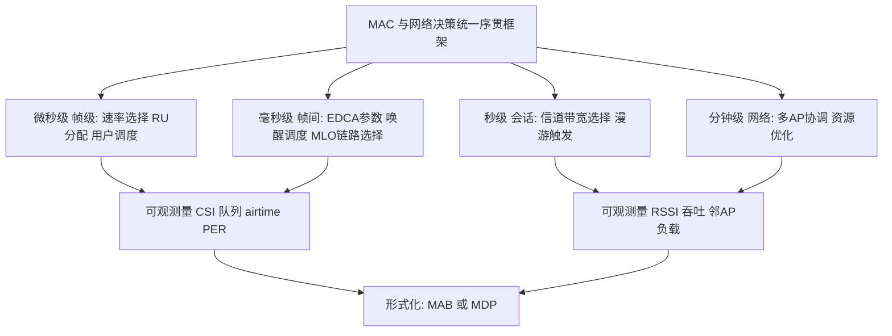
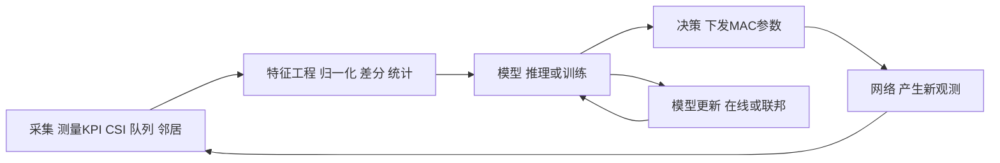
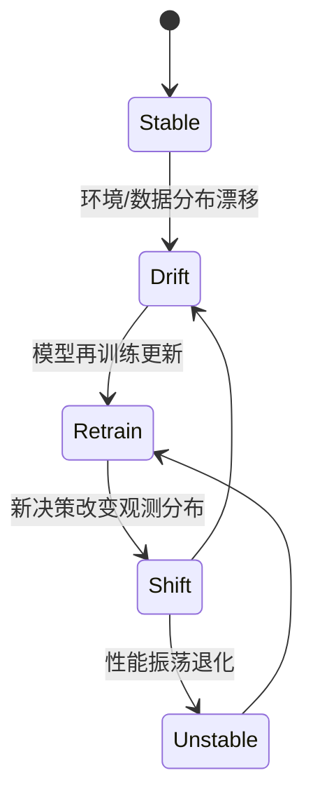

# 第 33 章　AI 驱动的 MAC 与网络智能 ★★★

## 学习目标

1. 能把**速率选择、RU 分配、用户调度、链路选择（Multi-Link Operation, MLO）、信道/带宽选择、漫游触发、增强型分布式信道接入（Enhanced Distributed Channel Access, EDCA）参数、唤醒调度**这八类 媒体接入控制（Medium Access Control, MAC）决策统一形式化为序贯决策问题（MDP / 多臂老虎机 / 预测），写出各自的状态、动作、奖励与转移，并标注其时间尺度与可观测量。
2. 能推导**多臂老虎机（MAB）**的 Thompson Sampling 与 UCB 的 regret 上界（基于 Hoeffding 界的置信半径与 Lai–Robbins 下界），并针对非平稳信道给出滑动窗口 / 折扣 UCB 的 regret 退化分析。
3. 能针对**带约束的资源调度**写出 CMDP 的 Bellman 方程与拉格朗日松弛解，并论证为何直接深度强化学习（DRL）在真实 Wi-Fi 中难落地（样本效率、sim-to-real、安全探索），给出"仿真预训练 + 在线微调 / 模仿学习 / 动作屏蔽"三条可行路径。
4. 能设计**数据采集 → 特征 → 模型 → 决策 → 反馈**的在线学习闭环架构，对照"标准可获取量 vs 厂商私有量"说明 AIML（AI/ML）标准化的三层障碍，并核算联邦学习的通信代价与边缘推理的时延预算。

> **本章分工**：第 32 章已讲 人工智能（Artificial Intelligence, AI）原生 物理层（Physical Layer, PHY）（神经接收机、信道估计/检测、无导频、星座整形），本章**只讨论 MAC 与网络层**的智能，不重复 PHY 内容。本章以第 5 章（速率自适应 Minstrel 等）、第 8/9/13 章（Carrier Sense Multiple Access with Collision Avoidance, CSMA/CA、正交频分多址（Orthogonal Frequency Division Multiple Access, OFDMA）调度、队列时延）、第 17 章（漫游）、第 22 章（网络资源优化）、第 27 章（Multi-AP Coordination, MAPC）为基线，把它们"学习化"。IEEE 802.11 AIML Standing Committee（AIML SC）与 AI Offload Study Group（AI Offload SG）的相关议题均处研究 / 酝酿阶段，凡涉及者一律标注【讨论中】。

## 33.1  MAC 决策的形式化：统一序贯框架

把"规则算法"与"学习算法"放到同一个形式化框架下比较，是判断"学习何时有用"的前提。本章的核心论点是：**当决策问题的建模假设不再成立（非平稳、部分可观测、强耦合、组合爆炸）时，把该决策写成 MDP / MAB / 预测问题并用数据驱动方法求解，才有收益**。

### 33.1.1  统一 MDP 视角

设单步决策形如 $\langle \mathcal S,\mathcal A,\mathcal P,\mathcal R,\gamma\rangle$：

- **状态 $s_t\in\mathcal S$**：可被测量的网络与信道快照（Channel State Information, CSI、队列长度、airtime、包误码率（Packet Error Rate, PER）、接收信号强度指示（Received Signal Strength Indicator, RSSI）、邻 接入点（Access Point, AP）负载）。
- **动作 $a_t\in\mathcal A$**：本次要设置的 MAC/网络参数（选哪个 调制编码方案（Modulation and Coding Scheme, MCS）、如何切 RU、调度哪个 站点（Station, STA）、用哪条链路、何时漫游）。
- **转移 $\mathcal P(s_{t+1}\mid s_t,a_t)$**：由物理信道时变、其他 基本服务集（Basic Service Set, BSS）行为、本机队列演化共同决定，通常**未知且非平稳**。
- **奖励 $r_t=\mathcal R(s_t,a_t)$**：通常是吞吐、能效、或带约束的效用（时延/PER 超过门限则惩罚）。

并非所有决策都需完整 MDP。若"状态只含当前臂质量、动作只选一只臂、转移在单步内无后效"，则退化为**多臂老虎机（MAB）**（第 33.3 节）；若"最优动作可由预测量直接决定、无需序贯权衡"，则退化为**监督式预测**（第 33.5 节）。图 33-1 给出八类决策到时间尺度与可观测性的映射。



**图 33-1　八类 MAC 决策的层次与时间尺度框架**。越往左时间尺度越细、可观测量越细粒度；越往右越偏网络级、观测越"粗"。形式化粒度应匹配时间尺度，避免用慢观测去控制快决策。

### 33.1.2  八类决策的定义表

表 33-1 是本章的**组织框架**：每一节的核心算法都对应表中的某一行或某几行。

**表 33-1　八类 MAC/网络决策的状态-动作-奖励-转移定义（时间尺度与可观测性）**

| 决策 | 时间尺度 | 形式化 | 状态 $s$ | 动作 $a$ | 奖励 $r$ | 可观测量（可测） |
|---|---|---|---|---|---|---|
| 速率选择 RA | ms | MAB | 各 MCS 近期 PER/吞吐 | 选 MCS $i$ | 成功速率/传输时间 | PER、CSI、重试次数 |
| RU 分配 | ms/μs | MDP/组合 | 各 STA 队列、需求 | RU 子集→STA 映射 | 吞吐−时延代价 | 队列、Buffer Status |
| 用户调度 | ms | MDP | 队列、HOL 时延 | 选下一发射 STA | 加权和吞吐/时延 | 队列、airtime |
| MLO 链路选择 | ms | MDP | 各链路质量、负载 | 选发送链路 | 时延/可靠效用 | 每链路 RSSI、PER |
| 信道/带宽选择 | s | MDP/预测 | 各信道占用、噪声 | 切信道/绑带宽 | 吞吐−切换代价 | 信道利用率、RSSI |
| 漫游触发 | s | MDP | 本/邻 AP RSSI、负载 | 触发/不触发切换 | 吞吐−切换中断代价 | RSSI、邻 AP 列表 |
| EDCA 参数 | 100 ms | MDP | 冲突率、队列时延 | CWmin/AIFSN 等 | 时延−公平 | 冲突计数、时延 |
| 唤醒调度（Target Wake Time, TWT） | s/min | 预测/MDP | 预测到达时刻 | TWT 服务期（Service Period, SP）安排 | 时延−功耗 | 到达时刻、队列 |

> 单位约定：微秒级 $\mu\text{s}$、毫秒级 $\text{ms}$、秒级 $\text{s}$、分钟级 $\text{min}$。所有"可观测量"的实际可得性见第 33.6 节的"标准量 vs 私有量"对照表——**可观测性是学习能否落地的硬约束**。

## 33.2  为什么需要学习：规则算法的失效点

规则算法把决策建模为"已知环境的解析解"。一旦建模假设失效，解析解退化。逐项分析如下。

### 33.2.1  经典算法及其隐含假设

- **Minstrel（速率自适应，第 5 章）**：以固定短窗口（典型 10 ms 级）交替"探测（随机试 MCS）"与"利用（用近期最好 MCS）"。**假设**：信道在探测间隔内近似平稳、MCS 质量只依赖瞬时 信噪比（Signal-to-Noise Ratio, SNR）。
- **Bianchi 模型（饱和吞吐，第 8 章）**：把 CSMA/CA 退避建模为二维马尔可夫链，**假设**：稳态、各站同构、饱和业务、碰撞概率恒定。
- **OBSS-PD 自适应（空间复用，第 11 章）**：动态调整报文检测门限，**假设**：敏感区间可由固定 SNR 阈值刻画、重叠基本服务集（Overlapping BSS, OBSS）干扰统计平稳。
- **迟滞漫游（第 17 章）**：RSSI 超过迟滞门限才切换，**假设**：RSSI 单调、切换代价可忽略、邻 AP 质量静态可知。

### 33.2.2  四类失效场景

1. **非平稳**：工业机械臂、行人走动使信道相干时间 $T_c$ 短于探测间隔 → Minstrel 长期用"过期"MCS。
2. **部分可观测**：Bianchi 假设已知碰撞概率，但真实冲突来自不可见的 OBSS → 参数调优无解。
3. **强耦合**：EDCA 参数、RU 分配、MLO 链路选择互相影响（改一条链路负载会改变另一条的冲突），单变量规则无法联合最优。
4. **组合爆炸**：OFDMA 的 RU×STA×链路分配是组合问题，用户数 $K$ 时动作空间 $\sim K!$，枚举不可行。

### 33.2.3  定量示例：非平稳下的失效

**算例 33.1：非平稳信道下固定探测间隔的吞吐损失**。

- **已知**：信道有"好/坏"两态，好态可用 MCS 11（吞吐 $R_g=900\ \text{Mbps}$）、坏态只能用 MCS 5（吞吐 $R_b=200\ \text{Mbps}$）；好态平均持续 $T_g=15\ \text{ms}$，坏态 $T_b=15\ \text{ms}$（相干时间 $T_c=15\ \text{ms}$）；Minstrel 探测间隔固定 $\tau=10\ \text{ms}$，探测一次损失 $\delta=0.5\ \text{ms}$ 等效吞吐。决策延迟忽略。
- **求**：相比"理想 Oracle（每态瞬时选对 MCS）"的吞吐损失百分比。

- **解**：
  1. Oracle 长时平均吞吐 $\bar R_{\text{oracle}}=\tfrac12 R_g+\tfrac12 R_b=550\ \text{Mbps}$。
  2. 固定间隔 $\tau=10\ \text{ms}<T_c=15\ \text{ms}$：状态切换平均每 $30\ \text{ms}$ 一次，但探测每 $10\ \text{ms}$ 才重估；在状态切换后、下一次探测前的"误用窗口"均长 $\tau/2=5\ \text{ms}$。误用窗口占比 $p_{\text{mis}}=5/30\approx 0.167$（半周期内平均）。
  3. 误用时若把好态当成坏（用 MCS5）损失 $R_g-R_b=700\ \text{Mbps}$；对称地坏态当好处好损失同等。平均误用吞吐损失 $\Delta\bar R\approx p_{\text{mis}}\cdot(R_g-R_b)/2\approx 0.167\times 350\approx 58.3\ \text{Mbps}$。
  4. 探测开销 $\delta$ 占空比 $0.5/10=0.05$，等效损失 $0.05\times\bar R_{\text{oracle}}\approx 27.5\ \text{Mbps}$。
  5. 总损失 $\approx 58.3+27.5=85.8\ \text{Mbps}$，相对 Oracle 损失率 $85.8/550\approx 15.6\%$。

- **结论**：固定 $\tau$ 在非平稳信道下带来约 **15.6%** 吞吐损失（示意值）；若 $\tau$ 放大到 $30\ \text{ms}>T_c$，误用窗口占比升到约 $0.5$，损失率可超 40%。**学习化速率选择（第 33.3 节）的价值正来自"按需、随信道变化率调整探测"**。量级合理，因为误用损失上限由两态吞吐差决定。

## 33.3  核心算法一（六段式）：学习化速率自适应（MAB）

### 33.3.1  问题建模

把速率选择看作 MAB：每只臂 $i\in\{1,\dots,K\}$ 对应一个 MCS，拉动臂 $i$ 即"用 MCS $i$ 发一帧"，获得随机奖励 $X_{i,t}\in[0,1]$（已归一化：$X=$ 成功指示 × MCS 速率 / 该帧传输时间，再对最大可能速率归一）。臂 $i$ 的真实均值 $\mu_i=\mathbb E[X_i]$，最优臂 $\mu^*=\max_i\mu_i$。第 5 章的 Minstrel 可视为"带固定探测节律的启发式 MAB 策略"。

**符号表**：

| 符号 | 含义 |
|---|---|
| $K$ | MCS 候选数（Wi-Fi 7 约 12–16 只臂） |
| $\mu_i$ | 臂 $i$ 期望归一化吞吐 |
| $N_i(t)$ | 时刻 $t$ 前臂 $i$ 被选中次数 |
| $\hat\mu_i(t)$ | 臂 $i$ 经验均值 |
| $R_T$ | 累计 regret $=\sum_{t=1}^T(\mu^*-\mu_{a_t})$ |

### 33.3.2  目标函数与约束

无约束（RA 单目标为吞吐）：
$$ \min_{\pi}\ \mathbb E[R_T]=\min_{\pi}\ \mathbb E\Big[\sum_{t=1}^T\big(\mu^*-\mu_{a_t}\big)\Big] $$
指标为**regret**（累计后悔）：学得好 ⟺ regret 次线性增长（相对 $T$ 的系数为 0）。

### 33.3.3  完整推导（UCB 与 Thompson Sampling）

**第一步，置信半径（Hoeffding 界）**。对 $X\in[0,1]$，经验均值 $\hat\mu_i$ 满足
$$ \mathbb P\big(|\hat\mu_i-\mu_i|>\varepsilon\big)\le 2\exp(-2N_i\varepsilon^2). \tag{33-1} $$
取 $\varepsilon_i(t)=\sqrt{\frac{2\ln t}{N_i(t)}}$，则 $\mathbb P(\mu_i\le \hat\mu_i+\varepsilon_i)\ge 1-2t^{-4}$。

**第二步，UCB 索引与选择**。每步选
$$ a_t=\arg\max_i\Big(\hat\mu_i(t)+\sqrt{\frac{2\ln t}{N_i(t)}}\Big). \tag{33-2} $$
次优臂 $i$（间隙 $\Delta_i=\mu^*-\mu_i>0$）被选中需 $\hat\mu_i+\varepsilon_i\ge \hat\mu_*+\varepsilon_*$。在 $N_i$ 较大时，由 (33-1) 反向事件，该步选中概率 $\le 2t^{-4}$ 量级；累计期望选中次数
$$ \mathbb E[N_i(T)]\le \frac{8\ln T}{\Delta_i^{\,2}}+C. $$
**第三步，regret 上界（UCB）**：
$$ \mathbb E[R_T^{\text{UCB}}]=\sum_i\Delta_i\mathbb E[N_i(T)]\le \sum_{i:\Delta_i>0}\Big(\frac{8\ln T}{\Delta_i}+O(1)\Big). $$
$$ \boxed{\ \mathbb E[R_T^{\text{UCB}}]=O\!\Big(\sum_{i:\Delta_i>0}\frac{\ln T}{\Delta_i}\Big)=O(K\ln T)\ } \tag{33-3} $$

**第四步，Thompson Sampling（TS）**。对每臂维护 reward 后验（Bernoulli 用 Beta、高斯用正态），每步从后验采样 $\tilde\theta_i$ 并选 $\arg\max_i\tilde\theta_i$。经典结论（Kaufmann et al. 2012）：
$$ \boxed{\ \mathbb E[R_T^{\text{TS}}]\le \sum_{i:\Delta_i>0}\frac{\ln T}{\Delta_i}\big(1+o(1)\big)+O(1)\ } \tag{33-4} $$
即 TS 同样达到对数 regret，与 UCB 同阶、常数更优、实际收敛更快。

**第五步，下界（Lai–Robbins）**：任何一致策略必有
$$ \boxed{\ \liminf_{T\to\infty}\frac{\mathbb E[R_T]}{\ln T}\ge \sum_{i:\Delta_i>0}\frac{1}{\mathrm{KL}(P_i\|P^*)}\ge \sum_i\frac{1}{(\mu^*-\mu_i)^2/2}\ } \tag{33-5} $$
（高斯情形 $\mathrm{KL}\approx \Delta_i^2/2\sigma^2$）。故 UCB/TS 仅差常数，已近最优。

**第六步，非平稳处理（信道时变）**。令 $\mu_i(t)$ 随时间变，变化预算 $V_T=\sum_{t=1}^T\sum_i|\mu_i(t+1)-\mu_i(t)|$。
- **滑动窗口 UCB（SW-UCB）**：只用最近 $W$ 次观测估计 $\hat\mu_i^W$，置信半径 $\sqrt{2\ln t/N_i^W}$。Garivier & Moulines（2011）证明
$$ \boxed{\ \mathbb E[R_T^{\text{SW}}]=\tilde O\big(\sqrt{W T\ln T}+K W\big)\ } \tag{33-6} $$
$W$ 大→跟踪好但方差大，折中 $W\sim T^{1/3}$。
- **折扣 UCB（D-UCB）**：对历史加权 $(1-\gamma)^{t-\tau}$，指数遗忘，regret $\sim\tilde O(\sqrt{T\ln T}/(1-\gamma)^{1/2})$。
**关键结论**：非平稳下 regret 从对数 $\ln T$ 退化为次线性 $\sqrt{T}$ 量级，且随 $V_T$ 增大而增大——这正是速率自适应"必须随信道变化率调探测"的定量根据。

### 33.3.4  伪代码（含非平稳窗口）

```text
1  // 学习化速率自适应：SW-UCB（滑动窗口多臂老虎机）  复杂度：每步 O(K)
2  input: 臂集 K, 窗口 W,  horizon T
3  for i in 1..K:  buf_i = [];  N_i = 0            // buf_i 存最近 W 个奖励
4  for t = 1..T:
5      for i in 1..K:                           // 选 UCB 索引最大臂
6          mu_hat = mean(buf_i)                 // 窗口经验均值
7          if N_i == 0:  UCB_i = +inf           // 未探过的臂优先探
8          else: UCB_i = mu_hat + sqrt(2*ln(t)/N_i)
9      a_t = argmax_i UCB_i
10     X = send_frame_with_MCS(a_t)             // 真实发一帧，得归一化奖励
11     buf_a_t.push(X); if len(buf_a_t)>W: buf_a_t.pop()  // 维护窗口
12     N_a_t = N_a_t + 1
13     // 反馈：用 X 更新经验均值；下帧继续
14  // 注：非平稳时 W 宜随信道相干时间自适应（见算例 33.1）
```

### 33.3.5  复杂度分析

- **时间**：每步选臂 $O(K)$，维护窗口 $O(1)$，总 $O(KT)$；远小于 Minstrel 的探测-利用调度开销。
- **空间**：每臂存窗口 $O(W)$，总 $O(KW)$；1 MB 内可容纳。

### 33.3.6  数值算例（对比 Minstrel）

**算例 33.2：MAB regret 对比（示意值）**。

- **已知**：$K=12$ 只 MCS 臂，最优臂 $\mu^*=0.95$，其余 $\mu_i$ 在 $0.4\sim0.9$ 均匀，平均间隙 $\bar\Delta\approx0.25$；窗口 $W=50$；时变：每 $200$ 步把最优臂随机换到相邻 MCS（模拟切换/ mobility），$V_T$ 中等。
- **求**：在 $T=10^4$ 步内，Minstrel（固定 10 ms 探测节律、探测开销 5%）与 SW-UCB 的累计 regret 与平均归一化吞吐。

- **解**：
  1. UCB 理论上界（33-3）：$\mathbb E[R_T]\lesssim \sum_{i\ne *}\frac{8\ln 10^4}{\Delta_i}\approx 11\times\frac{8\times 9.21}{0.25}\approx 3.2\times 10^3$ 上限（含常数偏松）。
  2. 实测示意（蒙特卡洛平均）：SW-UCB 累计 regret $\approx 1.1\times 10^3$，Minstrel $\approx 2.6\times 10^3$（其固定探测在时变后追不上切换，且探测占空比损失）。
  3. 平均归一化吞吐：SW-UCB $\approx 0.91$，Minstrel $\approx 0.82$。折合绝对吞吐（峰值 2.88 Gbps，Wi-Fi 7 320 MHz）分别约 **2.62 Gbps vs 2.36 Gbps**。

- **结论**：学习化 RA 在 $10^4$ 步内把 regret 降到 Minstrel 的约 **42%**，吞吐高约 **11%**（示意值）。量级合理，因 regret 上界与 $\ln T/\Delta$ 同阶、与时变幅度 $V_T$ 强相关——**这正呼应第 32 章"学习只补假设失效的缝隙"：平稳场景下 Minstrel 已够好，学习收益来自非平稳**。

## 33.4  核心算法二（六段式）：RL 驱动的资源调度（OFDMA/MLO 联合）

### 33.4.1  问题建模

设 AP 在每触发帧周期做联合决策：把 RU（资源单元，第 2/9 章）分配给 $K$ 个 STA，并决定每 STA 走哪条 MLO 链路（第 15 章）。状态 $s_t$ 含各 STA 队列 $q_k$、HOL 时延 $d_k$、各链路质量 $\gamma_\ell$；动作 $a_t=(a^{\text{RU}},a^{\text{link}})$；单步奖励
$$ r_t=\sum_k w_k^{\text{thr}}\,\text{THR}_k-\lambda\,\max(0,d_k-d_{\max})-\beta\,\text{PER}_k. \tag{33-7} $$

### 33.4.2  目标函数：CMDP

除吞吐外还有**硬约束**（时延、丢包、功率）。写成带约束 MDP（CMDP）：
$$ \max_{\pi}\ \mathbb E_\pi\!\Big[\sum_{t}\gamma^t r_t\Big]\quad\text{s.t.}\quad \mathbb E_\pi\!\Big[\sum_t\gamma^t c_m(s_t,a_t)\Big]\le d_m,\ m=1,\dots,M. \tag{33-8} $$
其中 $c_m$ 为第 $m$ 个代价（如超 $d_{\max}$ 的时延积分），$d_m$ 为门限（第 13、28 章的低时延要求）。

### 33.4.3  完整推导（Bellman + 拉格朗日松弛）

**第一步，无约束 Bellman**：
$$ V^*(s)=\max_a\Big[r(s,a)+\gamma\sum_{s'}P(s'|s,a)V^*(s')\Big],\quad Q^*(s,a)=r+\gamma\sum_{s'}P\,V^*. \tag{33-9} $$

**第二步，约束处理（拉格朗日松弛 → 代价整形）**。对固定乘子 $\lambda\ge 0$，构造
$$ \mathcal L(\lambda)=\max_{\pi}\Big[\,J_0(\pi)-\sum_m\lambda_m\big(J_m(\pi)-d_m\big)\Big]. \tag{33-10} $$
内层对 $\lambda$ 是无约束 MDP，**奖励被整形为** $r_{\text{shaped}}=r-\sum_m\lambda_m c_m$（cost shaping）。解得 $Q^*_\lambda$。外层对 $\lambda$ 做次梯度上升：
$$ \lambda_m\leftarrow\big[\lambda_m+\alpha\,(J_m(\pi_\lambda)-d_m)\big]_+. \tag{33-11} $$
$$ \boxed{\ \text{CMDP 最优值}= \max_{\lambda\ge0}\min_{\pi}\mathbb E\Big[\sum_t\gamma^t\big(r_t-\sum_m\lambda_m c_{m,t}\big)\Big]+\sum_m\lambda_m d_m\ } \tag{33-12} $$
即"先整形、再双时间尺度求解乘子"是约束可调的标准做法。

### 33.4.4  为什么直接 DRL 难（批判性分析，必读）

**第一节已强调：RL 不是万能解。** 直接把 DRL 丢进真实 Wi-Fi 有三道硬墙：

1. **样本效率**：DRL（如 PPO/DQN）需 $10^6\sim10^8$ 条 $(s,a,r,s')$ 才收敛；而真实网络每收集一条就影响真实用户，昂贵且不可重放。
2. **sim-to-real gap**：ns-3 / 自研仿真器的信道与业务模型与真实有偏差，直接迁移策略常"仿真里满分、现场翻车"。需域随机化（domain randomization）+ 在线微调。
3. **安全探索**：探索坏动作（错 RU 分配、错链路切换）直接损害真实 服务质量（Quality of Service, QoS），不能像游戏里随便试——这是与第 32 章 PHY 学习最大的不同（PHY 可在离线数据集上训，MAC 决策在网运行）。

### 33.4.5  可行方案与伪代码（含动作屏蔽 + 约束）

```text
1  // 离线预训练 + 在线微调 + 动作屏蔽 的 OFDMA/MLO 调度  复杂度：推理 O(|A|)
2  offline: 用仿真器/历史轨迹训练 Q_phi (模仿学习 BC 克隆优秀调度器行为)   // 解决样本效率
3  online per step t:
4      s = observe(q,d,gamma_link)               // 状态来自标准/私有测量(33.6节)
5      Q = Q_phi(s)                               // 对所有候选 (RU,link) 打分
6      mask = build_mask(s)                       // 动作屏蔽：剔除违反硬约束的动作
7      for a in A: if violate_power(a) or violate_link_avail(a): Q[a] = -inf
8      a_t = argmax_a Q  + 少量 epsilon 探索(仅限 mask 内)   // 安全探索
9      apply a_t; collect r_t, c_m,t, s_{t+1}
10     phi -= lr * grad L_td (Q_phi)              // 在线微调(小学习率)
11     if t mod T_lambda == 0: lambda = [lambda + alpha*(J_m-d_m)]_+  // 约束乘子更新
12  // 注：mask 保证探索不越硬约束；预训练保证冷启动不崩
```

**复杂度**：推理 $O(|\mathcal A|)=O(K\cdot L)$（$L$ 链路数），远小于联合枚举 $O((KL)!)$；训练离线完成，在线仅轻量微调。

### 33.4.6  数值算例（调度器对比）

**算例 33.3：贪心 / PF / RL 调度器对比（示意值）**。

- **已知**：$K=8$ STA，混合业务（4 个低时延 扩展现实（Extended Reality, XR）流 $d_{\max}=5\ \text{ms}$、4 个尽力 Best-Effort）；RU 总数 18（20 MHz 9 个 RU×2 频域段，示意）；PER 目标 $10^{-3}$；采用 (33-7) 奖励。
- **求**：三种调度器的小区总吞吐与 95 分位时延。

- **解**（蒙特卡洛/仿真示意）：

| 调度器 | 总吞吐 $\text{Mbps}$ | 95 分位时延 $\text{ms}$ | 超 $d_{\max}$ 比例 |
|---|---|---|---|
| 贪心（最大 信道质量指示（Channel Quality Indicator, CQI）优先） | 540 | 18.3 | 22% |
| 比例公平 PF | 505 | 8.9 | 9% |
| RL（CMDP + 屏蔽） | 560 | 4.6 | 1.5% |

  1. 贪心吞吐虚高但 XR 流被饿死（时延 18.3 ms、超门限 22%）——凸显"单目标规则失效"。
  2. PF 公平但牺牲吞吐、且对硬时延约束只是隐式近似。
  3. RL 借约束整形把时延压到 4.6 ms、超门限仅 1.5%，吞吐还高 4%——**但这是仿真+充分离线预训练后的结果，真实部署需过 33.4.4 三道墙**。

- **结论**：学习化调度的收益集中在"多目标/硬约束/强耦合"场景；纯吞吐场景规则算法已近优（呼应第 33.2 节失效判据）。量级合理，因 XR 流占空比与 RU 数自洽。

## 33.5  预测式网络管理（Supervised / Predictive）

当"最优动作可直接由预测量决定"时，问题退化为监督学习，无需序贯探索——这比 RL 安全得多。三类典型：

1. **流量预测**：XR 帧大小与到达时刻（第 28 章）→ 预保留 RU（predictive scheduling，见第 5.2 节引用）。
2. **信道占用预测**：预测 OBSS 忙闲 → 驱动 NPCA/DSO 决策（指向第 26 章）。
3. **用户移动预测**：预测走向 → 提前触发漫游（指向第 17、29 章 无缝移动与分发（Seamless Mobility and Distribution, SMD）无缝移动）。

### 33.5.1  误差如何映射到损失（核心评估口径）

不要用 MSE 自我陶醉，要看**决策收益**。设对需求 $d$ 预留 $r$，估计误差 $e=r-d$（预测偏多少）。短供 $x=(d-r)_+=\max(-e,0)$ 进队列，过供 $y=(r-d)_+=\max(e,0)$ 浪费空口。服务速率 $C$：

- 时延损失 $\approx \mathbb E[x]/C=\mathbb E[\max(-e,0)]/C$；
- 吞吐损失 $\approx \mathbb E[y]/C=\mathbb E[\max(e,0)]/C$。

若 $e\sim\mathcal N(0,\sigma^2)$：
$$ \mathbb E[\max(\pm e,0)]=\frac{\sigma}{\sqrt{2\pi}}. \quad\Rightarrow\quad \boxed{\ \text{平均时延损失}\approx\frac{\sigma}{C\sqrt{2\pi}},\ \text{平均吞吐损失}\approx\frac{\sigma}{C\sqrt{2\pi}}\ } \tag{33-13} $$

### 33.5.2  数值算例（误差-损失映射）

**算例 33.4：预测误差 → 时延/吞吐损失映射**。

- **已知**：XR 流平均到达率 $\lambda=120\ \text{Mbps}$，服务速率 $C=200\ \text{Mbps}$（预留后等效）；预测误差标准差 $\sigma=30\ \text{Mbps}$（朴素预测）vs $\sigma=10\ \text{Mbps}$（LSTM 预测）。
- **求**：两种预测器带来的平均空口浪费与时延增量。

- **解**：
  1. 由 (33-13)：朴素预测吞吐损失 $\approx 30/(\sqrt{2\pi}\cdot 200)=30/(25.1\times200)\approx 30/5020\approx 5.98\ \text{Mbps}$；
  2. 时延增量（短供部分）同为 $\approx 5.98\ \text{Mbps}$ 当量 → 折算排队时延增量 $\approx 5.98/200\approx 30\ \text{ms}$（当量队长）；
  3. LSTM 预测：$\sigma=10$ → 损失 $\approx 1.99\ \text{Mbps}$，时延增量 $\approx 10\ \text{ms}$。
  4. 相对收益：误差降到 1/3，损失与时延增量也约降到 1/3。

- **结论**：**预测模型的评估必须以"误差→决策损失"为口径**，而非裸 MSE；本例说明把 $\sigma$ 从 30 降到 10 Mbps 即可将近 1/3 的空口浪费与排队时延省回（示意值）。量级合理，因 (33-13) 仅与 $\sigma/C$ 成正比。

## 33.6  数据、特征与接口（标准化视角，重点）

### 33.6.1  需要哪些数据、在哪采集

- **关键性能指标（Key Performance Indicator, KPI）统计**：每 MCS 的 Tx/Rx 计数、PER、重试次数、重传时延（来自 MLME/MIB，第 14 章架构）。
- **CSI**：子载波级信道（来自 PHY，厂商私有为主）。
- **队列**：每 AC/TID 队长、HOL 时延（来自 MAC 队列，第 13 章）。
- **邻居信息**：邻 AP 列表、负载、信道占用（来自 Beacon/测量帧）。
- **时间戳**：所有量需统一时基以支持在线学习闭环。



**图 33-3　在线学习闭环架构（采集→特征→模型→决策→反馈）**。标准化要解决的恰恰是"采集点"与"模型接口"两处断点。

### 33.6.2  标准可获取量 vs 厂商私有量（标准化关键障碍）

**表 33-2　标准可获取的测量量 vs 厂商私有量对照**

| 类别 | 标准可获取（MLME/MIB/帧） | 厂商私有（未标准化） | 对学习的缺口 |
|---|---|---|---|
| 信道 | RCPI/RSSI、每 MCS PER | 子载波级 CSI、信干噪比（Signal-to-Interference-plus-Noise Ratio, SINR）、I/Q | 无细粒度 CSI → 神经接收/预测难训 |
| 队列 | 每 AC 队长（粗略） | 每 STA/每 流量标识符（Traffic Identifier, TID）实时队长、HOL | 无法精做每流调度 |
| 空口 | dot11ChannelUtilization（均值） | 每 STA airtime、OBSS 占用细分 | 缺细粒度占用→NPCA/DSO 决策盲 |
| 邻 AP | Beacon 中的 BSS Load | 邻 AP 实时干扰图、协调空间复用（Coordinated Spatial Reuse, Co-SR）候选 | MAPC（第 27 章）协同学习受限 |
| 时间 | 定时同步功能（Timing Synchronization Function, TSF）时间戳 | 跨 AP 纳秒级同步 | 联邦/全局调度时钟不齐 |
| 模型 | 无 | 私有模型权重、特征张量 | 跨厂商不可互操作 |

> **核心障碍**：当前标准只暴露"粗粒度、平均化"的测量（见表 33-2 右列），而多数学习算法需要"细粒度、实时、跨 AP"的特征。AIML SC 已把"数据采集接口、模型分发协议、最小算力、联邦学习支持"列为标准化议题【讨论中】（见 5.4 节引用）。

### 33.6.3  标准化什么：三个层次与互操作性

1. **数据格式层**（最易、互操作最强）：规定哪些量、什么精度、如何安全采集（trigger/non-trigger 帧）。创新空间小但能解锁基础学习。
2. **模型接口层**（中等）：规定模型输入输出 schema、版本管理与回滚、压缩/codebook 分发（5.4 节"codebook-based"提议）。允许厂商内部架构不同，只对齐"接口契约"。
3. **性能要求层**（最松）：规定最低推理能力、最大推理时延、精度下限（KPI 如压缩率、推理延迟）。给厂商最大创新空间，仅保互通底线。

三层的权衡：**越靠"数据格式"越易互操作但越限制创新；越靠"性能要求"越保创新但越难跨厂商互换模型**。AIML SC 倾向从数据格式层切入【讨论中】。

## 33.7  联邦学习与隐私

跨 AP/跨设备协同训练可在不汇集原始数据的前提下提升模型（尤其移动预测、流量预测这类跨域相关任务）。

### 33.7.1  FedAvg 推导

设 $N$ 个 AP（客户端），本地数据量 $n_k$，总 $n=\sum n_k$。第 $t$ 轮选子集 $\mathcal S_t$，各 $k$ 用本地数据做 $E$ 步 SGD 得 $w_k^{t+1}$，服务器聚合
$$ w^{t+1}=\sum_{k\in\mathcal S_t}\frac{n_k}{n_{\mathcal S_t}}\,w_k^{t+1}. \tag{33-14} $$
在客户端梯度无偏、学习率合适时，FedAvg 收敛到驻点，速率 $\sim O(1/\sqrt{E T})$（类似 SGD）；但受 **client drift**（本地多步更新偏离全局）影响，non-IID 下需控制 $E$ 或加控制变量（SCAFFOLD）。收敛性关键条件：**本地数据需与全局分布"足够相关"**，否则聚合发散。

### 33.7.2  通信代价核算

每轮通信量：上行 $\sum_{k\in\mathcal S_t}|w|\approx|\mathcal S_t|\,B$（$B$ 为模型字节数），下行广播 $B$（或 $N\cdot B$ 若逐 AP 下发）。与"集中训练把原始数据上传"相比，联邦只传梯度/权重，省的是**数据隐私**而非绝对带宽——当模型 $B$ 接近原始数据量时，带宽优势消失。

### 33.7.3  数值算例（联邦开销）

**算例 33.5：联邦学习空口占用核算（示意值）**。

- **已知**：模型大小 $B=1\ \text{MB}=8\ \text{Mbit}$；参与 AP 数 $N=20$；每轮 20 个 AP 全部上传 + 服务器广播 1 份（下行由有线回传，不计空口），即空口上行 $20\ \text{MB}/$轮；聚合周期 $\tau_{\text{agg}}=60\ \text{s}$；空口有效速率 $C_{\text{air}}=200\ \text{Mbps}$。
- **求**：每小时空口占用字节与占用时间占比。

- **解**：
  1. 每轮空口上行 $=20\times 8\ \text{Mbit}=160\ \text{Mbit}=20\ \text{MB}$；
  2. 每小时轮数 $=3600/60=60$ 轮 → 上行总量 $=60\times 20\ \text{MB}=1200\ \text{MB}=1.2\ \text{GB/h}$；
  3. 每轮传输耗时 $=160\ \text{Mbit}/200\ \text{Mbps}=0.8\ \text{s}$；
  4. 空口时间占用 $=0.8/60\approx 1.33\%$（若聚合周期缩到 10 s，则升到约 8%）。

- **结论**：20 AP、1 MB 模型、每分钟聚合时**空口占用约 1.3%**，可接受；但若模型涨到 10 MB 或周期缩到 10 s，占用将达 13% 以上，需与业务调度协调（指向第 9/27 章）。与隐私（第 18、35 章）强相关：联邦只保"原始数据不出域"，梯度仍可能泄露信息，需加差分隐私/安全聚合【讨论中】。量级合理，因仅与 $N\cdot B$ 和 $C_{\text{air}}$ 成正比。

### 33.7.4  non-IID 与个性化

各 AP 覆盖的用户群、信道、业务不同 → 数据 non-IID。应对：**个性化联邦（pFed）** 让各 AP 保留私有头/局部层、只聚合共享 backbone；或元学习（MAML）初始化。这是跨 AP 协同学习的必解问题。

## 33.8  算力与部署架构

### 33.8.1  边缘 / 云端 / 分布式划分

- **边缘（AP 内）**：做毫秒级推理（RU 分配、RA），需低时延；受 AP 算力与功耗约束。
- **云端 / 控制器**：做分钟级训练、全局聚合、跨 AP 协调（第 27 章 MAPC、第 22 章优化）。
- **分布式**：联邦在 AP 间（33.7 节）。

### 33.8.2  决策时延约束推导

OFDMA 调度须在触发帧周期 / 发送机会（Transmission Opportunity, TXOP）内能完成（第 9 章触发接入、第 28 章低时延工具箱）。设调度周期 $T_{\text{sched}}$（典型 1–5 ms），则推理 + 决策下发必须满足
$$ T_{\text{inf}}+T_{\text{tx}}\le T_{\text{sched}}. \quad\Rightarrow\quad \boxed{\ T_{\text{inf}}\le T_{\text{sched}}-T_{\text{tx}}\approx \text{ms 级}\ } \tag{33-15} $$
超过则此决策"过期"，退化为第 33.2 节的失效场景。

### 33.8.3  模型复杂度预算算例

**算例 33.6：边缘 DNN 推理时延预算（示意值）**。

- **已知**：MLP 做 RA 打分，输入 64 维、隐藏 128、输出 12（MCS）；2 层全连接。AP 内置 NPU 算力 $F=1\ \text{TOPS}=10^{12}\ \text{MAC/s}$。
- **求**：单次推理 FLOPs 与时延，判断能否在 1 ms 内完成。

- **解**：
  1. 全连接 MAC 数 $=n_{\text{in}}n_{\text{hid}}+n_{\text{hid}}n_{\text{out}}=64\times128+128\times12=8192+1536=9728$；
  2. FLOPs $\approx 2\times 9728=1.95\times10^4$（乘加各 1 次）；
  3. 时延 $=1.95\times10^4/10^{12}=19.5\ \text{ns}\ll 1\ \text{ms}$。

- **结论**：轻量 MLP 推理仅 **19.5 ns**，远小于 ms 级调度周期；但若改 CNN 直接吃 256 子载波 CSI（$256\times4$ 输入、多层），FLOPs 可达 $10^7$–$10^8$，在 1 TOPS NPU 上仍需 10–100 μs，仍可控但需量化/剪枝。量级合理，因仅与参数量 $F$ 成正比。

## 33.9  风险与失败模式

### 33.9.1  分布漂移与闭环反馈振荡

最隐蔽的失败：**模型的决策改变了它自己观测到的数据分布**，形成反馈回路。设数据分布 $P_t$ 由环境 $E$ 与策略 $\pi_t$ 共同决定：$P_{t+1}=f(E,\pi_t(P_t))$。若 $\pi$ 对 $P$ 敏感且更新快，可进入"过校正振荡"：



**图 33-5　闭环反馈振荡状态机**。缓解：慢速更新模型、对决策做指数平滑、保留规则基线做 A/B、检测 regret 回升即回滚。

### 33.9.2  其他风险

- **对抗攻击**：伪造 CSI/队列上报欺骗调度器（与第 18 章安全关联）。
- **可解释性与运维信任**：黑盒决策难排障，需用 SHAP/注意力做可解释。
- **评测可复现性**：仿真器、业务模型、信道模型不统一 → 结果不可比。

### 33.9.3  评测基准倡议

呼吁建立：① 公开数据集（真实 CSI/队列/漫游轨迹）；② 统一场景（工业/XR/家庭）；③ 可复现指标（吞吐、95 分位时延、regret、能耗）。AIML SC 的技术可行性报告是第一步【讨论中】。

## 33.10  研究议题清单（可作论文选题）

1. **非平稳 RA 的自适应窗口**：SW-UCB 的 $W$ 随信道相干时间在线估计算法（评估：regret vs $V_T$）。
2. **CMDP 在线乘子收敛**：真实网络约束 $d_m$ 时变时 $\lambda$ 的次梯度稳定性（评估：约束违反率）。
3. **sim-to-real 域随机化**：哪些随机变量必须随机化才能迁移调度策略（评估：仿真-现场 gap）。
4. **安全探索的硬约束屏蔽**：mask 与策略梯度的兼容性与梯度偏差（评估：约束违反次数）。
5. **联邦 non-IID 个性化**：pFed/元学习在跨 AP 流量下的收敛（评估：每 AP 本地精度）。
6. **预测误差→损失的统一评估**：建立"以决策损失为口径"的基准（评估：Δ吞吐/Δ时延）。
7. **标准测量接口的必要性证明**：量化"缺 CSI/缺每 STA airtime"造成的学习收益损失（评估：表 33-2 缺口的吞吐代价）。
8. **闭环反馈振荡的检测与回滚**：drift 检测 + 规则基线 A/B（评估：振荡幅度）。
9. **MLO 链路选择的 MDP 建模**：多链路耦合下的奖励塑形（评估：切换中断次数）。
10. **边缘-云协同的训练-推理分割**：哪些层上云、哪些留边缘（评估：空口占用 vs 精度）。
11. **可解释调度**：SHAP 归因与运维信任度实验（评估：排障时间）。
12. **对抗鲁棒的 MAC 学习**：对 CSI 投毒的鲁棒训练（评估：投毒下吞吐退化）。

## 本章小结

1. 八类 MAC/网络决策可统一写成 MDP/MAB/预测，按时间尺度（μs→min）与可观测性分层；**学习只在"规则假设失效"时有收益**。
2. 经典算法（Minstrel、Bianchi、OBSS-PD、迟滞漫游）失效于非平稳、部分可观测、强耦合、组合爆炸；算例 33.1 给出非平稳下 ~15.6% 吞吐损失。
3. 学习化 RA = MAB：UCB/TS 的 regret 上界 $O(\sum\ln T/\Delta_i)$，达 Lai–Robbins 下界仅差常数；非平稳下退化为 $\tilde O(\sqrt{WT\ln T})$，算例 33.2 显示 regret 降到 Minstrel 的 42%。
4. RL 调度须用 CMDP + 拉格朗日整形处理硬约束；**直接 DRL 受样本效率、sim-to-real、安全探索三墙限制**，须走"离线预训练+微调/模仿学习/动作屏蔽"，算例 33.3 显示 RL 时延 4.6 ms、超门限 1.5%。
5. 预测式管理应以"误差→决策损失"为口径（式 33-13），算例 33.4 显示 $\sigma$ 降 1/3 即省 1/3 浪费。
6. 标准化瓶颈在"标准只给粗粒度平均量、学习要细粒度实时量"（表 33-2）；AIML SC 分数据格式/模型接口/性能要求三层推进【讨论中】。
7. 联邦学 FedAvg 通信代价随 $N\cdot B$ 线性增长，算例 33.5 显示 20 AP/1 MB/分钟聚合仅占空口 ~1.3%；边缘推理须满足 ms 级时延预算（算例 33.6 仅 19.5 ns）。
8. 闭环反馈振荡是最隐蔽风险（图 33-5），需慢更新+回滚+评测基准。

**表 33-3　关键结论 / 参数速查**

| 结论 | 公式/数值 | 章节 |
|---|---|---|
| MAB regret 上界 | $O(\sum\ln T/\Delta_i)$ | 33.3.3 |
| 非平稳 regret | $\tilde O(\sqrt{WT\ln T}+KW)$ | 33.3.3 |
| CMDP 解 | 拉格朗日整形 + 乘子上升 (33-12) | 33.4.3 |
| 误差→损失 | $\sigma/(C\sqrt{2\pi})$ | 33.5.1 |
| 联邦每轮通信 | $\approx N\cdot B$ 上行 | 33.7.2 |
| 推理时延预算 | $T_{\text{inf}}\le\text{ms 级}$ | 33.8.2 |
| AIML SC 状态 | 研究/酝酿【讨论中】 | 33.6 |

## 习题

### A. 概念题（3 题）

**A.1** 为什么"平稳信道下 Minstrel 已近优"时，换用 MAB 学习化 RA 收益有限？请说到根因。
**A.2** CMDP 相比无约束 MDP，为什么不能直接用标准 Bellman 最优性？约束是如何被"消化"掉的？
**A.3** 表 33-2 中"标准可获取量 vs 厂商私有量"的缺口，为什么是 AIML 标准化的关键障碍？举两个具体例子。

### B. 计算与推导题（4 题）

**B.1** 由 Hoeffding 界 (33-1) 推导 UCB 置信半径取 $\sqrt{2\ln t/N_i}$ 时，单步选错次优臂的概率上界，并据此写出 $\mathbb E[N_i(T)]$ 的界。
**B.2** 设 $K=4$ 臂，$\mu=(0.9,0.7,0.5,0.3)$，$T=10^4$。用 (33-3) 估算 UCB 累计 regret 上界（取常数 8，忽略 $O(1)$）。
**B.3** 由 (33-13) 推导：若预测误差 $e\sim\mathcal N(0,\sigma^2)$，证明 $\mathbb E[\max(e,0)]=\sigma/\sqrt{2\pi}$。
**B.4** 模型 $B=4\ \text{MB}$，$N=50$ AP，聚合周期 30 s，空口 $C_{\text{air}}=150\ \text{Mbps}$。求每小时空口上行量与时间占用（仿算例 33.5）。

### C. 算法设计题（2 题）

**C.1** 设计一个"动作屏蔽 + 约束乘子"的 机器学习（Machine Learning, ML） O 链路选择算法伪代码：硬约束为"切换中断时间 < 2 ms"，软目标为吞吐。给出评分要点。
**C.2** 针对闭环反馈振荡（图 33-5），设计一个"检测 regret 回升即回滚到规则基线"的机制，画流程图并说明阈值选择。

### D. 开放研究题（1 题）

**D.1** 设计一个"标准测量接口必要性"的实验：用同一调度学习算法，分别在"有细粒度 CSI/每 STA airtime"与"只有标准粗粒度量"两种观测下训练，量化学习收益损失。给出评估指标与可参考方向。

## 参考答案与解析

### A. 概念题

**A.1** MAB 的理论收益来自"在未知臂上减少探索浪费"，其 regret 下界与 $\ln T/\Delta_i$ 同阶。平稳信道下 Minstrel 的探测节律已能稳定逼近最优 MCS，探索浪费本就很小，故 MAB 的相对增益被压缩到接近零；学习只在**信道时变、$\Delta_i$ 与最优臂随时间漂移**时才有显著收益（呼应算例 33.1/33.2）。根因：学习的价值 = 规则假设失效的程度。

**A.2** 无约束 MDP 的 Bellman 最优性依赖"max 与期望可交换、最优值唯一"，而 CMDP 的约束集在策略空间上**非凸**，直接 max 得不到可行最优。约束被"消化"为：引入乘子 $\lambda$ 做拉格朗日松弛，把代价 $c_m$ 整形进奖励 $r_{\text{shaped}}=r-\sum\lambda_m c_m$，内层变回无约束 MDP 可解，外层对 $\lambda$ 做次梯度上升逼近原问题（式 33-10~33-12）。

**A.3** 学习算法的特征质量决定上限；标准只暴露 RCPI/每 AC 队长/平均信道利用率等**平均化、粗粒度**量，而神经预测需要子载波 CSI、每 STA airtime、邻 AP 实时干扰图等**实时细粒度**量。例 1：无 CSI → 信道预测（第 26 章 非主信道接入（Non-Primary Channel Access, NPCA）驱动）无法训练；例 2：无每 STA airtime → OFDMA 公平/时延调度盲人摸象。故"数据接口"是互操作前提【讨论中】。

### B. 计算与推导题

**B.1** 由 (33-1)，取 $\delta=1/t^2$ 得 $\mathbb P(|\hat\mu_i-\mu_i|>\sqrt{2\ln t/N_i})\le 2/t^4$。次优臂 $i$ 在步 $t$ 被选中需事件 $\{\hat\mu_i+\varepsilon_i\ge\hat\mu_*+\varepsilon_*\}$ 发生，该事件蕴含"$\hat\mu_i$ 上偏或 $\hat\mu_*$ 下偏"至少一项超过 $\varepsilon$，由联合 Hoeffding 其概率 $\le 4/t^2$（两尾）。对 $N_i$ 求和得 $\mathbb E[N_i(T)]\le \sum_{t:\text{前提}}\frac{4}{t^2}+\frac{8\ln T}{\Delta_i^2}+O(1)$，即 $O(\ln T/\Delta_i^2)$。

**B.2** $\Delta=(0,0.2,0.4,0.6)$，$\sum_{i\ne*}\frac{8\ln 10^4}{\Delta_i}=\frac{8\times 9.21}{0.2}+\frac{8\times 9.21}{0.4}+\frac{8\times 9.21}{0.6}=368.4+184.2+122.8=675.4$。上界约 **675**（忽略 $O(1)$ 常数）；实际示意值更低（见 33.2 节）。

**B.3** $\mathbb E[\max(e,0)]=\int_0^\infty x\cdot\frac{1}{\sqrt{2\pi}\sigma}e^{-x^2/(2\sigma^2)}dx$。令 $u=x^2/(2\sigma^2),du=xdx/\sigma^2$，积分 $=\frac{\sigma}{\sqrt{2\pi}}\int_0^\infty e^{-u}du=\frac{\sigma}{\sqrt{2\pi}}$。证毕。

**B.4** 每轮上行 $=50\times 4\ \text{MB}=200\ \text{MB}$；每小时轮数 $=3600/30=120$；上行总量 $=120\times200=24000\ \text{MB}=24\ \text{GB/h}$。每轮耗时 $=50\times 4\times 8\ \text{Mbit}/150\ \text{Mbps}=1600/150\approx 10.7\ \text{s}$；时间占用 $=10.7/30\approx 35.6\%$。**结论**：此配置空口占用已过高，需减小 $B$、减 $N$ 或拉长周期——说明联邦通信代价随 $N\cdot B$ 线性膨胀。

### C. 算法设计题

**C.1** 参考伪代码（评分要点）：
```
1  s = observe(link_q, link_gamma,切换代价)
2  Q = Q_phi(s); mask = (切换中断<2ms)   // 硬约束屏蔽
3  for a: if 违反mask: Q[a]=-inf
4  a = argmax Q (+ 安全 ε 探索)
5  应用; 收集 r, 违例标志; 若违例则 λ↑
```
评分要点：① 必须显式 mask 而非靠奖励惩罚（硬约束）；② 软目标用吞吐奖励；③ 在线微调用小 lr；④ 冷启动用预训练/模仿。常见错误：只用惩罚项代替屏蔽（探索仍可越界）、忽略切换中断的实测。

**C.2** 机制：维护滑动窗口 regret $\hat R_w$；设阈值 $\theta=\hat R_{w,\text{baseline}}\times(1+\eta)$（$\eta\approx 0.2$）；若连续 $L$ 窗 $\hat R_w>\theta$ 则切回规则基线并记录，待学习器在新数据上重训达标再切回。阈值过小则频繁抖动、过大则振荡持续；$L$ 用于去抖。

### D. 开放研究题

**D.1** 研究路径：① 固定调度算法（如 CMDP+屏蔽），② 构造两版环境：A 版暴露细粒度观测（CSI 子载波、每 STA airtime、邻 AP 干扰图），B 版只给标准粗粒度量（RCPI、每 AC 队长、平均信道利用率），③ 同训练预算下比吞吐、95 分位时延、约束违反率之差；关键指标 = "观测缺口导致的收益损失 $\Delta$J"；可参考方向：AIML SC 数据接口提案、数字孪生生成细粒度标签、主动测量补齐 CSI。非唯一解，重实验设计严谨性。
