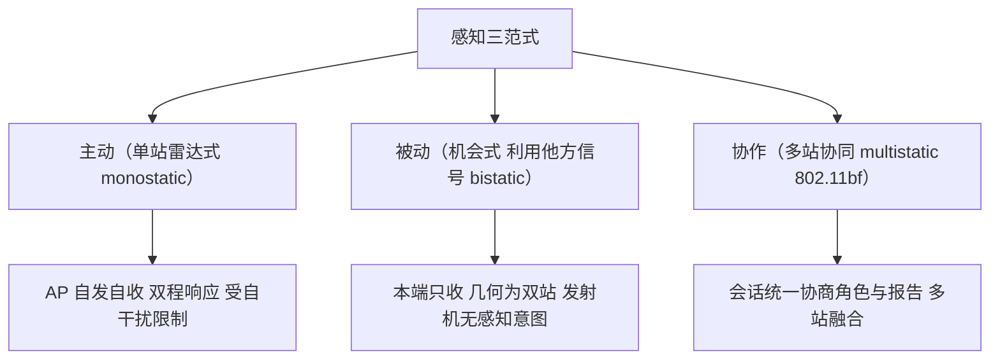
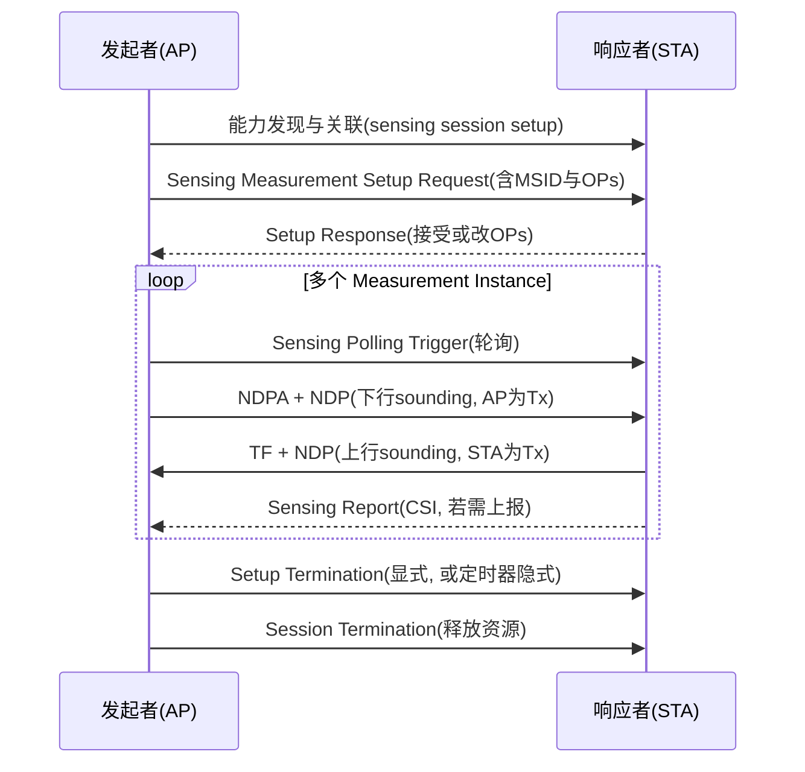
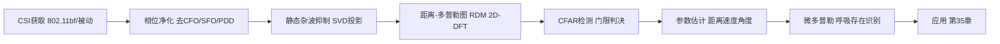

# 第 34 章　通感一体化：信号模型、参数估计与检测 ★★★

> 本章系统与第 21 章（定位与测距）衔接：第 21 章解决"定位一个**合作**设备"（FTM/NTB 往返时间（Round-Trip Time, RTT）、ToF 的 CRLB、MUSIC/AoA、相位校准），本章把同一套物理层工具扩展到"感知环境中的**非合作**目标（人/物）"——从"测距一个应答终端"转向"从信道状态信息（Channel State Information, CSI）中估计距离/速度/角度并检测存在、呼吸、微动"。凡第 21 章已完成的推导（ToF 的 CRLB、MUSIC、相位偏置模型）本章**直接引用结论**，仅做"感知化"扩展，不再重推；新推导集中在 CSI 感知信号模型、联合 Fisher 信息矩阵（Fisher Information Matrix, FIM）、静态杂波 奇异值分解（Singular Value Decomposition, SVD）抑制与 CFAR（Constant False Alarm Rate，恒虚警率）检测。应用、多站融合、隐私与资源调度见第 35 章。

## 学习目标

1. **能推导**：从多径信道模型出发推导 正交频分复用（Orthogonal Frequency Division Multiplexing, OFDM）子载波域 CSI 感知信号模型，并说明"距离↔频域相位斜率、速度↔时域相位斜率、角度↔天线间相位差"三对应关系。
2. **能计算**：Wi-Fi 感知的距离/速度/角度分辨率与理论精度界（CRLB），并对照专用雷达说明 Wi-Fi 感知的能力边界。
3. **能实现**：CSI 相位净化（去载波/采样频偏与包检测时延）与静态杂波抑制（SVD 子空间投影），设计 CFAR 与呼吸/存在检测算法。
4. **能分析**：802.11bf【已发布】的测量流程与通感资源折衷，建立"通信速率—感知精度"的 Pareto 前沿。

## 34.1　感知的三种范式与分工

### 34.1.1　范式定义

按发射机与接收机的归属，Wi-Fi 感知分为三类范式：

- **主动（active）**：单一设备自发自收，雷达式（monostatic）。接入点（Access Point, AP）发射探测波形并接收目标回波，信道即"发射—目标—接收"的双程响应。对应 802.11bf 的 monostatic（在 60 GHz 频段支持；sub-7 GHz 受自干扰限制通常不做真单站）。
- **被动（passive）**：接收端不发射，而是利用**他方已存在的信号**（他方 AP 的 beacon、数据帧、FB（Feedback，信道反馈）帧）经目标反射后的 CSI。本质是"机会式（opportunistic）"双站（bistatic）感知——发射机与接收机分属不同设备，且发射机无感知意图。
- **协作（collaborative）**：多节点按协议协同，明确分配发射/接收角色，交换测量与报告。对应 802.11bf 的 bistatic/multistatic（多站）感知，由 sensing 会话（session）统一协商。

图 34-1 给出三类范式的拓扑。



图 34-1　感知三范式拓扑：单站自发自收、被动利用他方信号、协作多节点按 802.11bf 会话协同。

### 34.1.2　与第 21 章及后续章的分工

| 主题 | 第 21 章（合作目标） | 本章（非合作目标） | 第 35 章 |
|---|---|---|---|
| 对象 | 应答终端（已知存在） | 人/物（存在性未知） | 应用谱系、部署 |
| 观测量 | RTT、到达角（Angle of Arrival, AoA） | CSI 衍生的距离/速度/角度/微多普勒 | 多站融合算法 |
| 核心推导 | ToF CRLB、MUSIC | CSI 信号模型、联合 FIM、杂波抑制 | 资源调度、隐私 |
| 检测 | 无（目标已知） | CFAR、存在/呼吸检测 | 合规与攻击 |

后续信号模型（§34.2）是全书感知部分的"地基"；§34.3 的分辨率/精度界把第 21 章的 ToF CRLB 扩展为联合（距离-速度-角度）估计；§34.4 的 802.11bf 是协作范式的标准化承载；§34.5–34.7 是处理链路核心算法；§34.8–34.9 给出 NLOS 与通感折衷的理论限界。

## 34.2　CSI 感知信号模型（核心地基）

### 34.2.1　从多径信道到 OFDM 子载波域响应

第 1 章给出多径信道的时延-时变表达：在慢变假设下，含 $K$ 条路径的复基带信道冲激响应（Channel Impulse Response, CIR）写为

$$
h(t,\tau)=\sum_{k=1}^{K} a_k\,e^{j2\pi f_{D,k}t}\,\delta(\tau-\tau_k),
$$

其中 $a_k$ 为第 $k$ 径复幅度，$\tau_k=2R_k/c$ 为双程（或单程，依范式）传播时延，$f_{D,k}=2v_k/\lambda$ 为多普勒频移（$v_k$ 沿链路径向速度，$\lambda$ 为波长），$c$ 为光速。注意此处 $t$ 是**慢时间**（跨 OFDM 符号/帧的尺度），多普勒表现为对幅度的缓慢相位调制。

OFDM 在第 $n$ 个子载波（频点 $f_n=n\Delta f_s$，$\Delta f_s$ 为子载波间隔，802.11 固定为 $312.5\ \mathrm{kHz}$）、第 $m$ 个 OFDM 符号（慢时间 $t_m=m T_{\mathrm{rep}}$，$T_{\mathrm{rep}}$ 为测量重复周期，如帧周期）处的**信道频率响应**为

$$
H[n,m]=\int_{-\infty}^{\infty} h(t_m,\tau)\,e^{-j2\pi f_n\tau}\,d\tau.
$$

**第 1 步**：代入 $h(t_m,\tau)$ 并交换积分与求和（$\delta$ 抽样）：

$$
H[n,m]=\sum_{k=1}^{K} a_k\,e^{j2\pi f_{D,k}m T_{\mathrm{rep}}}\int \delta(\tau-\tau_k)e^{-j2\pi n\Delta f_s \tau}d\tau.
$$

**第 2 步**：$\delta$ 积分直接给出 $e^{-j2\pi n\Delta f_s\tau_k}$，于是

$$
\boxed{H[n,m]=\sum_{k=1}^{K} a_k\,e^{-j2\pi \Delta f_s\,n\,\tau_k}\,e^{j2\pi f_{D,k}m T_{\mathrm{rep}}}}
$$

这正是题目给定的形式（其中 $\Delta f_s$ 即题中的 $f_s$）。它把"时延 $\tau_k$、多普勒 $f_{D,k}$、幅度 $a_k$"编码进一个二维复矩阵 $H\in\mathbb{C}^{N\times M}$（$N$ 子载波数、$M$ 慢时间样本数）。

### 34.2.2　三个对应关系（逐步推导）

对单一目标径 $k$，固定另两维，观察其在某一维的相位：

**(a) 距离 ↔ 频域（子载波间）相位斜率。** 固定 $m$，径 $k$ 相位
$$
\phi_k(n)=-2\pi\Delta f_s\,\tau_k\,n+\arg(a_k).
$$
相位随子载波索引 $n$ 作**线性变化**，斜率 $\beta_R=-2\pi\Delta f_s\tau_k$。因 $\tau_k=2R_k/c$，斜率直接正比于距离 $R_k$。故**距离信息存在于子载波间（频域）相位斜率**。

**(b) 速度 ↔ 时域（符号/帧间）相位斜率。** 固定 $n$，径 $k$ 相位
$$
\phi_k(m)=2\pi f_{D,k}\,T_{\mathrm{rep}}\,m+\arg(a_k)=2\pi\frac{2v_k}{\lambda}T_{\mathrm{rep}}\,m+\arg(a_k).
$$
相位随慢时间索引 $m$ 线性变化，斜率 $\beta_v=4\pi v_k T_{\mathrm{rep}}/\lambda$。故**速度信息存在于符号/帧间（慢时间域）相位斜率**。

**(c) 角度 ↔ 天线间相位差。** 设接收端均匀线阵（Uniform Linear Array, ULA），$N_{\mathrm{rx}}$ 根天线、间距 $d$。第 $p$ 根天线相对参考元因入射角 $\theta$（方位）产生的额外路径差为 $p d\sin\theta$，故该天线上的第 $k$ 径相位多一项 $-2\pi p d\sin\theta/\lambda$。固定 $n,m$，第 $p$ 与 $0$ 天线相位差
$$
\Delta\phi_k(p)=-2\pi\frac{d\sin\theta}{\lambda}\,p.
$$
故**角度信息存在于天线间（空域）相位差**——这正是第 21.5 节 MUSIC 的导向矢量来源，本章直接引用。

### 34.2.3　域—参数—分辨率对照表

图 34-2 以表格固化三对应关系（含后文将推导的分辨率与无模糊界）。

| 域 | 估计参数 | 相位关系（斜率/差） | 分辨率 | 最大无模糊范围 |
|---|---|---|---|---|
| 频域（子载波 $n$） | 距离 $R$ | $\beta_R=-2\pi\Delta f_s(2R/c)\,n$ | $\Delta R=c/(2B)$ | $R_{\max}=c/(2\Delta f_s)$ |
| 时域（慢时间 $m$） | 速度 $v$ | $\beta_v=4\pi v T_{\mathrm{rep}}/\lambda\,m$ | $\Delta v=\lambda/(2T_{\mathrm{obs}})$ | $v_{\max}=\lambda/(4T_{\mathrm{rep}})$ |
| 空域（天线 $p$） | 角度 $\theta$ | $\Delta\phi=-2\pi(d\sin\theta/\lambda)\,p$ | $\Delta\theta\approx\lambda/(N_{\mathrm{rx}}d\cos\theta)$ | $\theta\in[-90^\circ,90^\circ]$ |

图 34-2　CSI 感知"域—参数—分辨率"对照表：距离看频域斜率、速度看时域斜率、角度看天线相位差；分辨率由带宽/观测时长/孔径决定。

> 说明：频域分辨由**总带宽** $B$ 决定，时域分辨由**相干观测时长** $T_{\mathrm{obs}}=M T_{\mathrm{rep}}$ 决定，空域分辨由**孔径** $N_{\mathrm{rx}}d$ 决定。三者独立，对应信号处理中经典的"距离向—多普勒向—波束向"三维分辨。

## 34.3　分辨率与精度界（核心理论推导）

### 34.3.1　距离分辨率与最大无模糊距离

**距离分辨率**：由图 34-2 频域斜率，相邻两目标距离差 $\Delta R$ 对应时延差 $\Delta\tau=2\Delta R/c$。在子载波域对 $H[n,\cdot]$ 做长度 $N$ 的 离散傅里叶变换（Discrete Fourier Transform, DFT）（频域采样间隔即子载波间隔 $\Delta f_s$，总带宽 $B=N\Delta f_s$），两目标可分辨要求时延差大于 DFT 主瓣半宽 $\Delta\tau\ge 1/B$。故

$$
\boxed{\Delta R=\frac{c}{2B}}.
$$

**最大无模糊距离**：频域相位斜率 $\beta_R=-2\pi\Delta f_s\tau$ 随 $n$ 递增，当 $\beta_R$ 跨过 $\pi$（即相邻子载波相位差超 $\pi$）时发生 $2\pi$ 模糊——这正是 DFT 的周期延拓。临界：$\Delta f_s\cdot(2R_{\max}/c)=\tfrac12$（Nyquist），得

$$
\boxed{R_{\max}=\frac{c}{2\Delta f_s}}.
$$

以 $B=80\ \mathrm{MHz}$、$\Delta f_s=312.5\ \mathrm{kHz}$ 代入：$\Delta R=1.875\ \mathrm{m}$，$R_{\max}=480\ \mathrm{m}$。

### 34.3.2　速度分辨率与最大无模糊速度

**速度分辨率**：慢时间序列 $H[\cdot,m]$ 长度 $M$、采样间隔 $T_{\mathrm{rep}}$、观测时长 $T_{\mathrm{obs}}=M T_{\mathrm{rep}}$。对慢时间做 DFT，多普勒分辨 $\Delta f_D\ge 1/T_{\mathrm{obs}}$，由 $f_D=2v/\lambda$ 得

$$
\boxed{\Delta v=\frac{\lambda}{2T_{\mathrm{obs}}}=\frac{c}{2f_c T_{\mathrm{obs}}}}.
$$

**最大无模糊速度**：慢时间采样率为 $1/T_{\mathrm{rep}}$，Nyquist 限 $|f_D|<1/(2T_{\mathrm{rep}})$，故

$$
\boxed{v_{\max}=\frac{\lambda}{4T_{\mathrm{rep}}}}.
$$

以 $f_c=5\ \mathrm{GHz}$（$\lambda=0.06\ \mathrm{m}$）、帧率 $100\ \mathrm{Hz}$（$T_{\mathrm{rep}}=10\ \mathrm{ms}$）：$v_{\max}=1.5\ \mathrm{m/s}$；若取 $M=100$ 帧（$T_{\mathrm{obs}}=1\ \mathrm{s}$）则 $\Delta v=0.03\ \mathrm{m/s}$。**结论**：Wi-Fi 速度分辨率极优（cm/s 级），但帧率受限使无模糊速度仅约 $1.5\ \mathrm{m/s}$——这正是需要多帧率/中国余数理解模糊（§34.7.3）的原因。

### 34.3.3　角度分辨率（扩展到 2D 均匀面阵）

第 21.5.4 给出 ULA 方位分辨率 $\Delta\theta\approx\lambda/(N_{\mathrm{rx}}d\cos\theta)$。扩展至均匀面阵（Uniform Planar Array, UPA），$N_x\times N_y$ 阵元、间距均取 $\lambda/2$。入射方向由方位角 $\theta$（与 $x$ 轴夹角）与俯仰角 $\varphi$ 描述，空间频率
$$
u_x=\sin\theta\cos\varphi,\qquad u_y=\sin\theta\sin\varphi.
$$
导向矢量元素（第 $(p,q)$ 元）
$$
a_{p,q}(\theta,\varphi)=\exp\!\Big[-j\frac{2\pi}{\lambda}\big(p d\,u_x+q d\,u_y\big)\Big],\quad p=0..N_x\!-\!1,\ q=0..N_y\!-\!1.
$$
仿 ULA 推导，两临近方向可分辨当空间频率差大于孔径倒数，得二维分辨率
$$
\boxed{\Delta\theta\approx\frac{\lambda}{N_x d\cos\theta\,\sqrt{1-(u_y)^2}},\qquad
\Delta\varphi\approx\frac{\lambda}{N_y d\cos\varphi\,\sqrt{1-(u_x)^2}}}.
$$
可见俯仰分辨还受方位投影影响；$\lambda/2$ 间距下面阵把"一维角"升级为"方位+俯仰"二维感知，但 Wi-Fi 设备多为 1D 或 2×2 阵列，实际角分辨仍粗（见算例 34.1）。

### 34.3.4　联合估计的 Fisher 信息与 CRLB 矩阵

第 21.4 节在单径、单参数（时延 $\tau$）下给出 ToF 的 CRLB $\mathrm{var}(\hat\tau)\ge 1/(8\pi^2\beta^2\mathrm{SNR})$，距离 $\sigma_d=c\sigma_\tau/2$。本章把该结果推广到**多参数联合估计**（距离/速度/角度），使用复高斯观测下的 Slepian–Bangs 公式。

设无噪复观测向量 $\boldsymbol{\mu}(\boldsymbol{\theta})$（$\boldsymbol{\theta}=[\theta_1,\dots,\theta_P]^\mathsf{T}$ 为待估参数，噪声为圆对称复高斯、每维方差 $\sigma^2$），则 FIM 第 $(i,j)$ 元为

$$
\boxed{\mathcal{I}_{ij}=\frac{2}{\sigma^2}\Re\!\left\{\frac{\partial\boldsymbol{\mu}^{\!H}}{\partial\theta_i}\frac{\partial\boldsymbol{\mu}}{\partial\theta_j}\right\}}.
$$

**实例化（单径、估计 $\tau$ 与 $f_D$）**：取 $\mu_{n,m}=a\,e^{-j2\pi\Delta f_s n\tau}e^{j2\pi f_D m T_{\mathrm{rep}}}$（$a$ 已知幅度，仅估 $\tau,f_D$）。求偏导：

$$
\frac{\partial\mu}{\partial\tau}=-j2\pi\Delta f_s n\,\mu,\qquad
\frac{\partial\mu}{\partial f_D}=j2\pi m T_{\mathrm{rep}}\,\mu.
$$

- **对角元（不跳步）**：
$$
\mathcal{I}_{\tau\tau}=\frac{2}{\sigma^2}\Re\!\left\{(j2\pi\Delta f_s n\mu^{\!H})(-j2\pi\Delta f_s n\mu)\right\}
=\frac{2}{\sigma^2}(2\pi\Delta f_s)^2n^2|\mu|^2.
$$
对全部 $n,m$ 求和并代入 $\mathrm{SNR}=|a|^2/\sigma^2$、$|\mu|^2=|a|^2$：
$$
\mathcal{I}_{\tau\tau}=\frac{2\,\mathrm{SNR}}{NM}(2\pi\Delta f_s)^2\!\sum_{n=0}^{N-1}n^2
\approx\frac{2\,\mathrm{SNR}}{NM}(2\pi\Delta f_s)^2\frac{N^3}{3}.
$$
距离方差 $\sigma_R^2=(c/2)^2/\mathcal{I}_{\tau\tau}$，与第 21.4 节"$\sigma_d\propto1/B$"一致（因 $\sum n^2\sim N^3\propto B^3$ 配 $\mathrm{SNR}/(NM)$ 后得 $1/B^2$ 型界）。

- **非对角元（耦合项）**：
$$
\mathcal{I}_{\tau f_D}=\frac{2}{\sigma^2}\Re\!\left\{(j2\pi\Delta f_s n\mu^{\!H})(j2\pi m T_{\mathrm{rep}}\mu)\right\}
=\frac{2\,\mathrm{SNR}}{NM}(2\pi)^2\Delta f_s T_{\mathrm{rep}}\!\sum_{n,m}nm.
$$
该元非零，说明**距离与速度存在 Doppler–Range 耦合**：短观测下二者互相关，需联合估计或用"去斜（dechirp）/keystone"补偿。

- **CRB 矩阵**：$\mathrm{Cov}(\hat{\boldsymbol{\theta}})\succeq\mathcal{I}^{-1}$，即
$$
\boxed{\begin{bmatrix}\mathrm{var}(\hat R)&\mathrm{cov}(R,v)\\ \mathrm{cov}(R,v)&\mathrm{var}(\hat v)\end{bmatrix}\succeq
\begin{bmatrix}\mathcal{I}_{RR}&\mathcal{I}_{Rv}\\ \mathcal{I}_{Rv}&\mathcal{I}_{vv}\end{bmatrix}^{\!-1}}.
$$
角度参数同理：把 $\partial\mu/\partial\theta$ 换成 $-j(2\pi d/\lambda)\times(\text{天线索引})\times\mu$，FIM 元 $\propto(d/\lambda)^2\sum(\text{索引})^2$，其界即 §34.3.3 的分辨率量级下界。

### 34.3.5　算例 34.1：分辨率与精度、Wi-Fi 感知能力边界

**已知**：80 MHz 信道（$B=80\ \mathrm{MHz}$，$N=256$ 子载波，$\Delta f_s=312.5\ \mathrm{kHz}$），$f_c=5\ \mathrm{GHz}$（$\lambda=0.06\ \mathrm{m}$），$N_{\mathrm{rx}}=4$、$d=\lambda/2$，$\mathrm{SNR}=20\ \mathrm{dB}=100$，帧率 $100\ \mathrm{Hz}$（$T_{\mathrm{rep}}=10\ \mathrm{ms}$），取 $M=100$ 帧（$T_{\mathrm{obs}}=1\ \mathrm{s}$）。

**解（分步）**：
- 距离分辨率：$\Delta R=c/(2B)=3\times10^8/(1.6\times10^8)=1.875\ \mathrm{m}$。
- 最大无模糊距离：$R_{\max}=c/(2\Delta f_s)=3\times10^8/(6.25\times10^5)=480\ \mathrm{m}$。
- 速度分辨率：$\Delta v=\lambda/(2T_{\mathrm{obs}})=0.06/2=0.03\ \mathrm{m/s}$。
- 最大无模糊速度：$v_{\max}=\lambda/(4T_{\mathrm{rep}})=0.06/(0.04)=1.5\ \mathrm{m/s}$。
- 角度分辨率（法线）：$\Delta\theta\approx\lambda/(N_{\mathrm{rx}}d)=0.06/(4\times0.03)=0.5\ \mathrm{rad}=28.6^\circ$（与第 21.5.4 一致）。
- 距离 CRLB（引用第 21.4）：$\sigma_d=\dfrac{c\sqrt3}{4\pi B\sqrt{\mathrm{SNR}}}=3\times10^8\times1.732/(4\pi\times8\times10^7\times10)=0.0731\ \mathrm{m}$。

**结论与能力边界**：80 MHz Wi-Fi 的距离分辨率约 **1.9 m**（粗），但速度分辨率达 **3 cm/s**（极优）、角度约 **29°**（粗）。对照专用雷达：77 GHz 车载雷达带宽常达 1–4 GHz → 距离分辨率 4–15 cm（优于 Wi-Fi 两个数量级）；脉冲多普勒靠高 PRF 实现数十 m/s 无模糊速度（优于 Wi-Fi 的 1.5 m/s）。**因此 Wi-Fi 感知的甜区是"慢速微动/存在/呼吸/手势"（速度敏感、对距离精度不苛求），而非高分辨率成像或高速目标测速**——这是本章一再强调的能力边界。

## 34.4　802.11bf 协议与测量流程【已发布：IEEE 802.11bf-2025】

> 核实结论：IEEE 802.11bf-2025（Amendment 4: Enhancements for Wireless LAN Sensing）由 IEEE SA 于 2025-05-28 批准、2025-09-26 出版，状态 **Active**；修改 高效率（High Efficiency, HE）（802.11ax）与 极高吞吐量（Extremely High Throughput, EHT）（802.11be）物理层（Physical Layer, PHY）的 MAC/PHY 服务接口及 DMG/EDMG PHY，频段覆盖 1–7.125 GHz 与 >45 GHz。故本章标【已发布】。

### 34.4.1　角色与 sensing 类型

四个角色可组合于同一设备：
- **Sensing Initiator（发起者）**：发起 无线局域网（Wireless LAN, WLAN） sensing 流程，通常承载感知应用；
- **Sensing Responder（响应者）**：参与流程的对端设备；
- **Sensing Transmitter（发射者）**：发射用于测量的 物理层汇聚协议（Physical Layer Convergence Protocol, PLCP）协议数据单元（PLCP Protocol Data Unit, PPDU）；
- **Sensing Receiver（接收者）**：接收 PPDU 并执行测量。

由"Tx/Rx 是否同设备"导出三类 sensing 类型（图 34-1 已示）：monostatic（同设备，radar 式，60 GHz 支持）、bistatic（AP 与 站点（Station, STA）两设备，sub-7 GHz 主力）、multistatic（>2 设备，如 AP 协同多 STA，仅 TB 变体支持）。若发起者同时是接收者，则无需 sensing report；否则接收者必须回传报告。

### 34.4.2　测量流程（五阶段）

 sensing 会话按"能力发现 → 参数协商 → 实测 → 终止"推进。图 34-3 用 sequenceDiagram 描述 TB 变体的典型流程。



图 34-3　802.11bf TB 测量流程时序（Mermaid）：session setup → measurement setup（分配 MSID）→ 多个 instance（轮询/NDPA/Trigger/报告）→ termination。

各阶段要点：(1) **Sensing Session Setup** 交换 sensing 能力、建安全上下文（关联 STA 随关联自动完成；非关联用 PASN）；(2) **Sensing Measurement Setup** 协商操作参数 OPs（角色、带宽、空间流数、报告类型、周期/时长），发起者以自身 媒体接入控制（Medium Access Control, MAC）地址+**MSID（Measurement Setup Identifier，测量建立标识）**唯一标识一套 OPs，可建多套以服务不同应用；(3) **Sensing Measurement Instance** 是实测核心，由 **MII（Measurement Instance Identifier）** 标识，含 Polling、空数据帧宣告（NDP Announcement, NDPA） sounding（AP 发 空数据帧（Null Data Packet, NDP），STA 收）、TF sounding（STA 发 NDP，AP 收）、Reporting 四相位；(4) **Setup Termination** 有显式（发 Termination 帧）与隐式（MSID 定时器超时）两种；(5) **Session Termination** 释放全部 sensing 资源（含缓冲的 CSI 报告）。

### 34.4.3　测量类型与报告格式

802.11bf 标准化层面**仅把 CSI 定义为 sensing measurement**，其余（range/velocity/angle/presence/motion）是应用由 CSI 派生的"感知特征（features，PAR 原文）"。CSI 报告格式要点：
- 报告每个"发射天线 × 接收天线"对的信道频响；
- 每个原始频响先独立**缩放并量化**为 **8 或 10 bit**；
- 为降开销，**分组（grouping）**只报每 4/8/16 个子载波中的 1 个；
- 缩放因子随报告一并下发，供应用还原幅度/相位。

| 测量/特征 | 来源 | 802.11bf 标准化状态 |
|---|---|---|
| CSI（频响矩阵） | 直接测量 | 【已发布】唯一标准化 measurement |
| range / velocity / angle | CSI 派生（§34.2–34.3） | 【已发布】作为 features 由应用解算 |
| presence / motion | CSI 时变统计量（§34.6） | 【已发布】作为 features 由应用解算 |

### 34.4.4　与 802.11az NTB 的关系

802.11bf 在机制上复用 802.11az【已发布：IEEE 802.11az-2022】的两大基石：(a) **安全测距框架**——sensing session/measurement setup 的认证与会话管理沿用 802.11az 的 secure ranging 思路，防止伪造测量；(b) **CSI 反馈框架**——11bf 的 CSI 报告直接复用 HE/EHT 的 CSI 量化与分组机制（见 §34.4.3）。区别在于 802.11az 以"合作终端的 RTT/位置"为目标，11bf 把同一物理层测量泛化为"对环境非合作目标的感知"，并把测量触发从 下一代测距（Next-Generation TB Ranging, NTB）的成对往返扩展到多站（multistatic）TB 调度。

### 34.4.5　与通信的资源竞争：sounding 开销占空比

sensing 占用空口即挤占数据。TB instance 的开销主要来自 NDPA sounding（AP 发 NDPA+NDP）与 Reporting（Orthogonal Frequency Division Multiple Access, OFDMA 资源单元（Resource Unit, RU）回传 CSI）。设每 instance 净开销时长 $T_{\mathrm{ov}}$（NDPA+NDP+TF+报告，典型数十 µs 至数百 µs），每秒测量 $f_{\mathrm{sense}}$ 次，则 sensing 空口占空比

$$
\boxed{\rho_{\mathrm{sense}}=f_{\mathrm{sense}}\cdot T_{\mathrm{ov}}}.
$$

**算例（sounding 占空比）**：取 $T_{\mathrm{ov}}=200\ \mu\mathrm{s}$（含一次下行 NDP 与上行报告），若 $f_{\mathrm{sense}}=50\ \mathrm{Hz}$：$\rho=50\times200\times10^{-6}=1.0\%$；若需更高速度分辨率取 $f_{\mathrm{sense}}=200\ \mathrm{Hz}$：$\rho=4.0\%$。该开销直接由 §34.9 的通感折衷模型吸收——sounding 占比即"感知资源占比"，挤占等量的数据符号。

## 34.5　CSI 相位净化（Phase Sanitization）【算法六段式·一】

图 34-6 给出从 CSI 获取到特征输出的完整处理链路（与后续 §34.5–34.7 一一对应）。



图 34-6　Wi-Fi 感知处理链路（Mermaid flowchart）：CSI 获取→相位净化→静态抑制→RDM→CFAR→参数估计→微多普勒特征→应用。

### 34.5.1　相位损伤模型

第 2 章 CSI 相位除目标信号外，被五类硬件/同步损伤污染（第 21.5.5 已建模，此处汇总并做感知化扩展）：
1. **载波频偏 CFO（Carrier Frequency Offset）**：收发本振差 $\Delta f_{\mathrm{cfo}}$，造成全子载波共同相位随时间旋转 $\phi_{\mathrm{CFO}}(t)=2\pi\Delta f_{\mathrm{cfo}}t$（与子载波索引 $k$ 无关）；
2. **采样频偏 SFO（Sampling Frequency Offset）**：采样钟偏差 $\epsilon$，造成相位随 $k$ 线性旋转 $\phi_{\mathrm{SFO}}(k)=2\pi\epsilon\,k\,\Delta f_s t/N$（跨子载波斜率）；
3. **包检测时延 PDD（Packet Detection Delay）**：每包定时偏差 $\tau_{\mathrm{pdd}}$，引入跨子载波线性相位 $\phi_{\mathrm{PDD}}(k)=2\pi\Delta f_s\tau_{\mathrm{pdd}}k$；
4. **PLL 随机初相**：锁相环每包随机初相 $\phi_0$（全子载波、全天线公共，逐包变化）；
5. **天线间幅度/相位失配**：接收链增益与相位不一致 $\gamma_p,\eta_p$（随天线 $p$）。

### 34.5.2　合成相位模型

天线 $p$、子载波 $k$、慢时间 $m$ 的测量相位（单径/目标，含静态环境 $\tau_e$ 与动态 $\tau_m$）：

$$
\boxed{\Phi_p(k,m)=2\pi\Delta f_s(\tau_e+\tau_m)\,

k\;+\;2\pi\frac{d p\sin\theta}{\lambda}\;+\;\underbrace{\alpha k+\beta m+\phi_0(m)+\gamma_p}_{\text{损伤项}}\;+\;\eta_p}
$$

其中 $\alpha k$ 合并 SFO+PDD 的跨子载波斜率，$\beta m$ 为 CFO 的跨时间斜率，$\phi_0(m)$ 为逐包公共初相，$\gamma_p,\eta_p$ 为天线失配。目标信号在三项里：**距离**（$\tau_m$ 项，混于 $\alpha k$ 同形的频域斜率）、**角度**（天线项 $2\pi d p\sin\theta/\lambda$）、**速度**（$\tau_m$ 随 $m$ 变化，混于 $\beta m$ 同形的时域斜率）。净化的核心是把"损伤项"从"目标项"中剥离。

### 34.5.3　校准与消除算法思路

- **去 CFO/公共初相**：对同帧各天线取参考（天线 0），相减消去与 $p$ 无关的项 $\alpha k+\beta m+\phi_0+\eta_0$ 中除天线失配外的公共部分；或跨帧跟踪共同相位旋转拟合掉 $\beta m+\phi_0$。
- **去 SFO/PDD（去斜率）**：对单天线各子载波相位做关于 $k$ 的线性拟合，减去斜率 $\alpha$（消除 SFO/PDD）；但此举也会消去**真实距离斜率**——故须用"参考静态帧"或"天线差分"区分：天线差分使距离/环境斜率（对所有天线相同）抵消，仅留角度项（§34.2.2(c)），从而干净提取角度；若需距离，则改用"时间差分"以参考帧斜率抵消静态环境+SFO/PDD，仅留目标动态斜率（算例 34.2）。
- **天线失配校准**：用已知静态直射径或出厂标定得到 $\gamma_p,\eta_p$ 并补偿。

### 34.5.4　六段式算法：CSI 相位校准与净化算法

**1. 问题建模**。输入：原始 CSI 矩阵 $H_p(k,m)\in\mathbb{C}$（$p$ 天线、$k$ 子载波、$m$ 帧）。变量：损伤参数 $\alpha,\beta,\phi_0(m),\gamma_p,\eta_p$ 与纯净相位 $\tilde\Phi_p(k,m)$。假设：损伤为低秩/结构化（跨子载波线性、跨天线公共、逐包缓变），目标动态为高阶微扰。

**2. 目标函数与约束**。最小化净化后相位的"残差方差"（即去除结构化损伤后剩余应为零均值高斯噪声+目标）：
$$
\min_{\alpha,\beta,\phi_0,\gamma_p}\;\sum_{p,k,m}\Big|\angle H_p(k,m)-\big(\alpha k+\beta m+\phi_0(m)+\gamma_p\big)-\hat\Phi^{\mathrm{tgt}}_p(k,m)\Big|^2,
$$
约束：角度项 $\hat\Phi^{\mathrm{tgt}}$ 在各 $k$ 上应与 $k$ 无关（即去损伤后仅天线/时间相关）。

**3. 完整推导（不跳步）**。
- 第 1 步：公共相位消除。取参考天线 $p^\ast$，定义 $\Delta\Phi_p(k,m)=\angle H_p-\angle H_{p^\ast}$。因 $\alpha k+\beta m+\phi_0+\eta_{p^\ast}$ 项相同，抵消后
$$
\Delta\Phi_p(k,m)=2\pi\frac{d(p-p^\ast)\sin\theta}{\lambda}+\underbrace{(\gamma_p-\gamma_{p^\ast})}_{\text{常数}}+\text{目标动态跨天线差}.
$$
- 第 2 步：去斜率（SFO/PDD）。对每帧 $m$、每天线 $p$，对 $\angle H_p(k,m)$ 关于 $k$ 线性拟合得斜率 $\hat\alpha_{p,m}$，残差 $r_p(k,m)=\angle H_p-\hat\alpha_{p,m}k$。此步消去 SFO/PDD 与静态环境斜率，**但同步消去真实距离斜率**——故仅用于"角度提取"分支（角度项与 $k$ 无关，残差中恒为常数）。
- 第 3 步：时间差分（距离/速度分支）。以参考帧 $m_0$ 的斜率 $\hat\alpha_{p,m_0}$ 与相位为基准，定义 $\delta_p(k,m)=\angle H_p(k,m)-\angle H_p(k,m_0)=2\pi\Delta f_s(\tau_m(m)-\tau_m(m_0))k+\cdots$。静态环境与 SFO/PDD（均与 $m$ 无关）完全抵消，仅留目标动态引起的频域斜率变化——即距离/速度信息。
- 第 4 步：天线失配补偿。用标定值减去 $\gamma_p,\eta_p$。

**4. 伪代码**（带行号、中文注释，标注复杂度）。

```text
 1  function CSI_Sanitize(H, pref, m0):          // H: P×K×M 原始CSI相位矩阵
 2    for m = 1 to M:                            // 逐帧
 3      for p = 1 to P:                          // 逐天线
 4        [alpha(p,m), ~] = polyfit(k, angle(H(p,:,m)), 1)  // 线性拟合去斜率, O(K)
 5        r(p,:,m) = angle(H(p,:,m)) - alpha(p,m)*k        // 残差(含角度/目标), O(K)
 6    for p = 1 to P:                            // 天线差分消CFO/公共初相, O(KM)
 7      D(p,:, :) = r(p,:, :) - r(pref,:, :)     // 差分后仅留角度与动态, O(KM)
 8    for m = 1 to M:                            // 时间差分(距离/速度分支), O(PK)
 9      dPhi(:,:,m) = r(:,:,m) - r(:,:,m0)       // 消去静态+SFO/PDD, 留目标动态
10    return D, dPhi                             // D→角度, dPhi→距离/速度
```

**5. 复杂度分析**。时间：$O(M\cdot P\cdot K)$（拟合与差分主导），空间：$O(PKM)$ 存矩阵；相对 MUSIC 的 $O(N^3)$ 可忽略，适合实时每帧处理。

**6. 数值算例 34.2：净化前后相位斜率与目标检测**。
**已知**：$B=80\ \mathrm{MHz}$（$\Delta f_s=312.5\ \mathrm{kHz}$，$K=256$），静态环境时延 $\tau_e=30\ \mathrm{ns}$，SFO 等效附加时延 $\tau_{\mathrm{sfo}}=4\ \mathrm{ns}$（表现为额外频域斜率），目标运动使 $\tau_m(m)-\tau_m(m_0)=+1\ \mathrm{ns}$ 于帧 $m$。
**解**：
- 参考帧总频域斜率：$\beta_0=2\pi\Delta f_s(\tau_e+\tau_{\mathrm{sfo}})=2\pi\times312500\times34\times10^{-9}=2\pi\times1.0625\times10^{-2}=0.0667\ \mathrm{rad/子载波}$；全带累计相位 $0.0667\times256=17.08\ \mathrm{rad}$。
- 帧 $m$ 总斜率：$\beta_m=2\pi\times312500\times35\times10^{-9}=0.0687\ \mathrm{rad/子载波}$；全带累计 $17.59\ \mathrm{rad}$。
- 直接相减（未净化）：两帧全带相位差仅 $0.51\ \mathrm{rad}$，却淹没在 $17\ \mathrm{rad}$ 量级的静态大相位与 SFO 中，信噪比极低、检测失效。
- 时间差分（第 9 行）：仅留目标动态斜率 $\delta\beta=2\pi\Delta f_s\times1\ \mathrm{ns}=2\pi\times312500\times10^{-9}=0.001963\ \mathrm{rad/子载波}$，全带累计 $\Delta\Phi=0.001963\times256=0.5027\ \mathrm{rad}\approx28.8^\circ$。
**量级检查**：净化后只保留 $0.5\ \mathrm{rad}$（约 $29^\circ$）的目标动态相位，静态 $17\ \mathrm{rad}$ 与 SFO $0.25\ \mathrm{rad}$ 被完整抵消，残余即为可检测信号——量级合理，因为 $1\ \mathrm{ns}$ 时延对应双程 $0.15\ \mathrm{m}$ 位移，恰在人类微动尺度内。

## 34.6　静态杂波抑制与目标检测【算法六段式·二】

### 34.6.1　接收信号模型

接收 CSI 分解为三部分：
$$
H[k,m]=\underbrace{H_{\mathrm{static}}[k,m]}_{\text{墙壁/家具等静止径}}+\underbrace{H_{\mathrm{dyn}}[k,m]}_{\text{动态目标(人)}}+\underbrace{n[k,m]}_{\text{噪声}}.
$$
静态分量在相邻帧间近乎不变（仅随 SFO/CFO 缓变，已由 §34.5 处理），动态目标在慢时间上呈现周期/非周期变化（呼吸、步态）。抑制静态分量即可凸显目标。

### 34.6.2　静态分量去除：均值/高通/PCA/SVD 子空间投影

- **时域均值/高通**：$\tilde H[k,m]=H[k,m]-\frac1M\sum_m H[k,m]$（去直流）；或对慢时间高通滤波。简单但假设静态恒定。
- **SVD 子空间投影（推导）**：把 $H$ 按慢时间展开为矩阵 $\mathbf{H}\in\mathbb{C}^{K\times M}$，做奇异值分解 $\mathbf{H}=\mathbf{U}\boldsymbol{\Sigma}\mathbf{V}^{\!H}$。静态径能量集中、在各帧高度相关，对应**最大奇异值**的方向 $\mathbf{u}_1$（信号子空间主要由静态构成）；动态目标与噪声为小奇异值方向。将 $\mathbf{H}$ 投影到静态子空间的正交补：
$$
\boxed{\tilde{\mathbf{H}}=(\mathbf{I}-\mathbf{u}_1\mathbf{u}_1^{\!H})\mathbf{H}=\mathbf{H}-\mathbf{u}_1(\mathbf{u}_1^{\!H}\mathbf{H})}.
$$
即减去静态主导分量，仅留动态+噪声。相比均值法，SVD 投影能自适应跟踪"主静态分量"且对缓慢漂移更鲁棒。

### 34.6.3　CFAR 检测器推导（CA-CFAR）

对距离-多普勒单元 $(i,j)$ 的功率 $Z_{i,j}$，CA-CFAR（Cell-Averaging CFAR）以周围 $N_c$ 个保护单元外的参考单元均值估计背景功率：
$$
\hat\sigma^2_{i,j}=\frac{1}{N_c}\sum_{(p,q)\in\mathcal{R}_{i,j}} Z_{p,q},
$$
检测判决 $Z_{i,j}\mathop{\gtrless}_{H_0}^{H_1}\alpha\,\hat\sigma^2_{i,j}$。在瑞利背景（指数分布）下，虚警概率
$$
P_{\mathrm{fa}}=P(Z>\alpha\hat\sigma^2\mid H_0)=\big(1+\alpha\big)^{-N_c}\approx e^{-\alpha N_c}\quad(N_c\gg1),
$$
反解门限因子
$$
\boxed{\alpha=-\frac{\ln P_{\mathrm{fa}}}{N_c}}.
$$
给定 $P_{\mathrm{fa}}=10^{-4}$、$N_c=16$：$\alpha=-\ln(10^{-4})/16=9.21/16=0.576$。CFAR 的优点是门限随背景自适应，使虚警率恒定而不依赖绝对功率。

### 34.6.4　六段式算法：人体存在/呼吸检测算法

**1. 问题建模**。输入：净化后 CSI 慢时间序列（取单音或全子载波平均）。变量：呼吸引起的胸腔位移 $\Delta R(t)\in[1,12]\ \mathrm{mm}$、心率微动。假设：静止背景下仅存在缓慢周期微动，信噪比（Signal-to-Noise Ratio, SNR）适中。

**2. 目标函数与约束**。检测器：在"呼吸频带"$f\in[0.1,0.5]\ \mathrm{Hz}$ 内寻找显著谱峰，并满足 CFAR 虚警约束：
$$
\max_{f\in\mathcal{B}}|Y(f)|\;\gtrless\;\alpha\,\hat\sigma^2,\qquad \mathcal{B}=[0.1,0.5]\ \mathrm{Hz}.
$$

**3. 完整推导（不跳步）**。呼吸使胸腔往返位移 $\Delta R(t)$，链路相位变化（见 §34.2.2(b) 速度项积分得位移）：
$$
\Delta\phi(t)=\frac{4\pi}{\lambda}\Delta R(t).
$$
- 第 1 步：取净化后相位 $\phi(t)$（由 §34.5 时间差分得到），去趋势后得 $\Delta\phi(t)=4\pi\Delta R(t)/\lambda$。
- 第 2 步：对 $\Delta\phi(t)$ 做 DFT 得谱 $Y(f)$，在呼吸带 $\mathcal{B}$ 内取峰。
- 第 3 步：呼吸摆幅与波长关系：同物理位移下，$\lambda$ 越小相位摆幅越大——故 $5/6\ \mathrm{GHz}$（$\lambda=0.06/0.05\ \mathrm{m}$）比 $2.4\ \mathrm{GHz}$（$\lambda=0.125\ \mathrm{m}$）灵敏 $0.125/0.06\approx2.08$ 倍。

**4. 伪代码**。

```text
 1  function BREATH_DETECT(phi, fs, lambda, Pfa):   // phi: 净化相位序列, fs:采样率
 2    dphi = phi - detrend(phi)                     // 去趋势去静态, O(L)
 3    Y = fft(dphi) / L                             // 频谱, O(L log L)
 4    B = (f>=0.1)&(f<=0.5)                         // 呼吸频带掩码
 5    Z = abs(Y).^2                                 // 功率谱, O(L)
 6    ref = mean(Z(~B))                             // 背景功率估计, O(L)
 7    alpha = -log(Pfa)/Nc                          // CFAR门限因子, O(1)
 8    peak = max(Z(B));  fpk = f(argmax Z(B))       // 呼吸峰, O(L)
 9    detect = (peak > alpha*ref)                   // CFAR判决, O(1)
10    breath_rate = fpk;  amp = lambda*peak/(4*pi)  // 反推位移, O(1)
11    return detect, breath_rate, amp
```

**5. 复杂度分析**。时间 $O(L\log L)$（FFT 主导，$L$ 为慢时间样本数），空间 $O(L)$；可在 AP 侧每百毫秒实时运行一次。

**6. 数值算例 34.3：呼吸相位摆幅与所需 SNR**。
**已知**：$\lambda=0.06\ \mathrm{m}$（5 GHz），呼吸胸腔位移 $\Delta R=8\ \mathrm{mm}=8\times10^{-3}\ \mathrm{m}$；复高斯相位估计方差下界 $\sigma_\phi^2\ge1/(2\mathrm{SNR})$（幅度已知时）。
**解**：
- 相位摆幅：$\Delta\phi=4\pi\Delta R/\lambda=4\pi\times8\times10^{-3}/0.06=4\pi\times0.1333=1.675\ \mathrm{rad}$（峰峰 $3.35\ \mathrm{rad}$）。
- 对比 2.4 GHz（$\lambda=0.125\ \mathrm{m}$）：$\Delta\phi=4\pi\times0.008/0.125=0.804\ \mathrm{rad}$——5 GHz 摆幅为 2.4 GHz 的 $2.08$ 倍，验证高频更灵敏。
- 所需 SNR：要求相位标准差 $\sigma_\phi\le0.2\ \mathrm{rad}$ 以可靠区分呼吸峰，则 $\mathrm{SNR}\ge1/(2\sigma_\phi^2)=1/(2\times0.04)=12.5\to11.0\ \mathrm{dB}$。
**量级检查**：$1.675\ \mathrm{rad}$ 摆幅远大于 $0.2\ \mathrm{rad}$ 噪声（$\mathrm{SNR}=12.5$ 时），信噪相位比约 $8.4:1$，足以在呼吸带内成峰；阈值 11 dB 在室内近距离 Wi-Fi 链路常见，量级合理。

## 34.7　微多普勒与多普勒处理

### 34.7.1　时变多普勒与 Range-Doppler 图

运动目标径向速度 $v(t)$ 时变，多普勒 $f_D(t)=2v(t)/\lambda$。对 CSI 矩阵在频域（距离向，沿子载波）与时域（多普勒向，沿慢时间）做二维 DFT，构造**距离-多普勒图（Range-Doppler Map, RDM）**。离散化（对单径、忽略幅度）：

$$
\mathrm{RDM}(r,q)=\sum_{n=0}^{N-1}\sum_{m=0}^{M-1} H[n,m]\,w_n[n]\,w_m[m]\,
e^{-j2\pi\frac{nr}{N}}e^{-j2\pi\frac{mq}{M}},
$$

其中 $w_n,w_m$ 为窗函数（距离向常用矩形或汉宁以抑制旁瓣，多普勒向用汉宁以压低静止杂波泄漏）。图 34-4 给出 RDM 的 ASCII 示意：横轴多普勒（速度）、纵轴距离，目标在 $(\hat R,\hat f_D)$ 处成峰，静态杂波集中于零多普勒行。


*图 34-4　距离—多普勒图（Range-Doppler Map, RDM）示意。静态杂波（墙、家具）能量集中在零多普勒行，在 $R_0$ 处形成强峰；运动目标偏离零多普勒行，其**横坐标给出距离、纵坐标给出速度**（正多普勒=趋近，负多普勒=远离）。因此对消零多普勒行是提取运动目标的标准预处理。*

### 34.7.2　窗函数选择

距离向窗决定距离旁瓣（矩形窗主瓣窄但旁瓣 $-13\ \mathrm{dB}$、汉宁旁瓣 $-31\ \mathrm{dB}$ 但主瓣展宽）；多普勒向窗压低静止泄漏至运动单元。典型取汉宁窗平衡旁瓣与分辨，代价是有效分辨率略降（约 $1.5\times$）。

### 34.7.3　速度模糊与解模糊

由 §34.3.2，$v_{\max}=\lambda/(4T_{\mathrm{rep}})$。当真实速度超此限，RDM 中峰折叠（alias）到错误多普勒单元。解模糊两类方法：
- **多帧率法**：以两种（或多种）重复周期 $T_{\mathrm{rep},1},T_{\mathrm{rep},2}$ 测量，得到两组模糊速度 $v_1^{\mathrm{obs}},v_2^{\mathrm{obs}}$，联合解算真值；
- **中国余数定理（CRT）**：若两周期之比互素，模糊折叠量满足同余式 $v\equiv v_i^{\mathrm{obs}}\pmod{v_{\max,i}}$，可由 CRT 唯一恢复 $[0,\mathrm{lcm}(v_{\max,1},v_{\max,2}))$ 内真值。

**算例**：取 $T_{\mathrm{rep},1}=10\ \mathrm{ms}$（$v_{\max,1}=1.5\ \mathrm{m/s}$）、$T_{\mathrm{rep},2}=6.67\ \mathrm{ms}$（$v_{\max,2}=2.25\ \mathrm{m/s}$，互素比值 3:2），可解模糊至 $\mathrm{lcm}$ 区间 $4.5\ \mathrm{m/s}$，把无模糊速度扩展 3 倍。

## 34.8　多径利用与非视距感知

### 34.8.1　NLOS 镜像模型推导

非视距（Non-Line-of-Sight, NLOS）下，目标不直接可见，但经反射面（墙）的反射径可达接收机。以平面镜面反射建模：将接收机关于反射面作镜像得虚源 $\mathrm{Rx}'$，则反射径等价于"Tx→目标→$\mathrm{Rx}'$"的直线传播（图 34-5）。设目标位置 $\mathbf{p}$、镜像 $\mathrm{Rx}'$，则该径双程距离
$$
R_{\mathrm{NLOS}}=|\mathbf{p}-\mathrm{Tx}|+|\mathbf{p}-\mathrm{Rx}'|.
$$
可见 NLOS 并非"无感知"，而是把几何改写为"含镜像的双站测距"——只要反射面几何已知（或可由多径辅助 SLAM 估计，见第 21.8 与第 35 章），NLOS 径仍携带目标距离/角度信息，且常因绕过遮挡而提供 视距（Line of Sight, LOS）缺失时的唯一观测量。


*图 34-5　NLOS 镜像几何：以接收机镜像 Rx′ 把反射径等效为「Tx→目标→Rx′」的直线传播，使 NLOS 径可纳入测距模型。*

### 34.8.2　虚假目标（ghost target）与消除

多径几何还可能构造出"鬼影"：当存在多个反射面，RDM/成像中会在错误位置出现满足多径几何的虚假峰（ghost）。消除思路：(a) 多站/多视角融合——鬼影仅在某几何下成立，多站一致解算可剔除；(b) 利用镜像模型的几何约束做假设检验；(c) 机器学习（第 32/33 章）学习多径指纹以区分真假目标。鬼影是 Wi-Fi 感知在室内多径rich 环境下的核心误差源，也是第 35 章多站融合要解决的重点。

## 34.9　通感性能折衷（理论）

### 34.9.1　通信速率 vs 感知精度折衷模型

总帧周期 $T$ 内分配：数据符号占比 $\alpha$、感知（sounding）占比 $\beta$，且 $\alpha+\beta\le1$（余量为保护/退避）。通信峰值速率 $R_p=W\log_2(1+\mathrm{SNR}_d)$（$W$ 带宽），实际
$$
R_{\mathrm{comm}}(\alpha)=\alpha\,R_p.
$$
感知方面，由 §34.3.4 的 FIM，距离 Fisher 信息随相干测量资源增长：$\mathcal{I}_R\propto\beta$（更多 sounding 占比→更长相干观测/更多帧），故感知精度（CRB 逆）满足 $\mathrm{var}(\hat R)\propto1/\beta$。定义感知质量 $Q_{\mathrm{sense}}=\mathcal{I}_R\propto\beta$。

### 34.9.2　Pareto 前沿推导

在两目标 $\max(R_{\mathrm{comm}},\max Q_{\mathrm{sense}})$ 下，约束 $\alpha+\beta=1$（用尽资源为 Pareto 有效）。消去 $\beta=1-\alpha$ 得可达边界
$$
\boxed{Q_{\mathrm{sense}}=c\,(1-R_{\mathrm{comm}}/R_p)},
$$
即 $(R_{\mathrm{comm}},Q_{\mathrm{sense}})$ 平面上一条负斜率直线——任何提升通信速率的操作都以等比例牺牲感知 Fisher 信息，二者本质竞争同一空口时间资源。若允许保护间隔 $\alpha+\beta<1$，前沿内移，故"用尽资源"构成有效前沿。

### 34.9.3　算例 34.4：通感折衷曲线

**已知**：$R_p=1\ \mathrm{Gbps}$（示意值），$c=1$（归一化 Fisher），sounding 单 instance 开销 $T_{\mathrm{ov}}=200\ \mu\mathrm{s}$（见 §34.4.5）。

**解**：取 $\beta=\rho_{\mathrm{sense}}=f_{\mathrm{sense}}T_{\mathrm{ov}}$，表 34-1 给出不同测量频率下的折衷。

| $f_{\mathrm{sense}}$ (Hz) | $\beta$（sounding 占比） | $R_{\mathrm{comm}}=\alpha R_p$ (Gbps) | $Q_{\mathrm{sense}}=\beta$（归一） |
|---|---|---|---|
| 25 | 0.5 % | 0.995 | 0.005 |
| 50 | 1.0 % | 0.990 | 0.010 |
| 100 | 2.0 % | 0.980 | 0.020 |
| 250 | 5.0 % | 0.950 | 0.050 |
| 500 | 10.0 % | 0.900 | 0.100 |

**结论**：感知占比从 1% 提到 10%，通信速率仅降约 9%（因 sounding 绝对开销小），却使感知 Fisher 信息提升 10 倍——说明 Wi-Fi 通感折衷在"低占空比感知"区间极为平缓，**适度 sounding（≤10%）几乎不损通信却能显著增益感知**，这正是 802.11bf 可直接部署的物理经济原因；但当感知需高频（如高速手势 >200 Hz）时 $\beta$ 急剧上升，折衷转陡，需第 35 章的资源调度精算。

## 34.10　研究议题

1. **感知信道模型标准化**：现有 TGbf 信道模型（11-21/0782）如何纳入人体微动、材质反射系数，以支持可复现的感知仿真。
2. **多站融合**：多 AP/STA 的 multistatic CSI 如何联合解算目标轨迹并抑制 ghost（第 35 章落地）。
3. **人工智能（Artificial Intelligence, AI）驱动感知**：神经接收机/CSI 特征提取（第 32/33 章）与经典信号处理（RDM、MUSIC）的混合架构。
4. **低开销通感共用波形**：能否用 data 帧本身（被动感知）替代专用 sounding，进一步压低 §34.9 的 $\beta$。
5. **隐私与合规**：CSI 泄露行为/存在信息，需与第 18 章安全、第 35 章隐私合规协同；毫米波感知（第 36 章）频段更高、分辨更细但覆盖更短。

## 本章小结

1. 感知三范式：主动（monostatic 雷达式）、被动（利用他方 beacon/数据帧 CSI）、协作（802.11bf 多站）；本章把第 21 章"合作终端测距"扩展为"非合作目标感知"。
2. CSI 信号模型 $H[n,m]=\sum_k a_k e^{-j2\pi\Delta f_s n\tau_k}e^{j2\pi f_{D,k}m T_{\mathrm{rep}}}$：**距离↔频域相位斜率、速度↔时域相位斜率、角度↔天线相位差**——全书感知地基。
3. 分辨率：距离 $\Delta R=c/(2B)$、速度 $\Delta v=\lambda/(2T_{\mathrm{obs}})$、角度 $\Delta\theta\approx\lambda/(N_{\mathrm{rx}}d\cos\theta)$（UPA 扩展至方位+俯仰）；无模糊界 $R_{\max}=c/(2\Delta f_s)$、$v_{\max}=\lambda/(4T_{\mathrm{rep}})$。
4. 联合 FIM 用 Slepian–Bangs 公式 $\mathcal{I}_{ij}=\frac{2}{\sigma^2}\Re\{\partial\boldsymbol{\mu}^H/\partial\theta_i\cdot\partial\boldsymbol{\mu}/\partial\theta_j\}$，距离-速度非对角元非零→Doppler–Range 耦合；距离 CRB 边际与第 21.4 一致。
5. 802.11bf【已发布：2025-09-26】四角色、五阶段（session→measurement setup→instance→termination→session termination）、TB/Non-TB，CSI 为唯一标准化测量（8/10 bit 量化、分组 1-of-4/8/16），复用 802.11az NTB 安全与 CSI 框架。
6. 相位净化去 CFO/SFO/PDD/PLL/天线失配：天线差分取角度、时间差分取距离/速度；静态杂波用 SVD 子空间投影（去最大奇异值方向）抑制。
7. CFAR 门限因子 $\alpha=-\ln P_{\mathrm{fa}}/N_c$；呼吸相位摆幅 $\Delta\phi=4\pi\Delta R/\lambda$，5/6 GHz 比 2.4 GHz 灵敏约 2 倍。
8. 通感折衷 Pareto 前沿 $Q_{\mathrm{sense}}=c(1-R_{\mathrm{comm}}/R_p)$；低占空比（≤10%）感知几乎不损通信——这是 802.11bf 可部署的关键。

**关键结论/参数速查表**

| 项目 | 公式 / 数值 | 备注 |
|---|---|---|
| CSI 模型 | $H[n,m]=\sum a_k e^{-j2\pi\Delta f_s n\tau_k}e^{j2\pi f_{D,k}mT_{\mathrm{rep}}}$ | 三对应关系的源 |
| 距离分辨率 | $\Delta R=c/(2B)$ | 80 MHz→1.875 m |
| 最大无模糊距离 | $R_{\max}=c/(2\Delta f_s)$ | 312.5 kHz→480 m |
| 速度分辨率 | $\Delta v=\lambda/(2T_{\mathrm{obs}})$ | 1 s 观测→0.03 m/s |
| 最大无模糊速度 | $v_{\max}=\lambda/(4T_{\mathrm{rep}})$ | 100 Hz→1.5 m/s |
| 角度分辨率 | $\lambda/(N_{\mathrm{rx}}d\cos\theta)$ | 4 天线 5 GHz→28.6° |
| 联合 FIM | $\frac{2}{\sigma^2}\Re\{\partial\mu^H/\partial\theta_i\cdot\partial\mu/\partial\theta_j\}$ | 距离-速度耦合 |
| 802.11bf | 【已发布】2025-09-26, Amendment 4 | 四角色/五阶段/TB-NonTB |
| CSI 报告 | 8/10 bit 量化, 分组 1-of-4/8/16 | 唯一标准化 measurement |
| 相位摆幅 | $\Delta\phi=4\pi\Delta R/\lambda$ | 呼吸 8 mm@5 GHz→1.675 rad |
| CFAR 因子 | $\alpha=-\ln P_{\mathrm{fa}}/N_c$ | $P_{\mathrm{fa}}=10^{-4},N_c=16$→0.576 |
| 通感前沿 | $Q=c(1-R_{\mathrm{comm}}/R_p)$ | ≤10% sounding 几乎不损通信 |

## 习题

### A. 概念题（3 题）

1. 为什么说"角度是天线间相位差、距离是子载波间相位斜率、速度是符号间相位斜率"？请从 CSI 信号模型 $H[n,m]$ 的推导说明其物理根因。
2. 802.11bf 的被动（利用他方 beacon）感知在协议上属于哪种 sensing 类型？它为何在 sub-7 GHz 频段通常不做真 monostatic？
3. 净化的"天线差分"为何能消去 CFO 与 SFO/PDD 却保留角度信息？若用同一方法提取距离会丢失什么？

### B. 计算与推导题（4 题）

4. 由 $H[n,m]=\sum a_k e^{-j2\pi\Delta f_s n\tau_k}e^{j2\pi f_{D,k}m T_{\mathrm{rep}}}$ 推导距离分辨率 $\Delta R=c/(2B)$ 与最大无模糊距离 $R_{\max}=c/(2\Delta f_s)$（用 DFT 周期延拓解释模糊）。
5. 给定 $f_c=5.9\ \mathrm{GHz}$（Wi-Fi 6E/7 的 6 GHz 频段）、帧率 $200\ \mathrm{Hz}$，求最大无模糊速度 $v_{\max}$ 与 $T_{\mathrm{obs}}=2\ \mathrm{s}$ 时的速度分辨率 $\Delta v$。若目标以 $2.0\ \mathrm{m/s}$ 运动，是否模糊？如何解模糊？
6. 用 Slepian–Bangs 公式推导单径下 $\mathcal{I}_{vv}$（速度 FIM 对角元），写出与 $M,T_{\mathrm{rep}},\mathrm{SNR}$ 的关系，并说明与 §34.3.2 速度分辨率的联系。
7. 2.4 GHz 与 5 GHz 下，呼吸位移均为 $6\ \mathrm{mm}$，分别求相位摆幅 $\Delta\phi$，并求在要求 $\sigma_\phi=0.15\ \mathrm{rad}$ 时各自所需 SNR（dB）。

### C. 算法设计题（2 题）

8. 设计"基于 SVD 子空间投影的静态杂波抑制"伪代码：输入 CSI 矩阵 $\mathbf{H}\in\mathbb{C}^{K\times M}$，输出去静态后的 $\tilde{\mathbf{H}}$。说明为何取最大奇异值方向为静态、常见错误（如误把动态主分量当静态）。
9. 给出 CA-CFAR 在 RDM 上的检测器流程（含参考窗/保护单元设置、门限因子计算、判决），说明保护单元宽度应如何依 Doppler–Range 耦合设定。

### D. 开放研究题（1 题）

10. 提出一种"用 data 帧被动感知替代专用 sounding"的低开销通感共用波形方案，论述其如何解决 §34.9 的折衷（压低 $\beta$），列出关键指标（CSI 获取率、与业务流量的冲突率、感知精度损失）与可参考方向（被动感知、AI CSI 估计、第 32/33 章）。

## 参考答案与解析

### A. 概念题

1. **根因**：固定 $m$ 时 $H$ 对 $n$ 的相位为 $-2\pi\Delta f_s\tau_k n$——距离 $\tau_k$ 越大、跨子载波相位斜率越陡，故距离编码于频域斜率；固定 $n$ 时相位为 $2\pi f_{D,k}mT_{\mathrm{rep}}$，$f_D=2v/\lambda$ 使斜率随慢时间索引 $m$ 线性变化，故速度编码于时域斜率；不同接收天线因入射角产生额外路径差 $pd\sin\theta$，同一子载波跨天线的相位差正比于 $\sin\theta$，故角度编码于空域相位差。三者分别占据频域/时域/空域三个正交维。
2. **类型与限制**：被动利用他方 beacon/数据帧属 **bistatic**（发射机与接收机分属不同设备，且发射机无感知意图）。sub-7 GHz 通常不做真 monostatic，因为单设备自发自收时发射泄漏会淹没微弱目标回波（自干扰极大、无双程空间隔离），而 60 GHz 可用方向性波束与高路径损耗缓解自干扰，故 11bf 仅在 60 GHz 纳入 monostatic。
3. **天线差分原理**：CFO（公共初相）、SFO/PDD（跨子载波斜率）对所有天线**相同**，天线相减后完全抵消；角度项 $2\pi dp\sin\theta/\lambda$ 随天线索引 $p$ 变化，差分后**保留**为 $(p-p^\ast)$ 的差值。若用天线差分提取距离，因距离斜率也对所有天线相同，会**一并被抵消**，故距离须改用时间差分（参考静态帧）而非天线差分。

### B. 计算与推导题

4. **解**：对 $H$ 沿 $n$ 做长度 $N$ 的 DFT，频域采样间隔 $\Delta f_s$、总带宽 $B=N\Delta f_s$。时延 $\tau$ 对应频域线性相位斜率 $-2\pi\Delta f_s\tau$，两目标可分辨需时延差 $\Delta\tau$ 使相位差超 DFT 主瓣半宽，即 $\Delta\tau\ge1/B\Rightarrow\Delta R=c\Delta\tau/2=c/(2B)$。模糊源于 DFT 周期延拓：相邻子载波相位差 $2\pi\Delta f_s\tau$ 超 $\pi$ 时折叠，临界 $2\pi\Delta f_s(2R_{\max}/c)=\pi\Rightarrow R_{\max}=c/(2\Delta f_s)$。
5. **解**：6 GHz：$\lambda=c/f_c=3\times10^8/5.9\times10^9=0.0508\ \mathrm{m}$。$v_{\max}=\lambda/(4T_{\mathrm{rep}})=0.0508/(4\times0.005)=0.0508/0.02=2.54\ \mathrm{m/s}$。$\Delta v=\lambda/(2T_{\mathrm{obs}})=0.0508/4=0.0127\ \mathrm{m/s}$。目标 $2.0\ \mathrm{m/s}<2.54\ \mathrm{m/s}$，**不模糊**；若超界可用多帧率/CRT 解模糊（§34.7.3）。
6. **解**：$\partial\mu/\partial f_D=j2\pi m T_{\mathrm{rep}}\mu$，$\mathcal{I}_{vv}=\frac{2}{\sigma^2}\Re\{( -j2\pi m T_{\mathrm{rep}}\mu^{\!H})(j2\pi m T_{\mathrm{rep}}\mu)\}=\frac{2\mathrm{SNR}}{NM}(2\pi T_{\mathrm{rep}})^2\sum m^2$。$\sum_{m=0}^{M-1}m^2\approx M^3/3$，故 $\mathcal{I}_{vv}\propto\mathrm{SNR}\cdot M^3 T_{\mathrm{rep}}^2/(NM)\propto M^2T_{\mathrm{rep}}^2\mathrm{SNR}$，即随观测时长平方增长，与 $\Delta v\propto1/T_{\mathrm{obs}}$（方差 $\propto1/T_{\mathrm{obs}}^2$）自洽。
7. **解**：$\Delta\phi=4\pi\Delta R/\lambda$。2.4 GHz：$\lambda=0.125\ \mathrm{m}$，$\Delta\phi=4\pi\times0.006/0.125=0.603\ \mathrm{rad}$。5 GHz：$\lambda=0.06\ \mathrm{m}$，$\Delta\phi=4\pi\times0.006/0.06=1.257\ \mathrm{rad}$。所需 $\mathrm{SNR}\ge1/(2\sigma_\phi^2)=1/(2\times0.15^2)=22.2\to13.5\ \mathrm{dB}$（两频段相同，因 SNR 要求只取决于目标 $\sigma_\phi$）。注意 5 GHz 摆幅更大、抗同量级噪声余量更高。

### C. 算法设计题

8. **参考方案**：(a) 将 $\mathbf{H}$ 按慢时间展开为 $K\times M$ 矩阵；(b) SVD $\mathbf{H}=\mathbf{U}\boldsymbol{\Sigma}\mathbf{V}^H$；(c) 取最大奇异值对应左奇异向量 $\mathbf{u}_1$ 为静态主分量；(d) $\tilde{\mathbf{H}}=(\mathbf{I}-\mathbf{u}_1\mathbf{u}_1^H)\mathbf{H}$。
   **评分要点**：SVD 分解、以最大奇异值方向为静态、正交补投影。
   **常见错误**：把运动目标的强周期分量（可能也是大奇异值）误当静态剔除；未先相位净化致 SFO/CFO 污染使"静态"方向偏移；用均值法对缓慢漂移背景失效。
9. **参考方案**：(a) 对 RDM 逐单元 $(i,j)$，定义以之为中心的参考窗（排除 $G$ 个保护单元）；(b) 估计背景 $\hat\sigma^2=\mathrm{mean}($参考单元功率$)$；(c) $\alpha=-\ln P_{\mathrm{fa}}/N_c$；(d) 判决 $Z_{i,j}>\alpha\hat\sigma^2$ 为目标。
   **评分要点**：保护单元防止目标能量泄漏污染背景估计；门限因子公式；参考窗跨距离与多普勒两维。
   **常见错误**：保护单元过窄使目标旁瓣抬高虚警、过宽使背景估计失真；忽略 Doppler–Range 耦合导致保护窗应为二维菱形而非方形。

### D. 开放研究题

10. **研究路径建议**：(1) 让 AP/STA 在发送普通 data 帧时，接收端（或邻设备）持续估计并缓存 CSI，免去专用 NDP sounding；(2) 用 §34.5 时间/天线差分从业务 CSI 中提取目标动态，将 $\beta$ 中的 sounding 开销降为零（仅余极轻量报告）；(3) 关键指标：CSI 获取率（依赖业务流量密度）、与业务冲突率（退避导致测量空窗）、感知精度损失（相比专用 sounding 的相干性下降）；(4) 可参考方向：被动 Wi-Fi 感知、AI CSI 估计（第 32 章神经接收机）、MAC 级 CSI 触发（第 33 章学习式调度）。
