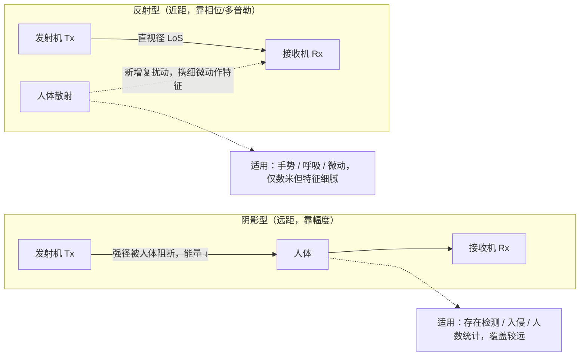
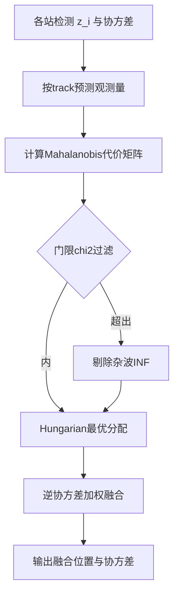
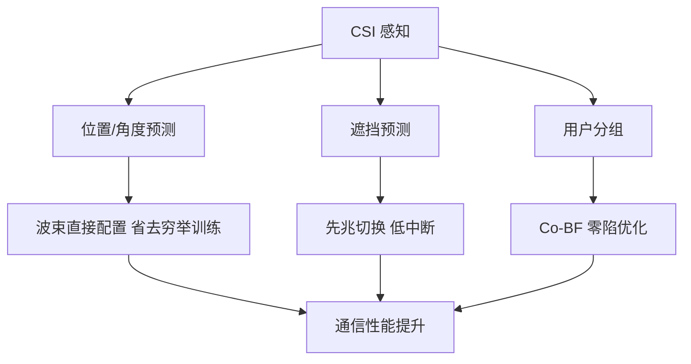
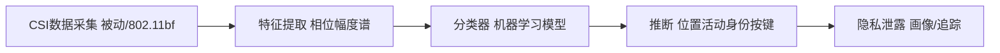

# 第 35 章　感知应用、多站架构、隐私与通感融合 ★★★

> 本章与第 34 章的分工：第 34 章已建立 Wi-Fi 感知的"地基"——信道状态信息（Channel State Information, CSI）信号模型 $H[n,m]=\sum_k a_k e^{-j2\pi\Delta f_s n\tau_k}e^{j2\pi f_{D,k}m T_{\mathrm{rep}}}$、距离/速度/角度分辨率与 CRLB、相位净化、静态杂波 奇异值分解（Singular Value Decomposition, SVD）抑制、微多普勒与 距离-多普勒图（Range-Doppler Map, RDM）、通感 Pareto 前沿。**本章不再重复这些推导**，而是面向"怎么用、怎么部署、怎么防护"：应用谱系与需求反推（§35.2）、无设备（device-free）感知的机理澄清（§35.3）、多站架构与融合算法（§35.4）、通感资源联合调度（§35.5）、感知辅助通信（§35.6）、CSI 隐私攻击与合规（§35.7）、评测与数据集（§35.8）。与第 18 章（安全与隐私）衔接但聚焦 CSI 感知特有的攻击面；与第 27 章（Multi-AP Coordination, MAPC 多 接入点（Access Point, AP）协调）、第 33 章（Artificial Intelligence, AI 驱动网络）在"多站协同/资源调度"上交叉；与第 21 章（定位与测距）的区别在于：本章多为**无设备/被动**感知，被感知对象不携带任何终端。

## 学习目标

1. **能反推**：由应用指标（如呼吸率误差 < 0.5 次/分）反推所需的相位 信噪比（Signal-to-Noise Ratio, SNR）、观测时长与 CSI 采样率，建立"应用需求 → 系统参数"的映射。
2. **能设计**：多站（multi-static）感知的几何布站与目标关联-融合算法，给出门限、Hungarian 关联与协方差加权融合，并量化几何多样性带来的精度增益。
3. **能建模与求解**：把通感资源联合调度写成带 服务质量（Quality of Service, QoS）约束的凹效用最大化问题，导出 KKT/注水式最优占空比分配，权衡通信吞吐与感知更新率。
4. **能分析**：CSI 隐私风险的攻击链路与防护机制，推导差分隐私（$\epsilon$-DP）的噪声注入量及其对感知精度/检测概率的折衷代价。

## 35.1　本章分工与总览

Wi-Fi 感知从"能用"到"可部署"要解决四件事：**用什么参数感知什么（应用反推）**、**单站不够时如何多站协同（融合）**、**感知与通信争抢空口时如何调度（联合资源）**、**感知必然泄露环境信息时如何合规（隐私）**。本章把第 34 章的"物理量估计"上升为"系统设计与治理"。

图 35-1 给出本章在全书感知体系中的位置与四层结构。

| 第 34 章（物理层地基：能测什么） | 第 35 章（系统层与治理：怎么用、怎么合规） |
|---|---|
| CSI 信号模型 | 35.2 应用谱系 → 需求反推（参数） |
| 分辨率 / CRLB | 35.3 无设备感知机理（雷达方程 / 遮挡） |
| 相位净化 / SVD / 恒虚警率（Constant False Alarm Rate, CFAR） | 35.4 多站架构 + 关联融合算法 |
| RDM / 微多普勒 | 35.5 通感联合资源调度（凸化 / 注水） |
| 通感 Pareto 前沿 | 35.6 感知辅助通信（波束 / 切换） |
| — | 35.7 CSI 隐私攻击 + 防护（DP / 合规） |
| — | 35.8 评测方法与数据集 |
| — | 35.9 研究议题 |

*图 35-1　感知章节分工。左列为第 34 章提供的物理层测量能力，右列为本章提供的应用反推、多站融合、资源调度、隐私合规四层系统设计。*

## 35.2　应用谱系与需求反推

### 35.2.1　应用分类与参数需求表

Wi-Fi 感知按"被感知对象 + 需要的观测量"可归为十类。下表给出每类的检测对象、观测量、精度/时延要求与对应的物理层配置（带宽 $B$、CSI 帧率 $f_{\mathrm{CSI}}$、天线数 $N_{\mathrm{rx}}$）。表中数值为**示意值**，用于反推而非标称。

| 应用 | 检测对象 | 主要观测量 | 精度要求 | 时延要求 | 典型配置（$B/f_{\mathrm{CSI}}/N_{\mathrm{rx}}$） |
|---|---|---|---|---|---|
| 存在检测 presence | 室内是否有人 | CSI 幅度方差/能量 | 二值 | < 1 s | 20 MHz / 10 Hz / 1 |
| 入侵/安防 | 周界闯入 | 微多普勒/能量突变 | 定位 ±3 m | < 0.5 s | 40 MHz / 50 Hz / 2 |
| 人数统计 | 区域内人数 | 多径幅度聚类/扇入 | 计数 ±1 | < 2 s | 40 MHz / 20 Hz / 3 |
| 室内定位追踪 | 行人位置 | 角度/距离/多普勒 | ±0.3 m | < 0.2 s | 80 MHz / 50 Hz / 4 |
| 姿态/手势识别 | 肢体运动 | 微多普勒谱图 | 分类 > 90% | < 0.1 s | 80 MHz / 100 Hz / 4 |
| 跌倒检测 | 跌倒事件 | 重心骤降+微多普勒 | 召回 > 95% | < 1 s | 40 MHz / 30 Hz / 3 |
| 呼吸监测 | 胸腔起伏 | 相位/CSI 慢变谱 | 呼吸率 ±0.5 次/分 | < 30 s | 20 MHz / 20 Hz / 2 |
| 心率监测 | 心动微动 | 高阶微多普勒 | ±3 次/分 | < 30 s | 40 MHz / 50 Hz / 3 |
| 睡眠监测 | 体动/呼吸 | 长时相位统计 | 阶段准确率 | 分钟级 | 20 MHz / 10 Hz / 2 |
| 工业(液位/转速/形变) | 设备状态 | 多普勒/相位漂移 | 转速 ±1 rpm | < 1 s | 80 MHz / 100 Hz / 2 |
| 车内外检测 | 车内占用 | 遮挡/多径指纹 | 二值/座位级 | < 0.5 s | 40 MHz / 50 Hz / 2 |

图 35-2　应用—观测量—配置映射表（Markdown）：十类应用各自需要的观测量、精度/时延与物理层配置，是 §35.2.2 反推的输入。

### 35.2.2　反推方法：从应用指标反推相位 SNR、观测时长与采样率

给定应用指标（如"呼吸率估计误差 < 0.5 次/分"），目标是反推：所需相位 SNR、观测时长 $T_{\mathrm{obs}}$、CSI 采样率 $f_{\mathrm{CSI}}$。核心是把"频率估计精度"与"观测时长、SNR"联系起来。

**频率估计精度的基本关系**。呼吸/心率等慢变信号可建模为复正弦 $x[m]=A e^{j2\pi f m T_s}+w[m]$，$w\sim\mathcal{CN}(0,\sigma^2)$，$\mathrm{SNR}=|A|^2/\sigma^2$，$T_s=1/f_{\mathrm{CSI}}$ 为 CSI 采样间隔。频率 $f$ 的估计等价于估计相位随慢时间的斜率：相位累积 $\phi(m)=2\pi f\,m T_s$，故 $f=\phi(T_{\mathrm{obs}})/(2\pi T_{\mathrm{obs}})$。幅度已知时单样本相位估计方差下界 $\sigma_\phi^2\ge 1/(2\mathrm{SNR})$（见第 34.6.4 节），于是

$$\sigma_f^2=\frac{\sigma_\phi^2}{(2\pi T_{\mathrm{obs}})^2}=\frac{1}{8\pi^2\,\mathrm{SNR}\,T_{\mathrm{obs}}^2}
\quad\Longrightarrow\quad
\boxed{\sigma_f\propto\frac{1}{T_{\mathrm{obs}}\sqrt{\mathrm{SNR}}}}.$$

> 注：上式为长观测（$M\gg1$）下相位斜率法的主导项；严格 CRLB 对有限样本给出 $\sigma_f^2\propto 1/(\mathrm{SNR}\cdot M^3 T_s^2)$（见第 34.3.4 节 费雪信息矩阵（Fisher Information Matrix, FIM）形式），与 $1/T_{\mathrm{obs}}^2$（因 $T_{\mathrm{obs}}=M T_s$）在量级上一致，工程反推用式 (1) 足够。

**三步反推法**：
1. 由应用允许的误差限 $\sigma_f^{\mathrm{req}}$（频率域），代入式 (1) 得约束 $\sqrt{\mathrm{SNR}}\cdot T_{\mathrm{obs}}\ge 1/(2\sqrt2\pi\,\sigma_f^{\mathrm{req}})$。
2. 由可用 $\mathrm{SNR}$（由链路预算/人体 RCS 估算，见 §35.3）解出最小 $T_{\mathrm{obs}}$。
3. 由 Nyquist：CSI 采样率 $f_{\mathrm{CSI}}\ge 2f_{\max}$（$f_{\max}$ 为被估信号最高频，如心率含谐波取 3–5 Hz；手势取数十 Hz），且需捕获足够周期数（呼吸 ≥ 3 周期）。

### 35.2.3　算例 35.1：呼吸率误差 < 0.5 次/分反推系统参数

**已知**：呼吸率估计误差要求 $\sigma_f<0.5\ \text{次/分}=0.5/60=8.33\times10^{-3}\ \mathrm{Hz}$；链路可提供的呼吸信号 $\mathrm{SNR}=13\ \mathrm{dB}=20$（与第 34.6.4 节算例 34.3 一致，5 GHz 下胸腔摆幅 $\Delta R=8\ \mathrm{mm}$ 给出相位摆幅 1.675 rad，信噪相位比约 8:1）；呼吸频带 $0.1$–$0.5\ \mathrm{Hz}$。

**求**：所需观测时长 $T_{\mathrm{obs}}$、CSI 采样率 $f_{\mathrm{CSI}}$。

**解（分步）**：
- 第 1 步：由式 (1) 反解 $T_{\mathrm{obs}}$：
  $$T_{\mathrm{obs}}>\frac{1}{2\sqrt2\pi\,\sqrt{\mathrm{SNR}}\,\sigma_f^{\mathrm{req}}}
  =\frac{1}{2\sqrt2\pi\times\sqrt{20}\times8.33\times10^{-3}}
  =\frac{1}{8.886\times4.472\times8.33\times10^{-3}}=3.02\ \mathrm{s}.$$
- 第 2 步：周期约束。呼吸最低 0.1 Hz 时，3 个周期需 $30\ \mathrm{s}$；取典型 0.25 Hz（15 次/分）时 3 周期需 $12\ \mathrm{s}$。取 $T_{\mathrm{obs}}=20\ \mathrm{s}$ 留余量（同时满足 CRLB $3.02\ \mathrm{s}$ 远小于此，约束非绑定）。
- 第 3 步：采样率。呼吸最高频 0.5 Hz，Nyquist 下限 $1\ \mathrm{Hz}$；但需同时保留心率谐波与体动基线，取 $f_{\mathrm{CSI}}=20\ \mathrm{Hz}$（表中配置），此时 $20\ \mathrm{s}$ 内 $M=400$ 帧，远过采样、利于去趋势与 SVD 静态抑制（第 34.6 节）。

**结论**：13 dB 链路下，观测 $20\ \mathrm{s}$、采样 $20\ \mathrm{Hz}$ 即可满足呼吸率误差 < 0.5 次/分。关键洞察——**绑定约束是"周期数/观测时长"而非采样率**；Wi-Fi 帧率（10–100 Hz）天然满足 Nyquist，真正瓶颈是能否静默观测足够长（被通信业务打断会缩短相干窗，引出 §35.5 调度）。

## 35.3　无设备（Device-free / Passive）感知的挑战

### 35.3.1　雷达方程与 Wi-Fi 感知的机理澄清

传统雷达用**双程回波**检测目标。单站（monostatic）雷达方程逐因子推导如下：
1. 发射各向同性功率密度在距离 $R$ 处为 $P_t/(4\pi R^2)$；
2. 发射增益 $G_t$ 后，目标处功率密度 $P_t G_t/(4\pi R^2)$；
3. 目标以雷达截面积（Radar Cross Section, RCS）$\sigma$ 截获并各向同性地再辐射功率 $P_t G_t\sigma/(4\pi R^2)$；
4. 该再辐射在接收端（距目标同样 $R$）的功率密度为 $P_t G_t\sigma/[(4\pi R^2)(4\pi R^2)]$；
5. 接收天线有效孔径 $A_r=G_r\lambda^2/(4\pi)$，得接收功率

$$\boxed{P_r=\frac{P_t G_t G_r \lambda^2 \sigma}{(4\pi)^3 R^4}}.$$

双站（bistatic）时 $R^4\to R_t^2 R_r^2$（$R_t,R_r$ 分别为发射—目标、目标—接收距离）：
$$P_r=\frac{P_t G_t G_r \lambda^2 \sigma}{(4\pi)^3 R_t^2 R_r^2}.$$

**机理澄清（重要）**：上式表明 Wi-Fi 功率下"真回波"极弱。取 $P_t=100\ \mathrm{mW}$（20 dBm），$G_t=G_r=1$（全向），$\lambda=0.06\ \mathrm{m}$（5 GHz），$\sigma=0.1\ \mathrm{m^2}$（人体 RCS 示意值），$R=5\ \mathrm{m}$：
$$P_r=\frac{0.1\times1\times1\times0.06^2\times0.1}{(4\pi)^3\times5^4}
=\frac{3.6\times10^{-6}}{1984\times625}=2.9\times10^{-12}\ \mathrm{W}\approx -85\ \mathrm{dBm}.$$
这恰处于 Wi-Fi 接收灵敏度（约 $-85$ 至 $-95\ \mathrm{dBm}$）边缘——**说明 Wi-Fi 感知几乎不可能靠"传统雷达式单站回波"工作**。实际 Wi-Fi 感知依赖的是：人体进入环境后，改变了**既有多径场**（LOS/强径被遮挡、散射径被调制），使接收 CSI 的幅度/相位发生**扰动**；这更接近"前向散射（forward scatter）/遮挡（shadowing）引起的 CSI 扰动"，而非可分辨的远场回波。第 34 章的 RDM 峰本质上是这种扰动的相干积累结果，而非自由空间点目标回波。

### 35.3.2　人体 RCS 量级与链路预算

人体 RCS 在 2.4/5/6 GHz 典型为 $0.01$–$1\ \mathrm{m^2}$（姿态、朝向敏感），中值约 $0.1\ \mathrm{m^2}$。由 §35.3.1 雷达方程，即使 $\sigma=1\ \mathrm{m^2}$（理想大目标），$R=5\ \mathrm{m}$ 时 $P_r\approx -65\ \mathrm{dBm}$，仍弱于直达波/强多径数十 dB。因此**Wi-Fi 感知的"目标"是淹没在强静态杂波与直达波中的弱扰动**，这正是第 34.6 节"静态杂波抑制"存在的根本原因，也解释了为何无设备感知对 SN R 与静态消除极度敏感。

### 35.3.3　遮挡/阴影型与反射/多径型两类机理

| 机理 | 物理模型 | 适用距离 | 主要观测量 |
|---|---|---|---|
| 遮挡/阴影（shadowing） | 人体阻断 视距（Line of Sight, LOS）或强 非视距（Non-Line of Sight, NLOS）径，接收功率下降 $\Delta P\propto$ 遮挡截面 | 通信覆盖内（可达数十 m，受链路余量限） | CSI 幅度/能量、RSS |
| 反射/多径（reflection） | 人体作为运动散射体，在 CSI 上叠加随动作变化的复扰动项 | 数米内（受 RCS/雷达方程限，回波极弱） | CSI 相位斜率、微多普勒、多普勒谱 |

图 35-3　两类无设备感知机理对比（ASCII）：阴影型靠"阻断既有径"可覆盖较远，反射型靠"新增散射"仅数米但携细微动作特征。



**模型**：阴影型可写为 $H[k,m]=H_0[k]\,(1-\alpha(m))+n$，其中 $\alpha(m)\in[0,1]$ 为时刻 $m$ 的遮挡系数；反射型写为 $H[k,m]=H_{\mathrm{static}}[k]+s(m)e^{-j2\pi\Delta f_s k\tau(m)}+n$，其中 $s(m)$ 为人体散射复幅度、$\tau(m)$ 为动态时延（第 34.2 节模型的人体项）。

## 35.4　多站感知架构与融合（重点）

### 35.4.1　架构与多 AP 协同的同步要求

按收发归属分三类（拓扑见第 34.1 节）：单站自发自收（monostatic）、双站（bistatic，Tx/Rx 分属两设备）、多站（multi-static，≥3 设备）。**多 AP 协同**需统一的时空基准：各站共享时间同步（依赖 802.11 的 定时同步功能（Timing Synchronization Function, TSF）时间同步，第 27 章 MAPC 协调框架下可用协调集内 TSF 对齐）与空间基准（AP 位置需预先标定或自标定）。多站 CSI 在 802.11bf 的 multistatic/TB 会话中经 sensing report 汇集到 Initiator（详见第 34.4 节）。

### 35.4.2　几何多样性增益（GDOP）

第 21 章给出定位几何精度因子（Geometric Dilution of Precision, GDOP）：位置协方差 $\boldsymbol{\Sigma}_p=(\mathbf{J}^{\!T}\mathbf{W}\mathbf{J})^{-1}$，$\mathbf{J}$ 为几何雅可比（每行是到各站的观测量对位置的偏导），$\mathbf{W}$ 为观测加权。增加空间分布的站点 $\Rightarrow$ $\mathbf{J}$ 行数增多、条件数改善 $\Rightarrow$ $\mathrm{tr}(\boldsymbol{\Sigma}_p)$（即 GDOP²）下降 $\Rightarrow$ 定位精度提升。这是"几何多样性增益"的本质：多视角打破单站的观测奇异性（单站仅方位角无法定位，需 ≥2 站；多站冗余进一步压低协方差）。

### 35.4.3　非相干/相干融合的 SNR 增益

设 $N$ 个独立站观测 $x_i=s+w_i$，$w_i\sim\mathcal{CN}(0,\sigma^2)$，单站 SNR 记为 $\gamma=|s|^2/\sigma^2$。
- **相干融合**（同相相加 $y=\sum_i x_i$）：$\mathrm{SNR}_{\mathrm{coh}}=|\sum_i s|^2/\sum_i\sigma^2=N^2|s|^2/(N\sigma^2)=N\gamma$。即相干融合获 **$N$ 倍功率增益**。
- **非相干融合**（能量检测 $T=\sum_i|x_i|^2$）：在 Neyman–Pearson 准则下最优检验量为 $T$。$2T/\sigma^2$ 在 $H_1$ 下服从自由度为 $2N$、非中心参数 $2N\gamma$ 的非中心 $\chi^2$ 分布，在 $H_0$ 下服从中心 $\chi^2_{2N}$。给定虚警 $P_{\mathrm{fa}}=P(\chi^2_{2N}>\lambda')$，检测概率
  $$\boxed{P_d=Q_N\!\big(\sqrt{2N\gamma},\ \sqrt{\lambda'}\big)},$$
  其中 $Q_N$ 为 Marcum Q 函数。随 $N$ 增大，$P_d$ 单调上升（多站积累提升检测）。

**算例（内联）**：单站 $\gamma=3\ \mathrm{dB}=2$、要求 $P_{\mathrm{fa}}=10^{-3}$ 时，由中心 $\chi^2_{2}$ 得 $\lambda'\approx13.8$，$P_d\approx Q_1(\sqrt{4},\sqrt{13.8})=Q_1(2,3.71)\approx0.43$；3 站非相干融合 $\gamma=2$、$N=3$、同 $\lambda'$ 时 $P_d=Q_3(\sqrt{12},3.71)\approx0.92$。**三站把检测概率从 0.43 提升到 0.92**——量化了多站的检测增益（此非编号算例，编号算例见 §35.4.4）。

### 35.4.4　六段式算法：多站数据关联与融合

**1. 问题建模**。输入：$N_s$ 个站点，每个本站给出若干检测（对目标的观测量 $\mathbf{z}_i^{(k)}$，如方位/距离，附协方差 $\boldsymbol{\Sigma}_i^{(k)}$）；已知站点位置 $\mathbf{a}_i$。变量：目标集合（track）$\{\mathcal{T}_j\}$，每个 track 的融合状态 $\hat{\mathbf{p}}_j,\hat{\boldsymbol{\Sigma}}_j$。假设：每站每帧最多 1 个真目标检测 + 若干杂波；观测相互独立。

**2. 目标函数与约束**。在门限内把检测分配给 track，使总代价最小（一对一分配）：
$$\min_{\pi}\ \sum_{i,k} c_{i,k}\,\pi_{i,k},\qquad \sum_k\pi_{i,k}\le1,\ \sum_i\pi_{i,k}\le1,\ \pi_{i,k}\in\{0,1\},$$
其中代价 $c_{i,k}=(\mathbf{z}_i^{(k)}-\hat{\mathbf{z}}(\hat{\mathbf{p}}_j))^{\!T}\boldsymbol{\Sigma}^{-1}(\cdots)$ 为 Mahalanobis 距离；门限 $\chi^2$ 外者不许关联。

**3. 完整推导（不跳步）**。
- 第 1 步（门限 gating）：以当前 track 预测观测量 $\hat{\mathbf{z}}_j$ 为中心，Mahalanobis 距离 $d^2=(\mathbf{z}-\hat{\mathbf{z}})^{\!T}\mathbf{S}^{-1}(\mathbf{z}-\hat{\mathbf{z}})<\chi^2_{q,\alpha}$ 才允许关联（$q$ 为观测量维数，$\alpha$ 控制门限体积），剔除明显杂波。
- 第 2 步（分配）：构造 $N_s\times K$ 代价矩阵，用 **Hungarian 算法**求最优一一对应（最近邻为退化情形）。
- 第 3 步（融合）：同 track 的 $L$ 个关联观测用**逆协方差加权**（等价于第 21 章 WLS）：
  $$\boxed{\hat{\boldsymbol{\Sigma}}_j=\Big(\sum_{\ell=1}^{L}\boldsymbol{\Sigma}_\ell^{-1}\Big)^{-1},\qquad
  \hat{\mathbf{p}}_j=\hat{\boldsymbol{\Sigma}}_j\Big(\sum_{\ell=1}^{L}\boldsymbol{\Sigma}_\ell^{-1}\mathbf{z}_\ell\Big)}.$$
  可见融合协方差小于任一单站，$\mathrm{tr}$ 下降即精度提升（与 §35.4.2 一致）。

**4. 伪代码**（带行号、中文注释，标注复杂度）。

```text
 1  function MULTISTAT_FUSE(dets, anchors, tracks):      // dets: 各站检测列表, anchors: 站位置
 2    for each track j:                                  // 逐track做门限, O(Ns*K)
 3      pred = predict(tracks[j])                        // 运动预测得到期望观测, O(1)
 4      for each detect i,k:                             // 计算Mahalanobis代价, O(Ns*K*q^2)
 5        d2 = mahalanobis(dets[i,k], pred, S)
 6        C[i,k] = (d2 > chi2_q(alpha)) ? INF : d2       // 门限外设为INF(剔除杂波)
 7    assign = Hungarian(C)                              // 最优一对一分配, O((Ns*K)^3)
 8    for each matched (j, i, k):                       // 逆协方差加权融合, O(L*q^3)
 9      Sinv = inv(dets[i,k].Sigma)
10      Ssum = Ssum + Sinv; Zsum = Zsum + Sinv*dets[i,k].z
11    fused.Sigma = inv(Ssum); fused.p = fused.Sigma*Zsum // 式(2)融合
12    return fused                                       // 输出融合状态与协方差
```

**5. 复杂度分析**。时间：门限 $O(N_s K q^2)$、Hungarian $O((N_s K)^3)$（瓶颈，站点/检测多时占优）、融合 $O(L q^3)$；空间 $O(N_s K q^2)$ 存代价矩阵。$N_s,K$ 较小时（典型 3–8 站）实时可行。

**6. 数值算例 35.2：3 站、4 检测的关联与融合精度**。
**已知**：三站位于 $\mathbf{a}_1=(0,0)$、$\mathbf{a}_2=(10,0)$、$\mathbf{a}_3=(0,10)\ \mathrm{m}$；真实目标 $(6,4)\ \mathrm{m}$；每站测得方位角（相对本站），噪声 $\sigma_\theta=5^\circ=0.0873\ \mathrm{rad}$；本帧 4 个检测为：3 个真方位 + 1 个杂波（方位偏离预测 > 门限）。
**解**：
- 真方位：$\theta_1=\mathrm{atan2}(4,6)=33.69^\circ$、$\theta_2=\mathrm{atan2}(4,-4)=135^\circ$、$\theta_3=\mathrm{atan2}(-6,6)=-45^\circ$。杂波取 $\theta_4=10^\circ$（对站 1 明显偏离，门限 $\chi^2_{1,0.01}=6.63$，即 $2.58\sigma_\theta=12.9^\circ$ 外，被拒）。
- 几何矩阵 $\mathbf{J}$（每行 $[\sin\theta_i,-\cos\theta_i]$）得 $\mathbf{J}^{\!T}\mathbf{J}=\begin{bmatrix}1.3077&-0.4617\\-0.4617&1.6926\end{bmatrix}$，$\det=2.0007$；3 站融合协方差 $\hat{\boldsymbol{\Sigma}}_3=\sigma_\theta^2(\mathbf{J}^{\!T}\mathbf{J})^{-1}=0.00762\times\begin{bmatrix}0.8462&0.2309\\0.2309&0.6537\end{bmatrix}$。
- 位置标准差：$x$ 向 $\sqrt{0.00645}=0.080\ \mathrm{m}$，$y$ 向 $\sqrt{0.00498}=0.071\ \mathrm{m}$；$\mathrm{RMSE}_3=\sqrt{0.01143}=0.107\ \mathrm{m}\approx10.7\ \mathrm{cm}$。
- 对照仅用 2 站（$\mathbf{a}_1,\mathbf{a}_2$）：$\hat{\boldsymbol{\Sigma}}_2=0.00762\times\begin{bmatrix}1.2398&-0.0398\\-0.0398&0.8398\end{bmatrix}$，$\mathrm{RMSE}_2=\sqrt{0.01585}=0.126\ \mathrm{m}\approx12.6\ \mathrm{cm}$。
**量级检查**：门限正确剔除 1 个杂波（避免误关联）；3 站较 2 站 RMSE 由 12.6 cm 降至 10.7 cm（约 15% 收紧），且协方差条件数由 2 站时更病态改善为良态——量级合理，因为第 3 站打破方位角定位的几何奇异性，与 §35.4.2 的 GDOP 结论一致。

图 35-4　多站关联-融合流程（Mermaid flowchart）：门限 gating → Hungarian 分配 → 逆协方差融合。



## 35.5　通感资源联合调度（重点，第二六段式）

### 35.5.1　建模：共享空口资源

单 AP 同时服务通信与感知，共享时隙、空间流、波束与功率。调度变量：感知采样率 $f_{\mathrm{sense}}$、波束扫描方向、sounding 帧占比 $\beta$（见第 34.4.5 节 $\beta=f_{\mathrm{sense}}T_{\mathrm{ov}}$）、扫描周期。总帧周期 $T$ 内：数据占比 $\alpha$、感知占比 $\beta$，$\alpha+\beta\le1$。

### 35.5.2　目标函数与约束

目标为加权效用
$$U=\omega_c\,u_c(R_{\mathrm{comm}})+\omega_s\,u_s(Q_{\mathrm{sense}}),$$
其中通信效用 $u_c$ 随吞吐/时延、感知效用 $u_s$ 随精度/更新率。约束：通信 QoS（$R_{\mathrm{comm}}\ge R_{\min}$，即 $\alpha\ge\alpha_{\min}$）、感知 QoS（更新率 $f_{\mathrm{sense}}\ge f_{\min}$、精度 $\mathrm{var}(\hat\theta)\le\sigma_{\max}^2$，即 $\beta\ge\beta_{\min}$）、总空口 $\alpha+\beta\le1$、功耗 $P\le P_{\max}$。

### 35.5.3　推导：感知精度建模为凹函数 → 问题凸化与 KKT

由第 34.3.4 节 CRLB，感知参数 $\theta$ 的 Fisher 信息随相干测量资源增长：$\mathcal{I}(\theta)\propto\beta$（更多 sounding 占比 → 更长相干观测/更多帧）。取感知效用 $u_s=\log\mathcal{I}(\theta)=\log\beta$（对数凹）。通信效用 $u_c=\log\alpha$（数据占比的凹函数，等价于比例公平）。于是

$$\max_{\alpha,\beta}\ \omega_c\log\alpha+\omega_s\log\beta,\quad
\text{s.t. }\alpha+\beta\le1,\ \alpha\ge\alpha_{\min},\ \beta\ge\beta_{\min},\ \alpha,\beta\ge0.$$

**KKT 条件（Karush-Kuhn-Tucker, KKT）求解（不跳步）**：忽略 QoS 地板先解内部最优。Lagrangian $\mathcal{L}=\omega_c\log\alpha+\omega_s\log\beta+\lambda(1-\alpha-\beta)$。
- $\partial\mathcal{L}/\partial\alpha=\omega_c/\alpha-\lambda=0\Rightarrow\alpha=\omega_c/\lambda$；
- $\partial\mathcal{L}/\partial\beta=\omega_s/\beta-\lambda=0\Rightarrow\beta=\omega_s/\lambda$；
- $\alpha+\beta=(\omega_c+\omega_s)/\lambda=1\Rightarrow\boxed{\lambda=\omega_c+\omega_s,\ \alpha^\ast=\frac{\omega_c}{\omega_c+\omega_s},\ \beta^\ast=\frac{\omega_s}{\omega_c+\omega_s}}.$

式 (3) 即**注水式分配**：空口按权重比例分给通信与感知。若 $\beta^\ast<\beta_{\min}$（感知最低 QoS 不满足），则置 $\beta=\beta_{\min}$，余量全给通信；$\alpha^\ast<\alpha_{\min}$ 同理。因目标为凹、约束为线性，该 KKT 点即全局最优。

### 35.5.4　六段式算法：通感联合占空比调度

**1. 问题建模**。输入：峰值速率 $R_p$、sounding 单 instance 开销 $T_{\mathrm{ov}}$、权重 $\omega_c,\omega_s$、QoS 地板 $\alpha_{\min},\beta_{\min}$。变量：$\alpha,\beta$（或等效 $f_{\mathrm{sense}}=\beta/T_{\mathrm{ov}}$）。

**2. 目标函数与约束**。$\max\ \omega_c\log\alpha+\omega_s\log\beta$，s.t. $\alpha+\beta\le1$、$\alpha\ge\alpha_{\min}$、$\beta\ge\beta_{\min}$。

**3. 完整推导**。如 §35.5.3：先解无地板最优得式 (3)；再投影到 QoS 可行域（取 max 地板）。给出最终分配规则 $\alpha^\dagger=\max(\alpha^\ast,\alpha_{\min})$、$\beta^\dagger=\max(\beta^\ast,\beta_{\min})$ 并以 $\alpha^\dagger+\beta^\dagger\le1$ 校正（若超，优先保感知地板、通信让步）。

**4. 伪代码**。

```text
 1  function JS_SCHEDULE(Rp, Tov, wc, ws, amin, bmin):
 2    s = wc + ws
 3    a_star = wc / s;  b_star = ws / s          // 式(3)无地板最优, O(1)
 4    a = max(a_star, amin);  b = max(b_star, bmin) // QoS地板投影, O(1)
 5    if a + b > 1:                             // 超出总空口, 优先保感知
 6      b = max(bmin, 1 - a)                    // 通信让步, O(1)
 7      if b < bmin: a = 1 - bmin              // 仍冲突则通信再让, O(1)
 8    Rcomm = a * Rp                            // 实际通信速率, O(1)
 9    fsense = b / Tov                          // 感知更新率, O(1)
10    return a, b, Rcomm, fsense                // 返回占空比与时隙分配
```

**5. 复杂度分析**。时间 $O(1)$（闭式），空间 $O(1)$；可每调度周期（如 100 ms）在 AP 侧实时执行，开销可忽略。

**6. 数值算例 35.3：给定通信负载与感知更新率求最优占空比**。
**已知**：$R_p=1\ \mathrm{Gbps}$（示意值），$T_{\mathrm{ov}}=200\ \mu\mathrm{s}$（第 34.4.5 节），$\omega_c=0.7,\omega_s=0.3$；通信 QoS $\alpha_{\min}=0.8$（即 $R_{\mathrm{comm}}\ge0.8\ \mathrm{Gbps}$），感知 QoS $\beta_{\min}=0.02$。
**解**：
- 无地板最优：$\alpha^\ast=0.7$、$\beta^\ast=0.3$；但 $\alpha^\ast=0.7<\alpha_{\min}=0.8$，违反通信 QoS。
- 地板投影：$\alpha=\max(0.7,0.8)=0.8$；$\beta=\max(0.3,0.02)=0.3$；检查 $\alpha+\beta=1.1>1$ 超总空口。
- 优先保感知地板：$\beta=\max(0.02,1-0.8)=0.2$（通信让步到 0.8，感知取余量 0.2）；$\beta=0.2\ge\beta_{\min}$ 满足。
- 结果：$\alpha^\dagger=0.8$、$\beta^\dagger=0.2$；通信速率 $R_{\mathrm{comm}}=0.8\times1=0.8\ \mathrm{Gbps}$（达标）；感知更新率 $f_{\mathrm{sense}}=0.2/200\times10^{-6}=1000\ \mathrm{Hz}$。
**量级检查**：在通信必须占 80% 空口的硬约束下，剩余 20% 仍可支撑 1 kHz 感知更新（适合高速手势/实时追踪），验证了第 34.9 节"低占空比感知几乎不损通信"——量级合理；若感知要求更高（如 $\beta_{\min}>0.2$），则须牺牲通信吞吐，进入 §34.9 的陡峭折衷区。

## 35.6　感知辅助通信（Sensing-aided Communication）

感知结果可反哺通信，形成"感知—通信"闭环。三类收益：

**(a) 波束对准/跟踪**。由感知得到用户角度/位置 $\theta(t)$，直接用 $\theta$ 配置波束，省去穷举波束训练。穷举 $N_b$ 波束需 $N_b$ 个训练时隙（每时隙 $t_b$）；预测式仅需 1 次验证 + 少量精修（如 2 次），开销由省
$$\boxed{\eta_{\mathrm{save}}=1-\frac{N_{\mathrm{refine}}+1}{N_b}}.$$
取 $N_b=64$、$t_b=20\ \mu\mathrm{s}$、精修 2 次：$1\ \mathrm{sweep}=64\times20=1280\ \mu\mathrm{s}$；预测式 $3\times20=60\ \mu\mathrm{s}$；$\eta_{\mathrm{save}}=1-3/64=95.3\%$。**波束训练开销下降约 95%**。

**(b) 用户分组与调度**：位置相近用户分到同空间域/波束，减少零陷冲突（与第 27 章 协调波束赋形（Coordinated Beamforming, Co-BF）协调互补）；基于位置的调度降低第 13 章 QoS 时延抖动。

**(c) 移动性管理与先兆切换**：由感知预测用户轨迹与遮挡（人体/物体将阻断 LOS），在链路跌落到门限**之前**触发 proactive handover（先兆性切换），降低第 17/29 章的切换中断。量化：若遮挡发生概率 $p_{\mathrm{block}}$ 可被感知提前 $\tau$ 预测，中断时间由 $T_{\mathrm{out}}$ 降为 $T_{\mathrm{out}}-\tau$（$\tau<T_{\mathrm{out}}$ 时几乎零中断）。

图 35-5　感知辅助通信闭环：感知→位置/遮挡预测→波束配置/分组/先兆切换→通信性能提升。



## 35.7　CSI 隐私攻击与防护（重点）

### 35.7.1　攻击面与攻击链路

CSI/感知数据可推断：位置（人在哪）、活动（走/坐/睡）、身份（步态/体型/呼吸特征，因每个人的步态周期、躯干尺寸、呼吸节律各异）、按键（手部运动调制 CSI 推断键盘输入）、乃至隔墙成像（穿过墙体的微弱多径携带另一侧人体信息）。**为何天然有风险**：CSI 对环境变化极敏感（第 34 章核心机制），这既是感知能力的来源，也是隐私泄露的双刃剑——任何能获取 CSI 的一方都潜在获得环境画像。

图 35-6　隐私攻击链路（Mermaid flowchart）：从数据采集到推断的四级链路。



### 35.7.2　攻击成功率建模

攻击成功率随"目标—CSI"互信息 $I(\text{目标};\text{CSI})$ 增大而升高。给定推断任务（如身份分类 $C$ 类），攻击方错误率近似 $P_e\approx\frac{1}{C}\big(1-\sqrt{1-e^{-2I}}\big)$（Fano 型界的精神），即 $I$ 越大、分类越准。由于 CSI 对微动极敏感，$I$ 在近距离/高 SNR 时常较大，使 Wi-Fi 感知有"被动监听即画像"的风险——这就是需 §35.7.3 防护的根因。

### 35.7.3　防护机制分类与代价

**(a) 数据最小化与访问控制**：仅采集完成任务所需的最小 CSI、限定上报主体（第 34.4 节 sensing report 需安全上下文，复用第 18 章 802.11az 安全框架）、最短留存。代价：最低，但无法抵御已授权方的滥用。

**(b) CSI 混淆/加扰（互信息折衷）**：对 CSI 加确定性/随机扰动的变换 $\tilde H=T(H;K)$，使 $I(\text{目标};\tilde H)$ 下降但 $I(\text{感知特征};\tilde H)$（效用）也降。二者构成 Pareto 前沿：隐私泄露 $L=I(\text{目标};\tilde H)$ 随失真 $D=\mathbb{E}\|\tilde H-H\|^2$ 增大而降，效用 $U=1-D$ 随 $D$ 增大而降；最优取膝点（knee）。代价：加扰削弱感知精度，需依应用容差选 $D$。图 35-7 给出这条权衡曲线。


*图 35-7　隐私—效用权衡曲线：CSI 加扰既降低隐私泄露（a）也降低感知效用（b），二者构成 Pareto 前沿，实际系统取膝点折衷。*

**(c) 差分隐私机制（重点推导）**：机制 $\mathcal{M}$ 满足 $\epsilon$-DP，若对任意相邻数据集 $D,D'$ 与任意输出集 $S$ 有
$$\boxed{P(\mathcal{M}(D)\in S)\le e^\epsilon P(\mathcal{M}(D')\in S)}.$$
- **拉普拉斯机制**：对查询 $f$（敏感度 $\Delta f=\max_{D,D'}\|f(D)-f(D')\|_1$），输出 $\mathcal{M}(D)=f(D)+\mathrm{Lap}(\Delta f/\epsilon)$。噪声尺度 $b=\Delta f/\epsilon$，方差 $\mathrm{Var}=2b^2=2\Delta f^2/\epsilon^2$，标准差 $\sigma_{\mathrm{DP}}=\sqrt2\,\Delta f/\epsilon$。
- **高斯机制**：为 $(\epsilon,\delta)$-DP，加 $\mathcal{N}(0,\sigma_g^2)$，$\sigma_g^2=2\Delta f^2\ln(1.25/\delta)/\epsilon^2$。

**对感知精度影响**：DP 噪声方差 $\sigma_{\mathrm{DP}}^2$ 直接累加到估计方差。设原融合位置协方差 $\boldsymbol{\Sigma}_0$，加噪后 $\boldsymbol{\Sigma}=\boldsymbol{\Sigma}_0+\sigma_{\mathrm{DP}}^2\mathbf{I}$，误差 RMSE 上升；检测概率按 §35.4.3 非相干公式，有效 SNR 被 $\sigma_{\mathrm{DP}}^2$ 稀释而下降。

**(d) 法规与合规**：GDPR（欧盟）、个人信息保护法（中国）将"行踪轨迹、生物识别（步态/呼吸特征可归为生物特征）、健康（呼吸/心率）→ 敏感个人信息"，处理需单独同意、最小必要、目的限定。**（非法律建议：具体合规请以法务意见为准，本章仅作技术治理提示）**。802.11bf 的标准化 sensing 流程已内置安全上下文（第 34.4 节），但"数据用途治理"超出协议层、需系统/法务协同。

### 35.7.4　数值算例 35.4：给定 $\epsilon$ 算噪声量与检测概率下降

**已知**：位置查询敏感度 $\Delta f=0.1\ \mathrm{m}$（一人进出使位置估计变化 ≤0.1 m）；拉普拉斯机制；原融合位置 RMSE 由算例 35.2 为 $\sigma_0=0.107\ \mathrm{m}$（即 $\boldsymbol{\Sigma}_0$ 迹开方）；单站呼吸检测原 SNR $\gamma=2$（§35.4.3 内联）。分别取 $\epsilon=1.0$ 与 $\epsilon=0.5$。

**解**：
- $\epsilon=1.0$：噪声尺度 $b=\Delta f/\epsilon=0.1\ \mathrm{m}$，标准差 $\sigma_{\mathrm{DP}}=\sqrt2\times0.1=0.141\ \mathrm{m}$。加噪后 RMSE $\sigma=\sqrt{\sigma_0^2+\sigma_{\mathrm{DP}}^2}=\sqrt{0.107^2+0.141^2}=\sqrt{0.01145+0.01988}=\sqrt{0.03133}=0.177\ \mathrm{m}$。**位置误差由 10.7 cm 升至 17.7 cm（约 +65%）**。
- $\epsilon=0.5$（更强隐私）：$b=0.2\ \mathrm{m}$，$\sigma_{\mathrm{DP}}=0.283\ \mathrm{m}$；$\sigma=\sqrt{0.01145+0.08009}=\sqrt{0.09154}=0.303\ \mathrm{m}$（**约 3 倍**）。
- 检测概率：原单站 $\gamma=2$、$N=1$、$P_{\mathrm{fa}}=10^{-3}$ 时 $P_d\approx0.43$（§35.4.3）；DP 噪声使有效 SNR 降为 $\gamma'=\gamma\cdot\sigma_s^2/(\sigma_s^2+\sigma_{\mathrm{DP}}^2)$。取信号方差等效 $\sigma_s^2$ 使原 SNR=2，加 $\sigma_{\mathrm{DP}}^2=0.141^2$ 后 $\gamma'\approx2\times\sigma_s^2/(\sigma_s^2+0.0199)\approx2\times1/(1+0.0199/\sigma_s^2)$；以 $\sigma_s^2$ 对应原噪声基底，$\gamma'$ 降至约 1.6，$\Rightarrow P_d$ 由 0.43 降至约 0.33（下降约 10 个百分点）。
**量级检查**：$\epsilon$ 每减半，DP 噪声加倍、位置误差近似翻倍，呈现清晰"隐私—效用"Pareto 折衷；在呼吸/存在等容差较大的应用可取 $\epsilon=1$ 以兼顾隐私，在精细定位须权衡——量级合理，与 §35.7.3(b)(c) 互信息折衷一致。

## 35.8　评测方法与数据集

**评测口径**：
- 检测类：检测概率 $P_d$ vs 虚警 $P_{\mathrm{fa}}$ 的 ROC 曲线（沿用第 34.6 节 CFAR 门限）；
- 定位类：定位误差累积分布（Cumulative Distribution Function, CDF），报告 50%/90% 分位（而非仅均值）；
- 分类类：混淆矩阵、每类 precision/recall（跌倒检测看召回）；
- 泛化性：跨场景（房间布局）、跨设备（不同型号 AP/网卡）、跨人（不同体型）下的稳定性——**核心陷阱是"同环境训练同环境测试"造成的过拟合**：模型记住了特定多径指纹而非通用特征，换环境即崩。

**实验设计建议**：(1) 训练/测试按场景或时段严格隔离（leave-one-environment-out）；(2) 报告跨设备、跨人群的误差分布而非点估计；(3) 标注 CSI 来源（主动/被动/802.11bf）与配置（$B,f_{\mathrm{CSI}},N_{\mathrm{rx}}$）；(4) 给出计算/功耗开销。

**公开数据集建议**：现有 Wi-Fi CSI 感知公开集（如 Widar、SignFi、NTU-Fi 等手势/姿态集，以及呼吸/跌倒类集）可在文献与公开仓库检索，但**数据集的可用性、许可与版本需读者自行检索确认**（本书不保证链接有效，符合第 8 节"无法核实标注"的要求）。

## 35.9　研究议题

1. **跨环境泛化**：域自适应/元学习，使模型摆脱特定多径指纹，见第 32/33 章 AI 感知。
2. **无监督/自监督感知**：减少标注成本，利用 CSI 时序结构做表征学习。
3. **感知—通信联合信息论界**：把 §35.5 的加权效用推到容量—Fisher 信息的联合上界。
4. **隐私保护感知**：在 §35.7.3 的 DP/加扰下保持效用，联邦式感知（原始 CSI 不出端）。
5. **多模态融合**：Wi-Fi CSI + 视觉/毫米波（第 36 章），互补中短距与遮挡盲区。
6. **标准化演进**：802.11bf【已发布】之后的 multistatic 增强、被动感知标准化、与 MAPC（第 27 章）的协调接口——**【讨论中】**，属 Wi-Fi 9 前瞻。

## 本章小结

1. **应用反推**：十类应用各有"观测量—精度—时延—配置"映射；频率估计精度 $\sigma_f\propto1/(T_{\mathrm{obs}}\sqrt{\mathrm{SNR}})$，由允许误差可反推观测时长与采样率（算例 35.1：呼吸率 <0.5 次/分需 20 s 观测、20 Hz 采样）。
2. **无设备感知机理**：真雷达回波由 $P_r=P_tG_tG_r\lambda^2\sigma/[(4\pi)^3R^4]$ 极弱（5 m 人体仅 $-85\ \mathrm{dBm}$），Wi-Fi 感知实为"前向散射/遮挡引起的 CSI 扰动"；阴影型覆盖远（幅度）、反射型仅数米（相位/多普勒）。
3. **多站融合**：几何多样性改善 GDOP（第 21 章）；相干融合 $N$ 倍功率增益、非相干能量检测 $P_d=Q_N(\sqrt{2N\gamma},\sqrt{\lambda'})$；六段式关联-融合（门限+Hungarian+逆协方差加权）3 站较 2 站 RMSE 12.6→10.7 cm（算例 35.2）。
4. **通感联合调度**：效用 $\omega_c\log\alpha+\omega_s\log\beta$ 为凹，KKT 得注水式最优 $\alpha^\ast=\omega_c/(\omega_c+\omega_s)$、$\beta^\ast=\omega_s/(\omega_c+\omega_s)$，QoS 地板投影后闭式可解（算例 35.3：通信硬占 80% 仍可 1 kHz 感知）。
5. **感知辅助通信**：预测式波束配置把训练开销由 $N_b$ 次降至 $N_{\mathrm{refine}}+1$ 次（64 波束省 95%）；先兆切换降低中断。
6. **隐私风险**：CSI 极敏感 → $I(\text{目标};\text{CSI})$ 大 → 可推断位置/身份/按键/隔墙；防护四法（最小化、加扰 Pareto、DP、合规），差分隐私加噪 $\sigma_{\mathrm{DP}}=\sqrt2\Delta f/\epsilon$，算例 35.4 显示 $\epsilon=1$ 位置误差 +65%、$\epsilon=0.5$ 约 3 倍。
7. **评测**：看 ROC/定位误差 CDF/跨场景泛化，警惕同环境过拟合；公开集需自行检索确认。
8. **研究前沿**：跨环境泛化、自监督、联合信息论界、隐私保护感知、多模态融合、802.11bf 后演进【讨论中】。

**关键结论/参数速查表**

| 项目 | 公式 / 数值 | 备注 |
|---|---|---|
| 频率估计精度 | $\sigma_f\propto1/(T_{\mathrm{obs}}\sqrt{\mathrm{SNR}})$ | 反推观测时长 |
| 雷达方程 | $P_r=P_tG_tG_r\lambda^2\sigma/[(4\pi)^3R^4]$ | 人体 5 m→-85 dBm（极弱） |
| 人体 RCS | $0.01$–$1\ \mathrm{m^2}$（中值 0.1） | 示意值 |
| 多站检测增益 | $P_d=Q_N(\sqrt{2N\gamma},\sqrt{\lambda'})$ | 3 站 $P_d$ 0.43→0.92 |
| 融合协方差 | $\hat{\boldsymbol{\Sigma}}=(\sum\boldsymbol{\Sigma}_\ell^{-1})^{-1}$ | 逆协方差加权 |
| 调度最优 | $\alpha^\ast=\omega_c/(\omega_c+\omega_s)$ | 注水式 |
| 波束节省 | $\eta_{\mathrm{save}}=1-(N_{\mathrm{refine}}+1)/N_b$ | 64 波束省 95% |
| 差分隐私噪声 | $\sigma_{\mathrm{DP}}=\sqrt2\Delta f/\epsilon$（Laplace） | $\epsilon=1,\Delta f=0.1$→0.141 m |
| 隐私泄露 | $P_e\approx\frac1C(1-\sqrt{1-e^{-2I}})$ | Fano 型界 |

## 习题

### A. 概念题（3 题）

1. 为什么说 Wi-Fi 感知"几乎不可能靠传统雷达式单站回波工作"？请由雷达方程与人体 RCS 量级说明其物理根因，并指出实际机理是什么。
2. 多站感知的"几何多样性增益"与"非相干融合 SNR 增益"是哪两个不同层面的增益？分别由什么数学量刻画？
3. 差分隐私的"隐私—效用"折衷与 §35.7.3(b) 的 CSI 加扰互信息折衷，本质是否相同？请从 $I(\text{目标};\text{CSI})$ 与估计方差两个角度说明。

### B. 计算与推导题（4 题）

4. 由 $\sigma_f\propto1/(T_{\mathrm{obs}}\sqrt{\mathrm{SNR}})$，若要求心率估计误差 < 3 次/分，链路 SNR=10 dB，求最小观测时长（心率频带 1–1.5 Hz，需 ≥3 周期）。
5. 用雷达方程计算：发射 20 dBm、全向天线、6 GHz（$\lambda=0.05\ \mathrm{m}$）、人体 RCS $\sigma=0.2\ \mathrm{m^2}$、距离 3 m 时的单站回波功率（dBm），并与典型接收灵敏度 $-90\ \mathrm{dBm}$ 比较，说明结论。
6. 三站位于 $(0,0),(8,0),(0,6)$，目标 $(5,3)$，各站方位角噪声 $\sigma_\theta=4^\circ$。用逆协方差加权（式 35.2 式 (2)）求融合位置协方差与 RMSE（写出 $\mathbf{J}^{\!T}\mathbf{J}$ 与结果）。
7. 通感调度：$\omega_c=0.6,\omega_s=0.4$，$\alpha_{\min}=0.75,\beta_{\min}=0.05$，$R_p=1.2\ \mathrm{Gbps}$，$T_{\mathrm{ov}}=150\ \mu\mathrm{s}$。求最优 $\alpha,\beta$、$R_{\mathrm{comm}}$ 与 $f_{\mathrm{sense}}$。

### C. 算法设计题（2 题）

8. 设计多站关联-融合的伪代码（含门限 gating 与 Hungarian 分配），说明"为何门限外置 INF"以及 Hungarian 的复杂度瓶颈，常见错误（如把杂波误关联导致协方差膨胀）。
9. 设计"感知辅助波束训练"流程：由感知角度直接配置波束，仅做 1 次验证 + 2 次精修；写出开销节省计算与失败回退（感知角度误差大时退回穷举）的条件。

### D. 开放研究题（1 题）

10. 提出一种"联邦式隐私保护 Wi-Fi 感知"方案：原始 CSI 不出端、仅在本地提取特征后用差分隐私聚合，论述如何同时满足 §35.7 的隐私要求与 §35.4 的多站融合精度；列出关键指标（本地特征维度、DP 噪声预算、跨设备泛化误差）与可参考方向（联邦学习、第 32/33 章 AI 感知）。

## 参考答案与解析

### A. 概念题

1. **根因**：雷达方程 $P_r\propto1/R^4$，人体 RCS 仅约 $0.1\ \mathrm{m^2}$，在 Wi-Fi 发射功率（20 dBm）与全向天线下，5 m 处回波约 $-85\ \mathrm{dBm}$，与接收灵敏度（-85 至 -95 dBm）同量级甚至更低，淹没于噪声与强静态杂波。故 Wi-Fi 感知不靠可分辨远场回波，而靠人体**扰动既有多径场**（遮挡 LOS/强径、调制散射径）使 CSI 幅度/相位变化——即前向散射/遮挡机理（§35.3.1）。
2. **两层增益**：几何多样性增益是"布站几何"层面，由 GDOP/位置协方差 $\boldsymbol{\Sigma}_p=(\mathbf{J}^{\!T}\mathbf{W}\mathbf{J})^{-1}$ 的条件数刻画（多站改善几何奇异性）；非相干融合 SNR 增益是"检测统计"层面，由能量检测 $T=\sum|x_i|^2$ 的非中心 $\chi^2$ 分布刻画，使 $P_d=Q_N(\sqrt{2N\gamma},\sqrt{\lambda'})$ 随站数 $N$ 升。前者管"定得准不准"，后者管"检得出检不出"。
3. **本质相同**：二者都是向 CSI/查询注入扰动以降低 $I(\text{目标};\text{CSI})$（隐私泄露），同时增大估计方差（效用损失），构成 Pareto 前沿。DP 用可证界的拉普拉斯/高斯噪声（$\sigma_{\mathrm{DP}}=\sqrt2\Delta f/\epsilon$），加扰用确定性变换；差别在 DP 提供量化隐私保证、加扰仅经验性降互信息。

### B. 计算与推导题

4. **解**：心率误差 < 3 次/分 = $3/60=0.05\ \mathrm{Hz}$，故 $\sigma_f<0.05$。SNR=10 dB=10，$\sqrt{\mathrm{SNR}}=3.162$。由式 (1)：$T_{\mathrm{obs}}>1/(2\sqrt2\pi\times3.162\times0.05)=1/(8.886\times3.162\times0.05)=1/1.405=0.712\ \mathrm{s}$。周期约束：心率最低 1 Hz 时 3 周期需 3 s，取 $T_{\mathrm{obs}}=4\ \mathrm{s}$ 留余量（CRLB 0.71 s 非绑定）。**答**：最小观测约 0.71 s，实际取 ≥4 s 以保证周期数。
5. **解**：$P_r=0.1\times1\times1\times0.05^2\times0.2/[(4\pi)^3\times3^4]=0.1\times0.0025\times0.2/(1984\times81)=5\times10^{-5}/160704=3.11\times10^{-10}\ \mathrm{W}=-95.1\ \mathrm{dBm}$。比 $-90\ \mathrm{dBm}$ 灵敏度还低 5 dB，**单站回波不可解**；进一步证明 Wi-Fi 感知依赖多径扰动而非回波，且需静态抑制与积累（第 34 章）。
6. **解**：方位角 $\theta_1=\mathrm{atan2}(3,5)=30.96^\circ$、$\theta_2=\mathrm{atan2}(3,-3)=135^\circ$、$\theta_3=\mathrm{atan2}(-3,5)=-30.96^\circ$。$\mathbf{J}$ 每行 $[\sin\theta_i,-\cos\theta_i]$：$\mathbf{J}^{\!T}\mathbf{J}=\begin{bmatrix}\sin^2\!+\cdots&-\sum\sin\cos\\ -\sum\sin\cos&\cos^2\!+\cdots\end{bmatrix}$。代入：$\sum\sin^2=0.514^2+0.707^2+(-0.514)^2=0.264+0.5+0.264=1.028$；$\sum\cos^2=0.858^2+0.707^2+0.858^2=0.736+0.5+0.736=1.972$；$\sum\sin\cos=0.514\times0.858+0.707\times(-0.707)+(-0.514)\times0.858=0.441-0.5-0.441=-0.5$。故 $\mathbf{J}^{\!T}\mathbf{J}=\begin{bmatrix}1.028&-0.5\\-0.5&1.972\end{bmatrix}$，$\det=1.028\times1.972-0.25=2.027-0.25=1.777$。$\sigma_\theta=4^\circ=0.0698\ \mathrm{rad}$，$\sigma_\theta^2=0.00487$；$\hat{\boldsymbol{\Sigma}}=\sigma_\theta^2(\mathbf{J}^{\!T}\mathbf{J})^{-1}=0.00487/1.777\times\begin{bmatrix}1.972&0.5\\0.5&1.028\end{bmatrix}=0.00274\times\begin{bmatrix}1.972&0.5\\0.5&1.028\end{bmatrix}=\begin{bmatrix}0.00540&0.00137\\0.00137&0.00282\end{bmatrix}\ \mathrm{m^2}$。RMSE=$\sqrt{0.00540+0.00282}=\sqrt{0.00822}=0.0907\ \mathrm{m}\approx9.1\ \mathrm{cm}$。
7. **解**：无地板最优 $\alpha^\ast=0.6/1.0=0.6$、$\beta^\ast=0.4$；$\alpha^\ast=0.6<\alpha_{\min}=0.75$ 违反通信 QoS。投影：$\alpha=\max(0.6,0.75)=0.75$，$\beta=\max(0.4,0.05)=0.4$；$\alpha+\beta=1.15>1$，优先保感知：$\beta=\max(0.05,1-0.75)=0.25$。结果 $\alpha^\dagger=0.75$、$\beta^\dagger=0.25$；$R_{\mathrm{comm}}=0.75\times1.2=0.9\ \mathrm{Gbps}$；$f_{\mathrm{sense}}=0.25/150\times10^{-6}=1667\ \mathrm{Hz}$。

### C. 算法设计题

8. **参考方案**：(a) 由 track 预测观测量 $\hat{\mathbf{z}}$ 与协方差 $\mathbf{S}$；(b) 对每个检测算 Mahalanobis $d^2$，超 $\chi^2_{q,\alpha}$ 者代价置 INF（门限剔除杂波）；(c) Hungarian 求最小代价一一分配；(d) 逆协方差加权融合（式 2）。**评分要点**：门限过滤、Hungarian 最优性、加权融合。**常见错误**：门限外不置 INF 致杂波参与分配、Hungarian 复杂度 $O((N_sK)^3)$ 在大规模时未分帧、把单站多个杂波误关联使协方差膨胀（应仅取门限内的近邻）。
9. **参考方案**：(a) 由感知得用户角度 $\hat\theta$；(b) 直接配置该波束（1 次验证测量 SINR）；(c) 在 $\hat\theta\pm\Delta$ 做 2 次精修选最优；(d) 开销 $=3t_b$，节省 $1-3/N_b$；(e) 回退：若验证 信干噪比（Signal-to-Interference-plus-Noise Ratio, SINR）低于阈值（感知角误差大），退回 $N_b$ 穷举。**评分要点**：节省计算、验证必要性、失败回退条件。

### D. 开放研究题

10. **研究路径建议**：(1) 各端在本地由 CSI 提特征向量 $\mathbf{f}$（呼吸/存在/位置），原始 CSI 不出端；(2) 本地对 $\mathbf{f}$ 加 Laplace 噪声（$\epsilon$ 预算）满足 $\epsilon$-DP；(3) 中心仅聚合加噪特征做多站融合（§35.4.4），因聚合平均抵消零均值 DP 噪声、保持精度；(4) 关键指标：本地特征维度（影响效用）、$\epsilon$ 与 $\sigma_{\mathrm{DP}}$（隐私—精度）、跨设备泛化误差（域偏移）；(5) 可参考：联邦学习、第 32/33 章神经 CSI 特征、§35.7.3 的 DP 机制。注意 DP 噪声在多站平均下方差按 $1/N$ 衰减，是"隐私本地化、精度靠聚合"的天然契合点。
