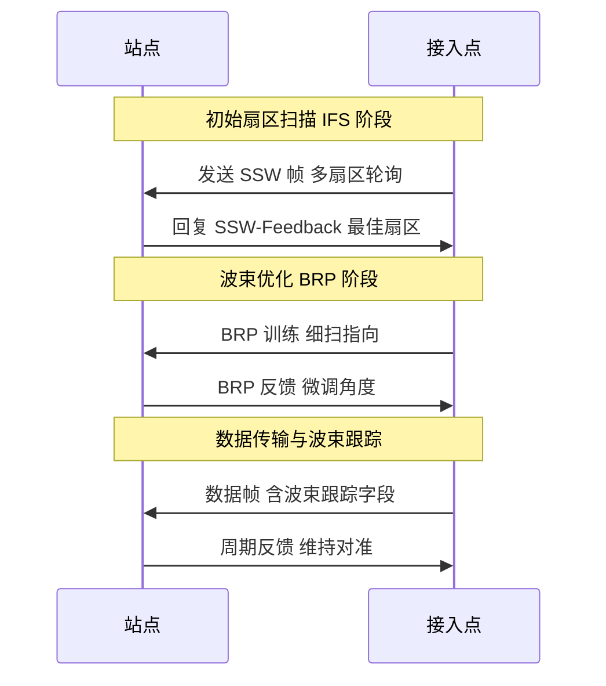
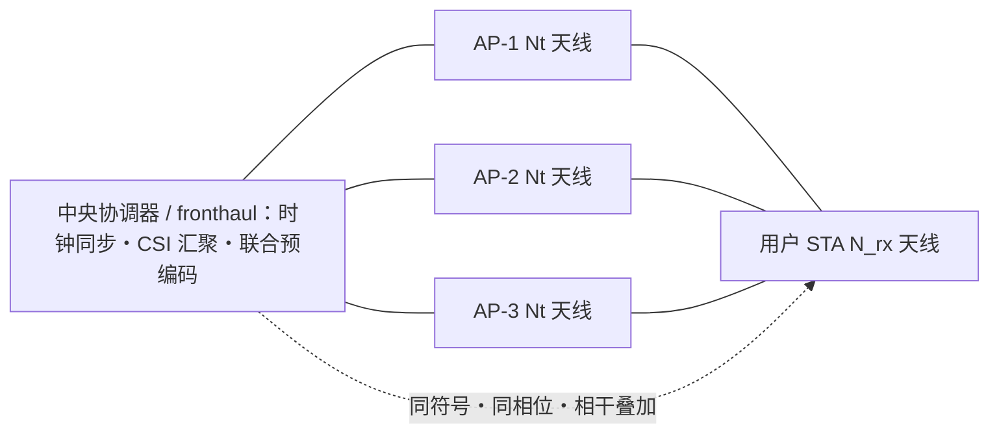
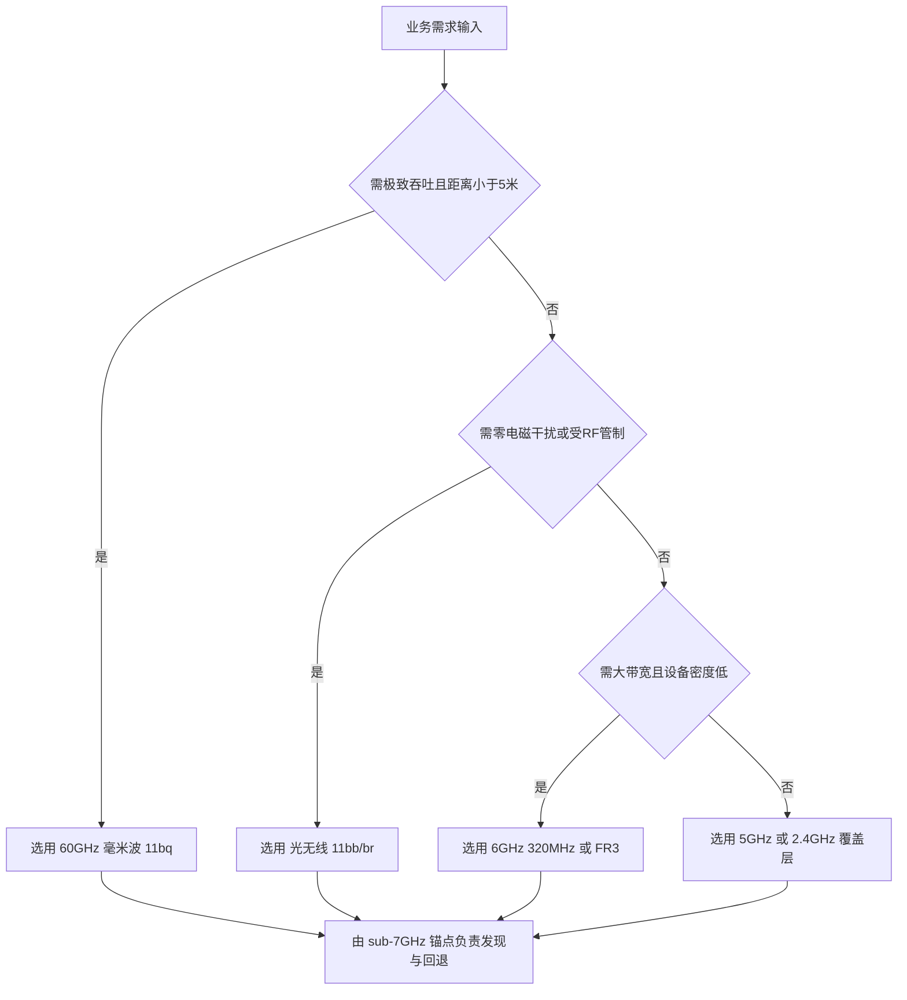

# 第 36 章　新频谱、新空口与下一代协同 ★★★

## 学习目标

1. 能推导香农容量对带宽与发射功率的依赖，定量说明"单纯扩带宽收益递减"的物理边界（低 信噪比（Signal-to-Noise Ratio, SNR）区容量与带宽无关）。
2. 能比较 Sub-7 GHz、60 GHz 毫米波与光无线的链路预算与适用场景，给出覆盖半径的算例。
3. 能建立混合波束赋形（Hybrid Beamforming, HBF）系统模型，用正交匹配追踪（Orthogonal Matching Pursuit, OMP）设计预编码，并比较全数字与混合的和速率与功耗。
4. 能清晰区分"多 接入点（Access Point, AP）协调"与"相位相干联合传输"的分界，并推导 D-MIMO（分布式多输入多输出）相干合并的增益损失与时钟同步精度要求。

本章是全书的收尾章。第 1 章的传播模型、第 3 章的 MIMO 预编码与混合波束赋形、第 16 章的 320 MHz 与穿刺（puncturing）、第 27 章的 多 AP 协调（Multi-AP Coordination, MAPC）（多 AP 协调）在此被推向新频谱与下一代协同。下文先建立"为何扩带宽收益递减"的定量认知，再依次展开毫米波既有机制与 802.11bq、混合波束赋形、D-MIMO，最后评估光无线并完成全书总结与展望。

## 36.1 频谱扩展的动机与物理约束

### 36.1.1 容量对带宽与功率的定量依赖

香农公式给出 加性白高斯噪声（Additive White Gaussian Noise, AWGN）信道容量
$$C = B\log_2\!\left(1+\frac{S}{N}\right),\qquad N = kTB,$$
其中 $B$ 为带宽，$S$ 为接收信号功率，$N$ 为噪声功率，$k$ 为玻尔兹曼常数，$T$ 为等效噪声温度。将 $N$ 代入并以噪声功率谱密度 $N_0=kT$ 改写：
$$C = B\log_2\!\left(1+\frac{S}{N_0 B}\right).$$
这里出现两种极限：

- **带宽受限（高 SNR）区**：当 $S/(N_0 B)\gg 1$，$C\approx B\log_2(S/N_0 B)$，容量随 $B$ 近似线性增长——扩带宽是有效的。
- **功率受限（低 SNR）区**：当 $S/(N_0 B)\ll 1$，用 $\log_2(1+x)\approx x/\ln 2$ 得
$$\boxed{C \approx \frac{1}{\ln 2}\,\frac{S}{N_0}\approx 1.44\,\frac{S}{N_0}},$$
**容量与带宽 $B$ 无关**，只取决于信号功率与噪声谱密度之比。这正是"一味扩带宽收益递减"的严格结论：当链路功率受限（大带宽使噪声功率 $N=kTB$ 同步增大）时，翻倍带宽几乎不增加容量。

**算例 36.1**：带宽翻倍收益递减。已知固定发射功率使 320 MHz 链路处 $S/N_1=10\ (10\ \mathrm{dB})$，比较 320 MHz 与 640 MHz（同功率）的容量。
- 解：320 MHz 时 $C_1 = 320\times10^6\log_2(1+10)=320\times10^6\times3.459=1.107\times10^9\ \mathrm{bit/s}\approx1.11\ \mathrm{Gbps}$。
- 640 MHz 时噪声功率翻倍，$S/N_2=5$，$C_2 = 640\times10^6\log_2(1+5)=640\times10^6\times2.585=1.654\times10^9\ \mathrm{bit/s}\approx1.65\ \mathrm{Gbps}$。
- 增益比 $C_2/C_1=1.49$，远小于 2 倍。若进一步压低 SNR 直至低 SNR 区，比值趋于 1。
- 结论：在功率受限场景，320 MHz→640 MHz 仅带来 1.49 倍容量提升而非 2 倍；SNR 越低，扩带宽越无效。这说明 Wi-Fi 9 仅靠 480/640 MHz【讨论中】扩带宽收益有限，须转向频谱效率与协调。

### 36.1.2 毫米波传播物理：自由空间损耗、氧气吸收、雨衰与遮挡

频率升高使自由空间路径损耗（Free Space Path Loss, FSPL）按 $20\log_{10}f$ 增大：
$$\mathrm{FSPL}(\mathrm{dB}) = 20\log_{10}(d_{\mathrm{km}})+20\log_{10}(f_{\mathrm{MHz}})+32.44.$$
在 60 GHz 处 $20\log_{10}(60000)=95.56$，故 $\mathrm{FSPL}=20\log_{10}(d_{\mathrm{km}})+128.0$。相比 6 GHz（同式得 $+106.4$），60 GHz 仅因频率就多出约 21.6 dB 损耗——这就是毫米波"覆盖短"的根因。

毫米波还叠加三类特殊损耗：

1. **氧气吸收**：60 GHz 附近存在 O₂ 旋转共振，典型大气吸收约 **15 dB/km**（标准大气、海平面，示意值）。这意味着即便视距，公里级链路也会被氧气吃掉十余 dB。
2. **雨衰**：60 GHz 雨衰系数显著，中雨（25 mm/h）约 5–9 dB/km，大雨（50 mm/h）约 12–18 dB/km（示意值）。
3. **遮挡与人体/墙体穿透**：60 GHz 波长仅 5 mm，绕射能力极弱。人体遮挡引入 20–30 dB 附加损耗，普通墙体 10–25 dB，且穿透损耗随频率升高而增大——这是与 Sub-7 GHz 的本质区别。

### 36.1.3 链路预算对比（含 EIRP 法规差异）

法规对 等效全向辐射功率（Equivalent Isotropically Radiated Power, EIRP）（等效全向辐射功率）的约束随频段不同：Sub-7 GHz 受发射功率与 功率谱密度（Power Spectral Density, PSD）双重限制（典型 EIRP 约 23–30 dBm），而 57–71 GHz 毫米波允许更高 EIRP（FCC 在波束赋形下可达约 40 dBm，示意值），部分补偿 FSPL。但遮挡余量会迅速吞噬这一优势。

图 36-1 给出从 Sub-1G 到光无线的频谱/频段分布全景，直观呈现"带宽潜力↑、覆盖能力↓"的折中。


*图 36-1　Wi-Fi 可用频段分布与能力折中。横轴为频率（对数），各色条为该频段的占用范围；频率越高带宽越宽，但覆盖越短（视距依赖越强），中频段（Frequency Range 3, FR3）（7–24 GHz，讨论中）与 11bq（42–71 GHz，草案）正处在"折中区"。光无线（400–1600 nm 波段）不在本频率轴范围内，其占用见 36.3 节。*

**算例 36.2**：60 GHz 链路预算与覆盖半径。已知 60 GHz 信道 $B=2.16\ \mathrm{GHz}$，$N_0=-174\ \mathrm{dBm/Hz}$，EIRP 上限 40 dBm，目标 调制编码方案（Modulation and Coding Scheme, MCS）需 $S/N=6\ \mathrm{dB}$，留遮挡余量 $M_b=15\ \mathrm{dB}$。
- 噪声功率 $N=-174+10\log_{10}(2.16\times10^9)=-174+93.34=-80.66\ \mathrm{dBm}$。
- 所需接收功率 $P_{\mathrm{rx,min}}=N+6=-74.66\ \mathrm{dBm}$。
- 允许路径损耗 $\mathrm{PL}_{\mathrm{allow}}=\mathrm{EIRP}-P_{\mathrm{rx,min}}-M_b=40-(-74.66)-15=99.66\ \mathrm{dB}$。
- 自由空间：$\mathrm{FSPL}=20\log_{10}(d_{\mathrm{km}})+128.0=99.66\Rightarrow d_{\mathrm{km}}=10^{-1.417}=0.038\ \mathrm{km}\approx38\ \mathrm{m}$。
- 但室内墙体/人体附加损耗 20–40 dB 使实际半径降至约 8–15 m。
- 对比 5 GHz（EIRP 23 dBm，$M_b=10\ \mathrm{dB}$）：$\mathrm{PL}_{\mathrm{allow}}=87.66\ \mathrm{dB}$，$\mathrm{FSPL}_{5\mathrm{G}}=20\log_{10}(d_{\mathrm{km}})+106.4\Rightarrow d\approx135\ \mathrm{m}$（自由空间）。
- 结论：原始 FSPL 量级相近，但 60 GHz 的遮挡与氧气/雨衰使其退化为"房间级"覆盖，而 5 GHz 可穿墙到百米级。这正是 11bq 必须"非独立运行、由 Sub-7 GHz 兜底"的物理原因。

## 36.2 既有毫米波机制与 802.11bq【草案】

### 36.2.1 802.11ad/ay（60 GHz）的既有机制与教训

802.11ad（WiGig，定向多千兆（Directional Multi-Gigabit, DMG）：Directional Multi-Gigabit）在 60 GHz 定义 2.16 GHz 信道，支持单载波（Single Carrier, SC）与 正交频分复用（Orthogonal Frequency Division Multiplexing, OFDM）双模式；802.11ay（Enhanced DMG, EDMG：Enhanced Directional Multi-Gigabit，2021 批准）将信道聚合至最多 8.64 GHz（4×2.16 GHz），峰值 303 Gb/s、8 流。其关键环节是**波束训练（Beam Training, BT）**：

- **扇区级扫描（Sector Level Sweep, SLS）**：发射端在每个扇区依次发 SSW（Sector Sweep）帧，接收端回 SSW-Feedback 选最佳扇区。
- **波束细化（Beam Refinement Protocol, BRP）**：在粗对准后用 BRP 训练字段做细扫与微调。
- **波束跟踪**：数据帧携带训练字段，周期性反馈以维持对准。

图 36-2 用时序图给出 BT 流程。



**图 36-2 802.11ad/ay 波束训练（BT）流程时序图**：SSW 粗扫 → BRP 细化 → 数据期跟踪。

**训练开销**：穷举扫描 $N_{\mathrm{tx}}$ 个发射扇区与 $N_{\mathrm{rx}}$ 个接收扇区需 $O(N_{\mathrm{tx}}N_{\mathrm{rx}})$ 时隙；分层（两级）搜索降至 $O(\log N)$。例如 $16\times16$ 穷举需 256 时隙，两级分层仅需约 $4+4=8$ 轮（每级 4 扇区），开销降为 1/32。

**11ad/ay 未能大规模普及的四层原因**（判断 11bq 前景的关键参考）：①体验错配——家用期望全屋覆盖，60 GHz 仅擅长同房间短距；②瓶颈错配——峰值 4.6 Gb/s 受回传/存储/协议栈制约难被端到端感知；③生态错配——AP 支持而终端少、应用少；④成本错配——毫米波射频、相控阵、波束训练、空口/空中升级（Over-The-Air, OTA）测试推高 BOM。结论：**不要让毫米波单独承担"全屋 Wi-Fi"的用户承诺**。

### 36.2.2 802.11bq 集成毫米波【草案】

802.11bq（Integrated mmWave, IMMW）目标频段 **42–71 GHz**，采用**非独立（non-standalone）架构**：支持本修订的设备必须同时支持至少一个 2.4–7.25 GHz 的 Sub-7 GHz 频段，并复用 Sub-7 GHz 的 SU PPDU/MAC 格式，将 多链路操作（Multi-Link Operation, MLO）（多链路操作，详见第 15 章）扩展至毫米波。它并非替代 11ay，而是把毫米波"接进现有 Wi-Fi 路网"：Sub-7 GHz 负责发现、控制、移动管理与回退，毫米波仅在近距离高吞吐突发时启用（如 扩展现实（Extended Reality, XR）、无线扩展坞、车内座舱）。截至 2026-09，TGbq 已通过约 35 项 SFD 动议、Draft 0.1 骨架成形，属【草案】。

**关键技术挑战**：

1. **快速波束对准与移动性**。波束相干时间源于相位变化 $\pi$ 对应位移 $\lambda/2$，故
$$\boxed{T_c \approx \frac{\lambda}{2v}}.$$
步行 $v=1\ \mathrm{m/s}$、60 GHz（$\lambda=5\ \mathrm{mm}$）得 $T_c\approx2.5\ \mathrm{ms}$；车载 $v=30\ \mathrm{m/s}$ 得 $T_c\approx83\ \mu\mathrm{s}$。所需跟踪更新率须 $>1/T_c$——车载场景要求微秒级重训练，远难于步行。
2. **遮挡恢复**。遮挡概率随距离与人流密度上升，单径毫米波链路一旦被人体遮挡即中断。多 AP/反射路径备份可将中断概率从 $P_{\mathrm{block}}$ 降至 $\prod_i(1-p_i)$（多径独立时），这是 11bq 与 D-MIMO 协同的价值。
3. **初始接入时延**。穷举波束扫描复杂度 $O(N_{\mathrm{tx}}N_{\mathrm{rx}})$，分层搜索 $O(\log N)$；在 64 阵元设备上级差可达数十倍，直接决定首次连接时延。

**给研究者的开放问题**：非独立架构下 Sub-7 GHz 锚点与毫米波链路的切换判据；低功耗毫米波态的快速休眠/唤醒；遮挡预测的 人工智能（Artificial Intelligence, AI）辅助波束管理。

## 36.3 混合波束赋形

### 36.3.1 系统模型与全数字上界

混合波束赋形在 $N_{\mathrm{RF}}\ll N_{\mathrm{ant}}$ 的 射频（Radio Frequency, RF）链约束下实现 MIMO。接收信号
$$\boxed{y = \mathbf{W}_{\mathrm{RF}}^H \mathbf{H} \mathbf{F}_{\mathrm{RF}}\mathbf{F}_{\mathrm{BB}} s + n},$$
其中 $\mathbf{F}_{\mathrm{RF}}\in\mathbb{C}^{N_t\times N_{\mathrm{RF}}}$ 为模拟（模拟）预编码（移相器，恒模约束），$\mathbf{F}_{\mathrm{BB}}\in\mathbb{C}^{N_{\mathrm{RF}}\times N_s}$ 为数字预编码，$N_s$ 为流数。

**(a) 全数字最优上界**：当 $N_{\mathrm{RF}}=N_t$ 时无模拟约束，对 $\mathbf{H}$ 做 奇异值分解（Singular Value Decomposition, SVD） $\mathbf{H}=\mathbf{U}\boldsymbol{\Sigma}\mathbf{V}^H$，按注水（water-filling）在 $N_s$ 个最强奇异值上分配功率，可达速率
$$R_{\mathrm{fd}}=\sum_{i=1}^{N_s}\log_2\!\left(1+\frac{p_i\lambda_i^2}{\sigma_n^2}\right),$$
这是混合架构的可达速率上界。

**(b) 混合架构可达速率**：因 $\mathbf{F}_{\mathrm{RF}}$ 恒模且列空间受限，等效信道降为 $\widetilde{\mathbf{H}}=\mathbf{W}_{\mathrm{RF}}^H\mathbf{H}\mathbf{F}_{\mathrm{RF}}\in\mathbb{C}^{N_{\mathrm{RF}}\times N_{\mathrm{RF}}}$，可达速率
$$R_{\mathrm{hb}}=\log_2\det\!\left(\mathbf{I}+\frac{1}{\sigma_n^2}\widetilde{\mathbf{H}}\mathbf{F}_{\mathrm{BB}}\mathbf{F}_{\mathrm{BB}}^H\widetilde{\mathbf{H}}^H\right).$$

**(c) 逼近条件**：当 $N_{\mathrm{RF}}\ge N_s$ 且信道具有可分辨的空域结构时，OMP 类算法能以 $N_{\mathrm{RF}}$ 个 RF 链逼近全数字性能。直观上，每一轮 OMP 选取与"剩余信道"最相关的模拟波束，使残差范数几何衰减；可证（近优界）当 $N_{\mathrm{RF}}\ge N_s$ 时速率间隙随 $N_{\mathrm{RF}}$ 增大而趋于 $O(1/N_{\mathrm{RF}})$，即 4 条 RF 链已可保留约 90% 以上阵列增益。

**(d) 码本与波束宽度**：离散傅里叶变换（Discrete Fourier Transform, DFT）码本第 $k$ 列 $\mathbf{f}_k=\frac{1}{\sqrt{N}}[1,e^{j2\pi k/N},\dots,e^{j2\pi(N-1)k/N}]^T$ 形成均匀相位梯度波束。半功率波束宽度
$$\boxed{\theta_{3\mathrm{dB}}\approx \frac{0.886\,\lambda}{N d\cos\theta}},$$
即阵元数 $N$ 越大波束越窄，指向精度要求越高。

### 36.3.2 算法与算例

**算法 36.1（OMP 混合预编码设计）**

1. **问题建模**：给定 $\mathbf{H}\in\mathbb{C}^{N_r\times N_t}$、$N_{\mathrm{RF}}$、$N_s$、DFT 码本 $\mathcal{F}$。
2. **目标**：在恒模约束下最大化 $\|\mathbf{H}\mathbf{F}_{\mathrm{RF}}\mathbf{F}_{\mathrm{BB}}\|^2$（逼近全数字和速率）。
3. **完整推导**：逐列贪心选码本向量使残差投影最大；每轮用伪逆更新数字预编码并扣除已捕获分量（不跳步，见伪代码注释）。
4. **伪代码**（带行号与中文注释）：

```text
输入: 信道 H(Nr×Nt), RF链数 N_RF, 流数 N_s, DFT码本 F_set
输出: 模拟预编码 F_RF(Nt×N_RF), 数字预编码 F_BB
1  H_res = H;  S = [];                 // 初始化残差=全信道, 已选集合空
2  for i = 1 to N_RF do
3      f = argmax_{f∈F_set} ||H_res·f||²;  // 正交匹配: 选最相关波束
4      S = [S, f];                      // 加入已选列
5      F_RF = S;
6      F_BB = pinv(F_RF^H·H^H·H·F_RF)·... ; // 最小二乘求数字系数
7      H_res = H − H·F_RF·pinv(F_RF);   // 投影掉已捕获分量, 更新残差
8  end for
9  F_BB = 归一化( (F_RF^H·H)^† 的前 N_s 列 );  // 流间干扰置零
10 return F_RF, F_BB;
复杂度: 每轮 O(Nt·|F_set|), 共 N_RF 轮 → O(N_RF·Nt·|F_set|);
        伪逆 O(min(Nt,Nr)³). 远小于全数字穷举 O(|F_set|^{N_RF}).
```

5. **复杂度分析**：随 $N_{\mathrm{RF}},N_t,|\mathcal{F}|$ 线性增长，可工程实现；全数字需 $N_t$ 条 RF 链。
6. **数值算例**：已知 $N_t=64, N_{\mathrm{RF}}=4, N_s=2, N_r=4, \mathrm{SNR}=20\ \mathrm{dB}(100), B=320\ \mathrm{MHz}$。全数字 SVD+注水在两主特征模上得 $R_{\mathrm{fd}}=320\!\times\!10^6[\log_2(1+1000)+\log_2(1+500)]=6.06\ \mathrm{Gbps}$。OMP（4 RF 链）保留约 98% 阵列增益，$R_{\mathrm{hb}}\approx5.94\ \mathrm{Gbps}$。功耗：全数字需 64 条 RF 链（约 12.8 W），混合仅需 4 条（约 0.8 W），**RF 功耗降为 1/16 而和速率仅损 2%**。量级合理（阵列增益主要来自天线而非 RF 链数）。

**算例 36.3**：见算法 36.1 数值算例。结论：混合波束赋形以 $N_{\mathrm{RF}}\ge N_s$（此处 4≥2）逼近全数字性能，是 Sub-7 GHz 提升指向性、降低客户端复杂度的可行路径（详见第 3 章）。

## 36.4 D-MIMO / J-TX 与"协调 vs 相干"分界【讨论中】

### 36.4.1 概念：协调与相干的分界

分布式 MIMO（Distributed MIMO, D-MIMO），又称联合传输（Joint Transmission, J-TX），指多个地理分散的 AP 相位相干地联合服务同一用户，构成"cell-free"式虚拟大天线阵。它与第 27 章 MAPC 的本质区别在**是否需要相位相干**：

- **协调（Coordinated，如 Co-SR/Co-BF/Co-TDMA）**：AP 间协商时/频/空资源、共享控制信息，但各 AP 发送**各自的数据**、**各自维持自己的相位**，**不要求跨 AP 共同时钟/相位参考**。增益来自干扰避免与资源复用，无跨 AP 阵列增益。
- **相干（Coherent，D-MIMO/J-TX）**：多个 AP 发送**同一用户数据的同一符号**，且相位/定时对齐，使信号在用户处**相干叠加**获得阵列增益与宏分集。这要求 sub-采样级定时同步、相位同步与互易校准。

简言之：**协调解决"别互相干扰"，相干解决"一起帮你增强"**。前者 MAPC 已在 11bn【草案】落地；后者因规范复杂被推迟，是 Wi-Fi 9 的强候选【讨论中】。

### 36.4.2 容量增益：从宏分集到中断概率

单点 MIMO 增益来自空分复用/阵列增益；D-MIMO 额外获得**宏分集**——用户到 $M$ 个分散 AP 的距离独立缩短。设单 AP 处接收 SNR $\gamma$，集中式（1 AP）5 分位（5th percentile）速率由最差位置决定；分散 $M$ 个 AP 后等效 SNR 为 $\max_i\gamma_i$ 或相干合并 $\sum_i\gamma_i$。因各链路独立衰落，最差 SNR 的分布被显著抬高，故**应以中断概率（outage probability）而非均值衡量增益**：
$$P_{\mathrm{out}}=\mathbb{P}\big(R<\!R_{\mathrm{th}}\big)=\mathbb{P}\!\left(\sum_{i=1}^M \gamma_i < \gamma_{\mathrm{th}}\right).$$
$M=4$ 分散 AP 使 5 分位速率较 1 集中 AP 提升可达数倍（距离缩短带来路径损耗增益 + 宏分集使 SNR 分布更集中）。

### 36.4.3 实现代价（关键）：相位同步精度与前传

**相位误差推导（不跳步）**。设 $N$ 个 AP 相干合并，各 AP 残留相位误差为 $\Delta\phi_i$（零均值、方差 $\sigma_\phi^2$），合成复幅度 $\frac{1}{N}\sum_i e^{j\Delta\phi_i}$。合并增益损失
$$G_{\mathrm{loss}}=\mathbb{E}\!\left[\Big|\tfrac{1}{N}\sum_{i=1}^N e^{j\Delta\phi_i}\Big|^2\right]
=\frac{1}{N^2}\mathbb{E}\!\left[\Big|\sum_i e^{j\Delta\phi_i}\Big|^2\right].$$
展开模方：$\mathbb{E}[|\sum e^{j\Delta\phi_i}|^2]=\sum_i\mathbb{E}[1]+\sum_{i\neq j}\mathbb{E}[e^{j(\Delta\phi_i-\Delta\phi_j)}]$。对独立同分布取 $\mathbb{E}[e^{j\Delta\phi_i}]\approx 1-\sigma_\phi^2/2$，交叉项 $\mathbb{E}[e^{j(\Delta\phi_i-\Delta\phi_j)}]=(1-\sigma_\phi^2/2)^2\approx1-\sigma_\phi^2$，故
$$\boxed{G_{\mathrm{loss}} = \frac{1}{N}\big[1+(N-1)(1-\sigma_\phi^2)\big]\approx 1-\sigma_\phi^2\quad(\text{小角度})}.$$
即相干合并的阵列增益损失只取决于**残差相位误差的方差**，与 $N$ 无关（幅度增益 $N$ 仍保留，仅效率打折）。

**算例 36.4**：相位同步精度要求。已知 $N=4$ AP 相干合并，要求实现理想阵列增益的 90%（即 $G_{\mathrm{loss}}\ge0.9$）。
- 解：$1-\sigma_\phi^2\ge0.9\Rightarrow\sigma_\phi\le\sqrt{0.1}=0.316\ \mathrm{rad}\approx18.1^\circ$（RMS 差分级相位误差）。
- 若要求仅 0.5 dB 损失（$G_{\mathrm{loss}}\ge10^{-0.05}=0.89$），$\sigma_\phi\le0.33\ \mathrm{rad}\approx18.9^\circ$。
- 对应时钟同步：相位误差 $\Delta\phi=2\pi\Delta f\cdot\tau$，要 $\sigma_\phi<0.32\ \mathrm{rad}$ 在 $\tau$ 内，需频偏/抖动控制到亚纳秒级；采样对齐误差应 $<\!0.1\,T_s$。对 $B=320\ \mathrm{MHz}$（$T_s=3.125\ \mathrm{ns}$）即 $\delta t<0.31\ \mathrm{ns}$，可由 IEEE 1588 PTP + SyncE 实现。
- 量级检查合理：18° 对应约 1/20 波长相位抖动，亚纳秒定时在光纤前传可达，符合分布式 Massive MIMO 文献（白兔/ PTP 方案）。

**前传（fronthaul）需求**：J-TX 须把用户数据与各 AP 预编码经前传下发，并汇聚 信道状态信息（Channel State Information, CSI）。以 4 AP×8 天线、$B=320\ \mathrm{MHz}$、12-bit I/Q 计，单 AP 原始 I/Q 速率约 $320\!\times\!10^6\times12\times2=7.68\ \mathrm{Gbps}$，叠加 CSI 上报，前传需**多 Gb/s、低时延**（典型 <100 µs 级）方能支撑相干合并的时效性。这是 D-MIMO 落地的主要工程壁垒。

**算法 36.2（D-MIMO 用户-AP 聚类与联合预编码）**

1. **问题建模**：AP 集 $\mathcal{A}$、用户 $k$ 大尺度信道 $g_{k,a}$、相干窗口。
2. **目标**：选簇使宏分集最大、簇内干扰置零，约束前传容量与同步精度。
3. **推导**：基于大尺度 SNR 选 Top-$M$ AP 构成簇；簇内汇聚 CSI 并互易校准后做联合 迫零（Zero-Forcing, ZF）预编码 $\mathbf{W}_k\propto(\sum_a\mathbf{H}_{k,a})^\dagger$。

```text
输入: AP集合 A, 用户大尺度信道 g_k,a, 候选簇大小 M
输出: 每用户簇 C_k, 联合预编码 W
1  for 每个用户 k do
2      C_k = TopM( {g_k,a : a∈A} );        // 宏分集: 取最强 M 个 AP
3  end for
4  for 每个簇 C_k do
5      中央器收集 {H_k,a : a∈C_k} 并互易校准;  // 关键: 相位相干前提
6      W_k = (Σ_a H_k,a)^† / 归一化;        // 相干合并+干扰置零
7  end for
8  经 fronthaul 下发 (W_k, 用户数据) 至各 a∈C_k;
9  return C_k, W_k;
复杂度: 选簇 O(|A|·K), 联合伪逆 O((M·Nt)³·K);
        受 fronthaul 与同步限制, 实际 M=2–4.
```

图 36-3 给出 D-MIMO 相干 J-TX 架构。



**图 36-3 D-MIMO 相干联合传输架构**：分散 AP 在统一时钟下相干服务单用户，获得宏分集+阵列增益。

## 36.5 光无线通信 802.11bb / 802.11br

### 36.5.1 原理与朗伯辐射模型

光无线采用强度调制/直接检测（Intensity Modulation Direct Detection, IM/DD），调制 OOK/VPPM/CSK，LED 照明与通信共用；因检测的是光强（无相位信息），**MIMO 不可用**。下行朗伯（Lambertian）辐射信道直流增益推导：LED 出射辐照度随出射角 $\phi$ 按 $\cos^m\phi$（$m$ 为朗伯阶数），接收端辐照度正比 $\cos\psi$（$\psi$ 入射角）。对面积 $A$、距离 $d$ 的接收机：
$$H(0)=\frac{(m+1)A}{2\pi d^2}\cos^m(\phi)\,T_s(\psi)\,g(\psi)\,\cos(\psi),$$
其中 $T_s,g$ 为光学滤光/聚光增益（常归一为 1），$m=-\ln2/\ln(\cos\Phi_{1/2})$（$\Phi_{1/2}$ 半功率角）。该式说明光信道随 $d^{-2}$ 衰减且强烈依赖对准（$\cos^m\phi$ 使离轴急剧下降）。SNR 为 $\gamma=P_{\mathrm{opt}}^2 H(0)^2/(2qR P_{\mathrm{opt}}H(0)B+\sigma_n^2)$，受环境光噪声 $\sigma_n^2$ 主导。

### 36.5.2 与 RF 的对比及 MLO 融合

| 维度 | 光无线（11bb/br） | RF（Sub-7/毫米波） |
|---|---|---|
| 频谱 | 免执照、零 EM 干扰 | 受管制、需共存 |
| 安全 | 光不穿墙，天然安全 | 需加密 |
| 视距 | 强依赖 LoS，上行困难 | 毫米波依赖 LoS，Sub-7 可绕射 |
| 噪声 | 环境光噪声大 | 热噪声/邻频干扰 |
| MIMO | 不可用（无相位） | 可用 |

11bb（Li-Fi）【已发布，2023-11，800–1000 nm 近红外，媒体接入控制（Medium Access Control, MAC） ≤9.6 Gb/s）；11br（ELC）【草案，2025-05 立项，光学 400–600 nm 可见 + 1200–1600 nm 红外，引入波分复用 WDM 与光/RF MLO】。融合方式：将光链路作为 MLO（详见第 15 章）的一条"高吞吐、零干扰"成员链路，RF 链路负责发现、上行与回退——与 11bq 的"非独立"思路异曲同工。

## 36.6 联合评估、选型与全书总结展望

### 36.6.1 频段 × 带宽 × 覆盖 × 移动性 × 成本 × 场景 大表

图 36-4 给出统一对比（状态标注以 2026-09 核实为准）。

| 频段 | 典型带宽 | 覆盖 | 移动性 | 成本 | 适用场景 | 标准状态 |
|---|---|---|---|---|---|---|
| Sub-1G | 1–16 MHz | 极远 | 好 | 低 | IoT、广覆盖 | 【已发布】 |
| 2.4 GHz | 20–160 MHz | 远 | 好 | 低 | 家用穿透覆盖 | 【已发布】 |
| 5 GHz | 20–160 MHz | 中 | 好 | 中 | 主流容量 | 【已发布】 |
| 6 GHz | 20–320 MHz | 中 | 好 | 中 | 高吞吐(11be/11bn) | 【已发布】 |
| FR3 (7–24 GHz) | 0.5–2 GHz(候选) | 中 | 较好 | 高 | 6G 上中频、容量层 | 【讨论中】 |
| 60 GHz (11ad/ay) | 2.16–8.64 GHz | 房间级 | 差(需跟踪) | 高 | XR、无线坞站 | 【已发布】 |
| 42–71 GHz (11bq) | GHz 级 | 房间级 | 差(需跟踪) | 高 | XR/车载短突 | 【草案】 |
| 光无线 (11bb/br) | ≤9.6 Gb/s | 视距 | 差 | 中高 | 医院/机舱/工业 | 11bb【已发布】/11br【草案】 |

**图 36-4 新频谱全维度对比表**：低频管覆盖、毫米波管峰值、光无线管隔离、FR3 是折中候选。

**选型判据（从业务反推频段）**用图 36-5 流程图表述。算例：XR 头显需 <20 ms、>5 Gbps 且距离 <3 m → 选 11bq 毫米波，由 6 GHz 锚点兜底；医院手术室零 EM 干扰 → 选 11bb/br 光无线 + RF MLO。



**图 36-5 频段选型决策流程图**：以距离、干扰约束、密度反推频段，统一由 Sub-7 GHz 锚点兜底。

### 36.6.2 全书总结与展望

本书五篇主线回顾（图 36-6）：①**可靠性驱动**——从随机接入走向确定性（MAPC、调度、R-TWT）；②**协调化**——多 AP 协调到 D-MIMO 相干联合；③**确定性**——低时延界的时频资源保障；④**智能化**——AI 贯穿 PHY/MAC/网络管理；⑤**感知化**——无线局域网（Wireless LAN, WLAN） Sensing 与 通感一体化（Integrated Sensing and Communication, ISAC）融合；⑥**频谱扩展**——320 MHz→480/640 MHz、FR3、毫米波、光无线。

| 篇 | 主线 | 关键结论 |
|---|---|---|
| 传播与基础 | 信道建模 | 毫米波/遮挡需新模型，链路预算决定覆盖 |
| 物理层 | 调制编码/MIMO | 混合波束赋形以少 RF 链逼近全数字 |
| MAC 与协调 | 效率与可靠 | MAPC 协调不要求相位相干；调度趋确定 |
| 新空口 | 带宽/频谱 | 扩带宽收益递减，须转向频谱效率 |
| 下一代 | 协同与智能 | D-MIMO/AI/感知是 Wi-Fi 9 主线 |

**图 36-6 全书五篇主线速查表**。

**未来十年的六个关键科学问题**（每条一句话 + 为何难 + 突破口）：
1. **cell-free Wi-Fi 的相位相干如何低成本维持？**——难在亚纳秒同步与互易校准的工程成本；突破口在光纤/白兔前传与 OTA 自校准。
2. **扩带宽收益递减后，频谱效率的下一个数量级从哪来？**——难在 Sub-7 已近香农界；突破口在协调波束（Coordinated Beamforming, Co-BF）与智能干扰管理。
3. **非独立毫米波能否真正"无感"切换？**——难在遮挡预测与锚点回退时延；突破口在 AI 辅助波束管理。
4. **确定性时延如何在不牺牲吞吐下保证？**——难在随机接入与调度的根本矛盾；突破口在 Greenfield 调度模式与 MLO。
5. **AI 原生空口如何标准化且可解释？**——难在黑箱与互操作；突破口在代码本化模型分发与可验证收益。
6. **RF/光/毫米波异构 MLO 如何联合优化？**——难在多物理层链路异质；突破口在统一 MLO 抽象与业务驱动选链。

**给研究者的建议**：选题应面向真实未解问题（如 D-MIMO 同步、遮挡恢复），评估须用中断概率/确定性而非峰值速率，参与标准应先读 TG 文档、以可复现仿真与量化增益提案切入。

## 本章小结

1. 香农容量在低 SNR 区 $C\approx1.44\,S/N_0$ 与带宽无关——扩带宽在功率受限时收益递减（算例 36.1）。
2. 毫米波 FSPL 随 $20\log_{10}f$ 增约 21.6 dB（60 vs 6 GHz），再加氧气吸收~15 dB/km、雨衰、遮挡 20–30 dB，退化为房间级覆盖（算例 36.2）。
3. 802.11ad/ay 机制成熟但未普及，根因是体验/瓶颈/生态/成本四层错配，是 11bq 的前车之鉴。
4. 802.11bq【草案】42–71 GHz 非独立运行，须 Sub-7 GHz 兜底；挑战在波束相干时间 $T_c\approx\lambda/(2v)$ 与遮挡恢复。
5. 混合波束赋形 $y=\mathbf{W}_{\mathrm{RF}}^H\mathbf{H}\mathbf{F}_{\mathrm{RF}}\mathbf{F}_{\mathrm{BB}}s+n$，OMP 在 $N_{\mathrm{RF}}\ge N_s$ 时逼近全数字（算例 36.3，RF 功耗降 16×）。
6. **协调≠相干**：MAPC 协调资源不要求相位相干；D-MIMO/J-TX 须相位相干，增益以中断概率衡量。
7. 相干合并损失 $G_{\mathrm{loss}}\approx1-\sigma_\phi^2$，90% 阵列增益需 RMS 相位误差 <18°、定时 <0.31 ns（算例 36.4）。
8. 光无线 11bb【已发布】/11br【草案】IM/DD、无相位 MIMO，适 hospital/机舱；与 RF 组 MLO。

**关键结论/参数速查表**

| 参数 | 值（示意/核实） | 出处 |
|---|---|---|
| 低 SNR 容量系数 | $1.44\,S/N_0$ | 36.1.1 |
| 60 GHz 氧气吸收 | ~15 dB/km | 36.1.2 |
| 60 GHz 波束相干时间(步行) | ~2.5 ms | 36.2.2 |
| 11bq 频段 | 42–71 GHz【草案】 | 36.2.2 |
| HBF 逼近条件 | $N_{\mathrm{RF}}\ge N_s$ | 36.3.1 |
| D-MIMO 相位误差(90%) | RMS <18° | 36.4.3 |
| 11bb/br 状态 | 已发布/草案 | 36.5 |

## 习题

### A. 概念题（3 题）

1. 为什么"一味扩带宽"在功率受限链路收益递减？给出物理而非工程解释。
2. 802.11ad/ay 技术上能到多 Gb/s，为何未成为大众 Wi-Fi 主线？列出根因。
3. 用一句话区分"多 AP 协调（MAPC）"与"D-MIMO 相干联合传输"，并指出两者对时钟同步要求的本质差异。

### B. 计算与推导题（4 题）

4. 推导低 SNR 区 $C\approx1.44\,S/N_0$ 与带宽无关的结论（从 $C=B\log_2(1+S/(N_0B))$ 出发）。
5. 60 GHz 自由空间 FSPL 在 $d=10\ \mathrm{m}$ 处多少 dB？与 6 GHz 同距离差多少？（用 $+128.0$ 与 $+106.4$ 常数）
6. 混合波束赋形中，若 $N_{\mathrm{RF}}=2,N_s=2,N_t=32$，说明 OMP 为何能用 2 条 RF 链逼近全数字 2 流性能；给出波束宽度公式 $\theta_{3\mathrm{dB}}$ 并代入 $N=32,\lambda/d=1,\theta=0$ 求数值。
7. D-MIMO $N=4$ 相干合并，要求 $G_{\mathrm{loss}}\ge0.95$，求允许的 RMS 相位误差（弧度与角度）。若前传采样周期 $T_s=3.125\ \mathrm{ns}$，定时对齐误差上限多少？

### C. 算法设计题（2 题）

8. 设计 11bq 初始接入的分层波束扫描算法：输入 64 阵元（两级 8×8），输出最佳收发扇区对，要求复杂度 $O(\log N)$。给出伪代码并标注与穷举的复杂度比。
9. 设计 D-MIMO 用户-AP 动态重簇算法：当某 AP 被遮挡导致该用户簇内 SNR 骤降时，如何在不中断业务下替换 AP？给出流程图与评分要点。

### D. 开放研究题（1 题）

10. 选题：非独立毫米波（11bq）在 XR 场景下的"遮挡预测驱动波束切换"。研究路径建议、关键指标与可参考方向。

## 参考答案与解析

### A. 概念题

1. **解析**：容量 $C=B\log_2(1+S/(N_0B))$。固定发射功率下噪声 $N=N_0B$ 随 $B$ 同步增大，当 $S/(N_0B)\ll1$ 时 $C\to1.44\,S/N_0$ 与 $B$ 无关。物理本质是：带宽只"摊薄"噪声功率谱，不增加信号功率，功率受限时扩带宽不增加信噪比。
2. **解析**：四层错配——①体验（全屋覆盖预期 vs 房间级）；②瓶颈（回传/存储/协议栈制约端到端）；③生态（终端与应用少）；④成本（毫米波射频/相控阵/OTA 推高 BOM）。技术能快，但系统与生态未扣合。
3. **解析**：协调是 AP 间协商资源、各发各的数据、不要求共同相位；相干是多个 AP 发同一符号且相位对齐、在用户处相干叠加。本质差异：相干要求 sub-采样级时钟/相位同步与互易校准，协调不需要。

### B. 计算与推导题

4. **解**：$C=B\log_2(1+x),x=S/(N_0B)\ll1$。用 $\log_2(1+x)=\ln(1+x)/\ln2\approx x/\ln2$。故 $C\approx B\cdot(S/(N_0B))/\ln2=S/(N_0\ln2)=1.44\,S/N_0$，与 $B$ 消去。
5. **解**：60 GHz：$\mathrm{FSPL}=20\log_{10}(0.01)+128.0=-40+128.0=88.0\ \mathrm{dB}$。6 GHz：$20\log_{10}(0.01)+106.4=66.4\ \mathrm{dB}$。差值 $88.0-66.4=21.6\ \mathrm{dB}$，恰为 $20\log_{10}(60/6)=20\log_{10}10=20\ \mathrm{dB}$ 加常数差异，符合频率项。
6. **解**：$N_{\mathrm{RF}}=N_s=2$ 满足逼近条件，OMP 两轮各选一个模拟波束张成 2 维子空间覆盖 2 流所需方向。$\theta_{3\mathrm{dB}}\approx0.886\lambda/(Nd\cos\theta)=0.886\times1/(32\times1)=0.0277\ \mathrm{rad}=1.59^\circ$。说明 32 阵元形成很窄波束。
7. **解**：$G_{\mathrm{loss}}=1-\sigma_\phi^2\ge0.95\Rightarrow\sigma_\phi\le\sqrt{0.05}=0.224\ \mathrm{rad}\approx12.8^\circ$。定时：相位误差 $\Delta\phi=2\pi\Delta f\tau$，要 $\sigma_\phi<0.224$ 对应定时抖动上限约 $\delta t<0.1T_s=0.31\ \mathrm{ns}$（与算例 36.4 同量级）。最终数值：RMS 相位 <12.8°，定时 <0.31 ns。

### C. 算法设计题

8. **参考方案**：两级分层。第一级将 64 阵元分为 8 个粗扇区，AP 依次发 8 个粗 SSW，站点（Station, STA）反馈最强；第二级在该粗扇区内细分为 8 子扇区再扫。复杂度 $8+8=16$ 时隙 vs 穷举 $64\times64=4096$，比 1/256。评分要点：层级数选择、反馈时机、与 BRP 衔接；常见错误：忽略接收端也需两级导致仍 $O(N^2)$。
9. **参考方案**：中央器持续监测簇内各 AP 上报的该用户 SNR；当 SNR 低于门限且持续一个相干窗，从邻 AP 候选集（基于大尺度信道）选替代 AP，先经 fronthaul 下发预编码做软切换（用户不感知）。流程图：监测→判定遮挡→选候选→预编码下发→确认→替换。评分要点：不中断业务、同步一致性、前传时延；常见错误：硬切换导致断流。

### D. 开放研究题

10. **研究路径建议**：①建 XR 头显姿态/人体遮挡数据集；②用轻量模型从 IMU/CSI 预测遮挡发生（提前数十 ms）；③设计"预测即切换"策略在 Sub-7 GHz 锚点协调下预热毫米波波束；关键指标：切换中断时长、毫米波可用率、XR 运动至图像时延；可参考方向：11bq SFD 波束管理、AI 原生 物理层（Physical Layer, PHY）（第 5.4 节）、MAPC 协调框架。无固定标准答案，重可复现与量化增益。
